**Volume 03. Reasoning in AI**


# 01. Logical Reasoning

## 01.01 Introduction to Logical Reasoning

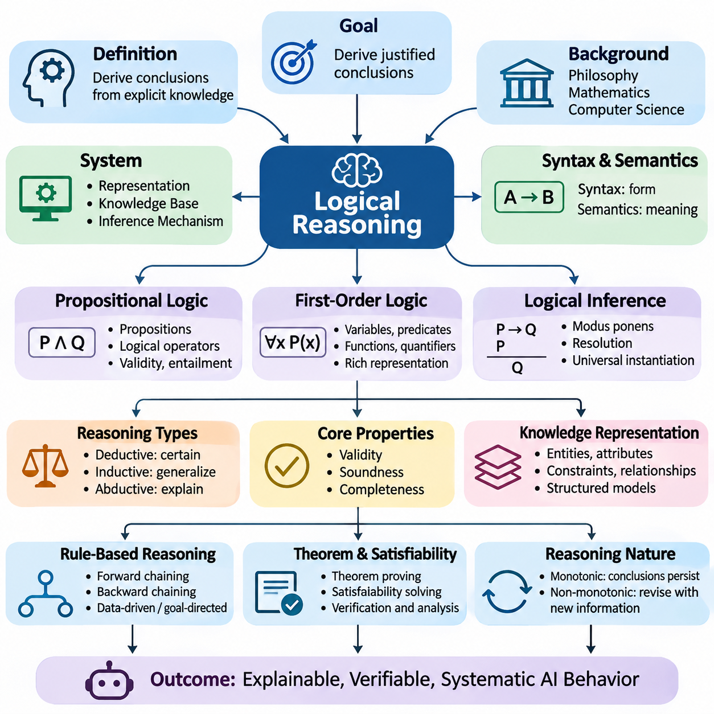{width="7.268055555555556in" height="7.268055555555556in"}

Logical reasoning is a fundamental capability of artificial intelligence that enables a system to derive conclusions from explicitly represented knowledge. Rather than relying exclusively on statistical correlations or learned patterns, logical reasoning applies formal principles to determine whether particular conclusions follow from available premises. This approach provides a foundation for explainable, verifiable, and systematically structured intelligent behavior.

The central objective of logical reasoning is to transform known facts, assumptions, and relationships into justified conclusions. A reasoning system begins with a collection of statements describing a particular domain and applies inference rules to generate additional knowledge. When the premises are valid and the inference procedure is sound, the resulting conclusions can be trusted within the assumptions of the underlying logical framework.

Logical reasoning has deep historical connections to philosophy, mathematics, and computer science. Classical logic established formal methods for evaluating arguments, while mathematical logic introduced symbolic representations that support precise computation. Artificial intelligence extends these foundations by implementing automated reasoning mechanisms capable of processing complex knowledge structures and solving problems that require multiple inference steps.

A logical reasoning system generally consists of a knowledge representation language, a knowledge base, and an inference mechanism. The representation language defines how facts and relationships are expressed, while the knowledge base stores statements about the domain. The inference mechanism applies formal rules to these statements, allowing the system to derive conclusions, detect inconsistencies, and answer questions.

One important distinction in logical reasoning is the difference between syntax and semantics. Syntax specifies the grammatical structure of valid logical expressions, including symbols, operators, and formation rules. Semantics determines how those expressions are interpreted and evaluated. Together, these components establish the formal connection between symbolic statements and the conditions under which they are considered true.

Propositional logic provides one of the simplest foundations for automated reasoning. It represents knowledge using propositions that can be assigned truth values and combines them through logical operators such as conjunction, disjunction, negation, and implication. Although propositional logic cannot directly express complex relationships between objects, it provides a rigorous environment for studying validity, entailment, and computational inference.

First-order logic extends propositional reasoning by introducing variables, predicates, functions, and quantifiers. These elements allow intelligent systems to represent objects, properties, and relationships within a domain. Universal and existential quantification make it possible to express general rules and existence claims, enabling substantially richer knowledge representations than those available through isolated propositions.

Logical inference describes the process of deriving conclusions from premises according to formal rules. Common inference principles include modus ponens, resolution, and universal instantiation. For example, if a system knows that every autonomous robot requires a control system and that a particular machine is an autonomous robot, it can infer that the machine requires a control system without directly storing that conclusion.

The concepts of validity, soundness, and completeness are essential for evaluating reasoning procedures. A valid argument preserves truth from its premises to its conclusion, while a sound argument is valid and has true premises. A sound inference procedure derives only logically entailed conclusions, whereas a complete procedure can derive every conclusion entailed by the knowledge base within its specified logical framework.

Deductive reasoning is the most direct expression of formal logical inference because its conclusions necessarily follow from accepted premises. Inductive reasoning instead generalizes from observations, producing conclusions that may remain uncertain. Abductive reasoning identifies plausible explanations for observed evidence. These approaches serve different purposes and frequently complement one another within intelligent systems.

Knowledge representation plays a critical role in determining what a reasoning system can understand and infer. A domain must be translated into symbolic descriptions that capture relevant entities, attributes, constraints, and relationships. Poorly designed representations may omit essential information or introduce ambiguity, while carefully structured knowledge models support efficient inference and consistent interpretation across complex tasks.

Rule-based reasoning systems implement logical knowledge through conditional statements that connect premises with conclusions. Forward chaining begins with available facts and repeatedly applies applicable rules to derive new information. Backward chaining begins with a target conclusion and searches for supporting premises. These strategies provide complementary mechanisms for data-driven analysis and goal-directed problem solving.

Logical reasoning also supports automated theorem proving and satisfiability analysis. Theorem provers attempt to establish whether a statement follows from a collection of axioms, while satisfiability solvers determine whether a logical formula admits a consistent assignment of truth values. Such techniques are widely used in formal verification, software analysis, configuration management, and the validation of complex computational systems.

Traditional logical systems commonly assume monotonic reasoning, meaning that previously established conclusions remain valid when additional premises are introduced. Real-world intelligence often requires non-monotonic reasoning, where new information can invalidate earlier conclusions. Default reasoning and defeasible logic address this challenge by allowing provisional conclusions that can be revised when exceptions or contradictory evidence become available.

Temporal and spatial reasoning extend logical analysis to relationships involving time, location, movement, and physical structure. Temporal reasoning describes event sequences, durations, and ordering constraints, while spatial reasoning represents containment, connectivity, direction, and relative position. These capabilities are particularly important for autonomous systems that must interpret changing environments and coordinate actions across physical spaces.

Logical reasoning contributes directly to planning and decision-making by representing goals, actions, preconditions, and effects. An intelligent planner can determine whether a sequence of actions satisfies specified constraints and achieves a desired objective. In robotics, such reasoning can verify that required resources are available, operational dependencies are satisfied, and proposed actions comply with predefined safety conditions.

Expert systems demonstrate the practical value of explicit logical knowledge. They encode domain expertise through rules and facts, allowing an inference engine to evaluate situations and recommend actions. Applications include equipment diagnosis, industrial troubleshooting, regulatory compliance, and operational decision support. Their transparent rule structures make it possible to trace conclusions back to supporting knowledge and inference steps.

Despite its strengths, logical reasoning faces important computational and representational limitations. Complex inference problems may require substantial processing resources, and some logical theories are undecidable. Real environments also contain incomplete, noisy, and contradictory information that cannot always be represented through strict Boolean assumptions. These challenges motivate careful selection of logical formalisms and reasoning strategies.

The distinction between logical truth and empirical truth is especially important in artificial intelligence. A conclusion may follow correctly from a knowledge base even when the underlying facts are inaccurate or outdated. Consequently, logical correctness alone does not guarantee reliable real-world decisions. Practical reasoning systems must combine formal inference with knowledge validation, evidence management, and mechanisms for updating their representations.

Logical reasoning differs from probabilistic reasoning primarily in how uncertainty is represented and processed. Classical logical systems focus on whether conclusions follow from premises, whereas probabilistic systems quantify uncertainty through probability distributions. Combining these approaches allows intelligent systems to preserve explicit constraints while evaluating uncertain observations, uncertain hypotheses, and incomplete information.

Modern neural reasoning approaches introduce learned representations and differentiable computation into problems traditionally addressed through symbolic inference. Neural networks can discover patterns and approximate relationships from data, while logical structures provide explicit constraints and interpretable relationships. Neuro-symbolic approaches attempt to combine these complementary strengths, although maintaining formal guarantees within learned systems remains an active research challenge.

Large language models introduce another perspective by generating responses that can resemble multi-step logical reasoning. Their learned representations support flexible language-based problem solving, but plausible explanations do not necessarily constitute valid formal proofs. Integrating language models with theorem provers, rule engines, and external verification tools can improve reliability when applications require explicit logical consistency.

For autonomous robotics, logical reasoning can operate above perception and low-level control as part of a hierarchical decision architecture. Perception modules estimate environmental conditions, while logical components evaluate mission requirements, operational rules, and task dependencies. This separation allows high-level decisions to be checked against explicit constraints before execution, although physical safety also requires reliable sensing and control.

The design of a reliable logical reasoning system requires careful attention to knowledge quality, inference correctness, computational efficiency, and explanation generation. Developers must determine which facts are authoritative, which rules apply under specific conditions, and how contradictory information should be handled. Testing should examine not only successful deductions but also inconsistent knowledge bases, unsupported conclusions, and exceptional cases.

Logical reasoning remains a foundational component of artificial intelligence because it provides a precise framework for representing knowledge and evaluating conclusions. Its greatest value emerges when formal inference is integrated with learning, uncertainty management, perception, and planning. Understanding these principles establishes the conceptual basis for advanced reasoning architectures capable of producing more consistent, interpretable, and verifiable intelligent behavior.

논리적 추론(Logical Reasoning)은 명시적으로 표현된 지식(Knowledge)으로부터 결론(Conclusion)을 도출할 수 있도록 하는 인공지능(Artificial Intelligence)의 핵심 능력이다. 논리적 추론은 통계적 상관관계(Statistical Correlation)나 학습된 패턴(Learned Pattern)에만 의존하지 않고, 형식적 원리(Formal Principles)를 적용하여 주어진 전제(Premise)로부터 특정 결론이 논리적으로 도출되는지를 판단한다. 이러한 접근법은 설명 가능하고(Explainable), 검증 가능하며(Verifiable), 체계적으로 구조화된 지능형 행동(Intelligent Behavior)의 기반을 제공한다.

논리적 추론의 핵심 목적은 알려진 사실(Fact), 가정(Assumption), 관계(Relationship)를 정당화된 결론(Justified Conclusion)으로 변환하는 것이다. 추론 시스템(Reasoning System)은 특정 영역(Domain)을 설명하는 명제(Statement)의 집합에서 시작하여 추론 규칙(Inference Rule)을 적용함으로써 추가적인 지식을 생성한다. 전제가 타당하고 추론 절차가 건전할 경우, 도출된 결론은 해당 논리 체계(Logical Framework)의 기본 가정 내에서 신뢰할 수 있다.

논리적 추론은 철학(Philosophy), 수학(Mathematics), 컴퓨터 과학(Computer Science)과 깊은 역사적 연관성을 가진다. 고전 논리학(Classical Logic)은 논증(Argument)을 평가하기 위한 형식적 방법을 확립하였으며, 수리 논리학(Mathematical Logic)은 정밀한 계산을 지원하는 기호 표현(Symbolic Representation)을 도입하였다. 인공지능은 이러한 기초를 확장하여 복잡한 지식 구조(Knowledge Structure)를 처리하고 여러 단계의 추론이 필요한 문제를 해결하는 자동 추론 메커니즘(Automated Reasoning Mechanism)을 구현한다.

논리적 추론 시스템은 일반적으로 지식 표현 언어(Knowledge Representation Language), 지식 베이스(Knowledge Base), 추론 메커니즘(Inference Mechanism)으로 구성된다. 지식 표현 언어는 사실과 관계를 표현하는 방법을 정의하며, 지식 베이스는 특정 영역에 관한 명제를 저장한다. 추론 메커니즘은 이러한 명제에 형식적 규칙(Formal Rule)을 적용하여 새로운 결론을 도출하고, 불일치(Inconsistency)를 탐지하며, 질문에 대한 답을 생성한다.

논리적 추론에서 중요한 구분 중 하나는 구문(Syntax)과 의미론(Semantics)의 차이이다. 구문은 기호(Symbol), 연산자(Operator), 형성 규칙(Formation Rule)을 포함하여 유효한 논리 표현식(Logical Expression)의 문법적 구조를 정의한다. 반면 의미론은 이러한 표현식이 어떻게 해석되고 평가되는지를 결정한다. 두 요소는 기호적 명제(Symbolic Statement)와 해당 명제가 참(True)으로 간주되는 조건 사이의 형식적 연결 관계를 확립한다.

명제 논리(Propositional Logic)는 자동 추론(Automated Reasoning)을 위한 가장 기본적인 토대 중 하나를 제공한다. 명제 논리는 참 또는 거짓의 진릿값(Truth Value)을 가질 수 있는 명제(Proposition)를 사용하며, 논리곱(Conjunction), 논리합(Disjunction), 부정(Negation), 함의(Implication)와 같은 논리 연산자(Logical Operator)를 통해 명제를 결합한다. 명제 논리는 객체 간의 복잡한 관계를 직접 표현하기 어렵지만, 타당성(Validity), 논리적 함축(Entailment), 계산적 추론(Computational Inference)을 연구하기 위한 엄밀한 환경을 제공한다.

일차 논리(First-Order Logic)는 변수(Variable), 술어(Predicate), 함수(Function), 한정자(Quantifier)를 도입하여 명제 논리를 확장한다. 이러한 요소를 통해 지능형 시스템은 특정 영역에 존재하는 객체(Object), 속성(Property), 관계(Relationship)를 표현할 수 있다. 전칭 한정(Universal Quantification)과 존재 한정(Existential Quantification)은 일반적인 규칙과 존재에 관한 명제를 표현할 수 있도록 하며, 개별 명제만으로 구성된 표현보다 훨씬 풍부한 지식 표현(Knowledge Representation)을 가능하게 한다.

논리적 추론(Logical Inference)은 형식적 규칙에 따라 전제로부터 결론을 도출하는 과정을 의미한다. 대표적인 추론 원리에는 전건 긍정(Modus Ponens), 해결 원리(Resolution), 전칭 예화(Universal Instantiation)가 포함된다. 예를 들어 모든 자율 로봇(Autonomous Robot)에 제어 시스템(Control System)이 필요하고 특정 기계가 자율 로봇이라는 사실을 알고 있다면, 해당 기계에 제어 시스템이 필요하다는 결론을 별도로 저장하지 않고도 추론할 수 있다.

타당성(Validity), 건전성(Soundness), 완전성(Completeness)은 추론 절차를 평가하는 핵심 개념이다. 타당한 논증(Valid Argument)은 전제가 참일 때 결론도 반드시 참이 되도록 하며, 건전한 논증(Sound Argument)은 타당하면서 실제 전제도 참인 논증을 의미한다. 건전한 추론 절차(Sound Inference Procedure)는 논리적으로 함축되는 결론만 도출하며, 완전한 추론 절차(Complete Inference Procedure)는 지정된 논리 체계 내에서 지식 베이스가 함축하는 모든 결론을 도출할 수 있다.

연역적 추론(Deductive Reasoning)은 결론이 수용된 전제로부터 필연적으로 도출된다는 점에서 형식적 논리 추론의 가장 직접적인 형태이다. 반면 귀납적 추론(Inductive Reasoning)은 관찰 결과로부터 일반화를 수행하므로 결론에 불확실성(Uncertainty)이 남을 수 있다. 가추적 추론(Abductive Reasoning)은 관찰된 증거(Evidence)에 대한 그럴듯한 설명을 찾아낸다. 이러한 추론 방식은 서로 다른 목적을 수행하며, 지능형 시스템(Intelligent System) 내부에서 상호 보완적으로 활용되는 경우가 많다.

지식 표현(Knowledge Representation)은 추론 시스템이 무엇을 이해하고 추론할 수 있는지를 결정하는 중요한 역할을 수행한다. 특정 영역은 관련 개체(Entity), 속성(Attribute), 제약조건(Constraint), 관계(Relationship)를 포착하는 기호적 설명(Symbolic Description)으로 변환되어야 한다. 부적절하게 설계된 표현은 필수 정보를 누락하거나 모호성(Ambiguity)을 유발할 수 있지만, 체계적으로 구성된 지식 모델(Knowledge Model)은 복잡한 작업 전반에서 효율적인 추론과 일관된 해석을 지원한다.

규칙 기반 추론 시스템(Rule-Based Reasoning System)은 전제와 결론을 연결하는 조건문(Conditional Statement)을 통해 논리적 지식을 구현한다. 전방향 추론(Forward Chaining)은 이용 가능한 사실에서 시작하여 적용 가능한 규칙을 반복적으로 실행함으로써 새로운 정보를 도출한다. 후방향 추론(Backward Chaining)은 목표 결론(Target Conclusion)에서 시작하여 이를 뒷받침하는 전제를 탐색한다. 두 전략은 데이터 중심 분석(Data-Driven Analysis)과 목표 지향적 문제 해결(Goal-Directed Problem Solving)을 위한 상호 보완적인 메커니즘을 제공한다.

논리적 추론은 자동 정리 증명(Automated Theorem Proving)과 만족 가능성 분석(Satisfiability Analysis)도 지원한다. 정리 증명기(Theorem Prover)는 특정 명제가 공리(Axiom)의 집합으로부터 논리적으로 도출되는지를 확인하며, 만족 가능성 해결기(Satisfiability Solver)는 논리식(Logical Formula)에 일관된 진릿값 할당(Truth Assignment)이 존재하는지를 판단한다. 이러한 기술은 형식 검증(Formal Verification), 소프트웨어 분석(Software Analysis), 구성 관리(Configuration Management), 복잡한 계산 시스템의 검증에 널리 활용된다.

전통적인 논리 시스템은 일반적으로 단조 추론(Monotonic Reasoning)을 가정하며, 이는 새로운 전제가 추가되더라도 이전에 확립된 결론이 계속 유효하게 유지된다는 의미이다. 그러나 실제 지능형 시스템에서는 새로운 정보가 기존 결론을 무효화할 수 있는 비단조 추론(Non-Monotonic Reasoning)이 필요한 경우가 많다. 기본 추론(Default Reasoning)과 철회 가능 논리(Defeasible Logic)는 예외(Exception)나 모순된 증거(Contradictory Evidence)가 나타날 때 잠정적인 결론(Provisional Conclusion)을 수정할 수 있도록 하여 이러한 문제를 해결한다.

시간적 추론(Temporal Reasoning)과 공간적 추론(Spatial Reasoning)은 시간(Time), 위치(Location), 이동(Movement), 물리적 구조(Physical Structure)에 관한 관계로 논리적 분석을 확장한다. 시간적 추론은 사건의 순서(Event Sequence), 지속 시간(Duration), 순서 제약조건(Ordering Constraint)을 설명하며, 공간적 추론은 포함 관계(Containment), 연결성(Connectivity), 방향(Direction), 상대적 위치(Relative Position)를 표현한다. 이러한 능력은 변화하는 환경을 해석하고 물리적 공간에서 행동을 조정해야 하는 자율 시스템(Autonomous System)에 특히 중요하다.

논리적 추론은 목표(Goal), 행동(Action), 사전조건(Precondition), 효과(Effect)를 표현함으로써 계획 수립(Planning)과 의사결정(Decision-Making)에 직접적으로 기여한다. 지능형 계획 시스템(Intelligent Planner)은 일련의 행동이 지정된 제약조건을 충족하고 원하는 목표를 달성하는지 판단할 수 있다. 로봇공학(Robotics)에서는 필요한 자원의 가용성(Resource Availability), 운영상 의존관계(Operational Dependency), 사전에 정의된 안전 조건(Safety Condition)의 충족 여부를 검증하는 데 이러한 추론을 활용할 수 있다.

전문가 시스템(Expert System)은 명시적 논리 지식(Explicit Logical Knowledge)의 실용적 가치를 보여준다. 전문가 시스템은 규칙과 사실을 통해 특정 영역의 전문 지식(Domain Expertise)을 인코딩하고, 추론 엔진(Inference Engine)을 사용하여 상황을 평가하고 행동을 권고한다. 주요 응용 분야에는 장비 진단(Equipment Diagnosis), 산업 문제 해결(Industrial Troubleshooting), 규제 준수(Regulatory Compliance), 운영 의사결정 지원(Operational Decision Support)이 포함된다. 투명한 규칙 구조를 통해 결론의 근거와 추론 과정을 추적할 수 있다.

논리적 추론은 여러 장점에도 불구하고 중요한 계산적 한계(Computational Limitation)와 표현상의 한계(Representational Limitation)를 가진다. 복잡한 추론 문제는 상당한 계산 자원을 요구할 수 있으며, 일부 논리 이론(Logical Theory)은 결정 불가능(Undecidable)하다. 실제 환경에는 불완전하고(Incomplete), 잡음이 존재하며(Noisy), 서로 모순되는(Contradictory) 정보가 포함되므로 엄격한 불리언 가정(Boolean Assumption)만으로는 항상 표현하기 어렵다. 이러한 문제는 적절한 논리 형식 체계(Logical Formalism)와 추론 전략(Reasoning Strategy)의 신중한 선택을 요구한다.

논리적 진리(Logical Truth)와 경험적 진리(Empirical Truth)의 차이는 인공지능에서 특히 중요하다. 기반이 되는 사실이 부정확하거나 오래되었더라도 특정 결론은 지식 베이스로부터 논리적으로 올바르게 도출될 수 있다. 따라서 논리적 정확성(Logical Correctness)만으로는 실제 환경에서 신뢰할 수 있는 의사결정이 보장되지 않는다. 실용적인 추론 시스템은 형식적 추론(Formal Inference)을 지식 검증(Knowledge Validation), 증거 관리(Evidence Management), 지식 표현 갱신(Knowledge Representation Update) 메커니즘과 결합해야 한다.

논리적 추론은 불확실성(Uncertainty)을 표현하고 처리하는 방식에서 확률적 추론(Probabilistic Reasoning)과 차이를 보인다. 고전적인 논리 시스템(Classical Logical System)은 결론이 전제로부터 도출되는지에 초점을 맞추지만, 확률적 시스템(Probabilistic System)은 확률 분포(Probability Distribution)를 통해 불확실성을 정량화한다. 두 접근법을 결합하면 명시적인 제약조건을 유지하면서 불확실한 관찰(Uncertain Observation), 가설(Hypothesis), 불완전한 정보(Incomplete Information)를 평가할 수 있다.

현대적인 신경망 추론(Neural Reasoning)은 전통적으로 기호적 추론(Symbolic Inference)을 통해 해결하던 문제에 학습된 표현(Learned Representation)과 미분 가능한 계산(Differentiable Computation)을 도입한다. 신경망(Neural Network)은 데이터에서 패턴을 발견하고 관계를 근사할 수 있으며, 논리적 구조(Logical Structure)는 명시적인 제약조건과 해석 가능한 관계를 제공한다. 신경-기호적 접근법(Neuro-Symbolic Approach)은 이러한 상호 보완적 장점을 결합하려 하지만, 학습 기반 시스템에서 형식적 보장(Formal Guarantee)을 유지하는 문제는 여전히 활발한 연구 주제이다.

대규모 언어 모델(Large Language Model, LLM)은 다단계 논리적 추론(Multi-Step Logical Reasoning)과 유사한 응답을 생성함으로써 또 다른 관점을 제공한다. 학습된 표현은 유연한 언어 기반 문제 해결(Language-Based Problem Solving)을 지원하지만, 그럴듯한 설명이 반드시 유효한 형식적 증명(Formal Proof)을 의미하지는 않는다. 언어 모델을 정리 증명기(Theorem Prover), 규칙 엔진(Rule Engine), 외부 검증 도구(External Verification Tool)와 통합하면 명시적인 논리적 일관성(Logical Consistency)이 요구되는 응용 분야에서 신뢰성을 향상할 수 있다.

자율 로봇공학(Autonomous Robotics)에서 논리적 추론은 계층적 의사결정 아키텍처(Hierarchical Decision Architecture)의 일부로서 인지(Perception) 및 저수준 제어(Low-Level Control)보다 상위 계층에서 작동할 수 있다. 인지 모듈(Perception Module)은 환경 상태를 추정하고, 논리적 구성요소(Logical Component)는 임무 요구사항(Mission Requirement), 운영 규칙(Operational Rule), 작업 의존관계(Task Dependency)를 평가한다. 이러한 분리는 실행 전에 고수준 의사결정(High-Level Decision)을 명시적인 제약조건과 비교하여 검증할 수 있도록 하지만, 물리적 안전성(Physical Safety)을 위해서는 신뢰할 수 있는 센싱(Sensing)과 제어(Control)도 필요하다.

신뢰할 수 있는 논리적 추론 시스템의 설계에는 지식 품질(Knowledge Quality), 추론 정확성(Inference Correctness), 계산 효율성(Computational Efficiency), 설명 생성(Explanation Generation)에 대한 세심한 고려가 필요하다. 개발자는 어떤 사실이 권위 있는 정보(Authoritative Information)인지, 특정 조건에서 어떤 규칙이 적용되는지, 모순된 정보를 어떻게 처리할 것인지를 결정해야 한다. 테스트(Testing)는 성공적인 연역뿐 아니라 일관성이 없는 지식 베이스(Inconsistent Knowledge Base), 근거 없는 결론(Unsupported Conclusion), 예외 상황(Exceptional Case)도 검토해야 한다.

논리적 추론은 지식을 표현하고 결론을 평가하기 위한 정밀한 프레임워크(Precise Framework)를 제공하므로 인공지능의 핵심 구성요소로 남아 있다. 논리적 추론의 가장 큰 가치는 형식적 추론(Formal Inference)이 학습(Learning), 불확실성 관리(Uncertainty Management), 인지(Perception), 계획 수립(Planning)과 통합될 때 나타난다. 이러한 원리를 이해하는 것은 더욱 일관되고(Consistent), 해석 가능하며(Interpretable), 검증 가능한(Verifiable) 지능형 행동을 생성할 수 있는 고급 추론 아키텍처(Advanced Reasoning Architecture)의 개념적 기반을 확립한다.

## 01.02 Deductive vs Inductive vs Abductive

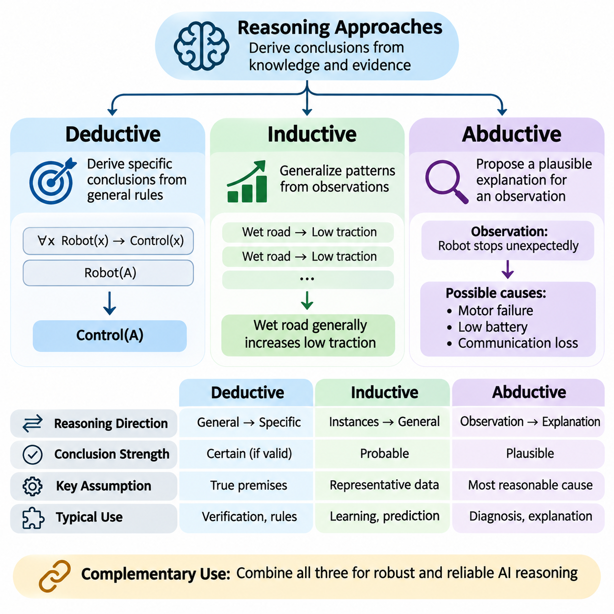{width="7.268055555555556in" height="7.268055555555556in"}

Deductive, inductive, and abductive reasoning represent three fundamental approaches through which artificial intelligence systems derive conclusions from available knowledge and evidence. Although all three support intelligent problem solving, they differ in the direction of inference, the strength of their conclusions, and the assumptions they require. Understanding these differences is essential for designing reasoning architectures that operate reliably under varying conditions.

Deductive reasoning derives specific conclusions from general premises through formally valid inference rules. When the premises are true and the argument is logically valid, the conclusion must also be true. This property makes deduction particularly valuable in applications requiring strict consistency, mathematical correctness, and verifiable decisions. Deductive reasoning establishes what necessarily follows from accepted knowledge rather than what merely appears probable.

A typical deductive argument begins with a general rule and combines it with a specific fact. If every autonomous robot requires a control system, and a particular machine is classified as an autonomous robot, the system can conclude that the machine requires a control system. The conclusion introduces no additional uncertainty because it follows directly from the premises. However, its real-world reliability still depends on the accuracy of those premises.

Formal deduction is closely associated with propositional logic, first-order logic, and mathematical proof systems. Inference mechanisms such as modus ponens, resolution, and universal instantiation allow automated systems to derive conclusions systematically. These procedures can be implemented through rule engines, theorem provers, and logic programming environments. Their correctness depends on the formal semantics of the selected logical framework.

Inductive reasoning operates in the opposite direction by developing generalizations from individual observations or repeated experiences. Rather than guaranteeing conclusions, induction identifies patterns that appear sufficiently consistent to support broader expectations. For example, if an autonomous vehicle repeatedly encounters reduced traction on wet surfaces, it may infer that wet road conditions generally increase the likelihood of reduced traction.

The conclusions produced through induction remain uncertain because future observations may differ from previous experiences. Even a large collection of consistent examples cannot establish a universal rule with absolute logical certainty. Inductive reasoning therefore depends on evidence quality, sample representativeness, and the assumptions connecting observed cases to future situations. Its strength is measured through empirical support rather than deductive validity.

Machine learning provides a computational realization of many inductive reasoning principles. Supervised learning algorithms infer predictive relationships from labeled examples, while unsupervised learning methods discover recurring structures in unlabeled data. Statistical estimation and generalization allow these learned relationships to be applied to previously unseen inputs. However, successful prediction does not necessarily establish a causal explanation or universal logical rule.

Abductive reasoning begins with an observation and searches for a plausible explanation that could account for it. Unlike deduction, which determines necessary consequences, or induction, which identifies general patterns, abduction proposes hypotheses that explain available evidence. If a robot unexpectedly stops moving, an abductive system might consider motor failure, depleted battery power, communication loss, or an activated safety mechanism.

An abductive conclusion is not guaranteed to be correct because several competing hypotheses may explain the same observation. The reasoning process must evaluate candidate explanations according to their consistency with evidence, explanatory coverage, simplicity, and relevant domain knowledge. Additional observations can strengthen or weaken particular hypotheses, allowing the system to refine its explanation as new information becomes available.

The three reasoning approaches can be distinguished by their relationships between premises, observations, and conclusions. Deduction applies general rules to particular situations, induction develops broader patterns from observed instances, and abduction identifies possible causes or explanations for observed outcomes. These distinctions describe their characteristic inference objectives, although practical systems may combine all three within a single reasoning process.

Consider an industrial robot operating in a manufacturing facility. Deductive reasoning determines that the robot must stop when a verified safety rule prohibits movement under a detected condition. Inductive reasoning identifies recurring relationships between operating temperature and equipment performance. Abductive reasoning investigates unexpected vibration by generating possible explanations involving mechanical wear, misalignment, or external interference.

Deductive reasoning offers strong formal guarantees but requires sufficiently accurate and explicit knowledge. Inductive reasoning adapts to patterns emerging from data but remains vulnerable to sampling bias, distribution shifts, and misleading correlations. Abductive reasoning supports explanation and diagnosis but may generate multiple plausible hypotheses without identifying the correct one. Each method addresses limitations that the others cannot resolve independently.

The distinction between logical validity and evidential support is particularly important when comparing these approaches. Deductive validity concerns whether a conclusion necessarily follows from its premises, regardless of whether those premises are factually correct. Inductive strength concerns how strongly observations support a generalization. Abductive quality concerns how effectively a hypothesis explains evidence relative to competing explanations and background assumptions.

Uncertainty is handled differently across the three reasoning paradigms. Classical deduction preserves logical consequences under explicitly defined assumptions, while induction produces conclusions whose reliability depends on empirical evidence. Abduction introduces uncertainty through competing explanatory hypotheses. Probabilistic reasoning can complement induction and abduction by assigning likelihoods or posterior probabilities to predictions and explanations when suitable models are available.

Bayesian inference provides a useful mathematical framework for evaluating uncertain hypotheses and updating beliefs as evidence accumulates. In abductive diagnosis, posterior probabilities can help compare alternative explanations for an observed failure. In inductive learning, probabilistic models can estimate predictive uncertainty. However, Bayesian inference is not identical to either induction or abduction, because it specifies a broader framework for probabilistic belief updating.

Reasoning systems frequently combine these approaches through iterative cycles of observation, hypothesis generation, prediction, and verification. Abduction proposes explanations for unexpected events, deduction derives testable consequences from those explanations, and induction identifies recurring relationships across accumulated observations. This interaction resembles scientific investigation, where hypotheses are continually evaluated against experimental and observational evidence.

In autonomous robotics, such integration can improve diagnostic reasoning and operational adaptability. When a navigation system reports inconsistent localization estimates, abduction may identify sensor malfunction or environmental interference as possible explanations. Deduction can determine the expected consequences of each hypothesis, while induction can analyze historical sensor behavior to estimate which explanations deserve further investigation.

Knowledge representation strongly influences the effectiveness of each reasoning approach. Deduction benefits from explicit rules, predicates, constraints, and ontological relationships. Induction requires observations encoded through informative features or learned representations. Abduction requires models connecting potential explanations with their observable consequences. A unified knowledge architecture can support information exchange between these complementary reasoning mechanisms.

Computational complexity also varies across reasoning strategies and problem formulations. Deductive theorem proving may become computationally expensive as logical expressions and search spaces grow. Inductive learning can require substantial training data and optimization resources. Abductive inference may involve combinatorial searches over possible explanations. Practical implementations therefore use heuristics, approximations, constraints, and domain-specific optimization techniques.

Explainability is another important consideration in reasoning system design. Deductive systems can often expose explicit inference steps connecting premises to conclusions. Inductive systems may require feature analysis, statistical interpretation, or model explanation techniques to clarify their predictions. Abductive systems can present competing hypotheses and supporting evidence, although explaining why one hypothesis was preferred may require additional evaluation.

Modern artificial intelligence increasingly combines symbolic and neural approaches to implement these reasoning capabilities. Symbolic engines provide explicit deductive procedures, while neural networks learn patterns that support inductive generalization. Neural models can also generate abductive hypotheses from complex observations. Hybrid architectures attempt to coordinate these components while maintaining consistency, uncertainty awareness, and computational efficiency.

Large language models can express deductive arguments, generate inductive generalizations, and propose abductive explanations through natural language. Their flexibility supports reasoning across diverse domains, but generated conclusions may contain invalid deductions, unsupported generalizations, or speculative explanations. External verification, structured knowledge retrieval, and executable reasoning tools are therefore valuable when correctness and traceability are essential.

Evaluating reasoning performance requires criteria appropriate to each paradigm. Deductive systems can be assessed through logical soundness, completeness, and proof correctness. Inductive systems can be evaluated using generalization accuracy, calibration, and robustness to distribution changes. Abductive systems can be assessed through explanatory adequacy, hypothesis ranking, diagnostic accuracy, and the ability to incorporate new evidence.

Reliable intelligent systems should select reasoning strategies according to the structure of the problem rather than treating one approach as universally superior. Deduction is appropriate when formal rules and guaranteed implications are central. Induction is valuable when patterns must be learned from experience. Abduction is essential when observations require explanation and possible causes must be investigated. Their coordinated application provides a foundation for adaptive and interpretable intelligence.

The integration of deductive, inductive, and abductive reasoning establishes a broader framework for artificial intelligence that connects formal knowledge, empirical learning, and explanatory hypothesis generation. Together, these approaches enable systems to derive necessary conclusions, recognize recurring patterns, and investigate unfamiliar situations. Understanding their complementary strengths and limitations is fundamental to developing reasoning architectures capable of reliable operation in complex environments.

연역적 추론(Deductive Reasoning), 귀납적 추론(Inductive Reasoning), 가추적 추론(Abductive Reasoning)은 인공지능(Artificial Intelligence) 시스템이 이용 가능한 지식(Knowledge)과 증거(Evidence)로부터 결론(Conclusion)을 도출하는 세 가지 기본적인 접근법이다. 세 가지 모두 지능적 문제 해결(Intelligent Problem Solving)을 지원하지만, 추론 방향(Direction of Inference), 결론의 확실성(Strength of Conclusion), 필요한 가정(Assumption)에서 차이가 있다. 이러한 차이를 이해하는 것은 다양한 조건에서 신뢰성 있게 작동하는 추론 아키텍처(Reasoning Architecture)를 설계하는 데 필수적이다.

연역적 추론(Deductive Reasoning)은 형식적으로 타당한 추론 규칙(Formally Valid Inference Rule)을 통해 일반적인 전제(General Premise)로부터 구체적인 결론(Specific Conclusion)을 도출한다. 전제가 참이고 논증(Argument)이 논리적으로 타당하다면 결론도 반드시 참이어야 한다. 이러한 특성으로 인해 연역은 엄격한 일관성(Consistency), 수학적 정확성(Mathematical Correctness), 검증 가능한 의사결정(Verifiable Decision)이 요구되는 응용 분야에서 특히 중요하다. 연역적 추론은 단순히 가능성이 높아 보이는 결과가 아니라, 수용된 지식으로부터 필연적으로 도출되는 결과를 확립한다.

전형적인 연역적 논증(Deductive Argument)은 일반적인 규칙(General Rule)에서 시작하여 이를 구체적인 사실(Specific Fact)과 결합한다. 모든 자율 로봇(Autonomous Robot)에 제어 시스템(Control System)이 필요하고 특정 기계가 자율 로봇으로 분류된다면, 해당 기계에도 제어 시스템이 필요하다는 결론을 도출할 수 있다. 이 결론은 전제로부터 직접 도출되므로 추가적인 불확실성(Uncertainty)을 발생시키지 않는다. 그러나 실제 환경에서의 신뢰성은 여전히 전제의 정확성(Accuracy of Premises)에 의존한다.

형식적 연역(Formal Deduction)은 명제 논리(Propositional Logic), 일차 논리(First-Order Logic), 수학적 증명 시스템(Mathematical Proof System)과 밀접하게 연관된다. 전건 긍정(Modus Ponens), 해결 원리(Resolution), 전칭 예화(Universal Instantiation)와 같은 추론 메커니즘(Inference Mechanism)을 통해 자동화 시스템은 결론을 체계적으로 도출할 수 있다. 이러한 절차는 규칙 엔진(Rule Engine), 정리 증명기(Theorem Prover), 논리 프로그래밍 환경(Logic Programming Environment)을 통해 구현할 수 있으며, 정확성은 선택한 논리 체계의 형식적 의미론(Formal Semantics)에 따라 결정된다.

귀납적 추론(Inductive Reasoning)은 개별 관찰(Individual Observation)이나 반복된 경험(Repeated Experience)으로부터 일반화(Generalization)를 형성한다는 점에서 연역과 반대 방향으로 작동한다. 귀납은 결론을 확정적으로 보장하기보다 충분히 일관되게 나타나는 패턴(Pattern)을 식별하여 더 넓은 범위의 예측(Expectation)을 지원한다. 예를 들어 자율주행 차량(Autonomous Vehicle)이 젖은 노면에서 접지력(Traction) 감소를 반복적으로 경험한다면, 젖은 도로 조건이 일반적으로 접지력 감소 가능성을 높인다고 추론할 수 있다.

귀납을 통해 생성된 결론은 미래의 관찰 결과가 과거 경험과 다를 수 있으므로 불확실성을 유지한다. 일관된 사례가 대량으로 축적되더라도 보편적인 규칙(Universal Rule)을 절대적인 논리적 확실성(Logical Certainty)으로 확립할 수는 없다. 따라서 귀납적 추론은 증거의 품질(Evidence Quality), 표본의 대표성(Sample Representativeness), 관찰된 사례와 미래 상황을 연결하는 가정에 의존한다. 귀납적 결론의 강도는 연역적 타당성(Deductive Validity)이 아니라 경험적 근거(Empirical Support)를 통해 평가된다.

기계학습(Machine Learning)은 다양한 귀납적 추론 원리를 계산적으로 구현한 대표적인 사례이다. 지도학습(Supervised Learning) 알고리즘은 레이블이 있는 사례(Labeled Example)로부터 예측 관계(Predictive Relationship)를 추론하며, 비지도학습(Unsupervised Learning)은 레이블이 없는 데이터(Unlabeled Data)에서 반복적으로 나타나는 구조를 발견한다. 통계적 추정(Statistical Estimation)과 일반화(Generalization)를 통해 학습된 관계를 이전에 관찰하지 못한 입력에 적용할 수 있다. 그러나 성공적인 예측이 반드시 인과적 설명(Causal Explanation)이나 보편적인 논리 규칙을 확립하는 것은 아니다.

가추적 추론(Abductive Reasoning)은 관찰(Observation)에서 출발하여 해당 현상을 설명할 수 있는 그럴듯한 설명(Plausible Explanation)을 탐색한다. 필연적인 결과를 결정하는 연역이나 일반적인 패턴을 식별하는 귀납과 달리, 가추는 이용 가능한 증거를 설명하는 가설(Hypothesis)을 제안한다. 예를 들어 로봇이 예상치 못하게 이동을 멈춘 경우, 가추적 추론 시스템은 모터 고장(Motor Failure), 배터리 방전(Depleted Battery), 통신 손실(Communication Loss), 안전 메커니즘 작동(Activated Safety Mechanism) 등을 가능한 원인으로 고려할 수 있다.

가추적 결론(Abductive Conclusion)은 여러 경쟁 가설(Competing Hypothesis)이 동일한 관찰 결과를 설명할 수 있으므로 반드시 정확하다고 보장되지 않는다. 추론 과정에서는 증거와의 일관성(Evidence Consistency), 설명 범위(Explanatory Coverage), 단순성(Simplicity), 관련 도메인 지식(Domain Knowledge)을 기준으로 후보 설명(Candidate Explanation)을 평가해야 한다. 추가적인 관찰은 특정 가설을 강화하거나 약화할 수 있으며, 새로운 정보가 확보됨에 따라 시스템이 설명을 정교화할 수 있도록 한다.

세 가지 추론 방식은 전제(Premise), 관찰(Observation), 결론(Conclusion) 사이의 관계를 통해 구분할 수 있다. 연역은 일반적인 규칙을 특정 상황에 적용하고, 귀납은 관찰된 개별 사례로부터 더 넓은 패턴을 형성하며, 가추는 관찰된 결과에 대한 가능한 원인이나 설명을 식별한다. 이러한 차이는 각 추론 방식의 대표적인 추론 목적(Inference Objective)을 나타내지만, 실제 시스템에서는 세 가지 방법을 하나의 추론 과정(Reasoning Process)에서 결합하여 사용할 수 있다.

제조 시설(Manufacturing Facility)에서 작동하는 산업용 로봇(Industrial Robot)을 생각해 볼 수 있다. 연역적 추론은 감지된 조건에서 이동을 금지하는 검증된 안전 규칙(Safety Rule)에 따라 로봇이 정지해야 한다고 판단한다. 귀납적 추론은 작동 온도(Operating Temperature)와 장비 성능(Equipment Performance) 사이에서 반복적으로 나타나는 관계를 식별한다. 가추적 추론은 예상치 못한 진동(Vibration)을 조사하면서 기계적 마모(Mechanical Wear), 정렬 불량(Misalignment), 외부 간섭(External Interference)과 같은 가능한 설명을 생성한다.

연역적 추론은 강력한 형식적 보장(Formal Guarantee)을 제공하지만, 충분히 정확하고 명시적인 지식(Explicit Knowledge)을 필요로 한다. 귀납적 추론은 데이터에서 나타나는 패턴에 적응할 수 있지만, 표본 편향(Sampling Bias), 분포 변화(Distribution Shift), 오해를 유발하는 상관관계(Misleading Correlation)에 취약하다. 가추적 추론은 설명과 진단(Diagnosis)을 지원하지만, 올바른 원인을 식별하지 못한 채 여러 그럴듯한 가설을 생성할 수 있다. 각 방법은 다른 방법만으로 해결하기 어려운 한계를 보완한다.

논리적 타당성(Logical Validity)과 증거적 뒷받침(Evidential Support)의 차이는 이러한 접근법을 비교할 때 특히 중요하다. 연역적 타당성은 전제가 실제로 참인지와 관계없이 결론이 전제로부터 필연적으로 도출되는지를 다룬다. 귀납적 강도(Inductive Strength)는 관찰 결과가 일반화를 얼마나 강하게 뒷받침하는지를 의미한다. 가추적 추론의 품질(Abductive Quality)은 경쟁 설명 및 배경 가정(Background Assumption)과 비교하여 특정 가설이 증거를 얼마나 효과적으로 설명하는지에 따라 결정된다.

불확실성(Uncertainty)은 세 가지 추론 패러다임(Reasoning Paradigm)에서 서로 다른 방식으로 처리된다. 고전적 연역(Classical Deduction)은 명시적으로 정의된 가정 아래에서 논리적 귀결(Logical Consequence)을 보존하는 반면, 귀납은 경험적 증거에 따라 신뢰성이 달라지는 결론을 생성한다. 가추는 경쟁하는 설명 가설(Explanatory Hypothesis)을 통해 불확실성을 도입한다. 적절한 모델이 제공되는 경우, 확률적 추론(Probabilistic Reasoning)은 예측과 설명에 가능도(Likelihood) 또는 사후확률(Posterior Probability)을 부여하여 귀납과 가추를 보완할 수 있다.

베이지안 추론(Bayesian Inference)은 불확실한 가설을 평가하고 증거가 축적됨에 따라 믿음(Belief)을 갱신하기 위한 유용한 수학적 프레임워크(Mathematical Framework)를 제공한다. 가추적 진단(Abductive Diagnosis)에서는 사후확률을 활용하여 관찰된 고장에 대한 대안적 설명(Alternative Explanation)을 비교할 수 있다. 귀납적 학습(Inductive Learning)에서는 확률 모델(Probabilistic Model)을 통해 예측 불확실성(Predictive Uncertainty)을 추정할 수 있다. 그러나 베이지안 추론은 확률적 믿음 갱신(Probabilistic Belief Updating)을 위한 더 넓은 체계를 정의하므로 귀납이나 가추 중 어느 하나와 동일하지 않다.

추론 시스템은 관찰(Observation), 가설 생성(Hypothesis Generation), 예측(Prediction), 검증(Verification)의 반복적인 순환 과정을 통해 이러한 접근법을 결합하는 경우가 많다. 가추는 예상하지 못한 사건에 대한 설명을 제안하고, 연역은 해당 설명으로부터 검증 가능한 결과(Testable Consequence)를 도출하며, 귀납은 축적된 관찰 전반에서 반복적인 관계를 식별한다. 이러한 상호작용은 실험적 증거(Experimental Evidence)와 관찰 증거(Observational Evidence)를 통해 가설을 지속적으로 평가하는 과학적 탐구(Scientific Investigation)와 유사하다.

자율 로봇공학(Autonomous Robotics)에서 이러한 통합은 진단 추론(Diagnostic Reasoning)과 운영 적응성(Operational Adaptability)을 향상할 수 있다. 내비게이션 시스템(Navigation System)이 일관되지 않은 위치 추정(Localization Estimate)을 보고하면, 가추는 센서 오작동(Sensor Malfunction)이나 환경적 간섭(Environmental Interference)을 가능한 설명으로 식별할 수 있다. 연역은 각 가설에서 예상되는 결과를 결정하고, 귀납은 과거 센서 동작(Historical Sensor Behavior)을 분석하여 어떤 설명을 추가로 조사해야 하는지 평가할 수 있다.

지식 표현(Knowledge Representation)은 각 추론 방식의 효과에 큰 영향을 미친다. 연역은 명시적인 규칙(Explicit Rule), 술어(Predicate), 제약조건(Constraint), 온톨로지 관계(Ontological Relationship)를 통해 이점을 얻는다. 귀납은 유용한 특징(Feature)이나 학습된 표현(Learned Representation)으로 인코딩된 관찰 데이터를 필요로 한다. 가추는 잠재적인 설명과 관찰 가능한 결과를 연결하는 모델을 필요로 한다. 통합 지식 아키텍처(Unified Knowledge Architecture)는 이러한 상호 보완적 추론 메커니즘 사이의 정보 교환을 지원할 수 있다.

계산 복잡도(Computational Complexity) 역시 추론 전략(Reasoning Strategy)과 문제 구성(Problem Formulation)에 따라 달라진다. 연역적 정리 증명(Deductive Theorem Proving)은 논리 표현식과 탐색 공간(Search Space)이 커질수록 계산 비용이 증가할 수 있다. 귀납적 학습은 상당한 학습 데이터(Training Data)와 최적화 자원(Optimization Resource)을 요구할 수 있다. 가추적 추론은 가능한 설명에 대한 조합적 탐색(Combinatorial Search)을 포함할 수 있다. 따라서 실제 구현에서는 휴리스틱(Heuristic), 근사 기법(Approximation), 제약조건, 도메인 특화 최적화(Domain-Specific Optimization)를 활용한다.

설명 가능성(Explainability)은 추론 시스템 설계에서 또 다른 중요한 고려사항이다. 연역적 시스템은 전제와 결론을 연결하는 명시적인 추론 단계(Inference Step)를 제시할 수 있는 경우가 많다. 귀납적 시스템은 예측을 설명하기 위해 특징 분석(Feature Analysis), 통계적 해석(Statistical Interpretation), 모델 설명 기법(Model Explanation Technique)이 필요할 수 있다. 가추적 시스템은 경쟁 가설과 이를 뒷받침하는 증거를 제시할 수 있지만, 특정 가설을 우선적으로 선택한 이유를 설명하려면 추가적인 평가가 필요할 수 있다.

현대 인공지능은 이러한 추론 능력을 구현하기 위해 기호적 접근법(Symbolic Approach)과 신경망 접근법(Neural Approach)을 점점 더 많이 결합하고 있다. 기호 엔진(Symbolic Engine)은 명시적인 연역 절차를 제공하며, 신경망(Neural Network)은 귀납적 일반화(Inductive Generalization)를 지원하는 패턴을 학습한다. 신경망 모델(Neural Model)은 복잡한 관찰로부터 가추적 가설을 생성할 수도 있다. 하이브리드 아키텍처(Hybrid Architecture)는 일관성(Consistency), 불확실성 인식(Uncertainty Awareness), 계산 효율성(Computational Efficiency)을 유지하면서 이러한 구성요소를 조정하려고 한다.

대규모 언어 모델(Large Language Model, LLM)은 자연어(Natural Language)를 통해 연역적 논증(Deductive Argument)을 표현하고, 귀납적 일반화(Inductive Generalization)를 생성하며, 가추적 설명(Abductive Explanation)을 제안할 수 있다. 이러한 유연성은 다양한 영역에서 추론을 지원하지만, 생성된 결론에는 잘못된 연역(Invalid Deduction), 근거가 부족한 일반화(Unsupported Generalization), 추측성 설명(Speculative Explanation)이 포함될 수 있다. 따라서 정확성(Correctness)과 추적 가능성(Traceability)이 중요한 경우 외부 검증(External Verification), 구조화된 지식 검색(Structured Knowledge Retrieval), 실행 가능한 추론 도구(Executable Reasoning Tool)가 유용하다.

추론 성능(Reasoning Performance)을 평가하려면 각 패러다임에 적합한 기준이 필요하다. 연역적 시스템은 논리적 건전성(Logical Soundness), 완전성(Completeness), 증명 정확성(Proof Correctness)을 통해 평가할 수 있다. 귀납적 시스템은 일반화 정확도(Generalization Accuracy), 확률 보정(Calibration), 분포 변화에 대한 강건성(Robustness)을 통해 평가할 수 있다. 가추적 시스템은 설명 적절성(Explanatory Adequacy), 가설 순위화(Hypothesis Ranking), 진단 정확도(Diagnostic Accuracy), 새로운 증거를 반영하는 능력을 통해 평가할 수 있다.

신뢰할 수 있는 지능형 시스템(Intelligent System)은 하나의 접근법을 보편적으로 우수하다고 간주하기보다 문제의 구조(Problem Structure)에 따라 적절한 추론 전략을 선택해야 한다. 연역은 형식적 규칙(Formal Rule)과 필연적인 논리적 귀결(Necessary Implication)이 중요한 경우에 적합하다. 귀납은 경험으로부터 패턴을 학습해야 하는 경우에 유용하다. 가추는 관찰 결과에 대한 설명이 필요하고 가능한 원인을 조사해야 하는 경우에 필수적이다. 이러한 접근법을 조화롭게 적용하면 적응적이고 해석 가능한 지능(Adaptive and Interpretable Intelligence)의 기반을 마련할 수 있다.

연역적 추론(Deductive Reasoning), 귀납적 추론(Inductive Reasoning), 가추적 추론(Abductive Reasoning)의 통합은 형식적 지식(Formal Knowledge), 경험적 학습(Empirical Learning), 설명적 가설 생성(Explanatory Hypothesis Generation)을 연결하는 보다 포괄적인 인공지능 프레임워크(Artificial Intelligence Framework)를 확립한다. 이러한 접근법은 지능형 시스템이 필연적인 결론을 도출하고, 반복적인 패턴을 인식하며, 익숙하지 않은 상황을 조사할 수 있도록 한다. 각 접근법의 상호 보완적인 강점과 한계를 이해하는 것은 복잡한 환경에서 신뢰성 있게 작동할 수 있는 추론 아키텍처(Reasoning Architecture)를 개발하기 위한 핵심 기반이다.

## 01.03 Propositional Reasoning

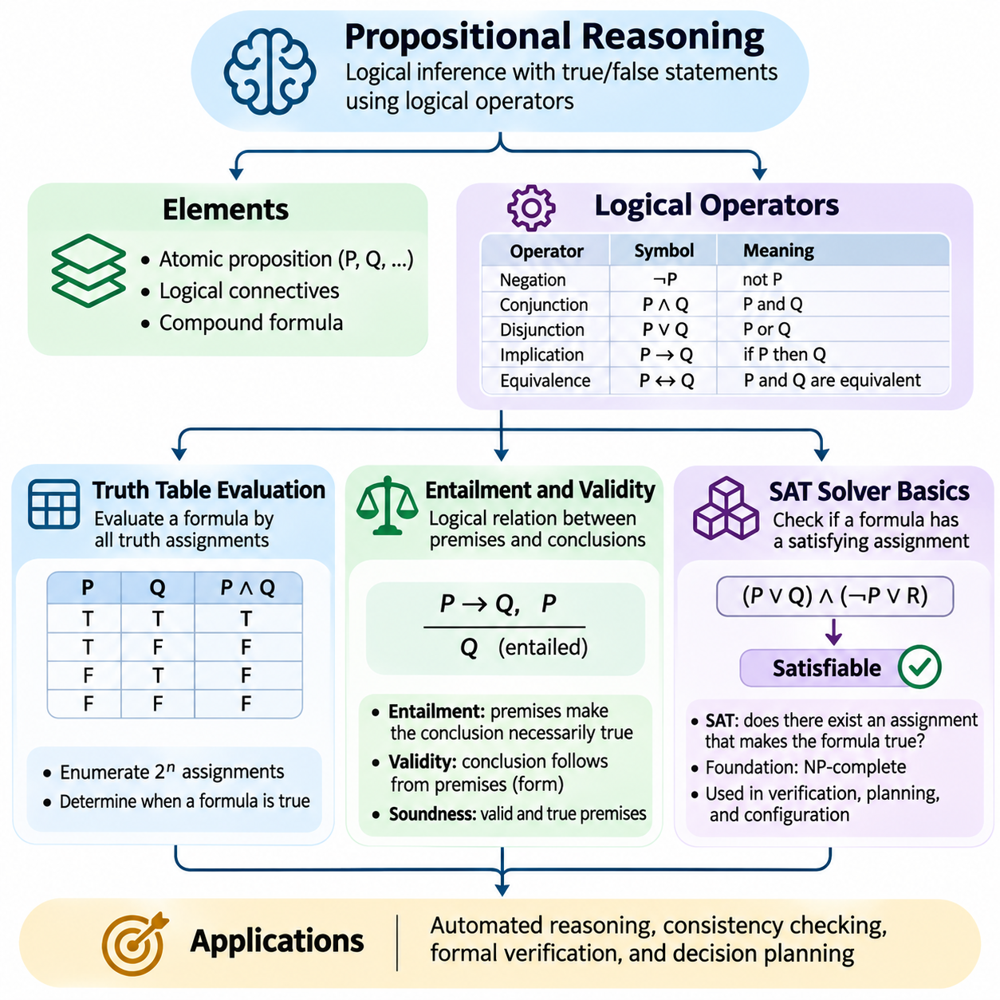{width="7.268055555555556in" height="7.268055555555556in"}

Propositional reasoning is a foundational approach to logical inference in artificial intelligence that represents knowledge through statements with definite truth values. Each proposition is treated as either true or false within a specified interpretation, allowing complex expressions to be constructed using logical operators. This formal structure supports systematic evaluation, consistency checking, and automated deduction across knowledge-based systems.

The basic elements of propositional logic include atomic propositions, logical connectives, and compound formulas. Atomic propositions represent indivisible statements, while compound formulas combine them using negation, conjunction, disjunction, implication, and equivalence. For example, a robot may operate only when its battery is charged and its safety system is active. Such requirements can be expressed as logical constraints and evaluated mathematically.

Truth table evaluation provides a direct method for determining the meaning of propositional expressions. A truth table enumerates every possible assignment of truth values to the atomic propositions appearing in a formula. For each assignment, the logical operators are evaluated according to their defined semantics. The resulting table reveals exactly when the complete expression is true or false.

For a formula containing n distinct propositional variables, a complete truth table requires 2\^n possible assignments. A formula with three variables therefore requires eight rows, while one containing ten variables requires 1,024 rows. This exponential growth makes truth tables practical for small logical expressions but increasingly expensive for larger systems containing many interconnected propositions.

The semantics of logical operators determine how compound propositions are evaluated. Negation reverses a truth value, conjunction requires both operands to be true, and disjunction requires at least one operand to be true. Material implication is false only when its antecedent is true and its consequent is false. Logical equivalence is true when both operands share the same truth value.

Truth tables also provide a method for classifying logical formulas. A tautology is true under every possible truth assignment, while a contradiction is false under every assignment. A contingent formula is true under some assignments and false under others. These classifications help determine whether a logical statement expresses an unconditional truth, an impossible condition, or a requirement dependent on particular circumstances.

Automated truth table evaluation can be implemented by generating combinations of Boolean values and recursively evaluating logical expression trees. A parser first converts an input formula into a structured representation, often an abstract syntax tree. The evaluator then applies operator semantics to each assignment. Such implementations are useful for educational reasoning engines, logical validation tools, and small configuration systems.

Logical entailment describes a relationship in which a conclusion must be true whenever a collection of premises is true. If a knowledge base entails a proposition, every interpretation satisfying the knowledge base must also satisfy that proposition. Entailment is therefore a semantic relationship between statements rather than a measure of statistical association or empirical probability.

Consider a knowledge base containing the statements that a robot moves only when its controller is enabled and that the robot is currently moving. From these premises, the system can infer that the controller is enabled. This conclusion is logically entailed because no interpretation can make both premises true while making the conclusion false, assuming the statements retain their specified logical meanings.

Validity is closely related to entailment but is commonly applied to arguments and inference structures. An argument is valid when its conclusion follows necessarily from its premises, regardless of whether those premises are factually correct. Soundness additionally requires the premises to be true. These distinctions are essential when separating formal reasoning correctness from the reliability of real-world knowledge.

Truth tables can verify entailment by examining every assignment that satisfies the premises. If the conclusion is true in all such assignments, entailment holds. Equivalently, the conjunction of the premises with the negation of the conclusion must be unsatisfiable. This transformation establishes a powerful connection between logical inference and computational satisfiability checking.

Logical equivalence provides another important reasoning relationship. Two formulas are equivalent when they have identical truth values under every possible assignment. Equivalence transformations allow complex expressions to be simplified without changing their logical meaning. Common examples include De Morgan\'s laws, double negation elimination, and the replacement of implication with an equivalent expression involving negation and disjunction.

Satisfiability refers to whether at least one truth assignment makes a propositional formula true. A satisfiable formula describes a logically possible configuration, whereas an unsatisfiable formula contains constraints that cannot all be satisfied simultaneously. Determining satisfiability is central to automated reasoning because many verification, planning, and configuration problems can be represented as collections of Boolean constraints.

The Boolean satisfiability problem, commonly called SAT, asks whether a given propositional formula has a satisfying assignment. SAT is a fundamental computational problem and was the first problem proven NP-complete. Although worst-case computational complexity can be exponential, modern SAT solvers frequently handle large practical instances efficiently by exploiting structure, propagation, and intelligent search strategies.

SAT solvers commonly operate on formulas expressed in conjunctive normal form, or CNF. A CNF formula consists of a conjunction of clauses, where each clause contains a disjunction of literals. A literal is either a propositional variable or its negation. This standardized representation allows solver algorithms to manipulate constraints efficiently while preserving the satisfiability properties of the original problem.

Converting arbitrary propositional formulas into CNF may involve eliminating equivalences and implications, moving negations inward, and applying distributive transformations. Direct conversion can produce exponentially larger formulas. Practical systems often use Tseitin transformations, which introduce auxiliary variables to construct an equisatisfiable CNF representation with size linear in the original formula representation.

The Davis--Putnam--Logemann--Loveland algorithm, commonly abbreviated DPLL, provides a foundational approach to SAT solving. It combines recursive search with unit propagation, branching decisions, and backtracking. Unit propagation identifies assignments forced by clauses containing a single unassigned literal, while branching explores alternative assignments when no immediate implication is available.

Modern SAT solvers frequently employ conflict-driven clause learning, known as CDCL. When a contradiction occurs, the solver analyzes the conflict and learns a new clause that prevents similar unsuccessful assignments. Non-chronological backtracking, efficient watched-literal structures, and adaptive branching heuristics further improve performance. These techniques enable sophisticated exploration of large Boolean search spaces.

SAT solving can also be used to test logical entailment. To determine whether a knowledge base entails a conclusion, a solver checks whether the knowledge base combined with the negated conclusion is unsatisfiable. If no satisfying assignment exists, the conclusion follows logically. If a satisfying assignment exists, it provides a counterexample demonstrating that the proposed entailment does not hold.

In artificial intelligence systems, propositional reasoning supports rule verification, constraint satisfaction, planning, and automated configuration. A robotic mission planner can encode operational requirements as Boolean variables representing equipment availability, safety permissions, and task dependencies. SAT solving can determine whether a proposed mission configuration satisfies all constraints or whether the requirements are mutually inconsistent.

Industrial automation provides another practical application. A manufacturing system may require that a conveyor operate only when protective barriers are closed, emergency-stop conditions are cleared, and upstream equipment is ready. Propositional constraints can represent these conditions and support offline verification of permitted operating states. Actual safety enforcement additionally requires appropriately engineered hardware and runtime controls.

The primary limitation of propositional reasoning is its restricted expressive power. Propositional variables represent complete statements without directly describing internal relationships between objects, quantities, or universally quantified rules. Representing many similar entities may therefore require numerous separate propositions. First-order logic addresses these limitations by introducing predicates, variables, and quantifiers.

Despite these limitations, propositional reasoning remains essential because its semantics are precise and its computational procedures are well understood. Truth tables provide exhaustive evaluation for small formulas, entailment establishes necessary logical consequences, and SAT solvers enable efficient satisfiability analysis for many practical problems. Together, these techniques form a rigorous foundation for building verifiable and explainable reasoning systems.

명제 추론(Propositional Reasoning)은 명확한 진릿값(Truth Value)을 갖는 명제(Statement)를 통해 지식(Knowledge)을 표현하는 인공지능(Artificial Intelligence)의 기본적인 논리적 추론(Logical Inference) 접근법이다. 각 명제(Proposition)는 지정된 해석(Interpretation) 내에서 참(True) 또는 거짓(False)으로 취급되며, 논리 연산자(Logical Operator)를 사용하여 복잡한 표현식을 구성할 수 있다. 이러한 형식적 구조(Formal Structure)는 지식 기반 시스템(Knowledge-Based System)에서 체계적인 평가(Systematic Evaluation), 일관성 검사(Consistency Checking), 자동 연역(Automated Deduction)을 지원한다.

명제 논리(Propositional Logic)의 기본 요소에는 원자 명제(Atomic Proposition), 논리 연결사(Logical Connective), 복합 논리식(Compound Formula)이 포함된다. 원자 명제는 더 이상 분해하지 않는 개별 명제를 나타내며, 복합 논리식은 부정(Negation), 논리곱(Conjunction), 논리합(Disjunction), 함의(Implication), 동치(Equivalence)를 사용하여 여러 명제를 결합한다. 예를 들어 로봇은 배터리가 충전되어 있고 안전 시스템(Safety System)이 활성화된 경우에만 작동할 수 있다. 이러한 요구사항은 논리적 제약조건(Logical Constraint)으로 표현하고 수학적으로 평가할 수 있다.

진리표 평가(Truth Table Evaluation)는 명제 논리식(Propositional Expression)의 의미를 결정하는 직접적인 방법을 제공한다. 진리표(Truth Table)는 논리식에 포함된 원자 명제(Atomic Proposition)에 할당할 수 있는 모든 진릿값 조합(Truth Assignment)을 나열한다. 각 조합에 대해 논리 연산자는 정의된 의미론(Semantics)에 따라 평가된다. 결과적으로 생성된 진리표는 전체 논리식이 어떤 조건에서 참 또는 거짓이 되는지를 정확하게 보여준다.

서로 다른 명제 변수(Propositional Variable)가 n개 포함된 논리식의 완전한 진리표(Complete Truth Table)에는 2\^n개의 가능한 진릿값 할당이 필요하다. 따라서 변수가 세 개인 논리식에는 8개의 행(Row)이 필요하며, 변수가 열 개인 경우에는 1,024개의 행이 필요하다. 이러한 지수적 증가(Exponential Growth)로 인해 진리표는 작은 논리식에는 실용적이지만, 서로 연결된 명제가 많은 대규모 시스템에서는 계산 비용(Computational Cost)이 급격히 증가한다.

논리 연산자(Logical Operator)의 의미론(Semantics)은 복합 명제(Compound Proposition)가 어떻게 평가되는지를 결정한다. 부정(Negation)은 진릿값을 반전시키고, 논리곱(Conjunction)은 두 피연산자(Operand)가 모두 참이어야 하며, 논리합(Disjunction)은 적어도 하나의 피연산자가 참이면 성립한다. 실질 함의(Material Implication)는 전건(Antecedent)이 참이고 후건(Consequent)이 거짓인 경우에만 거짓이다. 논리적 동치(Logical Equivalence)는 두 피연산자가 동일한 진릿값을 가질 때 참이 된다.

진리표는 논리식(Logical Formula)을 분류하는 방법도 제공한다. 항진식(Tautology)은 가능한 모든 진릿값 할당에서 참인 논리식이며, 모순식(Contradiction)은 모든 할당에서 거짓인 논리식이다. 우연식(Contingent Formula)은 일부 할당에서는 참이고 다른 할당에서는 거짓이다. 이러한 분류는 논리적 명제가 무조건적인 진리(Unconditional Truth), 불가능한 조건(Impossible Condition), 특정 상황에 의존하는 요구사항(Conditional Requirement) 중 무엇을 나타내는지 판단하는 데 도움이 된다.

자동화된 진리표 평가(Automated Truth Table Evaluation)는 불리언 값(Boolean Value)의 조합을 생성하고 논리 표현식 트리(Logical Expression Tree)를 재귀적으로 평가하는 방식으로 구현할 수 있다. 파서(Parser)는 먼저 입력 논리식을 추상 구문 트리(Abstract Syntax Tree, AST)와 같은 구조화된 표현으로 변환한다. 이후 평가기(Evaluator)는 각 진릿값 할당에 논리 연산자의 의미론을 적용한다. 이러한 구현은 교육용 추론 엔진(Educational Reasoning Engine), 논리 검증 도구(Logical Validation Tool), 소규모 구성 시스템(Configuration System)에 유용하다.

논리적 함축(Logical Entailment)은 전제(Premise)의 집합이 참일 때 결론(Conclusion)도 반드시 참이어야 하는 관계를 의미한다. 지식 베이스(Knowledge Base)가 특정 명제를 논리적으로 함축한다면, 해당 지식 베이스를 만족하는 모든 해석(Interpretation)은 그 명제도 만족해야 한다. 따라서 논리적 함축은 통계적 연관성(Statistical Association)이나 경험적 확률(Empirical Probability)이 아니라 명제 사이의 의미론적 관계(Semantic Relationship)를 나타낸다.

로봇이 제어기(Controller)가 활성화된 경우에만 이동할 수 있으며, 현재 로봇이 이동 중이라는 두 명제를 포함하는 지식 베이스를 생각해 볼 수 있다. 이러한 전제로부터 시스템은 제어기가 활성화되어 있다는 결론을 추론할 수 있다. 이는 두 전제가 모두 참이면서 결론이 거짓이 되는 해석이 존재하지 않기 때문이다. 단, 각 명제는 사전에 지정된 논리적 의미(Logical Meaning)를 유지한다고 가정한다.

타당성(Validity)은 논리적 함축과 밀접하게 관련되지만, 일반적으로 논증(Argument)과 추론 구조(Inference Structure)에 적용된다. 논증은 전제가 실제로 참인지와 관계없이 결론이 전제로부터 필연적으로 도출될 때 타당하다고 평가된다. 건전성(Soundness)은 논증이 타당하면서 전제도 실제로 참일 것을 추가로 요구한다. 이러한 구분은 형식적 추론의 정확성(Formal Reasoning Correctness)과 실제 세계의 지식 신뢰성(Real-World Knowledge Reliability)을 분리하는 데 필수적이다.

진리표는 전제를 만족하는 모든 진릿값 할당을 검사하여 논리적 함축을 검증할 수 있다. 이러한 모든 할당에서 결론이 참이라면 논리적 함축이 성립한다. 이와 동등하게, 전제들의 논리곱(Conjunction)과 결론의 부정(Negation)을 결합한 논리식은 만족 불가능(Unsatisfiable)해야 한다. 이러한 변환은 논리적 추론(Logical Inference)과 계산적 만족 가능성 검사(Computational Satisfiability Checking) 사이의 강력한 연결 관계를 확립한다.

논리적 동치(Logical Equivalence)는 또 다른 중요한 추론 관계이다. 두 논리식이 가능한 모든 진릿값 할당에서 동일한 진릿값을 가지면 논리적으로 동치이다. 동치 변환(Equivalence Transformation)을 사용하면 논리적 의미를 변경하지 않고 복잡한 표현식을 단순화할 수 있다. 대표적인 예로 드모르간 법칙(De Morgan\'s Laws), 이중 부정 제거(Double Negation Elimination), 함의를 부정과 논리합으로 구성된 동치 표현식으로 대체하는 방법이 있다.

만족 가능성(Satisfiability)은 적어도 하나의 진릿값 할당이 명제 논리식을 참으로 만드는지를 의미한다. 만족 가능한 논리식(Satisfiable Formula)은 논리적으로 실현 가능한 구성(Configuration)을 나타내지만, 만족 불가능한 논리식(Unsatisfiable Formula)은 모든 제약조건을 동시에 충족할 수 없는 상태를 나타낸다. 만족 가능성을 판단하는 것은 다양한 검증(Verification), 계획 수립(Planning), 구성 문제(Configuration Problem)를 불리언 제약조건(Boolean Constraint)의 집합으로 표현할 수 있기 때문에 자동 추론(Automated Reasoning)의 핵심 요소이다.

일반적으로 SAT라고 부르는 불리언 만족 가능성 문제(Boolean Satisfiability Problem)는 주어진 명제 논리식에 만족하는 진릿값 할당(Satisfying Assignment)이 존재하는지를 묻는다. SAT는 계산 이론(Computational Theory)의 핵심 문제이며, 최초로 NP-완전(NP-Complete)임이 증명된 문제이다. 최악의 경우 계산 복잡도(Worst-Case Computational Complexity)는 지수적으로 증가할 수 있지만, 현대적인 SAT 해결기(SAT Solver)는 문제의 구조, 전파(Propagation), 지능적인 탐색 전략(Intelligent Search Strategy)을 활용하여 대규모 실제 문제를 효율적으로 처리하는 경우가 많다.

SAT 해결기는 일반적으로 논리곱 정규형(Conjunctive Normal Form, CNF)으로 표현된 논리식을 처리한다. CNF 논리식은 여러 절(Clause)의 논리곱으로 구성되며, 각 절은 리터럴(Literal)의 논리합을 포함한다. 리터럴은 명제 변수(Propositional Variable) 또는 해당 변수의 부정(Negation)을 의미한다. 이러한 표준화된 표현(Standardized Representation)을 사용하면 해결기 알고리즘(Solver Algorithm)이 원래 문제의 만족 가능성 특성을 유지하면서 제약조건을 효율적으로 처리할 수 있다.

임의의 명제 논리식을 CNF로 변환하는 과정에는 동치(Equivalence)와 함의(Implication)의 제거, 부정 연산자의 내부 이동, 분배 법칙(Distributive Law)에 따른 변환이 포함될 수 있다. 직접적인 변환은 논리식의 크기를 지수적으로 증가시킬 수 있다. 실제 시스템에서는 보조 변수(Auxiliary Variable)를 도입하여 원래 논리식과 동등한 만족 가능성(Equisatisfiability)을 갖는 CNF 표현을 생성하는 차이틴 변환(Tseitin Transformation)을 자주 사용하며, 이를 통해 원래 논리식 표현의 크기에 선형적으로 비례하는 변환 결과를 얻을 수 있다.

데이비스-퍼트넘-로그만-러브랜드 알고리즘(Davis--Putnam--Logemann--Loveland Algorithm, DPLL)은 SAT 해결을 위한 기본적인 접근법을 제공한다. 이 알고리즘은 재귀적 탐색(Recursive Search), 단위 전파(Unit Propagation), 분기 결정(Branching Decision), 역추적(Backtracking)을 결합한다. 단위 전파는 아직 할당되지 않은 리터럴이 하나만 남은 절에서 강제되는 진릿값 할당을 식별하며, 분기는 즉시 도출할 수 있는 함축이 없을 때 대안적인 할당을 탐색한다.

현대적인 SAT 해결기는 충돌 주도 절 학습(Conflict-Driven Clause Learning, CDCL)을 자주 사용한다. 모순(Contradiction)이 발생하면 해결기는 충돌을 분석하고 유사한 실패 할당을 방지하는 새로운 절을 학습한다. 비연대기적 역추적(Non-Chronological Backtracking), 효율적인 감시 리터럴 구조(Watched-Literal Structure), 적응형 분기 휴리스틱(Adaptive Branching Heuristic)은 성능을 추가로 향상한다. 이러한 기술은 대규모 불리언 탐색 공간(Boolean Search Space)을 정교하게 탐색할 수 있도록 한다.

SAT 해결은 논리적 함축(Logical Entailment)을 검사하는 데에도 활용할 수 있다. 지식 베이스가 특정 결론을 함축하는지 판단하기 위해 해결기는 지식 베이스와 결론의 부정을 결합한 논리식이 만족 불가능한지 검사한다. 만족하는 진릿값 할당이 존재하지 않으면 해당 결론은 논리적으로 도출된다. 반대로 만족하는 할당이 존재하면, 이는 제안된 논리적 함축이 성립하지 않음을 보여주는 반례(Counterexample)를 제공한다.

인공지능 시스템에서 명제 추론(Propositional Reasoning)은 규칙 검증(Rule Verification), 제약조건 만족(Constraint Satisfaction), 계획 수립(Planning), 자동 구성(Automated Configuration)을 지원한다. 로봇 임무 계획기(Robotic Mission Planner)는 장비 가용성(Equipment Availability), 안전 허가(Safety Permission), 작업 의존관계(Task Dependency)를 나타내는 불리언 변수를 사용하여 운영 요구사항을 인코딩할 수 있다. SAT 해결을 통해 제안된 임무 구성(Mission Configuration)이 모든 제약조건을 만족하는지 또는 요구사항 사이에 상호 모순이 존재하는지 판단할 수 있다.

산업 자동화(Industrial Automation)는 또 다른 실용적인 응용 분야이다. 제조 시스템(Manufacturing System)은 보호 장벽(Protective Barrier)이 닫혀 있고, 비상 정지 조건(Emergency-Stop Condition)이 해제되었으며, 상위 공정 장비(Upstream Equipment)가 준비된 경우에만 컨베이어(Conveyor)를 작동하도록 요구할 수 있다. 명제 제약조건(Propositional Constraint)은 이러한 조건을 표현하고 허용되는 작동 상태(Operating State)에 대한 오프라인 검증(Offline Verification)을 지원할 수 있다. 실제 안전 기능을 구현하려면 적절하게 설계된 하드웨어(Hardware)와 실행 시점 제어(Runtime Control)가 추가로 필요하다.

명제 추론의 주요 한계는 제한적인 표현력(Expressive Power)에 있다. 명제 변수(Propositional Variable)는 객체(Object), 수량(Quantity), 전칭 한정 규칙(Universally Quantified Rule) 사이의 내부 관계를 직접 설명하지 않고 완전한 명제만 표현한다. 따라서 유사한 개체(Entity)가 다수 존재하는 상황에서는 많은 개별 명제가 필요할 수 있다. 일차 논리(First-Order Logic)는 술어(Predicate), 변수(Variable), 한정자(Quantifier)를 도입하여 이러한 한계를 해결한다.

이러한 한계에도 불구하고 명제 추론(Propositional Reasoning)은 의미론(Semantics)이 정밀하고 계산 절차(Computational Procedure)가 잘 정립되어 있기 때문에 여전히 필수적이다. 진리표(Truth Table)는 작은 논리식에 대한 완전한 평가(Exhaustive Evaluation)를 제공하고, 논리적 함축(Logical Entailment)은 필연적인 논리적 귀결(Necessary Logical Consequence)을 확립하며, SAT 해결기(SAT Solver)는 다양한 실제 문제에 대한 효율적인 만족 가능성 분석(Satisfiability Analysis)을 가능하게 한다. 이러한 기술은 검증 가능하고(Verifiable) 설명 가능한(Explainable) 추론 시스템을 구축하기 위한 엄밀한 기반을 형성한다.

## 01.04 First Order Reasoning

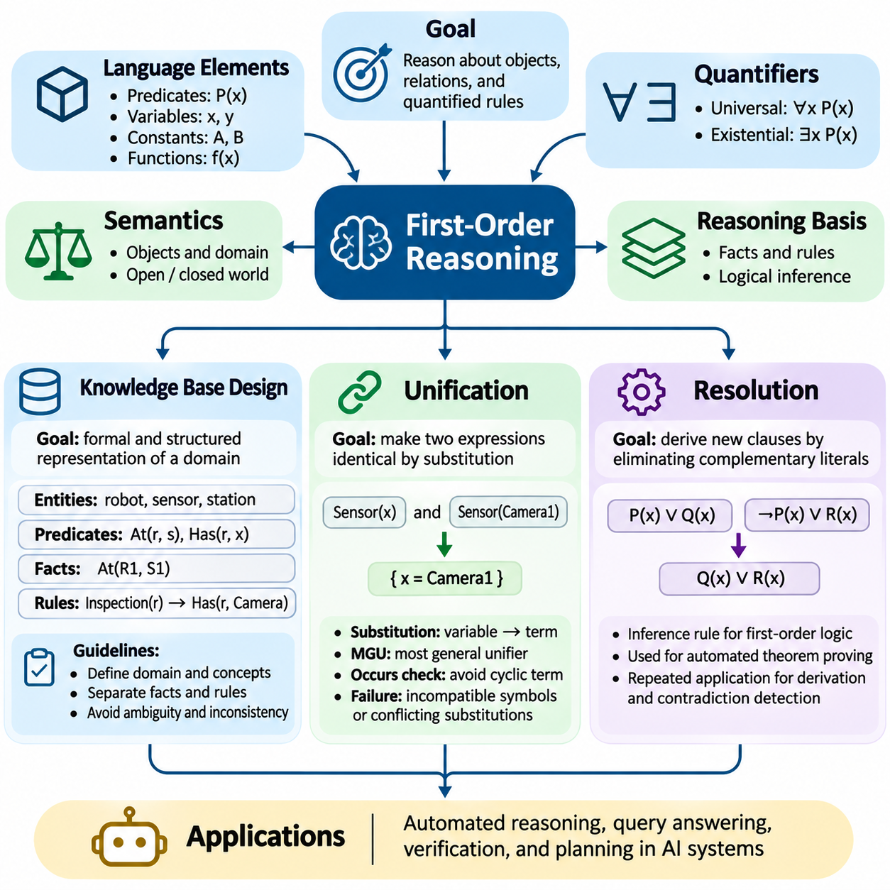{width="7.268055555555556in" height="7.268055555555556in"}

First-order reasoning extends propositional logic by representing objects, properties, relationships, and quantified statements within a formal logical framework. Instead of treating every statement as an indivisible proposition, first-order logic describes the internal structure of knowledge through predicates, variables, constants, and functions. This expressive capability enables artificial intelligence systems to reason about complex domains containing interconnected entities.

First-order logic introduces universal and existential quantifiers to express general rules and existence claims. Universal quantification states that a property applies to every object within a specified domain, while existential quantification asserts that at least one object satisfies a condition. These mechanisms allow knowledge bases to represent reusable rules rather than enumerating separate propositions for every individual object or situation.

A first-order knowledge base consists of formally expressed facts, rules, and relationships describing a particular domain. Predicates represent properties or relations, constants identify specific entities, and variables support generalized statements. Functions can represent mappings between objects. Together, these elements provide a structured vocabulary through which reasoning engines interpret domain knowledge and derive additional conclusions.

Knowledge base design begins by defining the domain of discourse and identifying relevant entities, attributes, and relationships. In a robotics application, entities may include robots, sensors, charging stations, missions, and operating zones. Predicates can describe whether a robot occupies a location, possesses a sensor, or is assigned to a mission. Carefully selected representations reduce ambiguity and support consistent inference.

The distinction between facts and rules is essential for knowledge base organization. Facts describe specific conditions, such as a robot being located at a charging station. Rules express general relationships, such as every robot assigned to an inspection mission requiring an appropriate sensor. A reasoning engine combines these elements to infer properties of individual entities without explicitly storing every possible consequence.

Quantifier scope must be defined carefully because different arrangements of quantifiers can express fundamentally different meanings. A statement asserting that every robot has some assigned mission does not necessarily mean that all robots share one particular mission. Incorrect quantifier placement can introduce unintended assumptions and produce misleading conclusions. Formal knowledge modeling therefore requires precise logical interpretation.

Knowledge bases must also address consistency, completeness, and assumptions about missing information. Under the open-world assumption, the absence of a fact does not imply that the fact is false. Under the closed-world assumption, information not established by the database may be treated as false within the selected reasoning framework. These assumptions influence query behavior, inference results, and the interpretation of incomplete knowledge.

A well-designed knowledge base separates domain concepts from operational inference procedures. Ontologies can organize entity categories and relationships, while logical rules define constraints and implications. Modular knowledge structures simplify maintenance, validation, and extension as domain requirements evolve. They also make it easier to identify contradictory assertions and trace the origin of inferred conclusions.

Unification is a fundamental operation that determines whether two logical expressions can become identical through suitable variable substitutions. For example, the expressions Sensor(x) and Sensor(Camera1) can be unified by substituting Camera1 for x. This mechanism allows general logical rules to match specific facts and provides a foundation for automated theorem proving, logic programming, and rule-based inference.

A substitution maps variables to terms, which may include constants, variables, or function expressions. Successful unification requires compatible predicate symbols, matching argument structures, and consistent substitutions across repeated variables. If one expression contains Relation(x,x) and another contains Relation(A,B), unification succeeds only when A and B can be made identical under the permitted substitutions.

The most general unifier, commonly called the MGU, is a substitution that makes two expressions identical without introducing unnecessary restrictions. Other valid unifiers can be obtained by applying additional substitutions to the MGU. Computing the most general unifier is valuable because it preserves flexibility for subsequent inference steps and avoids prematurely committing variables to overly specific values.

Unification algorithms typically compare expressions recursively, matching corresponding terms and accumulating substitutions. When a variable is encountered, the algorithm determines whether it can be consistently replaced by the opposing term. An occurs check prevents a variable from being substituted with a term containing that same variable, avoiding invalid cyclic structures in standard first-order unification.

Unification may fail when expressions contain incompatible constants, different predicate symbols, conflicting substitutions, or structures that cannot be reconciled. Such failures are meaningful because they prevent inference rules from being applied to unrelated facts. Efficient implementations maintain substitution environments and propagate established bindings throughout subsequent comparisons to preserve logical consistency.

Resolution is a powerful inference technique that derives new clauses by eliminating complementary literals from existing clauses. In first-order logic, resolution relies on unification to identify literals that can become complementary after substitution. The resulting resolvent represents a logical consequence of the original clauses. Repeated resolution can support automated proof construction and inconsistency detection.

Resolution-based theorem proving commonly uses proof by refutation. To demonstrate that a knowledge base entails a conclusion, the system adds the negation of that conclusion to the knowledge base and attempts to derive a contradiction. If resolution produces the empty clause, the combined statements are unsatisfiable, establishing that the original conclusion follows logically from the knowledge base.

Before applying resolution, first-order formulas are generally converted into clause form. This process includes eliminating implications, moving negations inward, standardizing variables apart, transforming quantifiers, and converting expressions into conjunctive normal form. Skolemization removes existential quantifiers through appropriate constants or functions while preserving satisfiability rather than full logical equivalence.

Consider a knowledge base stating that every inspection robot requires a camera and that RobotA is an inspection robot. The general rule can be expressed using a universally quantified implication, while the second statement provides a specific fact. Unification matches the general variable with RobotA, and resolution can derive that RobotA requires a camera. This illustrates how general knowledge produces concrete conclusions.

First-order resolution is sound and refutation-complete for first-order logic, meaning that valid resolution derivations preserve logical consequence and unsatisfiable clause sets can, in principle, be refuted. However, unrestricted first-order theorem proving is undecidable in general. A search procedure may continue indefinitely when the desired conclusion does not follow, making practical search control essential.

Resolution strategies improve efficiency by restricting which clauses are selected and how inference steps are performed. Unit resolution, set-of-support strategies, and ordered resolution can reduce unnecessary exploration under appropriate conditions. Indexing techniques accelerate matching and unification, while redundancy elimination removes clauses that contribute little additional information to the proof search.

Logic programming systems such as Prolog employ restricted forms of first-order reasoning to support goal-directed computation. Horn clauses provide a useful representation for many rules, and backward chaining combines unification with structured proof search. Although these systems are closely related to resolution, their operational semantics, search order, and treatment of special language features require careful consideration.

In autonomous robotics, first-order reasoning can represent relationships among missions, resources, environments, and safety constraints. A knowledge base may describe which robots possess required sensors, which missions demand particular capabilities, and which operating zones impose restrictions. Unification matches mission requirements with available resources, while logical inference determines whether assignments satisfy explicitly modeled conditions.

Practical knowledge-based systems must manage changing facts, incomplete observations, and computational limitations. Sensor updates may alter the current state of a robot, while newly introduced rules may change which conclusions can be derived. Incremental reasoning, selective rule evaluation, and knowledge validation help maintain useful performance. Formal correctness must still be distinguished from the accuracy of real-world observations.

Testing first-order reasoning systems requires more than confirming successful query results. Developers should examine inconsistent facts, incorrectly scoped quantifiers, failed unifications, unintended variable capture, and resolution searches that grow excessively large. Proof traces and controlled test cases help identify modeling errors. These practices are particularly important when inferred conclusions influence operational decisions.

First-order reasoning provides a rigorous foundation for representing structured knowledge and deriving conclusions across complex domains. Knowledge base design determines what can be expressed, unification connects general rules with specific instances, and resolution supplies a systematic mechanism for logical proof. Their integration supports explainable inference, automated verification, and knowledge-driven decision making in intelligent systems.

일차 논리 추론(First-Order Reasoning)은 형식 논리 체계(Formal Logical Framework) 내에서 객체(Object), 속성(Property), 관계(Relationship), 한정된 명제(Quantified Statement)를 표현함으로써 명제 논리(Propositional Logic)를 확장한다. 모든 명제를 분해할 수 없는 개별 명제로 취급하는 대신, 일차 논리(First-Order Logic)는 술어(Predicate), 변수(Variable), 상수(Constant), 함수(Function)를 통해 지식의 내부 구조(Internal Structure)를 기술한다. 이러한 표현 능력(Expressive Capability)을 통해 인공지능(Artificial Intelligence) 시스템은 상호 연결된 개체(Entity)를 포함하는 복잡한 도메인(Domain)에 대해 추론할 수 있다.

일차 논리(First-Order Logic)는 일반적인 규칙(General Rule)과 존재에 관한 명제(Existence Claim)를 표현하기 위해 전칭 한정자(Universal Quantifier)와 존재 한정자(Existential Quantifier)를 도입한다. 전칭 한정(Universal Quantification)은 지정된 도메인 내의 모든 객체에 특정 속성이 적용됨을 나타내며, 존재 한정(Existential Quantification)은 적어도 하나의 객체가 특정 조건을 만족함을 의미한다. 이러한 메커니즘을 통해 지식 베이스(Knowledge Base)는 개별 객체나 상황마다 별도의 명제를 나열하는 대신 재사용 가능한 규칙(Reusable Rule)을 표현할 수 있다.

일차 논리 지식 베이스(First-Order Knowledge Base)는 특정 도메인을 설명하는 형식적으로 표현된 사실(Fact), 규칙(Rule), 관계(Relationship)로 구성된다. 술어(Predicate)는 속성이나 관계를 나타내고, 상수(Constant)는 특정 개체(Entity)를 식별하며, 변수(Variable)는 일반화된 명제(Generalized Statement)를 지원한다. 함수(Function)는 객체 사이의 대응 관계(Mapping)를 표현할 수 있다. 이러한 요소는 추론 엔진(Reasoning Engine)이 도메인 지식을 해석하고 추가적인 결론을 도출하는 데 필요한 구조화된 어휘 체계(Structured Vocabulary)를 제공한다.

지식 베이스 설계(Knowledge Base Design)는 논의 영역(Domain of Discourse)을 정의하고 관련 개체(Entity), 속성(Attribute), 관계(Relationship)를 식별하는 것에서 시작한다. 로봇공학(Robotics) 응용 분야에서는 로봇(Robot), 센서(Sensor), 충전소(Charging Station), 임무(Mission), 운영 구역(Operating Zone) 등이 개체에 포함될 수 있다. 술어(Predicate)는 로봇이 특정 위치를 점유하는지, 센서를 보유하는지, 특정 임무에 할당되었는지를 설명할 수 있다. 신중하게 선택된 표현(Representation)은 모호성(Ambiguity)을 줄이고 일관된 추론(Consistent Inference)을 지원한다.

사실(Fact)과 규칙(Rule)의 구분은 지식 베이스를 구성하는 데 필수적이다. 사실은 로봇이 충전소에 위치한다는 것과 같은 특정 조건(Specific Condition)을 설명한다. 규칙은 검사 임무(Inspection Mission)에 할당된 모든 로봇이 적절한 센서를 필요로 한다는 것과 같은 일반적인 관계(General Relationship)를 표현한다. 추론 엔진(Reasoning Engine)은 이러한 요소를 결합하여 가능한 모든 논리적 귀결(Logical Consequence)을 명시적으로 저장하지 않고도 개별 개체의 속성을 추론할 수 있다.

한정자의 적용 범위(Quantifier Scope)는 한정자의 배열 방식에 따라 근본적으로 다른 의미가 표현될 수 있으므로 신중하게 정의해야 한다. 모든 로봇에 어떤 할당된 임무가 존재한다는 명제는 모든 로봇이 하나의 동일한 임무를 공유한다는 의미가 아니다. 잘못된 한정자 배치(Incorrect Quantifier Placement)는 의도하지 않은 가정(Unintended Assumption)을 도입하고 오해를 유발하는 결론(Misleading Conclusion)을 생성할 수 있다. 따라서 형식적 지식 모델링(Formal Knowledge Modeling)에는 정확한 논리적 해석(Logical Interpretation)이 필요하다.

지식 베이스(Knowledge Base)는 일관성(Consistency), 완전성(Completeness), 누락된 정보(Missing Information)에 관한 가정도 처리해야 한다. 열린 세계 가정(Open-World Assumption)에서는 특정 사실이 존재하지 않는다고 해서 그 사실이 거짓이라는 의미는 아니다. 닫힌 세계 가정(Closed-World Assumption)에서는 선택한 추론 체계(Reasoning Framework) 내에서 데이터베이스(Database)에 의해 확립되지 않은 정보를 거짓으로 취급할 수 있다. 이러한 가정은 질의 동작(Query Behavior), 추론 결과(Inference Result), 불완전한 지식(Incomplete Knowledge)의 해석에 영향을 미친다.

잘 설계된 지식 베이스는 도메인 개념(Domain Concept)과 운영상 추론 절차(Operational Inference Procedure)를 분리한다. 온톨로지(Ontology)는 개체 범주(Entity Category)와 관계를 체계적으로 구성할 수 있으며, 논리 규칙(Logical Rule)은 제약조건(Constraint)과 함의(Implication)를 정의한다. 모듈형 지식 구조(Modular Knowledge Structure)는 도메인 요구사항이 변화함에 따라 유지보수(Maintenance), 검증(Validation), 확장(Extension)을 단순화한다. 또한 모순된 단언(Contradictory Assertion)을 식별하고 추론된 결론의 출처를 추적하기 쉽게 한다.

단일화(Unification)는 적절한 변수 치환(Variable Substitution)을 통해 두 논리 표현식(Logical Expression)을 동일하게 만들 수 있는지 판단하는 기본 연산(Fundamental Operation)이다. 예를 들어 Sensor(x)와 Sensor(Camera1)이라는 표현식은 x를 Camera1로 치환함으로써 단일화할 수 있다. 이러한 메커니즘을 통해 일반적인 논리 규칙(General Logical Rule)을 특정 사실(Specific Fact)과 일치시킬 수 있으며, 자동 정리 증명(Automated Theorem Proving), 논리 프로그래밍(Logic Programming), 규칙 기반 추론(Rule-Based Inference)의 기반을 제공한다.

치환(Substitution)은 변수를 항(Term)에 대응시키는 과정이며, 항에는 상수(Constant), 변수(Variable), 함수 표현식(Function Expression)이 포함될 수 있다. 성공적인 단일화(Unification)를 위해서는 호환 가능한 술어 기호(Predicate Symbol), 일치하는 인자 구조(Argument Structure), 반복되는 변수에 대한 일관된 치환(Consistent Substitution)이 필요하다. 한 표현식이 Relation(x,x)를 포함하고 다른 표현식이 Relation(A,B)를 포함한다면, 허용된 치환에 따라 A와 B를 동일하게 만들 수 있는 경우에만 단일화가 성공한다.

일반적으로 MGU라고 부르는 가장 일반적인 단일화자(Most General Unifier)는 불필요한 제약조건(Unnecessary Restriction)을 추가하지 않으면서 두 표현식을 동일하게 만드는 치환(Substitution)이다. 다른 유효한 단일화자(Valid Unifier)는 MGU에 추가적인 치환을 적용하여 얻을 수 있다. 가장 일반적인 단일화자를 계산하는 것은 이후의 추론 단계(Inference Step)에서 유연성(Flexibility)을 유지하고 변수를 지나치게 구체적인 값으로 조기에 확정하는 것을 방지하기 때문에 중요하다.

단일화 알고리즘(Unification Algorithm)은 일반적으로 표현식을 재귀적으로 비교하면서 대응하는 항(Term)을 일치시키고 치환(Substitution)을 누적한다. 변수를 발견하면 알고리즘은 해당 변수를 반대편 항으로 일관되게 대체할 수 있는지 판단한다. 발생 검사(Occurs Check)는 변수가 자기 자신을 포함하는 항으로 치환되는 것을 방지하여 표준 일차 논리 단일화(Standard First-Order Unification)에서 유효하지 않은 순환 구조(Cyclic Structure)가 생성되지 않도록 한다.

단일화(Unification)는 표현식에 호환되지 않는 상수(Incompatible Constant), 서로 다른 술어 기호(Different Predicate Symbol), 충돌하는 치환(Conflicting Substitution), 조정할 수 없는 구조(Incompatible Structure)가 포함된 경우 실패할 수 있다. 이러한 실패는 관련 없는 사실에 추론 규칙이 적용되는 것을 방지하므로 의미가 있다. 효율적인 구현(Efficient Implementation)은 치환 환경(Substitution Environment)을 유지하고 확립된 변수 바인딩(Variable Binding)을 이후의 비교 과정에 전파하여 논리적 일관성(Logical Consistency)을 보존한다.

해결 원리(Resolution)는 기존 절(Clause)에 포함된 상보적 리터럴(Complementary Literal)을 제거하여 새로운 절을 도출하는 강력한 추론 기법(Inference Technique)이다. 일차 논리(First-Order Logic)에서 해결 원리는 단일화(Unification)를 활용하여 치환 이후 서로 상보적인 관계가 될 수 있는 리터럴을 식별한다. 결과적으로 생성되는 해결절(Resolvent)은 원래 절들의 논리적 귀결(Logical Consequence)을 나타낸다. 해결 원리를 반복적으로 적용하면 자동 증명 구성(Automated Proof Construction)과 불일치 탐지(Inconsistency Detection)를 지원할 수 있다.

해결 원리 기반 정리 증명(Resolution-Based Theorem Proving)은 일반적으로 귀류법에 의한 증명(Proof by Refutation)을 사용한다. 지식 베이스(Knowledge Base)가 특정 결론을 논리적으로 함축한다는 사실을 증명하기 위해 시스템은 해당 결론의 부정(Negation)을 지식 베이스에 추가하고 모순(Contradiction)을 도출하려고 시도한다. 해결 과정에서 공절(Empty Clause)이 생성되면 결합된 명제 집합이 만족 불가능(Unsatisfiable)하다는 의미이며, 원래 결론이 지식 베이스로부터 논리적으로 도출됨을 확립한다.

해결 원리를 적용하기 전에 일차 논리식(First-Order Formula)은 일반적으로 절 형식(Clause Form)으로 변환된다. 이 과정에는 함의 제거(Implication Elimination), 부정의 내부 이동(Negation Inward Movement), 변수 분리 표준화(Standardizing Variables Apart), 한정자 변환(Quantifier Transformation), 논리곱 정규형(Conjunctive Normal Form, CNF)으로의 변환이 포함된다. 스콜렘화(Skolemization)는 적절한 상수나 함수를 사용하여 존재 한정자(Existential Quantifier)를 제거하며, 완전한 논리적 동치(Logical Equivalence)가 아니라 만족 가능성(Satisfiability)을 보존한다.

모든 검사 로봇(Inspection Robot)에 카메라(Camera)가 필요하며 RobotA가 검사 로봇이라는 사실을 포함하는 지식 베이스를 생각해 볼 수 있다. 일반적인 규칙은 전칭 한정된 함의(Universally Quantified Implication)로 표현할 수 있으며, 두 번째 명제는 특정 사실(Specific Fact)을 제공한다. 단일화(Unification)는 일반 규칙의 변수를 RobotA와 일치시키고, 해결 원리(Resolution)는 RobotA에 카메라가 필요하다는 결론을 도출할 수 있다. 이는 일반적인 지식(General Knowledge)이 구체적인 결론(Concrete Conclusion)을 생성하는 과정을 보여준다.

일차 논리 해결 원리(First-Order Resolution)는 건전성(Soundness)과 반박 완전성(Refutation Completeness)을 가지며, 이는 유효한 해결 원리의 도출 과정이 논리적 귀결(Logical Consequence)을 보존하고 만족 불가능한 절 집합(Unsatisfiable Clause Set)은 원칙적으로 반박할 수 있음을 의미한다. 그러나 제약이 없는 일차 논리 정리 증명(First-Order Theorem Proving)은 일반적으로 결정 불가능(Undecidable)하다. 원하는 결론이 도출되지 않는 경우 탐색 절차(Search Procedure)가 무한히 계속될 수 있으므로 실용적인 탐색 제어(Search Control)가 필수적이다.

해결 원리 전략(Resolution Strategy)은 어떤 절을 선택하고 추론 단계를 어떻게 수행할 것인지를 제한하여 효율성을 향상한다. 단위 해결(Unit Resolution), 지원 집합 전략(Set-of-Support Strategy), 순서화 해결(Ordered Resolution)은 적절한 조건에서 불필요한 탐색(Unnecessary Exploration)을 줄일 수 있다. 인덱싱 기법(Indexing Technique)은 일치 검사(Matching)와 단일화(Unification)를 가속하며, 중복 제거(Redundancy Elimination)는 증명 탐색(Proof Search)에 추가적인 정보를 거의 제공하지 않는 절을 제거한다.

프롤로그(Prolog)와 같은 논리 프로그래밍 시스템(Logic Programming System)은 목표 지향적 계산(Goal-Directed Computation)을 지원하기 위해 제한된 형태의 일차 논리 추론(First-Order Reasoning)을 사용한다. 혼 절(Horn Clause)은 다양한 규칙을 표현하는 데 유용하며, 후방향 추론(Backward Chaining)은 단일화(Unification)와 구조화된 증명 탐색(Structured Proof Search)을 결합한다. 이러한 시스템은 해결 원리(Resolution)와 밀접하게 관련되지만, 실행 의미론(Operational Semantics), 탐색 순서(Search Order), 특수 언어 기능(Special Language Feature)의 처리 방식은 신중하게 고려해야 한다.

자율 로봇공학(Autonomous Robotics)에서 일차 논리 추론(First-Order Reasoning)은 임무(Mission), 자원(Resource), 환경(Environment), 안전 제약조건(Safety Constraint) 사이의 관계를 표현할 수 있다. 지식 베이스는 어떤 로봇이 필요한 센서를 보유하는지, 어떤 임무가 특정 기능(Capability)을 요구하는지, 어떤 운영 구역(Operating Zone)에 제한사항이 적용되는지를 설명할 수 있다. 단일화(Unification)는 임무 요구사항과 이용 가능한 자원을 일치시키며, 논리적 추론(Logical Inference)은 할당된 작업이 명시적으로 모델링된 조건을 만족하는지 판단한다.

실용적인 지식 기반 시스템(Knowledge-Based System)은 변화하는 사실(Changing Fact), 불완전한 관찰(Incomplete Observation), 계산적 한계(Computational Limitation)를 관리해야 한다. 센서 갱신(Sensor Update)은 로봇의 현재 상태(Current State)를 변경할 수 있으며, 새롭게 도입된 규칙은 도출 가능한 결론에 영향을 미칠 수 있다. 증분 추론(Incremental Reasoning), 선택적 규칙 평가(Selective Rule Evaluation), 지식 검증(Knowledge Validation)은 유용한 성능을 유지하는 데 도움이 된다. 그러나 형식적 정확성(Formal Correctness)은 실제 세계 관찰의 정확성(Real-World Observation Accuracy)과 구분되어야 한다.

일차 논리 추론 시스템(First-Order Reasoning System)의 테스트(Testing)는 성공적인 질의 결과(Query Result)를 확인하는 것 이상을 요구한다. 개발자는 일관성이 없는 사실(Inconsistent Fact), 잘못 지정된 한정자 범위(Incorrectly Scoped Quantifier), 실패한 단일화(Failed Unification), 의도하지 않은 변수 포획(Unintended Variable Capture), 지나치게 커지는 해결 원리 탐색(Resolution Search)을 검토해야 한다. 증명 추적(Proof Trace)과 통제된 테스트 사례(Controlled Test Case)는 모델링 오류(Modeling Error)를 식별하는 데 도움이 된다. 이러한 절차는 추론된 결론이 운영 의사결정(Operational Decision)에 영향을 미치는 경우 특히 중요하다.

일차 논리 추론(First-Order Reasoning)은 구조화된 지식(Structured Knowledge)을 표현하고 복잡한 도메인에서 결론을 도출하기 위한 엄밀한 기반을 제공한다. 지식 베이스 설계(Knowledge Base Design)는 무엇을 표현할 수 있는지 결정하고, 단일화(Unification)는 일반적인 규칙과 구체적인 사례를 연결하며, 해결 원리(Resolution)는 논리적 증명(Logical Proof)을 위한 체계적인 메커니즘을 제공한다. 이러한 요소의 통합은 지능형 시스템(Intelligent System)에서 설명 가능한 추론(Explainable Inference), 자동 검증(Automated Verification), 지식 기반 의사결정(Knowledge-Driven Decision Making)을 지원한다.

## 01.05 Rule Based Reasoning

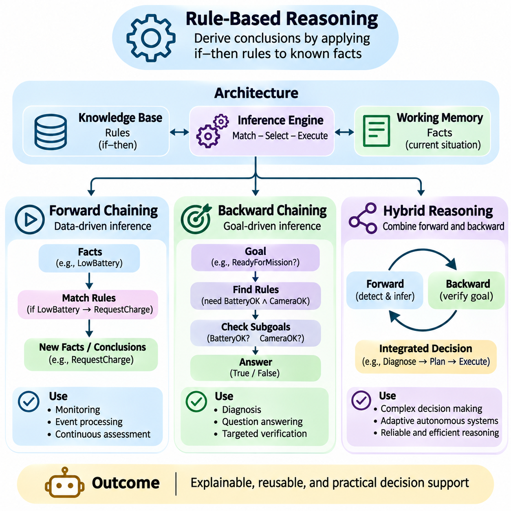{width="7.268055555555556in" height="7.268055555555556in"}

Rule-based reasoning is a foundational approach to artificial intelligence that derives conclusions by applying explicitly defined rules to available facts. These rules commonly use conditional structures connecting premises with consequences. Unlike purely statistical models, rule-based systems represent decision logic in a form that can be inspected, modified, and verified. Their transparency makes them valuable in expert systems, industrial automation, and knowledge-driven decision support.

A rule-based reasoning architecture typically contains a knowledge base, a working memory, and an inference engine. The knowledge base stores general rules, while working memory maintains facts describing the current situation. The inference engine identifies applicable rules and determines how they should be executed. This separation enables the system to reuse domain knowledge while responding to changing observations and operational conditions.

Forward chaining is a data-driven inference strategy that begins with known facts and progressively derives additional conclusions. The inference engine examines rules whose conditions match the current working memory and executes those that are applicable. Newly derived facts may activate further rules, creating a sequence of logical deductions. The process continues until no additional conclusions can be produced or a specified termination condition is reached.

Consider an autonomous robot operating in a warehouse. If its battery level falls below a defined threshold, a rule may classify the battery as low. Another rule may infer that a robot with a low battery should request charging. A subsequent rule may identify an available charging station. Forward chaining connects these conditions into a sequence of conclusions without requiring every intermediate decision to be explicitly requested.

The forward-chaining process generally involves matching, conflict resolution, and rule execution. During matching, the engine identifies rules whose conditions are satisfied. If multiple rules are applicable, a conflict-resolution strategy selects which rule to execute first. Rule execution then adds, updates, or retracts facts according to the system\'s operational semantics. These changes can trigger another evaluation cycle.

Efficient forward-chaining engines often use the Rete algorithm or related pattern-matching techniques. Rete maintains intermediate matching results so that changes in working memory do not require every rule condition to be evaluated again. This approach is particularly useful when large rule sets operate over frequently updated facts. However, memory consumption and rule-network complexity must be considered during implementation.

Forward chaining is well suited to monitoring, event processing, and continuous situation assessment. Industrial systems can apply rules to sensor measurements, equipment states, and operational alarms. Cybersecurity systems may correlate detected events with known threat patterns. Robotics platforms can infer mission readiness from resource availability and safety conditions. Its main limitation is that it may derive conclusions unrelated to the immediate objective.

Backward chaining follows a goal-driven strategy by beginning with a desired conclusion and searching for rules that could establish it. Instead of evaluating every possible consequence of available facts, the inference engine identifies the premises required to prove a particular goal. Each premise becomes a subgoal that must be verified through known facts or additional rules. This process continues until the goal is established or the search fails.

For example, a warehouse management system may ask whether RobotA is ready to execute an inspection mission. A backward-chaining engine searches for a rule defining mission readiness. The rule may require sufficient battery capacity, an operational camera, and authorization to enter the inspection zone. The engine evaluates these conditions individually, deriving supporting facts only when necessary to answer the original question.

Backward chaining commonly uses recursive goal expansion, unification, and backtracking. Unification matches a requested goal with the conclusion of a rule, while recursive expansion generates the required subgoals. If a selected rule cannot establish the goal, backtracking allows alternative rules to be considered. Proper variable management and termination controls are necessary to prevent repeated searches and infinite recursion.

Logic programming languages such as Prolog demonstrate the practical use of backward chaining. Prolog typically represents knowledge through facts and Horn clauses, applying goal-directed resolution to answer queries. Its operational behavior depends on rule ordering, search strategy, and unification. Although effective for structured symbolic reasoning, unrestricted recursive rules can cause nontermination or unnecessary exploration.

Backward chaining is particularly valuable in diagnostic systems, question answering, and targeted verification. A diagnostic engine can investigate whether a specific component failure explains observed symptoms. A compliance system can determine whether a proposed operation satisfies required conditions. Because only relevant supporting rules are explored, backward chaining can avoid some unnecessary deductions produced by unrestricted forward chaining.

Forward and backward chaining differ primarily in the direction of inference and the information that drives computation. Forward chaining starts from facts and discovers their consequences, while backward chaining starts from goals and investigates their prerequisites. The former is appropriate when incoming information should trigger conclusions automatically. The latter is effective when a specific question must be answered using available knowledge.

Neither strategy is universally superior because performance depends on rule structure, knowledge distribution, and application requirements. Forward chaining can be inefficient when many irrelevant conclusions are generated. Backward chaining can repeatedly evaluate shared subgoals or struggle with cyclic dependencies. Techniques such as memoization, dependency indexing, incremental evaluation, and cycle detection can improve efficiency in both approaches.

Hybrid reasoning combines forward and backward chaining within a coordinated inference architecture. A forward component continuously processes observations and maintains derived facts, while a backward component evaluates specific goals when requested. This combination allows systems to maintain awareness of changing conditions without exhaustively proving every possible conclusion. It also supports targeted reasoning over previously inferred knowledge.

In a robotic fleet management system, forward chaining may monitor battery states, sensor health, mission assignments, and charging availability. When a mission scheduler requests confirmation that a particular robot can perform a task, backward chaining evaluates the required capabilities and operational constraints. The resulting decision uses both continuously updated facts and goal-directed verification.

Hybrid systems require coordination between working memory, rule evaluation, and goal management. Facts derived through forward chaining must remain accessible to backward reasoning, while goal-directed discoveries may need to update shared knowledge. Dependency tracking helps determine when previously established conclusions become invalid after changes in observations. Without such mechanisms, stale facts can produce inconsistent operational decisions.

Rule priorities and conflict resolution are important in practical inference engines. Multiple rules may become applicable simultaneously, and their execution order can influence system behavior when rules perform state-changing actions. Priority levels, specificity criteria, and explicit conflict policies can establish predictable execution. For purely logical rules, inference results should be distinguished from operational side effects that depend on scheduling.

Rule-based reasoning also depends on clearly defined assumptions about incomplete and contradictory information. Classical monotonic reasoning preserves established conclusions when new premises are added, whereas practical monitoring systems often require fact retraction and belief revision. Truth-maintenance mechanisms can track dependencies between facts and derived conclusions, enabling updates when supporting information changes.

Explainability is a major advantage of rule-based systems because conclusions can be associated with the rules and facts that produced them. Forward-chaining engines can record sequences of activated rules, while backward-chaining engines can construct goal-support trees. These traces help engineers investigate unexpected decisions, verify domain requirements, and demonstrate compliance with explicitly modeled operational policies.

The reliability of a rule-based system depends on the quality of its knowledge base and the correctness of its inference procedures. Incorrect rules can produce logically consistent but operationally inappropriate conclusions. Testing should therefore examine conflicting rules, missing facts, circular dependencies, priority interactions, and boundary conditions. Formal verification and controlled simulation can complement conventional functional testing.

Modern artificial intelligence architectures increasingly combine rule-based reasoning with machine learning and probabilistic inference. Learned models can transform sensor observations into symbolic facts, while rules enforce explicit constraints and operational policies. Probabilistic components can represent uncertainty when observations are incomplete. Such hybrid architectures must preserve clear interfaces between uncertain predictions and deterministic logical decisions.

Rule-based reasoning remains particularly relevant in autonomous systems where decisions must satisfy explicit requirements. Forward chaining enables continuous interpretation of changing conditions, backward chaining supports targeted goal verification, and hybrid reasoning coordinates both mechanisms. Together, these approaches provide a structured foundation for transparent, maintainable, and knowledge-driven intelligence across complex operational environments.

규칙 기반 추론(Rule-Based Reasoning)은 이용 가능한 사실(Fact)에 명시적으로 정의된 규칙(Rule)을 적용하여 결론(Conclusion)을 도출하는 인공지능(Artificial Intelligence)의 기본적인 접근법이다. 이러한 규칙은 일반적으로 전제(Premise)와 결과(Consequence)를 연결하는 조건문(Conditional Statement) 구조를 사용한다. 순수한 통계 모델(Statistical Model)과 달리 규칙 기반 시스템(Rule-Based System)은 검사, 수정, 검증이 가능한 형태로 의사결정 논리(Decision Logic)를 표현한다. 이러한 투명성(Transparency)은 전문가 시스템(Expert System), 산업 자동화(Industrial Automation), 지식 기반 의사결정 지원(Knowledge-Driven Decision Support)에서 중요한 가치를 제공한다.

규칙 기반 추론 아키텍처(Rule-Based Reasoning Architecture)는 일반적으로 지식 베이스(Knowledge Base), 작업 메모리(Working Memory), 추론 엔진(Inference Engine)으로 구성된다. 지식 베이스는 일반적인 규칙을 저장하고, 작업 메모리는 현재 상황을 설명하는 사실을 유지한다. 추론 엔진은 적용 가능한 규칙(Applicable Rule)을 식별하고 해당 규칙의 실행 방법을 결정한다. 이러한 분리 구조(Separation of Concerns)를 통해 시스템은 도메인 지식(Domain Knowledge)을 재사용하면서 변화하는 관찰 결과(Observation)와 운영 조건(Operational Condition)에 대응할 수 있다.

전방향 추론(Forward Chaining)은 알려진 사실(Known Fact)에서 시작하여 추가적인 결론을 점진적으로 도출하는 데이터 중심 추론 전략(Data-Driven Inference Strategy)이다. 추론 엔진(Inference Engine)은 현재 작업 메모리(Working Memory)와 조건이 일치하는 규칙을 검사하고 적용 가능한 규칙을 실행한다. 새롭게 도출된 사실은 추가적인 규칙을 활성화하여 일련의 논리적 연역(Logical Deduction)을 생성할 수 있다. 이러한 과정은 더 이상 새로운 결론을 생성할 수 없거나 지정된 종료 조건(Termination Condition)에 도달할 때까지 계속된다.

창고(Warehouse)에서 작동하는 자율 로봇(Autonomous Robot)을 생각해 볼 수 있다. 배터리 수준(Battery Level)이 정의된 임계값(Threshold) 아래로 떨어지면 특정 규칙은 배터리 상태를 부족(Low Battery)으로 분류할 수 있다. 다른 규칙은 배터리가 부족한 로봇이 충전(Charging)을 요청해야 한다고 추론할 수 있다. 이후의 규칙은 이용 가능한 충전소(Charging Station)를 식별할 수 있다. 전방향 추론은 모든 중간 의사결정(Intermediate Decision)을 명시적으로 요청하지 않아도 이러한 조건을 일련의 결론으로 연결한다.

전방향 추론(Forward Chaining) 과정은 일반적으로 패턴 일치(Matching), 충돌 해결(Conflict Resolution), 규칙 실행(Rule Execution)으로 구성된다. 패턴 일치 단계에서는 추론 엔진이 조건을 만족하는 규칙을 식별한다. 여러 규칙이 동시에 적용 가능한 경우 충돌 해결 전략(Conflict-Resolution Strategy)이 먼저 실행할 규칙을 선택한다. 이후 규칙 실행 단계에서는 시스템의 실행 의미론(Operational Semantics)에 따라 사실을 추가, 갱신 또는 철회한다. 이러한 변경은 다음 평가 주기(Evaluation Cycle)를 유발할 수 있다.

효율적인 전방향 추론 엔진(Forward-Chaining Engine)은 레테 알고리즘(Rete Algorithm) 또는 관련 패턴 일치 기법(Pattern-Matching Technique)을 자주 사용한다. 레테 알고리즘은 중간 일치 결과(Intermediate Matching Result)를 유지하므로 작업 메모리(Working Memory)가 변경될 때마다 모든 규칙 조건을 다시 평가할 필요가 없다. 이러한 접근법은 자주 갱신되는 사실에 대해 대규모 규칙 집합(Rule Set)이 작동하는 경우 특히 유용하다. 그러나 구현 과정에서는 메모리 사용량(Memory Consumption)과 규칙 네트워크 복잡도(Rule-Network Complexity)를 고려해야 한다.

전방향 추론(Forward Chaining)은 모니터링(Monitoring), 이벤트 처리(Event Processing), 지속적인 상황 평가(Continuous Situation Assessment)에 적합하다. 산업 시스템(Industrial System)은 센서 측정값(Sensor Measurement), 장비 상태(Equipment State), 운영 경보(Operational Alarm)에 규칙을 적용할 수 있다. 사이버보안 시스템(Cybersecurity System)은 탐지된 이벤트를 알려진 위협 패턴(Threat Pattern)과 연관시킬 수 있다. 로봇 플랫폼(Robotics Platform)은 자원 가용성(Resource Availability)과 안전 조건(Safety Condition)을 바탕으로 임무 준비 상태(Mission Readiness)를 추론할 수 있다. 주요 한계는 즉각적인 목표와 관련 없는 결론까지 도출할 수 있다는 점이다.

후방향 추론(Backward Chaining)은 원하는 결론(Desired Conclusion)에서 시작하여 해당 결론을 확립할 수 있는 규칙을 탐색하는 목표 중심 전략(Goal-Driven Strategy)을 따른다. 이용 가능한 사실에서 발생할 수 있는 모든 결과를 평가하는 대신, 추론 엔진(Inference Engine)은 특정 목표(Goal)를 증명하는 데 필요한 전제를 식별한다. 각 전제는 알려진 사실이나 추가 규칙을 통해 검증해야 하는 하위 목표(Subgoal)가 된다. 이러한 과정은 목표가 확립되거나 탐색이 실패할 때까지 계속된다.

예를 들어 창고 관리 시스템(Warehouse Management System)이 RobotA가 검사 임무(Inspection Mission)를 수행할 준비가 되었는지 질문할 수 있다. 후방향 추론 엔진(Backward-Chaining Engine)은 임무 준비 상태(Mission Readiness)를 정의하는 규칙을 탐색한다. 해당 규칙은 충분한 배터리 용량(Battery Capacity), 정상 작동하는 카메라(Operational Camera), 검사 구역(Inspection Zone)에 진입할 수 있는 허가(Authorization)를 요구할 수 있다. 추론 엔진은 이러한 조건을 개별적으로 평가하고 원래 질문에 답하는 데 필요한 경우에만 근거가 되는 사실을 도출한다.

후방향 추론(Backward Chaining)은 일반적으로 재귀적 목표 확장(Recursive Goal Expansion), 단일화(Unification), 역추적(Backtracking)을 사용한다. 단일화는 요청된 목표를 규칙의 결론과 일치시키며, 재귀적 확장은 필요한 하위 목표를 생성한다. 선택한 규칙으로 목표를 확립할 수 없는 경우 역추적을 통해 대안적인 규칙(Alternative Rule)을 검토할 수 있다. 반복적인 탐색(Repeated Search)과 무한 재귀(Infinite Recursion)를 방지하려면 적절한 변수 관리(Variable Management)와 종료 제어(Termination Control)가 필요하다.

프롤로그(Prolog)와 같은 논리 프로그래밍 언어(Logic Programming Language)는 후방향 추론의 실용적인 활용을 보여준다. 프롤로그는 일반적으로 사실(Fact)과 혼 절(Horn Clause)을 통해 지식을 표현하고, 목표 지향적 해결 원리(Goal-Directed Resolution)를 적용하여 질의(Query)에 응답한다. 실행 동작(Operational Behavior)은 규칙 순서(Rule Ordering), 탐색 전략(Search Strategy), 단일화(Unification)에 따라 달라진다. 구조화된 기호적 추론(Structured Symbolic Reasoning)에 효과적이지만, 제한되지 않은 재귀 규칙(Recursive Rule)은 종료되지 않거나 불필요한 탐색을 유발할 수 있다.

후방향 추론(Backward Chaining)은 진단 시스템(Diagnostic System), 질의응답(Question Answering), 목표 지향적 검증(Targeted Verification)에서 특히 유용하다. 진단 엔진(Diagnostic Engine)은 특정 구성요소의 고장(Component Failure)이 관찰된 증상(Observed Symptom)을 설명하는지 조사할 수 있다. 규정 준수 시스템(Compliance System)은 제안된 작업이 필요한 조건을 만족하는지 판단할 수 있다. 관련된 근거 규칙(Supporting Rule)만 탐색하므로 후방향 추론은 제한 없는 전방향 추론에서 발생할 수 있는 불필요한 연역을 일부 방지할 수 있다.

전방향 추론(Forward Chaining)과 후방향 추론(Backward Chaining)은 주로 추론 방향(Direction of Inference)과 계산을 유도하는 정보에서 차이가 있다. 전방향 추론은 사실에서 시작하여 그 결과를 발견하는 반면, 후방향 추론은 목표에서 시작하여 목표의 전제조건(Prerequisite)을 조사한다. 전자는 새롭게 유입되는 정보가 자동으로 결론을 유발해야 하는 경우에 적합하다. 후자는 이용 가능한 지식을 사용하여 특정 질문에 답해야 하는 경우에 효과적이다.

두 전략 중 어느 하나가 보편적으로 우수한 것은 아니며, 성능(Performance)은 규칙 구조(Rule Structure), 지식 분포(Knowledge Distribution), 응용 요구사항(Application Requirement)에 따라 달라진다. 전방향 추론은 관련 없는 결론을 많이 생성할 때 비효율적일 수 있다. 후방향 추론은 공유된 하위 목표(Shared Subgoal)를 반복적으로 평가하거나 순환 의존성(Cyclic Dependency)을 처리하는 데 어려움을 겪을 수 있다. 메모이제이션(Memoization), 의존성 인덱싱(Dependency Indexing), 증분 평가(Incremental Evaluation), 순환 탐지(Cycle Detection)와 같은 기술은 두 접근법의 효율성을 향상할 수 있다.

하이브리드 추론(Hybrid Reasoning)은 전방향 추론과 후방향 추론을 조정된 추론 아키텍처(Coordinated Inference Architecture) 내에서 결합한다. 전방향 구성요소(Forward Component)는 관찰 결과를 지속적으로 처리하고 도출된 사실(Derived Fact)을 유지하며, 후방향 구성요소(Backward Component)는 요청이 발생했을 때 특정 목표를 평가한다. 이러한 조합은 가능한 모든 결론을 빠짐없이 증명하지 않고도 변화하는 조건에 대한 상황 인식(Situation Awareness)을 유지할 수 있도록 한다. 또한 이전에 추론된 지식에 대한 목표 지향적 추론(Targeted Reasoning)을 지원한다.

로봇 군집 관리 시스템(Robotic Fleet Management System)에서 전방향 추론은 배터리 상태(Battery State), 센서 건전성(Sensor Health), 임무 할당(Mission Assignment), 충전 가용성(Charging Availability)을 모니터링할 수 있다. 임무 스케줄러(Mission Scheduler)가 특정 로봇의 작업 수행 가능 여부를 확인하도록 요청하면, 후방향 추론은 필요한 기능(Capability)과 운영 제약조건(Operational Constraint)을 평가한다. 결과적으로 생성되는 의사결정은 지속적으로 갱신되는 사실과 목표 지향적 검증(Goal-Directed Verification)을 모두 활용한다.

하이브리드 시스템(Hybrid System)은 작업 메모리(Working Memory), 규칙 평가(Rule Evaluation), 목표 관리(Goal Management) 사이의 조정이 필요하다. 전방향 추론으로 도출된 사실은 후방향 추론에서도 접근할 수 있어야 하며, 목표 지향적 탐색을 통해 발견된 정보는 공유 지식(Shared Knowledge)을 갱신해야 할 수 있다. 의존성 추적(Dependency Tracking)은 관찰 결과가 변경된 후 이전에 확립된 결론이 언제 무효화되는지 판단하는 데 도움이 된다. 이러한 메커니즘이 없으면 오래된 사실(Stale Fact)이 일관되지 않은 운영 의사결정(Inconsistent Operational Decision)을 초래할 수 있다.

규칙 우선순위(Rule Priority)와 충돌 해결(Conflict Resolution)은 실용적인 추론 엔진(Inference Engine)에서 중요하다. 여러 규칙이 동시에 적용 가능해질 수 있으며, 규칙이 상태를 변경하는 동작(State-Changing Action)을 수행하는 경우 실행 순서(Execution Order)가 시스템 동작에 영향을 줄 수 있다. 우선순위 수준(Priority Level), 구체성 기준(Specificity Criterion), 명시적인 충돌 정책(Conflict Policy)을 통해 예측 가능한 실행(Predictable Execution)을 확립할 수 있다. 순수한 논리 규칙(Purely Logical Rule)의 경우 추론 결과(Inference Result)는 스케줄링에 따라 달라지는 운영상 부작용(Operational Side Effect)과 구분되어야 한다.

규칙 기반 추론(Rule-Based Reasoning)은 불완전하고 모순된 정보(Incomplete and Contradictory Information)에 대한 명확한 가정에도 의존한다. 고전적인 단조 추론(Classical Monotonic Reasoning)은 새로운 전제가 추가되어도 기존 결론을 유지하지만, 실제 모니터링 시스템(Monitoring System)에서는 사실 철회(Fact Retraction)와 믿음 수정(Belief Revision)이 필요한 경우가 많다. 진리 유지 메커니즘(Truth-Maintenance Mechanism)은 사실과 도출된 결론 사이의 의존관계를 추적하여 근거 정보(Supporting Information)가 변경될 때 결론을 갱신할 수 있도록 한다.

설명 가능성(Explainability)은 결론을 생성한 규칙과 사실을 연결할 수 있다는 점에서 규칙 기반 시스템(Rule-Based System)의 주요 장점이다. 전방향 추론 엔진은 활성화된 규칙의 실행 순서(Sequence of Activated Rules)를 기록할 수 있으며, 후방향 추론 엔진은 목표 근거 트리(Goal-Support Tree)를 구성할 수 있다. 이러한 추적 정보(Trace Information)는 엔지니어가 예상하지 못한 의사결정을 조사하고, 도메인 요구사항(Domain Requirement)을 검증하며, 명시적으로 모델링된 운영 정책(Operational Policy)의 준수 여부를 입증하는 데 도움이 된다.

규칙 기반 시스템의 신뢰성(Reliability)은 지식 베이스(Knowledge Base)의 품질과 추론 절차(Inference Procedure)의 정확성에 따라 결정된다. 잘못된 규칙(Incorrect Rule)은 논리적으로 일관되지만 운영상 부적절한 결론(Operationally Inappropriate Conclusion)을 생성할 수 있다. 따라서 테스트(Testing)는 충돌하는 규칙(Conflicting Rule), 누락된 사실(Missing Fact), 순환 의존성(Circular Dependency), 우선순위 상호작용(Priority Interaction), 경계 조건(Boundary Condition)을 검토해야 한다. 형식 검증(Formal Verification)과 통제된 시뮬레이션(Controlled Simulation)은 기존의 기능 테스트(Functional Testing)를 보완할 수 있다.

현대 인공지능 아키텍처(Artificial Intelligence Architecture)는 규칙 기반 추론(Rule-Based Reasoning)을 기계학습(Machine Learning) 및 확률적 추론(Probabilistic Inference)과 점점 더 많이 결합하고 있다. 학습된 모델(Learned Model)은 센서 관찰 결과(Sensor Observation)를 기호적 사실(Symbolic Fact)로 변환할 수 있으며, 규칙은 명시적인 제약조건(Explicit Constraint)과 운영 정책(Operational Policy)을 적용한다. 확률적 구성요소(Probabilistic Component)는 관찰 결과가 불완전할 때 불확실성(Uncertainty)을 표현할 수 있다. 이러한 하이브리드 아키텍처(Hybrid Architecture)는 불확실한 예측(Uncertain Prediction)과 결정론적 논리 의사결정(Deterministic Logical Decision) 사이에 명확한 인터페이스(Interface)를 유지해야 한다.

규칙 기반 추론(Rule-Based Reasoning)은 의사결정이 명시적인 요구사항(Explicit Requirement)을 만족해야 하는 자율 시스템(Autonomous System)에서 특히 중요한 역할을 한다. 전방향 추론(Forward Chaining)은 변화하는 조건을 지속적으로 해석할 수 있도록 하고, 후방향 추론(Backward Chaining)은 특정 목표에 대한 검증(Targeted Goal Verification)을 지원하며, 하이브리드 추론(Hybrid Reasoning)은 두 메커니즘을 조정한다. 이러한 접근법은 복잡한 운영 환경(Operational Environment) 전반에서 투명하고(Transparent), 유지보수가 가능하며(Maintainable), 지식 중심적인(Knowledge-Driven) 지능을 구현하기 위한 구조화된 기반을 제공한다.

## 01.06 Non Monotonic Reasoning

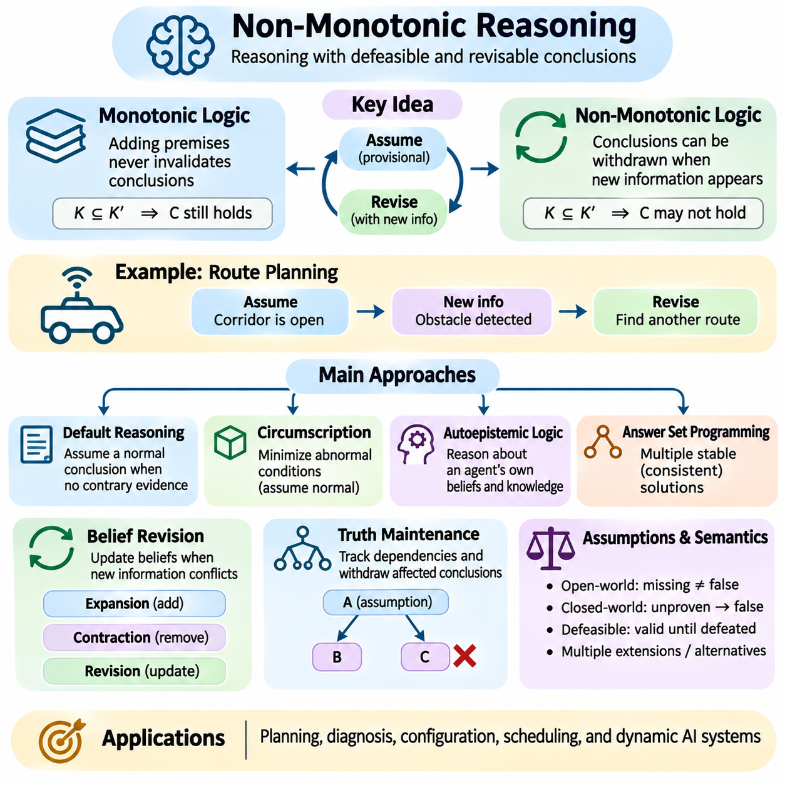{width="7.268055555555556in" height="7.268055555555556in"}

Non-monotonic reasoning is a form of logical inference in which conclusions may be withdrawn when new information becomes available. Unlike classical monotonic logic, where adding premises never invalidates previously established consequences, non-monotonic reasoning supports revisable conclusions. This capability is essential for artificial intelligence systems operating with incomplete knowledge, changing environments, and assumptions that may later prove incorrect.

Classical logic follows the monotonicity principle: if a conclusion follows from a knowledge base, it continues to follow after additional premises are introduced. Non-monotonic reasoning relaxes this property by allowing new evidence to defeat earlier conclusions. Such reasoning more closely reflects practical decision making, where agents frequently rely on provisional beliefs and modify them when exceptions or contradictory observations appear.

Consider an autonomous robot that normally assumes a corridor is traversable when no obstacle has been reported. Based on this assumption, the robot may plan a route through the corridor. If a sensor subsequently detects a physical obstruction, the previous conclusion must be withdrawn and the route reconsidered. Non-monotonic reasoning provides a formal perspective for managing this transition from assumed availability to evidence-based restriction.

A central concept in non-monotonic reasoning is the distinction between established facts and defeasible assumptions. Established facts represent information accepted within the current knowledge model, while defeasible assumptions remain valid only until stronger evidence challenges them. This distinction allows reasoning systems to act despite incomplete information without treating every provisional conclusion as permanently guaranteed.

Default reasoning is one important mechanism for implementing non-monotonic inference. A default rule expresses what should normally be assumed when no contrary evidence is available. For example, a warehouse robot may assume that an assigned charging station is accessible unless maintenance information indicates otherwise. The conclusion is supported by a normal operating assumption rather than an unconditional logical implication.

Reiter\'s default logic formalizes this behavior using rules that distinguish prerequisites, consistency conditions, and conclusions. A default can be applied when its prerequisite is established and its justification remains consistent with the available beliefs. Different compatible collections of defaults may produce multiple extensions, representing alternative sets of acceptable conclusions under the same incomplete knowledge.

Circumscription provides another approach by minimizing the extension of selected predicates while satisfying a logical theory. It can formalize assumptions that abnormal conditions are absent unless evidence requires otherwise. For instance, a monitoring system may treat equipment as operating normally unless an abnormality is established. The resulting conclusions depend on which predicates are minimized and which properties remain variable.

Autoepistemic logic addresses reasoning about an agent\'s own beliefs and knowledge. It introduces modal expressions that describe whether propositions are believed or not believed. This enables rules whose applicability depends on the absence of a belief rather than the explicit falsity of a proposition. Such distinctions are important because not knowing that a condition holds is different from knowing that it does not hold.

Logic programming with negation as failure provides a practical form of non-monotonic behavior. Under suitable program semantics, a system may infer a negative conclusion when an attempt to prove the corresponding positive statement fails. This mechanism is useful in database querying and rule-based applications, but its interpretation depends on assumptions about completeness and the selected logical semantics.

Answer set programming extends logic programming with stable-model semantics to represent defaults, exceptions, and alternative solutions. A program may have multiple answer sets, each describing a consistent interpretation of the encoded rules. This approach is particularly useful for planning, scheduling, configuration, and constraint-intensive reasoning problems where several admissible outcomes may exist.

The distinction between open-world and closed-world assumptions strongly influences non-monotonic reasoning. Under an open-world assumption, missing information does not establish falsity. Under a closed-world assumption, unproven statements may be treated as false within a defined information boundary. Selecting an appropriate assumption requires understanding whether the knowledge source is intended to be complete for the relevant domain.

Belief revision concerns how a reasoning system should modify its accepted beliefs when new information conflicts with existing knowledge. Rather than simply accumulating facts, a revision mechanism attempts to preserve useful information while restoring consistency. AGM belief revision provides a classical theoretical framework for analyzing rational changes to belief sets, including expansion, contraction, and revision operations.

Truth maintenance systems support practical belief revision by tracking relationships between assumptions and derived conclusions. When a supporting assumption becomes invalid, dependent conclusions can be reconsidered or withdrawn. Justification-based truth maintenance records inference dependencies, while assumption-based approaches can represent alternative consistent environments. These mechanisms are valuable in systems that must continuously update their internal state.

Non-monotonic reasoning must distinguish between new information that extends knowledge and information that defeats an existing inference. A newly observed temperature reading may add useful context without changing previous conclusions. In contrast, a confirmed sensor malfunction may invalidate conclusions derived from that sensor. Dependency tracking and explicit justification records help determine which beliefs require reevaluation.

Exceptions are a major source of non-monotonic behavior. General rules often describe typical conditions but admit special cases. A mobile robot may normally enter a designated operating zone, yet temporary maintenance restrictions can override that permission. Representing exceptions explicitly prevents the system from treating operational defaults as universal truths and supports more context-sensitive decisions.

Conflicting defaults create additional challenges because multiple plausible assumptions may support incompatible conclusions. A system may assume that a corridor is available based on its normal schedule while also assuming that maintenance areas are restricted. Priority rules, specificity principles, and preference relations can help resolve such conflicts. However, the chosen resolution policy must be defined rather than assumed to be universally correct.

Temporal change further complicates non-monotonic inference because facts and assumptions may be valid only during particular intervals. A charging station may be available at one moment and unavailable after a new reservation. Time-indexed facts, event histories, and validity intervals help prevent outdated conclusions from being applied to current situations. These mechanisms connect non-monotonic reasoning with temporal reasoning and dynamic knowledge representation.

In autonomous robotics, non-monotonic reasoning can coordinate high-level mission decisions with changing environmental information. A robot may initially consider a delivery route feasible, then withdraw that assessment after detecting a blocked passage or restricted area. The reasoning system can revise its mission assumptions and request replanning while lower-level safety controllers independently enforce immediate physical constraints.

Hybrid artificial intelligence systems can combine non-monotonic logic with probabilistic inference and machine learning. Learned perception models may provide uncertain observations, while symbolic rules determine how those observations affect operational assumptions. Confidence thresholds and evidence policies can influence when provisional conclusions should be revised. Care is required because probabilistic uncertainty and logical defeasibility represent different forms of uncertainty.

Computational complexity is an important limitation of non-monotonic reasoning. Determining acceptable conclusions may require exploring multiple alternative belief sets or stable models. Some formalisms have substantially higher computational complexity than restricted classical reasoning systems. Practical implementations therefore rely on domain constraints, incremental evaluation, solver optimization, and carefully selected fragments of non-monotonic logic.

Explainability becomes especially important when conclusions are revised. A reasoning system should identify which assumption originally supported a conclusion, what new evidence defeated it, and which alternative conclusion replaced it. Maintaining provenance records and justification graphs allows engineers to reconstruct changes in reasoning state. Such transparency supports debugging, operational auditing, and trustworthy human oversight.

Testing non-monotonic systems requires scenarios involving incomplete information, exceptions, contradictory evidence, and changing observations. Developers should verify that conclusions are withdrawn when their supporting assumptions fail and retained when unrelated information changes. Tests should also examine cyclic dependencies, competing defaults, and unexpected interactions between rules. These evaluations reveal errors that ordinary positive-case testing may overlook.

Non-monotonic reasoning provides a formal foundation for intelligent systems that must act before complete knowledge is available and adapt when circumstances change. By supporting defaults, exceptions, belief revision, and dependency-aware inference, it bridges rigid classical deduction and the practical demands of dynamic environments. Its integration with planning, perception, and knowledge management enables more flexible, explainable, and context-sensitive artificial intelligence.

비단조 추론(Non-Monotonic Reasoning)은 새로운 정보가 제공될 때 기존의 결론을 철회할 수 있는 논리적 추론(Logical Inference)의 한 형태이다. 새로운 전제를 추가하더라도 이전에 확립된 논리적 귀결(Logical Consequence)이 무효화되지 않는 고전적 단조 논리(Classical Monotonic Logic)와 달리, 비단조 추론은 수정 가능한 결론(Revisable Conclusion)을 지원한다. 이러한 능력은 불완전한 지식(Incomplete Knowledge), 변화하는 환경(Changing Environment), 나중에 잘못된 것으로 밝혀질 수 있는 가정(Assumption)을 바탕으로 작동하는 인공지능(Artificial Intelligence) 시스템에 필수적이다.

고전 논리(Classical Logic)는 단조성 원리(Monotonicity Principle)를 따른다. 즉, 특정 결론이 지식 베이스(Knowledge Base)로부터 도출된다면 추가적인 전제가 도입된 이후에도 해당 결론은 계속해서 논리적으로 도출된다. 비단조 추론(Non-Monotonic Reasoning)은 새로운 증거가 이전의 결론을 무효화할 수 있도록 이러한 속성을 완화한다. 이러한 추론 방식은 에이전트(Agent)가 잠정적인 믿음(Provisional Belief)에 의존하고 예외(Exception)나 모순되는 관찰 결과(Contradictory Observation)가 나타나면 이를 수정하는 실제 의사결정(Practical Decision Making)을 더욱 가깝게 반영한다.

장애물이 보고되지 않았을 때 복도(Corridor)를 통과할 수 있다고 일반적으로 가정하는 자율 로봇(Autonomous Robot)을 생각해 볼 수 있다. 이러한 가정을 바탕으로 로봇은 해당 복도를 통과하는 경로(Route)를 계획할 수 있다. 이후 센서(Sensor)가 물리적 장애물(Physical Obstruction)을 감지하면 이전 결론을 철회하고 경로를 다시 검토해야 한다. 비단조 추론(Non-Monotonic Reasoning)은 가정에 기반한 통행 가능 상태(Assumed Availability)에서 증거에 기반한 제한 상태(Evidence-Based Restriction)로 전환하는 과정을 관리하기 위한 형식적 관점(Formal Perspective)을 제공한다.

비단조 추론(Non-Monotonic Reasoning)의 핵심 개념은 확립된 사실(Established Fact)과 반박 가능한 가정(Defeasible Assumption)을 구분하는 것이다. 확립된 사실은 현재 지식 모델(Knowledge Model)에서 받아들여진 정보를 나타내며, 반박 가능한 가정은 더 강력한 증거(Stronger Evidence)가 이를 반박하기 전까지만 유효하다. 이러한 구분을 통해 추론 시스템(Reasoning System)은 불완전한 정보에도 불구하고 행동할 수 있으며, 모든 잠정적인 결론(Provisional Conclusion)을 영구적으로 보장된 사실로 취급하지 않을 수 있다.

기본 추론(Default Reasoning)은 비단조 추론(Non-Monotonic Inference)을 구현하는 중요한 메커니즘 중 하나이다. 기본 규칙(Default Rule)은 반대되는 증거가 존재하지 않을 때 일반적으로 무엇을 가정해야 하는지를 표현한다. 예를 들어 창고 로봇(Warehouse Robot)은 유지보수 정보(Maintenance Information)가 달리 나타내지 않는 한 할당된 충전소(Charging Station)에 접근할 수 있다고 가정할 수 있다. 이러한 결론은 무조건적인 논리적 함의(Unconditional Logical Implication)가 아니라 정상 운영 가정(Normal Operating Assumption)에 의해 뒷받침된다.

라이터의 기본 논리(Reiter\'s Default Logic)는 전제조건(Prerequisite), 일관성 조건(Consistency Condition), 결론(Conclusion)을 구분하는 규칙을 사용하여 이러한 동작을 형식화한다. 기본 규칙은 전제조건이 확립되고 정당화 조건(Justification)이 이용 가능한 믿음(Belief)과 일관성을 유지할 때 적용할 수 있다. 서로 양립 가능한 기본 규칙의 조합에 따라 여러 확장(Extension)이 생성될 수 있으며, 이는 동일한 불완전한 지식 아래에서 수용 가능한 대안적 결론 집합(Alternative Set of Acceptable Conclusions)을 나타낸다.

최소화 논리(Circumscription)는 논리 이론(Logical Theory)을 만족시키면서 선택된 술어(Predicate)의 외연(Extension)을 최소화하는 또 다른 접근법이다. 이를 통해 증거가 달리 요구하지 않는 한 비정상적인 조건(Abnormal Condition)이 존재하지 않는다고 가정하는 방식을 형식화할 수 있다. 예를 들어 모니터링 시스템(Monitoring System)은 이상 상태(Abnormality)가 확립되지 않는 한 장비가 정상적으로 작동한다고 취급할 수 있다. 결과적으로 도출되는 결론은 어떤 술어를 최소화하고 어떤 속성을 가변적으로 유지하는지에 따라 달라진다.

자기인식 논리(Autoepistemic Logic)는 에이전트(Agent)가 자신의 믿음(Belief)과 지식(Knowledge)에 대해 수행하는 추론을 다룬다. 이 논리는 특정 명제가 믿어지는지 또는 믿어지지 않는지를 설명하는 양상 표현(Modal Expression)을 도입한다. 이를 통해 명제가 명시적으로 거짓이라는 사실이 아니라 특정 믿음이 존재하지 않는다는 사실에 따라 적용 여부가 결정되는 규칙을 표현할 수 있다. 이러한 구분은 어떤 조건이 성립한다는 사실을 알지 못하는 것과 그 조건이 성립하지 않는다는 사실을 아는 것이 서로 다르기 때문에 중요하다.

실패에 의한 부정(Negation as Failure)을 사용하는 논리 프로그래밍(Logic Programming)은 비단조적 동작(Non-Monotonic Behavior)의 실용적인 형태를 제공한다. 적절한 프로그램 의미론(Program Semantics) 아래에서 시스템은 대응하는 긍정 명제(Positive Statement)를 증명하려는 시도가 실패하면 부정적인 결론(Negative Conclusion)을 추론할 수 있다. 이러한 메커니즘은 데이터베이스 질의(Database Querying)와 규칙 기반 응용(Rule-Based Application)에 유용하지만, 그 해석은 완전성(Completeness)에 관한 가정과 선택된 논리적 의미론(Logical Semantics)에 따라 달라진다.

정답 집합 프로그래밍(Answer Set Programming)은 기본 규칙(Default), 예외(Exception), 대안적 해결책(Alternative Solution)을 표현하기 위해 안정 모델 의미론(Stable-Model Semantics)을 사용하는 논리 프로그래밍의 확장이다. 하나의 프로그램은 여러 정답 집합(Answer Set)을 가질 수 있으며, 각 정답 집합은 인코딩된 규칙(Encoded Rule)에 대한 일관된 해석(Consistent Interpretation)을 설명한다. 이러한 접근법은 여러 허용 가능한 결과(Admissible Outcome)가 존재할 수 있는 계획(Planning), 일정 관리(Scheduling), 구성(Configuration), 제약조건 중심 추론(Constraint-Intensive Reasoning) 문제에서 특히 유용하다.

열린 세계 가정(Open-World Assumption)과 닫힌 세계 가정(Closed-World Assumption)의 차이는 비단조 추론(Non-Monotonic Reasoning)에 큰 영향을 미친다. 열린 세계 가정에서는 정보가 누락되었다고 해서 거짓임이 확립되는 것은 아니다. 닫힌 세계 가정에서는 정의된 정보 범위(Information Boundary) 내에서 증명되지 않은 명제를 거짓으로 취급할 수 있다. 적절한 가정을 선택하려면 해당 지식 원천(Knowledge Source)이 관련 도메인(Domain)에 대해 완전한 정보를 제공하도록 설계되었는지 이해해야 한다.

믿음 수정(Belief Revision)은 새로운 정보가 기존 지식과 충돌할 때 추론 시스템(Reasoning System)이 받아들인 믿음을 어떻게 변경해야 하는지를 다룬다. 수정 메커니즘(Revision Mechanism)은 단순히 사실을 누적하는 대신 유용한 정보를 보존하면서 일관성(Consistency)을 회복하려고 시도한다. AGM 믿음 수정(AGM Belief Revision)은 믿음 집합(Belief Set)의 합리적인 변화(Rational Change)를 분석하기 위한 고전적인 이론적 프레임워크(Theoretical Framework)를 제공하며, 확장(Expansion), 축소(Contraction), 수정(Revision) 연산을 포함한다.

진리 유지 시스템(Truth Maintenance System)은 가정(Assumption)과 도출된 결론(Derived Conclusion) 사이의 관계를 추적하여 실용적인 믿음 수정(Belief Revision)을 지원한다. 근거가 되는 가정이 무효화되면 해당 가정에 의존하는 결론을 재검토하거나 철회할 수 있다. 정당화 기반 진리 유지(Justification-Based Truth Maintenance)는 추론 의존관계(Inference Dependency)를 기록하며, 가정 기반 접근법(Assumption-Based Approach)은 대안적인 일관성 환경(Consistent Environment)을 표현할 수 있다. 이러한 메커니즘은 내부 상태(Internal State)를 지속적으로 갱신해야 하는 시스템에서 중요하다.

비단조 추론(Non-Monotonic Reasoning)은 지식을 확장하는 새로운 정보와 기존 추론을 무효화하는 정보를 구분해야 한다. 새롭게 관찰된 온도 측정값(Temperature Reading)은 이전 결론을 변경하지 않으면서 유용한 맥락(Context)을 추가할 수 있다. 반면 확인된 센서 고장(Sensor Malfunction)은 해당 센서에서 도출된 결론을 무효화할 수 있다. 의존성 추적(Dependency Tracking)과 명시적인 정당화 기록(Justification Record)은 어떤 믿음을 재평가해야 하는지 판단하는 데 도움이 된다.

예외(Exception)는 비단조적 동작(Non-Monotonic Behavior)의 주요 원인 중 하나이다. 일반적인 규칙(General Rule)은 흔히 전형적인 조건(Typical Condition)을 설명하지만 특별한 경우(Special Case)를 허용한다. 이동 로봇(Mobile Robot)은 일반적으로 지정된 운영 구역(Operating Zone)에 진입할 수 있지만, 일시적인 유지보수 제한(Temporary Maintenance Restriction)이 이러한 허가를 무효화할 수 있다. 예외를 명시적으로 표현하면 시스템이 운영상 기본 가정(Operational Default)을 보편적인 진리(Universal Truth)로 취급하는 것을 방지하고 상황에 더욱 민감한 의사결정(Context-Sensitive Decision)을 지원한다.

충돌하는 기본 규칙(Conflicting Default)은 여러 타당한 가정(Plausible Assumption)이 서로 양립할 수 없는 결론(Incompatible Conclusion)을 뒷받침할 수 있기 때문에 추가적인 문제를 발생시킨다. 시스템은 정상적인 운영 일정(Normal Schedule)을 바탕으로 복도를 이용할 수 있다고 가정하면서 동시에 유지보수 구역(Maintenance Area)에 대한 접근이 제한된다고 가정할 수 있다. 우선순위 규칙(Priority Rule), 구체성 원리(Specificity Principle), 선호 관계(Preference Relation)는 이러한 충돌을 해결하는 데 도움이 된다. 그러나 선택된 충돌 해결 정책(Conflict Resolution Policy)은 보편적으로 옳다고 가정하기보다 명시적으로 정의해야 한다.

시간적 변화(Temporal Change)는 사실과 가정이 특정 시간 구간(Time Interval)에서만 유효할 수 있기 때문에 비단조 추론(Non-Monotonic Inference)을 더욱 복잡하게 만든다. 충전소(Charging Station)는 어느 시점에는 이용 가능하지만 새로운 예약(Reservation)이 발생한 이후에는 이용할 수 없게 될 수 있다. 시간 인덱스가 부여된 사실(Time-Indexed Fact), 이벤트 이력(Event History), 유효 기간(Validity Interval)은 오래된 결론(Outdated Conclusion)이 현재 상황에 적용되는 것을 방지하는 데 도움이 된다. 이러한 메커니즘은 비단조 추론을 시간 추론(Temporal Reasoning) 및 동적 지식 표현(Dynamic Knowledge Representation)과 연결한다.

자율 로봇공학(Autonomous Robotics)에서 비단조 추론(Non-Monotonic Reasoning)은 상위 수준의 임무 의사결정(High-Level Mission Decision)을 변화하는 환경 정보(Environmental Information)와 조정할 수 있다. 로봇은 처음에는 배송 경로(Delivery Route)가 실행 가능하다고 판단하지만, 통로 차단(Blocked Passage)이나 제한 구역(Restricted Area)을 감지한 후 해당 판단을 철회할 수 있다. 추론 시스템은 임무 가정(Mission Assumption)을 수정하고 재계획(Replanning)을 요청할 수 있으며, 동시에 하위 수준의 안전 제어기(Lower-Level Safety Controller)는 즉각적인 물리적 제약조건(Physical Constraint)을 독립적으로 적용한다.

하이브리드 인공지능 시스템(Hybrid Artificial Intelligence System)은 비단조 논리(Non-Monotonic Logic)를 확률적 추론(Probabilistic Inference) 및 기계학습(Machine Learning)과 결합할 수 있다. 학습된 인식 모델(Learned Perception Model)은 불확실한 관찰 결과(Uncertain Observation)를 제공할 수 있으며, 기호적 규칙(Symbolic Rule)은 이러한 관찰 결과가 운영상 가정(Operational Assumption)에 어떤 영향을 미치는지 결정한다. 신뢰도 임계값(Confidence Threshold)과 증거 정책(Evidence Policy)은 잠정적인 결론(Provisional Conclusion)을 수정해야 하는 시점에 영향을 줄 수 있다. 확률적 불확실성(Probabilistic Uncertainty)과 논리적 반박 가능성(Logical Defeasibility)은 서로 다른 형태의 불확실성을 나타내므로 주의가 필요하다.

계산 복잡도(Computational Complexity)는 비단조 추론(Non-Monotonic Reasoning)의 중요한 한계이다. 수용 가능한 결론(Acceptable Conclusion)을 결정하려면 여러 대안적 믿음 집합(Alternative Belief Set)이나 안정 모델(Stable Model)을 탐색해야 할 수 있다. 일부 형식 체계(Formalism)는 제한된 고전적 추론 시스템(Restricted Classical Reasoning System)보다 훨씬 높은 계산 복잡도를 가진다. 따라서 실용적인 구현(Practical Implementation)은 도메인 제약조건(Domain Constraint), 증분 평가(Incremental Evaluation), 솔버 최적화(Solver Optimization), 신중하게 선택된 비단조 논리의 부분 체계(Fragment of Non-Monotonic Logic)에 의존한다.

결론이 수정되는 경우 설명 가능성(Explainability)은 특히 중요해진다. 추론 시스템(Reasoning System)은 어떤 가정이 원래 결론을 뒷받침했는지, 어떤 새로운 증거가 해당 결론을 무효화했는지, 어떤 대안적 결론(Alternative Conclusion)이 이를 대체했는지를 식별할 수 있어야 한다. 출처 기록(Provenance Record)과 정당화 그래프(Justification Graph)를 유지하면 엔지니어가 추론 상태(Reasoning State)의 변화를 재구성할 수 있다. 이러한 투명성(Transparency)은 디버깅(Debugging), 운영 감사(Operational Auditing), 신뢰할 수 있는 인간 감독(Trustworthy Human Oversight)을 지원한다.

비단조 시스템(Non-Monotonic System)의 테스트(Testing)에는 불완전한 정보(Incomplete Information), 예외(Exception), 모순되는 증거(Contradictory Evidence), 변화하는 관찰 결과(Changing Observation)가 포함된 시나리오가 필요하다. 개발자는 결론을 뒷받침하는 가정이 실패했을 때 해당 결론이 철회되고, 관련 없는 정보가 변경되었을 때는 결론이 유지되는지 검증해야 한다. 또한 순환 의존성(Cyclic Dependency), 경쟁하는 기본 규칙(Competing Default), 예상하지 못한 규칙 간 상호작용(Unexpected Rule Interaction)을 검사해야 한다. 이러한 평가는 일반적인 정상 사례 테스트(Positive-Case Testing)에서 놓칠 수 있는 오류를 발견하는 데 도움이 된다.

비단조 추론(Non-Monotonic Reasoning)은 완전한 지식이 확보되기 전에 행동해야 하고 상황이 변화하면 적응해야 하는 지능형 시스템(Intelligent System)을 위한 형식적 기반(Formal Foundation)을 제공한다. 기본 규칙(Default), 예외(Exception), 믿음 수정(Belief Revision), 의존성 인식 추론(Dependency-Aware Inference)을 지원함으로써 엄격한 고전적 연역(Classical Deduction)과 동적 환경(Dynamic Environment)의 실용적인 요구사항 사이를 연결한다. 계획(Planning), 인식(Perception), 지식 관리(Knowledge Management)와의 통합은 더욱 유연하고(Flexible), 설명 가능하며(Explainable), 상황에 민감한(Context-Sensitive) 인공지능을 구현할 수 있도록 한다.

## 01.07 Default and Defeasible Reasoning

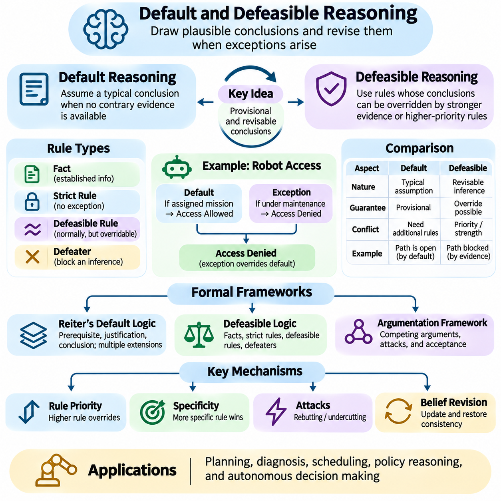{width="7.268055555555556in" height="7.268055555555556in"}

Default and defeasible reasoning provide formal mechanisms for drawing plausible conclusions from incomplete information while allowing those conclusions to be withdrawn when exceptions arise. Unlike strict deductive reasoning, which preserves logically established consequences, these approaches distinguish between unconditional knowledge and assumptions that normally hold. They are essential for intelligent systems that must make decisions before every relevant condition is known.

Default reasoning represents typical situations through rules that apply when contrary evidence is unavailable. A default rule expresses what may reasonably be assumed under normal circumstances without asserting that the conclusion is universally true. For example, an autonomous robot may assume that a designated corridor is accessible unless an obstruction or access restriction is reported. This assumption supports planning while remaining open to revision.

Defeasible reasoning extends this principle by explicitly representing rules whose conclusions can be overridden by stronger evidence or higher-priority rules. A defeasible rule does not guarantee its conclusion under every possible circumstance. Instead, it establishes a provisional inference that remains acceptable until an applicable exception defeats it. This structure closely resembles practical reasoning in operational policies, legal interpretation, and autonomous decision making.

The distinction between strict rules and defeasible rules is fundamental. A strict rule expresses a relationship intended to hold without exceptions within the modeled domain. A defeasible rule expresses a relationship that normally holds but may be overridden. For instance, a strict safety rule may prohibit entering a hazardous zone without authorization, while a defeasible scheduling rule may normally assign the nearest available robot to a mission.

Default reasoning is commonly associated with Reiter\'s default logic, which introduces formal rules containing prerequisites, justifications, and conclusions. A default can be applied when its prerequisite is established and its justification remains consistent with the accepted knowledge. This structure separates the evidence required to activate a rule from the assumptions needed to maintain its conclusion, allowing reasoning under incomplete information.

A default theory may admit multiple extensions, each representing a possible collection of conclusions consistent with the applicable defaults. Different extensions can arise when alternative assumptions compete without sufficient evidence to select one. Consequently, a proposition may hold in some extensions but not others. Skeptical reasoning accepts conclusions shared by all relevant extensions, whereas credulous reasoning considers conclusions supported by at least one.

Defeasible logic provides another framework by distinguishing facts, strict rules, defeasible rules, and defeaters. Facts describe established information, while strict rules support conclusions that follow necessarily from their premises. Defeasible rules support conclusions that may be challenged. Defeaters do not necessarily establish an opposing conclusion; instead, they can prevent another defeasible inference from being accepted.

Consider a warehouse robot that is normally permitted to enter a storage zone when assigned an authorized delivery mission. A general operational rule may support entry permission, while a temporary maintenance restriction may prohibit access. The restriction can defeat the ordinary permission without invalidating the broader operational policy. This illustrates how defeasible reasoning accommodates exceptional circumstances within a consistent rule framework.

Rule priorities are particularly important when conflicting defeasible rules support incompatible conclusions. A system may use superiority relations to establish that one rule takes precedence over another. Safety restrictions may receive higher priority than routine mission preferences, while emergency procedures may introduce additional exceptions. Such priorities must be explicitly defined because their interpretation depends on the intended operational policy.

Specificity offers another mechanism for resolving conflicts between general rules and exceptional cases. A rule applying to a narrowly defined situation may override a broader default when both are relevant. For example, a general rule may permit autonomous navigation through designated corridors, while a more specific rule restricts navigation through corridors undergoing inspection. Specificity is useful but does not automatically determine priority in every formalism.

Defeasible reasoning must distinguish between rebutting and undercutting attacks. A rebutting attack supports a conclusion incompatible with another conclusion, while an undercutting attack challenges the applicability or justification of the original inference. A sensor report indicating that a passage is blocked may rebut an assumption of accessibility. Evidence that the sensor is malfunctioning may instead undermine the reliability of that report.

Argumentation frameworks provide a structured interpretation of defeasible reasoning by representing competing arguments and relationships between them. Arguments consist of premises, inference steps, and conclusions, while attacks express conflicts or challenges. Acceptance semantics determine which arguments can be jointly defended or accepted. This perspective supports explainable decisions when several rules or evidence sources disagree.

Incomplete knowledge introduces a critical distinction between the absence of evidence and evidence of absence. A robot may lack information about an obstacle without possessing reliable evidence that the path is clear. Default assumptions can support provisional decisions, but they must not be confused with verified observations. The choice between open-world and closed-world assumptions influences whether missing information can justify particular conclusions.

Temporal validity is another important consideration because defaults and exceptions may change over time. A charging station may normally be available, become unavailable during maintenance, and return to service afterward. Time-indexed facts and validity intervals allow the reasoning system to distinguish current exceptions from historical restrictions. Without temporal management, outdated evidence may continue defeating conclusions that should become acceptable again.

Belief revision and truth maintenance mechanisms help preserve consistency when defeasible conclusions change. A reasoning system can record the assumptions and rules supporting each derived conclusion. When an assumption is invalidated or a stronger exception appears, dependent conclusions can be reconsidered. Dependency tracking prevents unsupported conclusions from remaining active and reduces the need to recompute unrelated parts of the knowledge base.

Defeasible reasoning differs from probabilistic reasoning even though both address uncertainty. Probabilistic reasoning assigns quantitative degrees of belief to events or hypotheses, while defeasible reasoning focuses on whether conclusions remain justified in the presence of exceptions and competing rules. A highly probable conclusion may still be prohibited by a strict operational constraint. Combining the approaches requires clearly separating confidence from logical permission.

In autonomous robotics, default and defeasible reasoning can support mission allocation, route selection, resource management, and operational supervision. A fleet controller may normally assign the closest capable robot to a task, but battery limitations, restricted zones, or emergency priorities can override that preference. Defeasible rules provide a structured mechanism for expressing these exceptions without requiring every operational situation to be enumerated.

Integration with perception systems introduces additional challenges because sensor observations may be uncertain, delayed, or contradictory. Learned perception models can provide evidence about environmental conditions, while symbolic rules determine whether that evidence defeats an existing assumption. Evidence provenance, confidence thresholds, and sensor reliability policies help manage these interactions. Immediate safety enforcement should remain independent of provisional logical assumptions.

Computational complexity depends on the selected formalism and the structure of the rule system. Some restricted defeasible logics support efficient inference, while richer default theories may require searching multiple extensions or resolving complex conflicts. Rule indexing, incremental evaluation, and dependency-based updates can improve practical performance. Designers must balance expressive flexibility against predictable response times and resource limitations.

Explainability is a major advantage of default and defeasible reasoning because conclusions can be traced to their supporting rules, assumptions, and exceptions. When a mission assignment changes, the system can identify which default originally supported the decision and which new restriction defeated it. Such explanations improve debugging, policy auditing, and operator understanding. They also help distinguish legitimate exceptions from incorrect knowledge representations.

Testing defeasible systems requires examining ordinary cases, exceptional cases, conflicting rules, and changes in available evidence. Developers should verify that strict constraints remain enforced, higher-priority rules override weaker defaults, and withdrawn exceptions permit appropriate conclusions to be restored. Cyclic dependencies and unresolved conflicts also require evaluation. These tests establish whether the system behaves consistently with its intended reasoning semantics.

Default and defeasible reasoning enable artificial intelligence systems to operate with incomplete knowledge while preserving the ability to revise provisional conclusions. Defaults capture normal expectations, defeasible rules represent exceptions, and priority mechanisms resolve competing inferences. Together with belief maintenance, temporal reasoning, and explainable rule execution, these techniques support adaptable, policy-aware, and logically structured decision making in dynamic environments.

기본 추론(Default Reasoning)과 반박 가능 추론(Defeasible Reasoning)은 불완전한 정보(Incomplete Information)로부터 타당한 결론(Plausible Conclusion)을 도출하면서 예외(Exception)가 발생하면 해당 결론을 철회할 수 있도록 하는 형식적 메커니즘(Formal Mechanism)을 제공한다. 논리적으로 확립된 귀결(Logically Established Consequence)을 유지하는 엄격한 연역 추론(Strict Deductive Reasoning)과 달리, 이러한 접근법은 무조건적인 지식(Unconditional Knowledge)과 일반적으로 성립하는 가정(Assumption)을 구분한다. 이는 모든 관련 조건이 알려지기 전에 의사결정을 수행해야 하는 지능형 시스템(Intelligent System)에 필수적이다.

기본 추론(Default Reasoning)은 반대되는 증거(Contrary Evidence)가 존재하지 않을 때 적용되는 규칙을 통해 전형적인 상황(Typical Situation)을 표현한다. 기본 규칙(Default Rule)은 특정 결론이 보편적으로 참이라고 주장하지 않으면서 정상적인 상황에서 합리적으로 무엇을 가정할 수 있는지를 나타낸다. 예를 들어 자율 로봇(Autonomous Robot)은 장애물(Obstruction)이나 접근 제한(Access Restriction)이 보고되지 않는 한 지정된 복도(Corridor)에 접근할 수 있다고 가정할 수 있다. 이러한 가정은 경로 계획(Planning)을 지원하면서도 수정 가능성(Revisability)을 유지한다.

반박 가능 추론(Defeasible Reasoning)은 더 강력한 증거(Stronger Evidence)나 더 높은 우선순위의 규칙(Higher-Priority Rule)에 의해 결론이 무효화될 수 있는 규칙을 명시적으로 표현함으로써 이러한 원리를 확장한다. 반박 가능한 규칙(Defeasible Rule)은 모든 가능한 상황에서 결론을 보장하지 않는다. 대신 적용 가능한 예외(Applicable Exception)가 이를 무효화할 때까지 수용 가능한 잠정적 추론(Provisional Inference)을 확립한다. 이러한 구조는 운영 정책(Operational Policy), 법률 해석(Legal Interpretation), 자율 의사결정(Autonomous Decision Making)에서 나타나는 실용적 추론(Practical Reasoning)과 밀접하게 유사하다.

엄격한 규칙(Strict Rule)과 반박 가능한 규칙(Defeasible Rule)의 구분은 기본적이다. 엄격한 규칙은 모델링된 도메인(Modelled Domain) 내에서 예외 없이 성립하도록 의도된 관계를 표현한다. 반박 가능한 규칙은 일반적으로 성립하지만 무효화될 수 있는 관계를 표현한다. 예를 들어 엄격한 안전 규칙(Strict Safety Rule)은 허가(Authorization) 없이 위험 구역(Hazardous Zone)에 진입하는 것을 금지할 수 있으며, 반박 가능한 일정 관리 규칙(Defeasible Scheduling Rule)은 일반적으로 가장 가까운 이용 가능한 로봇을 임무에 할당할 수 있다.

기본 추론(Default Reasoning)은 일반적으로 전제조건(Prerequisite), 정당화 조건(Justification), 결론(Conclusion)을 포함하는 형식적 규칙을 도입한 라이터의 기본 논리(Reiter\'s Default Logic)와 관련된다. 기본 규칙(Default)은 전제조건이 확립되고 정당화 조건이 수용된 지식(Accepted Knowledge)과 일관성을 유지할 때 적용될 수 있다. 이러한 구조는 규칙을 활성화하는 데 필요한 증거(Evidence)와 결론을 유지하는 데 필요한 가정(Assumption)을 분리하여 불완전한 정보 아래에서 추론할 수 있도록 한다.

기본 이론(Default Theory)은 여러 확장(Extension)을 허용할 수 있으며, 각 확장은 적용 가능한 기본 규칙과 일관성을 유지하는 가능한 결론 집합(Possible Collection of Conclusions)을 나타낸다. 서로 다른 확장은 특정 대안을 선택하기에 충분한 증거가 없는 상태에서 여러 가정이 경쟁할 때 발생할 수 있다. 따라서 하나의 명제(Proposition)는 일부 확장에서는 성립하지만 다른 확장에서는 성립하지 않을 수 있다. 회의적 추론(Skeptical Reasoning)은 모든 관련 확장에서 공통으로 성립하는 결론을 수용하는 반면, 신빙적 추론(Credulous Reasoning)은 적어도 하나의 확장에서 뒷받침되는 결론을 고려한다.

반박 가능 논리(Defeasible Logic)는 사실(Fact), 엄격한 규칙(Strict Rule), 반박 가능한 규칙(Defeasible Rule), 반박자(Defeater)를 구분하는 또 다른 프레임워크(Framework)를 제공한다. 사실은 확립된 정보를 설명하며, 엄격한 규칙은 전제로부터 필연적으로 도출되는 결론을 뒷받침한다. 반박 가능한 규칙은 도전받을 수 있는 결론을 지원한다. 반박자는 반드시 반대 결론(Opposing Conclusion)을 확립하지는 않으며, 대신 다른 반박 가능한 추론(Defeasible Inference)이 수용되는 것을 방지할 수 있다.

허가된 배송 임무(Authorized Delivery Mission)에 할당되면 일반적으로 보관 구역(Storage Zone)에 진입할 수 있는 창고 로봇(Warehouse Robot)을 생각해 볼 수 있다. 일반적인 운영 규칙(Operational Rule)은 진입 허가(Entry Permission)를 뒷받침할 수 있지만, 일시적인 유지보수 제한(Temporary Maintenance Restriction)은 접근을 금지할 수 있다. 이러한 제한은 더 광범위한 운영 정책(Operational Policy)을 무효화하지 않으면서 일반적인 허가를 반박할 수 있다. 이는 반박 가능 추론(Defeasible Reasoning)이 일관된 규칙 체계(Consistent Rule Framework) 내에서 예외적인 상황(Exceptional Circumstance)을 처리하는 방식을 보여준다.

규칙 우선순위(Rule Priority)는 서로 양립할 수 없는 결론(Incompatible Conclusion)을 뒷받침하는 반박 가능한 규칙들이 충돌할 때 특히 중요하다. 시스템은 우월 관계(Superiority Relation)를 사용하여 한 규칙이 다른 규칙보다 우선하도록 설정할 수 있다. 안전 제한(Safety Restriction)은 일상적인 임무 선호도(Routine Mission Preference)보다 높은 우선순위를 가질 수 있으며, 비상 절차(Emergency Procedure)는 추가적인 예외를 도입할 수 있다. 이러한 우선순위는 의도된 운영 정책에 따라 해석이 달라지므로 명시적으로 정의해야 한다.

구체성(Specificity)은 일반적인 규칙과 예외적인 사례 사이의 충돌을 해결하는 또 다른 메커니즘을 제공한다. 좁게 정의된 상황에 적용되는 규칙은 두 규칙이 모두 관련될 때 더 광범위한 기본 규칙(Broader Default)을 무효화할 수 있다. 예를 들어 일반 규칙은 지정된 복도에서 자율주행(Autonomous Navigation)을 허용할 수 있지만, 더 구체적인 규칙은 점검 중인 복도에서의 주행을 제한할 수 있다. 구체성은 유용하지만 모든 형식 체계(Formalism)에서 자동으로 우선순위를 결정하는 것은 아니다.

반박 가능 추론(Defeasible Reasoning)은 반론 공격(Rebutting Attack)과 근거 약화 공격(Undercutting Attack)을 구분해야 한다. 반론 공격은 다른 결론과 양립할 수 없는 결론을 뒷받침하는 반면, 근거 약화 공격은 기존 추론의 적용 가능성(Applicability)이나 정당화(Justification)에 이의를 제기한다. 통로가 차단되었다는 센서 보고(Sensor Report)는 접근 가능성(Accessibility)에 대한 가정을 반박할 수 있다. 반면 센서가 오작동하고 있다는 증거는 해당 보고의 신뢰성(Reliability)을 약화시킬 수 있다.

논증 프레임워크(Argumentation Framework)는 경쟁하는 논증(Competing Argument)과 그 사이의 관계를 표현함으로써 반박 가능 추론(Defeasible Reasoning)에 구조화된 해석을 제공한다. 논증(Argument)은 전제(Premise), 추론 단계(Inference Step), 결론(Conclusion)으로 구성되며, 공격 관계(Attack Relation)는 충돌이나 이의를 표현한다. 수용 의미론(Acceptance Semantics)은 어떤 논증들이 함께 방어되거나 수용될 수 있는지를 결정한다. 이러한 관점은 여러 규칙이나 증거 원천(Evidence Source)이 서로 일치하지 않을 때 설명 가능한 의사결정(Explainable Decision)을 지원한다.

불완전한 지식(Incomplete Knowledge)은 증거의 부재(Absence of Evidence)와 부재에 대한 증거(Evidence of Absence)를 구분해야 하는 중요한 문제를 제기한다. 로봇은 장애물(Obstacle)에 관한 정보가 없을 수 있지만, 그렇다고 경로가 비어 있다는 신뢰할 수 있는 증거(Reliable Evidence)를 보유한 것은 아니다. 기본 가정(Default Assumption)은 잠정적인 의사결정(Provisional Decision)을 지원할 수 있지만 검증된 관찰 결과(Verified Observation)와 혼동해서는 안 된다. 열린 세계 가정(Open-World Assumption)과 닫힌 세계 가정(Closed-World Assumption) 중 무엇을 선택하는지는 누락된 정보가 특정 결론을 정당화할 수 있는지에 영향을 미친다.

시간적 유효성(Temporal Validity)도 중요한 고려사항이다. 기본 규칙(Default)과 예외(Exception)는 시간이 지남에 따라 변경될 수 있기 때문이다. 충전소(Charging Station)는 일반적으로 이용 가능하지만 유지보수(Maintenance) 중에는 이용할 수 없으며, 이후 다시 정상 운영 상태로 복귀할 수 있다. 시간 인덱스가 부여된 사실(Time-Indexed Fact)과 유효 기간(Validity Interval)을 사용하면 추론 시스템(Reasoning System)이 현재의 예외와 과거의 제한사항(Historical Restriction)을 구분할 수 있다. 시간 관리(Temporal Management)가 없다면 오래된 증거(Outdated Evidence)가 다시 수용되어야 할 결론을 계속해서 무효화할 수 있다.

믿음 수정(Belief Revision)과 진리 유지 메커니즘(Truth Maintenance Mechanism)은 반박 가능한 결론(Defeasible Conclusion)이 변경될 때 일관성(Consistency)을 유지하는 데 도움이 된다. 추론 시스템은 각 도출된 결론(Derived Conclusion)을 뒷받침하는 가정과 규칙을 기록할 수 있다. 가정이 무효화되거나 더 강력한 예외가 나타나면 해당 가정에 의존하는 결론을 재검토할 수 있다. 의존성 추적(Dependency Tracking)은 근거를 잃은 결론(Unsupported Conclusion)이 활성 상태로 남는 것을 방지하고, 지식 베이스(Knowledge Base)의 관련 없는 부분을 다시 계산할 필요성을 줄인다.

반박 가능 추론(Defeasible Reasoning)은 두 접근법 모두 불확실성(Uncertainty)을 다루지만 확률적 추론(Probabilistic Reasoning)과는 다르다. 확률적 추론은 사건(Event)이나 가설(Hypothesis)에 정량적인 믿음의 정도(Quantitative Degree of Belief)를 부여하는 반면, 반박 가능 추론은 예외와 경쟁 규칙(Competing Rule)이 존재할 때 결론이 여전히 정당화되는지에 초점을 맞춘다. 확률이 매우 높은 결론이라도 엄격한 운영 제약조건(Strict Operational Constraint)에 의해 금지될 수 있다. 두 접근법을 결합하려면 신뢰도(Confidence)와 논리적 허가(Logical Permission)를 명확하게 구분해야 한다.

자율 로봇공학(Autonomous Robotics)에서 기본 추론(Default Reasoning)과 반박 가능 추론(Defeasible Reasoning)은 임무 할당(Mission Allocation), 경로 선택(Route Selection), 자원 관리(Resource Management), 운영 감독(Operational Supervision)을 지원할 수 있다. 군집 제어기(Fleet Controller)는 일반적으로 작업에 가장 가까운 적합한 로봇을 할당할 수 있지만, 배터리 제한(Battery Limitation), 제한 구역(Restricted Zone), 비상 우선순위(Emergency Priority)가 이러한 선호도를 무효화할 수 있다. 반박 가능한 규칙은 모든 운영 상황을 개별적으로 나열하지 않고도 이러한 예외를 표현하는 구조화된 메커니즘을 제공한다.

인식 시스템(Perception System)과의 통합은 센서 관찰 결과(Sensor Observation)가 불확실하거나 지연되거나 서로 모순될 수 있기 때문에 추가적인 문제를 발생시킨다. 학습된 인식 모델(Learned Perception Model)은 환경 조건(Environmental Condition)에 관한 증거를 제공할 수 있으며, 기호적 규칙(Symbolic Rule)은 해당 증거가 기존 가정(Existing Assumption)을 무효화하는지 결정한다. 증거 출처(Evidence Provenance), 신뢰도 임계값(Confidence Threshold), 센서 신뢰성 정책(Sensor Reliability Policy)은 이러한 상호작용을 관리하는 데 도움이 된다. 즉각적인 안전 조치(Immediate Safety Enforcement)는 잠정적인 논리적 가정(Provisional Logical Assumption)과 독립적으로 유지되어야 한다.

계산 복잡도(Computational Complexity)는 선택한 형식 체계(Formalism)와 규칙 시스템(Rule System)의 구조에 따라 달라진다. 일부 제한된 반박 가능 논리(Restricted Defeasible Logic)는 효율적인 추론을 지원하지만, 더 풍부한 기본 이론(Default Theory)은 여러 확장(Extension)을 탐색하거나 복잡한 충돌을 해결해야 할 수 있다. 규칙 인덱싱(Rule Indexing), 증분 평가(Incremental Evaluation), 의존성 기반 갱신(Dependency-Based Update)은 실용적인 성능을 향상할 수 있다. 설계자는 표현의 유연성(Expressive Flexibility)과 예측 가능한 응답 시간(Predictable Response Time), 자원 제한(Resource Limitation) 사이에서 균형을 유지해야 한다.

설명 가능성(Explainability)은 결론을 뒷받침하는 규칙, 가정, 예외를 추적할 수 있다는 점에서 기본 추론(Default Reasoning)과 반박 가능 추론(Defeasible Reasoning)의 주요 장점이다. 임무 할당(Mission Assignment)이 변경되면 시스템은 원래 의사결정을 뒷받침했던 기본 규칙과 이를 무효화한 새로운 제한사항(New Restriction)을 식별할 수 있다. 이러한 설명은 디버깅(Debugging), 정책 감사(Policy Auditing), 운영자 이해(Operator Understanding)를 향상한다. 또한 정당한 예외(Legitimate Exception)와 잘못된 지식 표현(Incorrect Knowledge Representation)을 구분하는 데 도움이 된다.

반박 가능 시스템(Defeasible System)의 테스트(Testing)는 일반적인 사례(Ordinary Case), 예외적인 사례(Exceptional Case), 충돌하는 규칙(Conflicting Rule), 이용 가능한 증거의 변화(Changes in Available Evidence)를 검토해야 한다. 개발자는 엄격한 제약조건(Strict Constraint)이 계속 적용되는지, 높은 우선순위의 규칙이 약한 기본 규칙을 무효화하는지, 철회된 예외가 적절한 결론의 복원을 허용하는지 검증해야 한다. 순환 의존성(Cyclic Dependency)과 해결되지 않은 충돌(Unresolved Conflict)도 평가해야 한다. 이러한 테스트는 시스템이 의도된 추론 의미론(Intended Reasoning Semantics)에 따라 일관되게 동작하는지 확인한다.

기본 추론(Default Reasoning)과 반박 가능 추론(Defeasible Reasoning)은 인공지능(Artificial Intelligence) 시스템이 불완전한 지식(Incomplete Knowledge)을 바탕으로 작동하면서도 잠정적인 결론(Provisional Conclusion)을 수정할 수 있도록 한다. 기본 규칙(Default)은 정상적인 기대(Normal Expectation)를 표현하고, 반박 가능한 규칙(Defeasible Rule)은 예외(Exception)를 나타내며, 우선순위 메커니즘(Priority Mechanism)은 경쟁하는 추론(Competing Inference)을 해결한다. 이러한 기술은 믿음 유지(Belief Maintenance), 시간 추론(Temporal Reasoning), 설명 가능한 규칙 실행(Explainable Rule Execution)과 결합하여 동적 환경(Dynamic Environment)에서 적응 가능하고(Adaptable), 정책을 인식하며(Policy-Aware), 논리적으로 구조화된(Logically Structured) 의사결정을 지원한다.

## 01.08 Temporal Reasoning

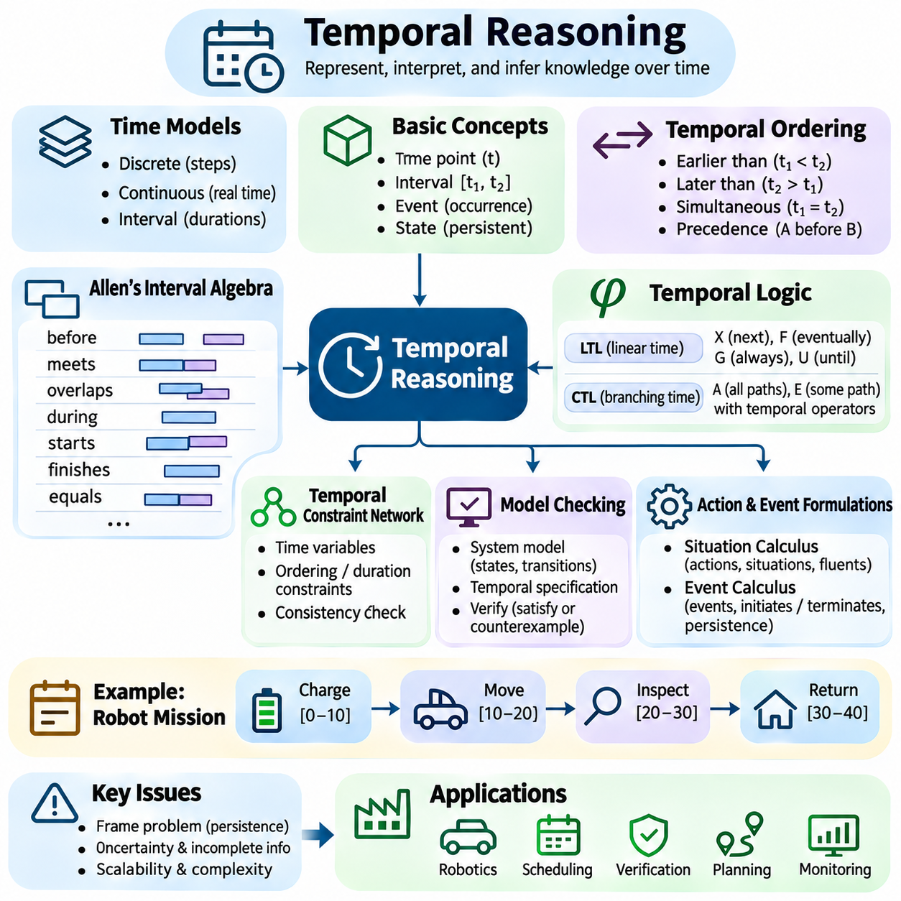{width="7.268055555555556in" height="7.268055555555556in"}

Temporal reasoning is a fundamental capability of artificial intelligence that enables systems to represent, interpret, and infer relationships involving time. Unlike static logical reasoning, which describes facts without considering when they hold, temporal reasoning examines how conditions evolve and how events relate across different moments. This capability is essential for planning, monitoring, robotics, and decision making in dynamic environments.

Time can be represented as discrete steps, continuous values, or ordered intervals depending on application requirements. Discrete models describe sequences of states or events, while continuous models capture processes evolving over measurable durations. Interval-based representations emphasize relationships between periods rather than individual timestamps. Selecting an appropriate temporal model determines which properties can be expressed and how efficiently they can be evaluated.

Temporal knowledge commonly distinguishes between time points, intervals, events, and states. A time point identifies a particular instant, while an interval represents a duration bounded by two endpoints. Events describe occurrences that may initiate or terminate conditions, whereas states describe properties that persist over time. These distinctions allow reasoning systems to represent both instantaneous changes and sustained operational conditions.

Temporal ordering establishes relationships such as earlier than, later than, and simultaneous with. A scheduling system may require a robot to complete charging before beginning an inspection mission. Such relationships can be expressed through inequalities between timestamps or through symbolic temporal constraints. Temporal ordering provides the foundation for detecting invalid sequences and determining whether planned activities satisfy precedence requirements.

Allen\'s interval algebra provides a qualitative framework for describing relationships between time intervals. Its thirteen basic relations include before, meets, overlaps, starts, during, finishes, equals, and their inverses. These relations allow systems to reason about temporal structure without requiring exact numerical timestamps. They are particularly useful when activity durations are uncertain but relative ordering is known.

Temporal constraint networks represent collections of time variables connected by ordering or duration restrictions. A simple temporal network expresses constraints as bounded differences between time points. Consistency checking determines whether all restrictions can be satisfied simultaneously. Such networks are widely applicable to task scheduling, mission coordination, and resource allocation where deadlines and dependencies must be respected.

Temporal logic extends classical logic with operators describing how propositions behave across time. Linear temporal logic, commonly abbreviated LTL, introduces operators such as next, eventually, always, and until. These operators express requirements over sequences of states. For example, a safety specification may require that an emergency stop signal always prevents further motion until the system has entered an authorized recovery state.

The distinction between safety and liveness properties is central to temporal specification. Safety properties describe conditions that must never be violated, such as avoiding unauthorized movement. Liveness properties describe desirable progress, such as eventually completing an accepted mission under appropriate assumptions. Temporal logic provides a formal language for expressing both categories and evaluating whether system behavior satisfies them.

Computation tree logic, or CTL, introduces branching-time reasoning in which multiple possible future paths are considered. Path quantifiers distinguish properties that must hold across every possible execution from those that hold along at least one execution. This representation is useful for analyzing systems with alternative actions, uncertain transitions, or nondeterministic behavior. CTL and LTL therefore capture different aspects of temporal system behavior.

Model checking evaluates whether a formal system model satisfies temporal specifications. The model typically represents states, transitions, and relevant propositions, while the specification defines required temporal behavior. Automated verification explores possible executions or uses symbolic techniques to detect violations. When a property fails, a counterexample trace can reveal the sequence of events responsible for the violation.

The situation calculus provides a logical framework for representing actions and their effects across sequences of situations. Actions transform one situation into another, while fluents represent properties whose truth values may change. Successor-state axioms specify how actions affect these properties and which conditions remain unchanged. This approach supports reasoning about action preconditions, planning outcomes, and evolving world states.

Event calculus offers another formalism for describing how events initiate and terminate persistent conditions. Its central concepts include events, fluents, and temporal relations. A condition may continue to hold after being initiated until an event terminates it, subject to the modeled assumptions. This persistence principle helps represent equipment status, mission execution, access permissions, and other operational properties.

Temporal reasoning must address the frame problem, which concerns how to represent properties that remain unchanged when actions occur. Explicitly describing every unaffected property after every action creates substantial modeling complexity. Persistence axioms and inertia assumptions provide more compact representations. However, these mechanisms must be designed carefully to avoid preserving conditions that should have changed.

Uncertainty complicates temporal reasoning because event times, durations, and observations may not be precisely known. A robot may estimate that a delivery will finish within a time range rather than at an exact moment. Temporal constraint propagation can narrow feasible intervals as additional information becomes available. Probabilistic models may complement symbolic constraints when timing uncertainty requires quantitative treatment.

Temporal reasoning also interacts with non-monotonic reasoning because newly observed events can invalidate previously accepted temporal conclusions. A charging station may be considered available until an unexpected maintenance event changes its status. Time-indexed knowledge and event histories allow systems to distinguish past validity from current applicability. This prevents outdated assumptions from controlling decisions after relevant conditions have changed.

Real-time systems introduce deadlines and response-time constraints that must be distinguished from ordinary logical ordering. A requirement that an alarm eventually triggers is weaker than requiring it to trigger within two seconds. Metric temporal logic and timed automata provide mechanisms for expressing quantitative timing requirements. Their use is particularly important in safety-critical control, industrial automation, and autonomous systems.

In autonomous robotics, temporal reasoning supports coordination between perception, planning, navigation, and mission execution. A robot may need to verify that localization is available before movement begins, that a restricted zone remains closed during maintenance, and that charging finishes before a scheduled mission. Temporal dependencies connect these conditions into an executable operational sequence while exposing conflicting requirements.

Multi-robot coordination introduces additional temporal challenges involving shared resources and concurrent activities. Several robots may request the same charging station, docking area, or narrow passage. Temporal constraints can prevent overlapping reservations and establish safe execution windows. Scheduling algorithms can combine these constraints with mission priorities, travel estimates, and resource availability to produce feasible assignments.

Temporal databases and streaming systems maintain information whose validity changes over time. Event timestamps indicate when observations occurred, while validity intervals describe when facts were true in the modeled environment. Distinguishing event time from processing time is important when sensor messages arrive late or out of order. Temporal queries can reconstruct historical states and support reasoning about the sequence of operational changes.

Efficient temporal reasoning requires balancing expressiveness and computational cost. Some restricted temporal constraint systems admit polynomial-time consistency checking, while richer interval networks and temporal logics can be substantially more expensive. Incremental constraint propagation, bounded verification, and selective monitoring reduce unnecessary computation. The appropriate technique depends on the scale of the system and its timing requirements.

Testing temporal reasoning systems requires examining event ordering, overlapping intervals, delayed observations, missed deadlines, and contradictory constraints. Developers should verify that temporal properties remain satisfied under alternative execution paths and changing operational conditions. Simulation and formal verification can expose race conditions, scheduling conflicts, and unexpected state transitions that ordinary static tests may overlook.

Temporal reasoning provides a rigorous foundation for intelligent systems that must understand not only what is true, but also when it is true and how it changes. Temporal logic expresses behavioral requirements, constraint networks organize scheduling relationships, and action-based formalisms describe evolving states. Their integration enables reliable planning, verification, monitoring, and coordinated decision making across dynamic environments.

시간 추론(Temporal Reasoning)은 시스템이 시간(Time)과 관련된 관계를 표현하고 해석하며 추론할 수 있도록 하는 인공지능(Artificial Intelligence)의 핵심 능력이다. 사실이 언제 성립하는지를 고려하지 않고 기술하는 정적 논리 추론(Static Logical Reasoning)과 달리, 시간 추론은 조건(Condition)이 시간에 따라 어떻게 변화하고 사건(Event)이 서로 다른 시점(Moment)에서 어떤 관계를 형성하는지 분석한다. 이러한 능력은 동적 환경(Dynamic Environment)에서 계획(Planning), 모니터링(Monitoring), 로봇공학(Robotics), 의사결정(Decision Making)을 수행하는 데 필수적이다.

시간(Time)은 응용 요구사항(Application Requirement)에 따라 이산 단계(Discrete Step), 연속 값(Continuous Value), 순서가 있는 구간(Ordered Interval)으로 표현할 수 있다. 이산 모델(Discrete Model)은 상태(State)나 사건(Event)의 순서를 설명하며, 연속 모델(Continuous Model)은 측정 가능한 지속시간(Duration)에 따라 변화하는 과정을 표현한다. 구간 기반 표현(Interval-Based Representation)은 개별 타임스탬프(Timestamp)보다 시간 구간 사이의 관계를 강조한다. 적절한 시간 모델(Temporal Model)을 선택하는 것은 어떤 속성을 표현할 수 있는지와 이를 얼마나 효율적으로 평가할 수 있는지를 결정한다.

시간 지식(Temporal Knowledge)은 일반적으로 시점(Time Point), 시간 구간(Interval), 사건(Event), 상태(State)를 구분한다. 시점은 특정 순간(Instant)을 식별하며, 시간 구간은 두 끝점(Endpoint)으로 경계가 정해진 지속시간을 나타낸다. 사건은 조건을 시작하거나 종료할 수 있는 발생 현상(Occurrence)을 설명하고, 상태는 시간에 따라 지속되는 속성(Property)을 나타낸다. 이러한 구분을 통해 추론 시스템(Reasoning System)은 순간적인 변화(Instantaneous Change)와 지속적인 운영 조건(Sustained Operational Condition)을 모두 표현할 수 있다.

시간적 순서(Temporal Ordering)는 이전(Earlier Than), 이후(Later Than), 동시(Simultaneous With)와 같은 관계를 확립한다. 일정 관리 시스템(Scheduling System)은 로봇이 검사 임무(Inspection Mission)를 시작하기 전에 충전(Charging)을 완료하도록 요구할 수 있다. 이러한 관계는 타임스탬프 사이의 부등식(Inequality)이나 기호적 시간 제약조건(Symbolic Temporal Constraint)을 통해 표현할 수 있다. 시간적 순서는 유효하지 않은 실행 순서(Invalid Sequence)를 탐지하고 계획된 활동이 선행 조건(Precedence Requirement)을 만족하는지 판단하는 기반을 제공한다.

앨런의 구간 대수(Allen\'s Interval Algebra)는 시간 구간(Time Interval) 사이의 관계를 설명하기 위한 정성적 프레임워크(Qualitative Framework)를 제공한다. 13개의 기본 관계(Basic Relation)에는 이전(Before), 접함(Meets), 겹침(Overlaps), 시작(Starts), 포함됨(During), 종료(Finishes), 동일함(Equals)과 각각의 역관계(Inverse Relation)가 포함된다. 이러한 관계를 통해 시스템은 정확한 수치 타임스탬프(Numerical Timestamp)가 없어도 시간적 구조(Temporal Structure)를 추론할 수 있다. 특히 활동의 지속시간이 불확실하지만 상대적인 순서가 알려진 경우 유용하다.

시간 제약 네트워크(Temporal Constraint Network)는 순서 제약조건(Ordering Constraint)이나 지속시간 제한(Duration Restriction)으로 연결된 시간 변수(Time Variable)의 집합을 표현한다. 단순 시간 네트워크(Simple Temporal Network)는 시점 사이의 차이에 대한 상한과 하한을 사용하여 제약조건을 표현한다. 일관성 검사(Consistency Checking)는 모든 제약조건을 동시에 만족할 수 있는지 판단한다. 이러한 네트워크는 마감시간(Deadline)과 의존관계(Dependency)를 준수해야 하는 작업 일정 관리(Task Scheduling), 임무 조정(Mission Coordination), 자원 할당(Resource Allocation)에 폭넓게 적용할 수 있다.

시간 논리(Temporal Logic)는 명제가 시간에 따라 어떻게 성립하는지를 설명하는 연산자(Operator)를 도입하여 고전 논리(Classical Logic)를 확장한다. 일반적으로 LTL로 약칭하는 선형 시간 논리(Linear Temporal Logic)는 다음(Next), 언젠가(Eventually), 항상(Always), \\\~까지(Until)와 같은 연산자를 도입한다. 이러한 연산자는 상태의 연속(Sequence of States)에 대한 요구사항을 표현한다. 예를 들어 안전 명세(Safety Specification)는 비상 정지 신호(Emergency Stop Signal)가 발생한 이후 시스템이 승인된 복구 상태(Authorized Recovery State)에 진입할 때까지 추가적인 움직임을 항상 방지하도록 요구할 수 있다.

안전 속성(Safety Property)과 활성 속성(Liveness Property)의 구분은 시간 명세(Temporal Specification)의 핵심이다. 안전 속성은 허가되지 않은 이동(Unauthorized Movement)을 방지하는 것처럼 절대로 위반해서는 안 되는 조건을 설명한다. 활성 속성은 적절한 가정 아래에서 수락된 임무(Accepted Mission)를 언젠가 완료하는 것처럼 바람직한 진행(Desirable Progress)을 설명한다. 시간 논리(Temporal Logic)는 두 범주를 모두 표현하고 시스템 동작(System Behavior)이 이를 만족하는지 평가하기 위한 형식 언어(Formal Language)를 제공한다.

계산 트리 논리(Computation Tree Logic, CTL)는 여러 가능한 미래 경로(Future Path)를 고려하는 분기 시간 추론(Branching-Time Reasoning)을 도입한다. 경로 한정자(Path Quantifier)는 모든 가능한 실행(Execution)에서 성립해야 하는 속성과 적어도 하나의 실행 경로에서 성립하는 속성을 구분한다. 이러한 표현은 대안적인 행동(Alternative Action), 불확실한 상태 전이(Uncertain Transition), 비결정론적 동작(Nondeterministic Behavior)을 포함하는 시스템을 분석하는 데 유용하다. 따라서 CTL과 LTL은 시간에 따른 시스템 동작의 서로 다른 측면을 표현한다.

모델 검사(Model Checking)는 형식적 시스템 모델(Formal System Model)이 시간 명세(Temporal Specification)를 만족하는지 평가한다. 모델은 일반적으로 상태(State), 전이(Transition), 관련 명제(Proposition)를 표현하며, 명세는 요구되는 시간적 동작(Temporal Behavior)을 정의한다. 자동 검증(Automated Verification)은 가능한 실행을 탐색하거나 기호적 기법(Symbolic Technique)을 사용하여 위반 사항을 탐지한다. 속성이 만족되지 않으면 반례 추적(Counterexample Trace)을 통해 위반을 발생시킨 사건의 순서(Sequence of Events)를 확인할 수 있다.

상황 계산법(Situation Calculus)은 상황(Situation)의 연속에 걸쳐 행동(Action)과 그 효과(Effect)를 표현하기 위한 논리적 프레임워크(Logical Framework)를 제공한다. 행동은 하나의 상황을 다른 상황으로 변환하며, 유동 속성(Fluent)은 진리값(Truth Value)이 변경될 수 있는 속성을 나타낸다. 후속 상태 공리(Successor-State Axiom)는 행동이 이러한 속성에 어떤 영향을 미치고 어떤 조건이 변경되지 않는지를 명시한다. 이러한 접근법은 행동의 전제조건(Action Precondition), 계획 결과(Planning Outcome), 변화하는 세계 상태(Evolving World State)에 대한 추론을 지원한다.

사건 계산법(Event Calculus)은 사건(Event)이 지속적인 조건(Persistent Condition)을 어떻게 시작하고 종료하는지 설명하는 또 다른 형식 체계(Formalism)를 제공한다. 핵심 개념에는 사건, 유동 속성(Fluent), 시간적 관계(Temporal Relation)가 포함된다. 특정 조건은 이를 시작한 사건 이후부터 종료시키는 사건이 발생할 때까지 모델링된 가정에 따라 계속 성립할 수 있다. 이러한 지속성 원리(Persistence Principle)는 장비 상태(Equipment Status), 임무 실행(Mission Execution), 접근 권한(Access Permission), 기타 운영 속성(Operational Property)을 표현하는 데 도움이 된다.

시간 추론(Temporal Reasoning)은 행동이 발생했을 때 변경되지 않는 속성을 어떻게 표현할 것인지에 관한 프레임 문제(Frame Problem)를 처리해야 한다. 모든 행동 이후 영향을 받지 않는 모든 속성을 명시적으로 설명하면 모델링 복잡도(Modeling Complexity)가 크게 증가한다. 지속성 공리(Persistence Axiom)와 관성 가정(Inertia Assumption)은 더욱 간결한 표현을 제공한다. 그러나 이러한 메커니즘은 실제로 변경되어야 하는 조건이 잘못 유지되지 않도록 신중하게 설계해야 한다.

불확실성(Uncertainty)은 사건 발생 시각(Event Time), 지속시간(Duration), 관찰 결과(Observation)가 정확하게 알려지지 않을 수 있기 때문에 시간 추론을 복잡하게 만든다. 로봇은 배송이 정확한 한 시점에 완료된다고 예측하기보다 특정 시간 범위(Time Range) 내에서 완료될 것으로 추정할 수 있다. 시간 제약 전파(Temporal Constraint Propagation)는 추가 정보가 제공됨에 따라 실행 가능한 시간 구간(Feasible Interval)을 좁힐 수 있다. 시간적 불확실성(Timing Uncertainty)을 정량적으로 처리해야 하는 경우 확률 모델(Probabilistic Model)이 기호적 제약조건(Symbolic Constraint)을 보완할 수 있다.

시간 추론(Temporal Reasoning)은 새롭게 관찰된 사건이 이전에 수용된 시간적 결론(Temporal Conclusion)을 무효화할 수 있기 때문에 비단조 추론(Non-Monotonic Reasoning)과도 상호작용한다. 충전소(Charging Station)는 예상하지 못한 유지보수 사건(Maintenance Event)이 상태를 변경하기 전까지 이용 가능한 것으로 간주될 수 있다. 시간 인덱스가 부여된 지식(Time-Indexed Knowledge)과 사건 이력(Event History)을 통해 시스템은 과거의 유효성(Past Validity)과 현재의 적용 가능성(Current Applicability)을 구분할 수 있다. 이는 관련 조건이 변경된 이후에도 오래된 가정(Outdated Assumption)이 의사결정을 지배하는 것을 방지한다.

실시간 시스템(Real-Time System)은 일반적인 논리적 순서(Logical Ordering)와 구분해야 하는 마감시간(Deadline) 및 응답 시간 제약조건(Response-Time Constraint)을 도입한다. 경보(Alarm)가 언젠가 발생해야 한다는 요구사항은 2초 이내에 발생해야 한다는 요구사항보다 약하다. 계량 시간 논리(Metric Temporal Logic)와 시간 오토마타(Timed Automata)는 정량적인 시간 요구사항(Quantitative Timing Requirement)을 표현하는 메커니즘을 제공한다. 이러한 기술은 안전 필수 제어(Safety-Critical Control), 산업 자동화(Industrial Automation), 자율 시스템(Autonomous System)에서 특히 중요하다.

자율 로봇공학(Autonomous Robotics)에서 시간 추론(Temporal Reasoning)은 인식(Perception), 계획(Planning), 내비게이션(Navigation), 임무 실행(Mission Execution) 사이의 조정을 지원한다. 로봇은 이동을 시작하기 전에 위치 추정(Localization)이 가능한지, 유지보수 중에 제한 구역(Restricted Zone)이 계속 폐쇄되어 있는지, 예정된 임무 이전에 충전이 완료되는지를 검증해야 할 수 있다. 시간적 의존관계(Temporal Dependency)는 이러한 조건을 실행 가능한 운영 순서(Executable Operational Sequence)로 연결하면서 충돌하는 요구사항(Conflicting Requirement)을 드러낸다.

다중 로봇 조정(Multi-Robot Coordination)은 공유 자원(Shared Resource)과 동시 활동(Concurrent Activity)에 관련된 추가적인 시간적 문제를 발생시킨다. 여러 로봇이 동일한 충전소(Charging Station), 도킹 구역(Docking Area), 좁은 통로(Narrow Passage)를 요청할 수 있다. 시간 제약조건(Temporal Constraint)은 예약 구간(Reservation Interval)의 중복을 방지하고 안전한 실행 시간대(Safe Execution Window)를 설정할 수 있다. 일정 관리 알고리즘(Scheduling Algorithm)은 이러한 제약조건을 임무 우선순위(Mission Priority), 이동 시간 추정(Travel Estimate), 자원 가용성(Resource Availability)과 결합하여 실행 가능한 할당(Feasible Assignment)을 생성할 수 있다.

시간 데이터베이스(Temporal Database)와 스트리밍 시스템(Streaming System)은 시간에 따라 유효성이 변경되는 정보를 유지한다. 사건 타임스탬프(Event Timestamp)는 관찰이 발생한 시점을 나타내며, 유효 기간(Validity Interval)은 모델링된 환경에서 사실이 참이었던 기간을 설명한다. 센서 메시지(Sensor Message)가 지연되거나 순서가 뒤바뀌어 도착하는 경우 사건 시간(Event Time)과 처리 시간(Processing Time)을 구분하는 것이 중요하다. 시간 질의(Temporal Query)는 과거 상태(Historical State)를 재구성하고 운영 변화(Operational Change)의 순서에 대한 추론을 지원할 수 있다.

효율적인 시간 추론(Temporal Reasoning)을 위해서는 표현력(Expressiveness)과 계산 비용(Computational Cost) 사이의 균형이 필요하다. 일부 제한된 시간 제약 시스템(Restricted Temporal Constraint System)은 다항 시간(Polynomial Time) 내에서 일관성 검사(Consistency Checking)를 수행할 수 있지만, 더 복잡한 구간 네트워크(Interval Network)와 시간 논리(Temporal Logic)는 훨씬 높은 계산 비용을 요구할 수 있다. 증분 제약 전파(Incremental Constraint Propagation), 제한된 검증(Bounded Verification), 선택적 모니터링(Selective Monitoring)은 불필요한 계산을 줄인다. 적절한 기법은 시스템 규모(System Scale)와 시간 요구사항(Timing Requirement)에 따라 결정된다.

시간 추론 시스템(Temporal Reasoning System)의 테스트(Testing)는 사건 순서(Event Ordering), 중첩된 시간 구간(Overlapping Interval), 지연된 관찰(Delayed Observation), 마감시간 위반(Missed Deadline), 모순되는 제약조건(Contradictory Constraint)을 검토해야 한다. 개발자는 대안적인 실행 경로(Alternative Execution Path)와 변화하는 운영 조건(Changing Operational Condition)에서도 시간적 속성(Temporal Property)이 계속 만족되는지 검증해야 한다. 시뮬레이션(Simulation)과 형식 검증(Formal Verification)은 일반적인 정적 테스트(Static Test)에서 놓칠 수 있는 경쟁 상태(Race Condition), 일정 충돌(Scheduling Conflict), 예상하지 못한 상태 전이(Unexpected State Transition)를 발견할 수 있다.

시간 추론(Temporal Reasoning)은 무엇이 참인지뿐만 아니라 언제 참이며 시간이 지나면서 어떻게 변화하는지를 이해해야 하는 지능형 시스템(Intelligent System)에 엄밀한 기반을 제공한다. 시간 논리(Temporal Logic)는 행동 요구사항(Behavioral Requirement)을 표현하고, 제약 네트워크(Constraint Network)는 일정 관리 관계(Scheduling Relationship)를 구성하며, 행동 기반 형식 체계(Action-Based Formalism)는 변화하는 상태(Evolving State)를 설명한다. 이러한 기술의 통합은 동적 환경(Dynamic Environment) 전반에서 신뢰할 수 있는 계획(Planning), 검증(Verification), 모니터링(Monitoring), 조정된 의사결정(Coordinated Decision Making)을 가능하게 한다.

## 01.09 Spatial Reasoning

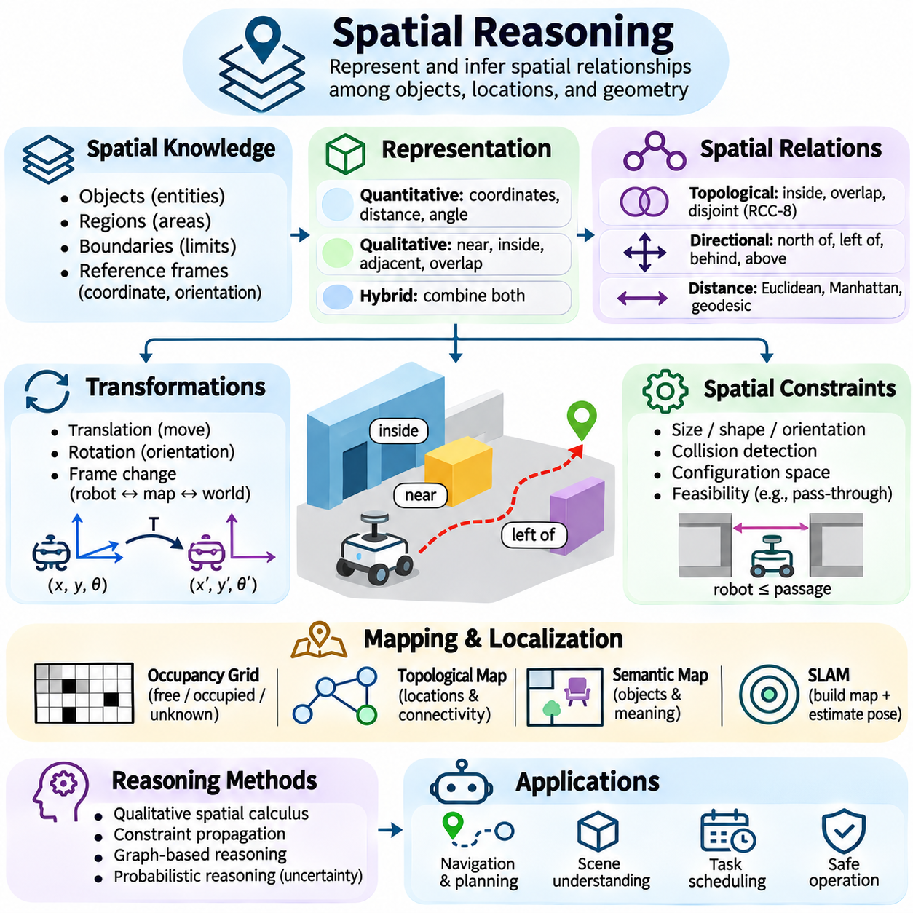{width="7.268055555555556in" height="7.268055555555556in"}

Spatial reasoning is a fundamental capability of artificial intelligence that enables systems to represent, interpret, and infer relationships among objects, locations, and geometric structures. Unlike purely symbolic reasoning, spatial reasoning incorporates position, orientation, distance, shape, and connectivity. It allows intelligent agents to understand how entities occupy physical environments and how spatial relationships influence perception, navigation, planning, and decision making.

Spatial knowledge can be represented through qualitative, quantitative, or hybrid models. Quantitative representations use coordinates, distances, angles, and geometric measurements to describe spatial configurations precisely. Qualitative representations express relationships such as near, inside, adjacent, or overlapping without requiring exact numerical values. Hybrid approaches combine both forms to support reasoning across different levels of spatial detail.

A spatial reasoning system must distinguish between objects, regions, boundaries, and reference frames. Objects represent identifiable entities, while regions describe occupied or designated areas. Boundaries separate spatial regions and may determine accessibility or containment. Reference frames establish how positions and orientations are interpreted. These concepts provide the structural foundation for consistent spatial knowledge representation.

Topological reasoning focuses on relationships that remain meaningful under continuous geometric transformations. Common relationships include disjointness, intersection, containment, overlap, and boundary contact. The Region Connection Calculus, particularly RCC-8, provides a formal framework for expressing eight fundamental topological relations. These relations support reasoning about connected spaces without depending on exact coordinates.

Directional reasoning describes the relative orientation of spatial entities. Relations such as north of, left of, behind, and above depend on an explicitly defined reference frame. An object may be left of a robot from the robot\'s perspective but right of another observer. Spatial reasoning must therefore account for viewpoint, coordinate conventions, and orientation changes to avoid contradictory interpretations.

Distance reasoning evaluates proximity and separation between objects or regions. Euclidean distance is appropriate for direct geometric separation, while Manhattan distance can represent movement constrained to orthogonal paths. Geodesic and graph-based distances describe movement along surfaces or connected networks. Selecting a distance metric requires considering environmental geometry, accessibility, and the intended operational task.

Coordinate systems provide numerical foundations for spatial reasoning. Cartesian coordinates describe positions along orthogonal axes, while polar and spherical coordinates express locations through distances and angles. Geographic systems represent positions on Earth using appropriate reference models. Transformations between coordinate frames allow observations from cameras, LiDAR sensors, and robotic platforms to be interpreted within a shared spatial context.

Spatial transformations describe translation, rotation, and changes between reference frames. In robotics, rigid-body transformations are commonly represented using rotation matrices, translation vectors, or homogeneous transformation matrices. These operations allow sensor measurements to be converted into robot, map, or world coordinates. Accurate calibration and transformation composition are essential for maintaining geometric consistency.

Spatial reasoning also involves geometric constraints concerning shape, size, orientation, and collision. A robot may fit through a passage only when its physical dimensions and required clearance satisfy the passage geometry. Collision detection evaluates whether occupied regions intersect, while configuration-space reasoning accounts for the robot\'s shape during movement. These techniques connect geometric knowledge with feasible physical actions.

Qualitative spatial calculi enable reasoning when measurements are incomplete or unnecessary. A system may know that a charging station is inside a warehouse and adjacent to a maintenance area without knowing their exact coordinates. Constraint propagation can derive additional relationships from known spatial facts. However, ambiguous qualitative descriptions may permit multiple configurations, requiring careful consistency checking.

Spatial knowledge graphs represent entities and their relationships as interconnected structures. Nodes may describe robots, rooms, corridors, obstacles, and equipment, while edges encode containment, adjacency, accessibility, or relative position. Graph-based reasoning can identify connected routes, restricted regions, and resource relationships. Combining spatial graphs with ontologies enables semantic interpretation of geometric environments.

Spatial reasoning is closely related to mapping and localization. Mapping constructs representations of environmental structure, while localization estimates an agent\'s position within a reference map. Occupancy grids describe free, occupied, or unknown cells, and topological maps represent connectivity among significant locations. Semantic maps add object categories and functional meanings, supporting reasoning beyond geometric navigation.

Simultaneous localization and mapping, commonly called SLAM, integrates observations and motion estimates to construct maps while estimating the robot\'s pose. Spatial reasoning uses these estimates to interpret environmental relationships and support planning. Measurement noise, sensor drift, and uncertain associations can introduce errors into spatial knowledge. Probabilistic estimation methods help represent and update these uncertainties.

Spatial constraint satisfaction determines whether a collection of geometric or relational requirements can hold simultaneously. A warehouse layout may require charging stations to remain outside emergency exits while maintaining accessible routes to operating zones. Constraint solvers can evaluate feasible arrangements and identify conflicting requirements. Such methods support facility design, robotic manipulation, and automated configuration.

Path planning applies spatial reasoning to identify feasible movement through an environment. Graph-search algorithms such as A\\\* can find routes through discrete maps, while sampling-based methods explore continuous configuration spaces. Spatial constraints determine which regions are traversable and which movements are prohibited. Practical planners must also consider robot dimensions, turning limits, terrain conditions, and collision margins.

Spatial reasoning becomes more complex when environments change over time. A corridor may be accessible during normal operation but blocked by a moving vehicle or temporary maintenance activity. Spatiotemporal reasoning combines spatial relationships with temporal constraints to represent evolving accessibility and occupancy. This integration supports dynamic route planning, collision avoidance, and coordinated movement.

Multi-agent systems require spatial reasoning about relative positions, shared regions, and interaction constraints. Multiple robots may need to coordinate movement through narrow passages or maintain separation distances during cooperative tasks. Relative localization and shared maps help establish a common spatial understanding. Communication delays and inconsistent reference frames can complicate coordination, making uncertainty management essential.

Embodied artificial intelligence connects spatial reasoning with perception and physical interaction. A manipulation robot must understand object orientation, reachable regions, grasping surfaces, and collision constraints. Visual observations can provide geometric and semantic information, while motion planning converts spatial goals into executable actions. The reasoning process must respect both symbolic task requirements and physical feasibility.

Spatial reasoning systems must manage uncertainty arising from sensor limitations, occlusion, incomplete maps, and ambiguous observations. An obstacle may be partially visible, or a region may remain unexplored. Probabilistic occupancy models and confidence-aware spatial relations help distinguish confirmed geometry from uncertain estimates. Safety-critical applications should avoid treating unknown space as automatically traversable.

Computational complexity depends on the spatial representation and the constraints being evaluated. Exact geometric reasoning may become expensive in high-dimensional configuration spaces, while qualitative constraint networks can also present difficult consistency problems. Hierarchical maps, spatial indexing, approximate geometry, and incremental updates reduce computational demands. Efficient implementations balance precision, scalability, and response time.

Testing spatial reasoning requires evaluating coordinate transformations, topological consistency, collision constraints, uncertain observations, and changing environments. Simulation can expose errors involving narrow passages, overlapping regions, incorrect reference frames, and dynamic obstacles. Validation against measured geometry helps distinguish logical modeling errors from perception inaccuracies. These practices are essential when spatial conclusions influence physical motion.

Spatial reasoning provides a rigorous foundation for intelligent systems that must understand where objects are, how regions relate, and which actions are physically possible. Geometric models provide precision, qualitative relations support symbolic interpretation, and spatial graphs organize connectivity and semantics. Their integration with perception, temporal reasoning, and planning enables reliable navigation, manipulation, coordination, and autonomous decision making.

공간 추론(Spatial Reasoning)은 시스템이 객체(Object), 위치(Location), 기하학적 구조(Geometric Structure) 사이의 관계를 표현하고 해석하며 추론할 수 있도록 하는 인공지능(Artificial Intelligence)의 핵심 능력이다. 순수한 기호적 추론(Symbolic Reasoning)과 달리 공간 추론은 위치(Position), 방향(Orientation), 거리(Distance), 형상(Shape), 연결성(Connectivity)을 포함한다. 이를 통해 지능형 에이전트(Intelligent Agent)는 개체(Entity)가 물리적 환경(Physical Environment)에서 어떻게 공간을 점유하고, 공간적 관계(Spatial Relationship)가 인식(Perception), 내비게이션(Navigation), 계획(Planning), 의사결정(Decision Making)에 어떤 영향을 미치는지 이해할 수 있다.

공간 지식(Spatial Knowledge)은 정성적 모델(Qualitative Model), 정량적 모델(Quantitative Model), 하이브리드 모델(Hybrid Model)을 통해 표현할 수 있다. 정량적 표현(Quantitative Representation)은 좌표(Coordinate), 거리(Distance), 각도(Angle), 기하학적 측정값(Geometric Measurement)을 사용하여 공간 구성을 정확하게 설명한다. 정성적 표현(Qualitative Representation)은 정확한 수치 없이 가까움(Near), 내부(Inside), 인접함(Adjacent), 겹침(Overlapping)과 같은 관계를 표현한다. 하이브리드 접근법(Hybrid Approach)은 두 표현 방식을 결합하여 서로 다른 수준의 공간적 세부사항(Spatial Detail)에 대한 추론을 지원한다.

공간 추론 시스템(Spatial Reasoning System)은 객체(Object), 영역(Region), 경계(Boundary), 기준 좌표계(Reference Frame)를 구분해야 한다. 객체는 식별 가능한 개체(Identifiable Entity)를 나타내며, 영역은 점유되거나 지정된 공간을 설명한다. 경계는 공간 영역을 구분하고 접근 가능성(Accessibility)이나 포함 관계(Containment)를 결정할 수 있다. 기준 좌표계는 위치와 방향을 해석하는 기준을 설정한다. 이러한 개념은 일관된 공간 지식 표현(Spatial Knowledge Representation)을 위한 구조적 기반(Structural Foundation)을 제공한다.

위상 추론(Topological Reasoning)은 연속적인 기하학적 변환(Continuous Geometric Transformation)에서도 의미가 유지되는 관계에 초점을 맞춘다. 일반적인 관계에는 분리(Disjointness), 교차(Intersection), 포함(Containment), 중첩(Overlap), 경계 접촉(Boundary Contact)이 포함된다. 영역 연결 계산법(Region Connection Calculus), 특히 RCC-8은 여덟 가지 기본 위상 관계(Fundamental Topological Relation)를 표현하기 위한 형식적 프레임워크(Formal Framework)를 제공한다. 이러한 관계는 정확한 좌표에 의존하지 않고 연결된 공간(Connected Space)에 대한 추론을 지원한다.

방향 추론(Directional Reasoning)은 공간 개체(Spatial Entity)의 상대적인 방향(Relative Orientation)을 설명한다. 북쪽(North Of), 왼쪽(Left Of), 뒤쪽(Behind), 위쪽(Above)과 같은 관계는 명시적으로 정의된 기준 좌표계(Reference Frame)에 따라 달라진다. 어떤 객체는 로봇의 관점(Perspective)에서는 왼쪽에 있지만 다른 관찰자(Observer)의 관점에서는 오른쪽에 있을 수 있다. 따라서 공간 추론은 모순된 해석(Contradictory Interpretation)을 방지하기 위해 시점(Viewpoint), 좌표 규약(Coordinate Convention), 방향 변화(Orientation Change)를 고려해야 한다.

거리 추론(Distance Reasoning)은 객체나 영역 사이의 근접성(Proximity)과 분리 정도(Separation)를 평가한다. 유클리드 거리(Euclidean Distance)는 직접적인 기하학적 거리(Geometric Separation)를 계산하는 데 적합하며, 맨해튼 거리(Manhattan Distance)는 직교 경로(Orthogonal Path)로 제한된 이동을 표현할 수 있다. 측지 거리(Geodesic Distance)와 그래프 기반 거리(Graph-Based Distance)는 표면이나 연결된 네트워크를 따라 이동하는 거리를 설명한다. 거리 척도(Distance Metric)를 선택할 때는 환경의 기하학적 구조(Environmental Geometry), 접근 가능성(Accessibility), 의도된 운영 작업(Operational Task)을 고려해야 한다.

좌표계(Coordinate System)는 공간 추론을 위한 수치적 기반(Numerical Foundation)을 제공한다. 직교 좌표(Cartesian Coordinate)는 서로 직교하는 축(Orthogonal Axis)을 따라 위치를 설명하며, 극좌표(Polar Coordinate)와 구면 좌표(Spherical Coordinate)는 거리와 각도를 통해 위치를 표현한다. 지리 좌표계(Geographic Coordinate System)는 적절한 기준 모델(Reference Model)을 사용하여 지구상의 위치를 표현한다. 좌표계 사이의 변환(Transformation)을 통해 카메라(Camera), 라이다(LiDAR), 로봇 플랫폼(Robotic Platform)에서 얻은 관찰 결과를 공통 공간 기준(Shared Spatial Context)에서 해석할 수 있다.

공간 변환(Spatial Transformation)은 평행이동(Translation), 회전(Rotation), 기준 좌표계 사이의 변환을 설명한다. 로봇공학(Robotics)에서는 강체 변환(Rigid-Body Transformation)을 일반적으로 회전 행렬(Rotation Matrix), 평행이동 벡터(Translation Vector), 동차 변환 행렬(Homogeneous Transformation Matrix)을 사용하여 표현한다. 이러한 연산을 통해 센서 측정값(Sensor Measurement)을 로봇 좌표계(Robot Coordinate Frame), 지도 좌표계(Map Coordinate Frame), 세계 좌표계(World Coordinate Frame)로 변환할 수 있다. 정확한 보정(Calibration)과 변환 합성(Transformation Composition)은 기하학적 일관성(Geometric Consistency)을 유지하는 데 필수적이다.

공간 추론(Spatial Reasoning)은 형상(Shape), 크기(Size), 방향(Orientation), 충돌(Collision)에 관한 기하학적 제약조건(Geometric Constraint)도 포함한다. 로봇은 자신의 물리적 치수(Physical Dimension)와 필요한 여유 공간(Required Clearance)이 통로의 기하학적 구조(Passage Geometry)를 만족하는 경우에만 통과할 수 있다. 충돌 탐지(Collision Detection)는 점유 영역(Occupied Region)이 서로 교차하는지 평가하며, 구성 공간 추론(Configuration-Space Reasoning)은 이동 중 로봇의 형상을 고려한다. 이러한 기술은 기하학적 지식(Geometric Knowledge)을 실행 가능한 물리적 행동(Feasible Physical Action)과 연결한다.

정성적 공간 계산법(Qualitative Spatial Calculus)은 측정값이 불완전하거나 필요하지 않은 경우에도 추론을 가능하게 한다. 시스템은 정확한 좌표를 알지 못하더라도 충전소(Charging Station)가 창고(Warehouse) 내부에 있고 유지보수 구역(Maintenance Area)에 인접해 있다는 사실을 알 수 있다. 제약 전파(Constraint Propagation)는 알려진 공간적 사실(Spatial Fact)로부터 추가적인 관계를 도출할 수 있다. 그러나 모호한 정성적 설명(Ambiguous Qualitative Description)은 여러 공간 구성(Spatial Configuration)을 허용할 수 있으므로 신중한 일관성 검사(Consistency Checking)가 필요하다.

공간 지식 그래프(Spatial Knowledge Graph)는 개체와 그 관계를 상호 연결된 구조(Interconnected Structure)로 표현한다. 노드(Node)는 로봇(Robot), 방(Room), 복도(Corridor), 장애물(Obstacle), 장비(Equipment)를 나타낼 수 있으며, 엣지(Edge)는 포함 관계(Containment), 인접성(Adjacency), 접근 가능성(Accessibility), 상대 위치(Relative Position)를 인코딩한다. 그래프 기반 추론(Graph-Based Reasoning)은 연결된 경로(Connected Route), 제한 구역(Restricted Region), 자원 관계(Resource Relationship)를 식별할 수 있다. 공간 그래프를 온톨로지(Ontology)와 결합하면 기하학적 환경(Geometric Environment)에 대한 의미론적 해석(Semantic Interpretation)이 가능해진다.

공간 추론(Spatial Reasoning)은 지도 작성(Mapping) 및 위치 추정(Localization)과 밀접하게 관련된다. 지도 작성은 환경 구조(Environmental Structure)의 표현을 구성하며, 위치 추정은 기준 지도(Reference Map) 내에서 에이전트의 위치를 추정한다. 점유 격자(Occupancy Grid)는 자유 공간(Free Space), 점유 공간(Occupied Space), 미확인 공간(Unknown Space)을 나타내며, 위상 지도(Topological Map)는 주요 위치 사이의 연결성(Connectivity)을 표현한다. 의미 지도(Semantic Map)는 객체 범주(Object Category)와 기능적 의미(Functional Meaning)를 추가하여 기하학적 내비게이션(Geometric Navigation)을 넘어서는 추론을 지원한다.

일반적으로 SLAM이라고 부르는 동시 위치 추정 및 지도 작성(Simultaneous Localization and Mapping)은 관찰 결과(Observation)와 이동 추정값(Motion Estimate)을 통합하여 로봇의 자세(Pose)를 추정하면서 지도를 구성한다. 공간 추론은 이러한 추정값을 사용하여 환경 관계(Environmental Relationship)를 해석하고 계획(Planning)을 지원한다. 측정 잡음(Measurement Noise), 센서 드리프트(Sensor Drift), 불확실한 데이터 연관(Uncertain Association)은 공간 지식에 오류를 발생시킬 수 있다. 확률적 추정 방법(Probabilistic Estimation Method)은 이러한 불확실성(Uncertainty)을 표현하고 갱신하는 데 도움이 된다.

공간 제약 충족(Spatial Constraint Satisfaction)은 기하학적 요구사항(Geometric Requirement)이나 관계적 요구사항(Relational Requirement)의 집합이 동시에 성립할 수 있는지 판단한다. 창고 배치(Warehouse Layout)는 충전소가 비상구(Emergency Exit) 외부에 위치하면서 운영 구역(Operating Zone)까지 접근 가능한 경로(Accessible Route)를 유지하도록 요구할 수 있다. 제약 솔버(Constraint Solver)는 실행 가능한 배치(Feasible Arrangement)를 평가하고 충돌하는 요구사항(Conflicting Requirement)을 식별할 수 있다. 이러한 방법은 시설 설계(Facility Design), 로봇 조작(Robotic Manipulation), 자동 구성(Automated Configuration)을 지원한다.

경로 계획(Path Planning)은 공간 추론을 적용하여 환경을 통과하는 실행 가능한 이동 경로(Feasible Movement Path)를 식별한다. A\\\*와 같은 그래프 탐색 알고리즘(Graph-Search Algorithm)은 이산 지도(Discrete Map)에서 경로를 찾을 수 있으며, 샘플링 기반 방법(Sampling-Based Method)은 연속 구성 공간(Continuous Configuration Space)을 탐색한다. 공간 제약조건(Spatial Constraint)은 어떤 영역을 통과할 수 있고 어떤 이동이 금지되는지 결정한다. 실용적인 경로 계획기(Practical Planner)는 로봇의 치수(Robot Dimension), 회전 한계(Turning Limit), 지형 조건(Terrain Condition), 충돌 여유 거리(Collision Margin)도 고려해야 한다.

공간 추론(Spatial Reasoning)은 환경이 시간에 따라 변화할 때 더욱 복잡해진다. 복도(Corridor)는 정상 운영 중에는 접근할 수 있지만 이동 차량(Moving Vehicle)이나 일시적인 유지보수 작업(Temporary Maintenance Activity)에 의해 차단될 수 있다. 시공간 추론(Spatiotemporal Reasoning)은 공간적 관계(Spatial Relationship)와 시간 제약조건(Temporal Constraint)을 결합하여 변화하는 접근 가능성(Accessibility)과 점유 상태(Occupancy)를 표현한다. 이러한 통합은 동적 경로 계획(Dynamic Route Planning), 충돌 회피(Collision Avoidance), 조정된 이동(Coordinated Movement)을 지원한다.

다중 에이전트 시스템(Multi-Agent System)은 상대 위치(Relative Position), 공유 영역(Shared Region), 상호작용 제약조건(Interaction Constraint)에 관한 공간 추론이 필요하다. 여러 로봇은 좁은 통로(Narrow Passage)를 통과하기 위해 이동을 조정하거나 협업 작업(Cooperative Task) 중 일정한 분리 거리(Separation Distance)를 유지해야 할 수 있다. 상대 위치 추정(Relative Localization)과 공유 지도(Shared Map)는 공통의 공간 이해(Common Spatial Understanding)를 확립하는 데 도움이 된다. 통신 지연(Communication Delay)과 일치하지 않는 기준 좌표계(Inconsistent Reference Frame)는 조정을 복잡하게 만들 수 있으므로 불확실성 관리(Uncertainty Management)가 필수적이다.

체화 인공지능(Embodied Artificial Intelligence)은 공간 추론(Spatial Reasoning)을 인식(Perception) 및 물리적 상호작용(Physical Interaction)과 연결한다. 조작 로봇(Manipulation Robot)은 객체 방향(Object Orientation), 도달 가능한 영역(Reachable Region), 파지 표면(Grasping Surface), 충돌 제약조건(Collision Constraint)을 이해해야 한다. 시각적 관찰(Visual Observation)은 기하학적 정보(Geometric Information)와 의미론적 정보(Semantic Information)를 제공할 수 있으며, 동작 계획(Motion Planning)은 공간 목표(Spatial Goal)를 실행 가능한 행동(Executable Action)으로 변환한다. 추론 과정은 기호적 작업 요구사항(Symbolic Task Requirement)과 물리적 실행 가능성(Physical Feasibility)을 모두 준수해야 한다.

공간 추론 시스템(Spatial Reasoning System)은 센서 한계(Sensor Limitation), 가려짐(Occlusion), 불완전한 지도(Incomplete Map), 모호한 관찰(Ambiguous Observation)에서 발생하는 불확실성(Uncertainty)을 관리해야 한다. 장애물(Obstacle)은 부분적으로만 보일 수 있으며, 특정 영역은 아직 탐색되지 않았을 수 있다. 확률적 점유 모델(Probabilistic Occupancy Model)과 신뢰도 인식 공간 관계(Confidence-Aware Spatial Relation)는 확인된 기하학적 구조(Confirmed Geometry)와 불확실한 추정값(Uncertain Estimate)을 구분하는 데 도움이 된다. 안전 필수 응용(Safety-Critical Application)에서는 미확인 공간(Unknown Space)을 자동으로 통과 가능한 영역(Traversable Area)으로 취급해서는 안 된다.

계산 복잡도(Computational Complexity)는 공간 표현(Spatial Representation)과 평가하는 제약조건(Constraint)에 따라 달라진다. 정확한 기하학적 추론(Exact Geometric Reasoning)은 고차원 구성 공간(High-Dimensional Configuration Space)에서 계산 비용이 높아질 수 있으며, 정성적 제약 네트워크(Qualitative Constraint Network) 역시 어려운 일관성 문제(Consistency Problem)를 발생시킬 수 있다. 계층적 지도(Hierarchical Map), 공간 인덱싱(Spatial Indexing), 근사 기하학(Approximate Geometry), 증분 갱신(Incremental Update)은 계산 요구량을 줄인다. 효율적인 구현(Efficient Implementation)은 정밀도(Precision), 확장성(Scalability), 응답 시간(Response Time) 사이의 균형을 유지한다.

공간 추론(Spatial Reasoning)의 테스트(Testing)는 좌표 변환(Coordinate Transformation), 위상적 일관성(Topological Consistency), 충돌 제약조건(Collision Constraint), 불확실한 관찰(Uncertain Observation), 변화하는 환경(Changing Environment)을 평가해야 한다. 시뮬레이션(Simulation)은 좁은 통로(Narrow Passage), 중첩 영역(Overlapping Region), 잘못된 기준 좌표계(Incorrect Reference Frame), 동적 장애물(Dynamic Obstacle)과 관련된 오류를 발견할 수 있다. 측정된 기하학적 구조(Measured Geometry)에 대한 검증(Validation)은 논리적 모델링 오류(Logical Modeling Error)와 인식 부정확성(Perception Inaccuracy)을 구분하는 데 도움이 된다. 이러한 절차는 공간적 결론(Spatial Conclusion)이 물리적 이동(Physical Motion)에 영향을 미치는 경우 필수적이다.

공간 추론(Spatial Reasoning)은 객체가 어디에 있는지, 영역들이 어떻게 관계를 맺는지, 어떤 행동이 물리적으로 가능한지를 이해해야 하는 지능형 시스템(Intelligent System)에 엄밀한 기반을 제공한다. 기하학적 모델(Geometric Model)은 정밀도(Precision)를 제공하고, 정성적 관계(Qualitative Relation)는 기호적 해석(Symbolic Interpretation)을 지원하며, 공간 그래프(Spatial Graph)는 연결성(Connectivity)과 의미론(Semantics)을 체계화한다. 이러한 요소를 인식(Perception), 시간 추론(Temporal Reasoning), 계획(Planning)과 통합하면 신뢰할 수 있는 내비게이션(Navigation), 조작(Manipulation), 조정(Coordination), 자율 의사결정(Autonomous Decision Making)이 가능해진다.

## 01.10 Complexity and Limitations

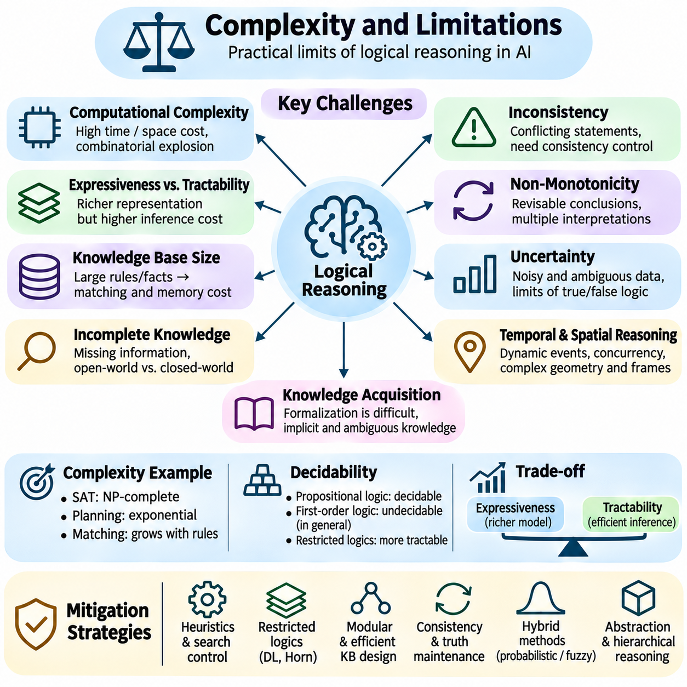{width="7.268055555555556in" height="7.268055555555556in"}

Logical reasoning provides artificial intelligence with formal mechanisms for deriving conclusions, verifying consistency, and explaining decisions. However, its practical effectiveness is constrained by computational complexity, incomplete knowledge, uncertainty, and the difficulty of representing real-world environments. Understanding these limitations is essential for designing reasoning systems that remain reliable, efficient, and scalable.

Computational complexity describes how the resources required by a reasoning algorithm grow with problem size. Time complexity measures computational operations, while space complexity measures memory consumption. Logical inference may require exploring many combinations of facts, rules, or possible interpretations. Even when a problem is mathematically decidable, its computational requirements may exceed practical hardware and response-time limits.

Propositional satisfiability, commonly known as SAT, is NP-complete in its general form. Although verifying a proposed satisfying assignment is efficient, finding one may require examining exponentially many possibilities in the worst case. Modern SAT solvers use conflict-driven clause learning, propagation, and branching heuristics to solve many practical instances efficiently. Nevertheless, difficult problem families remain computationally expensive.

The complexity of logical reasoning depends strongly on the selected representation language. Propositional logic is decidable, while unrestricted first-order logic has an undecidable validity problem. Consequently, no general algorithm can always determine the validity of every first-order formula and terminate. Restricted logical fragments, such as certain description logics and Horn-clause systems, provide more manageable inference properties.

Knowledge-base size also influences reasoning performance. Large collections of facts and rules increase matching operations, memory requirements, and dependency relationships. Forward chaining may generate numerous intermediate conclusions, while backward chaining may repeatedly explore alternative proof paths. Indexing, memoization, rule compilation, and selective inference can reduce redundant computation without changing the intended logical semantics.

The combinatorial explosion becomes particularly severe when reasoning involves multiple interacting variables, alternative actions, and uncertain conditions. A planning system may need to consider many possible sequences of actions, each producing different future states. Constraints can eliminate invalid alternatives, but the remaining search space may still grow rapidly. Heuristics and hierarchical decomposition help focus computation on promising possibilities.

Expressiveness and tractability often conflict in logical system design. Richer languages can represent complex relationships, exceptions, temporal dependencies, and quantified statements, but may require more expensive inference. Simpler languages support predictable computation at the cost of representational flexibility. Selecting a formalism therefore requires balancing the knowledge that must be expressed against available computational resources.

Incomplete knowledge presents a separate limitation because logical conclusions depend on the facts and assumptions represented in the knowledge base. An inference engine cannot reliably derive information that is neither encoded nor logically implied. The open-world assumption treats missing facts as unknown, whereas the closed-world assumption may treat their absence as evidence of falsity. Incorrect assumptions about missing information can produce misleading conclusions.

Inconsistency arises when a knowledge base contains mutually contradictory statements or rules. In classical logic, unrestricted reasoning from a contradiction can entail arbitrary conclusions through the principle of explosion. Practical systems therefore require consistency checking, conflict detection, or controlled inference strategies. Paraconsistent logics offer alternatives that can tolerate certain contradictions without allowing every proposition to become derivable.

Non-monotonic reasoning addresses changing knowledge but introduces additional complexity. Default conclusions may need to be withdrawn when exceptions or stronger evidence appear. Maintaining dependencies between assumptions and derived facts requires truth-maintenance mechanisms and careful rule prioritization. Conflicting defaults can produce multiple acceptable interpretations, making deterministic and explainable decisions more difficult.

Uncertainty creates another boundary for purely logical approaches. Sensor measurements, language interpretations, and environmental observations often contain noise or ambiguity. Classical logic typically represents propositions as true or false, which may not capture confidence levels or uncertain evidence adequately. Probabilistic reasoning, fuzzy logic, and hybrid neuro-symbolic methods can complement logical inference when uncertainty must be represented explicitly.

Knowledge acquisition and formalization are major engineering challenges. Real-world expertise frequently contains implicit assumptions, contextual exceptions, and ambiguous terminology. Translating this knowledge into precise predicates, ontologies, and inference rules requires substantial domain understanding. Incorrect formalization may produce logically valid conclusions that are operationally inappropriate because the modeled assumptions do not match reality.

Temporal and spatial reasoning introduce further computational and representational difficulties. Events may occur concurrently, observations may arrive late, and spatial relationships may depend on changing reference frames. Exact geometric constraints can become expensive in high-dimensional environments. Combining temporal logic, spatial constraints, and action planning requires consistent semantics and careful management of interacting dependencies.

Real-time applications impose strict limits on reasoning latency. An autonomous robot cannot indefinitely search for an optimal conclusion when immediate collision avoidance is required. Bounded inference, anytime algorithms, and precomputed policies can provide usable decisions within available deadlines. Safety-critical constraints should be enforced independently of complex reasoning processes whose completion time cannot be guaranteed.

Scalability becomes challenging when reasoning extends across distributed agents and knowledge sources. Different systems may maintain inconsistent facts, use incompatible ontologies, or receive updates at different times. Communication delays and synchronization overhead can affect inference correctness. Distributed reasoning architectures require explicit policies for data ownership, consistency, provenance, and conflict resolution.

Explainability is an important strength of symbolic reasoning, but large inference chains can still become difficult to interpret. A conclusion may depend on hundreds of intermediate rules, assumptions, and exceptions. Producing a technically valid proof does not automatically provide an understandable explanation. Practical systems should summarize decisive premises, identify relevant conflicts, and distinguish verified facts from provisional assumptions.

Verification and testing must address both logical correctness and operational behavior. Unit tests can evaluate individual rules, while consistency checks identify contradictory knowledge. Formal verification can establish properties within a specified model, but those guarantees depend on the model\'s assumptions. Simulation, adversarial scenarios, and real-world validation are necessary to identify failures caused by incomplete or inaccurate representations.

Hybrid reasoning architectures provide a practical response to many limitations of purely symbolic systems. Neural models can extract patterns from complex observations, probabilistic methods can represent uncertainty, and symbolic logic can enforce explicit constraints. Combining these components introduces challenges involving interface semantics, confidence calibration, and error propagation. Clear separation of responsibilities improves system reliability.

Engineering optimization should focus on the actual reasoning workload rather than theoretical complexity alone. Profiling can identify expensive rule evaluations, repeated queries, and memory bottlenecks. Incremental updates, caching, knowledge partitioning, and approximate methods may improve throughput. However, optimization must preserve required correctness guarantees, especially when conclusions influence safety-related decisions.

Logical reasoning remains valuable because it provides explicit structure, verifiable relationships, and traceable decision processes. Its limitations do not eliminate its usefulness but define the conditions under which it should be applied. Reliable AI systems combine suitable logical formalisms with efficient algorithms, uncertainty management, validation, and operational safeguards to achieve practical intelligence within finite resources.

논리적 추론(Logical Reasoning)은 인공지능(Artificial Intelligence)이 결론을 도출하고, 일관성(Consistency)을 검증하며, 의사결정(Decision Making)을 설명할 수 있도록 하는 형식적 메커니즘(Formal Mechanism)을 제공한다. 그러나 실제적인 효과는 계산 복잡도(Computational Complexity), 불완전한 지식(Incomplete Knowledge), 불확실성(Uncertainty), 현실 세계 환경(Real-World Environment)을 표현하는 어려움에 의해 제한된다. 이러한 한계를 이해하는 것은 신뢰성(Reliability), 효율성(Efficiency), 확장성(Scalability)을 유지하는 추론 시스템(Reasoning System)을 설계하는 데 필수적이다.

계산 복잡도(Computational Complexity)는 문제 크기(Problem Size)가 증가함에 따라 추론 알고리즘(Reasoning Algorithm)에 필요한 자원이 어떻게 증가하는지를 설명한다. 시간 복잡도(Time Complexity)는 계산 연산(Computational Operation)의 양을 측정하며, 공간 복잡도(Space Complexity)는 메모리 사용량(Memory Consumption)을 측정한다. 논리적 추론은 사실(Fact), 규칙(Rule), 가능한 해석(Possible Interpretation)의 다양한 조합을 탐색해야 할 수 있다. 문제가 수학적으로 결정 가능(Decidable)하더라도 계산 요구량이 실제 하드웨어(Hardware)와 응답 시간(Response Time)의 한계를 초과할 수 있다.

일반적으로 SAT라고 부르는 명제 논리 만족 가능성(Propositional Satisfiability)은 일반적인 형태에서 NP-완전(NP-Complete) 문제이다. 제안된 만족 할당(Satisfying Assignment)이 올바른지 검증하는 작업은 효율적이지만, 만족 할당을 찾는 과정에서는 최악의 경우(Worst Case) 지수적으로 많은 가능성을 검토해야 할 수 있다. 현대적인 SAT 솔버(SAT Solver)는 충돌 기반 절 학습(Conflict-Driven Clause Learning), 전파(Propagation), 분기 휴리스틱(Branching Heuristic)을 사용하여 많은 실제 문제를 효율적으로 해결한다. 그러나 계산 비용이 매우 높은 어려운 문제군(Difficult Problem Family)은 여전히 존재한다.

논리적 추론의 복잡도는 선택한 표현 언어(Representation Language)에 크게 의존한다. 명제 논리(Propositional Logic)는 결정 가능하지만, 제한되지 않은 일차 논리(Unrestricted First-Order Logic)의 타당성 문제(Validity Problem)는 결정 불가능(Undecidable)하다. 따라서 모든 일차 논리 수식(First-Order Formula)의 타당성을 항상 판단하고 종료하는 일반적인 알고리즘은 존재하지 않는다. 특정 기술 논리(Description Logic)와 혼 절 시스템(Horn-Clause System) 같은 제한된 논리 단편(Restricted Logical Fragment)은 더욱 관리하기 쉬운 추론 특성(Inference Property)을 제공한다.

지식 베이스(Knowledge Base)의 크기도 추론 성능(Reasoning Performance)에 영향을 미친다. 대규모 사실과 규칙의 집합은 매칭 연산(Matching Operation), 메모리 요구량(Memory Requirement), 의존 관계(Dependency Relationship)를 증가시킨다. 전방향 추론(Forward Chaining)은 수많은 중간 결론(Intermediate Conclusion)을 생성할 수 있으며, 후방향 추론(Backward Chaining)은 대안적인 증명 경로(Alternative Proof Path)를 반복적으로 탐색할 수 있다. 인덱싱(Indexing), 메모이제이션(Memoization), 규칙 컴파일(Rule Compilation), 선택적 추론(Selective Inference)은 의도된 논리적 의미론(Logical Semantics)을 변경하지 않으면서 중복 계산을 줄일 수 있다.

조합 폭발(Combinatorial Explosion)은 여러 상호작용 변수(Interacting Variable), 대안적 행동(Alternative Action), 불확실한 조건(Uncertain Condition)이 추론에 포함될 때 특히 심각해진다. 계획 시스템(Planning System)은 수많은 가능한 행동 순서(Action Sequence)를 고려해야 할 수 있으며, 각각은 서로 다른 미래 상태(Future State)를 생성한다. 제약조건(Constraint)은 유효하지 않은 대안을 제거할 수 있지만, 남아 있는 탐색 공간(Search Space)도 빠르게 증가할 수 있다. 휴리스틱(Heuristic)과 계층적 분해(Hierarchical Decomposition)는 유망한 가능성에 계산 자원을 집중하도록 돕는다.

표현력(Expressiveness)과 계산 용이성(Tractability)은 논리 시스템 설계에서 서로 충돌하는 경우가 많다. 표현력이 풍부한 언어(Richer Language)는 복잡한 관계(Complex Relationship), 예외(Exception), 시간적 의존성(Temporal Dependency), 양화된 명제(Quantified Statement)를 표현할 수 있지만 더 높은 추론 비용(Inference Cost)을 요구할 수 있다. 단순한 언어(Simpler Language)는 표현의 유연성(Representational Flexibility)을 희생하는 대신 예측 가능한 계산(Predictable Computation)을 지원한다. 따라서 형식 체계(Formalism)를 선택할 때는 표현해야 할 지식과 사용 가능한 계산 자원(Computational Resource) 사이의 균형을 고려해야 한다.

불완전한 지식(Incomplete Knowledge)은 논리적 결론(Logical Conclusion)이 지식 베이스(Knowledge Base)에 표현된 사실과 가정에 의존하기 때문에 별도의 한계를 발생시킨다. 추론 엔진(Inference Engine)은 명시적으로 인코딩되지 않았거나 논리적으로 함축되지 않은 정보를 신뢰성 있게 도출할 수 없다. 열린 세계 가정(Open-World Assumption)은 누락된 사실을 알 수 없는 상태(Unknown)로 취급하는 반면, 닫힌 세계 가정(Closed-World Assumption)은 해당 사실의 부재를 거짓이라는 증거(Evidence of Falsity)로 취급할 수 있다. 누락된 정보에 대한 잘못된 가정은 오해를 유발하는 결론(Misleading Conclusion)을 생성할 수 있다.

불일치(Inconsistency)는 지식 베이스(Knowledge Base)에 서로 모순되는 명제(Contradictory Statement)나 규칙이 포함될 때 발생한다. 고전 논리(Classical Logic)에서는 폭발 원리(Principle of Explosion)에 따라 모순으로부터 제한 없이 추론하면 임의의 결론(Arbitrary Conclusion)을 도출할 수 있다. 따라서 실제 시스템에는 일관성 검사(Consistency Checking), 충돌 탐지(Conflict Detection), 통제된 추론 전략(Controlled Inference Strategy)이 필요하다. 초일관 논리(Paraconsistent Logic)는 모든 명제가 도출되는 것을 허용하지 않으면서 특정 모순을 수용할 수 있는 대안적인 접근법을 제공한다.

비단조 추론(Non-Monotonic Reasoning)은 변화하는 지식(Changing Knowledge)을 처리하지만 추가적인 복잡성을 도입한다. 기본 결론(Default Conclusion)은 예외(Exception)나 더 강력한 증거(Stronger Evidence)가 나타나면 철회되어야 할 수 있다. 가정(Assumption)과 도출된 사실(Derived Fact) 사이의 의존 관계를 유지하려면 진리 유지 메커니즘(Truth-Maintenance Mechanism)과 신중한 규칙 우선순위 설정(Rule Prioritization)이 필요하다. 충돌하는 기본 규칙(Conflicting Default)은 여러 수용 가능한 해석(Acceptable Interpretation)을 생성할 수 있으며, 이로 인해 결정론적(Deterministic)이고 설명 가능한 의사결정(Explainable Decision Making)이 더욱 어려워진다.

불확실성(Uncertainty)은 순수한 논리적 접근법(Purely Logical Approach)에 또 다른 한계를 형성한다. 센서 측정값(Sensor Measurement), 언어 해석(Language Interpretation), 환경 관찰(Environmental Observation)에는 잡음(Noise)이나 모호성(Ambiguity)이 포함되는 경우가 많다. 고전 논리(Classical Logic)는 일반적으로 명제(Proposition)를 참(True) 또는 거짓(False)으로 표현하므로 신뢰도 수준(Confidence Level)이나 불확실한 증거(Uncertain Evidence)를 충분히 표현하지 못할 수 있다. 불확실성을 명시적으로 표현해야 하는 경우 확률적 추론(Probabilistic Reasoning), 퍼지 논리(Fuzzy Logic), 하이브리드 신경 기호 방법(Hybrid Neuro-Symbolic Method)이 논리적 추론을 보완할 수 있다.

지식 획득(Knowledge Acquisition)과 형식화(Formalization)는 중요한 공학적 과제(Engineering Challenge)이다. 현실 세계의 전문 지식(Real-World Expertise)에는 암묵적인 가정(Implicit Assumption), 맥락적 예외(Contextual Exception), 모호한 용어(Ambiguous Terminology)가 포함되는 경우가 많다. 이러한 지식을 정확한 술어(Predicate), 온톨로지(Ontology), 추론 규칙(Inference Rule)으로 변환하려면 상당한 도메인 이해(Domain Understanding)가 필요하다. 잘못된 형식화(Incorrect Formalization)는 모델링된 가정이 현실과 일치하지 않기 때문에 논리적으로는 타당하지만 운영상 부적절한 결론(Operationally Inappropriate Conclusion)을 생성할 수 있다.

시간 추론(Temporal Reasoning)과 공간 추론(Spatial Reasoning)은 계산 및 표현 측면에서 추가적인 어려움을 발생시킨다. 사건(Event)은 동시에 발생할 수 있고, 관찰 결과(Observation)는 지연되어 도착할 수 있으며, 공간적 관계(Spatial Relationship)는 변화하는 기준 좌표계(Reference Frame)에 따라 달라질 수 있다. 정확한 기하학적 제약조건(Exact Geometric Constraint)은 고차원 환경(High-Dimensional Environment)에서 높은 계산 비용을 요구할 수 있다. 시간 논리(Temporal Logic), 공간 제약조건(Spatial Constraint), 행동 계획(Action Planning)을 결합하려면 일관된 의미론(Consistent Semantics)과 상호작용하는 의존 관계(Interacting Dependency)에 대한 신중한 관리가 필요하다.

실시간 응용(Real-Time Application)은 추론 지연시간(Reasoning Latency)에 엄격한 제한을 부과한다. 자율 로봇(Autonomous Robot)은 즉각적인 충돌 회피(Immediate Collision Avoidance)가 필요한 상황에서 최적의 결론(Optimal Conclusion)을 찾기 위해 무기한 탐색할 수 없다. 제한된 추론(Bounded Inference), 애니타임 알고리즘(Anytime Algorithm), 사전 계산된 정책(Precomputed Policy)은 주어진 마감시간(Deadline) 내에 활용 가능한 의사결정을 제공할 수 있다. 안전 필수 제약조건(Safety-Critical Constraint)은 완료 시간을 보장할 수 없는 복잡한 추론 과정(Complex Reasoning Process)과 독립적으로 강제되어야 한다.

확장성(Scalability)은 추론이 분산 에이전트(Distributed Agent)와 여러 지식 원천(Knowledge Source)으로 확장될 때 중요한 문제가 된다. 서로 다른 시스템은 일치하지 않는 사실(Inconsistent Fact)을 유지하거나 호환되지 않는 온톨로지(Incompatible Ontology)를 사용하거나 서로 다른 시점에 갱신 정보를 수신할 수 있다. 통신 지연(Communication Delay)과 동기화 오버헤드(Synchronization Overhead)는 추론의 정확성(Inference Correctness)에 영향을 미칠 수 있다. 분산 추론 아키텍처(Distributed Reasoning Architecture)는 데이터 소유권(Data Ownership), 일관성(Consistency), 출처 추적(Provenance), 충돌 해결(Conflict Resolution)에 관한 명시적인 정책이 필요하다.

설명 가능성(Explainability)은 기호적 추론(Symbolic Reasoning)의 중요한 강점이지만, 대규모 추론 체인(Inference Chain)은 여전히 해석하기 어려울 수 있다. 하나의 결론은 수백 개의 중간 규칙(Intermediate Rule), 가정(Assumption), 예외(Exception)에 의존할 수 있다. 기술적으로 유효한 증명(Technically Valid Proof)을 생성한다고 해서 자동으로 이해하기 쉬운 설명(Understandable Explanation)이 제공되는 것은 아니다. 실제 시스템은 결정적인 전제(Decisive Premise)를 요약하고, 관련 충돌(Relevant Conflict)을 식별하며, 검증된 사실(Verified Fact)과 잠정적인 가정(Provisional Assumption)을 구분해야 한다.

검증(Verification)과 테스트(Testing)는 논리적 정확성(Logical Correctness)과 운영 동작(Operational Behavior)을 모두 다루어야 한다. 단위 테스트(Unit Test)는 개별 규칙을 평가할 수 있으며, 일관성 검사(Consistency Check)는 모순되는 지식(Contradictory Knowledge)을 식별한다. 형식 검증(Formal Verification)은 지정된 모델(Specified Model) 내에서 특정 속성을 입증할 수 있지만, 이러한 보장은 모델의 가정(Model Assumption)에 의존한다. 시뮬레이션(Simulation), 적대적 시나리오(Adversarial Scenario), 현실 세계 검증(Real-World Validation)은 불완전하거나 부정확한 표현으로 인해 발생하는 실패를 식별하는 데 필요하다.

하이브리드 추론 아키텍처(Hybrid Reasoning Architecture)는 순수한 기호적 시스템(Purely Symbolic System)의 여러 한계에 대응하는 실용적인 방법을 제공한다. 신경망 모델(Neural Model)은 복잡한 관찰 결과에서 패턴(Pattern)을 추출할 수 있고, 확률적 방법(Probabilistic Method)은 불확실성을 표현할 수 있으며, 기호 논리(Symbolic Logic)는 명시적인 제약조건(Explicit Constraint)을 강제할 수 있다. 이러한 구성요소를 결합하면 인터페이스 의미론(Interface Semantics), 신뢰도 보정(Confidence Calibration), 오류 전파(Error Propagation)와 관련된 문제가 발생한다. 구성요소 사이의 명확한 책임 분리(Separation of Responsibilities)는 시스템 신뢰성(System Reliability)을 향상한다.

공학적 최적화(Engineering Optimization)는 이론적인 복잡도(Theoretical Complexity)만이 아니라 실제 추론 작업 부하(Reasoning Workload)에 초점을 맞추어야 한다. 프로파일링(Profiling)은 비용이 높은 규칙 평가(Rule Evaluation), 반복 질의(Repeated Query), 메모리 병목현상(Memory Bottleneck)을 식별할 수 있다. 증분 갱신(Incremental Update), 캐싱(Caching), 지식 분할(Knowledge Partitioning), 근사 방법(Approximate Method)은 처리량(Throughput)을 향상할 수 있다. 그러나 최적화는 특히 결론이 안전 관련 의사결정(Safety-Related Decision)에 영향을 미치는 경우 요구되는 정확성 보장(Correctness Guarantee)을 유지해야 한다.

논리적 추론(Logical Reasoning)은 명시적인 구조(Explicit Structure), 검증 가능한 관계(Verifiable Relationship), 추적 가능한 의사결정 과정(Traceable Decision Process)을 제공하기 때문에 여전히 가치가 있다. 이러한 한계는 논리적 추론의 유용성을 없애는 것이 아니라 적용해야 하는 조건을 정의한다. 신뢰할 수 있는 인공지능 시스템(Reliable AI System)은 적절한 논리적 형식 체계(Logical Formalism)를 효율적인 알고리즘(Efficient Algorithm), 불확실성 관리(Uncertainty Management), 검증(Validation), 운영 안전장치(Operational Safeguard)와 결합하여 유한한 자원(Finite Resource) 내에서 실용적인 지능(Practical Intelligence)을 구현한다.

## 01.11 Case Studies

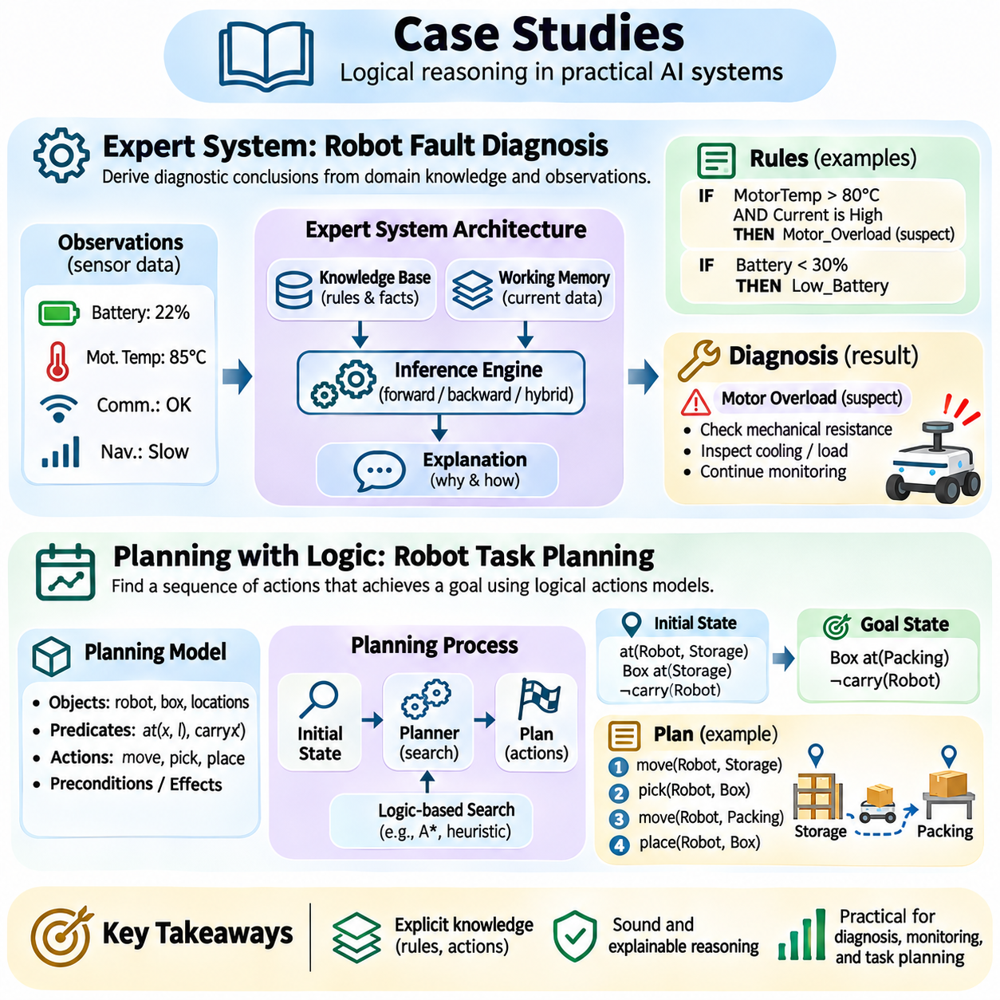{width="7.268055555555556in" height="7.268055555555556in"}

Case studies in logical reasoning demonstrate how formal knowledge representation and inference mechanisms can solve practical decision-making problems. Expert systems and logic-based planning provide two complementary applications of symbolic artificial intelligence. Expert systems derive conclusions from domain knowledge, while planning systems determine sequences of actions that achieve specified goals. Both require explicit rules, consistent representations, and verifiable reasoning processes.

An expert system is an artificial intelligence application designed to reproduce selected aspects of human expert decision making within a defined domain. Its architecture typically includes a knowledge base, an inference engine, working memory, and an explanation component. The knowledge base stores domain facts and rules, while the inference engine applies logical operations to derive conclusions. Working memory maintains case-specific information and intermediate results.

Knowledge acquisition is the first major challenge in expert system development. Domain specialists provide operational procedures, diagnostic relationships, constraints, and exceptional conditions. Knowledge engineers translate this expertise into structured facts, predicates, and production rules. The resulting representation must distinguish established evidence from assumptions and preserve the conditions under which each rule is applicable.

Consider an expert system for diagnosing faults in autonomous mobile robots. The system receives observations concerning battery voltage, motor temperature, communication status, and navigation performance. Diagnostic rules connect abnormal measurements to possible component failures. For example, elevated motor temperature combined with excessive current may indicate mechanical resistance, while communication loss may suggest network or controller problems.

A diagnostic rule can express that if motor temperature exceeds a defined threshold and current consumption is abnormal, a motor overload condition should be investigated. This conclusion may trigger additional checks rather than immediately establish a definitive fault. Such rules must distinguish symptoms from confirmed causes. The inference engine combines multiple observations to narrow candidate explanations and recommend appropriate diagnostic procedures.

Forward chaining supports data-driven diagnosis by activating rules whenever their conditions match available facts. Sensor measurements enter working memory, and applicable rules generate new conclusions until no additional inference is possible. This approach is useful for continuous equipment monitoring because new observations can automatically trigger diagnostic evaluation. Efficient implementations use rule indexing and incremental matching to reduce repeated computation.

Backward chaining supports goal-directed diagnosis by starting from a suspected fault and searching for evidence that would establish it. If the system investigates a battery management failure, it may request voltage imbalance, temperature alarms, or communication records. The reasoning process recursively evaluates supporting conditions until the hypothesis is confirmed, rejected, or remains unresolved. This method reduces unnecessary examination of unrelated faults.

Hybrid inference combines forward and backward chaining to improve diagnostic efficiency. Forward reasoning identifies suspicious conditions from incoming telemetry, while backward reasoning evaluates specific fault hypotheses. An explanation facility records which observations and rules support each conclusion. Operators can therefore distinguish confirmed failures, plausible diagnoses, and insufficient evidence instead of receiving unexplained fault labels.

Expert systems must also handle conflicting evidence and exceptional operating conditions. A temperature increase may indicate overload during normal operation but may be expected during a controlled stress test. Rule priorities, contextual conditions, and defeasible reasoning prevent ordinary diagnostic assumptions from overriding known exceptions. Uncertain sensor observations can be incorporated through confidence measures or probabilistic models.

Validation of an expert system requires testing normal behavior, individual faults, combined failures, and incomplete observations. Diagnostic accuracy should be evaluated against verified cases rather than rule consistency alone. Important measures include false alarms, missed detections, explanation quality, and inference latency. Safety-critical recommendations require independent verification before automated corrective actions are executed.

Logic-based planning addresses a different problem: determining which actions transform an initial state into a desired goal state. A planning model defines objects, predicates, available actions, preconditions, and effects. The initial state describes the known environment, while the goal specifies required conditions. A planner searches for an action sequence whose execution satisfies the goal without violating applicable constraints.

Classical planning commonly assumes deterministic actions, complete state information, and a static environment during deliberation. STRIPS-style representations describe actions through preconditions, add effects, and delete effects. An action is applicable when its preconditions hold, and execution updates the state according to its effects. These formal definitions make action sequences suitable for systematic search and logical verification.

Consider a warehouse robot assigned to transport a container from a storage area to a packing station. The initial state records the robot\'s location, container position, carrying status, and accessible routes. The goal requires the container to reach the packing station. Available actions include moving between connected locations, picking up the container, and placing it at the destination.

A pickup action may require the robot and container to occupy the same location, the robot to be available, and the container to be movable. Its effects establish that the robot carries the container and that the container is no longer resting at its original location. A movement action changes the robot\'s location while preserving the carried container relationship. A placement action completes delivery when the destination conditions are satisfied.

Planning algorithms explore possible action sequences using forward state-space search, backward regression, or heuristic methods. Forward search applies actions from the initial state, while regression identifies conditions necessary to achieve the goal. Heuristic planning estimates the remaining effort and prioritizes promising states. The resulting plan must satisfy action preconditions and preserve consistency across successive state transitions.

Logical constraints prevent plans from selecting actions that violate operational requirements. A robot may be prohibited from entering restricted areas, carrying loads beyond its capacity, or using unavailable equipment. Resource constraints and temporal dependencies further restrict valid execution sequences. Constraint satisfaction and temporal reasoning can be integrated with planning to support coordinated operations involving multiple robots.

Real-world execution introduces uncertainty because actions may fail, obstacles may appear, and observations may contradict the planning model. A practical planning system monitors execution and compares observed states with expected outcomes. When significant deviations occur, the planner updates its knowledge and generates a revised plan. This closed-loop process connects symbolic planning with perception, control, and non-monotonic reasoning.

Expert systems and logic-based planning can be integrated into a unified autonomous architecture. The expert system evaluates equipment health and operational restrictions, while the planner selects actions consistent with those conclusions. A diagnosed battery fault may prohibit a long-distance mission and introduce charging or maintenance goals. Shared predicates and rule interfaces allow diagnostic knowledge to influence action selection.

Implementation requires careful separation between logical inference, planning, and physical control. Symbolic components determine what actions are justified or permitted, while motion controllers enforce geometric feasibility and safety constraints. Knowledge updates must preserve temporal validity and evidence provenance. Logging rules, decisions, and execution outcomes supports debugging, reproducibility, and operational accountability.

These case studies demonstrate the practical value and limitations of logical reasoning in intelligent systems. Expert systems transform structured knowledge into explainable diagnoses, while logic-based planners convert goals into verifiable action sequences. Their effectiveness depends on accurate knowledge models, efficient inference, reliable observations, and continuous validation. Together, they establish a foundation for transparent, adaptable, and policy-aware autonomous intelligence.

논리적 추론(Logical Reasoning)의 사례 연구(Case Study)는 형식적 지식 표현(Formal Knowledge Representation)과 추론 메커니즘(Inference Mechanism)이 실제 의사결정 문제(Decision-Making Problem)를 어떻게 해결할 수 있는지 보여준다. 전문가 시스템(Expert System)과 논리 기반 계획(Logic-Based Planning)은 기호적 인공지능(Symbolic Artificial Intelligence)의 상호 보완적인 두 가지 응용 분야이다. 전문가 시스템은 도메인 지식(Domain Knowledge)으로부터 결론을 도출하는 반면, 계획 시스템(Planning System)은 지정된 목표(Goal)를 달성하기 위한 행동 순서(Action Sequence)를 결정한다. 두 시스템 모두 명시적인 규칙(Explicit Rule), 일관된 표현(Consistent Representation), 검증 가능한 추론 과정(Verifiable Reasoning Process)을 필요로 한다.

전문가 시스템(Expert System)은 정의된 도메인(Domain) 내에서 인간 전문가(Human Expert)의 의사결정 능력 중 특정 부분을 재현하도록 설계된 인공지능 응용 시스템(Artificial Intelligence Application)이다. 일반적인 아키텍처(Architecture)는 지식 베이스(Knowledge Base), 추론 엔진(Inference Engine), 작업 메모리(Working Memory), 설명 구성요소(Explanation Component)로 구성된다. 지식 베이스는 도메인의 사실(Fact)과 규칙(Rule)을 저장하며, 추론 엔진은 논리적 연산(Logical Operation)을 적용하여 결론을 도출한다. 작업 메모리는 개별 사례에 관한 정보(Case-Specific Information)와 중간 결과(Intermediate Result)를 유지한다.

지식 획득(Knowledge Acquisition)은 전문가 시스템 개발(Expert System Development)의 첫 번째 주요 과제이다. 도메인 전문가(Domain Specialist)는 운영 절차(Operational Procedure), 진단 관계(Diagnostic Relationship), 제약조건(Constraint), 예외 조건(Exceptional Condition)을 제공한다. 지식 엔지니어(Knowledge Engineer)는 이러한 전문 지식을 구조화된 사실(Structured Fact), 술어(Predicate), 생성 규칙(Production Rule)으로 변환한다. 결과적으로 생성된 표현은 확립된 증거(Established Evidence)와 가정(Assumption)을 구분하고, 각 규칙이 적용되는 조건(Applicability Condition)을 보존해야 한다.

자율 이동 로봇(Autonomous Mobile Robot)의 고장을 진단하는 전문가 시스템(Expert System)을 생각해 볼 수 있다. 시스템은 배터리 전압(Battery Voltage), 모터 온도(Motor Temperature), 통신 상태(Communication Status), 내비게이션 성능(Navigation Performance)에 관한 관찰 결과(Observation)를 수신한다. 진단 규칙(Diagnostic Rule)은 비정상적인 측정값(Abnormal Measurement)을 가능한 부품 고장(Component Failure)과 연결한다. 예를 들어 모터 온도 상승과 과도한 전류(Excessive Current)가 함께 발생하면 기계적 저항(Mechanical Resistance)을 나타낼 수 있으며, 통신 손실(Communication Loss)은 네트워크(Network) 또는 제어기(Controller) 문제를 시사할 수 있다.

진단 규칙(Diagnostic Rule)은 모터 온도(Motor Temperature)가 정의된 임계값(Threshold)을 초과하고 전류 소비(Current Consumption)가 비정상적이면 모터 과부하 상태(Motor Overload Condition)를 조사해야 한다고 표현할 수 있다. 이러한 결론은 즉시 확정적인 고장(Definitive Fault)을 판단하기보다 추가 점검(Additional Check)을 유도할 수 있다. 따라서 규칙은 증상(Symptom)과 확인된 원인(Confirmed Cause)을 구분해야 한다. 추론 엔진(Inference Engine)은 여러 관찰 결과를 결합하여 가능한 원인 설명(Candidate Explanation)의 범위를 좁히고 적절한 진단 절차(Diagnostic Procedure)를 권고한다.

전방향 추론(Forward Chaining)은 사용 가능한 사실과 조건이 일치할 때마다 규칙을 활성화함으로써 데이터 기반 진단(Data-Driven Diagnosis)을 지원한다. 센서 측정값(Sensor Measurement)이 작업 메모리(Working Memory)에 입력되면 적용 가능한 규칙이 새로운 결론을 생성하며, 추가적인 추론이 불가능해질 때까지 이 과정이 반복된다. 이러한 접근법은 새로운 관찰 결과가 자동으로 진단 평가(Diagnostic Evaluation)를 실행할 수 있기 때문에 지속적인 장비 모니터링(Continuous Equipment Monitoring)에 유용하다. 효율적인 구현은 규칙 인덱싱(Rule Indexing)과 증분 매칭(Incremental Matching)을 사용하여 반복 계산을 줄인다.

후방향 추론(Backward Chaining)은 의심되는 고장(Suspected Fault)에서 시작하여 이를 입증할 증거를 탐색하는 목표 지향적 진단(Goal-Directed Diagnosis)을 지원한다. 시스템이 배터리 관리 시스템 고장(Battery Management Failure)을 조사한다면 전압 불균형(Voltage Imbalance), 온도 경보(Temperature Alarm), 통신 기록(Communication Record)을 요청할 수 있다. 추론 과정은 가설(Hypothesis)이 확인되거나 기각되거나 미해결 상태(Unresolved State)로 남을 때까지 관련 조건을 재귀적으로 평가한다. 이러한 방법은 관련 없는 고장에 대한 불필요한 검토를 줄인다.

하이브리드 추론(Hybrid Inference)은 전방향 추론(Forward Chaining)과 후방향 추론(Backward Chaining)을 결합하여 진단 효율성(Diagnostic Efficiency)을 향상한다. 전방향 추론은 입력되는 원격 측정 데이터(Telemetry)에서 의심스러운 조건(Suspicious Condition)을 식별하고, 후방향 추론은 구체적인 고장 가설(Fault Hypothesis)을 평가한다. 설명 기능(Explanation Facility)은 각 결론을 뒷받침하는 관찰 결과와 규칙을 기록한다. 따라서 운영자(Operator)는 설명되지 않은 고장 분류(Fault Label)만 전달받는 대신 확인된 고장(Confirmed Failure), 가능성 있는 진단(Plausible Diagnosis), 불충분한 증거(Insufficient Evidence)를 구분할 수 있다.

전문가 시스템(Expert System)은 상충하는 증거(Conflicting Evidence)와 예외적인 운영 조건(Exceptional Operating Condition)도 처리해야 한다. 온도 상승(Temperature Increase)은 정상 운영(Normal Operation)에서는 과부하(Overload)를 나타낼 수 있지만, 통제된 스트레스 테스트(Controlled Stress Test)에서는 예상되는 현상일 수 있다. 규칙 우선순위(Rule Priority), 맥락적 조건(Contextual Condition), 반박 가능 추론(Defeasible Reasoning)은 일반적인 진단 가정(Diagnostic Assumption)이 알려진 예외(Known Exception)를 무효화하지 않도록 방지한다. 불확실한 센서 관찰 결과(Uncertain Sensor Observation)는 신뢰도 척도(Confidence Measure)나 확률 모델(Probabilistic Model)을 통해 통합할 수 있다.

전문가 시스템의 검증(Validation)은 정상 동작(Normal Behavior), 개별 고장(Individual Fault), 복합 고장(Combined Failure), 불완전한 관찰(Incomplete Observation)을 테스트해야 한다. 진단 정확도(Diagnostic Accuracy)는 규칙의 일관성(Rule Consistency)만이 아니라 검증된 사례(Verified Case)를 기준으로 평가해야 한다. 중요한 평가 지표(Evaluation Metric)에는 오경보(False Alarm), 미탐지(Missed Detection), 설명 품질(Explanation Quality), 추론 지연시간(Inference Latency)이 포함된다. 안전 필수 권고사항(Safety-Critical Recommendation)은 자동화된 시정 조치(Automated Corrective Action)를 실행하기 전에 독립적인 검증(Independent Verification)이 필요하다.

논리 기반 계획(Logic-Based Planning)은 초기 상태(Initial State)를 원하는 목표 상태(Goal State)로 변환하는 행동(Action)을 결정하는 다른 문제를 다룬다. 계획 모델(Planning Model)은 객체(Object), 술어(Predicate), 사용 가능한 행동(Available Action), 전제조건(Precondition), 효과(Effect)를 정의한다. 초기 상태는 알려진 환경(Known Environment)을 설명하고, 목표는 요구되는 조건(Required Condition)을 지정한다. 계획기(Planner)는 적용 가능한 제약조건(Constraint)을 위반하지 않으면서 목표를 만족시키는 행동 순서(Action Sequence)를 탐색한다.

고전적 계획(Classical Planning)은 일반적으로 결정론적 행동(Deterministic Action), 완전한 상태 정보(Complete State Information), 계획 수립 과정에서의 정적 환경(Static Environment)을 가정한다. STRIPS 방식의 표현(STRIPS-Style Representation)은 전제조건(Precondition), 추가 효과(Add Effect), 삭제 효과(Delete Effect)를 통해 행동을 설명한다. 행동은 전제조건이 성립할 때 적용 가능하며, 실행되면 해당 효과에 따라 상태가 갱신된다. 이러한 형식적 정의(Formal Definition)는 행동 순서를 체계적인 탐색(Systematic Search)과 논리적 검증(Logical Verification)에 적합하도록 만든다.

창고 로봇(Warehouse Robot)이 보관 구역(Storage Area)에서 포장 작업장(Packing Station)으로 컨테이너(Container)를 운송하도록 할당된 상황을 생각해 볼 수 있다. 초기 상태(Initial State)는 로봇의 위치(Robot Location), 컨테이너 위치(Container Position), 적재 상태(Carrying Status), 접근 가능한 경로(Accessible Route)를 기록한다. 목표(Goal)는 컨테이너가 포장 작업장에 도착하도록 요구한다. 사용 가능한 행동(Available Action)에는 연결된 위치 사이의 이동(Movement), 컨테이너 집기(Pickup), 목적지에 컨테이너 내려놓기(Placement)가 포함된다.

집기 행동(Pickup Action)은 로봇과 컨테이너가 동일한 위치(Same Location)에 있고, 로봇이 작업 가능한 상태(Available State)이며, 컨테이너를 이동할 수 있다는 조건을 요구할 수 있다. 이 행동의 효과(Effect)는 로봇이 컨테이너를 운반하고 있으며 컨테이너가 더 이상 원래 위치(Original Location)에 놓여 있지 않다는 상태를 확립한다. 이동 행동(Movement Action)은 컨테이너 운반 관계(Carrying Relationship)를 유지하면서 로봇의 위치를 변경한다. 내려놓기 행동(Placement Action)은 목적지 조건(Destination Condition)이 충족되면 배송을 완료한다.

계획 알고리즘(Planning Algorithm)은 전방향 상태 공간 탐색(Forward State-Space Search), 후방향 회귀(Backward Regression), 휴리스틱 방법(Heuristic Method)을 사용하여 가능한 행동 순서를 탐색한다. 전방향 탐색(Forward Search)은 초기 상태에서 행동을 적용하며, 회귀(Regression)는 목표 달성에 필요한 조건을 식별한다. 휴리스틱 계획(Heuristic Planning)은 남은 작업량(Remaining Effort)을 추정하고 유망한 상태(Promising State)에 우선순위를 부여한다. 결과적으로 생성된 계획은 행동의 전제조건을 만족하고 연속적인 상태 전이(State Transition) 사이에서 일관성을 유지해야 한다.

논리적 제약조건(Logical Constraint)은 운영 요구사항(Operational Requirement)을 위반하는 행동이 계획에 포함되지 않도록 방지한다. 로봇은 제한 구역(Restricted Area)에 진입하거나 적재 용량(Load Capacity)을 초과하는 화물을 운반하거나 사용할 수 없는 장비(Unavailable Equipment)를 이용하는 것이 금지될 수 있다. 자원 제약조건(Resource Constraint)과 시간적 의존관계(Temporal Dependency)는 유효한 실행 순서(Valid Execution Sequence)를 추가로 제한한다. 제약 충족(Constraint Satisfaction)과 시간 추론(Temporal Reasoning)은 계획과 통합되어 여러 로봇이 참여하는 조정된 운영(Coordinated Operation)을 지원할 수 있다.

현실 세계에서의 실행(Real-World Execution)은 행동 실패(Action Failure), 새로운 장애물(Obstacle)의 출현, 계획 모델(Planning Model)과 모순되는 관찰 결과(Observation) 때문에 불확실성(Uncertainty)을 발생시킨다. 실용적인 계획 시스템(Practical Planning System)은 실행을 모니터링하고 관찰된 상태(Observed State)를 예상 결과(Expected Outcome)와 비교한다. 중대한 편차(Significant Deviation)가 발생하면 계획기는 지식(Knowledge)을 갱신하고 수정된 계획(Revised Plan)을 생성한다. 이러한 폐루프 과정(Closed-Loop Process)은 기호적 계획(Symbolic Planning)을 인식(Perception), 제어(Control), 비단조 추론(Non-Monotonic Reasoning)과 연결한다.

전문가 시스템(Expert System)과 논리 기반 계획(Logic-Based Planning)은 통합 자율 아키텍처(Unified Autonomous Architecture)로 결합할 수 있다. 전문가 시스템은 장비 상태(Equipment Health)와 운영 제한사항(Operational Restriction)을 평가하고, 계획기는 이러한 결론과 일치하는 행동을 선택한다. 진단된 배터리 고장(Diagnosed Battery Fault)은 장거리 임무(Long-Distance Mission)를 금지하고 충전(Charging) 또는 유지보수 목표(Maintenance Goal)를 추가할 수 있다. 공유 술어(Shared Predicate)와 규칙 인터페이스(Rule Interface)를 통해 진단 지식(Diagnostic Knowledge)이 행동 선택(Action Selection)에 영향을 미치도록 할 수 있다.

구현(Implementation) 과정에서는 논리적 추론(Logical Inference), 계획(Planning), 물리적 제어(Physical Control) 사이의 책임을 신중하게 분리해야 한다. 기호적 구성요소(Symbolic Component)는 어떤 행동이 정당화되거나 허용되는지를 결정하고, 동작 제어기(Motion Controller)는 기하학적 실행 가능성(Geometric Feasibility)과 안전 제약조건(Safety Constraint)을 강제한다. 지식 갱신(Knowledge Update)은 시간적 유효성(Temporal Validity)과 증거 출처(Evidence Provenance)를 보존해야 한다. 규칙, 의사결정, 실행 결과(Execution Outcome)를 기록하면 디버깅(Debugging), 재현성(Reproducibility), 운영 책임성(Operational Accountability)을 지원할 수 있다.

이러한 사례 연구(Case Study)는 지능형 시스템(Intelligent System)에서 논리적 추론(Logical Reasoning)이 가지는 실용적 가치(Practical Value)와 한계(Limitation)를 보여준다. 전문가 시스템은 구조화된 지식(Structured Knowledge)을 설명 가능한 진단(Explainable Diagnosis)으로 변환하며, 논리 기반 계획기(Logic-Based Planner)는 목표를 검증 가능한 행동 순서(Verifiable Action Sequence)로 변환한다. 이러한 시스템의 효과는 정확한 지식 모델(Accurate Knowledge Model), 효율적인 추론(Efficient Inference), 신뢰할 수 있는 관찰(Reliable Observation), 지속적인 검증(Continuous Validation)에 달려 있다. 두 접근법은 함께 투명성(Transparency), 적응성(Adaptability), 정책 인식(Policy Awareness)을 갖춘 자율 지능(Autonomous Intelligence)의 기반을 확립한다.
