**Volume 03. Reasoning in AI**

# 01. Logical Reasoning

## 01.01 Introduction to Logical Reasoning

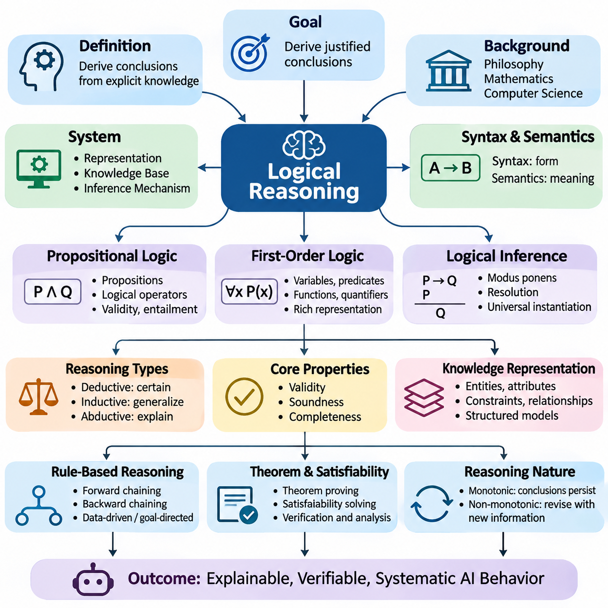{width="7.268055555555556in" height="7.268055555555556in"}

Logical reasoning is a fundamental capability of artificial intelligence that enables a system to derive conclusions from explicitly represented knowledge. Rather than relying exclusively on statistical correlations or learned patterns, logical reasoning applies formal principles to determine whether particular conclusions follow from available premises. This approach provides a foundation for explainable, verifiable, and systematically structured intelligent behavior.

The central objective of logical reasoning is to transform known facts, assumptions, and relationships into justified conclusions. A reasoning system begins with a collection of statements describing a particular domain and applies inference rules to generate additional knowledge. When the premises are valid and the inference procedure is sound, the resulting conclusions can be trusted within the assumptions of the underlying logical framework.

Logical reasoning has deep historical connections to philosophy, mathematics, and computer science. Classical logic established formal methods for evaluating arguments, while mathematical logic introduced symbolic representations that support precise computation. Artificial intelligence extends these foundations by implementing automated reasoning mechanisms capable of processing complex knowledge structures and solving problems that require multiple inference steps.

A logical reasoning system generally consists of a knowledge representation language, a knowledge base, and an inference mechanism. The representation language defines how facts and relationships are expressed, while the knowledge base stores statements about the domain. The inference mechanism applies formal rules to these statements, allowing the system to derive conclusions, detect inconsistencies, and answer questions.

One important distinction in logical reasoning is the difference between syntax and semantics. Syntax specifies the grammatical structure of valid logical expressions, including symbols, operators, and formation rules. Semantics determines how those expressions are interpreted and evaluated. Together, these components establish the formal connection between symbolic statements and the conditions under which they are considered true.

Propositional logic provides one of the simplest foundations for automated reasoning. It represents knowledge using propositions that can be assigned truth values and combines them through logical operators such as conjunction, disjunction, negation, and implication. Although propositional logic cannot directly express complex relationships between objects, it provides a rigorous environment for studying validity, entailment, and computational inference.

First-order logic extends propositional reasoning by introducing variables, predicates, functions, and quantifiers. These elements allow intelligent systems to represent objects, properties, and relationships within a domain. Universal and existential quantification make it possible to express general rules and existence claims, enabling substantially richer knowledge representations than those available through isolated propositions.

Logical inference describes the process of deriving conclusions from premises according to formal rules. Common inference principles include modus ponens, resolution, and universal instantiation. For example, if a system knows that every autonomous robot requires a control system and that a particular machine is an autonomous robot, it can infer that the machine requires a control system without directly storing that conclusion.

The concepts of validity, soundness, and completeness are essential for evaluating reasoning procedures. A valid argument preserves truth from its premises to its conclusion, while a sound argument is valid and has true premises. A sound inference procedure derives only logically entailed conclusions, whereas a complete procedure can derive every conclusion entailed by the knowledge base within its specified logical framework.

Deductive reasoning is the most direct expression of formal logical inference because its conclusions necessarily follow from accepted premises. Inductive reasoning instead generalizes from observations, producing conclusions that may remain uncertain. Abductive reasoning identifies plausible explanations for observed evidence. These approaches serve different purposes and frequently complement one another within intelligent systems.

Knowledge representation plays a critical role in determining what a reasoning system can understand and infer. A domain must be translated into symbolic descriptions that capture relevant entities, attributes, constraints, and relationships. Poorly designed representations may omit essential information or introduce ambiguity, while carefully structured knowledge models support efficient inference and consistent interpretation across complex tasks.

Rule-based reasoning systems implement logical knowledge through conditional statements that connect premises with conclusions. Forward chaining begins with available facts and repeatedly applies applicable rules to derive new information. Backward chaining begins with a target conclusion and searches for supporting premises. These strategies provide complementary mechanisms for data-driven analysis and goal-directed problem solving.

Logical reasoning also supports automated theorem proving and satisfiability analysis. Theorem provers attempt to establish whether a statement follows from a collection of axioms, while satisfiability solvers determine whether a logical formula admits a consistent assignment of truth values. Such techniques are widely used in formal verification, software analysis, configuration management, and the validation of complex computational systems.

Traditional logical systems commonly assume monotonic reasoning, meaning that previously established conclusions remain valid when additional premises are introduced. Real-world intelligence often requires non-monotonic reasoning, where new information can invalidate earlier conclusions. Default reasoning and defeasible logic address this challenge by allowing provisional conclusions that can be revised when exceptions or contradictory evidence become available.

Temporal and spatial reasoning extend logical analysis to relationships involving time, location, movement, and physical structure. Temporal reasoning describes event sequences, durations, and ordering constraints, while spatial reasoning represents containment, connectivity, direction, and relative position. These capabilities are particularly important for autonomous systems that must interpret changing environments and coordinate actions across physical spaces.

Logical reasoning contributes directly to planning and decision-making by representing goals, actions, preconditions, and effects. An intelligent planner can determine whether a sequence of actions satisfies specified constraints and achieves a desired objective. In robotics, such reasoning can verify that required resources are available, operational dependencies are satisfied, and proposed actions comply with predefined safety conditions.

Expert systems demonstrate the practical value of explicit logical knowledge. They encode domain expertise through rules and facts, allowing an inference engine to evaluate situations and recommend actions. Applications include equipment diagnosis, industrial troubleshooting, regulatory compliance, and operational decision support. Their transparent rule structures make it possible to trace conclusions back to supporting knowledge and inference steps.

Despite its strengths, logical reasoning faces important computational and representational limitations. Complex inference problems may require substantial processing resources, and some logical theories are undecidable. Real environments also contain incomplete, noisy, and contradictory information that cannot always be represented through strict Boolean assumptions. These challenges motivate careful selection of logical formalisms and reasoning strategies.

The distinction between logical truth and empirical truth is especially important in artificial intelligence. A conclusion may follow correctly from a knowledge base even when the underlying facts are inaccurate or outdated. Consequently, logical correctness alone does not guarantee reliable real-world decisions. Practical reasoning systems must combine formal inference with knowledge validation, evidence management, and mechanisms for updating their representations.

Logical reasoning differs from probabilistic reasoning primarily in how uncertainty is represented and processed. Classical logical systems focus on whether conclusions follow from premises, whereas probabilistic systems quantify uncertainty through probability distributions. Combining these approaches allows intelligent systems to preserve explicit constraints while evaluating uncertain observations, uncertain hypotheses, and incomplete information.

Modern neural reasoning approaches introduce learned representations and differentiable computation into problems traditionally addressed through symbolic inference. Neural networks can discover patterns and approximate relationships from data, while logical structures provide explicit constraints and interpretable relationships. Neuro-symbolic approaches attempt to combine these complementary strengths, although maintaining formal guarantees within learned systems remains an active research challenge.

Large language models introduce another perspective by generating responses that can resemble multi-step logical reasoning. Their learned representations support flexible language-based problem solving, but plausible explanations do not necessarily constitute valid formal proofs. Integrating language models with theorem provers, rule engines, and external verification tools can improve reliability when applications require explicit logical consistency.

For autonomous robotics, logical reasoning can operate above perception and low-level control as part of a hierarchical decision architecture. Perception modules estimate environmental conditions, while logical components evaluate mission requirements, operational rules, and task dependencies. This separation allows high-level decisions to be checked against explicit constraints before execution, although physical safety also requires reliable sensing and control.

The design of a reliable logical reasoning system requires careful attention to knowledge quality, inference correctness, computational efficiency, and explanation generation. Developers must determine which facts are authoritative, which rules apply under specific conditions, and how contradictory information should be handled. Testing should examine not only successful deductions but also inconsistent knowledge bases, unsupported conclusions, and exceptional cases.

Logical reasoning remains a foundational component of artificial intelligence because it provides a precise framework for representing knowledge and evaluating conclusions. Its greatest value emerges when formal inference is integrated with learning, uncertainty management, perception, and planning. Understanding these principles establishes the conceptual basis for advanced reasoning architectures capable of producing more consistent, interpretable, and verifiable intelligent behavior.

## 01.02 Deductive vs Inductive vs Abductive

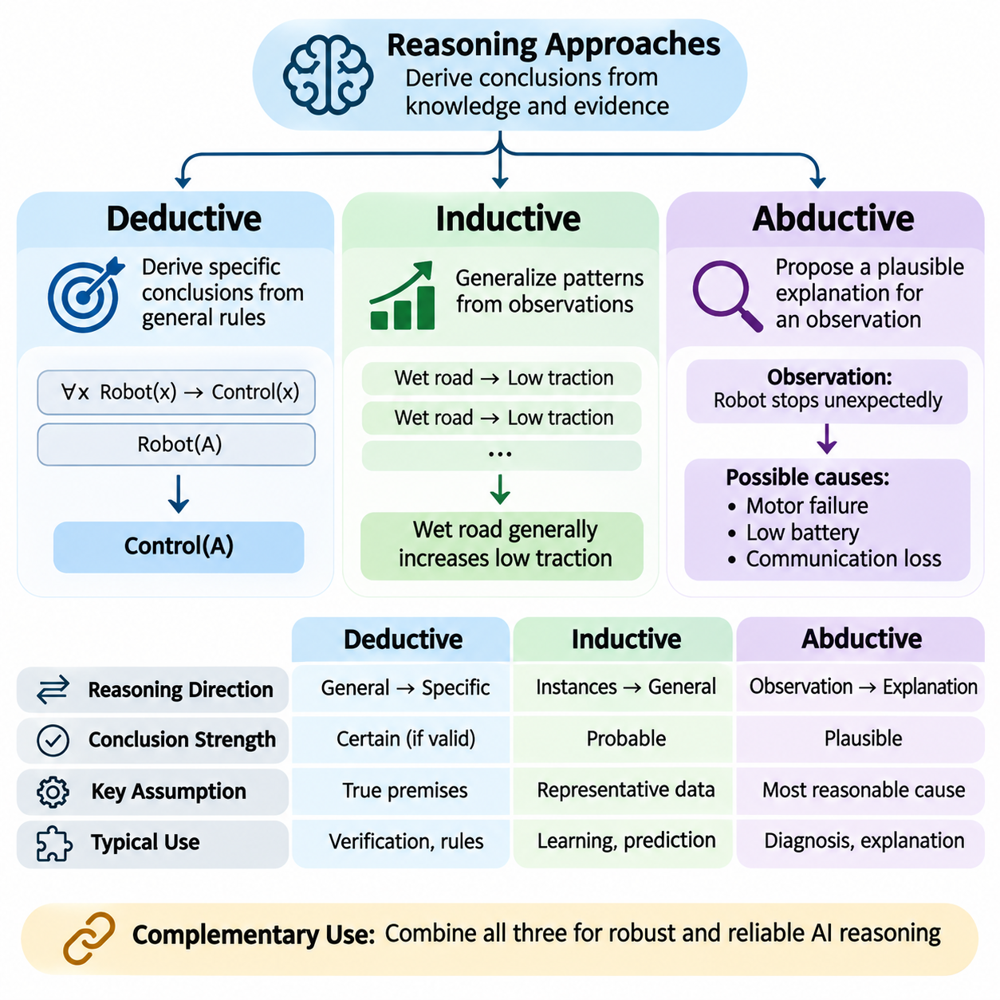{width="7.268055555555556in" height="7.268055555555556in"}

Deductive, inductive, and abductive reasoning represent three fundamental approaches through which artificial intelligence systems derive conclusions from available knowledge and evidence. Although all three support intelligent problem solving, they differ in the direction of inference, the strength of their conclusions, and the assumptions they require. Understanding these differences is essential for designing reasoning architectures that operate reliably under varying conditions.

Deductive reasoning derives specific conclusions from general premises through formally valid inference rules. When the premises are true and the argument is logically valid, the conclusion must also be true. This property makes deduction particularly valuable in applications requiring strict consistency, mathematical correctness, and verifiable decisions. Deductive reasoning establishes what necessarily follows from accepted knowledge rather than what merely appears probable.

A typical deductive argument begins with a general rule and combines it with a specific fact. If every autonomous robot requires a control system, and a particular machine is classified as an autonomous robot, the system can conclude that the machine requires a control system. The conclusion introduces no additional uncertainty because it follows directly from the premises. However, its real-world reliability still depends on the accuracy of those premises.

Formal deduction is closely associated with propositional logic, first-order logic, and mathematical proof systems. Inference mechanisms such as modus ponens, resolution, and universal instantiation allow automated systems to derive conclusions systematically. These procedures can be implemented through rule engines, theorem provers, and logic programming environments. Their correctness depends on the formal semantics of the selected logical framework.

Inductive reasoning operates in the opposite direction by developing generalizations from individual observations or repeated experiences. Rather than guaranteeing conclusions, induction identifies patterns that appear sufficiently consistent to support broader expectations. For example, if an autonomous vehicle repeatedly encounters reduced traction on wet surfaces, it may infer that wet road conditions generally increase the likelihood of reduced traction.

The conclusions produced through induction remain uncertain because future observations may differ from previous experiences. Even a large collection of consistent examples cannot establish a universal rule with absolute logical certainty. Inductive reasoning therefore depends on evidence quality, sample representativeness, and the assumptions connecting observed cases to future situations. Its strength is measured through empirical support rather than deductive validity.

Machine learning provides a computational realization of many inductive reasoning principles. Supervised learning algorithms infer predictive relationships from labeled examples, while unsupervised learning methods discover recurring structures in unlabeled data. Statistical estimation and generalization allow these learned relationships to be applied to previously unseen inputs. However, successful prediction does not necessarily establish a causal explanation or universal logical rule.

Abductive reasoning begins with an observation and searches for a plausible explanation that could account for it. Unlike deduction, which determines necessary consequences, or induction, which identifies general patterns, abduction proposes hypotheses that explain available evidence. If a robot unexpectedly stops moving, an abductive system might consider motor failure, depleted battery power, communication loss, or an activated safety mechanism.

An abductive conclusion is not guaranteed to be correct because several competing hypotheses may explain the same observation. The reasoning process must evaluate candidate explanations according to their consistency with evidence, explanatory coverage, simplicity, and relevant domain knowledge. Additional observations can strengthen or weaken particular hypotheses, allowing the system to refine its explanation as new information becomes available.

The three reasoning approaches can be distinguished by their relationships between premises, observations, and conclusions. Deduction applies general rules to particular situations, induction develops broader patterns from observed instances, and abduction identifies possible causes or explanations for observed outcomes. These distinctions describe their characteristic inference objectives, although practical systems may combine all three within a single reasoning process.

Consider an industrial robot operating in a manufacturing facility. Deductive reasoning determines that the robot must stop when a verified safety rule prohibits movement under a detected condition. Inductive reasoning identifies recurring relationships between operating temperature and equipment performance. Abductive reasoning investigates unexpected vibration by generating possible explanations involving mechanical wear, misalignment, or external interference.

Deductive reasoning offers strong formal guarantees but requires sufficiently accurate and explicit knowledge. Inductive reasoning adapts to patterns emerging from data but remains vulnerable to sampling bias, distribution shifts, and misleading correlations. Abductive reasoning supports explanation and diagnosis but may generate multiple plausible hypotheses without identifying the correct one. Each method addresses limitations that the others cannot resolve independently.

The distinction between logical validity and evidential support is particularly important when comparing these approaches. Deductive validity concerns whether a conclusion necessarily follows from its premises, regardless of whether those premises are factually correct. Inductive strength concerns how strongly observations support a generalization. Abductive quality concerns how effectively a hypothesis explains evidence relative to competing explanations and background assumptions.

Uncertainty is handled differently across the three reasoning paradigms. Classical deduction preserves logical consequences under explicitly defined assumptions, while induction produces conclusions whose reliability depends on empirical evidence. Abduction introduces uncertainty through competing explanatory hypotheses. Probabilistic reasoning can complement induction and abduction by assigning likelihoods or posterior probabilities to predictions and explanations when suitable models are available.

Bayesian inference provides a useful mathematical framework for evaluating uncertain hypotheses and updating beliefs as evidence accumulates. In abductive diagnosis, posterior probabilities can help compare alternative explanations for an observed failure. In inductive learning, probabilistic models can estimate predictive uncertainty. However, Bayesian inference is not identical to either induction or abduction, because it specifies a broader framework for probabilistic belief updating.

Reasoning systems frequently combine these approaches through iterative cycles of observation, hypothesis generation, prediction, and verification. Abduction proposes explanations for unexpected events, deduction derives testable consequences from those explanations, and induction identifies recurring relationships across accumulated observations. This interaction resembles scientific investigation, where hypotheses are continually evaluated against experimental and observational evidence.

In autonomous robotics, such integration can improve diagnostic reasoning and operational adaptability. When a navigation system reports inconsistent localization estimates, abduction may identify sensor malfunction or environmental interference as possible explanations. Deduction can determine the expected consequences of each hypothesis, while induction can analyze historical sensor behavior to estimate which explanations deserve further investigation.

Knowledge representation strongly influences the effectiveness of each reasoning approach. Deduction benefits from explicit rules, predicates, constraints, and ontological relationships. Induction requires observations encoded through informative features or learned representations. Abduction requires models connecting potential explanations with their observable consequences. A unified knowledge architecture can support information exchange between these complementary reasoning mechanisms.

Computational complexity also varies across reasoning strategies and problem formulations. Deductive theorem proving may become computationally expensive as logical expressions and search spaces grow. Inductive learning can require substantial training data and optimization resources. Abductive inference may involve combinatorial searches over possible explanations. Practical implementations therefore use heuristics, approximations, constraints, and domain-specific optimization techniques.

Explainability is another important consideration in reasoning system design. Deductive systems can often expose explicit inference steps connecting premises to conclusions. Inductive systems may require feature analysis, statistical interpretation, or model explanation techniques to clarify their predictions. Abductive systems can present competing hypotheses and supporting evidence, although explaining why one hypothesis was preferred may require additional evaluation.

Modern artificial intelligence increasingly combines symbolic and neural approaches to implement these reasoning capabilities. Symbolic engines provide explicit deductive procedures, while neural networks learn patterns that support inductive generalization. Neural models can also generate abductive hypotheses from complex observations. Hybrid architectures attempt to coordinate these components while maintaining consistency, uncertainty awareness, and computational efficiency.

Large language models can express deductive arguments, generate inductive generalizations, and propose abductive explanations through natural language. Their flexibility supports reasoning across diverse domains, but generated conclusions may contain invalid deductions, unsupported generalizations, or speculative explanations. External verification, structured knowledge retrieval, and executable reasoning tools are therefore valuable when correctness and traceability are essential.

Evaluating reasoning performance requires criteria appropriate to each paradigm. Deductive systems can be assessed through logical soundness, completeness, and proof correctness. Inductive systems can be evaluated using generalization accuracy, calibration, and robustness to distribution changes. Abductive systems can be assessed through explanatory adequacy, hypothesis ranking, diagnostic accuracy, and the ability to incorporate new evidence.

Reliable intelligent systems should select reasoning strategies according to the structure of the problem rather than treating one approach as universally superior. Deduction is appropriate when formal rules and guaranteed implications are central. Induction is valuable when patterns must be learned from experience. Abduction is essential when observations require explanation and possible causes must be investigated. Their coordinated application provides a foundation for adaptive and interpretable intelligence.

The integration of deductive, inductive, and abductive reasoning establishes a broader framework for artificial intelligence that connects formal knowledge, empirical learning, and explanatory hypothesis generation. Together, these approaches enable systems to derive necessary conclusions, recognize recurring patterns, and investigate unfamiliar situations. Understanding their complementary strengths and limitations is fundamental to developing reasoning architectures capable of reliable operation in complex environments.

## 01.03 Propositional Reasoning

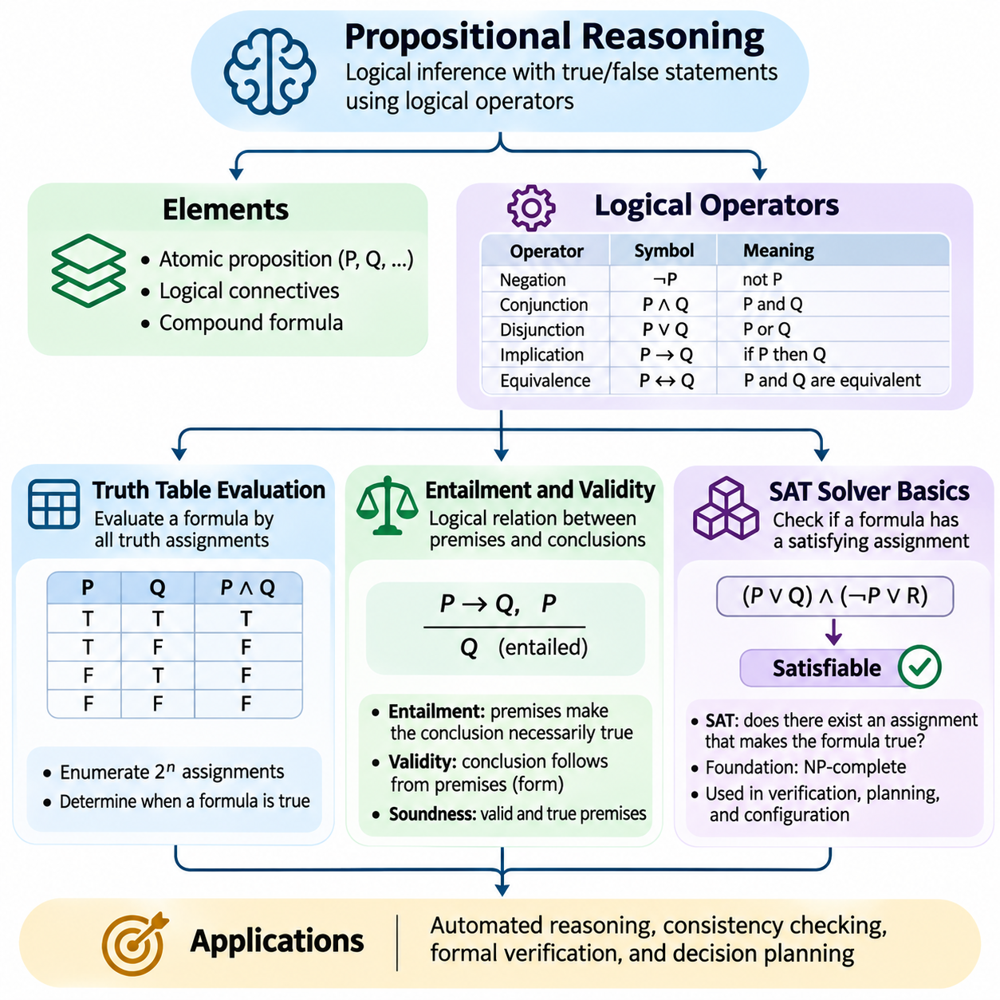{width="7.268055555555556in" height="7.268055555555556in"}

Propositional reasoning is a foundational approach to logical inference in artificial intelligence that represents knowledge through statements with definite truth values. Each proposition is treated as either true or false within a specified interpretation, allowing complex expressions to be constructed using logical operators. This formal structure supports systematic evaluation, consistency checking, and automated deduction across knowledge-based systems.

The basic elements of propositional logic include atomic propositions, logical connectives, and compound formulas. Atomic propositions represent indivisible statements, while compound formulas combine them using negation, conjunction, disjunction, implication, and equivalence. For example, a robot may operate only when its battery is charged and its safety system is active. Such requirements can be expressed as logical constraints and evaluated mathematically.

Truth table evaluation provides a direct method for determining the meaning of propositional expressions. A truth table enumerates every possible assignment of truth values to the atomic propositions appearing in a formula. For each assignment, the logical operators are evaluated according to their defined semantics. The resulting table reveals exactly when the complete expression is true or false.

For a formula containing n distinct propositional variables, a complete truth table requires 2\^n possible assignments. A formula with three variables therefore requires eight rows, while one containing ten variables requires 1,024 rows. This exponential growth makes truth tables practical for small logical expressions but increasingly expensive for larger systems containing many interconnected propositions.

The semantics of logical operators determine how compound propositions are evaluated. Negation reverses a truth value, conjunction requires both operands to be true, and disjunction requires at least one operand to be true. Material implication is false only when its antecedent is true and its consequent is false. Logical equivalence is true when both operands share the same truth value.

Truth tables also provide a method for classifying logical formulas. A tautology is true under every possible truth assignment, while a contradiction is false under every assignment. A contingent formula is true under some assignments and false under others. These classifications help determine whether a logical statement expresses an unconditional truth, an impossible condition, or a requirement dependent on particular circumstances.

Automated truth table evaluation can be implemented by generating combinations of Boolean values and recursively evaluating logical expression trees. A parser first converts an input formula into a structured representation, often an abstract syntax tree. The evaluator then applies operator semantics to each assignment. Such implementations are useful for educational reasoning engines, logical validation tools, and small configuration systems.

Logical entailment describes a relationship in which a conclusion must be true whenever a collection of premises is true. If a knowledge base entails a proposition, every interpretation satisfying the knowledge base must also satisfy that proposition. Entailment is therefore a semantic relationship between statements rather than a measure of statistical association or empirical probability.

Consider a knowledge base containing the statements that a robot moves only when its controller is enabled and that the robot is currently moving. From these premises, the system can infer that the controller is enabled. This conclusion is logically entailed because no interpretation can make both premises true while making the conclusion false, assuming the statements retain their specified logical meanings.

Validity is closely related to entailment but is commonly applied to arguments and inference structures. An argument is valid when its conclusion follows necessarily from its premises, regardless of whether those premises are factually correct. Soundness additionally requires the premises to be true. These distinctions are essential when separating formal reasoning correctness from the reliability of real-world knowledge.

Truth tables can verify entailment by examining every assignment that satisfies the premises. If the conclusion is true in all such assignments, entailment holds. Equivalently, the conjunction of the premises with the negation of the conclusion must be unsatisfiable. This transformation establishes a powerful connection between logical inference and computational satisfiability checking.

Logical equivalence provides another important reasoning relationship. Two formulas are equivalent when they have identical truth values under every possible assignment. Equivalence transformations allow complex expressions to be simplified without changing their logical meaning. Common examples include De Morgan\'s laws, double negation elimination, and the replacement of implication with an equivalent expression involving negation and disjunction.

Satisfiability refers to whether at least one truth assignment makes a propositional formula true. A satisfiable formula describes a logically possible configuration, whereas an unsatisfiable formula contains constraints that cannot all be satisfied simultaneously. Determining satisfiability is central to automated reasoning because many verification, planning, and configuration problems can be represented as collections of Boolean constraints.

The Boolean satisfiability problem, commonly called SAT, asks whether a given propositional formula has a satisfying assignment. SAT is a fundamental computational problem and was the first problem proven NP-complete. Although worst-case computational complexity can be exponential, modern SAT solvers frequently handle large practical instances efficiently by exploiting structure, propagation, and intelligent search strategies.

SAT solvers commonly operate on formulas expressed in conjunctive normal form, or CNF. A CNF formula consists of a conjunction of clauses, where each clause contains a disjunction of literals. A literal is either a propositional variable or its negation. This standardized representation allows solver algorithms to manipulate constraints efficiently while preserving the satisfiability properties of the original problem.

Converting arbitrary propositional formulas into CNF may involve eliminating equivalences and implications, moving negations inward, and applying distributive transformations. Direct conversion can produce exponentially larger formulas. Practical systems often use Tseitin transformations, which introduce auxiliary variables to construct an equisatisfiable CNF representation with size linear in the original formula representation.

The Davis--Putnam--Logemann--Loveland algorithm, commonly abbreviated DPLL, provides a foundational approach to SAT solving. It combines recursive search with unit propagation, branching decisions, and backtracking. Unit propagation identifies assignments forced by clauses containing a single unassigned literal, while branching explores alternative assignments when no immediate implication is available.

Modern SAT solvers frequently employ conflict-driven clause learning, known as CDCL. When a contradiction occurs, the solver analyzes the conflict and learns a new clause that prevents similar unsuccessful assignments. Non-chronological backtracking, efficient watched-literal structures, and adaptive branching heuristics further improve performance. These techniques enable sophisticated exploration of large Boolean search spaces.

SAT solving can also be used to test logical entailment. To determine whether a knowledge base entails a conclusion, a solver checks whether the knowledge base combined with the negated conclusion is unsatisfiable. If no satisfying assignment exists, the conclusion follows logically. If a satisfying assignment exists, it provides a counterexample demonstrating that the proposed entailment does not hold.

In artificial intelligence systems, propositional reasoning supports rule verification, constraint satisfaction, planning, and automated configuration. A robotic mission planner can encode operational requirements as Boolean variables representing equipment availability, safety permissions, and task dependencies. SAT solving can determine whether a proposed mission configuration satisfies all constraints or whether the requirements are mutually inconsistent.

Industrial automation provides another practical application. A manufacturing system may require that a conveyor operate only when protective barriers are closed, emergency-stop conditions are cleared, and upstream equipment is ready. Propositional constraints can represent these conditions and support offline verification of permitted operating states. Actual safety enforcement additionally requires appropriately engineered hardware and runtime controls.

The primary limitation of propositional reasoning is its restricted expressive power. Propositional variables represent complete statements without directly describing internal relationships between objects, quantities, or universally quantified rules. Representing many similar entities may therefore require numerous separate propositions. First-order logic addresses these limitations by introducing predicates, variables, and quantifiers.

Despite these limitations, propositional reasoning remains essential because its semantics are precise and its computational procedures are well understood. Truth tables provide exhaustive evaluation for small formulas, entailment establishes necessary logical consequences, and SAT solvers enable efficient satisfiability analysis for many practical problems. Together, these techniques form a rigorous foundation for building verifiable and explainable reasoning systems.

## 01.04 First Order Reasoning

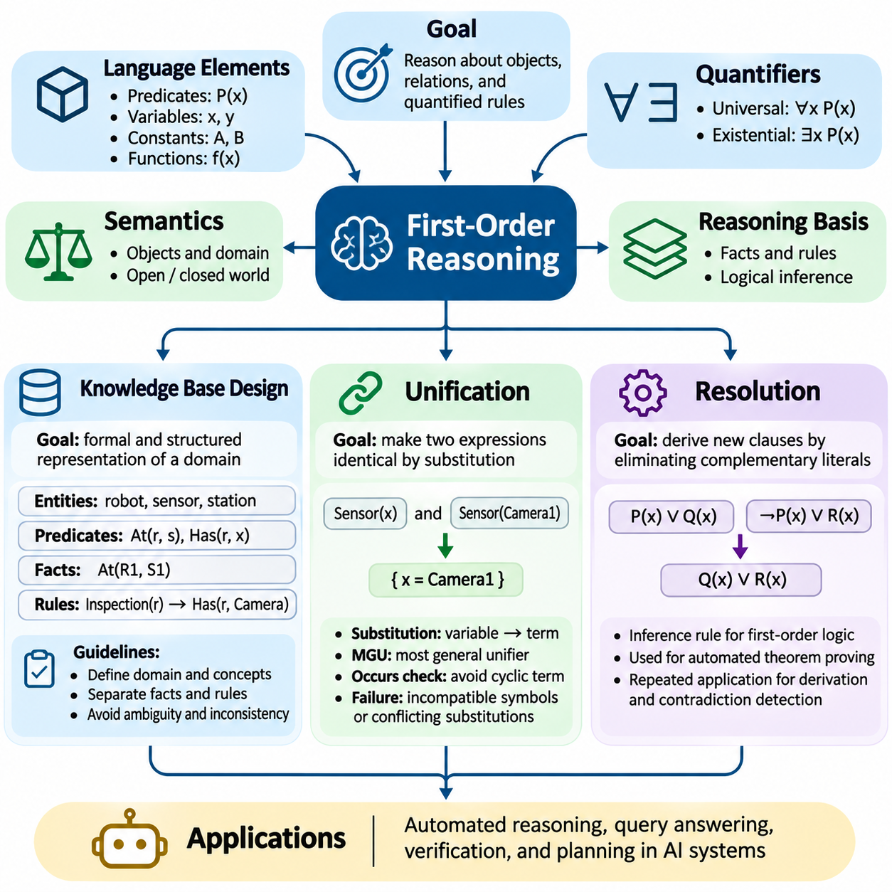{width="7.268055555555556in" height="7.268055555555556in"}

First-order reasoning extends propositional logic by representing objects, properties, relationships, and quantified statements within a formal logical framework. Instead of treating every statement as an indivisible proposition, first-order logic describes the internal structure of knowledge through predicates, variables, constants, and functions. This expressive capability enables artificial intelligence systems to reason about complex domains containing interconnected entities.

First-order logic introduces universal and existential quantifiers to express general rules and existence claims. Universal quantification states that a property applies to every object within a specified domain, while existential quantification asserts that at least one object satisfies a condition. These mechanisms allow knowledge bases to represent reusable rules rather than enumerating separate propositions for every individual object or situation.

A first-order knowledge base consists of formally expressed facts, rules, and relationships describing a particular domain. Predicates represent properties or relations, constants identify specific entities, and variables support generalized statements. Functions can represent mappings between objects. Together, these elements provide a structured vocabulary through which reasoning engines interpret domain knowledge and derive additional conclusions.

Knowledge base design begins by defining the domain of discourse and identifying relevant entities, attributes, and relationships. In a robotics application, entities may include robots, sensors, charging stations, missions, and operating zones. Predicates can describe whether a robot occupies a location, possesses a sensor, or is assigned to a mission. Carefully selected representations reduce ambiguity and support consistent inference.

The distinction between facts and rules is essential for knowledge base organization. Facts describe specific conditions, such as a robot being located at a charging station. Rules express general relationships, such as every robot assigned to an inspection mission requiring an appropriate sensor. A reasoning engine combines these elements to infer properties of individual entities without explicitly storing every possible consequence.

Quantifier scope must be defined carefully because different arrangements of quantifiers can express fundamentally different meanings. A statement asserting that every robot has some assigned mission does not necessarily mean that all robots share one particular mission. Incorrect quantifier placement can introduce unintended assumptions and produce misleading conclusions. Formal knowledge modeling therefore requires precise logical interpretation.

Knowledge bases must also address consistency, completeness, and assumptions about missing information. Under the open-world assumption, the absence of a fact does not imply that the fact is false. Under the closed-world assumption, information not established by the database may be treated as false within the selected reasoning framework. These assumptions influence query behavior, inference results, and the interpretation of incomplete knowledge.

A well-designed knowledge base separates domain concepts from operational inference procedures. Ontologies can organize entity categories and relationships, while logical rules define constraints and implications. Modular knowledge structures simplify maintenance, validation, and extension as domain requirements evolve. They also make it easier to identify contradictory assertions and trace the origin of inferred conclusions.

Unification is a fundamental operation that determines whether two logical expressions can become identical through suitable variable substitutions. For example, the expressions Sensor(x) and Sensor(Camera1) can be unified by substituting Camera1 for x. This mechanism allows general logical rules to match specific facts and provides a foundation for automated theorem proving, logic programming, and rule-based inference.

A substitution maps variables to terms, which may include constants, variables, or function expressions. Successful unification requires compatible predicate symbols, matching argument structures, and consistent substitutions across repeated variables. If one expression contains Relation(x,x) and another contains Relation(A,B), unification succeeds only when A and B can be made identical under the permitted substitutions.

The most general unifier, commonly called the MGU, is a substitution that makes two expressions identical without introducing unnecessary restrictions. Other valid unifiers can be obtained by applying additional substitutions to the MGU. Computing the most general unifier is valuable because it preserves flexibility for subsequent inference steps and avoids prematurely committing variables to overly specific values.

Unification algorithms typically compare expressions recursively, matching corresponding terms and accumulating substitutions. When a variable is encountered, the algorithm determines whether it can be consistently replaced by the opposing term. An occurs check prevents a variable from being substituted with a term containing that same variable, avoiding invalid cyclic structures in standard first-order unification.

Unification may fail when expressions contain incompatible constants, different predicate symbols, conflicting substitutions, or structures that cannot be reconciled. Such failures are meaningful because they prevent inference rules from being applied to unrelated facts. Efficient implementations maintain substitution environments and propagate established bindings throughout subsequent comparisons to preserve logical consistency.

Resolution is a powerful inference technique that derives new clauses by eliminating complementary literals from existing clauses. In first-order logic, resolution relies on unification to identify literals that can become complementary after substitution. The resulting resolvent represents a logical consequence of the original clauses. Repeated resolution can support automated proof construction and inconsistency detection.

Resolution-based theorem proving commonly uses proof by refutation. To demonstrate that a knowledge base entails a conclusion, the system adds the negation of that conclusion to the knowledge base and attempts to derive a contradiction. If resolution produces the empty clause, the combined statements are unsatisfiable, establishing that the original conclusion follows logically from the knowledge base.

Before applying resolution, first-order formulas are generally converted into clause form. This process includes eliminating implications, moving negations inward, standardizing variables apart, transforming quantifiers, and converting expressions into conjunctive normal form. Skolemization removes existential quantifiers through appropriate constants or functions while preserving satisfiability rather than full logical equivalence.

Consider a knowledge base stating that every inspection robot requires a camera and that RobotA is an inspection robot. The general rule can be expressed using a universally quantified implication, while the second statement provides a specific fact. Unification matches the general variable with RobotA, and resolution can derive that RobotA requires a camera. This illustrates how general knowledge produces concrete conclusions.

First-order resolution is sound and refutation-complete for first-order logic, meaning that valid resolution derivations preserve logical consequence and unsatisfiable clause sets can, in principle, be refuted. However, unrestricted first-order theorem proving is undecidable in general. A search procedure may continue indefinitely when the desired conclusion does not follow, making practical search control essential.

Resolution strategies improve efficiency by restricting which clauses are selected and how inference steps are performed. Unit resolution, set-of-support strategies, and ordered resolution can reduce unnecessary exploration under appropriate conditions. Indexing techniques accelerate matching and unification, while redundancy elimination removes clauses that contribute little additional information to the proof search.

Logic programming systems such as Prolog employ restricted forms of first-order reasoning to support goal-directed computation. Horn clauses provide a useful representation for many rules, and backward chaining combines unification with structured proof search. Although these systems are closely related to resolution, their operational semantics, search order, and treatment of special language features require careful consideration.

In autonomous robotics, first-order reasoning can represent relationships among missions, resources, environments, and safety constraints. A knowledge base may describe which robots possess required sensors, which missions demand particular capabilities, and which operating zones impose restrictions. Unification matches mission requirements with available resources, while logical inference determines whether assignments satisfy explicitly modeled conditions.

Practical knowledge-based systems must manage changing facts, incomplete observations, and computational limitations. Sensor updates may alter the current state of a robot, while newly introduced rules may change which conclusions can be derived. Incremental reasoning, selective rule evaluation, and knowledge validation help maintain useful performance. Formal correctness must still be distinguished from the accuracy of real-world observations.

Testing first-order reasoning systems requires more than confirming successful query results. Developers should examine inconsistent facts, incorrectly scoped quantifiers, failed unifications, unintended variable capture, and resolution searches that grow excessively large. Proof traces and controlled test cases help identify modeling errors. These practices are particularly important when inferred conclusions influence operational decisions.

First-order reasoning provides a rigorous foundation for representing structured knowledge and deriving conclusions across complex domains. Knowledge base design determines what can be expressed, unification connects general rules with specific instances, and resolution supplies a systematic mechanism for logical proof. Their integration supports explainable inference, automated verification, and knowledge-driven decision making in intelligent systems.

## 01.05 Rule Based Reasoning

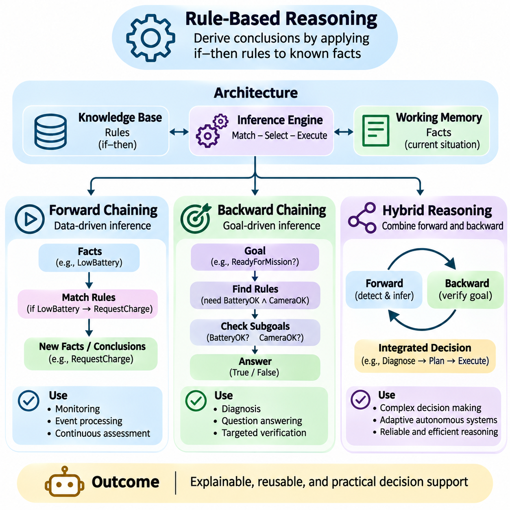{width="7.268055555555556in" height="7.268055555555556in"}

Rule-based reasoning is a foundational approach to artificial intelligence that derives conclusions by applying explicitly defined rules to available facts. These rules commonly use conditional structures connecting premises with consequences. Unlike purely statistical models, rule-based systems represent decision logic in a form that can be inspected, modified, and verified. Their transparency makes them valuable in expert systems, industrial automation, and knowledge-driven decision support.

A rule-based reasoning architecture typically contains a knowledge base, a working memory, and an inference engine. The knowledge base stores general rules, while working memory maintains facts describing the current situation. The inference engine identifies applicable rules and determines how they should be executed. This separation enables the system to reuse domain knowledge while responding to changing observations and operational conditions.

Forward chaining is a data-driven inference strategy that begins with known facts and progressively derives additional conclusions. The inference engine examines rules whose conditions match the current working memory and executes those that are applicable. Newly derived facts may activate further rules, creating a sequence of logical deductions. The process continues until no additional conclusions can be produced or a specified termination condition is reached.

Consider an autonomous robot operating in a warehouse. If its battery level falls below a defined threshold, a rule may classify the battery as low. Another rule may infer that a robot with a low battery should request charging. A subsequent rule may identify an available charging station. Forward chaining connects these conditions into a sequence of conclusions without requiring every intermediate decision to be explicitly requested.

The forward-chaining process generally involves matching, conflict resolution, and rule execution. During matching, the engine identifies rules whose conditions are satisfied. If multiple rules are applicable, a conflict-resolution strategy selects which rule to execute first. Rule execution then adds, updates, or retracts facts according to the system\'s operational semantics. These changes can trigger another evaluation cycle.

Efficient forward-chaining engines often use the Rete algorithm or related pattern-matching techniques. Rete maintains intermediate matching results so that changes in working memory do not require every rule condition to be evaluated again. This approach is particularly useful when large rule sets operate over frequently updated facts. However, memory consumption and rule-network complexity must be considered during implementation.

Forward chaining is well suited to monitoring, event processing, and continuous situation assessment. Industrial systems can apply rules to sensor measurements, equipment states, and operational alarms. Cybersecurity systems may correlate detected events with known threat patterns. Robotics platforms can infer mission readiness from resource availability and safety conditions. Its main limitation is that it may derive conclusions unrelated to the immediate objective.

Backward chaining follows a goal-driven strategy by beginning with a desired conclusion and searching for rules that could establish it. Instead of evaluating every possible consequence of available facts, the inference engine identifies the premises required to prove a particular goal. Each premise becomes a subgoal that must be verified through known facts or additional rules. This process continues until the goal is established or the search fails.

For example, a warehouse management system may ask whether RobotA is ready to execute an inspection mission. A backward-chaining engine searches for a rule defining mission readiness. The rule may require sufficient battery capacity, an operational camera, and authorization to enter the inspection zone. The engine evaluates these conditions individually, deriving supporting facts only when necessary to answer the original question.

Backward chaining commonly uses recursive goal expansion, unification, and backtracking. Unification matches a requested goal with the conclusion of a rule, while recursive expansion generates the required subgoals. If a selected rule cannot establish the goal, backtracking allows alternative rules to be considered. Proper variable management and termination controls are necessary to prevent repeated searches and infinite recursion.

Logic programming languages such as Prolog demonstrate the practical use of backward chaining. Prolog typically represents knowledge through facts and Horn clauses, applying goal-directed resolution to answer queries. Its operational behavior depends on rule ordering, search strategy, and unification. Although effective for structured symbolic reasoning, unrestricted recursive rules can cause nontermination or unnecessary exploration.

Backward chaining is particularly valuable in diagnostic systems, question answering, and targeted verification. A diagnostic engine can investigate whether a specific component failure explains observed symptoms. A compliance system can determine whether a proposed operation satisfies required conditions. Because only relevant supporting rules are explored, backward chaining can avoid some unnecessary deductions produced by unrestricted forward chaining.

Forward and backward chaining differ primarily in the direction of inference and the information that drives computation. Forward chaining starts from facts and discovers their consequences, while backward chaining starts from goals and investigates their prerequisites. The former is appropriate when incoming information should trigger conclusions automatically. The latter is effective when a specific question must be answered using available knowledge.

Neither strategy is universally superior because performance depends on rule structure, knowledge distribution, and application requirements. Forward chaining can be inefficient when many irrelevant conclusions are generated. Backward chaining can repeatedly evaluate shared subgoals or struggle with cyclic dependencies. Techniques such as memoization, dependency indexing, incremental evaluation, and cycle detection can improve efficiency in both approaches.

Hybrid reasoning combines forward and backward chaining within a coordinated inference architecture. A forward component continuously processes observations and maintains derived facts, while a backward component evaluates specific goals when requested. This combination allows systems to maintain awareness of changing conditions without exhaustively proving every possible conclusion. It also supports targeted reasoning over previously inferred knowledge.

In a robotic fleet management system, forward chaining may monitor battery states, sensor health, mission assignments, and charging availability. When a mission scheduler requests confirmation that a particular robot can perform a task, backward chaining evaluates the required capabilities and operational constraints. The resulting decision uses both continuously updated facts and goal-directed verification.

Hybrid systems require coordination between working memory, rule evaluation, and goal management. Facts derived through forward chaining must remain accessible to backward reasoning, while goal-directed discoveries may need to update shared knowledge. Dependency tracking helps determine when previously established conclusions become invalid after changes in observations. Without such mechanisms, stale facts can produce inconsistent operational decisions.

Rule priorities and conflict resolution are important in practical inference engines. Multiple rules may become applicable simultaneously, and their execution order can influence system behavior when rules perform state-changing actions. Priority levels, specificity criteria, and explicit conflict policies can establish predictable execution. For purely logical rules, inference results should be distinguished from operational side effects that depend on scheduling.

Rule-based reasoning also depends on clearly defined assumptions about incomplete and contradictory information. Classical monotonic reasoning preserves established conclusions when new premises are added, whereas practical monitoring systems often require fact retraction and belief revision. Truth-maintenance mechanisms can track dependencies between facts and derived conclusions, enabling updates when supporting information changes.

Explainability is a major advantage of rule-based systems because conclusions can be associated with the rules and facts that produced them. Forward-chaining engines can record sequences of activated rules, while backward-chaining engines can construct goal-support trees. These traces help engineers investigate unexpected decisions, verify domain requirements, and demonstrate compliance with explicitly modeled operational policies.

The reliability of a rule-based system depends on the quality of its knowledge base and the correctness of its inference procedures. Incorrect rules can produce logically consistent but operationally inappropriate conclusions. Testing should therefore examine conflicting rules, missing facts, circular dependencies, priority interactions, and boundary conditions. Formal verification and controlled simulation can complement conventional functional testing.

Modern artificial intelligence architectures increasingly combine rule-based reasoning with machine learning and probabilistic inference. Learned models can transform sensor observations into symbolic facts, while rules enforce explicit constraints and operational policies. Probabilistic components can represent uncertainty when observations are incomplete. Such hybrid architectures must preserve clear interfaces between uncertain predictions and deterministic logical decisions.

Rule-based reasoning remains particularly relevant in autonomous systems where decisions must satisfy explicit requirements. Forward chaining enables continuous interpretation of changing conditions, backward chaining supports targeted goal verification, and hybrid reasoning coordinates both mechanisms. Together, these approaches provide a structured foundation for transparent, maintainable, and knowledge-driven intelligence across complex operational environments.

## 01.06 Non Monotonic Reasoning

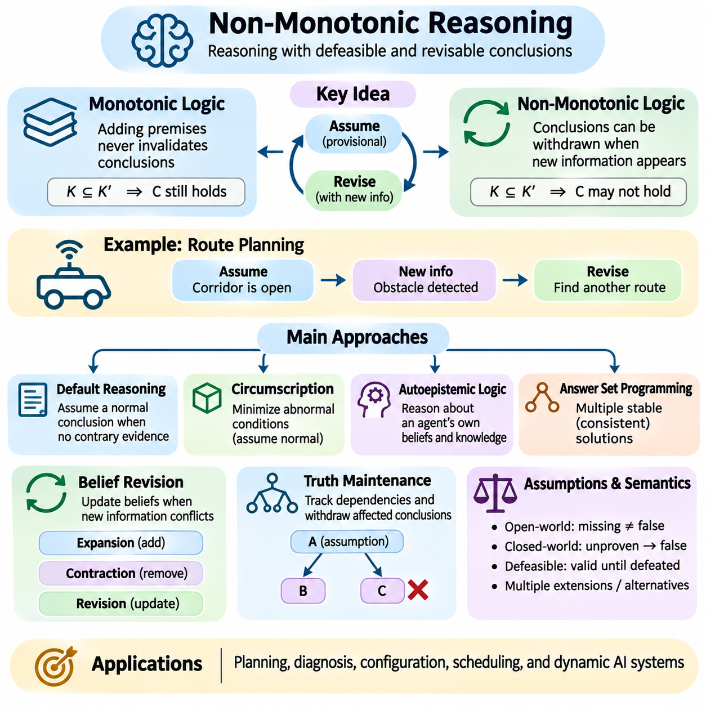{width="7.268055555555556in" height="7.268055555555556in"}

Non-monotonic reasoning is a form of logical inference in which conclusions may be withdrawn when new information becomes available. Unlike classical monotonic logic, where adding premises never invalidates previously established consequences, non-monotonic reasoning supports revisable conclusions. This capability is essential for artificial intelligence systems operating with incomplete knowledge, changing environments, and assumptions that may later prove incorrect.

Classical logic follows the monotonicity principle: if a conclusion follows from a knowledge base, it continues to follow after additional premises are introduced. Non-monotonic reasoning relaxes this property by allowing new evidence to defeat earlier conclusions. Such reasoning more closely reflects practical decision making, where agents frequently rely on provisional beliefs and modify them when exceptions or contradictory observations appear.

Consider an autonomous robot that normally assumes a corridor is traversable when no obstacle has been reported. Based on this assumption, the robot may plan a route through the corridor. If a sensor subsequently detects a physical obstruction, the previous conclusion must be withdrawn and the route reconsidered. Non-monotonic reasoning provides a formal perspective for managing this transition from assumed availability to evidence-based restriction.

A central concept in non-monotonic reasoning is the distinction between established facts and defeasible assumptions. Established facts represent information accepted within the current knowledge model, while defeasible assumptions remain valid only until stronger evidence challenges them. This distinction allows reasoning systems to act despite incomplete information without treating every provisional conclusion as permanently guaranteed.

Default reasoning is one important mechanism for implementing non-monotonic inference. A default rule expresses what should normally be assumed when no contrary evidence is available. For example, a warehouse robot may assume that an assigned charging station is accessible unless maintenance information indicates otherwise. The conclusion is supported by a normal operating assumption rather than an unconditional logical implication.

Reiter\'s default logic formalizes this behavior using rules that distinguish prerequisites, consistency conditions, and conclusions. A default can be applied when its prerequisite is established and its justification remains consistent with the available beliefs. Different compatible collections of defaults may produce multiple extensions, representing alternative sets of acceptable conclusions under the same incomplete knowledge.

Circumscription provides another approach by minimizing the extension of selected predicates while satisfying a logical theory. It can formalize assumptions that abnormal conditions are absent unless evidence requires otherwise. For instance, a monitoring system may treat equipment as operating normally unless an abnormality is established. The resulting conclusions depend on which predicates are minimized and which properties remain variable.

Autoepistemic logic addresses reasoning about an agent\'s own beliefs and knowledge. It introduces modal expressions that describe whether propositions are believed or not believed. This enables rules whose applicability depends on the absence of a belief rather than the explicit falsity of a proposition. Such distinctions are important because not knowing that a condition holds is different from knowing that it does not hold.

Logic programming with negation as failure provides a practical form of non-monotonic behavior. Under suitable program semantics, a system may infer a negative conclusion when an attempt to prove the corresponding positive statement fails. This mechanism is useful in database querying and rule-based applications, but its interpretation depends on assumptions about completeness and the selected logical semantics.

Answer set programming extends logic programming with stable-model semantics to represent defaults, exceptions, and alternative solutions. A program may have multiple answer sets, each describing a consistent interpretation of the encoded rules. This approach is particularly useful for planning, scheduling, configuration, and constraint-intensive reasoning problems where several admissible outcomes may exist.

The distinction between open-world and closed-world assumptions strongly influences non-monotonic reasoning. Under an open-world assumption, missing information does not establish falsity. Under a closed-world assumption, unproven statements may be treated as false within a defined information boundary. Selecting an appropriate assumption requires understanding whether the knowledge source is intended to be complete for the relevant domain.

Belief revision concerns how a reasoning system should modify its accepted beliefs when new information conflicts with existing knowledge. Rather than simply accumulating facts, a revision mechanism attempts to preserve useful information while restoring consistency. AGM belief revision provides a classical theoretical framework for analyzing rational changes to belief sets, including expansion, contraction, and revision operations.

Truth maintenance systems support practical belief revision by tracking relationships between assumptions and derived conclusions. When a supporting assumption becomes invalid, dependent conclusions can be reconsidered or withdrawn. Justification-based truth maintenance records inference dependencies, while assumption-based approaches can represent alternative consistent environments. These mechanisms are valuable in systems that must continuously update their internal state.

Non-monotonic reasoning must distinguish between new information that extends knowledge and information that defeats an existing inference. A newly observed temperature reading may add useful context without changing previous conclusions. In contrast, a confirmed sensor malfunction may invalidate conclusions derived from that sensor. Dependency tracking and explicit justification records help determine which beliefs require reevaluation.

Exceptions are a major source of non-monotonic behavior. General rules often describe typical conditions but admit special cases. A mobile robot may normally enter a designated operating zone, yet temporary maintenance restrictions can override that permission. Representing exceptions explicitly prevents the system from treating operational defaults as universal truths and supports more context-sensitive decisions.

Conflicting defaults create additional challenges because multiple plausible assumptions may support incompatible conclusions. A system may assume that a corridor is available based on its normal schedule while also assuming that maintenance areas are restricted. Priority rules, specificity principles, and preference relations can help resolve such conflicts. However, the chosen resolution policy must be defined rather than assumed to be universally correct.

Temporal change further complicates non-monotonic inference because facts and assumptions may be valid only during particular intervals. A charging station may be available at one moment and unavailable after a new reservation. Time-indexed facts, event histories, and validity intervals help prevent outdated conclusions from being applied to current situations. These mechanisms connect non-monotonic reasoning with temporal reasoning and dynamic knowledge representation.

In autonomous robotics, non-monotonic reasoning can coordinate high-level mission decisions with changing environmental information. A robot may initially consider a delivery route feasible, then withdraw that assessment after detecting a blocked passage or restricted area. The reasoning system can revise its mission assumptions and request replanning while lower-level safety controllers independently enforce immediate physical constraints.

Hybrid artificial intelligence systems can combine non-monotonic logic with probabilistic inference and machine learning. Learned perception models may provide uncertain observations, while symbolic rules determine how those observations affect operational assumptions. Confidence thresholds and evidence policies can influence when provisional conclusions should be revised. Care is required because probabilistic uncertainty and logical defeasibility represent different forms of uncertainty.

Computational complexity is an important limitation of non-monotonic reasoning. Determining acceptable conclusions may require exploring multiple alternative belief sets or stable models. Some formalisms have substantially higher computational complexity than restricted classical reasoning systems. Practical implementations therefore rely on domain constraints, incremental evaluation, solver optimization, and carefully selected fragments of non-monotonic logic.

Explainability becomes especially important when conclusions are revised. A reasoning system should identify which assumption originally supported a conclusion, what new evidence defeated it, and which alternative conclusion replaced it. Maintaining provenance records and justification graphs allows engineers to reconstruct changes in reasoning state. Such transparency supports debugging, operational auditing, and trustworthy human oversight.

Testing non-monotonic systems requires scenarios involving incomplete information, exceptions, contradictory evidence, and changing observations. Developers should verify that conclusions are withdrawn when their supporting assumptions fail and retained when unrelated information changes. Tests should also examine cyclic dependencies, competing defaults, and unexpected interactions between rules. These evaluations reveal errors that ordinary positive-case testing may overlook.

Non-monotonic reasoning provides a formal foundation for intelligent systems that must act before complete knowledge is available and adapt when circumstances change. By supporting defaults, exceptions, belief revision, and dependency-aware inference, it bridges rigid classical deduction and the practical demands of dynamic environments. Its integration with planning, perception, and knowledge management enables more flexible, explainable, and context-sensitive artificial intelligence.

## 01.07 Default and Defeasible Reasoning

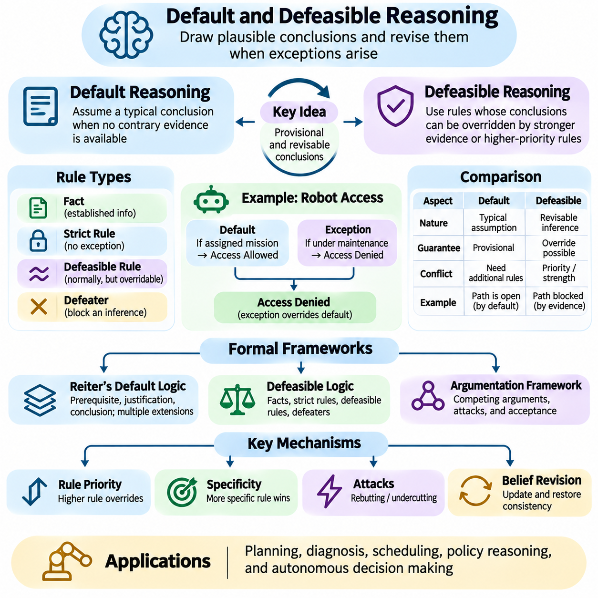{width="7.268055555555556in" height="7.268055555555556in"}

Default and defeasible reasoning provide formal mechanisms for drawing plausible conclusions from incomplete information while allowing those conclusions to be withdrawn when exceptions arise. Unlike strict deductive reasoning, which preserves logically established consequences, these approaches distinguish between unconditional knowledge and assumptions that normally hold. They are essential for intelligent systems that must make decisions before every relevant condition is known.

Default reasoning represents typical situations through rules that apply when contrary evidence is unavailable. A default rule expresses what may reasonably be assumed under normal circumstances without asserting that the conclusion is universally true. For example, an autonomous robot may assume that a designated corridor is accessible unless an obstruction or access restriction is reported. This assumption supports planning while remaining open to revision.

Defeasible reasoning extends this principle by explicitly representing rules whose conclusions can be overridden by stronger evidence or higher-priority rules. A defeasible rule does not guarantee its conclusion under every possible circumstance. Instead, it establishes a provisional inference that remains acceptable until an applicable exception defeats it. This structure closely resembles practical reasoning in operational policies, legal interpretation, and autonomous decision making.

The distinction between strict rules and defeasible rules is fundamental. A strict rule expresses a relationship intended to hold without exceptions within the modeled domain. A defeasible rule expresses a relationship that normally holds but may be overridden. For instance, a strict safety rule may prohibit entering a hazardous zone without authorization, while a defeasible scheduling rule may normally assign the nearest available robot to a mission.

Default reasoning is commonly associated with Reiter\'s default logic, which introduces formal rules containing prerequisites, justifications, and conclusions. A default can be applied when its prerequisite is established and its justification remains consistent with the accepted knowledge. This structure separates the evidence required to activate a rule from the assumptions needed to maintain its conclusion, allowing reasoning under incomplete information.

A default theory may admit multiple extensions, each representing a possible collection of conclusions consistent with the applicable defaults. Different extensions can arise when alternative assumptions compete without sufficient evidence to select one. Consequently, a proposition may hold in some extensions but not others. Skeptical reasoning accepts conclusions shared by all relevant extensions, whereas credulous reasoning considers conclusions supported by at least one.

Defeasible logic provides another framework by distinguishing facts, strict rules, defeasible rules, and defeaters. Facts describe established information, while strict rules support conclusions that follow necessarily from their premises. Defeasible rules support conclusions that may be challenged. Defeaters do not necessarily establish an opposing conclusion; instead, they can prevent another defeasible inference from being accepted.

Consider a warehouse robot that is normally permitted to enter a storage zone when assigned an authorized delivery mission. A general operational rule may support entry permission, while a temporary maintenance restriction may prohibit access. The restriction can defeat the ordinary permission without invalidating the broader operational policy. This illustrates how defeasible reasoning accommodates exceptional circumstances within a consistent rule framework.

Rule priorities are particularly important when conflicting defeasible rules support incompatible conclusions. A system may use superiority relations to establish that one rule takes precedence over another. Safety restrictions may receive higher priority than routine mission preferences, while emergency procedures may introduce additional exceptions. Such priorities must be explicitly defined because their interpretation depends on the intended operational policy.

Specificity offers another mechanism for resolving conflicts between general rules and exceptional cases. A rule applying to a narrowly defined situation may override a broader default when both are relevant. For example, a general rule may permit autonomous navigation through designated corridors, while a more specific rule restricts navigation through corridors undergoing inspection. Specificity is useful but does not automatically determine priority in every formalism.

Defeasible reasoning must distinguish between rebutting and undercutting attacks. A rebutting attack supports a conclusion incompatible with another conclusion, while an undercutting attack challenges the applicability or justification of the original inference. A sensor report indicating that a passage is blocked may rebut an assumption of accessibility. Evidence that the sensor is malfunctioning may instead undermine the reliability of that report.

Argumentation frameworks provide a structured interpretation of defeasible reasoning by representing competing arguments and relationships between them. Arguments consist of premises, inference steps, and conclusions, while attacks express conflicts or challenges. Acceptance semantics determine which arguments can be jointly defended or accepted. This perspective supports explainable decisions when several rules or evidence sources disagree.

Incomplete knowledge introduces a critical distinction between the absence of evidence and evidence of absence. A robot may lack information about an obstacle without possessing reliable evidence that the path is clear. Default assumptions can support provisional decisions, but they must not be confused with verified observations. The choice between open-world and closed-world assumptions influences whether missing information can justify particular conclusions.

Temporal validity is another important consideration because defaults and exceptions may change over time. A charging station may normally be available, become unavailable during maintenance, and return to service afterward. Time-indexed facts and validity intervals allow the reasoning system to distinguish current exceptions from historical restrictions. Without temporal management, outdated evidence may continue defeating conclusions that should become acceptable again.

Belief revision and truth maintenance mechanisms help preserve consistency when defeasible conclusions change. A reasoning system can record the assumptions and rules supporting each derived conclusion. When an assumption is invalidated or a stronger exception appears, dependent conclusions can be reconsidered. Dependency tracking prevents unsupported conclusions from remaining active and reduces the need to recompute unrelated parts of the knowledge base.

Defeasible reasoning differs from probabilistic reasoning even though both address uncertainty. Probabilistic reasoning assigns quantitative degrees of belief to events or hypotheses, while defeasible reasoning focuses on whether conclusions remain justified in the presence of exceptions and competing rules. A highly probable conclusion may still be prohibited by a strict operational constraint. Combining the approaches requires clearly separating confidence from logical permission.

In autonomous robotics, default and defeasible reasoning can support mission allocation, route selection, resource management, and operational supervision. A fleet controller may normally assign the closest capable robot to a task, but battery limitations, restricted zones, or emergency priorities can override that preference. Defeasible rules provide a structured mechanism for expressing these exceptions without requiring every operational situation to be enumerated.

Integration with perception systems introduces additional challenges because sensor observations may be uncertain, delayed, or contradictory. Learned perception models can provide evidence about environmental conditions, while symbolic rules determine whether that evidence defeats an existing assumption. Evidence provenance, confidence thresholds, and sensor reliability policies help manage these interactions. Immediate safety enforcement should remain independent of provisional logical assumptions.

Computational complexity depends on the selected formalism and the structure of the rule system. Some restricted defeasible logics support efficient inference, while richer default theories may require searching multiple extensions or resolving complex conflicts. Rule indexing, incremental evaluation, and dependency-based updates can improve practical performance. Designers must balance expressive flexibility against predictable response times and resource limitations.

Explainability is a major advantage of default and defeasible reasoning because conclusions can be traced to their supporting rules, assumptions, and exceptions. When a mission assignment changes, the system can identify which default originally supported the decision and which new restriction defeated it. Such explanations improve debugging, policy auditing, and operator understanding. They also help distinguish legitimate exceptions from incorrect knowledge representations.

Testing defeasible systems requires examining ordinary cases, exceptional cases, conflicting rules, and changes in available evidence. Developers should verify that strict constraints remain enforced, higher-priority rules override weaker defaults, and withdrawn exceptions permit appropriate conclusions to be restored. Cyclic dependencies and unresolved conflicts also require evaluation. These tests establish whether the system behaves consistently with its intended reasoning semantics.

Default and defeasible reasoning enable artificial intelligence systems to operate with incomplete knowledge while preserving the ability to revise provisional conclusions. Defaults capture normal expectations, defeasible rules represent exceptions, and priority mechanisms resolve competing inferences. Together with belief maintenance, temporal reasoning, and explainable rule execution, these techniques support adaptable, policy-aware, and logically structured decision making in dynamic environments.

## 01.08 Temporal Reasoning

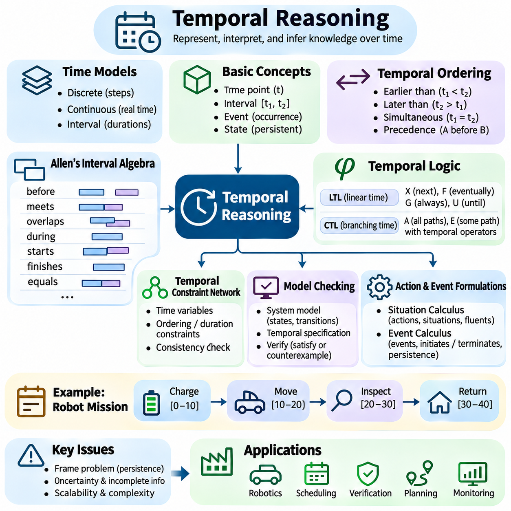{width="7.268055555555556in" height="7.268055555555556in"}

Temporal reasoning is a fundamental capability of artificial intelligence that enables systems to represent, interpret, and infer relationships involving time. Unlike static logical reasoning, which describes facts without considering when they hold, temporal reasoning examines how conditions evolve and how events relate across different moments. This capability is essential for planning, monitoring, robotics, and decision making in dynamic environments.

Time can be represented as discrete steps, continuous values, or ordered intervals depending on application requirements. Discrete models describe sequences of states or events, while continuous models capture processes evolving over measurable durations. Interval-based representations emphasize relationships between periods rather than individual timestamps. Selecting an appropriate temporal model determines which properties can be expressed and how efficiently they can be evaluated.

Temporal knowledge commonly distinguishes between time points, intervals, events, and states. A time point identifies a particular instant, while an interval represents a duration bounded by two endpoints. Events describe occurrences that may initiate or terminate conditions, whereas states describe properties that persist over time. These distinctions allow reasoning systems to represent both instantaneous changes and sustained operational conditions.

Temporal ordering establishes relationships such as earlier than, later than, and simultaneous with. A scheduling system may require a robot to complete charging before beginning an inspection mission. Such relationships can be expressed through inequalities between timestamps or through symbolic temporal constraints. Temporal ordering provides the foundation for detecting invalid sequences and determining whether planned activities satisfy precedence requirements.

Allen\'s interval algebra provides a qualitative framework for describing relationships between time intervals. Its thirteen basic relations include before, meets, overlaps, starts, during, finishes, equals, and their inverses. These relations allow systems to reason about temporal structure without requiring exact numerical timestamps. They are particularly useful when activity durations are uncertain but relative ordering is known.

Temporal constraint networks represent collections of time variables connected by ordering or duration restrictions. A simple temporal network expresses constraints as bounded differences between time points. Consistency checking determines whether all restrictions can be satisfied simultaneously. Such networks are widely applicable to task scheduling, mission coordination, and resource allocation where deadlines and dependencies must be respected.

Temporal logic extends classical logic with operators describing how propositions behave across time. Linear temporal logic, commonly abbreviated LTL, introduces operators such as next, eventually, always, and until. These operators express requirements over sequences of states. For example, a safety specification may require that an emergency stop signal always prevents further motion until the system has entered an authorized recovery state.

The distinction between safety and liveness properties is central to temporal specification. Safety properties describe conditions that must never be violated, such as avoiding unauthorized movement. Liveness properties describe desirable progress, such as eventually completing an accepted mission under appropriate assumptions. Temporal logic provides a formal language for expressing both categories and evaluating whether system behavior satisfies them.

Computation tree logic, or CTL, introduces branching-time reasoning in which multiple possible future paths are considered. Path quantifiers distinguish properties that must hold across every possible execution from those that hold along at least one execution. This representation is useful for analyzing systems with alternative actions, uncertain transitions, or nondeterministic behavior. CTL and LTL therefore capture different aspects of temporal system behavior.

Model checking evaluates whether a formal system model satisfies temporal specifications. The model typically represents states, transitions, and relevant propositions, while the specification defines required temporal behavior. Automated verification explores possible executions or uses symbolic techniques to detect violations. When a property fails, a counterexample trace can reveal the sequence of events responsible for the violation.

The situation calculus provides a logical framework for representing actions and their effects across sequences of situations. Actions transform one situation into another, while fluents represent properties whose truth values may change. Successor-state axioms specify how actions affect these properties and which conditions remain unchanged. This approach supports reasoning about action preconditions, planning outcomes, and evolving world states.

Event calculus offers another formalism for describing how events initiate and terminate persistent conditions. Its central concepts include events, fluents, and temporal relations. A condition may continue to hold after being initiated until an event terminates it, subject to the modeled assumptions. This persistence principle helps represent equipment status, mission execution, access permissions, and other operational properties.

Temporal reasoning must address the frame problem, which concerns how to represent properties that remain unchanged when actions occur. Explicitly describing every unaffected property after every action creates substantial modeling complexity. Persistence axioms and inertia assumptions provide more compact representations. However, these mechanisms must be designed carefully to avoid preserving conditions that should have changed.

Uncertainty complicates temporal reasoning because event times, durations, and observations may not be precisely known. A robot may estimate that a delivery will finish within a time range rather than at an exact moment. Temporal constraint propagation can narrow feasible intervals as additional information becomes available. Probabilistic models may complement symbolic constraints when timing uncertainty requires quantitative treatment.

Temporal reasoning also interacts with non-monotonic reasoning because newly observed events can invalidate previously accepted temporal conclusions. A charging station may be considered available until an unexpected maintenance event changes its status. Time-indexed knowledge and event histories allow systems to distinguish past validity from current applicability. This prevents outdated assumptions from controlling decisions after relevant conditions have changed.

Real-time systems introduce deadlines and response-time constraints that must be distinguished from ordinary logical ordering. A requirement that an alarm eventually triggers is weaker than requiring it to trigger within two seconds. Metric temporal logic and timed automata provide mechanisms for expressing quantitative timing requirements. Their use is particularly important in safety-critical control, industrial automation, and autonomous systems.

In autonomous robotics, temporal reasoning supports coordination between perception, planning, navigation, and mission execution. A robot may need to verify that localization is available before movement begins, that a restricted zone remains closed during maintenance, and that charging finishes before a scheduled mission. Temporal dependencies connect these conditions into an executable operational sequence while exposing conflicting requirements.

Multi-robot coordination introduces additional temporal challenges involving shared resources and concurrent activities. Several robots may request the same charging station, docking area, or narrow passage. Temporal constraints can prevent overlapping reservations and establish safe execution windows. Scheduling algorithms can combine these constraints with mission priorities, travel estimates, and resource availability to produce feasible assignments.

Temporal databases and streaming systems maintain information whose validity changes over time. Event timestamps indicate when observations occurred, while validity intervals describe when facts were true in the modeled environment. Distinguishing event time from processing time is important when sensor messages arrive late or out of order. Temporal queries can reconstruct historical states and support reasoning about the sequence of operational changes.

Efficient temporal reasoning requires balancing expressiveness and computational cost. Some restricted temporal constraint systems admit polynomial-time consistency checking, while richer interval networks and temporal logics can be substantially more expensive. Incremental constraint propagation, bounded verification, and selective monitoring reduce unnecessary computation. The appropriate technique depends on the scale of the system and its timing requirements.

Testing temporal reasoning systems requires examining event ordering, overlapping intervals, delayed observations, missed deadlines, and contradictory constraints. Developers should verify that temporal properties remain satisfied under alternative execution paths and changing operational conditions. Simulation and formal verification can expose race conditions, scheduling conflicts, and unexpected state transitions that ordinary static tests may overlook.

Temporal reasoning provides a rigorous foundation for intelligent systems that must understand not only what is true, but also when it is true and how it changes. Temporal logic expresses behavioral requirements, constraint networks organize scheduling relationships, and action-based formalisms describe evolving states. Their integration enables reliable planning, verification, monitoring, and coordinated decision making across dynamic environments.

## 01.09 Spatial Reasoning

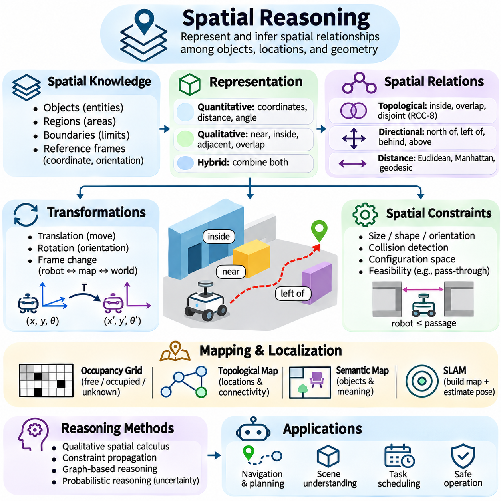{width="7.268055555555556in" height="7.268055555555556in"}

Spatial reasoning is a fundamental capability of artificial intelligence that enables systems to represent, interpret, and infer relationships among objects, locations, and geometric structures. Unlike purely symbolic reasoning, spatial reasoning incorporates position, orientation, distance, shape, and connectivity. It allows intelligent agents to understand how entities occupy physical environments and how spatial relationships influence perception, navigation, planning, and decision making.

Spatial knowledge can be represented through qualitative, quantitative, or hybrid models. Quantitative representations use coordinates, distances, angles, and geometric measurements to describe spatial configurations precisely. Qualitative representations express relationships such as near, inside, adjacent, or overlapping without requiring exact numerical values. Hybrid approaches combine both forms to support reasoning across different levels of spatial detail.

A spatial reasoning system must distinguish between objects, regions, boundaries, and reference frames. Objects represent identifiable entities, while regions describe occupied or designated areas. Boundaries separate spatial regions and may determine accessibility or containment. Reference frames establish how positions and orientations are interpreted. These concepts provide the structural foundation for consistent spatial knowledge representation.

Topological reasoning focuses on relationships that remain meaningful under continuous geometric transformations. Common relationships include disjointness, intersection, containment, overlap, and boundary contact. The Region Connection Calculus, particularly RCC-8, provides a formal framework for expressing eight fundamental topological relations. These relations support reasoning about connected spaces without depending on exact coordinates.

Directional reasoning describes the relative orientation of spatial entities. Relations such as north of, left of, behind, and above depend on an explicitly defined reference frame. An object may be left of a robot from the robot\'s perspective but right of another observer. Spatial reasoning must therefore account for viewpoint, coordinate conventions, and orientation changes to avoid contradictory interpretations.

Distance reasoning evaluates proximity and separation between objects or regions. Euclidean distance is appropriate for direct geometric separation, while Manhattan distance can represent movement constrained to orthogonal paths. Geodesic and graph-based distances describe movement along surfaces or connected networks. Selecting a distance metric requires considering environmental geometry, accessibility, and the intended operational task.

Coordinate systems provide numerical foundations for spatial reasoning. Cartesian coordinates describe positions along orthogonal axes, while polar and spherical coordinates express locations through distances and angles. Geographic systems represent positions on Earth using appropriate reference models. Transformations between coordinate frames allow observations from cameras, LiDAR sensors, and robotic platforms to be interpreted within a shared spatial context.

Spatial transformations describe translation, rotation, and changes between reference frames. In robotics, rigid-body transformations are commonly represented using rotation matrices, translation vectors, or homogeneous transformation matrices. These operations allow sensor measurements to be converted into robot, map, or world coordinates. Accurate calibration and transformation composition are essential for maintaining geometric consistency.

Spatial reasoning also involves geometric constraints concerning shape, size, orientation, and collision. A robot may fit through a passage only when its physical dimensions and required clearance satisfy the passage geometry. Collision detection evaluates whether occupied regions intersect, while configuration-space reasoning accounts for the robot\'s shape during movement. These techniques connect geometric knowledge with feasible physical actions.

Qualitative spatial calculi enable reasoning when measurements are incomplete or unnecessary. A system may know that a charging station is inside a warehouse and adjacent to a maintenance area without knowing their exact coordinates. Constraint propagation can derive additional relationships from known spatial facts. However, ambiguous qualitative descriptions may permit multiple configurations, requiring careful consistency checking.

Spatial knowledge graphs represent entities and their relationships as interconnected structures. Nodes may describe robots, rooms, corridors, obstacles, and equipment, while edges encode containment, adjacency, accessibility, or relative position. Graph-based reasoning can identify connected routes, restricted regions, and resource relationships. Combining spatial graphs with ontologies enables semantic interpretation of geometric environments.

Spatial reasoning is closely related to mapping and localization. Mapping constructs representations of environmental structure, while localization estimates an agent\'s position within a reference map. Occupancy grids describe free, occupied, or unknown cells, and topological maps represent connectivity among significant locations. Semantic maps add object categories and functional meanings, supporting reasoning beyond geometric navigation.

Simultaneous localization and mapping, commonly called SLAM, integrates observations and motion estimates to construct maps while estimating the robot\'s pose. Spatial reasoning uses these estimates to interpret environmental relationships and support planning. Measurement noise, sensor drift, and uncertain associations can introduce errors into spatial knowledge. Probabilistic estimation methods help represent and update these uncertainties.

Spatial constraint satisfaction determines whether a collection of geometric or relational requirements can hold simultaneously. A warehouse layout may require charging stations to remain outside emergency exits while maintaining accessible routes to operating zones. Constraint solvers can evaluate feasible arrangements and identify conflicting requirements. Such methods support facility design, robotic manipulation, and automated configuration.

Path planning applies spatial reasoning to identify feasible movement through an environment. Graph-search algorithms such as A\\\* can find routes through discrete maps, while sampling-based methods explore continuous configuration spaces. Spatial constraints determine which regions are traversable and which movements are prohibited. Practical planners must also consider robot dimensions, turning limits, terrain conditions, and collision margins.

Spatial reasoning becomes more complex when environments change over time. A corridor may be accessible during normal operation but blocked by a moving vehicle or temporary maintenance activity. Spatiotemporal reasoning combines spatial relationships with temporal constraints to represent evolving accessibility and occupancy. This integration supports dynamic route planning, collision avoidance, and coordinated movement.

Multi-agent systems require spatial reasoning about relative positions, shared regions, and interaction constraints. Multiple robots may need to coordinate movement through narrow passages or maintain separation distances during cooperative tasks. Relative localization and shared maps help establish a common spatial understanding. Communication delays and inconsistent reference frames can complicate coordination, making uncertainty management essential.

Embodied artificial intelligence connects spatial reasoning with perception and physical interaction. A manipulation robot must understand object orientation, reachable regions, grasping surfaces, and collision constraints. Visual observations can provide geometric and semantic information, while motion planning converts spatial goals into executable actions. The reasoning process must respect both symbolic task requirements and physical feasibility.

Spatial reasoning systems must manage uncertainty arising from sensor limitations, occlusion, incomplete maps, and ambiguous observations. An obstacle may be partially visible, or a region may remain unexplored. Probabilistic occupancy models and confidence-aware spatial relations help distinguish confirmed geometry from uncertain estimates. Safety-critical applications should avoid treating unknown space as automatically traversable.

Computational complexity depends on the spatial representation and the constraints being evaluated. Exact geometric reasoning may become expensive in high-dimensional configuration spaces, while qualitative constraint networks can also present difficult consistency problems. Hierarchical maps, spatial indexing, approximate geometry, and incremental updates reduce computational demands. Efficient implementations balance precision, scalability, and response time.

Testing spatial reasoning requires evaluating coordinate transformations, topological consistency, collision constraints, uncertain observations, and changing environments. Simulation can expose errors involving narrow passages, overlapping regions, incorrect reference frames, and dynamic obstacles. Validation against measured geometry helps distinguish logical modeling errors from perception inaccuracies. These practices are essential when spatial conclusions influence physical motion.

Spatial reasoning provides a rigorous foundation for intelligent systems that must understand where objects are, how regions relate, and which actions are physically possible. Geometric models provide precision, qualitative relations support symbolic interpretation, and spatial graphs organize connectivity and semantics. Their integration with perception, temporal reasoning, and planning enables reliable navigation, manipulation, coordination, and autonomous decision making.

## 01.10 Complexity and Limitations

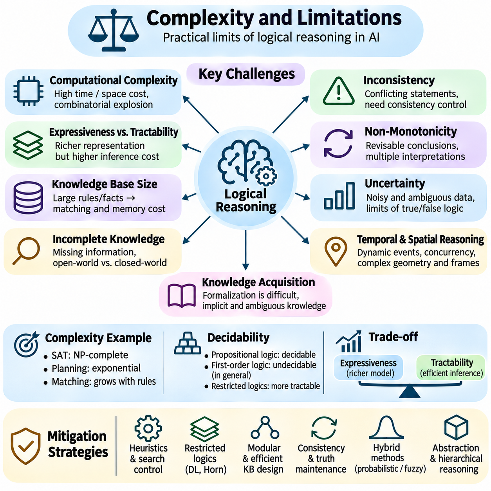{width="7.268055555555556in" height="7.268055555555556in"}

Logical reasoning provides artificial intelligence with formal mechanisms for deriving conclusions, verifying consistency, and explaining decisions. However, its practical effectiveness is constrained by computational complexity, incomplete knowledge, uncertainty, and the difficulty of representing real-world environments. Understanding these limitations is essential for designing reasoning systems that remain reliable, efficient, and scalable.

Computational complexity describes how the resources required by a reasoning algorithm grow with problem size. Time complexity measures computational operations, while space complexity measures memory consumption. Logical inference may require exploring many combinations of facts, rules, or possible interpretations. Even when a problem is mathematically decidable, its computational requirements may exceed practical hardware and response-time limits.

Propositional satisfiability, commonly known as SAT, is NP-complete in its general form. Although verifying a proposed satisfying assignment is efficient, finding one may require examining exponentially many possibilities in the worst case. Modern SAT solvers use conflict-driven clause learning, propagation, and branching heuristics to solve many practical instances efficiently. Nevertheless, difficult problem families remain computationally expensive.

The complexity of logical reasoning depends strongly on the selected representation language. Propositional logic is decidable, while unrestricted first-order logic has an undecidable validity problem. Consequently, no general algorithm can always determine the validity of every first-order formula and terminate. Restricted logical fragments, such as certain description logics and Horn-clause systems, provide more manageable inference properties.

Knowledge-base size also influences reasoning performance. Large collections of facts and rules increase matching operations, memory requirements, and dependency relationships. Forward chaining may generate numerous intermediate conclusions, while backward chaining may repeatedly explore alternative proof paths. Indexing, memoization, rule compilation, and selective inference can reduce redundant computation without changing the intended logical semantics.

The combinatorial explosion becomes particularly severe when reasoning involves multiple interacting variables, alternative actions, and uncertain conditions. A planning system may need to consider many possible sequences of actions, each producing different future states. Constraints can eliminate invalid alternatives, but the remaining search space may still grow rapidly. Heuristics and hierarchical decomposition help focus computation on promising possibilities.

Expressiveness and tractability often conflict in logical system design. Richer languages can represent complex relationships, exceptions, temporal dependencies, and quantified statements, but may require more expensive inference. Simpler languages support predictable computation at the cost of representational flexibility. Selecting a formalism therefore requires balancing the knowledge that must be expressed against available computational resources.

Incomplete knowledge presents a separate limitation because logical conclusions depend on the facts and assumptions represented in the knowledge base. An inference engine cannot reliably derive information that is neither encoded nor logically implied. The open-world assumption treats missing facts as unknown, whereas the closed-world assumption may treat their absence as evidence of falsity. Incorrect assumptions about missing information can produce misleading conclusions.

Inconsistency arises when a knowledge base contains mutually contradictory statements or rules. In classical logic, unrestricted reasoning from a contradiction can entail arbitrary conclusions through the principle of explosion. Practical systems therefore require consistency checking, conflict detection, or controlled inference strategies. Paraconsistent logics offer alternatives that can tolerate certain contradictions without allowing every proposition to become derivable.

Non-monotonic reasoning addresses changing knowledge but introduces additional complexity. Default conclusions may need to be withdrawn when exceptions or stronger evidence appear. Maintaining dependencies between assumptions and derived facts requires truth-maintenance mechanisms and careful rule prioritization. Conflicting defaults can produce multiple acceptable interpretations, making deterministic and explainable decisions more difficult.

Uncertainty creates another boundary for purely logical approaches. Sensor measurements, language interpretations, and environmental observations often contain noise or ambiguity. Classical logic typically represents propositions as true or false, which may not capture confidence levels or uncertain evidence adequately. Probabilistic reasoning, fuzzy logic, and hybrid neuro-symbolic methods can complement logical inference when uncertainty must be represented explicitly.

Knowledge acquisition and formalization are major engineering challenges. Real-world expertise frequently contains implicit assumptions, contextual exceptions, and ambiguous terminology. Translating this knowledge into precise predicates, ontologies, and inference rules requires substantial domain understanding. Incorrect formalization may produce logically valid conclusions that are operationally inappropriate because the modeled assumptions do not match reality.

Temporal and spatial reasoning introduce further computational and representational difficulties. Events may occur concurrently, observations may arrive late, and spatial relationships may depend on changing reference frames. Exact geometric constraints can become expensive in high-dimensional environments. Combining temporal logic, spatial constraints, and action planning requires consistent semantics and careful management of interacting dependencies.

Real-time applications impose strict limits on reasoning latency. An autonomous robot cannot indefinitely search for an optimal conclusion when immediate collision avoidance is required. Bounded inference, anytime algorithms, and precomputed policies can provide usable decisions within available deadlines. Safety-critical constraints should be enforced independently of complex reasoning processes whose completion time cannot be guaranteed.

Scalability becomes challenging when reasoning extends across distributed agents and knowledge sources. Different systems may maintain inconsistent facts, use incompatible ontologies, or receive updates at different times. Communication delays and synchronization overhead can affect inference correctness. Distributed reasoning architectures require explicit policies for data ownership, consistency, provenance, and conflict resolution.

Explainability is an important strength of symbolic reasoning, but large inference chains can still become difficult to interpret. A conclusion may depend on hundreds of intermediate rules, assumptions, and exceptions. Producing a technically valid proof does not automatically provide an understandable explanation. Practical systems should summarize decisive premises, identify relevant conflicts, and distinguish verified facts from provisional assumptions.

Verification and testing must address both logical correctness and operational behavior. Unit tests can evaluate individual rules, while consistency checks identify contradictory knowledge. Formal verification can establish properties within a specified model, but those guarantees depend on the model\'s assumptions. Simulation, adversarial scenarios, and real-world validation are necessary to identify failures caused by incomplete or inaccurate representations.

Hybrid reasoning architectures provide a practical response to many limitations of purely symbolic systems. Neural models can extract patterns from complex observations, probabilistic methods can represent uncertainty, and symbolic logic can enforce explicit constraints. Combining these components introduces challenges involving interface semantics, confidence calibration, and error propagation. Clear separation of responsibilities improves system reliability.

Engineering optimization should focus on the actual reasoning workload rather than theoretical complexity alone. Profiling can identify expensive rule evaluations, repeated queries, and memory bottlenecks. Incremental updates, caching, knowledge partitioning, and approximate methods may improve throughput. However, optimization must preserve required correctness guarantees, especially when conclusions influence safety-related decisions.

Logical reasoning remains valuable because it provides explicit structure, verifiable relationships, and traceable decision processes. Its limitations do not eliminate its usefulness but define the conditions under which it should be applied. Reliable AI systems combine suitable logical formalisms with efficient algorithms, uncertainty management, validation, and operational safeguards to achieve practical intelligence within finite resources.

## 01.11 Case Studies

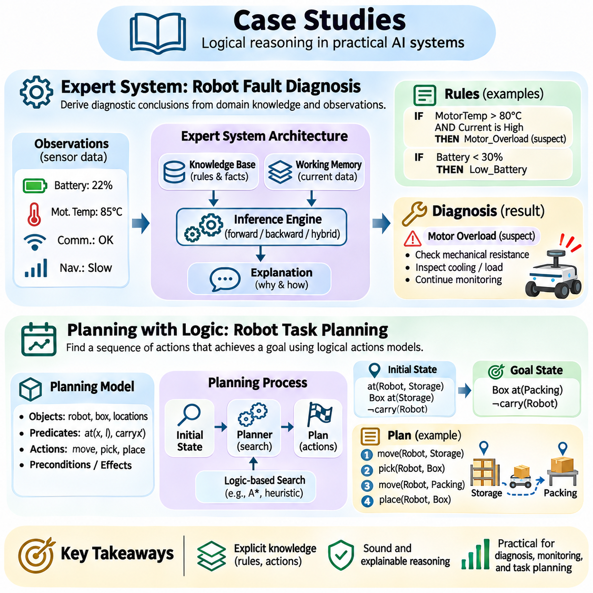{width="7.268055555555556in" height="7.268055555555556in"}

Case studies in logical reasoning demonstrate how formal knowledge representation and inference mechanisms can solve practical decision-making problems. Expert systems and logic-based planning provide two complementary applications of symbolic artificial intelligence. Expert systems derive conclusions from domain knowledge, while planning systems determine sequences of actions that achieve specified goals. Both require explicit rules, consistent representations, and verifiable reasoning processes.

An expert system is an artificial intelligence application designed to reproduce selected aspects of human expert decision making within a defined domain. Its architecture typically includes a knowledge base, an inference engine, working memory, and an explanation component. The knowledge base stores domain facts and rules, while the inference engine applies logical operations to derive conclusions. Working memory maintains case-specific information and intermediate results.

Knowledge acquisition is the first major challenge in expert system development. Domain specialists provide operational procedures, diagnostic relationships, constraints, and exceptional conditions. Knowledge engineers translate this expertise into structured facts, predicates, and production rules. The resulting representation must distinguish established evidence from assumptions and preserve the conditions under which each rule is applicable.

Consider an expert system for diagnosing faults in autonomous mobile robots. The system receives observations concerning battery voltage, motor temperature, communication status, and navigation performance. Diagnostic rules connect abnormal measurements to possible component failures. For example, elevated motor temperature combined with excessive current may indicate mechanical resistance, while communication loss may suggest network or controller problems.

A diagnostic rule can express that if motor temperature exceeds a defined threshold and current consumption is abnormal, a motor overload condition should be investigated. This conclusion may trigger additional checks rather than immediately establish a definitive fault. Such rules must distinguish symptoms from confirmed causes. The inference engine combines multiple observations to narrow candidate explanations and recommend appropriate diagnostic procedures.

Forward chaining supports data-driven diagnosis by activating rules whenever their conditions match available facts. Sensor measurements enter working memory, and applicable rules generate new conclusions until no additional inference is possible. This approach is useful for continuous equipment monitoring because new observations can automatically trigger diagnostic evaluation. Efficient implementations use rule indexing and incremental matching to reduce repeated computation.

Backward chaining supports goal-directed diagnosis by starting from a suspected fault and searching for evidence that would establish it. If the system investigates a battery management failure, it may request voltage imbalance, temperature alarms, or communication records. The reasoning process recursively evaluates supporting conditions until the hypothesis is confirmed, rejected, or remains unresolved. This method reduces unnecessary examination of unrelated faults.

Hybrid inference combines forward and backward chaining to improve diagnostic efficiency. Forward reasoning identifies suspicious conditions from incoming telemetry, while backward reasoning evaluates specific fault hypotheses. An explanation facility records which observations and rules support each conclusion. Operators can therefore distinguish confirmed failures, plausible diagnoses, and insufficient evidence instead of receiving unexplained fault labels.

Expert systems must also handle conflicting evidence and exceptional operating conditions. A temperature increase may indicate overload during normal operation but may be expected during a controlled stress test. Rule priorities, contextual conditions, and defeasible reasoning prevent ordinary diagnostic assumptions from overriding known exceptions. Uncertain sensor observations can be incorporated through confidence measures or probabilistic models.

Validation of an expert system requires testing normal behavior, individual faults, combined failures, and incomplete observations. Diagnostic accuracy should be evaluated against verified cases rather than rule consistency alone. Important measures include false alarms, missed detections, explanation quality, and inference latency. Safety-critical recommendations require independent verification before automated corrective actions are executed.

Logic-based planning addresses a different problem: determining which actions transform an initial state into a desired goal state. A planning model defines objects, predicates, available actions, preconditions, and effects. The initial state describes the known environment, while the goal specifies required conditions. A planner searches for an action sequence whose execution satisfies the goal without violating applicable constraints.

Classical planning commonly assumes deterministic actions, complete state information, and a static environment during deliberation. STRIPS-style representations describe actions through preconditions, add effects, and delete effects. An action is applicable when its preconditions hold, and execution updates the state according to its effects. These formal definitions make action sequences suitable for systematic search and logical verification.

Consider a warehouse robot assigned to transport a container from a storage area to a packing station. The initial state records the robot\'s location, container position, carrying status, and accessible routes. The goal requires the container to reach the packing station. Available actions include moving between connected locations, picking up the container, and placing it at the destination.

A pickup action may require the robot and container to occupy the same location, the robot to be available, and the container to be movable. Its effects establish that the robot carries the container and that the container is no longer resting at its original location. A movement action changes the robot\'s location while preserving the carried container relationship. A placement action completes delivery when the destination conditions are satisfied.

Planning algorithms explore possible action sequences using forward state-space search, backward regression, or heuristic methods. Forward search applies actions from the initial state, while regression identifies conditions necessary to achieve the goal. Heuristic planning estimates the remaining effort and prioritizes promising states. The resulting plan must satisfy action preconditions and preserve consistency across successive state transitions.

Logical constraints prevent plans from selecting actions that violate operational requirements. A robot may be prohibited from entering restricted areas, carrying loads beyond its capacity, or using unavailable equipment. Resource constraints and temporal dependencies further restrict valid execution sequences. Constraint satisfaction and temporal reasoning can be integrated with planning to support coordinated operations involving multiple robots.

Real-world execution introduces uncertainty because actions may fail, obstacles may appear, and observations may contradict the planning model. A practical planning system monitors execution and compares observed states with expected outcomes. When significant deviations occur, the planner updates its knowledge and generates a revised plan. This closed-loop process connects symbolic planning with perception, control, and non-monotonic reasoning.

Expert systems and logic-based planning can be integrated into a unified autonomous architecture. The expert system evaluates equipment health and operational restrictions, while the planner selects actions consistent with those conclusions. A diagnosed battery fault may prohibit a long-distance mission and introduce charging or maintenance goals. Shared predicates and rule interfaces allow diagnostic knowledge to influence action selection.

Implementation requires careful separation between logical inference, planning, and physical control. Symbolic components determine what actions are justified or permitted, while motion controllers enforce geometric feasibility and safety constraints. Knowledge updates must preserve temporal validity and evidence provenance. Logging rules, decisions, and execution outcomes supports debugging, reproducibility, and operational accountability.

These case studies demonstrate the practical value and limitations of logical reasoning in intelligent systems. Expert systems transform structured knowledge into explainable diagnoses, while logic-based planners convert goals into verifiable action sequences. Their effectiveness depends on accurate knowledge models, efficient inference, reliable observations, and continuous validation. Together, they establish a foundation for transparent, adaptable, and policy-aware autonomous intelligence.
