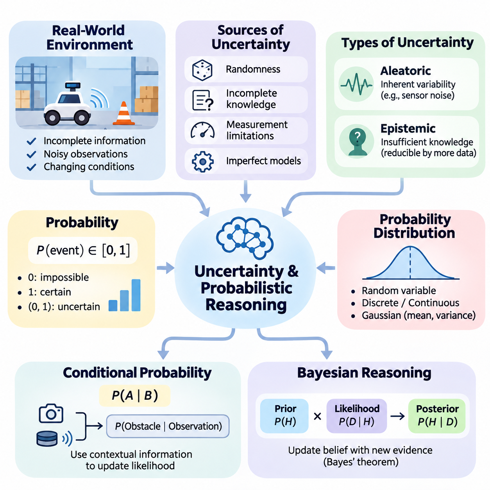
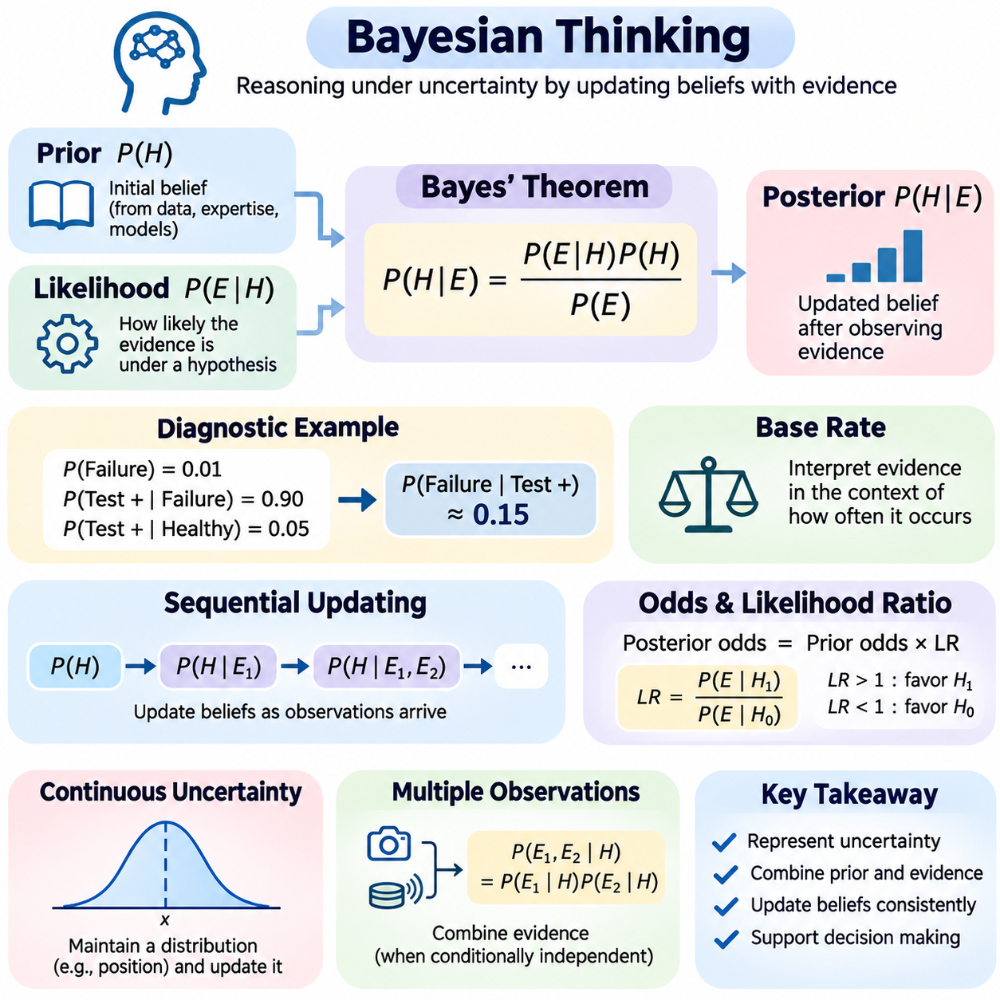
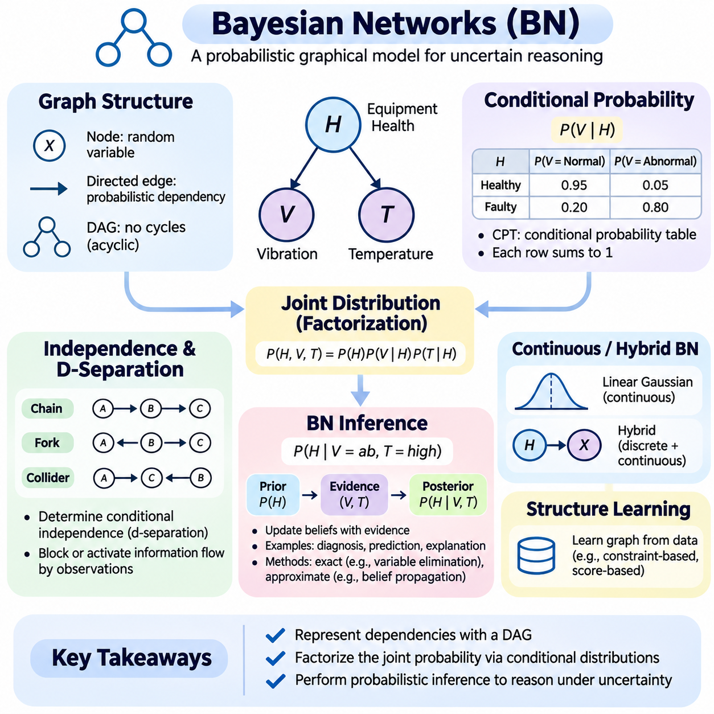
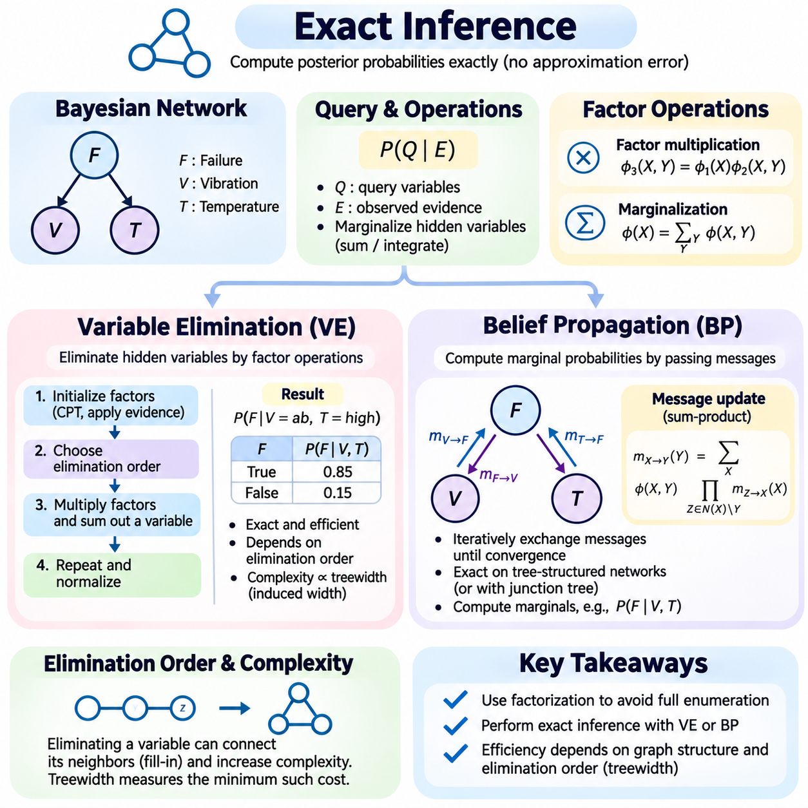
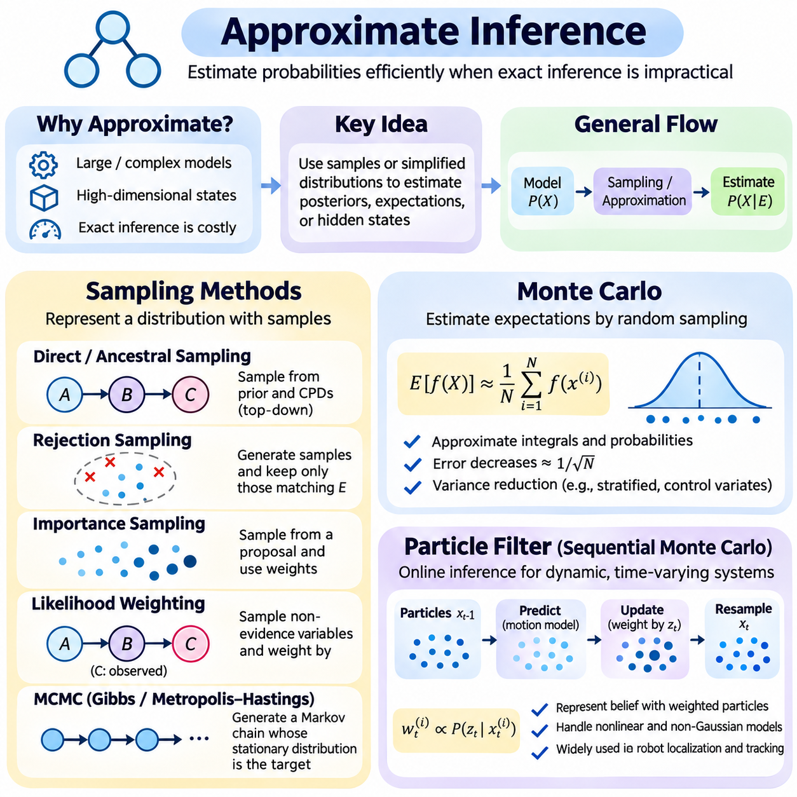
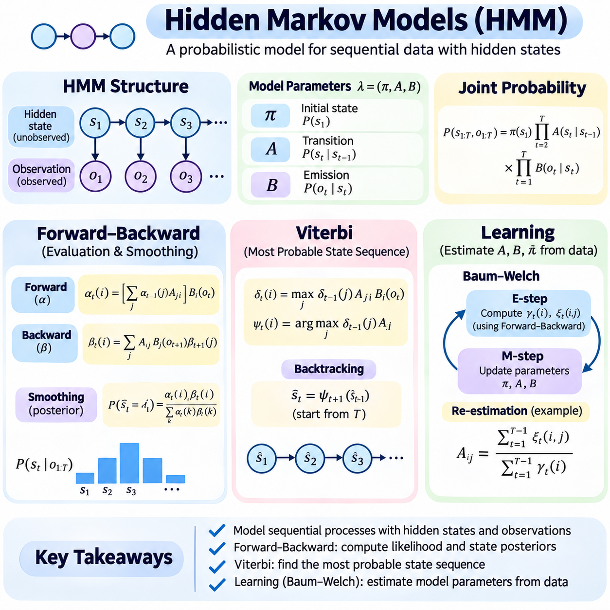
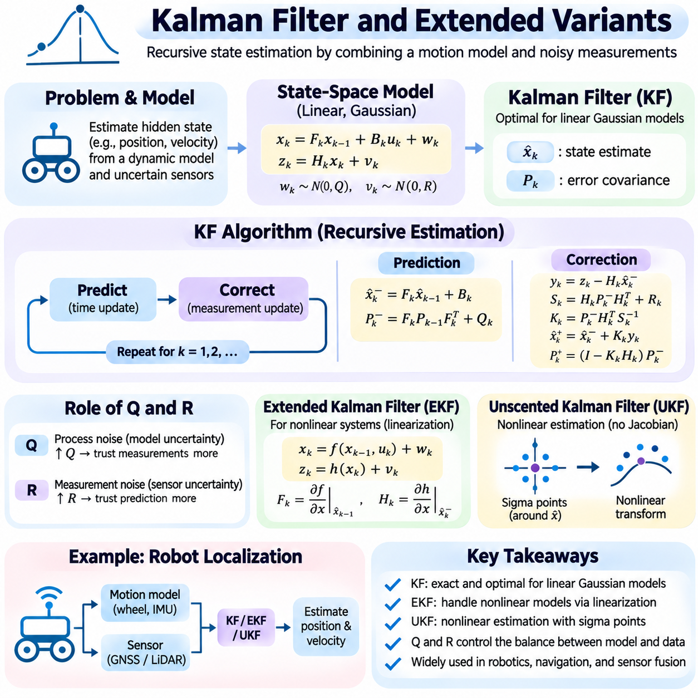
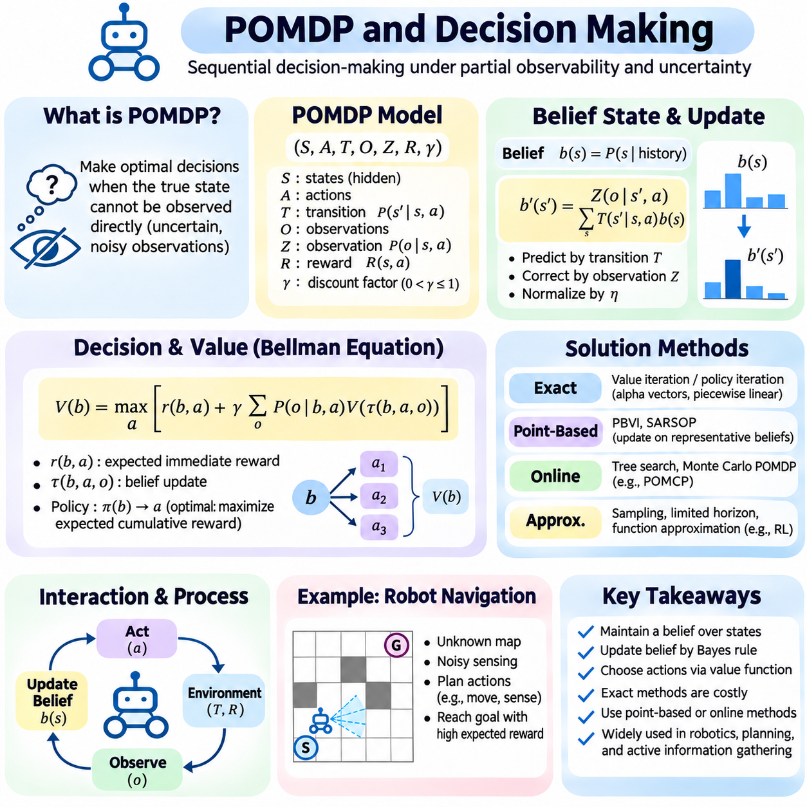
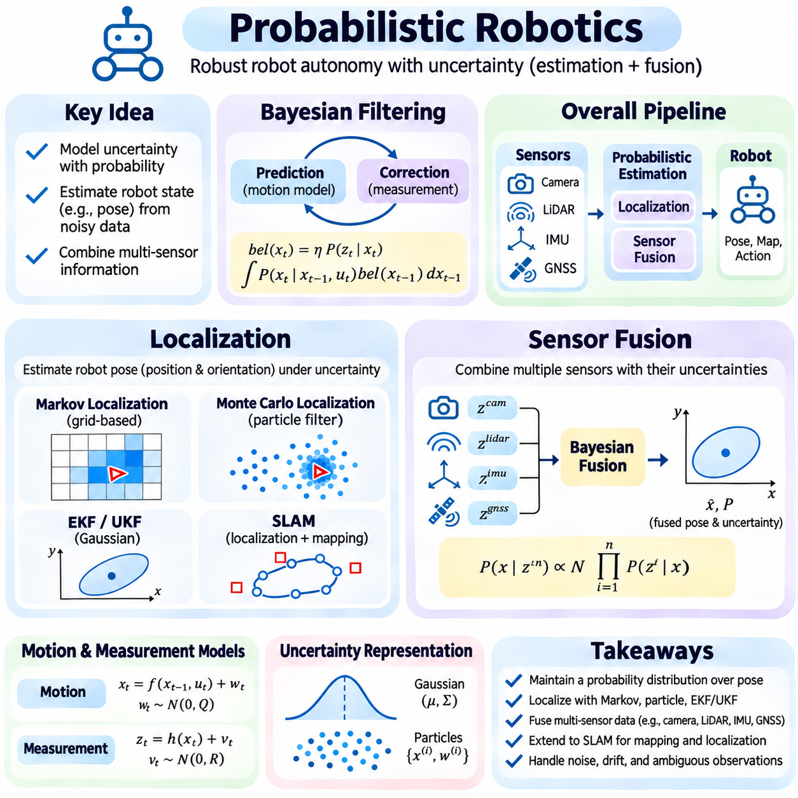
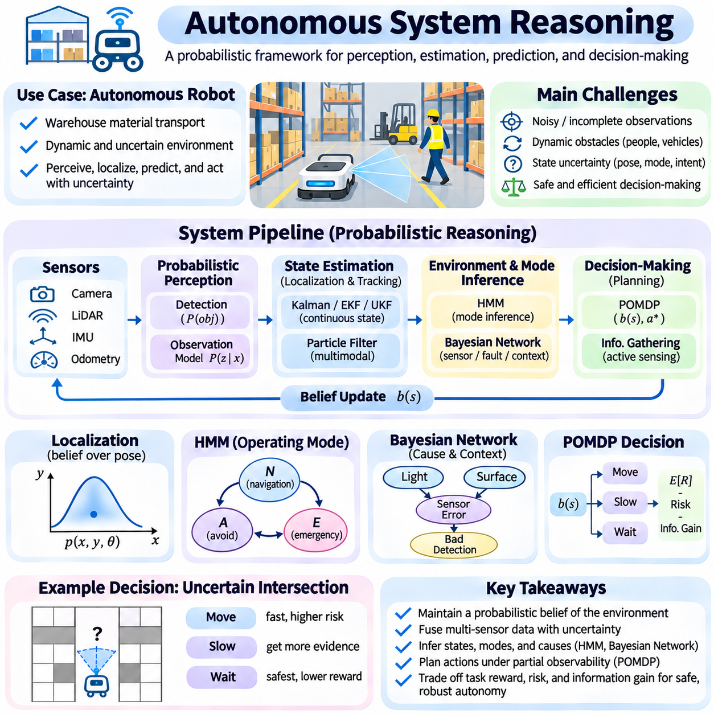

**Volume 03. Reasoning in AI**

# 02. Probabilistic Reasoning

## 02.01 Introduction to Uncertainty

{width="7.268055555555556in" height="7.268055555555556in"}

Uncertainty is a fundamental characteristic of intelligent systems operating in complex and dynamic environments. Unlike deterministic reasoning, where conclusions follow directly from established facts and rules, probabilistic reasoning addresses situations in which information is incomplete, observations are noisy, and outcomes cannot be predicted with absolute certainty. Artificial intelligence must therefore represent uncertainty explicitly to produce reliable conclusions and decisions.

Real-world environments rarely provide complete or perfectly accurate information. Sensors introduce measurement errors, human observations contain subjective interpretations, and environmental conditions change continuously. An autonomous robot, for example, may detect an obstacle without knowing its exact position or movement. Rather than assuming that every observation is correct, an intelligent system must evaluate multiple possible explanations and estimate their relative likelihood.

Uncertainty arises from several distinct sources, including randomness, incomplete knowledge, measurement limitations, and imperfect models. Aleatoric uncertainty describes variability inherent in a process, such as random fluctuations in sensor measurements or environmental disturbances. Epistemic uncertainty reflects insufficient knowledge about the system or its operating conditions. Distinguishing these categories helps determine whether uncertainty can be reduced through additional observations or improved modeling.

Aleatoric uncertainty cannot generally be eliminated simply by collecting more observations because it reflects inherent variability in the underlying process. For example, repeated measurements from a physical sensor may continue to fluctuate because of electronic noise. Statistical models can characterize this variability and estimate its influence on predictions. Reliable reasoning systems must account for such uncertainty instead of interpreting every measurement as an exact representation of reality.

Epistemic uncertainty originates from limited data, incomplete assumptions, or insufficient understanding of environmental relationships. A robot entering an unfamiliar building may initially lack knowledge about room layouts, obstacles, and navigation constraints. As additional observations become available, its uncertainty about the environment can decrease. This characteristic makes epistemic uncertainty especially important in learning systems that continuously update their internal representations.

Probability theory provides a mathematical framework for representing uncertainty through numerical measures of likelihood. A probability value between zero and one expresses how strongly a model supports the occurrence of an event under specified assumptions. Zero represents an impossible event within the model, while one represents a certain event. Intermediate values express varying degrees of uncertainty and enable systematic comparisons between alternative hypotheses.

Probabilistic reasoning differs from traditional logical reasoning in how conclusions are represented and revised. Classical deductive logic determines whether conclusions necessarily follow from premises, whereas probabilistic reasoning evaluates how strongly available evidence supports different possibilities. A logical rule may establish that a condition implies a particular outcome, while a probabilistic model can express how frequently or plausibly that outcome occurs under uncertain conditions.

An essential concept is the distinction between objective randomness and uncertainty about knowledge. A coin toss can be modeled as a random event, while uncertainty about whether a machine component has failed may result from insufficient diagnostic information. Both situations can be represented probabilistically, but their interpretations differ. Understanding this distinction prevents the mistaken assumption that every uncertain event is inherently random.

Probabilistic models represent uncertain quantities using random variables and probability distributions. A random variable associates possible outcomes with numerical or categorical values, while a probability distribution describes their likelihoods. Discrete distributions represent outcomes such as component failure states, whereas continuous distributions describe quantities such as position, velocity, temperature, or measurement error. These representations form the foundation of probabilistic inference.

The Gaussian distribution is widely used to model continuous uncertainty because it provides a convenient representation through its mean and variance. The mean indicates the central tendency of a quantity, while the variance describes its dispersion. In robotic localization, a position estimate may be accompanied by uncertainty describing the range of plausible locations. However, Gaussian assumptions are not universally appropriate, particularly for asymmetric or multimodal distributions.

Conditional probability introduces the ability to reason about events using contextual information. The probability of an obstacle being present may change when a camera detects an object or a LiDAR sensor reports a nearby surface. Conditional relationships express how evidence modifies the likelihood of hypotheses. This capability allows intelligent systems to move beyond isolated predictions and reason about dependencies among observations, hidden states, and environmental conditions.

Bayesian reasoning provides a systematic mechanism for updating beliefs when new evidence becomes available. A prior probability represents an initial belief, while the likelihood describes how compatible an observation is with a hypothesis. Bayes\' theorem combines these elements to produce a posterior probability. This process allows intelligent systems to revise their conclusions as information accumulates, rather than maintaining fixed assumptions despite contradictory observations.

For example, an industrial monitoring system may initially assign a low probability to motor failure because the equipment normally operates reliably. When abnormal vibration and elevated temperature are detected, the probability of failure may increase. The updated assessment depends on the reliability of the sensors and the statistical relationship between observed symptoms and actual failures. Probabilistic reasoning therefore integrates historical knowledge with current evidence.

Uncertainty also affects the interpretation of multiple observations. Measurements obtained from different sensors may provide complementary information, but they may also contain correlated errors. Combining evidence without considering dependencies can produce excessive confidence in incorrect conclusions. Probabilistic sensor fusion requires appropriate models of measurement noise, correlations, and observation reliability to estimate hidden states more accurately.

Probabilistic graphical models provide structured representations of relationships among uncertain variables. Bayesian networks describe conditional dependencies through directed graphs, while other graphical models represent different forms of probabilistic interaction. These structures help organize complex reasoning problems by identifying relevant variables and their relationships. They also support computational methods for estimating probabilities when only partial evidence is available.

Uncertainty becomes especially challenging when intelligent systems operate over time. The current state of an environment may be hidden, while observations provide only indirect information about it. Dynamic probabilistic models describe how states evolve and how observations relate to those states. Hidden Markov models, Kalman filters, and particle filters provide different mechanisms for maintaining and updating beliefs about changing environments under uncertain measurements.

In autonomous robotics, uncertainty influences perception, localization, mapping, planning, and control. A mobile robot cannot assume that its estimated position perfectly matches its actual location. Wheel slippage, sensor noise, and imperfect environmental maps introduce errors that accumulate during movement. Probabilistic localization maintains a belief about possible robot poses and updates that belief using motion predictions and sensor observations.

Decision-making under uncertainty requires more than selecting the most probable environmental state. An intelligent agent must consider the consequences of actions across multiple possible outcomes. A navigation system may choose a longer route when the shortest path contains uncertain obstacles or potentially hazardous conditions. Expected utility, risk constraints, and belief-state planning provide mechanisms for evaluating actions when environmental information remains incomplete.

Partially observable Markov decision processes extend probabilistic reasoning into sequential decision-making. Instead of assuming direct access to the true environmental state, an agent maintains a probability distribution over possible states. Actions influence both the environment and the information available to the agent. This formulation supports intelligent behavior in situations where sensing is incomplete and decisions must account for future uncertainty.

Confidence and uncertainty must also be distinguished from prediction accuracy. A system can produce a highly confident prediction that is incorrect because its model is poorly calibrated or encounters unfamiliar conditions. Calibration evaluates whether predicted probabilities correspond to observed frequencies over comparable cases. Reliable artificial intelligence requires not only accurate predictions but also uncertainty estimates that meaningfully reflect the system\'s actual predictive reliability.

Model uncertainty becomes particularly important when an artificial intelligence system encounters conditions outside its training distribution. Unfamiliar objects, unusual weather, unexpected sensor behavior, or previously unseen operating environments may invalidate learned assumptions. Detecting distribution shifts and recognizing insufficient knowledge can help prevent unsafe decisions. However, uncertainty estimation methods themselves require validation and may fail under severe distribution changes.

Practical uncertainty-aware systems must balance computational complexity, inference accuracy, and operational requirements. Exact probabilistic inference can become prohibitively expensive when models contain many interacting variables. Approximate inference methods, including sampling and variational approaches, provide computational alternatives. Selecting an appropriate method depends on model structure, available computing resources, required accuracy, and real-time constraints.

Probabilistic reasoning ultimately provides a foundation for intelligent systems that must act despite incomplete knowledge. By representing uncertain states, updating beliefs from evidence, combining observations, and evaluating possible consequences, artificial intelligence can make decisions that are more adaptive and defensible. These principles connect Bayesian networks, probabilistic filtering, partially observable planning, and autonomous reasoning within a unified framework for managing uncertainty.

## 02.02 Bayesian Thinking

{width="7.268055555555556in" height="7.268055555555556in"}

Bayesian thinking is a systematic approach to reasoning under uncertainty that treats knowledge as a set of beliefs that can be revised when new evidence becomes available. Instead of classifying statements as simply true or false, it assigns probabilities to competing hypotheses. This perspective enables intelligent systems to combine existing knowledge with observations, continuously refine their understanding, and make decisions even when information remains incomplete or ambiguous.

The central principle of Bayesian thinking is that rational beliefs should change in response to evidence. An intelligent agent begins with an initial assessment of possible explanations and evaluates how likely newly observed information would be under each explanation. The resulting belief reflects both previous knowledge and current observations. This process provides a coherent foundation for learning from experience without assuming that every new observation is perfectly reliable.

Bayes\' theorem formalizes belief updating through the relationship P(H\|E) = P(E\|H)P(H)/P(E), where H represents a hypothesis and E represents observed evidence. The prior probability P(H) describes the initial belief, while the likelihood P(E\|H) measures how probable the evidence is under that hypothesis. The posterior probability P(H\|E) represents the updated belief after incorporating the observation, and P(E) serves as the normalizing probability of the evidence.

Prior probabilities encode knowledge available before a particular observation is considered. They may originate from historical measurements, domain expertise, physical constraints, or previously learned statistical models. For example, a robotic system may assign different initial probabilities to possible locations based on its previous position and motion history. A prior does not necessarily represent an arbitrary assumption; it provides an explicit starting point that can be examined and revised.

The likelihood function connects hypotheses with observable outcomes. It expresses how strongly a particular observation is expected under a proposed explanation. In equipment monitoring, elevated vibration may be more likely when a bearing is damaged than when it operates normally. The likelihood therefore determines how much the observation should influence the current belief. Importantly, the probability of evidence given a hypothesis is not equivalent to the probability of the hypothesis given that evidence.

Posterior probability combines prior knowledge and observational evidence into an updated representation of uncertainty. A hypothesis with a low prior probability can become plausible when strongly supported by new observations. Conversely, a previously credible hypothesis may lose support when evidence contradicts its predictions. Bayesian updating therefore avoids treating initial assumptions as permanent truths and provides a mathematically consistent mechanism for revising conclusions.

Consider a diagnostic system in which a component has a prior failure probability of one percent. Suppose a test detects ninety percent of actual failures but also produces positive results in five percent of healthy components. After a positive result, the posterior failure probability is approximately fifteen percent. Although the test is relatively sensitive, the low initial failure rate significantly influences the interpretation of the observation.

This diagnostic example illustrates the importance of base rates in probabilistic reasoning. A positive observation may appear compelling when considered independently, yet its meaning depends on how frequently the underlying condition occurs. Ignoring prior probabilities can lead to systematic overestimation of rare events. Bayesian thinking explicitly incorporates base rates, helping intelligent systems avoid conclusions driven solely by apparently strong but incomplete evidence.

Bayesian updating can be performed sequentially as observations arrive. The posterior distribution obtained from one observation becomes the prior distribution for the next update. This recursive structure is particularly useful in real-time artificial intelligence systems, where measurements arrive continuously. Under an appropriate observation model, sequential updating allows information to accumulate without requiring the entire reasoning process to restart after every measurement.

A useful alternative formulation expresses Bayesian updating through odds and likelihood ratios. Posterior odds equal prior odds multiplied by the likelihood ratio of the observed evidence. The likelihood ratio compares how probable an observation is under two competing hypotheses. Values greater than one favor one hypothesis, while values below one favor its alternative. This formulation makes the evidential contribution of individual observations easier to interpret.

Bayesian reasoning also supports uncertainty over continuous quantities rather than only discrete hypotheses. A robot may maintain a probability distribution over its position instead of selecting a single coordinate. Sensor measurements modify this distribution by increasing support for locations consistent with observed distances or landmarks. The resulting posterior captures both the estimated position and remaining uncertainty, providing richer information than a deterministic point estimate.

When multiple observations are available, their statistical dependencies must be considered. If measurements are conditionally independent given a hypothesis, their likelihoods can be multiplied to combine evidence efficiently. However, correlated sensors or repeated observations derived from the same underlying source violate this assumption. Treating dependent evidence as independent can produce overly confident posterior estimates and undermine the reliability of probabilistic conclusions.

Bayesian thinking distinguishes uncertainty about model parameters from uncertainty about future observations. Parameter uncertainty concerns unknown quantities such as sensor bias, failure rates, or environmental characteristics. Predictive uncertainty additionally reflects variability in outcomes. Bayesian predictive distributions integrate predictions across plausible parameter values, allowing systems to account for uncertainty in both learned models and future events.

Prior selection influences Bayesian inference, especially when observational data is limited. Informative priors incorporate substantial domain knowledge, while weakly informative priors impose broader constraints without strongly determining the result. Hierarchical models can share information across related tasks or populations. Regardless of the approach, prior assumptions should be documented and their influence examined through sensitivity analysis rather than treated as unquestionable facts.

Bayesian reasoning provides a natural framework for comparing competing models. Instead of evaluating only how well each model fits observed data, Bayesian model comparison considers the probability of the evidence under each model. This quantity, often called model evidence or marginal likelihood, integrates over parameter uncertainty. It can discourage unnecessarily complex explanations, although practical computation may be challenging for high-dimensional models.

Decision-making extends Bayesian inference by connecting updated beliefs with possible actions and consequences. A system may estimate the probability of equipment failure, but selecting whether to stop a machine also requires considering operational costs and potential damage. Bayesian decision theory combines posterior beliefs with utility or loss functions to identify actions with favorable expected outcomes. The most probable hypothesis does not necessarily determine the best decision.

In autonomous robotics, Bayesian thinking underlies localization, tracking, mapping, and sensor fusion. A robot predicts its next state using a motion model and then incorporates camera, LiDAR, or inertial measurements to update its belief. This prediction-and-correction process enables continuous reasoning despite noisy observations and imperfect dynamics. Kalman filters and particle filters implement different forms of recursive probabilistic state estimation.

Bayesian thinking is equally relevant to machine learning systems that must recognize limitations in their predictions. A classification model may estimate probabilities for different object categories, but reliable interpretation requires examining calibration and uncertainty. Bayesian neural networks represent distributions over model parameters or approximations to them, offering one approach to estimating predictive uncertainty. Their practical effectiveness depends on inference quality, model assumptions, and computational resources.

Computational complexity remains a major challenge in Bayesian inference. Exact posterior calculations may require integration over many hidden variables or high-dimensional parameter spaces. Approximation techniques such as Markov chain Monte Carlo, variational inference, and sequential Monte Carlo provide alternative computational strategies. Each introduces tradeoffs involving accuracy, convergence, memory requirements, and inference latency that must be considered during system design.

Bayesian thinking does not guarantee correct conclusions when assumptions are inaccurate. Poor likelihood models, inappropriate priors, unrecognized dependencies, and distribution shifts can all produce misleading posterior probabilities. Reliable applications therefore require model checking, calibration assessment, sensitivity analysis, and validation against representative observations. Probabilistic outputs should be interpreted as conditional on the assumptions and evidence used to construct them.

The broader significance of Bayesian thinking lies in its treatment of intelligence as continuous belief revision rather than fixed rule execution. By combining prior knowledge, evidence, uncertainty, and decision consequences, Bayesian methods support adaptive reasoning across changing environments. This foundation connects Bayesian networks, probabilistic filtering, sequential inference, and autonomous decision-making, enabling artificial intelligence systems to reason systematically when certainty is unavailable.

## 02.03 Bayesian Networks

{width="7.268055555555556in" height="7.268055555555556in"}

Bayesian networks are probabilistic graphical models that represent uncertain relationships among variables through a directed acyclic graph. They combine graph theory with probability theory to describe how different factors influence one another and how evidence changes beliefs. By organizing complex probability distributions into smaller conditional relationships, Bayesian networks provide an interpretable and computationally structured framework for reasoning under uncertainty.

The graph structure of a Bayesian network consists of nodes and directed edges. Each node represents a random variable describing an observable event, hidden state, or uncertain condition. Directed edges connect parent variables to child variables and encode direct probabilistic dependencies within the model. The graph must remain acyclic, meaning that no sequence of directed edges can return to its starting node, ensuring a valid factorization of the joint probability distribution.

A directed edge indicates that the probability distribution of a child variable depends directly on its parent within the chosen model structure. However, this relationship does not automatically establish causality. A Bayesian network may represent statistical dependencies without identifying physical cause-and-effect mechanisms. Causal interpretations require additional assumptions about how the variables and their relationships correspond to interventions in the real world.

The joint probability distribution of a Bayesian network can be factorized into a product of local conditional distributions. For variables X1 through Xn, the factorization is P(X1,\...,Xn) = ∏ P(Xi\|Parents(Xi)). This representation avoids explicitly storing every possible combination of variable values when the graph contains useful conditional independencies. The resulting reduction in model complexity is one of the principal advantages of Bayesian networks.

Graph structure determines which conditional independence assumptions are encoded by the model. Under the local Markov property, each variable is conditionally independent of its non-descendants given its parents. This property enables complex dependencies to be represented through relatively small local relationships. Correctly identifying these independencies is essential because an inappropriate graph structure can produce misleading probability estimates even when individual conditional distributions appear reasonable.

Three fundamental graphical patterns help explain information flow in Bayesian networks. A chain connects variables sequentially, a fork represents multiple variables sharing a common parent, and a collider represents multiple parents influencing a common child. Conditioning on an intermediate variable can block information flow in chains and forks, while conditioning on a collider or its descendant can activate a previously blocked path. These relationships form the basis of d-separation.

D-separation is a graphical criterion used to determine whether variables are conditionally independent according to the network structure. It examines paths between variables and evaluates whether observed variables block or activate those paths. This mechanism allows independence relationships to be identified without calculating the complete joint distribution. D-separation is particularly valuable when designing networks, validating assumptions, and optimizing probabilistic inference.

The structure of a Bayesian network can be designed using expert knowledge or learned from observational data. Expert-designed networks incorporate known relationships from engineering, medicine, or other domains. Structure-learning algorithms search for graphs that explain observed dependencies while satisfying acyclicity constraints. Constraint-based and score-based approaches are commonly used, although limited data and observational equivalence can prevent unique identification of the underlying graph.

Conditional probability distributions specify the quantitative relationships associated with graph edges. For a discrete child variable, a conditional probability table assigns probabilities to its possible states for every configuration of parent variables. Each conditional distribution must be normalized so that probabilities across the child\'s states sum to one. These tables transform the qualitative graph structure into a complete probabilistic model capable of answering inference queries.

Consider a network describing equipment health, vibration, and temperature. Equipment health may influence the probability of abnormal vibration and elevated temperature, making it a parent of both sensor observations. Conditional probability tables specify how frequently each observation is expected under healthy and faulty conditions. When unusual measurements occur, the network can update its belief about equipment health by combining evidence from the available sensors.

Conditional probability tables become increasingly expensive as the number of parent variables grows. A binary child with many binary parents requires probabilities for exponentially many parent configurations in a general table. Structured conditional distributions, noisy-OR models, parameter sharing, and continuous probability models can reduce this burden when their assumptions are appropriate. Such representations improve scalability while preserving meaningful dependencies.

Continuous variables can also be incorporated into Bayesian networks through suitable probability distributions. Linear Gaussian models represent continuous relationships using conditional Gaussian distributions, while hybrid networks combine discrete and continuous variables. More flexible conditional models may capture nonlinear dependencies, although they often complicate inference. The choice of representation should reflect physical characteristics, available observations, and computational requirements.

Parameter learning estimates conditional probability distributions from observed data. For fully observed discrete networks, maximum likelihood estimation can use normalized frequency counts. Bayesian parameter estimation introduces prior distributions over unknown parameters and updates them using evidence. When variables are hidden or observations are incomplete, algorithms such as expectation-maximization may estimate parameters iteratively while accounting for latent states.

Bayesian network inference computes probabilities of variables of interest given available evidence. A typical query evaluates P(Query\|Evidence), where query variables represent unknown conditions and evidence variables represent observed information. Inference may involve predicting downstream outcomes, diagnosing upstream explanations, or estimating hidden variables. These different reasoning directions can be handled within the same probabilistic model.

Predictive inference estimates the likelihood of future or downstream events using known conditions. Diagnostic inference works in the opposite direction by reasoning from observed effects toward possible explanations. For example, a network may predict the probability of overheating given a component fault, or estimate the probability of a fault after detecting overheating. Bayesian updating enables both forms of reasoning without requiring separate rule systems.

Exact inference calculates posterior probabilities without approximation under the specified model. Enumeration evaluates relevant combinations of hidden variables, while variable elimination reorganizes calculations to avoid repeated operations. Belief propagation can compute exact marginals efficiently in tree-structured networks. In more complex graphs, exact inference may require junction-tree methods or other structured algorithms, with computational cost strongly influenced by graph connectivity.

Variable elimination performs inference by multiplying probability factors and summing out variables that are neither queried nor observed. The elimination order is important because intermediate factors may become very large. Graph properties such as treewidth help characterize the complexity of exact inference. Networks with dense dependencies can therefore be computationally expensive even when their individual conditional probability tables are relatively small.

Belief propagation exchanges probabilistic messages between connected variables or factors to compute marginal distributions. In tree-structured graphs, message passing can produce exact results through a finite sequence of updates. In graphs containing undirected cycles, loopy belief propagation provides an approximate alternative, but convergence and accuracy are not guaranteed. This distinction is important when selecting inference methods for complex networks.

Approximate inference becomes necessary when exact calculations are computationally impractical. Sampling methods such as likelihood weighting and Gibbs sampling estimate posterior distributions using generated samples. Other approaches employ variational approximations or specialized message-passing algorithms. Approximate methods introduce estimation error, but they can make probabilistic reasoning feasible in networks with many hidden variables or complicated dependencies.

Implementing Bayesian network inference requires careful separation of model structure, probability parameters, observations, and queries. A practical implementation may use adjacency representations for graph relationships, conditional probability tables for discrete variables, and factor operations for inference. Validation should verify acyclicity, probability normalization, variable consistency, and agreement with analytically solvable examples before applying the model to larger problems.

Evidence handling must distinguish observed values from uncertain measurements. Conventional Bayesian network queries often treat evidence variables as exactly observed, but real sensors may produce noisy or ambiguous readings. Measurement uncertainty can be represented explicitly through observation nodes and conditional sensor models. This approach prevents unreliable measurements from being interpreted as certain facts and supports more realistic probabilistic reasoning.

Bayesian networks are widely applicable to fault diagnosis, medical decision support, risk assessment, sensor fusion, and autonomous systems. Their major strength is the ability to combine interpretable dependency structures with quantitative uncertainty estimates. However, model quality depends on valid independence assumptions, reliable probability parameters, and appropriate evidence. Effective Bayesian network engineering therefore combines graphical modeling, statistical validation, and computationally efficient inference.

## 02.04 Exact Inference

{width="7.268055555555556in" height="7.268055555555556in"}

Exact inference is a fundamental computational approach in probabilistic graphical models that calculates posterior probabilities without introducing approximation error. Given a model with specified probability distributions and observed evidence, exact inference determines the probability of hidden variables through mathematically valid operations. It provides a reference for evaluating approximate methods and supports reliable reasoning when the computational complexity remains manageable.

Bayesian networks represent joint probability distributions through products of local conditional probability factors. Exact inference exploits this factorization to avoid constructing the complete joint distribution whenever possible. Instead of enumerating every combination of variable states, specialized algorithms reorganize probability calculations. Variable elimination and belief propagation are two central techniques that use graphical structure to perform inference efficiently.

The objective of exact inference is typically to calculate a conditional probability such as P(Q\|E), where Q represents query variables and E represents observed evidence. Hidden variables that are neither queried nor observed must be marginalized from the joint distribution. This operation requires summing over discrete states or integrating over continuous variables. Computational efficiency depends on how these operations are organized and how the graphical model constrains dependencies.

Variable elimination is an exact inference algorithm that systematically removes irrelevant hidden variables from a probabilistic model. It represents the joint distribution as a collection of factors and eliminates variables through factor multiplication and marginalization. Rather than repeatedly calculating identical probability terms, the algorithm reuses intermediate results. This makes variable elimination substantially more efficient than naive enumeration for many structured networks.

A factor is a function that assigns numerical values to combinations of variables within its scope. In Bayesian networks, conditional probability tables naturally define initial factors. When evidence is observed, factors can be restricted to the corresponding observed values. The remaining factors are manipulated through multiplication and summation, allowing the inference algorithm to preserve the probability relationships needed to answer a query.

Factor multiplication combines two or more factors into a new factor defined over the union of their variables. For each assignment of those variables, the resulting value equals the product of the corresponding factor entries. Marginalization removes a variable by summing the factor values across its possible states. These operations are mathematically straightforward, but intermediate factor sizes can grow rapidly when many variables become connected during elimination.

The variable elimination process begins by identifying query variables, evidence variables, and hidden variables. Evidence is incorporated into the relevant factors, and an elimination order is selected for hidden variables. For each variable, all factors containing it are multiplied, and the variable is summed out. The resulting factor is returned to the collection. After all hidden variables are eliminated, the remaining factors are combined and normalized to obtain the desired posterior distribution.

Consider a Bayesian network describing component failure, abnormal vibration, and elevated temperature. Component failure influences both sensor observations, and the objective is to estimate failure probability after observing vibration and temperature. Variable elimination incorporates the observed sensor states into their conditional probability factors and combines them with the prior failure distribution. Normalization then produces the posterior probability of component failure.

The elimination order strongly influences computational efficiency. Different orders produce the same exact result under valid arithmetic but may generate intermediate factors of dramatically different sizes. Eliminating a highly connected variable too early can create large factors involving many remaining variables. Therefore, selecting a suitable elimination order is often more important for runtime performance than optimizing individual arithmetic operations.

Graph-theoretic concepts help explain the complexity of variable elimination. Eliminating a variable connects its neighboring variables within the induced interaction graph, potentially increasing factor scope. The maximum intermediate clique size is related to the induced width of the elimination order. Treewidth characterizes the minimum achievable width across valid elimination orders, making it a central measure of exact inference complexity.

Finding an optimal elimination order is computationally difficult for general graphs. Practical implementations therefore use heuristics such as minimum degree, minimum fill, and weighted minimum fill. These strategies estimate which variable can be eliminated with relatively little additional computational cost. Although heuristics do not guarantee the globally optimal order, they often provide substantial improvements for realistic probabilistic networks.

Variable elimination can be implemented using arrays, dictionaries, or multidimensional tensors to represent factors. A practical implementation requires consistent variable indexing, factor alignment, multiplication, summation, and normalization. Tensor broadcasting can simplify operations when variable dimensions are correctly aligned. Numerical stability should also be considered, particularly when multiplying many small probabilities that may cause floating-point underflow.

Belief propagation is another important inference technique that computes marginal probabilities by exchanging messages across a graphical model. Instead of explicitly eliminating variables through a centralized sequence of factor operations, belief propagation distributes computations across connected nodes or factors. Each message summarizes probabilistic information from one part of the graph, allowing neighboring components to update their local beliefs.

In a tree-structured Bayesian network or factor graph, belief propagation can compute exact marginal distributions through a finite number of message exchanges. Because the graph contains no undirected cycles, information can travel between nodes without repeatedly circulating through closed paths. Messages are typically propagated inward from leaf nodes and then outward toward the remaining nodes, ensuring that relevant evidence contributes to each marginal estimate.

Factor graphs provide a convenient representation for belief propagation by separating variable nodes from factor nodes. Variable-to-factor messages combine incoming information from neighboring factors other than the recipient. Factor-to-variable messages multiply the local factor by incoming messages from other connected variables and marginalize those variables. This alternating message structure implements the sum-product algorithm for exact inference on tree-structured factor graphs.

The sum-product algorithm calculates marginal probability distributions by combining local factors and summing over unobserved variables. Messages are functions of the receiving variable and summarize information from connected portions of the graph. Once all required messages have arrived, a variable\'s unnormalized belief is obtained by multiplying incoming factor messages. Normalization converts this belief into a valid marginal probability distribution.

Belief propagation can also support maximum a posteriori assignments through related message-passing operations. The max-product or max-sum algorithm replaces summation with maximization to identify high-probability configurations. However, finding a globally most probable joint assignment differs from calculating individual marginal probabilities. The distinction is important because selecting the most probable state of each variable independently may not produce the most probable joint configuration.

When a graphical model contains undirected cycles, ordinary belief propagation no longer has the same general exactness guarantee. Loopy belief propagation repeatedly exchanges messages around cyclic structures and may converge to approximate marginal distributions. However, convergence is not guaranteed, and converged results may still be inaccurate. Exact inference in cyclic networks generally requires alternative structures or algorithms, such as junction-tree propagation.

Junction-tree methods transform a graphical model into a tree of clusters that satisfy appropriate consistency properties. Each cluster contains multiple variables, and messages are exchanged between clusters through shared separator variables. This transformation enables exact belief propagation even when the original graph contains cycles. However, cluster sizes can become large, and computational complexity remains closely related to the treewidth of the original model.

Variable elimination and belief propagation are closely related because both exploit distributive properties of probability calculations. Variable elimination organizes computation around an elimination sequence, while belief propagation organizes similar operations as reusable messages between connected components. On tree structures, message passing can efficiently answer multiple marginal queries. For a single query, variable elimination may provide a simpler implementation with comparable computational principles.

The computational cost of exact inference depends on graph structure, variable cardinality, and the number of dependencies. Sparse networks with small treewidth can often be processed efficiently, while densely connected networks may require exponentially large intermediate representations. Continuous variables introduce additional challenges because marginalization may involve difficult integrals. Exact solutions remain practical for certain structured distribution families, including linear Gaussian models.

Correct implementation requires careful validation of factor operations, evidence handling, and normalization. Small networks with analytically known probabilities provide useful reference cases for testing variable elimination and belief propagation. Results should remain consistent across different elimination orders, subject to numerical precision. Comparing independent implementations can reveal indexing mistakes, missing factors, or incorrect conditional independence assumptions.

Exact inference provides an essential foundation for probabilistic reasoning in diagnosis, sensor interpretation, risk analysis, and autonomous systems. Variable elimination demonstrates how algebraic restructuring reduces redundant calculations, while belief propagation shows how local message exchange supports global probabilistic conclusions. Together, these methods establish the computational principles underlying more advanced inference algorithms and clarify when exact probabilistic reasoning is feasible.

## 02.05 Approximate Inference

{width="7.268055555555556in" height="7.268055555555556in"}

Approximate inference provides computational methods for estimating probability distributions when exact inference becomes impractical. Complex probabilistic models may contain numerous hidden variables, nonlinear relationships, and high-dimensional state spaces that make exact marginalization prohibitively expensive. Approximate methods replace exhaustive probability calculations with numerical estimation, allowing intelligent systems to reason under uncertainty while balancing computational cost and estimation accuracy.

The central objective of approximate inference is to estimate posterior probabilities, expectations, or hidden states without evaluating every possible variable configuration. Instead of constructing complete joint distributions, algorithms use representative samples or simplified distributions. Their results contain approximation error, but this error can often be characterized or reduced through additional computation. The appropriate method depends on model structure, available resources, and accuracy requirements.

Sampling methods represent uncertain distributions through collections of randomly generated observations. Each sample corresponds to a possible configuration of variables, and the collection approximates the underlying probability distribution. Statistical quantities such as means, variances, and event probabilities can be estimated from these samples. As the number of suitable samples increases, estimates generally become more reliable, although convergence rates depend on the sampling procedure.

Direct sampling generates observations from a probability distribution when its sampling mechanism is available. In Bayesian networks, ancestral sampling follows the directed graph from parent variables toward their descendants. Root variables are sampled from prior distributions, while child variables are sampled from conditional distributions given their sampled parents. This procedure generates samples from the joint distribution and provides a foundation for probabilistic simulation.

Rejection sampling estimates conditional probabilities by generating samples from a proposal distribution and retaining only those consistent with observed evidence. Accepted samples approximate the target conditional distribution when the procedure is correctly constructed. However, rare evidence can cause most generated samples to be rejected, producing substantial computational waste. Consequently, rejection sampling is often unsuitable for networks containing highly unlikely observations.

Importance sampling addresses inefficient sampling by drawing observations from a proposal distribution and assigning weights that correct for differences from the target distribution. Samples receiving larger weights contribute more strongly to estimated expectations. The proposal distribution should cover regions where the target distribution has significant probability mass. Poor proposals may produce highly uneven weights, reducing the effective information contained in the sample collection.

Likelihood weighting is an importance sampling technique commonly applied to Bayesian networks with observed evidence. Evidence variables remain fixed at their observed values, while unobserved variables are sampled according to relevant conditional distributions. Each sample receives a weight determined by the likelihood of the evidence. This avoids rejecting inconsistent samples, although performance may deteriorate when many evidence variables produce highly concentrated weights.

Markov chain Monte Carlo methods generate correlated samples using a stochastic process designed to have the target distribution as its stationary distribution. Unlike independent sampling, each new sample depends on the current state of the chain. Under suitable mathematical conditions, long-run sample averages converge toward expectations under the target distribution. Practical reliability depends on convergence, mixing behavior, and the dependence between successive samples.

Gibbs sampling is a Markov chain Monte Carlo algorithm that updates one variable or a group of variables at a time using conditional distributions. In a Bayesian network, the conditional distribution of a variable can often be computed from its Markov blanket. Repeated updates generate a sequence of configurations intended to explore the posterior distribution. Strong dependencies and multiple separated probability modes can make exploration slow.

The Metropolis-Hastings algorithm constructs a Markov chain using proposed state transitions and probabilistic acceptance decisions. A candidate state is generated from a proposal mechanism and accepted according to a ratio involving target probabilities and proposal probabilities. This construction allows sampling from distributions that are difficult to sample directly. Its effectiveness depends heavily on proposal design, acceptance behavior, and the ability to explore relevant regions.

Monte Carlo inference estimates mathematical expectations through random sampling. For a function f(X), the expectation E[f(X)] can be approximated by averaging its values across samples drawn from the relevant distribution. This principle supports probability estimation, numerical integration, uncertainty propagation, and Bayesian prediction. Under standard independent-sampling conditions with finite variance, estimation error typically decreases proportionally to the inverse square root of sample count.

Monte Carlo methods are attractive because they can approximate high-dimensional integrals without explicitly constructing multidimensional numerical grids. However, computational efficiency depends on the variability of the estimated quantity and the quality of the sampling distribution. Variance reduction techniques, including stratified sampling, control variates, and improved importance proposals, can increase precision without requiring a proportional increase in samples.

Sampling quality must be evaluated rather than assumed. Effective sample size measures how much information a weighted or correlated sample collection contains relative to independent observations. Autocorrelation can reduce the usefulness of Markov chain samples, while highly unequal importance weights can cause a few samples to dominate an estimate. Convergence diagnostics and repeated independent runs help identify unreliable results, although no finite diagnostic guarantees correctness.

Particle filters extend Monte Carlo inference to sequential state estimation in dynamic systems. They represent the probability distribution of a hidden state using a finite collection of weighted particles. Each particle describes a possible system state, such as a robot position, velocity, or orientation. As new observations arrive, particles are propagated and reweighted to approximate the evolving posterior distribution without requiring linear dynamics or Gaussian uncertainty.

A particle filter operates recursively through prediction and measurement updates. During prediction, particles are propagated using a state transition model that represents system dynamics and process uncertainty. During measurement updating, each particle receives a weight based on how well its predicted state explains the latest observation. Normalized weights approximate the relative posterior support for the particles, forming an updated representation of the system\'s belief state.

Sequential importance sampling maintains weighted particles over time without necessarily regenerating them after each observation. However, repeated updates often produce weight degeneracy, where most particles contribute almost nothing to the estimated distribution. Resampling addresses this problem by preferentially retaining particles with high weights and removing particles with low weights. The resulting particle population concentrates computational effort on states supported by the observations.

Sequential importance resampling, often implemented as a bootstrap particle filter, combines state propagation, observation likelihood weighting, and resampling. Common resampling strategies include multinomial, systematic, stratified, and residual resampling. These methods differ in computational characteristics and sampling variance. Resampling is frequently triggered when effective sample size falls below a selected threshold rather than being performed unconditionally.

Particle impoverishment occurs when repeated resampling reduces diversity within the particle population. This problem becomes particularly serious when process noise is small or the posterior distribution contains narrow regions. Possible remedies include increasing particle count, improving proposal distributions, adding appropriate rejuvenation moves, and using more informative transition models. These techniques seek to preserve diversity without distorting the intended posterior distribution.

In autonomous robotics, particle filters are widely used for localization under uncertain motion and noisy sensor measurements. Each particle represents a possible robot pose, and motion commands propagate particles according to a probabilistic motion model. Camera, LiDAR, or other sensor observations then adjust particle weights based on agreement with environmental features. Multiple competing location hypotheses can be maintained until sufficient evidence resolves ambiguity.

Particle filters also support object tracking, navigation, fault detection, and nonlinear sensor fusion. They are particularly valuable when uncertainty is multimodal or system dynamics cannot be represented adequately by linear Gaussian models. However, the number of particles required may increase dramatically with state dimensionality. High-dimensional applications often require structured proposals, factorization, Rao-Blackwellization, or alternative inference strategies.

Implementing approximate inference requires careful management of random number generation, probability normalization, numerical stability, and computational resources. Logarithmic probability calculations can reduce underflow when multiplying small likelihoods. Vectorized operations and parallel processing can accelerate sample generation and weight evaluation. Reproducible experiments should record random seeds, model parameters, sample counts, and convergence diagnostics.

Approximate inference algorithms should be validated against exact calculations whenever sufficiently small reference problems are available. Evaluation should consider estimation bias, variance, effective sample size, computational latency, and sensitivity to model assumptions. In sequential systems, tracking error and recovery after unexpected observations are also important. A method that produces accurate estimates offline may still be unsuitable for applications with strict real-time constraints.

Approximate inference enables probabilistic reasoning in systems where exact computation is too expensive or mathematically intractable. Sampling methods provide flexible representations of uncertainty, Monte Carlo techniques approximate expectations through numerical experiments, and particle filters extend these principles to evolving hidden states. Together, they support scalable Bayesian reasoning in robotics, autonomous systems, machine learning, and decision-making under uncertainty.

## 02.06 Hidden Markov Models

{width="7.268055555555556in" height="7.268055555555556in"}

Hidden Markov models are probabilistic models designed to represent systems whose internal states cannot be observed directly but generate measurable observations over time. They combine a sequence of hidden states with a sequence of observable outputs, allowing intelligent systems to infer underlying conditions from incomplete evidence. Hidden Markov models provide a mathematical foundation for temporal reasoning in speech recognition, activity analysis, equipment monitoring, and autonomous systems.

A hidden Markov model assumes that the hidden state at a particular time depends only on the immediately preceding hidden state. This first-order Markov assumption simplifies temporal dependencies while preserving important sequential relationships. Each observation is generated according to a probability distribution conditioned on the current hidden state. These assumptions allow the joint probability of states and observations to be factorized into initial, transition, and emission probabilities.

The structure of a hidden Markov model consists of hidden state variables, observation variables, and probabilistic relationships connecting them. Hidden states describe underlying system conditions, while observations represent measurable signals or events. Transition probabilities determine how states evolve over time, and emission probabilities describe how likely particular observations are under each state. The initial state distribution represents uncertainty before the observation sequence begins.

A discrete hidden Markov model is commonly represented by parameters λ = (π, A, B), where π denotes initial state probabilities, A represents the state transition matrix, and B describes observation emission probabilities. Each transition matrix row defines a normalized probability distribution over possible next states. Emission distributions similarly assign probabilities to observable outcomes. Together, these parameters specify the probabilistic behavior of the temporal model.

Hidden Markov models support three fundamental computational problems: evaluating the probability of an observation sequence, identifying the most probable hidden state sequence, and learning model parameters from data. The forward-backward algorithm addresses probabilistic evaluation and state estimation, while the Viterbi algorithm identifies an optimal state path. Learning algorithms estimate transition and emission relationships when these quantities are not known beforehand.

The forward algorithm computes the probability of an observation sequence through dynamic programming. Instead of enumerating every possible hidden state sequence, it recursively accumulates probabilities for reaching each state while explaining observations encountered so far. A forward variable represents the joint probability of the observed sequence prefix and the current hidden state. This recursive calculation substantially reduces computational complexity compared with exhaustive enumeration.

Forward recursion begins by combining the initial state distribution with the likelihood of the first observation. At each subsequent time step, the algorithm sums contributions from all possible previous states, weighted by transition probabilities, and multiplies the result by the current emission probability. The probability of the complete observation sequence is obtained by summing the final forward values across states. This process supports efficient likelihood evaluation.

The backward algorithm performs complementary calculations in reverse temporal order. A backward variable represents the probability of future observations conditioned on a particular current hidden state. Starting from the end of the observation sequence, the algorithm recursively combines transition probabilities, emission probabilities, and subsequent backward values. Backward messages summarize information from observations that occur after the current time.

The forward-backward algorithm combines forward and backward probabilities to estimate the posterior distribution of hidden states at each time step. This process is called smoothing because it uses both earlier and later observations to infer a past state. The posterior probability of a state is proportional to the product of its forward and backward values. Normalization ensures that the probabilities across possible states sum to one.

Filtering and smoothing differ in the information available during inference. Filtering estimates the current hidden state using observations received up to the present time, making it appropriate for online monitoring. Smoothing estimates states using the complete observation sequence, including future observations relative to the estimated time. Consequently, smoothing can improve retrospective estimates but introduces a delay when future measurements are required.

Numerical stability is essential when implementing forward-backward inference. Multiplying many probabilities smaller than one can cause floating-point underflow, especially for long observation sequences. Scaling coefficients or logarithmic probability calculations prevent intermediate values from becoming numerically indistinguishable from zero. A reliable implementation must apply normalization consistently and preserve the relationships required for posterior probability estimation.

The Viterbi algorithm identifies the most probable complete sequence of hidden states given an observation sequence. Unlike forward-backward inference, which sums probability contributions from alternative paths, Viterbi decoding selects the highest-probability path. Dynamic programming stores the best partial path ending in each state and records the preceding state responsible for that result. Backtracking then reconstructs the optimal sequence.

Viterbi initialization combines initial state probabilities with the likelihood of the first observation. During recursion, each candidate current state evaluates transitions from possible previous states and retains the maximum accumulated path probability. Backpointer information records the maximizing predecessor. After processing all observations, the algorithm selects the highest-scoring final state and follows the stored backpointers to recover the complete state sequence.

The distinction between Viterbi decoding and posterior state estimation is important. Viterbi decoding produces the single most probable joint state sequence, while forward-backward smoothing calculates marginal probabilities for individual states at each time. Selecting the most probable state independently at every time step may produce a sequence that is not globally optimal or even permitted by the transition model. These approaches therefore answer different inference questions.

Consider an industrial machine operating in normal, degraded, and faulty conditions. Vibration and temperature measurements provide indirect evidence about the hidden operating state. Forward-backward inference estimates the probability of each condition over time, allowing engineers to examine uncertainty and transitions. Viterbi decoding instead identifies the most probable sequence of operating conditions, supporting retrospective event reconstruction and fault analysis.

Learning hidden Markov model parameters requires estimating initial state probabilities, transition probabilities, and emission distributions from observed sequences. When hidden state labels are available, supervised estimation can use normalized transition counts and observation frequencies. However, many practical datasets contain observations without corresponding state labels. In these situations, unsupervised learning must infer hidden state responsibilities while estimating the model parameters.

The Baum-Welch algorithm is a specialized expectation-maximization procedure for learning hidden Markov models from unlabeled observation sequences. During the expectation step, forward-backward calculations estimate posterior state occupancy probabilities and expected transition counts. During the maximization step, these expected quantities are used to update initial, transition, and emission parameters. Repeating the procedure seeks to improve the likelihood of the observed data.

Baum-Welch learning generally increases or preserves the observed-data likelihood at each idealized iteration, but it does not guarantee convergence to the global optimum. Different parameter initializations can produce different local solutions. State labels may also be interchangeable without changing the model\'s observable behavior. Practical training therefore benefits from multiple initializations, suitable regularization, convergence monitoring, and evaluation on independent sequences.

Emission models determine the types of observations that hidden Markov models can represent. Discrete emissions are suitable for categorical observations, while Gaussian or Gaussian mixture distributions can model continuous measurements. Multivariate emissions support observations containing several sensor channels. The chosen distribution should reflect the statistical properties of the data because inappropriate emission assumptions can distort hidden state inference and parameter learning.

Model complexity depends on the number of hidden states, possible transitions, and emission parameters. Too few states may fail to capture important operating conditions, while too many states can increase computational cost and overfitting risk. Model selection may use validation likelihood, information criteria, and domain knowledge. Transition constraints can also encode physically plausible behavior, such as preventing impossible instantaneous changes between operating modes.

Hidden Markov models are particularly useful when observations are noisy but temporal continuity provides additional information. A single sensor reading may be ambiguous, yet a sequence of measurements can reveal consistent patterns that support a particular hidden state. Transition probabilities act as temporal constraints, discouraging implausible state changes. This capability makes hidden Markov models valuable for sequential classification, event recognition, and condition monitoring.

In robotics and autonomous systems, hidden Markov models can represent discrete operating modes, task phases, human activities, or environmental conditions. Sensor observations provide evidence about hidden states, while transition models describe how those states evolve. Online filtering supports immediate decisions, smoothing enables retrospective analysis, and Viterbi decoding reconstructs likely event sequences. These functions can complement continuous-state estimators such as Kalman and particle filters.

The principal limitations of conventional hidden Markov models arise from their first-order Markov assumption, conditional observation independence, and fixed state representation. Real systems may exhibit long-range dependencies, complex observation correlations, and variable-duration behaviors. Extensions such as hidden semi-Markov models, factorial hidden Markov models, and switching state-space models address selected limitations. Their additional expressiveness generally introduces greater computational and modeling complexity.

Reliable implementation requires validating transition normalization, emission likelihoods, numerical scaling, and state sequence reconstruction. Forward-backward and Viterbi results should be compared with exhaustive calculations on small test cases. Parameter learning should be evaluated using held-out observation sequences and sensitivity to initialization. Together, forward-backward inference, Viterbi decoding, and probabilistic learning establish hidden Markov models as a foundational framework for reasoning about uncertain temporal processes.

## 02.07 Kalman Filter and Extended Variants [w/Code]

{width="7.268055555555556in" height="7.268055555555556in"}

The Kalman filter is a recursive estimation algorithm that determines the hidden state of a dynamic system from uncertain measurements. It combines predictions derived from a mathematical motion model with observations obtained from sensors. By explicitly representing estimation uncertainty, the filter balances confidence in the model against confidence in incoming measurements. This makes it fundamental to navigation, robotics, tracking, control systems, and real-time sensor fusion.

The classical Kalman filter assumes linear system dynamics and Gaussian process and measurement noise. A system state may contain position, velocity, acceleration, or other quantities that cannot all be observed directly. The state transition model predicts how these quantities evolve, while the measurement model relates hidden states to sensor outputs. Under the specified linear Gaussian assumptions, the filter produces the exact conditional mean and covariance of the state.

A discrete linear state-space model is expressed as xₖ = Fₖxₖ₋₁ + Bₖuₖ + wₖ and zₖ = Hₖxₖ + vₖ. Here, x represents the hidden state, F the state transition matrix, B the control-input matrix, u the control input, and H the measurement matrix. The process noise w and measurement noise v are commonly modeled as independent, zero-mean Gaussian variables with covariance matrices Q and R, respectively.

The Kalman filter maintains two essential quantities: a state estimate and an error covariance matrix. The state estimate represents the current best estimate of the system condition, while the covariance describes uncertainty and correlations among state variables. A large covariance indicates limited confidence, whereas a smaller covariance indicates greater certainty. Maintaining both quantities allows the filter to determine how strongly new measurements should influence the estimate.

Kalman filtering operates through alternating prediction and correction stages. During prediction, the previous state estimate is propagated through the state transition model to estimate the next state. The covariance is also propagated while accounting for process noise. During correction, the predicted state is compared with a new measurement, and the resulting discrepancy is used to refine the estimate. This recursive structure supports continuous operation without retaining every previous observation.

The prediction equations are x̂ₖ⁻ = Fₖx̂ₖ₋₁⁺ + Bₖuₖ and Pₖ⁻ = FₖPₖ₋₁⁺Fₖᵀ + Qₖ. The superscript minus denotes a predicted estimate, while plus denotes an estimate after measurement correction. The predicted covariance increases according to uncertainty introduced by system dynamics and process disturbances. Accurate selection of the transition model and process covariance is therefore essential for reliable estimation.

The correction stage begins by calculating the innovation, yₖ = zₖ − Hₖx̂ₖ⁻, which measures the difference between the actual observation and its predicted value. The innovation covariance is Sₖ = HₖPₖ⁻Hₖᵀ + Rₖ. These quantities describe both the measurement discrepancy and its expected uncertainty. Large innovations relative to their covariance may indicate unexpected motion, sensor faults, or inaccurate model assumptions.

The Kalman gain determines how strongly the measurement modifies the predicted state. It is calculated as Kₖ = Pₖ⁻HₖᵀSₖ⁻¹. The corrected state becomes x̂ₖ⁺ = x̂ₖ⁻ + Kₖyₖ, while its covariance can be updated using Pₖ⁺ = (I − KₖHₖ)Pₖ⁻. For improved numerical robustness, implementations often use the Joseph covariance form, which better preserves symmetry and positive semidefiniteness under finite-precision arithmetic.

The relationship between process covariance Q and measurement covariance R governs filter behavior. Increasing Q expresses less confidence in the prediction model and generally makes the filter more responsive to observations. Increasing R expresses greater measurement uncertainty and causes the filter to rely more heavily on predictions. Incorrect covariance settings can produce delayed responses, unstable estimates, or unrealistic confidence even when the mathematical update equations are implemented correctly.

Consider a mobile robot estimating its position and velocity using wheel encoders and an external positioning sensor. The motion model predicts movement based on previous velocity and control commands, while measurements correct accumulated drift. When the external sensor becomes noisy, the filter reduces its influence according to measurement uncertainty. When reliable measurements return, the state estimate is corrected, illustrating the complementary roles of prediction and observation.

The extended Kalman filter addresses nonlinear dynamic systems by locally linearizing their transition and measurement functions. Instead of fixed linear matrices, the system is represented through nonlinear functions xₖ = f(xₖ₋₁,uₖ) + wₖ and zₖ = h(xₖ) + vₖ. Jacobian matrices approximate local sensitivities of these functions and replace the corresponding linear matrices during covariance propagation and measurement correction.

Extended Kalman filtering is widely used for robot localization, inertial navigation, and sensor fusion involving nonlinear geometry. However, first-order linearization introduces approximation errors that may become significant when uncertainty is large or nonlinearities are strong. Poor initial estimates can also cause divergence because the linearization is performed around an inaccurate operating point. Angle normalization, consistent coordinate frames, and appropriate Jacobian calculations are particularly important.

The unscented Kalman filter provides an alternative nonlinear estimation approach without explicitly calculating Jacobian matrices. It uses a deterministic collection of sigma points to represent the state distribution around its estimated mean and covariance. These points are propagated through nonlinear system functions, and their transformed statistics are used to approximate the predicted mean and covariance. This approach can capture nonlinear effects more accurately than first-order linearization in suitable conditions.

The unscented transformation is central to the unscented Kalman filter. Sigma points are selected according to the state dimension, covariance, and scaling parameters, then assigned weights for reconstructing statistical moments. After nonlinear propagation, weighted combinations produce updated means and covariance matrices. Although this method avoids analytical derivatives, it introduces computational overhead and requires careful handling of scaling parameters and numerical stability.

The extended and unscented Kalman filters offer different tradeoffs for nonlinear estimation. The extended filter can be efficient when Jacobians are available and nonlinearities are moderate, while the unscented filter may provide improved accuracy when local linearization is inadequate. Neither method guarantees optimal estimation for arbitrary nonlinear or non-Gaussian systems. Their suitability depends on state dimensionality, model smoothness, computational resources, and uncertainty characteristics.

The information filter represents Gaussian state uncertainty through an information matrix and information vector rather than covariance and mean directly. These quantities correspond to the inverse covariance and its product with the state estimate. Measurement updates can become convenient when combining independent information sources. Information-form filtering is useful in distributed estimation and certain sparse estimation problems, although prediction and matrix operations may require additional care.

Square-root Kalman filters improve numerical stability by propagating matrix factors of covariance rather than covariance matrices directly. Cholesky or related matrix factorizations help preserve positive semidefiniteness and reduce numerical errors. These methods are valuable in systems with limited numerical precision or demanding reliability requirements. Their mathematical objective remains consistent with conventional Kalman filtering, but their implementation emphasizes robust matrix computation.

Kalman smoothing extends filtering by incorporating measurements obtained after the state being estimated. A forward filtering pass produces sequential state estimates, while a backward smoothing pass refines earlier estimates using later observations. The Rauch-Tung-Striebel smoother is a common example for linear Gaussian systems. Smoothing improves retrospective trajectory reconstruction but generally requires stored intermediate results and introduces processing delay.

Practical sensor fusion requires careful synchronization of measurements with different sampling rates and delays. Cameras, inertial measurement units, wheel encoders, and positioning sensors may provide observations at different times. State predictions must account for elapsed time, and delayed observations may require buffering or reprocessing. Incorrect timestamps or inconsistent coordinate transformations can introduce systematic errors that cannot be corrected simply by adjusting noise covariance.

Filter consistency describes whether reported uncertainty agrees with actual estimation errors. Innovation statistics, normalized innovation squared, and normalized estimation error squared are useful diagnostic measures under appropriate assumptions. Persistent inconsistencies may reveal incorrect noise models, unmodeled disturbances, or sensor calibration problems. Outlier rejection and innovation gating can reduce the influence of abnormal observations, provided their thresholds are selected carefully.

Kalman filters have important limitations when state distributions are strongly multimodal, dynamics are discontinuous, or measurement errors are substantially non-Gaussian. In such situations, a single Gaussian estimate may fail to represent competing hypotheses. Particle filters, interacting multiple-model estimators, and other nonlinear Bayesian methods may provide more appropriate alternatives. The choice of estimator should reflect the underlying uncertainty rather than computational convenience alone.

Reliable implementation requires validating state dimensions, matrix operations, covariance symmetry, coordinate conventions, and initialization. Simulation experiments with known trajectories can evaluate estimation error, convergence, and robustness under varying noise conditions. Comparisons among classical, extended, and unscented Kalman filters reveal their respective strengths and limitations. Together, these methods establish a practical foundation for recursive probabilistic estimation in intelligent dynamic systems.

## 02.08 POMDP and Decision Making

{width="7.268055555555556in" height="7.268055555555556in"}

A partially observable Markov decision process, or POMDP, is a mathematical framework for sequential decision-making when the true environment state cannot be observed directly. An intelligent agent receives incomplete or noisy observations and must choose actions that influence future states and rewards. POMDPs extend Markov decision processes by explicitly representing uncertainty about hidden states, making them suitable for robotics, autonomous navigation, and intelligent control.

A POMDP is commonly defined by the tuple (S, A, T, O, Z, R, γ), where S represents possible states, A denotes available actions, and T describes state transition probabilities. O defines possible observations, while Z specifies observation probabilities conditioned on states and possibly actions. R represents the reward function, and γ is the discount factor. Together, these components describe how an agent interacts with an uncertain environment over time.

The defining challenge of a POMDP is that observations do not uniquely identify the underlying state. A robot may detect an obstacle without knowing its precise location, or a monitoring system may observe abnormal signals without identifying their cause. Consequently, decisions cannot rely solely on the latest sensor reading. The agent must maintain a probabilistic representation of possible states and update this representation as new evidence becomes available.

The belief state is a probability distribution over possible environment states conditioned on the history of actions and observations. It summarizes information relevant to future decision-making without requiring the complete interaction history to be stored. For a discrete state space, each belief component represents the probability assigned to a particular state. Belief states transform a partially observable problem into a fully observable decision process over probability distributions.

Belief updating combines prediction through the transition model with correction through the observation model. After an action, the agent predicts the probability of each next state by summing over possible previous states. When an observation arrives, the predicted distribution is weighted by observation likelihoods and normalized. This Bayesian update allows the agent to revise its understanding of the environment while accounting for both action uncertainty and sensor noise.

The belief update can be written as b′(s′) = η Z(o\|s′,a) Σₛ T(s′\|s,a)b(s), where b represents the current belief, a is the selected action, and o is the received observation. The normalization constant η ensures that the updated probabilities sum to one. This equation forms the foundation of POMDP filtering and connects sequential decision-making with Bayesian inference, hidden Markov models, and probabilistic state estimation.

Decision-making in a POMDP requires evaluating actions according to their expected long-term consequences rather than immediate rewards alone. An action may produce a small immediate benefit while improving future information or reducing risk. The agent therefore considers how actions affect state transitions, observations, and future opportunities. This interaction between control and information acquisition distinguishes partially observable planning from simpler reactive decision rules.

A policy maps belief states to actions and specifies how the agent should behave under different uncertainty conditions. The optimal policy maximizes expected cumulative reward over a finite or infinite planning horizon. Discounting reduces the contribution of distant rewards when γ is smaller than one. Because belief states form a continuous probability space even when the original state space is finite, finding an optimal policy can be computationally demanding.

The Bellman equation expresses the recursive relationship between the value of a belief state and the values of future beliefs. For discounted infinite-horizon planning, V(b) = maxₐ [r(b,a) + γ Σₒ P(o\|b,a)V(τ(b,a,o))], where τ denotes the belief update. The expected immediate reward r(b,a) averages state-dependent rewards under the current belief. This formulation provides a mathematical basis for optimizing decisions under partial observability.

Exact POMDP solutions are often computationally expensive because the number of possible conditional plans grows rapidly with the planning horizon. For finite state and action spaces, value functions can be represented using collections of alpha vectors under standard assumptions. Each vector corresponds to a conditional plan, and the value function is piecewise linear and convex in the belief state. However, the number of required vectors can become prohibitively large.

Value iteration repeatedly applies Bellman backups to improve estimates of future reward. Policy iteration instead evaluates a candidate policy and updates it to obtain better decisions. Both approaches become difficult when belief spaces are large or continuous. Exact algorithms are therefore most practical for relatively small problems, while realistic autonomous systems often require approximate planning, structured models, or limited planning horizons.

Point-based value iteration reduces computational requirements by performing value updates on selected representative belief states rather than the entire belief space. These beliefs may be generated through simulation or exploration of reachable conditions. Algorithms such as PBVI and SARSOP exploit this idea to approximate useful policies. Their performance depends on how effectively selected beliefs cover regions that matter for decision-making.

Online POMDP planning focuses computation on the current belief and the actions likely to become relevant in the near future. Tree-search methods expand possible action and observation sequences to estimate future outcomes. Monte Carlo planning can approximate these evaluations through sampled trajectories. Techniques such as POMCP combine particle-based belief representations with Monte Carlo tree search, enabling planning in problems with large state spaces.

Information-gathering actions are central to decision-making under partial observability. A robot may rotate its camera to identify an uncertain obstacle before selecting a route, sacrificing time to improve its state estimate. The value of information measures how additional observations can improve expected decision quality. However, information acquisition is not automatically beneficial; its value depends on whether improved knowledge changes future actions enough to justify its cost.

The exploration-exploitation tradeoff appears when an agent must choose between actions that produce immediate rewards and actions that reveal useful information. In a POMDP, exploration can directly alter the quality of future state estimates. This behavior is related to dual control, where actions simultaneously influence the physical system and the information available about it. Effective policies balance task progress, uncertainty reduction, and operational constraints.

Consider an autonomous mobile robot navigating a warehouse with uncertain obstacle positions and intermittent localization measurements. Its belief state represents possible robot locations and environmental conditions. Movement actions change the physical state, while camera or LiDAR observations update the belief. A POMDP planner can choose between moving forward, taking a safer route, or gathering additional observations according to expected future reward and risk.

Reward design determines which behaviors a POMDP agent considers desirable. Rewards may reflect task completion, travel time, energy consumption, collision avoidance, or information acquisition. Poorly designed rewards can encourage unintended behavior, such as excessive sensing or unnecessary risk-taking. Safety-critical applications may require explicit constraints on collision probability, resource usage, or other unacceptable outcomes rather than relying exclusively on reward penalties.

Belief representations strongly influence computational efficiency. Exact probability tables are suitable for small discrete systems, while particle-based representations approximate distributions through weighted samples. Gaussian approximations can be effective when uncertainty is approximately unimodal, but may fail when several competing hypotheses exist. Factored beliefs and structured probabilistic models exploit conditional independence to reduce storage and inference costs.

Model uncertainty creates additional challenges because transition and observation probabilities may not be known accurately. Incorrect models can produce misleading beliefs and poor decisions even when planning algorithms are mathematically correct. Learning-based POMDP approaches estimate model parameters from interaction data, while robust formulations consider uncertainty over possible models. Online adaptation must balance improved performance against the risks of unreliable exploration.

Practical POMDP systems must manage computation time, observation delays, numerical stability, and changing environments. Real-time applications may use receding-horizon planning, approximate belief updates, and cached policy information to meet latency constraints. Evaluation should consider cumulative reward, task success, belief accuracy, safety violations, and computational cost. Simulation and controlled experiments help identify failures before deployment in physical environments.

POMDPs provide a unified framework connecting probabilistic inference, sequential planning, and decision-making under uncertainty. Belief updates maintain estimates of hidden states, policies select actions according to expected future outcomes, and planning algorithms balance task rewards with information gathering. Although exact solutions are frequently intractable, approximate and online methods enable practical applications in robotics, autonomous systems, healthcare monitoring, and intelligent resource management.

## 02.09 Probabilistic Robotics

{width="7.268055555555556in" height="7.268055555555556in"}

Probabilistic robotics provides a mathematical framework for enabling robots to perceive, localize, and interact with uncertain environments. Real-world sensors produce noisy measurements, motion commands generate unpredictable deviations, and environmental conditions change over time. Rather than assuming perfect knowledge, probabilistic methods represent uncertainty explicitly and update estimates as new evidence arrives. This approach supports reliable autonomy in complex and dynamic operating conditions.

Robot localization estimates the position and orientation of a robot relative to a reference coordinate system. The robot\'s pose is typically represented by planar coordinates and heading or by a six-degree-of-freedom configuration in three-dimensional environments. Localization becomes challenging because wheel slip, sensor noise, calibration errors, and imperfect maps introduce uncertainty. Probabilistic localization maintains a distribution over possible poses instead of relying exclusively on one deterministic estimate.

The Bayesian filtering framework forms the foundation of probabilistic localization. It recursively estimates the posterior distribution of the robot state using motion commands and sensor observations. Prediction propagates the previous belief through a probabilistic motion model, while correction incorporates the likelihood of new measurements. This separation allows localization algorithms to combine uncertain movement with environmental evidence in a mathematically consistent manner.

A localization belief can be expressed as bel(xₜ) = P(xₜ\|z₁:ₜ,u₁:ₜ), where xₜ represents robot pose, z denotes observations, and u represents motion inputs. The prediction step integrates over possible previous poses using the transition probability P(xₜ\|xₜ₋₁,uₜ). The correction step multiplies the predicted belief by the measurement likelihood P(zₜ\|xₜ). Normalization produces a valid posterior distribution over possible robot configurations.

Odometry estimates robot movement from wheel encoders, inertial sensors, or visual observations. It provides frequent relative motion estimates but accumulates drift because small errors compound over time. Probabilistic motion models represent these errors through distributions that depend on traveled distance, rotation, speed, and surface conditions. Accurate localization therefore requires periodic correction from observations that provide information about the surrounding environment.

Markov localization represents the robot\'s possible positions using a probability distribution over a known map. Grid-based approaches divide the environment into discrete cells and maintain probabilities for each possible location. Motion updates redistribute probability according to robot movement, while sensor updates increase support for locations consistent with observations. This method can represent multiple competing location hypotheses but becomes computationally expensive at high spatial resolution.

Monte Carlo localization uses a particle filter to approximate the robot\'s pose distribution through weighted samples. Each particle represents a possible robot configuration, and motion updates propagate particles according to a stochastic motion model. Sensor observations assign likelihood-based weights, while resampling concentrates particles in plausible regions. The approach supports nonlinear motion and multimodal uncertainty, making it useful for global localization and recovery from localization failures.

Global localization differs from position tracking because the robot begins without a reliable initial pose. The system must consider multiple possible locations and progressively eliminate inconsistent hypotheses. Position tracking starts with an approximately known pose and estimates subsequent movement. The kidnapped robot problem occurs when the robot is unexpectedly moved without the localization system being informed, requiring recovery mechanisms capable of rediscovering its actual position.

Extended Kalman filter localization represents pose uncertainty using a Gaussian distribution and linearizes nonlinear motion and measurement relationships. It is computationally efficient when uncertainty remains approximately unimodal and initial estimates are reliable. However, strong nonlinearities or ambiguous observations can invalidate its assumptions. Unscented Kalman filters provide an alternative by propagating representative sigma points through nonlinear transformations without explicitly computing Jacobians.

Simultaneous localization and mapping extends localization by estimating both the robot trajectory and an initially unknown environment map. SLAM systems use motion estimates and repeated observations of environmental features to constrain robot poses and map structure. Loop closure identifies previously visited locations and reduces accumulated drift. Probabilistic formulations include filtering-based SLAM, graph-based optimization, and factor graph methods that represent relationships among poses, landmarks, and measurements.

Sensor fusion combines information from multiple sensors to improve state estimation beyond what individual sensors can provide. Cameras capture visual features, LiDAR measures geometric structure, inertial measurement units provide acceleration and angular velocity, and GNSS supplies global positioning information. Each sensor has distinct uncertainty, sampling rates, and failure conditions. Probabilistic fusion accounts for these characteristics when combining measurements into a coherent state estimate.

The fundamental principle of Bayesian sensor fusion is to combine prior knowledge with measurement likelihoods. When measurements are conditionally independent given the hidden state, their likelihood contributions can be multiplied to update the posterior distribution. However, correlated sensor errors violate this independence assumption and may produce overconfident estimates if ignored. Reliable fusion therefore requires understanding shared noise sources, common calibration errors, and dependencies among observations.

Kalman filter fusion is widely used when system dynamics and measurement uncertainty can be approximated by Gaussian models. The filter predicts the evolving state and corrects it using measurements from different sensors. An extended Kalman filter can incorporate nonlinear observation models, while an unscented Kalman filter handles nonlinear transformations through sigma points. Particle filters offer greater flexibility when state distributions contain multiple modes or substantial non-Gaussian uncertainty.

Inertial sensor fusion is particularly important for autonomous robots operating with intermittent external positioning. Accelerometers and gyroscopes provide high-frequency motion information but accumulate integration drift and bias errors. GNSS, visual odometry, LiDAR localization, or wheel odometry can provide complementary corrections. The estimator must represent sensor biases and coordinate transformations to prevent systematic errors from contaminating the reconstructed trajectory.

Visual-inertial odometry combines camera observations with inertial measurements to estimate motion in environments where satellite positioning is unreliable. Visual features constrain relative movement, while inertial measurements provide short-term motion prediction and help resolve scale and orientation. Tight coupling jointly optimizes sensor measurements within one estimation framework, whereas loose coupling combines independently estimated outputs. Each architecture presents different computational and robustness tradeoffs.

LiDAR-inertial fusion combines geometric measurements with inertial motion estimates to support localization in complex environments. LiDAR scan matching aligns observed point clouds with previous scans or an existing map, while inertial propagation supplies motion predictions between scans. Probabilistic estimation accounts for registration uncertainty and motion distortion. Performance depends on geometric observability, sensor calibration, environmental structure, and accurate temporal synchronization.

Time synchronization is essential because sensor measurements often arrive at different rates and with different delays. A camera may operate at tens of frames per second, while inertial sensors produce measurements at much higher frequencies. Fusion algorithms must associate each observation with the correct system state and compensate for latency. Incorrect timestamps can introduce apparent motion inconsistencies, particularly during rapid acceleration or rotation.

Coordinate frame management is equally important in multi-sensor robotics. Measurements may be expressed in camera, LiDAR, inertial, robot-body, odometry, or global reference frames. Extrinsic calibration determines the rigid transformations between sensors, while intrinsic calibration characterizes sensor-specific measurement geometry. Inconsistent transformations introduce systematic localization errors that probabilistic filtering alone cannot eliminate.

Sensor reliability changes with operating conditions. Cameras may degrade under poor illumination, LiDAR may encounter reflective or obscuring surfaces, GNSS may suffer multipath interference, and wheel odometry may become inaccurate during slipping. Adaptive fusion methods adjust measurement confidence according to estimated sensor quality. Innovation-based gating, robust loss functions, and fault detection can reduce the influence of unreliable observations.

Observability determines whether the available measurements contain enough information to estimate particular state variables. A robot traveling through a featureless corridor may have weak constraints on motion along the corridor, even with accurate geometric sensing. Additional sensors or motion excitation can improve observability. Covariance analysis and estimation diagnostics help identify poorly constrained states and prevent unjustified confidence in localization results.

Probabilistic robotics systems must balance estimation accuracy, computational latency, memory consumption, and robustness. Real-time deployment requires efficient matrix operations, optimized particle updates, and careful scheduling of asynchronous measurements. Evaluation should include trajectory error, uncertainty consistency, recovery time, and performance under sensor degradation. Testing across varied environments is necessary because accuracy in controlled conditions does not guarantee reliable operation.

Localization and sensor fusion jointly establish the probabilistic foundation of autonomous robotic perception. Localization estimates where the robot is, while sensor fusion combines complementary evidence to improve that estimate and infer additional motion states. Bayesian filtering, Kalman variants, particle methods, and SLAM provide alternative mechanisms for managing uncertainty. Their integration enables robots to navigate, monitor, and act reliably despite incomplete observations and unpredictable environmental changes.

## 02.10 Case Studies

{width="7.268055555555556in" height="7.268055555555556in"}

Autonomous system reasoning integrates probabilistic perception, state estimation, prediction, and decision-making to support reliable operation in uncertain environments. Autonomous robots must interpret incomplete sensor measurements, estimate hidden conditions, anticipate future events, and select appropriate actions. A probabilistic reasoning framework allows these functions to share uncertainty information rather than treating intermediate estimates as perfectly accurate facts.

Consider an autonomous mobile robot assigned to transport materials through a warehouse containing workers, moving vehicles, and temporary obstacles. Its mission requires navigating toward a destination while avoiding collisions and responding to changing conditions. Cameras, LiDAR, inertial sensors, and wheel encoders provide complementary measurements. The reasoning system must continuously determine where the robot is, what surrounds it, and which actions remain safe.

The system begins by constructing a probabilistic representation of its operating environment. A map describes known structures, while dynamic observations identify obstacles and moving objects. Robot pose, obstacle positions, velocities, and operating modes are represented as uncertain state variables. These variables form a belief state that summarizes the system\'s current knowledge and provides a foundation for prediction, planning, and decision-making.

Sensor measurements are processed through probabilistic observation models that describe expected readings under different environmental conditions. Camera detections may contain classification errors, LiDAR measurements may suffer from occlusion, and wheel odometry may accumulate drift. Instead of accepting every measurement as correct, the system evaluates observation likelihoods and combines evidence according to estimated sensor reliability.

Localization estimates the robot\'s position and orientation by combining motion predictions with environmental observations. A Kalman filter may estimate continuous motion states when Gaussian assumptions are appropriate, while a particle filter can represent multiple competing pose hypotheses. When localization confidence decreases, the system may reduce speed, request additional observations, or temporarily stop until its position becomes sufficiently reliable.

Sensor fusion improves state estimation by integrating measurements with different strengths and limitations. Inertial sensors provide rapid motion updates, wheel encoders estimate relative displacement, and LiDAR or camera observations correct accumulated drift. Bayesian fusion accounts for uncertainty and correlations among measurements. Accurate timestamps and coordinate transformations are essential because inconsistent sensor alignment can produce misleading estimates.

Dynamic obstacle tracking introduces another layer of probabilistic reasoning. The system estimates object positions, velocities, and possible motion patterns from sequences of observations. Kalman variants can track approximately Gaussian motion, while particle methods support more complex uncertainty. Predictions should account for uncertainty growth over time, especially when pedestrians or vehicles can change direction unexpectedly.

A hidden Markov model can represent discrete operating conditions such as normal navigation, obstacle avoidance, localization degradation, and emergency stopping. Sensor events provide evidence about these hidden modes, while transition probabilities describe plausible changes between them. Forward filtering estimates the current operating mode, and Viterbi decoding can reconstruct the most probable sequence of modes during retrospective incident analysis.

Bayesian networks can represent dependencies among sensor faults, environmental conditions, and observed anomalies. For example, poor illumination may increase camera detection errors, while reflective surfaces may affect LiDAR measurements. Probabilistic inference distinguishes competing explanations for inconsistent observations. This prevents the system from interpreting every abnormal sensor reading as evidence of a physical obstacle or mechanical failure.

Planning under uncertainty requires evaluating actions according to expected outcomes and associated risks. A partially observable Markov decision process represents possible states, actions, observations, transitions, and rewards. The robot\'s belief state becomes the basis for selecting actions rather than a single assumed environment configuration. The planner considers how movement affects both physical progress and the information available for subsequent decisions.

Suppose the robot encounters a partially occluded corridor intersection. The available observations cannot determine whether a worker is approaching from behind a storage rack. Moving immediately may reduce travel time but increase collision risk. The robot can instead slow down, reposition its sensors, or wait for additional observations. A probabilistic planner compares these alternatives using expected task reward, uncertainty, and safety constraints.

Information gathering becomes an active component of autonomous reasoning. Camera rotation, viewpoint adjustment, or controlled movement can reduce uncertainty about obstacles and localization. Such actions may temporarily delay mission progress but improve future decision quality. The value of information depends on whether the additional evidence changes the preferred action enough to justify its acquisition cost.

Safety constraints must remain explicit throughout probabilistic decision-making. Expected reward alone may not adequately represent rare but severe failures. Collision probability, minimum separation distance, braking capability, and localization confidence can be incorporated into constrained planning. A separate safety supervisor may reject actions that violate operational limits, even when the probabilistic planner assigns them favorable expected rewards.

Uncertainty propagation connects perception errors with downstream planning decisions. An uncertain obstacle position should produce a wider predicted occupancy region rather than a falsely precise point estimate. Similarly, uncertain robot localization affects the reliability of planned clearances. Maintaining covariance matrices, particle distributions, or other uncertainty representations helps prevent small estimation errors from becoming dangerous control decisions.

The reasoning architecture operates as a repeated perception-estimation-prediction-planning-action cycle. New observations update the belief state, motion models predict future conditions, and the planner selects an action under current constraints. Execution produces additional observations that may confirm or contradict earlier assumptions. This feedback loop allows the system to adapt continuously instead of relying on a fixed sequence of predetermined commands.

Real-time operation introduces computational constraints that influence algorithm selection. Exact Bayesian inference or optimal POMDP planning may be too expensive for large autonomous systems. Approximate inference, particle filtering, limited-horizon planning, and cached policies reduce computational requirements. The system must allocate resources according to task urgency while ensuring that critical safety functions meet their deadlines.

Model uncertainty creates additional difficulties because learned motion models and sensor likelihoods may not accurately describe every environment. Wet floors, unexpected payload changes, sensor degradation, and unusual human behavior can violate assumptions established during development. Adaptive estimation and anomaly detection can identify discrepancies, but adaptation must remain bounded by safety requirements and validated operational limits.

A practical implementation separates state estimation, environmental prediction, decision planning, and safety monitoring while maintaining consistent information exchange. Each component should expose uncertainty estimates, timestamps, and validity indicators alongside its outputs. Interfaces must distinguish measured quantities from inferred hypotheses. This prevents downstream modules from treating uncertain predictions as verified environmental facts.

Evaluation should examine both estimation quality and decision consequences. Localization error, tracking accuracy, uncertainty calibration, task completion, collision avoidance, and recovery time provide complementary performance measures. Simulation scenarios should include sensor failures, unexpected obstacles, ambiguous observations, and communication delays. Repeated experiments help determine whether the system remains reliable across changing environmental conditions.

A representative experiment may compare deterministic navigation with probabilistic reasoning under increasing sensor noise. The deterministic system follows its most recent state estimate, while the probabilistic system adjusts decisions according to confidence and predicted risk. Results can be evaluated through trajectory error, intervention frequency, mission duration, and safety violations. Such comparisons reveal the operational value and computational cost of explicit uncertainty management.

Autonomous system reasoning demonstrates how probabilistic methods become practical components of intelligent behavior. Bayesian inference interprets uncertain evidence, filtering estimates hidden states, temporal models explain evolving conditions, and decision processes select actions under partial observability. Their integration enables autonomous systems to respond systematically to ambiguity, balance efficiency with safety, and maintain dependable operation in dynamic environments.
