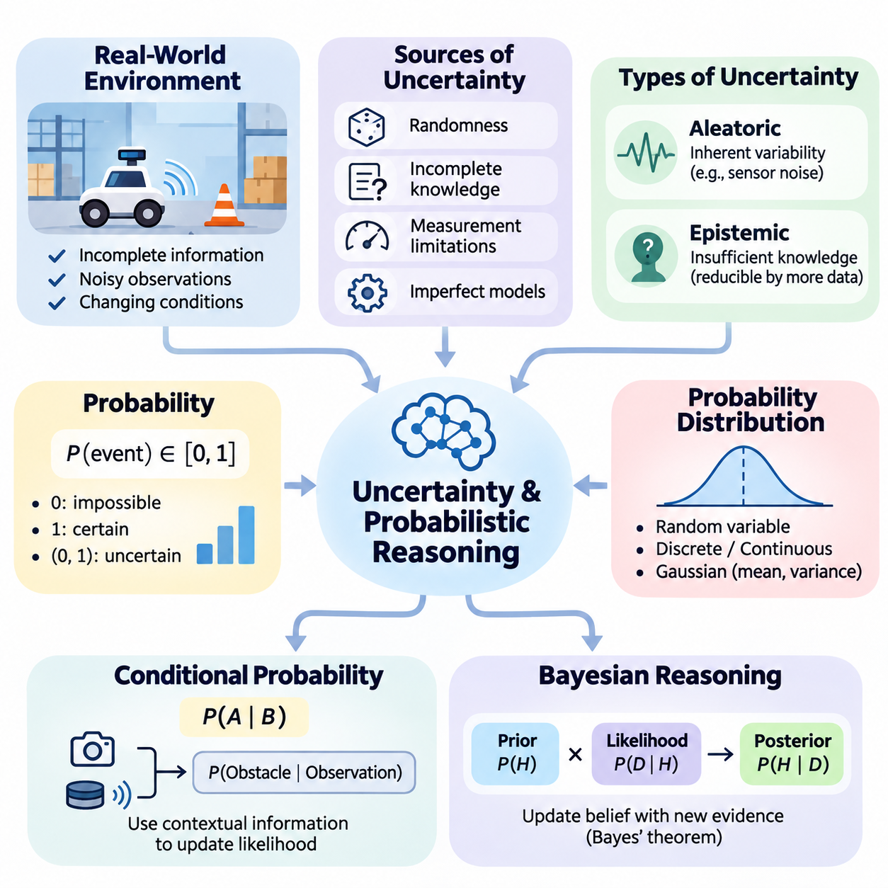
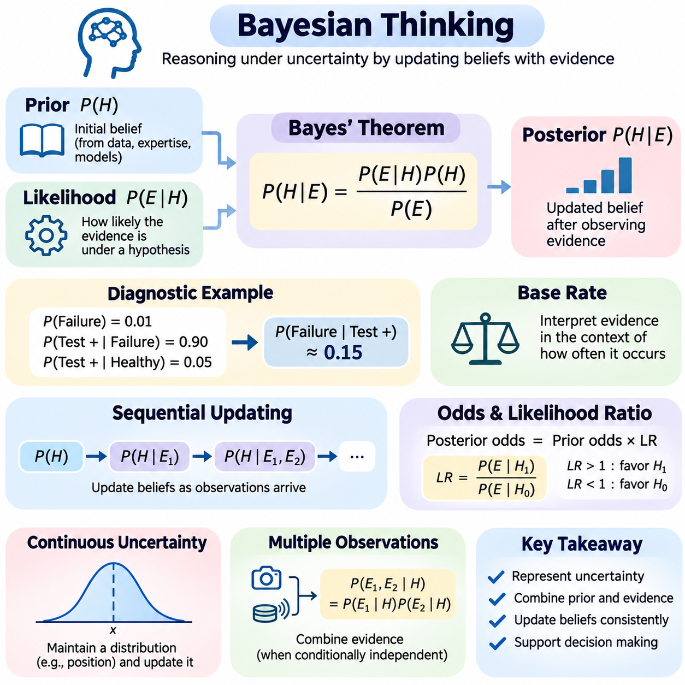
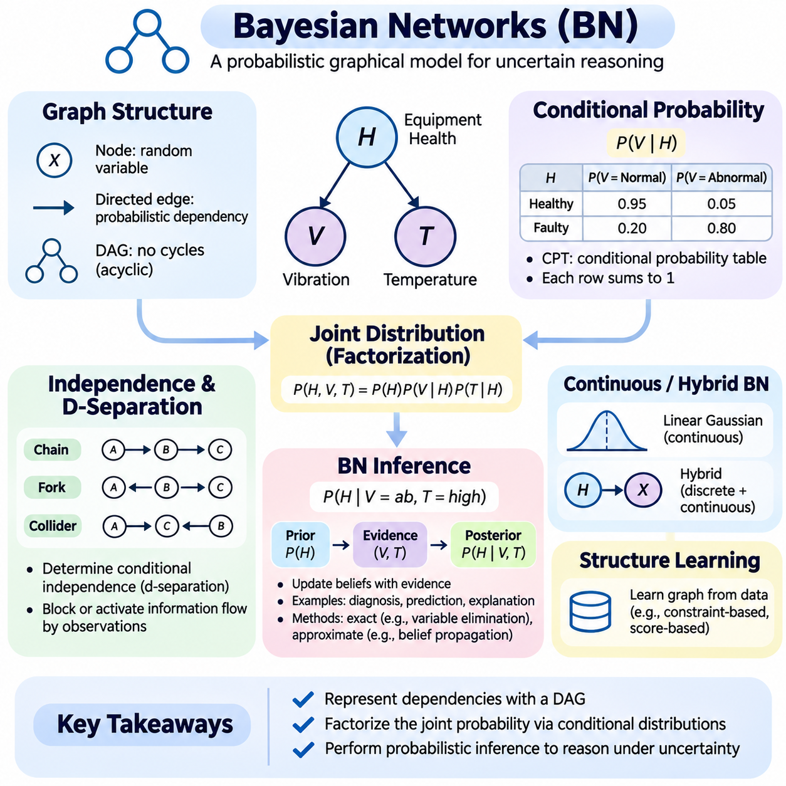
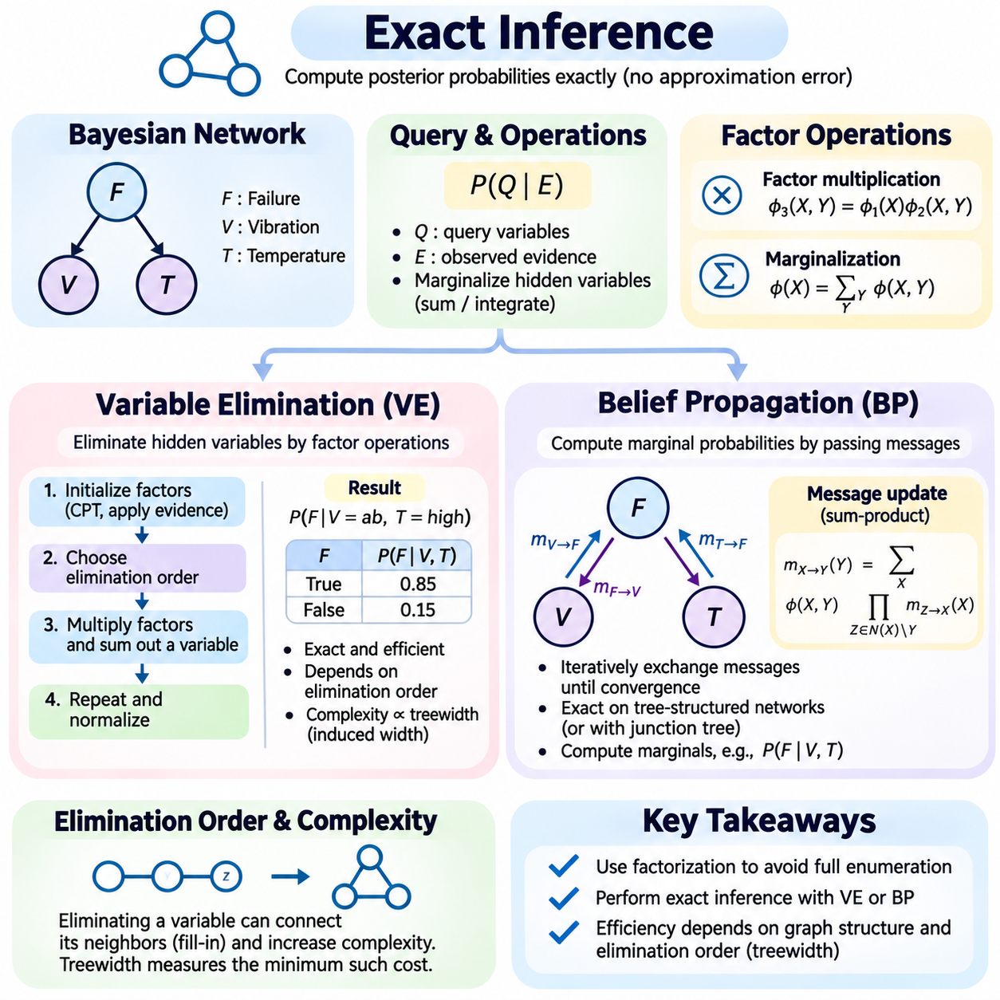
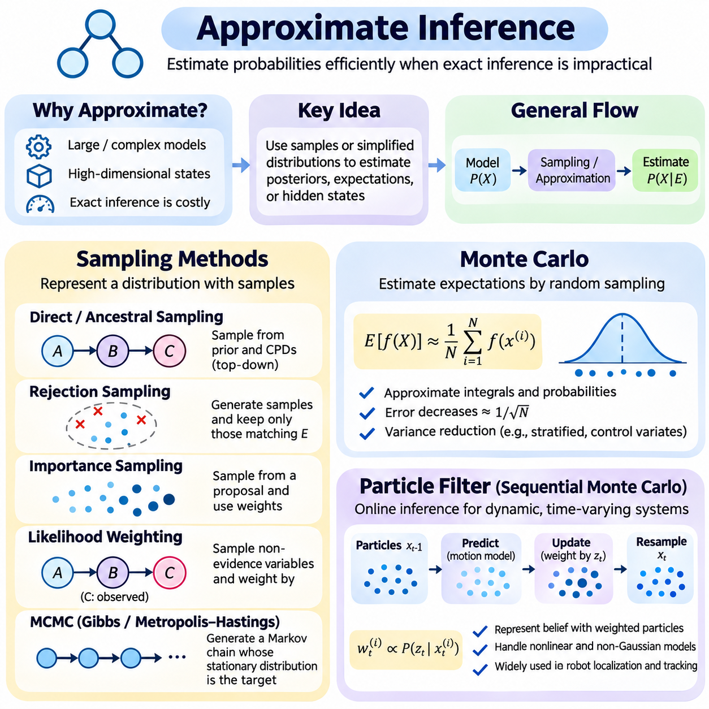
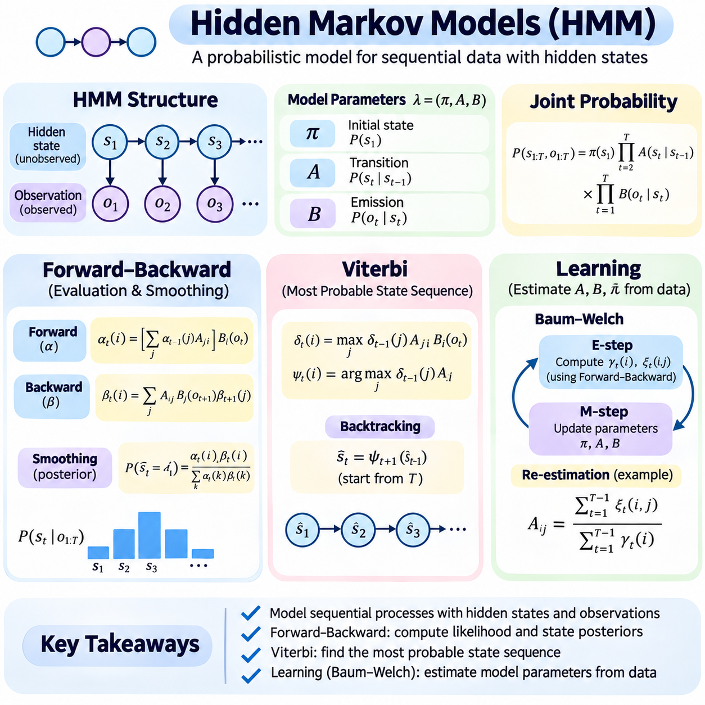
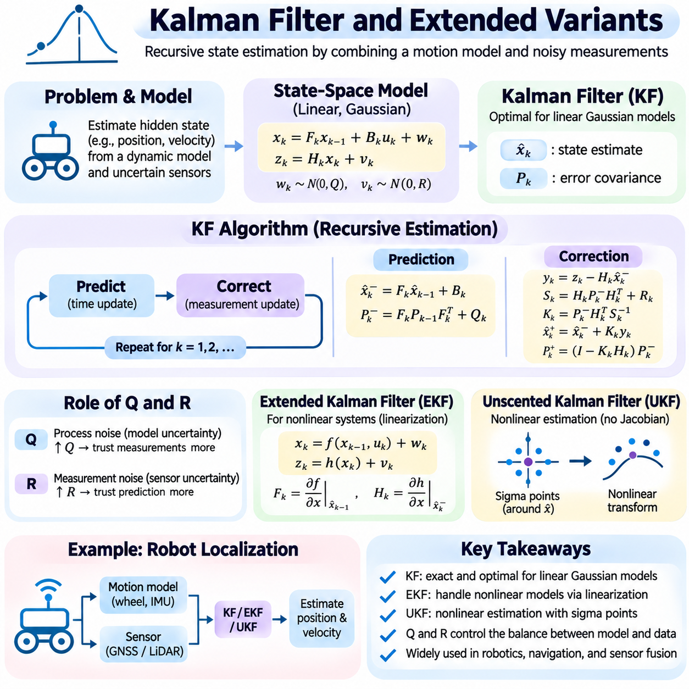
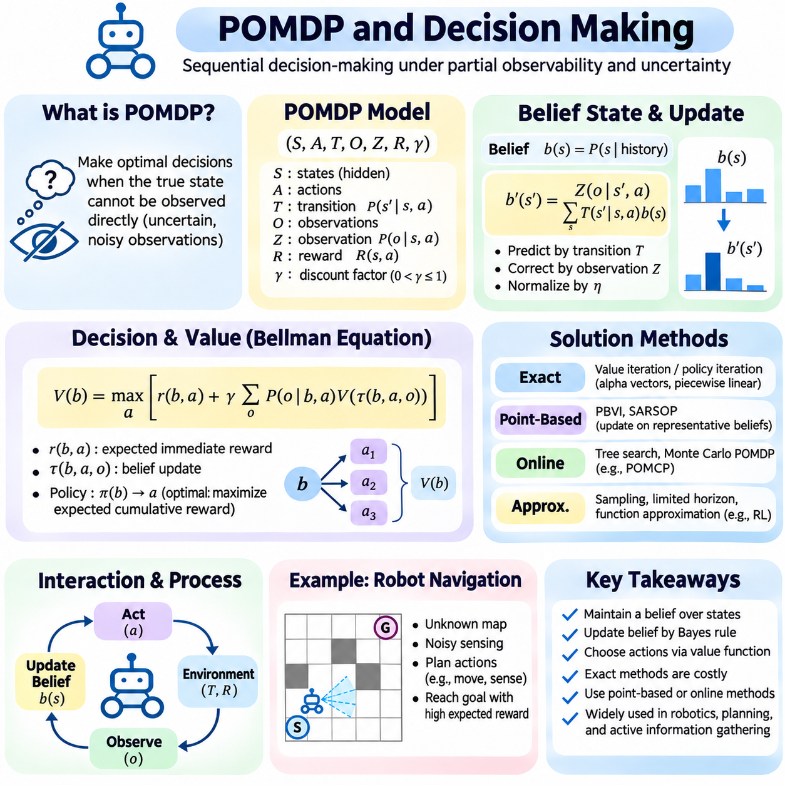
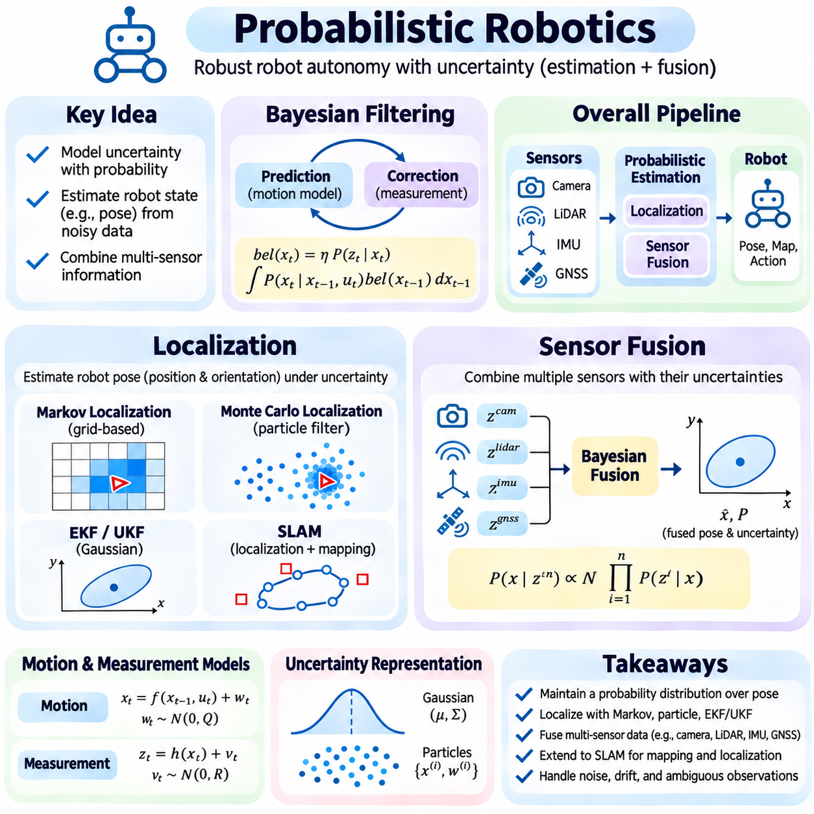
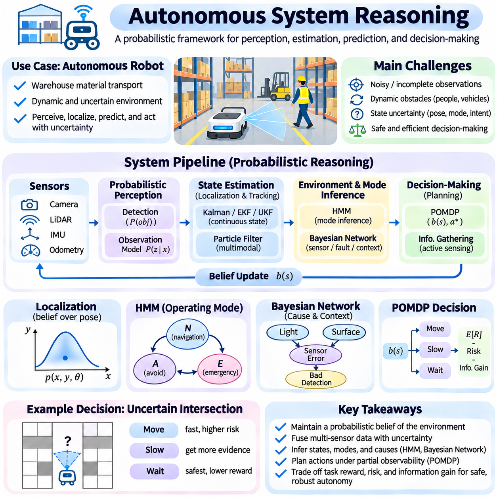

**Volume 03. Reasoning in AI**

# 02. Probabilistic Reasoning

## 02.01 Introduction to Uncertainty

{width="7.268055555555556in" height="7.268055555555556in"}

불확실성(Uncertainty)은 복잡하고 동적인 환경(Dynamic Environment)에서 작동하는 지능형 시스템(Intelligent System)의 근본적인 특성이다. 확립된 사실과 규칙으로부터 결론이 직접 도출되는 결정론적 추론(Deterministic Reasoning)과 달리, 확률적 추론(Probabilistic Reasoning)은 정보가 불완전하고 관측에 잡음이 존재하며 결과를 절대적인 확실성으로 예측할 수 없는 상황을 다룬다. 따라서 인공지능(Artificial Intelligence)은 신뢰할 수 있는 결론과 의사결정을 생성하기 위해 불확실성을 명시적으로 표현해야 한다.

실제 환경(Real-World Environment)은 완전하거나 완벽하게 정확한 정보를 제공하는 경우가 거의 없다. 센서(Sensor)는 측정 오차(Measurement Error)를 발생시키고, 인간의 관측에는 주관적인 해석이 포함되며, 환경 조건(Environmental Condition)은 지속적으로 변화한다. 예를 들어 자율 로봇(Autonomous Robot)은 장애물을 감지하더라도 정확한 위치나 움직임을 알지 못할 수 있다. 지능형 시스템은 모든 관측이 정확하다고 가정하는 대신 여러 가능한 설명을 평가하고 각각의 상대적인 가능성을 추정해야 한다.

불확실성은 무작위성(Randomness), 불완전한 지식(Incomplete Knowledge), 측정 한계(Measurement Limitation), 불완전한 모델(Imperfect Model) 등 여러 원인에서 발생한다. 우연적 불확실성(Aleatoric Uncertainty)은 센서 측정값의 무작위 변동이나 환경적 교란과 같이 과정 자체에 내재된 변동성을 의미한다. 인식적 불확실성(Epistemic Uncertainty)은 시스템이나 작동 조건에 대한 지식 부족을 나타낸다. 이러한 유형을 구분하면 추가 관측이나 모델 개선을 통해 불확실성을 줄일 수 있는지 판단하는 데 도움이 된다.

우연적 불확실성(Aleatoric Uncertainty)은 기저 과정(Underlying Process)에 내재된 변동성을 반영하므로 단순히 관측 데이터를 추가로 수집하는 것만으로는 일반적으로 제거할 수 없다. 예를 들어 물리적 센서(Physical Sensor)의 측정값은 전자적 잡음(Electronic Noise)으로 인해 반복 측정에서도 계속 변동할 수 있다. 통계 모델(Statistical Model)은 이러한 변동성을 특성화하고 예측에 미치는 영향을 추정할 수 있다. 신뢰할 수 있는 추론 시스템(Reasoning System)은 모든 측정값을 현실의 정확한 표현으로 해석하는 대신 이러한 불확실성을 고려해야 한다.

인식적 불확실성(Epistemic Uncertainty)은 제한된 데이터(Limited Data), 불완전한 가정(Incomplete Assumption), 환경 관계에 대한 이해 부족에서 발생한다. 익숙하지 않은 건물에 진입한 로봇은 처음에 공간 배치(Room Layout), 장애물(Obstacle), 탐색 제약 조건(Navigation Constraint)에 대한 지식이 부족할 수 있다. 추가 관측이 확보되면 환경에 대한 불확실성이 감소할 수 있다. 이러한 특성으로 인해 인식적 불확실성은 내부 표현(Internal Representation)을 지속적으로 갱신하는 학습 시스템(Learning System)에서 특히 중요하다.

확률 이론(Probability Theory)은 가능성을 수치적으로 측정하여 불확실성을 표현하는 수학적 프레임워크(Mathematical Framework)를 제공한다. 0과 1 사이의 확률값(Probability Value)은 특정 가정 아래에서 모델이 사건의 발생을 얼마나 강하게 지지하는지 나타낸다. 0은 모델 내에서 불가능한 사건을 의미하고, 1은 확실한 사건을 의미한다. 중간값은 다양한 수준의 불확실성을 표현하며 대안적 가설(Alternative Hypothesis) 사이의 체계적인 비교를 가능하게 한다.

확률적 추론(Probabilistic Reasoning)은 결론을 표현하고 수정하는 방식에서 전통적인 논리적 추론(Logical Reasoning)과 차이가 있다. 고전적 연역 논리(Classical Deductive Logic)는 결론이 전제로부터 필연적으로 도출되는지를 판단하는 반면, 확률적 추론은 이용 가능한 증거가 서로 다른 가능성을 얼마나 강하게 뒷받침하는지 평가한다. 논리 규칙(Logical Rule)은 특정 조건이 어떤 결과를 함의한다는 사실을 확립할 수 있지만, 확률 모델(Probabilistic Model)은 불확실한 조건에서 그 결과가 얼마나 자주 또는 얼마나 그럴듯하게 발생하는지를 표현할 수 있다.

핵심 개념 중 하나는 객관적 무작위성(Objective Randomness)과 지식에 대한 불확실성(Uncertainty About Knowledge)을 구분하는 것이다. 동전 던지기(Coin Toss)는 무작위 사건(Random Event)으로 모델링할 수 있지만, 기계 부품의 고장 여부에 대한 불확실성은 진단 정보(Diagnostic Information)의 부족에서 발생할 수 있다. 두 상황 모두 확률적으로 표현할 수 있지만 해석은 서로 다르다. 이러한 차이를 이해하면 모든 불확실한 사건이 본질적으로 무작위적이라고 가정하는 오류를 방지할 수 있다.

확률 모델(Probabilistic Model)은 확률 변수(Random Variable)와 확률 분포(Probability Distribution)를 사용하여 불확실한 수량을 표현한다. 확률 변수는 가능한 결과를 수치 또는 범주형 값과 연결하고, 확률 분포는 각 결과의 발생 가능성을 설명한다. 이산 분포(Discrete Distribution)는 부품 고장 상태와 같은 결과를 표현하며, 연속 분포(Continuous Distribution)는 위치, 속도, 온도, 측정 오차와 같은 수량을 설명한다. 이러한 표현은 확률적 추론(Probabilistic Inference)의 기반을 형성한다.

가우시안 분포(Gaussian Distribution)는 평균(Mean)과 분산(Variance)을 통해 편리하게 표현할 수 있기 때문에 연속적인 불확실성을 모델링하는 데 널리 사용된다. 평균은 수량의 중심 경향(Central Tendency)을 나타내고, 분산은 값의 퍼짐 정도(Dispersion)를 설명한다. 로봇 위치 추정(Robot Localization)에서는 위치 추정값과 함께 가능한 위치 범위를 설명하는 불확실성을 제공할 수 있다. 그러나 가우시안 가정(Gaussian Assumption)은 비대칭 분포(Asymmetric Distribution)나 다봉 분포(Multimodal Distribution)에서 항상 적절한 것은 아니다.

조건부 확률(Conditional Probability)은 맥락 정보(Contextual Information)를 활용하여 사건을 추론하는 능력을 제공한다. 카메라(Camera)가 객체를 감지하거나 라이다(LiDAR) 센서가 가까운 표면을 보고하면 장애물이 존재할 확률이 달라질 수 있다. 조건부 관계(Conditional Relationship)는 증거가 가설의 가능성을 어떻게 변화시키는지 표현한다. 이러한 기능을 통해 지능형 시스템은 개별적인 예측을 넘어 관측(Observation), 숨겨진 상태(Hidden State), 환경 조건(Environmental Condition) 사이의 의존성을 추론할 수 있다.

베이지안 추론(Bayesian Reasoning)은 새로운 증거가 확보될 때 믿음(Belief)을 갱신하는 체계적인 메커니즘을 제공한다. 사전 확률(Prior Probability)은 초기 믿음을 나타내고, 우도(Likelihood)는 관측이 가설과 얼마나 부합하는지를 설명한다. 베이즈 정리(Bayes\' Theorem)는 이러한 요소를 결합하여 사후 확률(Posterior Probability)을 생성한다. 이 과정은 모순되는 관측에도 기존 가정을 고정적으로 유지하는 대신 정보가 축적됨에 따라 지능형 시스템이 결론을 수정할 수 있도록 한다.

예를 들어 산업용 모니터링 시스템(Industrial Monitoring System)은 장비가 일반적으로 안정적으로 작동하기 때문에 초기에는 모터 고장(Motor Failure)에 낮은 확률을 부여할 수 있다. 그러나 비정상적인 진동(Abnormal Vibration)과 온도 상승(Elevated Temperature)이 감지되면 고장 확률이 증가할 수 있다. 갱신된 평가는 센서의 신뢰성과 관측된 증상 및 실제 고장 사이의 통계적 관계에 따라 달라진다. 따라서 확률적 추론은 과거 지식(Historical Knowledge)과 현재 증거(Current Evidence)를 통합한다.

불확실성은 여러 관측을 해석하는 과정에도 영향을 미친다. 서로 다른 센서에서 얻은 측정값은 상호 보완적인 정보를 제공할 수 있지만, 상관된 오차(Correlated Error)를 포함할 수도 있다. 의존성(Dependency)을 고려하지 않고 증거를 결합하면 잘못된 결론에 대해 과도한 확신을 갖게 될 수 있다. 확률적 센서 융합(Probabilistic Sensor Fusion)은 숨겨진 상태를 더 정확하게 추정하기 위해 측정 잡음(Measurement Noise), 상관관계(Correlation), 관측 신뢰성(Observation Reliability)에 대한 적절한 모델을 필요로 한다.

확률적 그래프 모델(Probabilistic Graphical Model)은 불확실한 변수 사이의 관계를 구조적으로 표현한다. 베이지안 네트워크(Bayesian Network)는 방향 그래프(Directed Graph)를 통해 조건부 의존성(Conditional Dependency)을 설명하며, 다른 그래프 모델은 다양한 형태의 확률적 상호작용을 표현한다. 이러한 구조는 관련 변수와 관계를 식별하여 복잡한 추론 문제를 체계적으로 구성하는 데 도움이 된다. 또한 부분적인 증거만 이용할 수 있는 상황에서도 확률을 추정하는 계산 방법을 지원한다.

지능형 시스템이 시간에 따라 작동할 때 불확실성은 더욱 복잡해진다. 환경의 현재 상태(Current State)는 직접 관측되지 않을 수 있으며, 관측은 해당 상태에 대한 간접적인 정보만 제공할 수 있다. 동적 확률 모델(Dynamic Probabilistic Model)은 상태가 어떻게 변화하고 관측이 해당 상태와 어떻게 연결되는지 설명한다. 은닉 마르코프 모델(Hidden Markov Model), 칼만 필터(Kalman Filter), 파티클 필터(Particle Filter)는 불확실한 측정 환경에서 변화하는 상태에 대한 믿음을 유지하고 갱신하는 서로 다른 메커니즘을 제공한다.

자율 로봇공학(Autonomous Robotics)에서 불확실성은 인식(Perception), 위치 추정(Localization), 지도 작성(Mapping), 계획(Planning), 제어(Control)에 영향을 미친다. 이동 로봇(Mobile Robot)은 추정 위치가 실제 위치와 완벽하게 일치한다고 가정할 수 없다. 바퀴 미끄러짐(Wheel Slippage), 센서 잡음(Sensor Noise), 불완전한 환경 지도(Environmental Map)는 이동 과정에서 누적되는 오차를 발생시킨다. 확률적 위치 추정(Probabilistic Localization)은 가능한 로봇 자세(Robot Pose)에 대한 믿음을 유지하고 움직임 예측(Motion Prediction)과 센서 관측을 이용하여 이를 갱신한다.

불확실성하의 의사결정(Decision-Making Under Uncertainty)은 가장 가능성이 높은 환경 상태를 선택하는 것 이상의 과정을 필요로 한다. 지능형 에이전트(Intelligent Agent)는 여러 가능한 결과에서 행동(Action)이 가져올 영향을 고려해야 한다. 탐색 시스템(Navigation System)은 최단 경로에 불확실한 장애물이나 잠재적인 위험 조건이 존재한다면 더 긴 경로를 선택할 수 있다. 기대 효용(Expected Utility), 위험 제약 조건(Risk Constraint), 믿음 상태 계획(Belief-State Planning)은 환경 정보가 불완전한 상황에서 행동을 평가하는 메커니즘을 제공한다.

부분 관측 마르코프 의사결정 과정(Partially Observable Markov Decision Process, POMDP)은 확률적 추론을 순차적 의사결정(Sequential Decision-Making)으로 확장한다. 에이전트는 실제 환경 상태에 직접 접근할 수 있다고 가정하는 대신 가능한 상태에 대한 확률 분포를 유지한다. 행동은 환경뿐만 아니라 에이전트가 이용할 수 있는 정보에도 영향을 미친다. 이러한 정식화(Formulation)는 감지 정보가 불완전하고 의사결정에서 미래의 불확실성을 고려해야 하는 상황에서 지능적인 행동을 지원한다.

신뢰도(Confidence)와 불확실성(Uncertainty)은 예측 정확도(Prediction Accuracy)와도 구분해야 한다. 시스템은 모델의 보정 상태가 좋지 않거나 익숙하지 않은 조건을 만나면 매우 높은 확신을 가진 잘못된 예측을 생성할 수 있다. 보정(Calibration)은 예측 확률이 비교 가능한 사례에서 관측된 실제 빈도와 일치하는지를 평가한다. 신뢰할 수 있는 인공지능은 정확한 예측뿐만 아니라 시스템의 실제 예측 신뢰성을 의미 있게 반영하는 불확실성 추정값(Uncertainty Estimate)도 필요로 한다.

모델 불확실성(Model Uncertainty)은 인공지능 시스템이 훈련 분포(Training Distribution)를 벗어난 조건을 만날 때 특히 중요해진다. 익숙하지 않은 객체, 비정상적인 날씨, 예상하지 못한 센서 동작, 이전에 경험하지 못한 작동 환경은 학습된 가정을 무효화할 수 있다. 분포 변화(Distribution Shift)를 감지하고 지식 부족을 인식하면 안전하지 않은 의사결정을 방지하는 데 도움이 된다. 그러나 불확실성 추정 방법 자체도 검증이 필요하며 심각한 분포 변화에서는 실패할 수 있다.

실용적인 불확실성 인식 시스템(Uncertainty-Aware System)은 계산 복잡도(Computational Complexity), 추론 정확도(Inference Accuracy), 운영 요구사항(Operational Requirement) 사이의 균형을 유지해야 한다. 정확한 확률적 추론(Exact Probabilistic Inference)은 모델에 상호작용하는 변수가 많아지면 계산 비용이 지나치게 커질 수 있다. 샘플링(Sampling)과 변분 접근법(Variational Approach)을 포함한 근사 추론(Approximate Inference)은 계산상의 대안을 제공한다. 적절한 방법의 선택은 모델 구조, 사용 가능한 계산 자원, 요구 정확도, 실시간 제약 조건(Real-Time Constraint)에 따라 달라진다.

궁극적으로 확률적 추론(Probabilistic Reasoning)은 불완전한 지식에도 불구하고 행동해야 하는 지능형 시스템의 기반을 제공한다. 불확실한 상태를 표현하고, 증거를 통해 믿음을 갱신하며, 관측을 결합하고, 가능한 결과를 평가함으로써 인공지능은 더욱 적응적이고 합리적으로 정당화할 수 있는 의사결정을 수행할 수 있다. 이러한 원리는 베이지안 네트워크(Bayesian Network), 확률적 필터링(Probabilistic Filtering), 부분 관측 계획(Partially Observable Planning), 자율 추론(Autonomous Reasoning)을 불확실성 관리를 위한 통합 프레임워크(Unified Framework)로 연결한다.

## 02.02 Bayesian Thinking

{width="7.268055555555556in" height="7.268055555555556in"}

베이지안 사고(Bayesian Thinking)는 새로운 증거(Evidence)가 확보될 때 수정할 수 있는 믿음(Belief)의 집합으로 지식을 다루는 불확실성하의 체계적인 추론 접근법(Systematic Reasoning Approach)이다. 명제를 단순히 참(True) 또는 거짓(False)으로 분류하는 대신, 경쟁하는 가설(Competing Hypothesis)에 확률을 부여한다. 이러한 관점은 지능형 시스템(Intelligent System)이 기존 지식과 관측을 결합하고, 이해를 지속적으로 정교화하며, 정보가 불완전하거나 모호한 상황에서도 의사결정을 수행할 수 있도록 한다.

베이지안 사고(Bayesian Thinking)의 핵심 원리는 합리적인 믿음(Rational Belief)이 증거에 따라 변화해야 한다는 것이다. 지능형 에이전트(Intelligent Agent)는 가능한 설명에 대한 초기 평가에서 출발하여, 새롭게 관측된 정보가 각 설명 아래에서 얼마나 발생할 가능성이 높은지 평가한다. 그 결과 형성되는 믿음은 이전 지식(Prior Knowledge)과 현재 관측(Current Observation)을 모두 반영한다. 이 과정은 모든 새로운 관측이 완벽하게 신뢰할 수 있다고 가정하지 않으면서 경험으로부터 학습하는 일관된 기반을 제공한다.

베이즈 정리(Bayes\' Theorem)는 P(H\|E) = P(E\|H)P(H)/P(E)라는 관계를 통해 믿음 갱신(Belief Updating)을 수학적으로 정식화한다. 여기서 H는 가설(Hypothesis)을 나타내고 E는 관측된 증거(Observed Evidence)를 나타낸다. 사전 확률(Prior Probability) P(H)는 초기 믿음을 설명하며, 우도(Likelihood) P(E\|H)는 해당 가설 아래에서 증거가 발생할 확률을 측정한다. 사후 확률(Posterior Probability) P(H\|E)는 관측을 반영한 갱신된 믿음을 나타내며, P(E)는 증거의 정규화 확률(Normalizing Probability)로 작용한다.

사전 확률(Prior Probability)은 특정 관측을 고려하기 전에 이용할 수 있는 지식을 부호화한다. 이러한 확률은 과거 측정값(Historical Measurement), 도메인 전문 지식(Domain Expertise), 물리적 제약 조건(Physical Constraint), 이전에 학습된 통계 모델(Statistical Model)에서 도출될 수 있다. 예를 들어 로봇 시스템(Robotic System)은 이전 위치와 이동 이력(Motion History)을 바탕으로 가능한 위치에 서로 다른 초기 확률을 부여할 수 있다. 사전 확률은 반드시 임의적인 가정을 의미하지 않으며, 검토하고 수정할 수 있는 명시적인 출발점을 제공한다.

우도 함수(Likelihood Function)는 가설과 관측 가능한 결과(Observable Outcome)를 연결한다. 이는 특정 관측이 제안된 설명 아래에서 얼마나 예상되는지를 표현한다. 장비 모니터링(Equipment Monitoring)에서 베어링(Bearing)이 정상적으로 작동할 때보다 손상되었을 때 높은 진동이 발생할 가능성이 더 클 수 있다. 따라서 우도는 관측이 현재 믿음에 얼마나 영향을 미쳐야 하는지를 결정한다. 중요한 점은 가설이 주어졌을 때 증거의 확률과 증거가 주어졌을 때 가설의 확률이 동일하지 않다는 것이다.

사후 확률(Posterior Probability)은 사전 지식(Prior Knowledge)과 관측 증거(Observational Evidence)를 결합하여 갱신된 불확실성 표현(Uncertainty Representation)을 생성한다. 초기 확률이 낮은 가설도 새로운 관측에서 강한 지지를 받으면 그럴듯한 설명이 될 수 있다. 반대로 이전에 신뢰할 만했던 가설도 예측과 모순되는 증거가 나타나면 지지도가 감소할 수 있다. 따라서 베이지안 갱신(Bayesian Updating)은 초기 가정을 영구적인 진실로 취급하지 않고 결론을 수정하는 수학적으로 일관된 메커니즘을 제공한다.

부품의 사전 고장 확률(Prior Failure Probability)이 1%인 진단 시스템(Diagnostic System)을 고려해 보자. 검사(Test)가 실제 고장의 90%를 감지하지만 정상 부품의 5%에서도 양성 결과(Positive Result)를 생성한다고 가정한다. 양성 결과가 나타난 이후의 사후 고장 확률(Posterior Failure Probability)은 약 15%이다. 검사의 민감도(Sensitivity)가 비교적 높더라도 초기 고장률(Initial Failure Rate)이 낮다는 사실은 관측 결과의 해석에 상당한 영향을 미친다.

이러한 진단 사례는 확률적 추론(Probabilistic Reasoning)에서 기저율(Base Rate)의 중요성을 보여준다. 양성 관측(Positive Observation)은 독립적으로 고려하면 설득력 있어 보일 수 있지만, 그 의미는 실제 조건이 얼마나 자주 발생하는지에 따라 달라진다. 사전 확률(Prior Probability)을 무시하면 드문 사건(Rare Event)의 발생 가능성을 체계적으로 과대평가할 수 있다. 베이지안 사고(Bayesian Thinking)는 기저율을 명시적으로 반영하여 강력해 보이지만 불완전한 증거에만 의존하는 결론을 방지하도록 돕는다.

베이지안 갱신(Bayesian Updating)은 관측이 도착하는 순서에 따라 순차적으로 수행할 수 있다. 하나의 관측에서 얻은 사후 분포(Posterior Distribution)는 다음 갱신을 위한 사전 분포(Prior Distribution)가 된다. 이러한 재귀적 구조(Recursive Structure)는 측정값이 지속적으로 도착하는 실시간 인공지능 시스템(Real-Time AI System)에서 특히 유용하다. 적절한 관측 모델(Observation Model) 아래에서 순차적 갱신(Sequential Updating)은 새로운 측정값이 들어올 때마다 전체 추론 과정을 다시 시작하지 않고도 정보를 축적할 수 있도록 한다.

베이지안 갱신을 표현하는 또 다른 유용한 방식은 오즈(Odds)와 우도비(Likelihood Ratio)를 사용하는 것이다. 사후 오즈(Posterior Odds)는 사전 오즈(Prior Odds)에 관측 증거의 우도비를 곱한 값과 같다. 우도비는 경쟁하는 두 가설 아래에서 특정 관측이 발생할 가능성을 비교한다. 값이 1보다 크면 한 가설을 지지하고, 1보다 작으면 대안 가설(Alternative Hypothesis)을 지지한다. 이러한 표현은 개별 관측이 제공하는 증거적 기여(Evidential Contribution)를 더 쉽게 해석하도록 한다.

베이지안 추론(Bayesian Reasoning)은 이산 가설(Discrete Hypothesis)뿐만 아니라 연속적인 수량(Continuous Quantity)에 대한 불확실성도 지원한다. 로봇은 단일 좌표를 선택하는 대신 자신의 위치에 대한 확률 분포(Probability Distribution)를 유지할 수 있다. 센서 측정값(Sensor Measurement)은 관측된 거리나 랜드마크(Landmark)와 일치하는 위치의 확률을 높이는 방식으로 분포를 수정한다. 그 결과 생성되는 사후 분포(Posterior Distribution)는 추정 위치와 남아 있는 불확실성을 모두 포함하여 결정론적 점 추정(Deterministic Point Estimate)보다 풍부한 정보를 제공한다.

여러 관측을 사용할 수 있는 경우에는 통계적 의존성(Statistical Dependency)을 고려해야 한다. 측정값이 특정 가설 아래에서 조건부 독립(Conditional Independence)을 만족한다면 우도를 곱하여 증거를 효율적으로 결합할 수 있다. 그러나 상관관계가 있는 센서(Correlated Sensor)나 동일한 기저 정보원(Underlying Source)에서 생성된 반복 관측은 이러한 가정을 위반한다. 의존적인 증거를 독립적인 것으로 취급하면 지나치게 확신하는 사후 추정(Posterior Estimate)이 생성되어 확률적 결론의 신뢰성을 저하시킬 수 있다.

베이지안 사고(Bayesian Thinking)는 모델 매개변수(Model Parameter)에 대한 불확실성과 미래 관측(Future Observation)에 대한 불확실성을 구분한다. 매개변수 불확실성(Parameter Uncertainty)은 센서 편향(Sensor Bias), 고장률(Failure Rate), 환경 특성(Environmental Characteristic)과 같은 알려지지 않은 수량에 관한 것이다. 예측 불확실성(Predictive Uncertainty)은 결과의 변동성까지 추가로 반영한다. 베이지안 예측 분포(Bayesian Predictive Distribution)는 가능한 매개변수 값 전반에 걸쳐 예측을 통합함으로써 학습된 모델과 미래 사건의 불확실성을 함께 고려하도록 한다.

사전 분포 선택(Prior Selection)은 특히 관측 데이터(Observational Data)가 제한적일 때 베이지안 추론(Bayesian Inference)에 영향을 미친다. 정보성 사전 분포(Informative Prior)는 상당한 도메인 지식(Domain Knowledge)을 반영하는 반면, 약정보성 사전 분포(Weakly Informative Prior)는 결과를 강하게 결정하지 않으면서 더 넓은 제약 조건을 부여한다. 계층적 모델(Hierarchical Model)은 관련 작업이나 모집단(Population) 사이에서 정보를 공유할 수 있다. 어떤 접근법을 사용하더라도 사전 가정(Prior Assumption)을 문서화하고 민감도 분석(Sensitivity Analysis)을 통해 그 영향을 검토해야 한다.

베이지안 추론(Bayesian Reasoning)은 경쟁하는 모델(Competing Model)을 비교하기 위한 자연스러운 프레임워크를 제공한다. 각 모델이 관측 데이터에 얼마나 잘 적합하는지만 평가하는 대신, 베이지안 모델 비교(Bayesian Model Comparison)는 각 모델 아래에서 증거가 발생할 확률을 고려한다. 흔히 모델 증거(Model Evidence) 또는 주변 우도(Marginal Likelihood)라고 하는 이 값은 매개변수 불확실성(Parameter Uncertainty)을 적분하여 반영한다. 이러한 방식은 불필요하게 복잡한 설명을 억제할 수 있지만, 고차원 모델(High-Dimensional Model)에서는 실제 계산이 어려울 수 있다.

의사결정(Decision-Making)은 갱신된 믿음을 가능한 행동(Action) 및 결과(Consequence)와 연결함으로써 베이지안 추론을 확장한다. 시스템은 장비 고장 확률을 추정할 수 있지만, 기계를 정지할지 결정하려면 운영 비용(Operational Cost)과 잠재적 손상(Potential Damage)도 고려해야 한다. 베이지안 의사결정 이론(Bayesian Decision Theory)은 사후 믿음(Posterior Belief)과 효용 함수(Utility Function) 또는 손실 함수(Loss Function)를 결합하여 기대 결과(Expected Outcome)가 유리한 행동을 식별한다. 가장 가능성이 높은 가설이 반드시 최선의 의사결정을 결정하는 것은 아니다.

자율 로봇공학(Autonomous Robotics)에서 베이지안 사고(Bayesian Thinking)는 위치 추정(Localization), 추적(Tracking), 지도 작성(Mapping), 센서 융합(Sensor Fusion)의 기반이 된다. 로봇은 운동 모델(Motion Model)을 사용하여 다음 상태를 예측한 후 카메라(Camera), 라이다(LiDAR), 관성 측정(Inertial Measurement)을 반영하여 믿음을 갱신한다. 이러한 예측 및 보정 과정(Prediction-and-Correction Process)은 잡음이 있는 관측과 불완전한 동역학(Imperfect Dynamics)에도 불구하고 지속적인 추론을 가능하게 한다. 칼만 필터(Kalman Filter)와 파티클 필터(Particle Filter)는 서로 다른 형태의 재귀적 확률 상태 추정(Recursive Probabilistic State Estimation)을 구현한다.

베이지안 사고(Bayesian Thinking)는 예측의 한계를 인식해야 하는 기계학습 시스템(Machine Learning System)에도 중요하다. 분류 모델(Classification Model)은 서로 다른 객체 범주(Object Category)에 대한 확률을 추정할 수 있지만, 신뢰할 수 있는 해석을 위해서는 보정(Calibration)과 불확실성(Uncertainty)을 검토해야 한다. 베이지안 신경망(Bayesian Neural Network)은 모델 매개변수에 대한 분포 또는 그 근사값을 표현하여 예측 불확실성(Predictive Uncertainty)을 추정하는 하나의 접근법을 제공한다. 실제 효과는 추론 품질(Inference Quality), 모델 가정(Model Assumption), 계산 자원(Computational Resource)에 따라 달라진다.

계산 복잡도(Computational Complexity)는 베이지안 추론(Bayesian Inference)의 주요 과제로 남아 있다. 정확한 사후 확률 계산(Exact Posterior Calculation)은 많은 숨겨진 변수(Hidden Variable)나 고차원 매개변수 공간(High-Dimensional Parameter Space)에 대한 적분을 필요로 할 수 있다. 마르코프 연쇄 몬테카를로(Markov Chain Monte Carlo), 변분 추론(Variational Inference), 순차 몬테카를로(Sequential Monte Carlo)와 같은 근사 기법(Approximation Technique)은 대안적인 계산 전략을 제공한다. 각 방법은 정확도, 수렴성(Convergence), 메모리 요구사항(Memory Requirement), 추론 지연시간(Inference Latency) 사이의 절충 관계(Tradeoff)를 수반한다.

베이지안 사고(Bayesian Thinking)는 가정이 부정확한 경우 올바른 결론을 보장하지 않는다. 부적절한 우도 모델(Likelihood Model), 잘못 선택된 사전 분포(Prior Distribution), 인식되지 않은 의존성(Unrecognized Dependency), 분포 변화(Distribution Shift)는 모두 오해를 유발하는 사후 확률(Posterior Probability)을 생성할 수 있다. 따라서 신뢰할 수 있는 응용 시스템은 모델 점검(Model Checking), 보정 평가(Calibration Assessment), 민감도 분석(Sensitivity Analysis), 대표성 있는 관측에 대한 검증(Validation)을 필요로 한다. 확률적 출력은 이를 구성하는 데 사용된 가정과 증거에 조건부로 의존한다는 점을 고려하여 해석해야 한다.

베이지안 사고(Bayesian Thinking)의 더 넓은 중요성은 지능(Intelligence)을 고정된 규칙 실행(Fixed Rule Execution)이 아니라 지속적인 믿음 수정(Continuous Belief Revision)으로 다룬다는 데 있다. 사전 지식(Prior Knowledge), 증거(Evidence), 불확실성(Uncertainty), 의사결정의 결과(Decision Consequence)를 결합함으로써 베이지안 방법(Bayesian Method)은 변화하는 환경에서 적응적 추론(Adaptive Reasoning)을 지원한다. 이러한 기반은 베이지안 네트워크(Bayesian Network), 확률적 필터링(Probabilistic Filtering), 순차적 추론(Sequential Inference), 자율 의사결정(Autonomous Decision-Making)을 연결하여 확실성을 확보할 수 없는 상황에서도 인공지능 시스템이 체계적으로 추론할 수 있도록 한다.

## 02.03 Bayesian Networks

{width="7.268055555555556in" height="7.268055555555556in"}

베이지안 네트워크(Bayesian Network)는 방향성 비순환 그래프(Directed Acyclic Graph, DAG)를 통해 변수 사이의 불확실한 관계를 표현하는 확률적 그래프 모델(Probabilistic Graphical Model)이다. 그래프 이론(Graph Theory)과 확률 이론(Probability Theory)을 결합하여 서로 다른 요인이 어떻게 영향을 주고받으며 증거(Evidence)가 믿음(Belief)을 어떻게 변화시키는지 설명한다. 복잡한 확률 분포(Probability Distribution)를 작은 조건부 관계(Conditional Relationship)로 구성함으로써 베이지안 네트워크는 불확실성하의 추론을 위한 해석 가능하고 계산적으로 구조화된 프레임워크(Framework)를 제공한다.

베이지안 네트워크의 그래프 구조(Graph Structure)는 노드(Node)와 방향성 간선(Directed Edge)으로 구성된다. 각 노드는 관측 가능한 사건(Observable Event), 숨겨진 상태(Hidden State), 불확실한 조건(Uncertain Condition)을 설명하는 확률 변수(Random Variable)를 나타낸다. 방향성 간선은 부모 변수(Parent Variable)와 자식 변수(Child Variable)를 연결하며 모델 내의 직접적인 확률적 의존성(Probabilistic Dependency)을 표현한다. 그래프는 방향성 간선을 따라 출발 노드로 되돌아오는 경로가 없는 비순환 구조(Acyclic Structure)를 유지해야 하며, 이를 통해 결합 확률 분포(Joint Probability Distribution)의 유효한 인수분해(Factorization)가 보장된다.

방향성 간선(Directed Edge)은 선택된 모델 구조(Model Structure)에서 자식 변수의 확률 분포가 부모 변수에 직접적으로 의존한다는 것을 나타낸다. 그러나 이러한 관계가 자동으로 인과성(Causality)을 확립하는 것은 아니다. 베이지안 네트워크(Bayesian Network)는 물리적인 원인과 결과의 메커니즘(Cause-and-Effect Mechanism)을 식별하지 않고도 통계적 의존성(Statistical Dependency)을 표현할 수 있다. 인과적 해석(Causal Interpretation)을 위해서는 변수와 관계가 실제 환경의 개입(Intervention)에 어떻게 대응하는지에 대한 추가적인 가정이 필요하다.

베이지안 네트워크의 결합 확률 분포(Joint Probability Distribution)는 국소 조건부 분포(Local Conditional Distribution)의 곱으로 인수분해할 수 있다. 변수 X1부터 Xn까지에 대해 인수분해는 P(X1,\...,Xn) = ∏ P(Xi\|Parents(Xi))로 표현된다. 이러한 표현은 그래프에 유용한 조건부 독립성(Conditional Independence)이 존재할 때 모든 변수 값의 조합을 명시적으로 저장할 필요를 줄인다. 그 결과 모델 복잡도(Model Complexity)가 감소하며, 이는 베이지안 네트워크의 주요 장점 중 하나이다.

그래프 구조(Graph Structure)는 모델에 포함되는 조건부 독립성 가정(Conditional Independence Assumption)을 결정한다. 국소 마르코프 속성(Local Markov Property)에 따르면 각 변수는 부모 변수가 주어졌을 때 자신의 비후손 변수(Non-Descendant Variable)와 조건부 독립이다. 이러한 속성은 복잡한 의존성을 비교적 작은 국소 관계(Local Relationship)로 표현할 수 있도록 한다. 개별 조건부 분포가 합리적으로 보이더라도 부적절한 그래프 구조는 잘못된 확률 추정(Probability Estimate)을 생성할 수 있으므로 독립성을 정확하게 식별하는 것이 중요하다.

세 가지 기본적인 그래프 패턴(Graphical Pattern)은 베이지안 네트워크에서 정보 흐름(Information Flow)을 설명하는 데 도움이 된다. 연쇄 구조(Chain)는 변수를 순차적으로 연결하고, 분기 구조(Fork)는 여러 변수가 공통 부모(Common Parent)를 공유하는 관계를 나타내며, 충돌 구조(Collider)는 여러 부모 변수가 하나의 공통 자식(Common Child)에 영향을 주는 관계를 표현한다. 중간 변수에 조건을 부여하면 연쇄와 분기 구조에서는 정보 흐름이 차단될 수 있지만, 충돌 변수 또는 그 후손에 조건을 부여하면 이전에 차단되었던 경로가 활성화될 수 있다. 이러한 관계는 디-분리(D-Separation)의 기반을 형성한다.

디-분리(D-Separation)는 네트워크 구조에 따라 변수들이 조건부 독립(Conditional Independence)인지 판단하는 그래프 기준(Graphical Criterion)이다. 변수 사이의 경로(Path)를 조사하고 관측된 변수(Observed Variable)가 해당 경로를 차단하거나 활성화하는지 평가한다. 이 메커니즘은 전체 결합 확률 분포(Joint Probability Distribution)를 계산하지 않고도 독립 관계(Independence Relationship)를 식별할 수 있도록 한다. 디-분리는 네트워크 설계(Network Design), 가정 검증(Assumption Validation), 확률적 추론 최적화(Probabilistic Inference Optimization)에서 특히 유용하다.

베이지안 네트워크의 구조는 전문가 지식(Expert Knowledge)을 사용하여 설계하거나 관측 데이터(Observational Data)로부터 학습할 수 있다. 전문가가 설계한 네트워크(Expert-Designed Network)는 공학, 의학 및 기타 분야에서 알려진 관계를 반영한다. 구조 학습 알고리즘(Structure Learning Algorithm)은 비순환 제약 조건(Acyclicity Constraint)을 만족하면서 관측된 의존성을 설명하는 그래프를 탐색한다. 제약 기반 접근법(Constraint-Based Approach)과 점수 기반 접근법(Score-Based Approach)이 일반적으로 사용되지만, 제한된 데이터와 관측적 동등성(Observational Equivalence)으로 인해 실제 그래프를 유일하게 식별하지 못할 수 있다.

조건부 확률 분포(Conditional Probability Distribution)는 그래프 간선과 관련된 정량적 관계(Quantitative Relationship)를 정의한다. 이산 자식 변수(Discrete Child Variable)의 경우 조건부 확률표(Conditional Probability Table, CPT)는 부모 변수의 모든 상태 조합에 대해 자식 변수의 가능한 상태별 확률을 할당한다. 각 조건부 분포는 자식 변수의 상태에 대한 확률 합이 1이 되도록 정규화(Normalization)되어야 한다. 이러한 확률표는 정성적인 그래프 구조(Qualitative Graph Structure)를 추론 질의(Inference Query)에 응답할 수 있는 완전한 확률 모델(Probabilistic Model)로 변환한다.

장비 상태(Equipment Health), 진동(Vibration), 온도(Temperature)를 설명하는 네트워크를 고려해 보자. 장비 상태는 비정상적인 진동과 온도 상승의 발생 확률에 영향을 줄 수 있으므로 두 센서 관측(Sensor Observation)의 부모 변수(Parent Variable)가 될 수 있다. 조건부 확률표(Conditional Probability Table)는 정상 상태(Healthy Condition)와 고장 상태(Faulty Condition)에서 각 관측이 얼마나 자주 발생하는지 정의한다. 비정상적인 측정값이 발생하면 네트워크는 이용 가능한 센서의 증거를 결합하여 장비 상태에 대한 믿음을 갱신할 수 있다.

조건부 확률표(Conditional Probability Table)는 부모 변수(Parent Variable)의 수가 증가할수록 저장 및 계산 비용이 급격하게 증가한다. 여러 개의 이진 부모 변수(Binary Parent Variable)를 가진 이진 자식 변수(Binary Child Variable)는 일반적인 확률표에서 부모 상태 조합의 수가 지수적으로 증가한다. 구조화된 조건부 분포(Structured Conditional Distribution), 노이지-OR 모델(Noisy-OR Model), 매개변수 공유(Parameter Sharing), 연속 확률 모델(Continuous Probability Model)은 가정이 적절한 경우 이러한 부담을 줄일 수 있다. 이러한 표현은 의미 있는 의존성을 유지하면서 확장성(Scalability)을 개선한다.

연속 변수(Continuous Variable)도 적절한 확률 분포를 통해 베이지안 네트워크에 포함할 수 있다. 선형 가우시안 모델(Linear Gaussian Model)은 조건부 가우시안 분포(Conditional Gaussian Distribution)를 사용하여 연속적인 관계를 표현하며, 혼합형 네트워크(Hybrid Network)는 이산 변수와 연속 변수를 결합한다. 더 유연한 조건부 모델(Conditional Model)은 비선형 의존성(Nonlinear Dependency)을 표현할 수 있지만 추론을 복잡하게 만드는 경우가 많다. 표현 방식의 선택은 물리적 특성(Physical Characteristic), 이용 가능한 관측, 계산 요구사항(Computational Requirement)을 반영해야 한다.

매개변수 학습(Parameter Learning)은 관측 데이터로부터 조건부 확률 분포(Conditional Probability Distribution)를 추정한다. 모든 변수가 관측되는 이산 네트워크(Discrete Network)에서는 최대우도추정(Maximum Likelihood Estimation, MLE)이 정규화된 빈도수(Normalized Frequency Count)를 사용할 수 있다. 베이지안 매개변수 추정(Bayesian Parameter Estimation)은 알려지지 않은 매개변수에 사전 분포(Prior Distribution)를 도입하고 증거를 이용하여 갱신한다. 변수가 숨겨져 있거나 관측이 불완전한 경우에는 기댓값 최대화 알고리즘(Expectation-Maximization Algorithm)이 잠재 상태(Latent State)를 고려하면서 매개변수를 반복적으로 추정할 수 있다.

베이지안 네트워크 추론(Bayesian Network Inference)은 이용 가능한 증거가 주어졌을 때 관심 변수의 확률을 계산한다. 일반적인 질의는 P(Query\|Evidence)를 평가하며, 여기서 질의 변수(Query Variable)는 알려지지 않은 조건을 나타내고 증거 변수(Evidence Variable)는 관측된 정보를 나타낸다. 추론에는 하위 결과(Downstream Outcome)의 예측, 상위 원인(Upstream Explanation)의 진단, 숨겨진 변수(Hidden Variable)의 추정이 포함될 수 있다. 이러한 서로 다른 추론 방향은 동일한 확률 모델 내에서 처리할 수 있다.

예측 추론(Predictive Inference)은 알려진 조건을 사용하여 미래 사건(Future Event)이나 하위 사건(Downstream Event)의 발생 가능성을 추정한다. 진단 추론(Diagnostic Inference)은 반대 방향으로 작동하며 관측된 결과로부터 가능한 설명을 추론한다. 예를 들어 네트워크는 부품 고장(Component Fault)이 주어졌을 때 과열(Overheating)의 발생 확률을 예측하거나, 과열이 감지된 이후 고장 확률을 추정할 수 있다. 베이지안 갱신(Bayesian Updating)은 별도의 규칙 시스템(Rule System)을 필요로 하지 않으면서 두 가지 추론을 모두 지원한다.

정확 추론(Exact Inference)은 지정된 모델 아래에서 근사 없이 사후 확률(Posterior Probability)을 계산한다. 열거법(Enumeration)은 관련된 숨겨진 변수(Hidden Variable)의 조합을 평가하며, 변수 제거(Variable Elimination)는 반복 계산을 방지하도록 연산을 재구성한다. 믿음 전파(Belief Propagation)는 트리 구조 네트워크(Tree-Structured Network)에서 정확한 주변 확률(Marginal Probability)을 효율적으로 계산할 수 있다. 더 복잡한 그래프에서는 접합 트리 방법(Junction-Tree Method)이나 다른 구조화된 알고리즘이 필요할 수 있으며, 계산 비용은 그래프 연결성(Graph Connectivity)의 영향을 크게 받는다.

변수 제거(Variable Elimination)는 확률 인자(Probability Factor)를 곱하고 질의 대상이나 관측 대상이 아닌 변수를 합산하여 제거하는 방식으로 추론을 수행한다. 제거 순서(Elimination Order)는 중간 인자(Intermediate Factor)의 크기가 매우 커질 수 있기 때문에 중요하다. 트리폭(Treewidth)과 같은 그래프 속성(Graph Property)은 정확 추론(Exact Inference)의 복잡도를 특성화하는 데 도움이 된다. 따라서 밀집된 의존성(Dense Dependency)을 가진 네트워크는 개별 조건부 확률표가 비교적 작더라도 계산 비용이 높을 수 있다.

믿음 전파(Belief Propagation)는 연결된 변수나 인자 사이에서 확률적 메시지(Probabilistic Message)를 교환하여 주변 분포(Marginal Distribution)를 계산한다. 트리 구조 그래프(Tree-Structured Graph)에서는 유한한 메시지 갱신 과정을 통해 정확한 결과를 생성할 수 있다. 무방향 순환(Undirected Cycle)이 존재하는 그래프에서는 순환 믿음 전파(Loopy Belief Propagation)가 근사적인 대안을 제공하지만 수렴(Convergence)과 정확도(Accuracy)가 보장되지는 않는다. 이러한 차이는 복잡한 네트워크에서 추론 방법을 선택할 때 중요하다.

정확한 계산이 현실적으로 어려운 경우에는 근사 추론(Approximate Inference)이 필요하다. 우도 가중 샘플링(Likelihood Weighting)과 깁스 샘플링(Gibbs Sampling) 같은 샘플링 방법(Sampling Method)은 생성된 표본(Sample)을 사용하여 사후 분포(Posterior Distribution)를 추정한다. 다른 접근법은 변분 근사(Variational Approximation)나 특수한 메시지 전달 알고리즘(Message-Passing Algorithm)을 사용한다. 근사 방법은 추정 오차(Estimation Error)를 발생시키지만 숨겨진 변수가 많거나 의존성이 복잡한 네트워크에서도 확률적 추론을 실현할 수 있도록 한다.

베이지안 네트워크 추론(Bayesian Network Inference)을 구현하려면 모델 구조(Model Structure), 확률 매개변수(Probability Parameter), 관측(Observation), 질의(Query)를 명확하게 분리해야 한다. 실용적인 구현에서는 그래프 관계를 위한 인접 표현(Adjacency Representation), 이산 변수를 위한 조건부 확률표(Conditional Probability Table), 추론을 위한 인자 연산(Factor Operation)을 사용할 수 있다. 더 큰 문제에 모델을 적용하기 전에 비순환성(Acyclicity), 확률 정규화(Probability Normalization), 변수 일관성(Variable Consistency), 해석적으로 해결할 수 있는 예제와의 일치 여부를 검증해야 한다.

증거 처리(Evidence Handling)에서는 관측된 값(Observed Value)과 불확실한 측정값(Uncertain Measurement)을 구분해야 한다. 일반적인 베이지안 네트워크 질의는 증거 변수가 정확하게 관측되었다고 취급하는 경우가 많지만, 실제 센서는 잡음이 있거나 모호한 측정값을 생성할 수 있다. 측정 불확실성(Measurement Uncertainty)은 관측 노드(Observation Node)와 조건부 센서 모델(Conditional Sensor Model)을 통해 명시적으로 표현할 수 있다. 이러한 접근법은 신뢰성이 낮은 측정값을 확실한 사실로 해석하는 것을 방지하고 더욱 현실적인 확률적 추론을 지원한다.

베이지안 네트워크(Bayesian Network)는 고장 진단(Fault Diagnosis), 의료 의사결정 지원(Medical Decision Support), 위험 평가(Risk Assessment), 센서 융합(Sensor Fusion), 자율 시스템(Autonomous System)에 폭넓게 적용할 수 있다. 주요 강점은 해석 가능한 의존성 구조(Interpretable Dependency Structure)와 정량적인 불확실성 추정(Quantitative Uncertainty Estimate)을 결합할 수 있다는 점이다. 그러나 모델 품질(Model Quality)은 유효한 독립성 가정(Independence Assumption), 신뢰할 수 있는 확률 매개변수(Probability Parameter), 적절한 증거에 의존한다. 따라서 효과적인 베이지안 네트워크 공학(Bayesian Network Engineering)은 그래프 모델링(Graphical Modeling), 통계적 검증(Statistical Validation), 계산 효율적인 추론(Computationally Efficient Inference)을 통합해야 한다.

## 02.04 Exact Inference

{width="7.268055555555556in" height="7.268055555555556in"}

정확 추론(Exact Inference)은 근사 오차(Approximation Error)를 도입하지 않고 사후 확률(Posterior Probability)을 계산하는 확률적 그래프 모델(Probabilistic Graphical Model)의 기본적인 계산 접근법이다. 지정된 확률 분포(Probability Distribution)와 관측 증거(Observed Evidence)를 가진 모델에서 정확 추론은 수학적으로 유효한 연산을 통해 숨겨진 변수(Hidden Variable)의 확률을 결정한다. 이는 근사 방법(Approximate Method)을 평가하기 위한 기준을 제공하며, 계산 복잡도(Computational Complexity)를 관리할 수 있는 상황에서 신뢰할 수 있는 추론을 지원한다.

베이지안 네트워크(Bayesian Network)는 국소 조건부 확률 인자(Local Conditional Probability Factor)의 곱을 통해 결합 확률 분포(Joint Probability Distribution)를 표현한다. 정확 추론(Exact Inference)은 이러한 인수분해(Factorization)를 활용하여 가능한 경우 전체 결합 확률 분포를 구성하지 않도록 한다. 모든 변수 상태의 조합을 열거하는 대신 특수한 알고리즘(Specialized Algorithm)이 확률 계산을 재구성한다. 변수 제거(Variable Elimination)와 믿음 전파(Belief Propagation)는 그래프 구조(Graphical Structure)를 활용하여 효율적으로 추론을 수행하는 두 가지 핵심 기법이다.

정확 추론(Exact Inference)의 목적은 일반적으로 P(Q\|E)와 같은 조건부 확률(Conditional Probability)을 계산하는 것이다. 여기서 Q는 질의 변수(Query Variable)를 나타내고 E는 관측된 증거(Observed Evidence)를 나타낸다. 질의 대상도 아니고 관측되지도 않은 숨겨진 변수(Hidden Variable)는 결합 확률 분포(Joint Probability Distribution)에서 주변화(Marginalization)해야 한다. 이 연산은 이산 상태(Discrete State)에 대한 합산 또는 연속 변수(Continuous Variable)에 대한 적분을 필요로 한다. 계산 효율성(Computational Efficiency)은 이러한 연산을 구성하는 방식과 그래프 모델이 의존성을 제한하는 방식에 따라 달라진다.

변수 제거(Variable Elimination)는 확률 모델(Probabilistic Model)에서 관련 없는 숨겨진 변수(Hidden Variable)를 체계적으로 제거하는 정확 추론 알고리즘(Exact Inference Algorithm)이다. 결합 확률 분포를 여러 인자(Factor)의 집합으로 표현하고, 인자 곱셈(Factor Multiplication)과 주변화(Marginalization)를 통해 변수를 제거한다. 동일한 확률 항(Probability Term)을 반복적으로 계산하는 대신 중간 결과(Intermediate Result)를 재사용한다. 이러한 특성으로 인해 변수 제거는 구조화된 많은 네트워크에서 단순 열거법(Naive Enumeration)보다 훨씬 효율적이다.

인자(Factor)는 변수의 범위(Scope)에 포함된 변수 값의 조합에 수치값을 할당하는 함수(Function)이다. 베이지안 네트워크(Bayesian Network)에서는 조건부 확률표(Conditional Probability Table)가 자연스럽게 초기 인자(Initial Factor)를 정의한다. 증거가 관측되면 해당 관측값에 맞도록 인자를 제한할 수 있다. 나머지 인자는 곱셈(Multiplication)과 합산(Summation)을 통해 조작되며, 추론 알고리즘(Inference Algorithm)은 질의에 응답하는 데 필요한 확률 관계(Probability Relationship)를 유지할 수 있다.

인자 곱셈(Factor Multiplication)은 두 개 이상의 인자를 결합하여 해당 변수들의 합집합(Union)에 대해 정의되는 새로운 인자를 생성한다. 각 변수 값의 할당(Variable Assignment)에 대해 결과값은 대응하는 인자 항목(Factor Entry)의 곱과 같다. 주변화(Marginalization)는 가능한 상태에 걸쳐 인자값을 합산하여 변수를 제거한다. 이러한 연산은 수학적으로 단순하지만, 제거 과정에서 많은 변수가 연결되면 중간 인자(Intermediate Factor)의 크기가 급격하게 증가할 수 있다.

변수 제거 과정(Variable Elimination Process)은 질의 변수(Query Variable), 증거 변수(Evidence Variable), 숨겨진 변수(Hidden Variable)를 식별하는 것으로 시작한다. 증거는 관련 인자에 반영되며, 숨겨진 변수에 대한 제거 순서(Elimination Order)가 선택된다. 각 변수에 대해 해당 변수를 포함하는 모든 인자를 곱한 다음 그 변수를 합산하여 제거한다. 생성된 인자는 다시 인자 집합(Factor Collection)에 추가된다. 모든 숨겨진 변수를 제거한 후 남은 인자를 결합하고 정규화(Normalization)하여 원하는 사후 분포(Posterior Distribution)를 얻는다.

부품 고장(Component Failure), 비정상 진동(Abnormal Vibration), 온도 상승(Elevated Temperature)을 설명하는 베이지안 네트워크(Bayesian Network)를 고려해 보자. 부품 고장은 두 센서 관측(Sensor Observation)에 영향을 주며, 목적은 진동과 온도를 관측한 후 고장 확률(Failure Probability)을 추정하는 것이다. 변수 제거(Variable Elimination)는 관측된 센서 상태를 조건부 확률 인자(Conditional Probability Factor)에 반영하고 이를 사전 고장 분포(Prior Failure Distribution)와 결합한다. 이후 정규화(Normalization)를 통해 부품 고장의 사후 확률(Posterior Probability)을 계산한다.

제거 순서(Elimination Order)는 계산 효율성(Computational Efficiency)에 상당한 영향을 미친다. 서로 다른 제거 순서는 유효한 산술 연산 아래에서 동일한 정확한 결과를 생성하지만, 중간 인자(Intermediate Factor)의 크기는 크게 달라질 수 있다. 연결성이 높은 변수(Highly Connected Variable)를 지나치게 일찍 제거하면 많은 잔여 변수를 포함하는 큰 인자가 생성될 수 있다. 따라서 적절한 제거 순서를 선택하는 것이 개별 산술 연산(Arithmetic Operation)을 최적화하는 것보다 실행시간(Runtime Performance)에 더 중요한 경우가 많다.

그래프 이론적 개념(Graph-Theoretic Concept)은 변수 제거(Variable Elimination)의 복잡도를 설명하는 데 도움이 된다. 변수를 제거하면 유도된 상호작용 그래프(Induced Interaction Graph)에서 해당 변수의 이웃 변수(Neighboring Variable)가 서로 연결되어 인자 범위(Factor Scope)가 증가할 수 있다. 최대 중간 클리크 크기(Maximum Intermediate Clique Size)는 제거 순서의 유도 폭(Induced Width)과 관련된다. 트리폭(Treewidth)은 유효한 제거 순서 전체에서 달성 가능한 최소 폭을 특성화하므로 정확 추론 복잡도(Exact Inference Complexity)의 핵심 척도가 된다.

최적 제거 순서(Optimal Elimination Order)를 찾는 것은 일반적인 그래프에서 계산적으로 어려운 문제이다. 따라서 실제 구현에서는 최소 차수(Minimum Degree), 최소 채움(Minimum Fill), 가중 최소 채움(Weighted Minimum Fill)과 같은 휴리스틱(Heuristic)을 사용한다. 이러한 전략은 상대적으로 적은 추가 계산 비용(Computational Cost)으로 제거할 수 있는 변수를 추정한다. 휴리스틱이 전역 최적 순서(Globally Optimal Order)를 보장하지는 않지만, 현실적인 확률 네트워크(Probabilistic Network)에서 상당한 성능 개선을 제공하는 경우가 많다.

변수 제거(Variable Elimination)는 배열(Array), 딕셔너리(Dictionary), 다차원 텐서(Multidimensional Tensor)를 사용하여 인자(Factor)를 표현하는 방식으로 구현할 수 있다. 실용적인 구현에는 일관된 변수 인덱싱(Variable Indexing), 인자 정렬(Factor Alignment), 곱셈(Multiplication), 합산(Summation), 정규화(Normalization)가 필요하다. 변수 차원(Variable Dimension)이 올바르게 정렬되면 텐서 브로드캐스팅(Tensor Broadcasting)이 연산을 단순화할 수 있다. 특히 매우 작은 확률을 반복적으로 곱할 때 발생할 수 있는 부동소수점 언더플로(Floating-Point Underflow)를 고려하여 수치적 안정성(Numerical Stability)도 확보해야 한다.

믿음 전파(Belief Propagation)는 그래프 모델(Graphical Model) 전반에 걸쳐 메시지(Message)를 교환하여 주변 확률(Marginal Probability)을 계산하는 또 다른 중요한 추론 기법(Inference Technique)이다. 중앙집중적인 인자 연산(Factor Operation) 순서를 통해 변수를 명시적으로 제거하는 대신, 믿음 전파는 연결된 노드(Node) 또는 인자(Factor)에 계산을 분산한다. 각 메시지는 그래프의 특정 부분에서 얻은 확률적 정보(Probabilistic Information)를 요약하며, 인접 구성요소가 자신의 국소 믿음(Local Belief)을 갱신할 수 있도록 한다.

트리 구조 베이지안 네트워크(Tree-Structured Bayesian Network) 또는 인자 그래프(Factor Graph)에서는 믿음 전파(Belief Propagation)가 유한한 메시지 교환(Message Exchange)을 통해 정확한 주변 분포(Marginal Distribution)를 계산할 수 있다. 그래프에 무방향 순환(Undirected Cycle)이 존재하지 않으므로 정보는 닫힌 경로(Closed Path)를 반복적으로 순환하지 않고 노드 사이를 이동할 수 있다. 일반적으로 메시지는 잎 노드(Leaf Node)에서 내부로 전달된 다음 나머지 노드를 향해 외부로 전파되며, 이를 통해 관련 증거가 각 주변 확률 추정(Marginal Estimate)에 반영된다.

인자 그래프(Factor Graph)는 변수 노드(Variable Node)와 인자 노드(Factor Node)를 분리함으로써 믿음 전파(Belief Propagation)를 편리하게 표현한다. 변수에서 인자로 전달되는 메시지(Variable-to-Factor Message)는 수신 인자를 제외한 인접 인자로부터 들어오는 정보를 결합한다. 인자에서 변수로 전달되는 메시지(Factor-to-Variable Message)는 국소 인자(Local Factor)에 다른 연결 변수의 메시지를 곱한 후 해당 변수들을 주변화(Marginalization)한다. 이러한 교대 메시지 구조(Alternating Message Structure)는 트리 구조 인자 그래프에서 정확 추론을 위한 합-곱 알고리즘(Sum-Product Algorithm)을 구현한다.

합-곱 알고리즘(Sum-Product Algorithm)은 국소 인자(Local Factor)를 결합하고 관측되지 않은 변수(Unobserved Variable)에 대해 합산하여 주변 확률 분포(Marginal Probability Distribution)를 계산한다. 메시지는 수신 변수(Receiving Variable)에 대한 함수이며 그래프의 연결된 부분에서 얻은 정보를 요약한다. 필요한 모든 메시지가 도착하면 변수의 정규화되지 않은 믿음(Unnormalized Belief)은 들어오는 인자 메시지(Incoming Factor Message)를 곱하여 얻는다. 정규화(Normalization)는 이러한 믿음을 유효한 주변 확률 분포로 변환한다.

믿음 전파(Belief Propagation)는 관련된 메시지 전달 연산(Message-Passing Operation)을 통해 최대 사후 확률 할당(Maximum A Posteriori Assignment)도 지원할 수 있다. 최대-곱 알고리즘(Max-Product Algorithm) 또는 최대-합 알고리즘(Max-Sum Algorithm)은 합산을 최대화(Maximization)로 대체하여 높은 확률을 가진 변수 구성(Variable Configuration)을 식별한다. 그러나 전체적으로 가장 가능성이 높은 결합 할당(Joint Assignment)을 찾는 것은 개별 주변 확률(Marginal Probability)을 계산하는 것과 다르다. 각 변수에서 가장 가능성이 높은 상태를 독립적으로 선택하더라도 가장 가능성이 높은 결합 구성이 생성되지 않을 수 있으므로 이러한 차이는 중요하다.

그래프 모델(Graphical Model)에 무방향 순환(Undirected Cycle)이 존재하면 일반적인 믿음 전파(Belief Propagation)는 더 이상 동일한 수준의 정확성 보장(Exactness Guarantee)을 제공하지 않는다. 순환 믿음 전파(Loopy Belief Propagation)는 순환 구조(Cyclic Structure)에서 메시지를 반복적으로 교환하며 근사 주변 분포(Approximate Marginal Distribution)로 수렴할 수 있다. 그러나 수렴(Convergence)이 보장되지 않으며 수렴한 결과도 부정확할 수 있다. 순환 네트워크(Cyclic Network)에서 정확 추론(Exact Inference)을 수행하려면 일반적으로 접합 트리 전파(Junction-Tree Propagation)와 같은 대안적인 구조나 알고리즘이 필요하다.

접합 트리 방법(Junction-Tree Method)은 그래프 모델(Graphical Model)을 적절한 일관성 속성(Consistency Property)을 만족하는 클러스터 트리(Cluster Tree)로 변환한다. 각 클러스터(Cluster)는 여러 변수를 포함하며, 메시지는 공유된 분리 변수(Separator Variable)를 통해 클러스터 사이에서 교환된다. 이러한 변환은 원래 그래프에 순환이 존재하더라도 정확한 믿음 전파(Exact Belief Propagation)를 가능하게 한다. 그러나 클러스터 크기(Cluster Size)가 커질 수 있으며 계산 복잡도(Computational Complexity)는 원래 모델의 트리폭(Treewidth)과 밀접하게 관련된다.

변수 제거(Variable Elimination)와 믿음 전파(Belief Propagation)는 모두 확률 계산의 분배 법칙(Distributive Property)을 활용하므로 밀접하게 관련되어 있다. 변수 제거는 제거 순서(Elimination Sequence)를 중심으로 계산을 구성하는 반면, 믿음 전파는 연결된 구성요소 사이에서 재사용할 수 있는 메시지(Message) 형태로 유사한 연산을 구성한다. 트리 구조(Tree Structure)에서는 메시지 전달(Message Passing)을 통해 여러 주변 확률 질의(Marginal Query)에 효율적으로 응답할 수 있다. 단일 질의(Single Query)의 경우 변수 제거가 유사한 계산 원리를 사용하면서 더 단순한 구현을 제공할 수 있다.

정확 추론(Exact Inference)의 계산 비용(Computational Cost)은 그래프 구조(Graph Structure), 변수 상태 수(Variable Cardinality), 의존성(Dependency)의 수에 따라 달라진다. 트리폭(Treewidth)이 작은 희소 네트워크(Sparse Network)는 효율적으로 처리할 수 있는 경우가 많지만, 연결성이 높은 밀집 네트워크(Dense Network)는 지수적으로 큰 중간 표현(Intermediate Representation)을 필요로 할 수 있다. 연속 변수(Continuous Variable)는 주변화(Marginalization)에 어려운 적분(Integral)이 포함될 수 있으므로 추가적인 문제를 발생시킨다. 선형 가우시안 모델(Linear Gaussian Model)을 포함한 특정 구조화된 분포 계열(Structured Distribution Family)에서는 정확한 해법(Exact Solution)이 여전히 실용적이다.

올바른 구현(Correct Implementation)을 위해서는 인자 연산(Factor Operation), 증거 처리(Evidence Handling), 정규화(Normalization)에 대한 세심한 검증이 필요하다. 해석적으로 알려진 확률(Analytically Known Probability)을 가진 소규모 네트워크(Small Network)는 변수 제거(Variable Elimination)와 믿음 전파(Belief Propagation)를 시험하기 위한 유용한 기준 사례(Reference Case)를 제공한다. 결과는 수치 정밀도(Numerical Precision)의 한계 내에서 서로 다른 제거 순서에 대해 일관성을 유지해야 한다. 독립적인 구현(Independent Implementation)을 비교하면 인덱싱 오류(Indexing Error), 누락된 인자(Missing Factor), 잘못된 조건부 독립성 가정(Conditional Independence Assumption)을 발견할 수 있다.

정확 추론(Exact Inference)은 진단(Diagnosis), 센서 정보 해석(Sensor Interpretation), 위험 분석(Risk Analysis), 자율 시스템(Autonomous System)의 확률적 추론(Probabilistic Reasoning)에 필수적인 기반을 제공한다. 변수 제거(Variable Elimination)는 대수적 재구성(Algebraic Restructuring)이 중복 계산(Redundant Calculation)을 줄이는 방법을 보여주며, 믿음 전파(Belief Propagation)는 국소 메시지 교환(Local Message Exchange)이 전역적인 확률적 결론(Global Probabilistic Conclusion)을 지원하는 방식을 보여준다. 두 방법은 함께 고급 추론 알고리즘(Advanced Inference Algorithm)의 기반이 되는 계산 원리(Computational Principle)를 확립하고, 정확한 확률적 추론이 실현 가능한 조건을 명확하게 설명한다.

## 02.05 Approximate Inference

{width="7.268055555555556in" height="7.268055555555556in"}

근사 추론(Approximate Inference)은 정확 추론(Exact Inference)이 현실적으로 어려워지는 상황에서 확률 분포(Probability Distribution)를 추정하기 위한 계산 방법(Computational Method)을 제공한다. 복잡한 확률 모델(Probabilistic Model)은 수많은 숨겨진 변수(Hidden Variable), 비선형 관계(Nonlinear Relationship), 고차원 상태 공간(High-Dimensional State Space)을 포함할 수 있으며, 이로 인해 정확한 주변화(Exact Marginalization)의 계산 비용이 지나치게 커질 수 있다. 근사 방법(Approximate Method)은 완전한 확률 계산을 수치적 추정(Numerical Estimation)으로 대체하여 계산 비용과 추정 정확도(Estimation Accuracy) 사이의 균형을 유지하면서 불확실성하의 추론을 가능하게 한다.

근사 추론(Approximate Inference)의 핵심 목적은 가능한 모든 변수 구성(Variable Configuration)을 평가하지 않고 사후 확률(Posterior Probability), 기댓값(Expectation), 숨겨진 상태(Hidden State)를 추정하는 것이다. 전체 결합 확률 분포(Joint Probability Distribution)를 구성하는 대신 대표적인 표본(Representative Sample)이나 단순화된 분포(Simplified Distribution)를 사용한다. 결과에는 근사 오차(Approximation Error)가 포함되지만, 추가 계산을 통해 이러한 오차를 특성화하거나 줄일 수 있는 경우가 많다. 적절한 방법은 모델 구조(Model Structure), 이용 가능한 자원(Available Resource), 정확도 요구사항(Accuracy Requirement)에 따라 결정된다.

샘플링 방법(Sampling Method)은 무작위로 생성된 관측값(Randomly Generated Observation)의 집합을 통해 불확실한 분포(Uncertain Distribution)를 표현한다. 각 표본(Sample)은 가능한 변수 구성(Variable Configuration)에 대응하며, 표본 집합(Sample Collection)은 기저 확률 분포(Underlying Probability Distribution)를 근사한다. 평균(Mean), 분산(Variance), 사건 확률(Event Probability)과 같은 통계량(Statistical Quantity)은 이러한 표본으로부터 추정할 수 있다. 적절한 표본의 수가 증가하면 일반적으로 추정의 신뢰성이 향상되지만, 수렴 속도(Convergence Rate)는 샘플링 절차(Sampling Procedure)에 따라 달라진다.

직접 샘플링(Direct Sampling)은 확률 분포(Probability Distribution)의 표본 생성 메커니즘(Sampling Mechanism)을 사용할 수 있을 때 관측값을 생성한다. 베이지안 네트워크(Bayesian Network)에서 조상 샘플링(Ancestral Sampling)은 부모 변수(Parent Variable)에서 후손 변수(Descendant Variable)로 이어지는 방향성 그래프(Directed Graph)를 따른다. 루트 변수(Root Variable)는 사전 분포(Prior Distribution)에서 표본을 추출하고, 자식 변수(Child Variable)는 표본으로 선택된 부모 값이 주어졌을 때 조건부 분포(Conditional Distribution)에서 표본을 추출한다. 이러한 절차는 결합 확률 분포(Joint Probability Distribution)에서 표본을 생성하며 확률적 시뮬레이션(Probabilistic Simulation)의 기반을 제공한다.

거부 샘플링(Rejection Sampling)은 제안 분포(Proposal Distribution)에서 표본을 생성하고 관측된 증거(Observed Evidence)와 일치하는 표본만 유지하여 조건부 확률(Conditional Probability)을 추정한다. 절차가 올바르게 구성되면 채택된 표본(Accepted Sample)은 목표 조건부 분포(Target Conditional Distribution)를 근사한다. 그러나 드문 증거(Rare Evidence)가 주어지면 생성된 표본의 대부분이 거부되어 상당한 계산 낭비(Computational Waste)가 발생할 수 있다. 따라서 거부 샘플링은 발생 가능성이 매우 낮은 관측을 포함하는 네트워크에 적합하지 않은 경우가 많다.

중요도 샘플링(Importance Sampling)은 제안 분포(Proposal Distribution)에서 표본을 추출하고 목표 분포(Target Distribution)와의 차이를 보정하는 가중치(Weight)를 부여하여 비효율적인 샘플링 문제를 해결한다. 높은 가중치를 받은 표본은 추정된 기댓값(Estimated Expectation)에 더 큰 영향을 미친다. 제안 분포는 목표 분포에서 상당한 확률 질량(Probability Mass)을 갖는 영역을 포함해야 한다. 부적절한 제안 분포(Poor Proposal Distribution)는 가중치가 매우 불균등하게 분포하도록 만들어 표본 집합에 포함된 유효 정보량(Effective Information)을 감소시킬 수 있다.

우도 가중 샘플링(Likelihood Weighting)은 관측 증거(Observed Evidence)가 존재하는 베이지안 네트워크(Bayesian Network)에 일반적으로 적용되는 중요도 샘플링(Importance Sampling) 기법이다. 증거 변수(Evidence Variable)는 관측된 값으로 고정하고, 관측되지 않은 변수(Unobserved Variable)는 관련 조건부 분포(Conditional Distribution)에 따라 표본을 추출한다. 각 표본에는 증거의 우도(Likelihood)에 따라 결정되는 가중치가 부여된다. 이 방법은 일치하지 않는 표본을 거부하지 않지만, 많은 증거 변수로 인해 가중치가 소수의 표본에 집중되면 성능이 저하될 수 있다.

마르코프 연쇄 몬테카를로(Markov Chain Monte Carlo, MCMC) 방법은 목표 분포(Target Distribution)를 정상 분포(Stationary Distribution)로 갖도록 설계된 확률 과정(Stochastic Process)을 사용하여 상관관계가 있는 표본(Correlated Sample)을 생성한다. 독립 샘플링(Independent Sampling)과 달리 새로운 표본은 연쇄(Chain)의 현재 상태에 의존한다. 적절한 수학적 조건 아래에서 장기 표본 평균(Long-Run Sample Average)은 목표 분포에 대한 기댓값으로 수렴한다. 실제 신뢰성은 수렴(Convergence), 혼합 특성(Mixing Behavior), 연속 표본 사이의 의존성(Dependency)에 따라 달라진다.

깁스 샘플링(Gibbs Sampling)은 조건부 분포(Conditional Distribution)를 사용하여 한 번에 하나의 변수 또는 변수 집합을 갱신하는 마르코프 연쇄 몬테카를로(Markov Chain Monte Carlo) 알고리즘이다. 베이지안 네트워크(Bayesian Network)에서는 변수의 마르코프 블랭킷(Markov Blanket)을 통해 해당 변수의 조건부 분포를 계산할 수 있는 경우가 많다. 반복적인 갱신은 사후 분포(Posterior Distribution)를 탐색하기 위한 변수 구성의 시퀀스(Sequence)를 생성한다. 강한 의존성(Strong Dependency)과 서로 분리된 여러 확률 모드(Probability Mode)는 탐색 속도를 느리게 만들 수 있다.

메트로폴리스-헤이스팅스 알고리즘(Metropolis-Hastings Algorithm)은 제안된 상태 전이(Proposed State Transition)와 확률적 수락 결정(Probabilistic Acceptance Decision)을 사용하여 마르코프 연쇄(Markov Chain)를 구성한다. 후보 상태(Candidate State)는 제안 메커니즘(Proposal Mechanism)에서 생성되며, 목표 확률(Target Probability)과 제안 확률(Proposal Probability)을 포함하는 비율에 따라 수락된다. 이러한 구조는 직접 표본을 추출하기 어려운 분포에서도 샘플링을 가능하게 한다. 효과는 제안 분포 설계(Proposal Design), 수락 특성(Acceptance Behavior), 관련 영역을 탐색하는 능력에 크게 의존한다.

몬테카를로 추론(Monte Carlo Inference)은 무작위 샘플링(Random Sampling)을 통해 수학적 기댓값(Mathematical Expectation)을 추정한다. 함수 f(X)에 대해 기댓값 E[f(X)]는 관련 분포에서 추출한 표본에 대한 함수값의 평균으로 근사할 수 있다. 이러한 원리는 확률 추정(Probability Estimation), 수치 적분(Numerical Integration), 불확실성 전파(Uncertainty Propagation), 베이지안 예측(Bayesian Prediction)을 지원한다. 유한 분산(Finite Variance)을 가진 표준적인 독립 샘플링 조건에서 추정 오차(Estimation Error)는 일반적으로 표본 수의 제곱근에 반비례하여 감소한다.

몬테카를로 방법(Monte Carlo Method)은 다차원 수치 격자(Multidimensional Numerical Grid)를 명시적으로 구성하지 않고도 고차원 적분(High-Dimensional Integral)을 근사할 수 있다는 장점이 있다. 그러나 계산 효율성(Computational Efficiency)은 추정 대상 수량의 변동성(Variability)과 샘플링 분포(Sampling Distribution)의 품질에 따라 달라진다. 층화 샘플링(Stratified Sampling), 제어 변수(Control Variate), 개선된 중요도 제안 분포(Improved Importance Proposal)를 포함하는 분산 감소 기법(Variance Reduction Technique)은 표본 수를 비례적으로 늘리지 않고도 추정 정밀도(Estimation Precision)를 높일 수 있다.

샘플링 품질(Sampling Quality)은 당연하게 가정해서는 안 되며 반드시 평가해야 한다. 유효 표본 크기(Effective Sample Size, ESS)는 가중치가 부여되거나 상관관계가 있는 표본 집합이 독립 관측(Independent Observation)에 비해 얼마나 많은 정보를 포함하는지 측정한다. 자기상관(Autocorrelation)은 마르코프 연쇄 표본의 유용성을 감소시킬 수 있으며, 매우 불균등한 중요도 가중치(Importance Weight)는 소수의 표본이 추정 결과를 지배하도록 만들 수 있다. 수렴 진단(Convergence Diagnostic)과 반복적인 독립 실행(Independent Run)은 신뢰할 수 없는 결과를 식별하는 데 도움이 되지만, 유한한 진단만으로 정확성을 보장할 수는 없다.

파티클 필터(Particle Filter)는 몬테카를로 추론(Monte Carlo Inference)을 동적 시스템(Dynamic System)의 순차적 상태 추정(Sequential State Estimation)으로 확장한다. 파티클 필터는 유한한 가중 파티클(Weighted Particle) 집합을 사용하여 숨겨진 상태(Hidden State)의 확률 분포를 표현한다. 각 파티클(Particle)은 로봇의 위치(Position), 속도(Velocity), 자세(Orientation)와 같은 가능한 시스템 상태(System State)를 설명한다. 새로운 관측이 도착하면 파티클을 전파하고 가중치를 갱신하여 선형 동역학(Linear Dynamics)이나 가우시안 불확실성(Gaussian Uncertainty)을 요구하지 않고 변화하는 사후 분포(Evolving Posterior Distribution)를 근사한다.

파티클 필터(Particle Filter)는 예측(Prediction)과 측정 갱신(Measurement Update)을 통해 재귀적으로 작동한다. 예측 단계(Prediction Step)에서는 시스템 동역학(System Dynamics)과 프로세스 불확실성(Process Uncertainty)을 나타내는 상태 전이 모델(State Transition Model)을 사용하여 파티클을 전파한다. 측정 갱신 단계(Measurement Update Step)에서는 각 파티클의 예측 상태(Predicted State)가 최신 관측을 얼마나 잘 설명하는지에 따라 가중치를 부여한다. 정규화된 가중치(Normalized Weight)는 파티클에 대한 상대적인 사후 지지도(Posterior Support)를 근사하며, 시스템의 믿음 상태(Belief State)를 갱신된 형태로 표현한다.

순차 중요도 샘플링(Sequential Importance Sampling)은 매 관측 이후 반드시 파티클을 다시 생성하지 않으면서 시간에 따라 가중 파티클(Weighted Particle)을 유지한다. 그러나 반복적인 갱신은 대부분의 파티클이 추정 분포에 거의 기여하지 못하는 가중치 퇴화(Weight Degeneracy)를 발생시키는 경우가 많다. 재샘플링(Resampling)은 높은 가중치를 가진 파티클을 우선적으로 유지하고 낮은 가중치를 가진 파티클을 제거하여 이 문제를 해결한다. 그 결과 파티클 집합(Particle Population)은 관측에 의해 지지되는 상태에 계산 자원을 집중하게 된다.

순차 중요도 재샘플링(Sequential Importance Resampling, SIR)은 흔히 부트스트랩 파티클 필터(Bootstrap Particle Filter)로 구현되며, 상태 전파(State Propagation), 관측 우도 가중치(Observation Likelihood Weighting), 재샘플링(Resampling)을 결합한다. 일반적인 재샘플링 전략에는 다항 재샘플링(Multinomial Resampling), 체계적 재샘플링(Systematic Resampling), 층화 재샘플링(Stratified Resampling), 잔차 재샘플링(Residual Resampling)이 포함된다. 이러한 방법은 계산 특성(Computational Characteristic)과 샘플링 분산(Sampling Variance)이 서로 다르다. 재샘플링은 매번 무조건 수행하기보다 유효 표본 크기(Effective Sample Size)가 선택된 임계값(Threshold) 아래로 떨어질 때 실행하는 경우가 많다.

파티클 빈곤화(Particle Impoverishment)는 반복적인 재샘플링(Resampling)으로 인해 파티클 집합(Particle Population)의 다양성(Diversity)이 감소할 때 발생한다. 이 문제는 프로세스 잡음(Process Noise)이 작거나 사후 분포(Posterior Distribution)가 좁은 영역에 집중되어 있을 때 특히 심각해진다. 가능한 해결 방법에는 파티클 수(Particle Count) 증가, 제안 분포(Proposal Distribution) 개선, 적절한 재활성화 이동(Rejuvenation Move) 추가, 더 유용한 전이 모델(Transition Model) 사용이 포함된다. 이러한 기법은 의도한 사후 분포를 왜곡하지 않으면서 다양성을 유지하는 것을 목표로 한다.

자율 로봇공학(Autonomous Robotics)에서 파티클 필터(Particle Filter)는 불확실한 움직임(Uncertain Motion)과 잡음이 있는 센서 측정값(Noisy Sensor Measurement) 아래에서 위치 추정(Localization)에 널리 사용된다. 각 파티클은 가능한 로봇 자세(Robot Pose)를 나타내며, 이동 명령(Motion Command)은 확률적 운동 모델(Probabilistic Motion Model)에 따라 파티클을 전파한다. 이후 카메라(Camera), 라이다(LiDAR), 기타 센서 관측(Sensor Observation)은 환경 특징(Environmental Feature)과의 일치 정도에 따라 파티클 가중치를 조정한다. 충분한 증거가 모호성을 해소할 때까지 서로 경쟁하는 여러 위치 가설(Location Hypothesis)을 유지할 수 있다.

파티클 필터(Particle Filter)는 객체 추적(Object Tracking), 내비게이션(Navigation), 고장 감지(Fault Detection), 비선형 센서 융합(Nonlinear Sensor Fusion)도 지원한다. 특히 불확실성이 다봉형(Multimodal)이거나 시스템 동역학(System Dynamics)을 선형 가우시안 모델(Linear Gaussian Model)로 적절하게 표현할 수 없는 경우에 유용하다. 그러나 필요한 파티클 수는 상태 차원(State Dimensionality)이 증가함에 따라 급격하게 늘어날 수 있다. 고차원 응용(High-Dimensional Application)에서는 구조화된 제안 분포(Structured Proposal), 인수분해(Factorization), 라오-블랙웰화(Rao-Blackwellization), 대안적인 추론 전략(Alternative Inference Strategy)이 필요한 경우가 많다.

근사 추론(Approximate Inference)을 구현하려면 난수 생성(Random Number Generation), 확률 정규화(Probability Normalization), 수치적 안정성(Numerical Stability), 계산 자원(Computational Resource)을 세심하게 관리해야 한다. 로그 확률 계산(Logarithmic Probability Calculation)은 작은 우도(Likelihood)를 반복적으로 곱할 때 발생하는 언더플로(Underflow)를 줄일 수 있다. 벡터화 연산(Vectorized Operation)과 병렬 처리(Parallel Processing)는 표본 생성(Sample Generation)과 가중치 평가(Weight Evaluation)를 가속할 수 있다. 재현 가능한 실험(Reproducible Experiment)을 위해서는 난수 시드(Random Seed), 모델 매개변수(Model Parameter), 표본 수(Sample Count), 수렴 진단(Convergence Diagnostic)을 기록해야 한다.

근사 추론 알고리즘(Approximate Inference Algorithm)은 충분히 작은 기준 문제(Reference Problem)에서 정확 계산(Exact Calculation)이 가능한 경우 이를 활용하여 검증해야 한다. 평가에는 추정 편향(Estimation Bias), 분산(Variance), 유효 표본 크기(Effective Sample Size), 계산 지연시간(Computational Latency), 모델 가정(Model Assumption)에 대한 민감도가 포함되어야 한다. 순차 시스템(Sequential System)에서는 추적 오차(Tracking Error)와 예상하지 못한 관측 이후의 복구 능력(Recovery Capability)도 중요하다. 오프라인 환경(Offline Environment)에서 정확한 추정 결과를 생성하는 방법이라도 엄격한 실시간 제약 조건(Real-Time Constraint)을 가진 응용에는 적합하지 않을 수 있다.

근사 추론(Approximate Inference)은 정확한 계산이 지나치게 비싸거나 수학적으로 다루기 어려운 시스템에서도 확률적 추론(Probabilistic Reasoning)을 가능하게 한다. 샘플링 방법(Sampling Method)은 불확실성을 유연하게 표현하고, 몬테카를로 기법(Monte Carlo Technique)은 수치적 실험(Numerical Experiment)을 통해 기댓값을 근사하며, 파티클 필터(Particle Filter)는 이러한 원리를 시간에 따라 변화하는 숨겨진 상태(Evolving Hidden State)로 확장한다. 이들은 함께 로봇공학(Robotics), 자율 시스템(Autonomous System), 기계학습(Machine Learning), 불확실성하의 의사결정(Decision-Making Under Uncertainty)에서 확장 가능한 베이지안 추론(Scalable Bayesian Reasoning)을 지원한다.

## 02.06 Hidden Markov Models

{width="7.268055555555556in" height="7.268055555555556in"}

은닉 마르코프 모델(Hidden Markov Model, HMM)은 내부 상태(Internal State)를 직접 관측할 수 없지만 시간에 따라 측정 가능한 관측값(Observation)을 생성하는 시스템을 표현하기 위해 설계된 확률 모델(Probabilistic Model)이다. 숨겨진 상태(Hidden State)의 시퀀스와 관측 가능한 출력(Observable Output)의 시퀀스를 결합하여 지능형 시스템(Intelligent System)이 불완전한 증거(Incomplete Evidence)로부터 기저 상태(Underlying Condition)를 추론할 수 있도록 한다. 은닉 마르코프 모델은 음성 인식(Speech Recognition), 활동 분석(Activity Analysis), 장비 모니터링(Equipment Monitoring), 자율 시스템(Autonomous System)의 시간적 추론(Temporal Reasoning)을 위한 수학적 기반을 제공한다.

은닉 마르코프 모델(Hidden Markov Model)은 특정 시점의 숨겨진 상태(Hidden State)가 바로 이전 시점의 숨겨진 상태에만 의존한다고 가정한다. 이러한 1차 마르코프 가정(First-Order Markov Assumption)은 중요한 순차적 관계(Sequential Relationship)를 유지하면서 시간적 의존성(Temporal Dependency)을 단순화한다. 각 관측값은 현재 숨겨진 상태를 조건으로 하는 확률 분포(Probability Distribution)에 따라 생성된다. 이러한 가정을 통해 상태와 관측값의 결합 확률(Joint Probability)을 초기 확률(Initial Probability), 전이 확률(Transition Probability), 방출 확률(Emission Probability)로 인수분해(Factorization)할 수 있다.

은닉 마르코프 모델의 구조(Structure)는 숨겨진 상태 변수(Hidden State Variable), 관측 변수(Observation Variable), 그리고 이들을 연결하는 확률적 관계(Probabilistic Relationship)로 구성된다. 숨겨진 상태는 시스템의 기저 조건(Underlying System Condition)을 설명하며, 관측값은 측정 가능한 신호(Measurable Signal)나 사건(Event)을 나타낸다. 전이 확률(Transition Probability)은 시간에 따른 상태 변화를 결정하고, 방출 확률(Emission Probability)은 각 상태에서 특정 관측이 발생할 가능성을 설명한다. 초기 상태 분포(Initial State Distribution)는 관측 시퀀스가 시작되기 전의 불확실성을 표현한다.

이산 은닉 마르코프 모델(Discrete Hidden Markov Model)은 일반적으로 λ = (π, A, B)라는 매개변수(Parameter)로 표현된다. 여기서 π는 초기 상태 확률(Initial State Probability), A는 상태 전이 행렬(State Transition Matrix), B는 관측 방출 확률(Observation Emission Probability)을 나타낸다. 전이 행렬의 각 행은 가능한 다음 상태에 대한 정규화된 확률 분포(Normalized Probability Distribution)를 정의한다. 방출 분포(Emission Distribution) 역시 관측 가능한 결과에 확률을 할당한다. 이러한 매개변수는 함께 시간적 모델(Temporal Model)의 확률적 동작을 규정한다.

은닉 마르코프 모델(Hidden Markov Model)은 관측 시퀀스의 확률 평가(Observation Sequence Probability Evaluation), 가장 가능성이 높은 숨겨진 상태 시퀀스(Most Probable Hidden State Sequence)의 식별, 데이터로부터 모델 매개변수(Model Parameter)의 학습이라는 세 가지 기본 계산 문제를 지원한다. 전방-후방 알고리즘(Forward-Backward Algorithm)은 확률 평가와 상태 추정(State Estimation)을 수행하며, 비터비 알고리즘(Viterbi Algorithm)은 최적 상태 경로(Optimal State Path)를 식별한다. 학습 알고리즘(Learning Algorithm)은 전이 및 방출 관계를 사전에 알 수 없는 경우 이를 추정한다.

전방 알고리즘(Forward Algorithm)은 동적 계획법(Dynamic Programming)을 통해 관측 시퀀스(Observation Sequence)의 확률을 계산한다. 가능한 모든 숨겨진 상태 시퀀스를 열거하는 대신, 지금까지 관측된 값을 설명하면서 각 상태에 도달할 확률을 재귀적으로 누적한다. 전방 변수(Forward Variable)는 관측 시퀀스의 접두 부분(Observed Sequence Prefix)과 현재 숨겨진 상태의 결합 확률(Joint Probability)을 나타낸다. 이러한 재귀 계산(Recursive Calculation)은 완전 열거법(Exhaustive Enumeration)에 비해 계산 복잡도(Computational Complexity)를 크게 감소시킨다.

전방 재귀(Forward Recursion)는 초기 상태 분포(Initial State Distribution)와 첫 번째 관측의 우도(Likelihood)를 결합하는 것으로 시작한다. 이후 각 시간 단계(Time Step)에서 가능한 모든 이전 상태의 기여도를 전이 확률(Transition Probability)로 가중하여 합산하고, 그 결과에 현재 방출 확률(Emission Probability)을 곱한다. 전체 관측 시퀀스의 확률은 마지막 시점의 전방 값(Forward Value)을 모든 상태에 걸쳐 합산하여 얻는다. 이러한 과정은 효율적인 우도 평가(Likelihood Evaluation)를 지원한다.

후방 알고리즘(Backward Algorithm)은 시간의 역방향(Reverse Temporal Order)으로 상호 보완적인 계산을 수행한다. 후방 변수(Backward Variable)는 특정 현재 숨겨진 상태가 주어졌을 때 미래 관측(Future Observation)이 발생할 확률을 나타낸다. 관측 시퀀스의 마지막에서 시작하여 전이 확률(Transition Probability), 방출 확률(Emission Probability), 이후 시점의 후방 값(Backward Value)을 재귀적으로 결합한다. 후방 메시지(Backward Message)는 현재 시점 이후에 발생하는 관측으로부터 얻은 정보를 요약한다.

전방-후방 알고리즘(Forward-Backward Algorithm)은 전방 확률(Forward Probability)과 후방 확률(Backward Probability)을 결합하여 각 시간 단계의 숨겨진 상태에 대한 사후 분포(Posterior Distribution)를 추정한다. 이 과정은 과거 상태를 추론하기 위해 이전 관측과 이후 관측을 모두 사용하므로 평활화(Smoothing)라고 한다. 특정 상태의 사후 확률(Posterior Probability)은 해당 상태의 전방 값과 후방 값의 곱에 비례한다. 정규화(Normalization)는 가능한 상태에 대한 확률의 합이 1이 되도록 보장한다.

필터링(Filtering)과 평활화(Smoothing)는 추론 과정에서 이용할 수 있는 정보가 다르다. 필터링은 현재 시점까지 수신된 관측값을 사용하여 현재 숨겨진 상태(Hidden State)를 추정하므로 온라인 모니터링(Online Monitoring)에 적합하다. 평활화는 추정 대상 시점 이후의 관측값을 포함한 전체 관측 시퀀스(Complete Observation Sequence)를 사용하여 상태를 추정한다. 따라서 평활화는 과거 상태에 대한 추정 정확도를 높일 수 있지만 미래 측정값이 필요한 경우 지연(Delay)이 발생한다.

전방-후방 추론(Forward-Backward Inference)을 구현할 때 수치적 안정성(Numerical Stability)은 필수적이다. 1보다 작은 확률을 반복적으로 곱하면 특히 긴 관측 시퀀스(Long Observation Sequence)에서 부동소수점 언더플로(Floating-Point Underflow)가 발생할 수 있다. 스케일링 계수(Scaling Coefficient)나 로그 확률 계산(Logarithmic Probability Calculation)을 사용하면 중간 값이 수치적으로 0과 구별되지 않는 문제를 방지할 수 있다. 신뢰할 수 있는 구현은 정규화(Normalization)를 일관되게 적용하고 사후 확률 추정에 필요한 관계를 유지해야 한다.

비터비 알고리즘(Viterbi Algorithm)은 관측 시퀀스(Observation Sequence)가 주어졌을 때 가장 가능성이 높은 전체 숨겨진 상태 시퀀스(Hidden State Sequence)를 식별한다. 대안 경로(Alternative Path)의 확률 기여도를 합산하는 전방-후방 추론과 달리, 비터비 디코딩(Viterbi Decoding)은 확률이 가장 높은 경로를 선택한다. 동적 계획법(Dynamic Programming)은 각 상태에서 끝나는 최적 부분 경로(Best Partial Path)를 저장하고 해당 결과를 생성한 이전 상태를 기록한다. 이후 역추적(Backtracking)을 통해 최적 시퀀스를 복원한다.

비터비 초기화(Viterbi Initialization)는 초기 상태 확률(Initial State Probability)과 첫 번째 관측의 우도(Likelihood)를 결합한다. 재귀 단계(Recursion Step)에서는 각 후보 현재 상태(Candidate Current State)에 대해 가능한 이전 상태로부터의 전이를 평가하고 누적 경로 확률(Accumulated Path Probability)이 최대인 값을 유지한다. 역추적 포인터(Backpointer)는 최대값을 생성한 이전 상태를 기록한다. 모든 관측을 처리한 후 알고리즘은 가장 높은 점수를 가진 최종 상태(Final State)를 선택하고 저장된 역추적 포인터를 따라 전체 상태 시퀀스를 복원한다.

비터비 디코딩(Viterbi Decoding)과 사후 상태 추정(Posterior State Estimation)의 차이는 중요하다. 비터비 디코딩은 결합 확률(Joint Probability)이 가장 높은 단일 상태 시퀀스를 생성하는 반면, 전방-후방 평활화(Forward-Backward Smoothing)는 각 시점에서 개별 상태의 주변 확률(Marginal Probability)을 계산한다. 모든 시간 단계에서 가장 가능성이 높은 상태를 독립적으로 선택하면 전역 최적(Global Optimum)이 아니거나 전이 모델(Transition Model)에서 허용되지 않는 시퀀스가 생성될 수 있다. 따라서 두 접근법은 서로 다른 추론 문제에 답한다.

정상 상태(Normal Condition), 성능 저하 상태(Degraded Condition), 고장 상태(Faulty Condition)에서 작동하는 산업용 기계(Industrial Machine)를 고려해 보자. 진동(Vibration)과 온도(Temperature) 측정값은 숨겨진 운전 상태(Hidden Operating State)에 대한 간접적인 증거를 제공한다. 전방-후방 추론(Forward-Backward Inference)은 시간에 따른 각 상태의 확률을 추정하여 엔지니어가 불확실성과 상태 전이(State Transition)를 분석할 수 있도록 한다. 반면 비터비 디코딩(Viterbi Decoding)은 가장 가능성이 높은 운전 상태 시퀀스를 식별하여 과거 사건 재구성(Retrospective Event Reconstruction)과 고장 분석(Fault Analysis)을 지원한다.

은닉 마르코프 모델의 매개변수 학습(Parameter Learning)은 관측 시퀀스(Observed Sequence)로부터 초기 상태 확률(Initial State Probability), 전이 확률(Transition Probability), 방출 분포(Emission Distribution)를 추정하는 과정이다. 숨겨진 상태 레이블(Hidden State Label)을 사용할 수 있다면 지도 추정(Supervised Estimation)은 정규화된 전이 횟수(Normalized Transition Count)와 관측 빈도(Observation Frequency)를 활용할 수 있다. 그러나 실제 데이터셋(Dataset)은 해당 상태 레이블 없이 관측값만 포함하는 경우가 많다. 이러한 상황에서는 비지도 학습(Unsupervised Learning)이 모델 매개변수를 추정하면서 숨겨진 상태의 책임도(State Responsibility)를 추론해야 한다.

바움-웰치 알고리즘(Baum-Welch Algorithm)은 상태 레이블이 없는 관측 시퀀스(Unlabeled Observation Sequence)로부터 은닉 마르코프 모델을 학습하기 위한 특수한 기댓값 최대화(Expectation-Maximization, EM) 절차이다. 기댓값 단계(Expectation Step)에서는 전방-후방 계산을 통해 사후 상태 점유 확률(Posterior State Occupancy Probability)과 기대 전이 횟수(Expected Transition Count)를 추정한다. 최대화 단계(Maximization Step)에서는 이러한 기대값을 사용하여 초기 확률, 전이 확률, 방출 매개변수(Emission Parameter)를 갱신한다. 이 절차를 반복하여 관측 데이터의 우도(Likelihood)를 개선한다.

바움-웰치 학습(Baum-Welch Learning)은 이상적인 반복 과정에서 관측 데이터 우도(Observed-Data Likelihood)를 일반적으로 증가시키거나 유지하지만, 전역 최적해(Global Optimum)로의 수렴을 보장하지는 않는다. 서로 다른 매개변수 초기화(Parameter Initialization)는 서로 다른 국소 해(Local Solution)를 생성할 수 있다. 또한 상태 레이블(State Label)은 모델의 관측 가능한 동작(Observable Behavior)을 변화시키지 않으면서 서로 교환될 수 있다. 따라서 실제 학습에서는 여러 초기화, 적절한 정규화(Regularization), 수렴 모니터링(Convergence Monitoring), 독립적인 시퀀스에 대한 평가가 유용하다.

방출 모델(Emission Model)은 은닉 마르코프 모델이 표현할 수 있는 관측값의 유형을 결정한다. 이산 방출(Discrete Emission)은 범주형 관측(Categorical Observation)에 적합하며, 가우시안 분포(Gaussian Distribution)나 가우시안 혼합 분포(Gaussian Mixture Distribution)는 연속 측정값(Continuous Measurement)을 모델링할 수 있다. 다변량 방출(Multivariate Emission)은 여러 센서 채널(Sensor Channel)을 포함하는 관측을 지원한다. 부적절한 방출 가정(Emission Assumption)은 숨겨진 상태 추론(Hidden State Inference)과 매개변수 학습(Parameter Learning)을 왜곡할 수 있으므로 선택한 분포는 데이터의 통계적 특성(Statistical Property)을 반영해야 한다.

모델 복잡도(Model Complexity)는 숨겨진 상태(Hidden State)의 수, 가능한 전이(Possible Transition), 방출 매개변수(Emission Parameter)에 따라 달라진다. 상태 수가 너무 적으면 중요한 운전 조건(Operating Condition)을 표현하지 못할 수 있으며, 너무 많으면 계산 비용(Computational Cost)과 과적합 위험(Overfitting Risk)이 증가할 수 있다. 모델 선택(Model Selection)에는 검증 우도(Validation Likelihood), 정보 기준(Information Criterion), 도메인 지식(Domain Knowledge)을 사용할 수 있다. 전이 제약 조건(Transition Constraint)은 운전 모드 사이의 불가능한 순간적인 변화와 같은 물리적으로 타당하지 않은 동작을 방지하도록 설정할 수도 있다.

은닉 마르코프 모델(Hidden Markov Model)은 관측에 잡음(Noise)이 존재하지만 시간적 연속성(Temporal Continuity)이 추가적인 정보를 제공하는 상황에서 특히 유용하다. 단일 센서 측정값(Sensor Reading)은 모호할 수 있지만 측정값의 시퀀스(Measurement Sequence)는 특정 숨겨진 상태를 지지하는 일관된 패턴을 드러낼 수 있다. 전이 확률(Transition Probability)은 시간적 제약 조건(Temporal Constraint)으로 작용하여 비현실적인 상태 변화를 억제한다. 이러한 능력은 은닉 마르코프 모델을 순차적 분류(Sequential Classification), 사건 인식(Event Recognition), 상태 모니터링(Condition Monitoring)에 유용하게 만든다.

로봇공학(Robotics)과 자율 시스템(Autonomous System)에서 은닉 마르코프 모델(Hidden Markov Model)은 이산 운전 모드(Discrete Operating Mode), 작업 단계(Task Phase), 인간 활동(Human Activity), 환경 조건(Environmental Condition)을 표현할 수 있다. 센서 관측(Sensor Observation)은 숨겨진 상태에 대한 증거를 제공하며, 전이 모델(Transition Model)은 이러한 상태가 어떻게 변화하는지 설명한다. 온라인 필터링(Online Filtering)은 즉각적인 의사결정을 지원하고, 평활화(Smoothing)는 사후 분석(Retrospective Analysis)을 가능하게 하며, 비터비 디코딩(Viterbi Decoding)은 가능성이 높은 사건 시퀀스를 재구성한다. 이러한 기능은 칼만 필터(Kalman Filter)와 파티클 필터(Particle Filter) 같은 연속 상태 추정기(Continuous-State Estimator)를 보완할 수 있다.

기존 은닉 마르코프 모델(Conventional Hidden Markov Model)의 주요 한계는 1차 마르코프 가정(First-Order Markov Assumption), 조건부 관측 독립성(Conditional Observation Independence), 고정된 상태 표현(Fixed State Representation)에서 발생한다. 실제 시스템은 장거리 의존성(Long-Range Dependency), 복잡한 관측 상관관계(Observation Correlation), 가변 지속시간 동작(Variable-Duration Behavior)을 보일 수 있다. 은닉 준마르코프 모델(Hidden Semi-Markov Model), 요인형 은닉 마르코프 모델(Factorial Hidden Markov Model), 전환 상태 공간 모델(Switching State-Space Model)과 같은 확장 모델은 이러한 한계 중 일부를 해결한다. 그러나 표현력(Expressiveness)이 증가하면 일반적으로 계산 및 모델링 복잡도도 증가한다.

신뢰할 수 있는 구현(Reliable Implementation)을 위해서는 전이 확률 정규화(Transition Normalization), 방출 우도(Emission Likelihood), 수치 스케일링(Numerical Scaling), 상태 시퀀스 복원(State Sequence Reconstruction)을 검증해야 한다. 전방-후방 알고리즘(Forward-Backward Algorithm)과 비터비 알고리즘(Viterbi Algorithm)의 결과는 소규모 시험 사례(Test Case)에서 완전 열거 계산(Exhaustive Calculation)과 비교해야 한다. 매개변수 학습(Parameter Learning)은 학습에 사용하지 않은 관측 시퀀스(Held-Out Observation Sequence)와 초기화 민감도(Initialization Sensitivity)를 통해 평가해야 한다. 전방-후방 추론, 비터비 디코딩, 확률적 학습(Probabilistic Learning)은 함께 은닉 마르코프 모델을 불확실한 시간적 과정(Uncertain Temporal Process)에 대한 추론의 기본 프레임워크로 확립한다.

## 02.07 Kalman Filter and Extended Variants [w/Code]

{width="7.268055555555556in" height="7.268055555555556in"}

칼만 필터(Kalman Filter)는 불확실한 측정값(Uncertain Measurement)으로부터 동적 시스템(Dynamic System)의 숨겨진 상태(Hidden State)를 추정하는 재귀적 추정 알고리즘(Recursive Estimation Algorithm)이다. 수학적 운동 모델(Mathematical Motion Model)에서 도출된 예측(Prediction)과 센서(Sensor)에서 획득한 관측값(Observation)을 결합한다. 추정 불확실성(Estimation Uncertainty)을 명시적으로 표현함으로써 모델에 대한 신뢰도와 새롭게 입력되는 측정값에 대한 신뢰도 사이의 균형을 조정한다. 이러한 특성으로 인해 칼만 필터는 내비게이션(Navigation), 로봇공학(Robotics), 추적(Tracking), 제어 시스템(Control System), 실시간 센서 융합(Real-Time Sensor Fusion)의 핵심 기술로 활용된다.

고전적 칼만 필터(Classical Kalman Filter)는 선형 시스템 동역학(Linear System Dynamics)과 가우시안 프로세스 잡음(Gaussian Process Noise) 및 측정 잡음(Measurement Noise)을 가정한다. 시스템 상태(System State)는 위치(Position), 속도(Velocity), 가속도(Acceleration) 또는 직접 관측할 수 없는 다른 물리량을 포함할 수 있다. 상태 전이 모델(State Transition Model)은 이러한 물리량이 어떻게 변화하는지 예측하며, 측정 모델(Measurement Model)은 숨겨진 상태와 센서 출력(Sensor Output)의 관계를 정의한다. 지정된 선형 가우시안 가정(Linear Gaussian Assumption) 아래에서 필터는 상태의 정확한 조건부 평균(Conditional Mean)과 공분산(Covariance)을 계산한다.

이산 선형 상태 공간 모델(Discrete Linear State-Space Model)은 xₖ = Fₖxₖ₋₁ + Bₖuₖ + wₖ 및 zₖ = Hₖxₖ + vₖ로 표현된다. 여기서 x는 숨겨진 상태(Hidden State), F는 상태 전이 행렬(State Transition Matrix), B는 제어 입력 행렬(Control-Input Matrix), u는 제어 입력(Control Input), H는 측정 행렬(Measurement Matrix)을 나타낸다. 프로세스 잡음(Process Noise) w와 측정 잡음(Measurement Noise) v는 일반적으로 각각 공분산 행렬(Covariance Matrix) Q와 R을 가지는 독립적인 영평균 가우시안 변수(Independent Zero-Mean Gaussian Variable)로 모델링된다.

칼만 필터(Kalman Filter)는 상태 추정값(State Estimate)과 오차 공분산 행렬(Error Covariance Matrix)이라는 두 가지 핵심 수량을 유지한다. 상태 추정값은 현재 시스템 상태에 대한 최선의 추정치를 나타내며, 공분산(Covariance)은 상태 변수(State Variable) 사이의 불확실성과 상관관계(Correlation)를 설명한다. 큰 공분산은 낮은 신뢰도를 나타내고, 작은 공분산은 높은 확실성을 나타낸다. 두 수량을 함께 유지함으로써 필터는 새로운 측정값이 추정 결과에 얼마나 강하게 영향을 미쳐야 하는지 결정할 수 있다.

칼만 필터링(Kalman Filtering)은 예측 단계(Prediction Stage)와 보정 단계(Correction Stage)를 번갈아 수행한다. 예측 단계에서는 이전 상태 추정값(Previous State Estimate)을 상태 전이 모델(State Transition Model)에 따라 전파하여 다음 상태를 추정한다. 공분산(Covariance)도 프로세스 잡음(Process Noise)을 고려하면서 전파된다. 보정 단계에서는 예측 상태(Predicted State)를 새로운 측정값과 비교하고, 그 차이를 사용하여 추정값을 정교화한다. 이러한 재귀적 구조(Recursive Structure)는 모든 과거 관측값을 저장하지 않고도 연속적인 동작을 지원한다.

예측 방정식(Prediction Equation)은 x̂ₖ⁻ = Fₖx̂ₖ₋₁⁺ + Bₖuₖ 및 Pₖ⁻ = FₖPₖ₋₁⁺Fₖᵀ + Qₖ로 표현된다. 위첨자 마이너스(Minus Superscript)는 예측 추정값(Predicted Estimate)을 나타내고, 플러스(Plus Superscript)는 측정 보정 이후의 추정값(Corrected Estimate)을 나타낸다. 예측 공분산(Predicted Covariance)은 시스템 동역학(System Dynamics)과 프로세스 교란(Process Disturbance)에서 발생하는 불확실성을 반영하여 증가한다. 따라서 신뢰할 수 있는 추정을 위해서는 정확한 전이 모델(Transition Model)과 프로세스 공분산(Process Covariance)의 선택이 필수적이다.

보정 단계(Correction Stage)는 실제 관측값과 예측 관측값의 차이를 측정하는 이노베이션(Innovation) yₖ = zₖ − Hₖx̂ₖ⁻를 계산하는 것으로 시작한다. 이노베이션 공분산(Innovation Covariance)은 Sₖ = HₖPₖ⁻Hₖᵀ + Rₖ로 정의된다. 이러한 수량은 측정값의 불일치(Measurement Discrepancy)와 예상되는 불확실성(Expected Uncertainty)을 함께 설명한다. 공분산에 비해 이노베이션이 크다면 예상하지 못한 움직임(Unexpected Motion), 센서 고장(Sensor Fault), 부정확한 모델 가정(Inaccurate Model Assumption)을 나타낼 수 있다.

칼만 이득(Kalman Gain)은 측정값이 예측 상태(Predicted State)를 얼마나 강하게 수정하는지 결정한다. 이는 Kₖ = Pₖ⁻HₖᵀSₖ⁻¹로 계산된다. 보정된 상태(Corrected State)는 x̂ₖ⁺ = x̂ₖ⁻ + Kₖyₖ가 되며, 공분산은 Pₖ⁺ = (I − KₖHₖ)Pₖ⁻를 사용하여 갱신할 수 있다. 수치적 강건성(Numerical Robustness)을 높이기 위해 실제 구현에서는 유한 정밀도 산술 연산(Finite-Precision Arithmetic)에서 대칭성(Symmetry)과 양의 준정부호성(Positive Semidefiniteness)을 더 잘 보존하는 조셉 공분산 형식(Joseph Covariance Form)을 사용하는 경우가 많다.

프로세스 공분산(Process Covariance) Q와 측정 공분산(Measurement Covariance) R의 관계는 필터의 동작을 결정한다. Q를 증가시키면 예측 모델(Prediction Model)에 대한 신뢰도가 낮아지며 일반적으로 필터가 관측값에 더 민감하게 반응한다. R을 증가시키면 측정 불확실성(Measurement Uncertainty)이 커지고 필터는 예측값에 더 많이 의존하게 된다. 수학적 갱신 방정식(Update Equation)이 올바르게 구현되었더라도 공분산 설정(Covariance Setting)이 부정확하면 응답 지연(Delayed Response), 불안정한 추정(Unstable Estimate), 비현실적인 신뢰도(Unrealistic Confidence)가 발생할 수 있다.

휠 엔코더(Wheel Encoder)와 외부 위치 센서(External Positioning Sensor)를 사용하여 위치와 속도를 추정하는 이동 로봇(Mobile Robot)을 고려해 보자. 운동 모델(Motion Model)은 이전 속도와 제어 명령(Control Command)을 기반으로 이동을 예측하며, 측정값은 누적된 드리프트(Accumulated Drift)를 보정한다. 외부 센서의 잡음(Noise)이 증가하면 필터는 측정 불확실성에 따라 해당 센서의 영향을 감소시킨다. 신뢰할 수 있는 측정값이 다시 입력되면 상태 추정값이 보정되며, 이는 예측과 관측의 상호 보완적 역할(Complementary Role)을 보여준다.

확장 칼만 필터(Extended Kalman Filter, EKF)는 상태 전이 함수(State Transition Function)와 측정 함수(Measurement Function)를 국소적으로 선형화(Local Linearization)하여 비선형 동적 시스템(Nonlinear Dynamic System)을 처리한다. 고정된 선형 행렬(Linear Matrix) 대신 시스템은 xₖ = f(xₖ₋₁,uₖ) + wₖ 및 zₖ = h(xₖ) + vₖ와 같은 비선형 함수(Nonlinear Function)로 표현된다. 야코비안 행렬(Jacobian Matrix)은 이러한 함수의 국소 민감도(Local Sensitivity)를 근사하며, 공분산 전파(Covariance Propagation)와 측정 보정(Measurement Correction) 과정에서 대응하는 선형 행렬을 대체한다.

확장 칼만 필터링(Extended Kalman Filtering)은 로봇 위치 추정(Robot Localization), 관성 항법(Inertial Navigation), 비선형 기하학(Nonlinear Geometry)이 포함된 센서 융합(Sensor Fusion)에 널리 사용된다. 그러나 1차 선형화(First-Order Linearization)는 불확실성이 크거나 비선형성(Nonlinearity)이 강할 때 상당한 근사 오차(Approximation Error)를 발생시킬 수 있다. 선형화가 부정확한 동작점(Operating Point)을 중심으로 수행되므로 초기 추정값(Initial Estimate)이 잘못되면 발산(Divergence)이 발생할 수도 있다. 각도 정규화(Angle Normalization), 일관된 좌표계(Coordinate Frame), 정확한 야코비안 계산(Jacobian Calculation)이 특히 중요하다.

무향 칼만 필터(Unscented Kalman Filter, UKF)는 야코비안 행렬(Jacobian Matrix)을 명시적으로 계산하지 않고 비선형 상태 추정(Nonlinear State Estimation)을 수행하는 대안적인 접근법이다. 추정 평균(Estimated Mean)과 공분산(Covariance)을 중심으로 상태 분포(State Distribution)를 표현하기 위해 결정론적으로 선택된 시그마 포인트(Sigma Point) 집합을 사용한다. 이러한 점을 비선형 시스템 함수(Nonlinear System Function)에 통과시킨 후 변환된 통계량(Transformed Statistic)을 사용하여 예측 평균(Predicted Mean)과 공분산을 근사한다. 적절한 조건에서 이 방법은 1차 선형화보다 비선형 효과(Nonlinear Effect)를 더 정확하게 반영할 수 있다.

무향 변환(Unscented Transformation)은 무향 칼만 필터(Unscented Kalman Filter)의 핵심이다. 시그마 포인트(Sigma Point)는 상태 차원(State Dimension), 공분산(Covariance), 스케일링 매개변수(Scaling Parameter)에 따라 선택되며, 통계적 모멘트(Statistical Moment)를 재구성하기 위한 가중치(Weight)가 부여된다. 비선형 전파(Nonlinear Propagation) 이후 가중 결합(Weighted Combination)을 통해 갱신된 평균과 공분산 행렬(Covariance Matrix)을 계산한다. 이 방법은 해석적 미분(Analytical Derivative)을 피할 수 있지만 계산 부담(Computational Overhead)이 추가되며 스케일링 매개변수와 수치적 안정성(Numerical Stability)을 신중하게 관리해야 한다.

확장 칼만 필터(Extended Kalman Filter)와 무향 칼만 필터(Unscented Kalman Filter)는 비선형 추정(Nonlinear Estimation)에서 서로 다른 절충 관계(Tradeoff)를 제공한다. 확장 칼만 필터는 야코비안(Jacobian)을 사용할 수 있고 비선형성이 중간 수준일 때 효율적일 수 있으며, 무향 칼만 필터는 국소 선형화(Local Linearization)가 충분하지 않은 경우 정확도를 개선할 수 있다. 어느 방법도 임의의 비선형 또는 비가우시안 시스템(Non-Gaussian System)에 대해 최적 추정(Optimal Estimation)을 보장하지 않는다. 적합성은 상태 차원(State Dimensionality), 모델의 매끄러움(Model Smoothness), 계산 자원(Computational Resource), 불확실성 특성(Uncertainty Characteristic)에 따라 결정된다.

정보 필터(Information Filter)는 공분산(Covariance)과 평균(Mean)을 직접 사용하는 대신 정보 행렬(Information Matrix)과 정보 벡터(Information Vector)를 통해 가우시안 상태 불확실성(Gaussian State Uncertainty)을 표현한다. 이러한 수량은 각각 공분산의 역행렬(Inverse Covariance)과 그 역행렬에 상태 추정값을 곱한 값에 대응한다. 독립적인 정보원(Independent Information Source)을 결합할 때 측정 갱신(Measurement Update)이 편리해질 수 있다. 정보 형식 필터링(Information-Form Filtering)은 분산 추정(Distributed Estimation)과 특정 희소 추정 문제(Sparse Estimation Problem)에 유용하지만, 예측 및 행렬 연산(Matrix Operation)에는 추가적인 주의가 필요할 수 있다.

제곱근 칼만 필터(Square-Root Kalman Filter)는 공분산 행렬(Covariance Matrix)을 직접 전파하는 대신 공분산의 행렬 인자(Matrix Factor)를 전파하여 수치적 안정성(Numerical Stability)을 개선한다. 촐레스키 분해(Cholesky Factorization) 또는 관련 행렬 분해(Matrix Factorization)는 양의 준정부호성(Positive Semidefiniteness)을 유지하고 수치 오차(Numerical Error)를 줄이는 데 도움이 된다. 이러한 방법은 수치 정밀도(Numerical Precision)가 제한적이거나 높은 신뢰성이 요구되는 시스템에서 유용하다. 수학적 목적은 기존 칼만 필터링(Conventional Kalman Filtering)과 동일하지만 구현에서는 강건한 행렬 계산(Robust Matrix Computation)을 강조한다.

칼만 평활화(Kalman Smoothing)는 추정 대상 상태 이후에 획득한 측정값을 반영하여 필터링(Filtering)을 확장한다. 전방 필터링 과정(Forward Filtering Pass)은 순차적인 상태 추정값(Sequential State Estimate)을 생성하고, 후방 평활화 과정(Backward Smoothing Pass)은 이후 관측값을 사용하여 이전 추정값을 정교화한다. 라우흐-퉁-스트리벨 평활기(Rauch-Tung-Striebel Smoother)는 선형 가우시안 시스템(Linear Gaussian System)에서 사용되는 대표적인 예이다. 평활화는 과거 궤적 재구성(Retrospective Trajectory Reconstruction)을 개선하지만 일반적으로 중간 결과의 저장이 필요하며 처리 지연(Processing Delay)이 발생한다.

실용적인 센서 융합(Sensor Fusion)을 위해서는 서로 다른 샘플링 주기(Sampling Rate)와 지연시간(Delay)을 가진 측정값을 신중하게 동기화해야 한다. 카메라(Camera), 관성 측정 장치(Inertial Measurement Unit, IMU), 휠 엔코더(Wheel Encoder), 위치 센서(Positioning Sensor)는 서로 다른 시점에 관측값을 제공할 수 있다. 상태 예측(State Prediction)은 경과 시간(Elapsed Time)을 반영해야 하며, 지연된 관측(Delayed Observation)은 버퍼링(Buffering)이나 재처리(Reprocessing)를 필요로 할 수 있다. 부정확한 타임스탬프(Timestamp)나 일관되지 않은 좌표 변환(Coordinate Transformation)은 잡음 공분산(Noise Covariance)을 조정하는 것만으로는 해결할 수 없는 체계적 오차(Systematic Error)를 발생시킬 수 있다.

필터 일관성(Filter Consistency)은 보고된 불확실성(Reported Uncertainty)이 실제 추정 오차(Actual Estimation Error)와 일치하는 정도를 설명한다. 이노베이션 통계량(Innovation Statistic), 정규화된 이노베이션 제곱(Normalized Innovation Squared, NIS), 정규화된 추정 오차 제곱(Normalized Estimation Error Squared, NEES)은 적절한 가정 아래에서 유용한 진단 척도(Diagnostic Measure)이다. 지속적인 불일치는 잘못된 잡음 모델(Noise Model), 모델링되지 않은 교란(Unmodeled Disturbance), 센서 보정 문제(Sensor Calibration Problem)를 나타낼 수 있다. 이상치 제거(Outlier Rejection)와 이노베이션 게이팅(Innovation Gating)은 임계값(Threshold)을 신중하게 선택하는 경우 비정상 관측(Abnormal Observation)의 영향을 줄일 수 있다.

칼만 필터(Kalman Filter)는 상태 분포(State Distribution)가 강한 다봉형(Multimodal)을 보이거나, 동역학(Dynamics)이 불연속적이거나, 측정 오차(Measurement Error)가 상당한 비가우시안 특성(Non-Gaussian Characteristic)을 가질 때 중요한 한계가 있다. 이러한 상황에서는 단일 가우시안 추정(Single Gaussian Estimate)이 경쟁하는 가설(Competing Hypothesis)을 적절하게 표현하지 못할 수 있다. 파티클 필터(Particle Filter), 상호작용 다중 모델 추정기(Interacting Multiple-Model Estimator), 기타 비선형 베이지안 방법(Nonlinear Bayesian Method)이 더 적절한 대안을 제공할 수 있다. 추정기(Estimator)의 선택은 계산 편의성(Computational Convenience)만이 아니라 기저 불확실성(Underlying Uncertainty)의 특성을 반영해야 한다.

신뢰할 수 있는 구현(Reliable Implementation)을 위해서는 상태 차원(State Dimension), 행렬 연산(Matrix Operation), 공분산 대칭성(Covariance Symmetry), 좌표 규약(Coordinate Convention), 초기화(Initialization)를 검증해야 한다. 실제 궤적을 알고 있는 시뮬레이션 실험(Simulation Experiment)은 다양한 잡음 조건(Noise Condition)에서 추정 오차(Estimation Error), 수렴(Convergence), 강건성(Robustness)을 평가할 수 있다. 고전적 칼만 필터(Classical Kalman Filter), 확장 칼만 필터(Extended Kalman Filter), 무향 칼만 필터(Unscented Kalman Filter)를 비교하면 각 방법의 강점과 한계를 파악할 수 있다. 이러한 방법은 함께 지능형 동적 시스템(Intelligent Dynamic System)의 재귀적 확률 추정(Recursive Probabilistic Estimation)을 위한 실용적인 기반을 확립한다.

## 02.08 POMDP and Decision Making

{width="7.268055555555556in" height="7.268055555555556in"}

부분 관측 마르코프 의사결정 과정(Partially Observable Markov Decision Process, POMDP)은 실제 환경 상태(True Environment State)를 직접 관측할 수 없는 상황에서 순차적 의사결정(Sequential Decision-Making)을 수행하기 위한 수학적 프레임워크(Mathematical Framework)이다. 지능형 에이전트(Intelligent Agent)는 불완전하거나 잡음이 포함된 관측값(Incomplete or Noisy Observation)을 수신하고, 미래 상태(Future State)와 보상(Reward)에 영향을 미치는 행동(Action)을 선택해야 한다. POMDP는 숨겨진 상태(Hidden State)에 대한 불확실성(Uncertainty)을 명시적으로 표현하여 마르코프 의사결정 과정(Markov Decision Process, MDP)을 확장하며, 로봇공학(Robotics), 자율 항법(Autonomous Navigation), 지능형 제어(Intelligent Control)에 적합하다.

POMDP는 일반적으로 튜플(Tuple) (S, A, T, O, Z, R, γ)로 정의된다. 여기서 S는 가능한 상태(State), A는 사용 가능한 행동(Action), T는 상태 전이 확률(State Transition Probability)을 나타낸다. O는 가능한 관측값(Observation)을 정의하고, Z는 상태 및 경우에 따라 행동을 조건으로 하는 관측 확률(Observation Probability)을 지정한다. R은 보상 함수(Reward Function)를 나타내며, γ는 할인 계수(Discount Factor)이다. 이러한 구성요소는 에이전트가 시간에 따라 불확실한 환경(Uncertain Environment)과 상호작용하는 방식을 설명한다.

POMDP의 핵심적인 어려움은 관측값(Observation)만으로 기저 상태(Underlying State)를 고유하게 식별할 수 없다는 점이다. 로봇은 장애물(Obstacle)을 감지하더라도 정확한 위치를 알지 못할 수 있으며, 모니터링 시스템(Monitoring System)은 비정상 신호(Abnormal Signal)를 관측하더라도 원인을 식별하지 못할 수 있다. 따라서 의사결정(Decision-Making)은 최신 센서 측정값(Sensor Reading)에만 의존할 수 없다. 에이전트는 가능한 상태에 대한 확률적 표현(Probabilistic Representation)을 유지하고 새로운 증거(Evidence)가 확보될 때마다 이를 갱신해야 한다.

믿음 상태(Belief State)는 행동(Action)과 관측(Observation)의 이력을 조건으로 하는 가능한 환경 상태(Environment State)에 대한 확률 분포(Probability Distribution)이다. 이는 전체 상호작용 이력(Interaction History)을 저장하지 않고도 미래 의사결정에 필요한 정보를 요약한다. 이산 상태 공간(Discrete State Space)에서는 각 믿음 상태의 구성요소(Belief Component)가 특정 상태에 할당된 확률을 나타낸다. 믿음 상태는 부분 관측 문제(Partially Observable Problem)를 확률 분포 공간(Probability Distribution Space)에서의 완전 관측 의사결정 과정(Fully Observable Decision Process)으로 변환한다.

믿음 상태 갱신(Belief Update)은 전이 모델(Transition Model)을 통한 예측(Prediction)과 관측 모델(Observation Model)을 통한 보정(Correction)을 결합한다. 행동 이후 에이전트는 가능한 이전 상태(Previous State)에 대해 합산하여 각 다음 상태(Next State)의 확률을 예측한다. 관측값이 도착하면 예측 분포(Predicted Distribution)에 관측 우도(Observation Likelihood)를 가중하고 정규화(Normalization)한다. 이러한 베이지안 갱신(Bayesian Update)을 통해 에이전트는 행동 불확실성(Action Uncertainty)과 센서 잡음(Sensor Noise)을 모두 고려하면서 환경에 대한 이해를 수정할 수 있다.

믿음 상태 갱신(Belief Update)은 b′(s′) = η Z(o\|s′,a) Σₛ T(s′\|s,a)b(s)로 표현할 수 있다. 여기서 b는 현재 믿음 상태(Current Belief), a는 선택된 행동(Selected Action), o는 수신된 관측값(Received Observation)을 나타낸다. 정규화 상수(Normalization Constant) η는 갱신된 확률의 합이 1이 되도록 보장한다. 이 방정식은 POMDP 필터링(POMDP Filtering)의 기반을 형성하며, 순차적 의사결정(Sequential Decision-Making)을 베이지안 추론(Bayesian Inference), 은닉 마르코프 모델(Hidden Markov Model), 확률적 상태 추정(Probabilistic State Estimation)과 연결한다.

POMDP에서 의사결정(Decision-Making)을 수행하려면 즉각적인 보상(Immediate Reward)만이 아니라 행동의 예상되는 장기적 결과(Expected Long-Term Consequence)를 기준으로 행동을 평가해야 한다. 어떤 행동은 즉각적인 이익이 작더라도 미래 정보(Future Information)를 개선하거나 위험(Risk)을 감소시킬 수 있다. 따라서 에이전트는 행동이 상태 전이(State Transition), 관측(Observation), 미래 기회(Future Opportunity)에 미치는 영향을 고려한다. 제어(Control)와 정보 획득(Information Acquisition) 사이의 이러한 상호작용은 부분 관측 계획(Partially Observable Planning)을 단순한 반응형 의사결정 규칙(Reactive Decision Rule)과 구별한다.

정책(Policy)은 믿음 상태(Belief State)를 행동(Action)에 대응시키며, 서로 다른 불확실성 조건(Uncertainty Condition)에서 에이전트가 어떻게 행동해야 하는지 지정한다. 최적 정책(Optimal Policy)은 유한 또는 무한 계획 기간(Finite or Infinite Planning Horizon)에 걸쳐 기대 누적 보상(Expected Cumulative Reward)을 최대화한다. 할인 계수(Discount Factor) γ가 1보다 작으면 먼 미래의 보상이 기여하는 정도가 감소한다. 원래 상태 공간(State Space)이 유한하더라도 믿음 상태는 연속적인 확률 공간(Continuous Probability Space)을 형성하므로 최적 정책을 찾는 데 상당한 계산 비용이 필요할 수 있다.

벨만 방정식(Bellman Equation)은 믿음 상태(Belief State)의 가치(Value)와 미래 믿음 상태(Future Belief)의 가치 사이의 재귀적 관계(Recursive Relationship)를 표현한다. 할인된 무한 기간 계획(Discounted Infinite-Horizon Planning)에서 V(b) = maxₐ [r(b,a) + γ Σₒ P(o\|b,a)V(τ(b,a,o))]로 정의되며, 여기서 τ는 믿음 상태 갱신(Belief Update)을 나타낸다. 기대 즉시 보상(Expected Immediate Reward) r(b,a)는 현재 믿음 상태에 따라 상태별 보상(State-Dependent Reward)을 평균한 값이다. 이러한 공식은 부분 관측성(Partial Observability) 아래에서 의사결정을 최적화하기 위한 수학적 기반을 제공한다.

정확한 POMDP 해법(Exact POMDP Solution)은 계획 기간(Planning Horizon)이 길어질수록 가능한 조건부 계획(Conditional Plan)의 수가 급격히 증가하기 때문에 계산 비용이 매우 높은 경우가 많다. 유한 상태 및 행동 공간(Finite State and Action Space)에서는 표준적인 가정 아래 가치 함수(Value Function)를 알파 벡터(Alpha Vector)의 집합으로 표현할 수 있다. 각 벡터는 조건부 계획에 대응하며, 가치 함수는 믿음 상태 공간에서 구간별 선형 볼록 함수(Piecewise Linear and Convex Function)가 된다. 그러나 필요한 벡터 수가 지나치게 커질 수 있다.

가치 반복(Value Iteration)은 벨만 백업(Bellman Backup)을 반복적으로 적용하여 미래 보상(Future Reward)의 추정값을 개선한다. 반면 정책 반복(Policy Iteration)은 후보 정책(Candidate Policy)을 평가하고 더 나은 의사결정을 얻도록 갱신한다. 두 접근법 모두 믿음 상태 공간(Belief Space)이 크거나 연속적일 때 어려워진다. 따라서 정확 알고리즘(Exact Algorithm)은 상대적으로 작은 문제에 가장 실용적이며, 실제 자율 시스템(Autonomous System)에서는 근사 계획(Approximate Planning), 구조화된 모델(Structured Model), 제한된 계획 기간(Limited Planning Horizon)이 필요한 경우가 많다.

점 기반 가치 반복(Point-Based Value Iteration)은 전체 믿음 상태 공간(Belief Space)이 아니라 선택된 대표 믿음 상태(Representative Belief State)에 대해 가치 갱신(Value Update)을 수행하여 계산 요구량을 줄인다. 이러한 믿음 상태는 시뮬레이션(Simulation)이나 도달 가능한 조건(Reachable Condition)의 탐색을 통해 생성할 수 있다. PBVI(Point-Based Value Iteration)와 SARSOP와 같은 알고리즘은 이 개념을 활용하여 유용한 정책(Policy)을 근사한다. 성능은 선택된 믿음 상태가 의사결정에 중요한 영역을 얼마나 효과적으로 포함하는지에 따라 달라진다.

온라인 POMDP 계획(Online POMDP Planning)은 현재 믿음 상태(Current Belief)와 가까운 미래에 중요해질 가능성이 높은 행동에 계산 자원을 집중한다. 트리 탐색 방법(Tree-Search Method)은 가능한 행동 및 관측 시퀀스(Action and Observation Sequence)를 확장하여 미래 결과(Future Outcome)를 추정한다. 몬테카를로 계획(Monte Carlo Planning)은 샘플링된 궤적(Sampled Trajectory)을 통해 이러한 평가를 근사할 수 있다. POMCP(Partially Observable Monte Carlo Planning)와 같은 기법은 파티클 기반 믿음 상태 표현(Particle-Based Belief Representation)과 몬테카를로 트리 탐색(Monte Carlo Tree Search)을 결합하여 큰 상태 공간에서도 계획을 수행할 수 있도록 한다.

정보 수집 행동(Information-Gathering Action)은 부분 관측 환경에서의 의사결정(Decision-Making Under Partial Observability)에 핵심적인 역할을 한다. 로봇은 경로(Route)를 선택하기 전에 불확실한 장애물(Obstacle)을 식별하기 위해 카메라(Camera)를 회전시킬 수 있으며, 이 과정에서 시간을 소비하는 대신 상태 추정(State Estimate)을 개선한다. 정보의 가치(Value of Information)는 추가 관측(Additional Observation)이 기대 의사결정 품질(Expected Decision Quality)을 얼마나 개선할 수 있는지 측정한다. 그러나 정보 획득이 항상 유익한 것은 아니며, 향상된 지식이 미래 행동을 충분히 변화시켜 획득 비용을 정당화할 수 있는지에 따라 가치가 결정된다.

탐색과 활용의 절충 관계(Exploration-Exploitation Tradeoff)는 에이전트가 즉각적인 보상(Immediate Reward)을 제공하는 행동과 유용한 정보를 드러내는 행동 사이에서 선택해야 할 때 나타난다. POMDP에서 탐색(Exploration)은 미래 상태 추정(Future State Estimate)의 품질을 직접적으로 변화시킬 수 있다. 이러한 동작은 행동이 물리적 시스템(Physical System)과 시스템에 대해 이용 가능한 정보에 동시에 영향을 미치는 이중 제어(Dual Control)와 관련된다. 효과적인 정책(Effective Policy)은 작업 진행(Task Progress), 불확실성 감소(Uncertainty Reduction), 운영 제약 조건(Operational Constraint) 사이의 균형을 유지한다.

장애물 위치(Obstacle Position)가 불확실하고 위치 추정 측정값(Localization Measurement)이 간헐적으로 제공되는 창고(Warehouse)를 주행하는 자율 이동 로봇(Autonomous Mobile Robot)을 고려해 보자. 믿음 상태(Belief State)는 가능한 로봇 위치(Robot Location)와 환경 조건(Environmental Condition)을 표현한다. 이동 행동(Movement Action)은 물리적 상태(Physical State)를 변화시키며, 카메라(Camera) 또는 라이다(LiDAR) 관측은 믿음 상태를 갱신한다. POMDP 계획기(POMDP Planner)는 예상되는 미래 보상(Expected Future Reward)과 위험(Risk)에 따라 전진, 안전한 우회 경로(Safer Route) 선택, 추가 관측 수집 중 하나를 결정할 수 있다.

보상 설계(Reward Design)는 POMDP 에이전트가 어떤 행동을 바람직하다고 판단하는지 결정한다. 보상(Reward)은 작업 완료(Task Completion), 이동 시간(Travel Time), 에너지 소비(Energy Consumption), 충돌 회피(Collision Avoidance), 정보 획득(Information Acquisition)을 반영할 수 있다. 잘못 설계된 보상은 과도한 센싱(Excessive Sensing)이나 불필요한 위험 감수(Unnecessary Risk-Taking)와 같은 의도하지 않은 행동(Unintended Behavior)을 유발할 수 있다. 안전 필수 응용(Safety-Critical Application)에서는 보상 페널티(Reward Penalty)에만 의존하기보다 충돌 확률(Collision Probability), 자원 사용(Resource Usage), 기타 허용할 수 없는 결과(Unacceptable Outcome)에 대한 명시적인 제약 조건(Explicit Constraint)이 필요할 수 있다.

믿음 상태 표현(Belief Representation)은 계산 효율성(Computational Efficiency)에 큰 영향을 미친다. 정확한 확률 테이블(Exact Probability Table)은 작은 이산 시스템(Discrete System)에 적합하며, 파티클 기반 표현(Particle-Based Representation)은 가중 표본(Weighted Sample)을 통해 확률 분포를 근사한다. 가우시안 근사(Gaussian Approximation)는 불확실성이 대체로 단봉형(Unimodal)일 때 효과적일 수 있지만 여러 경쟁 가설(Competing Hypothesis)이 존재하면 실패할 수 있다. 인수분해된 믿음 상태(Factored Belief)와 구조화된 확률 모델(Structured Probabilistic Model)은 조건부 독립성(Conditional Independence)을 활용하여 저장 비용(Storage Cost)과 추론 비용(Inference Cost)을 줄인다.

모델 불확실성(Model Uncertainty)은 전이 확률(Transition Probability)과 관측 확률(Observation Probability)을 정확하게 알지 못할 수 있기 때문에 추가적인 문제를 발생시킨다. 잘못된 모델은 계획 알고리즘(Planning Algorithm)이 수학적으로 정확하더라도 오해를 유발하는 믿음 상태(Misleading Belief)와 부적절한 의사결정(Poor Decision)을 생성할 수 있다. 학습 기반 POMDP(Learning-Based POMDP) 접근법은 상호작용 데이터(Interaction Data)로부터 모델 매개변수(Model Parameter)를 추정하며, 강건한 정식화(Robust Formulation)는 가능한 모델들에 대한 불확실성을 고려한다. 온라인 적응(Online Adaptation)은 성능 개선(Performance Improvement)과 신뢰할 수 없는 탐색(Unreliable Exploration)의 위험 사이에서 균형을 유지해야 한다.

실용적인 POMDP 시스템(Practical POMDP System)은 계산 시간(Computation Time), 관측 지연(Observation Delay), 수치적 안정성(Numerical Stability), 변화하는 환경(Changing Environment)을 관리해야 한다. 실시간 응용(Real-Time Application)에서는 지연시간 제약(Latency Constraint)을 충족하기 위해 이동 계획 기간 방식(Receding-Horizon Planning), 근사 믿음 상태 갱신(Approximate Belief Update), 캐시된 정책 정보(Cached Policy Information)를 사용할 수 있다. 평가에는 누적 보상(Cumulative Reward), 작업 성공률(Task Success), 믿음 상태 정확도(Belief Accuracy), 안전 위반(Safety Violation), 계산 비용(Computational Cost)이 포함되어야 한다. 시뮬레이션(Simulation)과 통제된 실험(Controlled Experiment)은 물리적 환경(Physical Environment)에 배포하기 전에 실패 가능성을 식별하는 데 도움이 된다.

POMDP는 확률적 추론(Probabilistic Inference), 순차적 계획(Sequential Planning), 불확실성하의 의사결정(Decision-Making Under Uncertainty)을 연결하는 통합 프레임워크(Unified Framework)를 제공한다. 믿음 상태 갱신(Belief Update)은 숨겨진 상태(Hidden State)의 추정값을 유지하고, 정책(Policy)은 예상되는 미래 결과(Expected Future Outcome)에 따라 행동을 선택하며, 계획 알고리즘(Planning Algorithm)은 작업 보상(Task Reward)과 정보 수집(Information Gathering) 사이의 균형을 조정한다. 정확한 해법(Exact Solution)은 계산적으로 다루기 어려운 경우가 많지만, 근사 방법(Approximate Method)과 온라인 방법(Online Method)은 로봇공학(Robotics), 자율 시스템(Autonomous System), 의료 모니터링(Healthcare Monitoring), 지능형 자원 관리(Intelligent Resource Management)에서 실용적인 응용을 가능하게 한다.

## 02.09 Probabilistic Robotics

{width="7.268055555555556in" height="7.268055555555556in"}

확률적 로봇공학(Probabilistic Robotics)은 로봇이 불확실한 환경(Uncertain Environment)을 인식하고, 위치를 추정하며, 환경과 상호작용할 수 있도록 하는 수학적 프레임워크(Mathematical Framework)를 제공한다. 실제 센서(Real-World Sensor)는 잡음이 포함된 측정값(Noisy Measurement)을 생성하고, 운동 명령(Motion Command)은 예측하기 어려운 편차(Unpredictable Deviation)를 발생시키며, 환경 조건(Environmental Condition)은 시간에 따라 변화한다. 확률적 방법(Probabilistic Method)은 완전한 지식을 가정하는 대신 불확실성(Uncertainty)을 명시적으로 표현하고 새로운 증거(Evidence)가 도착할 때마다 추정값을 갱신한다. 이러한 접근법은 복잡하고 동적인 운용 조건(Dynamic Operating Condition)에서 신뢰할 수 있는 자율성(Reliable Autonomy)을 지원한다.

로봇 위치 추정(Robot Localization)은 기준 좌표계(Reference Coordinate System)에 대한 로봇의 위치(Position)와 방향(Orientation)을 추정한다. 로봇의 자세(Pose)는 일반적으로 평면 좌표(Planar Coordinate)와 진행 방향(Heading) 또는 3차원 환경(Three-Dimensional Environment)에서의 6자유도 구성(Six-Degree-of-Freedom Configuration)으로 표현된다. 휠 미끄러짐(Wheel Slip), 센서 잡음(Sensor Noise), 보정 오차(Calibration Error), 불완전한 지도(Imperfect Map)가 불확실성을 발생시키므로 위치 추정은 어려워진다. 확률적 위치 추정(Probabilistic Localization)은 하나의 결정론적 추정값(Deterministic Estimate)에만 의존하지 않고 가능한 자세에 대한 확률 분포(Probability Distribution)를 유지한다.

베이지안 필터링 프레임워크(Bayesian Filtering Framework)는 확률적 위치 추정(Probabilistic Localization)의 기반을 형성한다. 이 프레임워크는 운동 명령(Motion Command)과 센서 관측(Sensor Observation)을 사용하여 로봇 상태(Robot State)의 사후 분포(Posterior Distribution)를 재귀적으로 추정한다. 예측(Prediction)은 확률적 운동 모델(Probabilistic Motion Model)을 통해 이전 믿음 상태(Previous Belief)를 전파하고, 보정(Correction)은 새로운 측정값의 우도(Likelihood)를 반영한다. 이러한 분리는 위치 추정 알고리즘(Localization Algorithm)이 불확실한 움직임과 환경 증거(Environmental Evidence)를 수학적으로 일관되게 결합할 수 있도록 한다.

위치 추정 믿음 상태(Localization Belief)는 bel(xₜ) = P(xₜ\|z₁:ₜ,u₁:ₜ)로 표현할 수 있으며, 여기서 xₜ는 로봇 자세(Robot Pose), z는 관측값(Observation), u는 운동 입력(Motion Input)을 나타낸다. 예측 단계(Prediction Step)는 전이 확률(Transition Probability) P(xₜ\|xₜ₋₁,uₜ)을 사용하여 가능한 이전 자세에 대해 적분한다. 보정 단계(Correction Step)는 예측된 믿음 상태(Predicted Belief)에 측정 우도(Measurement Likelihood) P(zₜ\|xₜ)를 곱한다. 정규화(Normalization)를 통해 가능한 로봇 구성(Robot Configuration)에 대한 유효한 사후 분포(Posterior Distribution)를 생성한다.

주행 거리 추정(Odometry)은 휠 엔코더(Wheel Encoder), 관성 센서(Inertial Sensor), 시각적 관측(Visual Observation)으로부터 로봇의 움직임을 추정한다. 이 방법은 빈번한 상대 운동 추정값(Relative Motion Estimate)을 제공하지만 작은 오차가 시간에 따라 누적되므로 드리프트(Drift)가 발생한다. 확률적 운동 모델(Probabilistic Motion Model)은 이동 거리(Traveled Distance), 회전(Rotation), 속도(Speed), 표면 조건(Surface Condition)에 따라 달라지는 확률 분포를 통해 이러한 오차를 표현한다. 따라서 정확한 위치 추정을 위해서는 주변 환경에 대한 정보를 제공하는 관측값을 이용한 주기적인 보정이 필요하다.

마르코프 위치 추정(Markov Localization)은 알려진 지도(Known Map)에서 로봇의 가능한 위치를 확률 분포(Probability Distribution)로 표현한다. 격자 기반 접근법(Grid-Based Approach)은 환경을 이산 셀(Discrete Cell)로 분할하고 각 가능한 위치에 대한 확률을 유지한다. 운동 갱신(Motion Update)은 로봇의 움직임에 따라 확률을 재분배하며, 센서 갱신(Sensor Update)은 관측값과 일치하는 위치의 확률적 지지도(Probability Support)를 증가시킨다. 이 방법은 여러 경쟁 위치 가설(Competing Location Hypothesis)을 표현할 수 있지만 공간 해상도(Spatial Resolution)가 높아지면 계산 비용이 증가한다.

몬테카를로 위치 추정(Monte Carlo Localization, MCL)은 파티클 필터(Particle Filter)를 사용하여 가중 표본(Weighted Sample)을 통해 로봇 자세 분포(Robot Pose Distribution)를 근사한다. 각 파티클(Particle)은 가능한 로봇 구성(Robot Configuration)을 나타내며, 운동 갱신(Motion Update)은 확률적 운동 모델(Stochastic Motion Model)에 따라 파티클을 전파한다. 센서 관측(Sensor Observation)은 우도 기반 가중치(Likelihood-Based Weight)를 부여하고, 재샘플링(Resampling)은 가능성이 높은 영역에 파티클을 집중시킨다. 이 접근법은 비선형 운동(Nonlinear Motion)과 다봉형 불확실성(Multimodal Uncertainty)을 지원하므로 전역 위치 추정(Global Localization)과 위치 추정 실패 이후의 복구에 유용하다.

전역 위치 추정(Global Localization)은 로봇이 신뢰할 수 있는 초기 자세(Initial Pose) 없이 시작한다는 점에서 위치 추적(Position Tracking)과 다르다. 시스템은 여러 가능한 위치를 고려하고 일치하지 않는 가설(Inconsistent Hypothesis)을 점진적으로 제거해야 한다. 위치 추적은 대략적으로 알려진 자세에서 시작하여 이후 움직임을 추정한다. 납치된 로봇 문제(Kidnapped Robot Problem)는 위치 추정 시스템에 알리지 않은 상태에서 로봇이 예상치 못하게 이동할 때 발생하며, 실제 위치를 다시 발견할 수 있는 복구 메커니즘(Recovery Mechanism)이 필요하다.

확장 칼만 필터 위치 추정(Extended Kalman Filter Localization)은 가우시안 분포(Gaussian Distribution)를 사용하여 자세 불확실성(Pose Uncertainty)을 표현하고 비선형 운동 및 측정 관계(Nonlinear Motion and Measurement Relationship)를 선형화한다. 불확실성이 대체로 단봉형(Unimodal)이고 초기 추정값(Initial Estimate)이 신뢰할 수 있을 때 계산 효율성이 높다. 그러나 강한 비선형성(Strong Nonlinearity)이나 모호한 관측(Ambiguous Observation)은 이러한 가정을 무효화할 수 있다. 무향 칼만 필터(Unscented Kalman Filter)는 야코비안(Jacobian)을 명시적으로 계산하지 않고 대표 시그마 포인트(Sigma Point)를 비선형 변환(Nonlinear Transformation)에 통과시키는 대안을 제공한다.

동시 위치 추정 및 지도 작성(Simultaneous Localization and Mapping, SLAM)은 로봇 궤적(Robot Trajectory)과 초기에는 알려지지 않은 환경 지도(Environment Map)를 함께 추정하도록 위치 추정을 확장한다. SLAM 시스템은 운동 추정값(Motion Estimate)과 환경 특징(Environmental Feature)에 대한 반복 관측을 사용하여 로봇 자세와 지도 구조(Map Structure)에 제약을 부여한다. 루프 폐쇄(Loop Closure)는 이전에 방문한 위치를 식별하고 누적 드리프트(Accumulated Drift)를 감소시킨다. 확률적 정식화(Probabilistic Formulation)에는 필터링 기반 SLAM(Filtering-Based SLAM), 그래프 기반 최적화(Graph-Based Optimization), 자세와 랜드마크(Landmark) 및 측정값 사이의 관계를 표현하는 요인 그래프 방법(Factor Graph Method)이 포함된다.

센서 융합(Sensor Fusion)은 여러 센서의 정보를 결합하여 개별 센서만으로 얻을 수 있는 수준보다 상태 추정(State Estimation)을 개선한다. 카메라(Camera)는 시각적 특징(Visual Feature)을 포착하고, 라이다(LiDAR)는 기하학적 구조(Geometric Structure)를 측정하며, 관성 측정 장치(Inertial Measurement Unit, IMU)는 가속도(Acceleration)와 각속도(Angular Velocity)를 제공하고, 위성 항법 시스템(Global Navigation Satellite System, GNSS)은 전역 위치 정보(Global Positioning Information)를 제공한다. 각 센서는 서로 다른 불확실성(Uncertainty), 샘플링 주기(Sampling Rate), 고장 조건(Failure Condition)을 가진다. 확률적 융합(Probabilistic Fusion)은 이러한 특성을 고려하여 측정값을 일관된 상태 추정값(Coherent State Estimate)으로 결합한다.

베이지안 센서 융합(Bayesian Sensor Fusion)의 기본 원리는 사전 지식(Prior Knowledge)과 측정 우도(Measurement Likelihood)를 결합하는 것이다. 숨겨진 상태(Hidden State)가 주어졌을 때 측정값들이 조건부 독립(Conditionally Independent)이면 각 우도 기여도(Likelihood Contribution)를 곱하여 사후 분포(Posterior Distribution)를 갱신할 수 있다. 그러나 상관관계가 있는 센서 오차(Correlated Sensor Error)는 이러한 독립성 가정(Independence Assumption)을 위반하며, 이를 무시하면 지나치게 높은 신뢰도를 가진 추정값(Overconfident Estimate)이 생성될 수 있다. 따라서 신뢰할 수 있는 융합을 위해서는 공유 잡음원(Shared Noise Source), 공통 보정 오차(Common Calibration Error), 관측 사이의 의존성(Dependency)을 이해해야 한다.

칼만 필터 융합(Kalman Filter Fusion)은 시스템 동역학(System Dynamics)과 측정 불확실성(Measurement Uncertainty)을 가우시안 모델(Gaussian Model)로 근사할 수 있을 때 널리 사용된다. 필터는 변화하는 상태를 예측하고 서로 다른 센서의 측정값을 사용하여 이를 보정한다. 확장 칼만 필터(Extended Kalman Filter)는 비선형 관측 모델(Nonlinear Observation Model)을 통합할 수 있으며, 무향 칼만 필터(Unscented Kalman Filter)는 시그마 포인트(Sigma Point)를 통해 비선형 변환을 처리한다. 파티클 필터(Particle Filter)는 상태 분포가 여러 모드(Mode)를 포함하거나 상당한 비가우시안 불확실성(Non-Gaussian Uncertainty)을 가질 때 더 높은 유연성을 제공한다.

관성 센서 융합(Inertial Sensor Fusion)은 외부 위치 정보(External Positioning Information)가 간헐적으로 제공되는 환경에서 작동하는 자율 로봇(Autonomous Robot)에 특히 중요하다. 가속도계(Accelerometer)와 자이로스코프(Gyroscope)는 고주파 운동 정보(High-Frequency Motion Information)를 제공하지만 적분 드리프트(Integration Drift)와 바이어스 오차(Bias Error)가 누적된다. GNSS, 시각적 주행 거리 추정(Visual Odometry), 라이다 위치 추정(LiDAR Localization), 휠 주행 거리 추정(Wheel Odometry)은 상호 보완적인 보정 정보를 제공할 수 있다. 추정기(Estimator)는 체계적 오차(Systematic Error)가 재구성된 궤적(Reconstructed Trajectory)에 영향을 미치지 않도록 센서 바이어스(Sensor Bias)와 좌표 변환(Coordinate Transformation)을 표현해야 한다.

시각-관성 주행 거리 추정(Visual-Inertial Odometry, VIO)은 카메라 관측(Camera Observation)과 관성 측정값(Inertial Measurement)을 결합하여 위성 위치 정보(Satellite Positioning)가 신뢰할 수 없는 환경에서 움직임을 추정한다. 시각적 특징(Visual Feature)은 상대 운동(Relative Motion)에 제약을 부여하며, 관성 측정값은 단기 운동 예측(Short-Term Motion Prediction)을 제공하고 스케일(Scale)과 방향(Orientation)을 결정하는 데 도움을 준다. 강결합(Tight Coupling)은 하나의 추정 프레임워크(Estimation Framework)에서 센서 측정값을 공동으로 최적화하며, 약결합(Loose Coupling)은 독립적으로 추정된 출력값을 결합한다. 각 구조는 계산 비용(Computational Cost)과 강건성(Robustness) 측면에서 서로 다른 절충 관계(Tradeoff)를 가진다.

라이다-관성 융합(LiDAR-Inertial Fusion)은 기하학적 측정값(Geometric Measurement)과 관성 운동 추정값(Inertial Motion Estimate)을 결합하여 복잡한 환경에서 위치 추정을 지원한다. 라이다 스캔 정합(LiDAR Scan Matching)은 관측된 포인트 클라우드(Point Cloud)를 이전 스캔이나 기존 지도(Existing Map)에 정렬하며, 관성 전파(Inertial Propagation)는 스캔 사이의 운동 예측(Motion Prediction)을 제공한다. 확률적 추정(Probabilistic Estimation)은 정합 불확실성(Registration Uncertainty)과 운동 왜곡(Motion Distortion)을 고려한다. 성능은 기하학적 관측 가능성(Geometric Observability), 센서 보정(Sensor Calibration), 환경 구조(Environmental Structure), 정확한 시간 동기화(Temporal Synchronization)에 따라 달라진다.

시간 동기화(Time Synchronization)는 센서 측정값이 서로 다른 주기와 지연시간(Delay)으로 도착하는 경우가 많기 때문에 필수적이다. 카메라(Camera)는 초당 수십 프레임(Frame Per Second)으로 작동할 수 있지만 관성 센서(Inertial Sensor)는 훨씬 높은 주파수(Frequency)로 측정값을 생성한다. 융합 알고리즘(Fusion Algorithm)은 각 관측값을 올바른 시스템 상태(System State)와 연결하고 지연시간(Latency)을 보상해야 한다. 부정확한 타임스탬프(Timestamp)는 특히 급격한 가속(Acceleration)이나 회전(Rotation) 중에 겉보기 운동 불일치(Apparent Motion Inconsistency)를 발생시킬 수 있다.

좌표계 관리(Coordinate Frame Management) 역시 다중 센서 로봇공학(Multi-Sensor Robotics)에서 중요하다. 측정값은 카메라(Camera), 라이다(LiDAR), 관성(Inertial), 로봇 본체(Robot-Body), 주행 거리 추정(Odometry), 전역 기준 좌표계(Global Reference Frame)로 표현될 수 있다. 외부 파라미터 보정(Extrinsic Calibration)은 센서 사이의 강체 변환(Rigid Transformation)을 결정하며, 내부 파라미터 보정(Intrinsic Calibration)은 센서별 측정 기하학(Measurement Geometry)을 특성화한다. 일관되지 않은 좌표 변환(Inconsistent Coordinate Transformation)은 확률적 필터링(Probabilistic Filtering)만으로 제거할 수 없는 체계적 위치 추정 오차(Systematic Localization Error)를 발생시킨다.

센서 신뢰성(Sensor Reliability)은 운용 조건(Operating Condition)에 따라 변화한다. 카메라는 낮은 조도(Poor Illumination)에서 성능이 저하될 수 있고, 라이다는 반사성 표면(Reflective Surface)이나 시야를 가리는 표면(Obscuring Surface)의 영향을 받을 수 있으며, GNSS는 다중경로 간섭(Multipath Interference)을 겪을 수 있다. 또한 휠 주행 거리 추정(Wheel Odometry)은 미끄러짐(Slipping)이 발생하면 부정확해질 수 있다. 적응형 융합 방법(Adaptive Fusion Method)은 추정된 센서 품질(Estimated Sensor Quality)에 따라 측정 신뢰도(Measurement Confidence)를 조정한다. 이노베이션 기반 게이팅(Innovation-Based Gating), 강건 손실 함수(Robust Loss Function), 고장 감지(Fault Detection)는 신뢰할 수 없는 관측값의 영향을 줄일 수 있다.

관측 가능성(Observability)은 이용 가능한 측정값이 특정 상태 변수(State Variable)를 추정하기에 충분한 정보를 포함하는지 결정한다. 특징이 거의 없는 복도(Featureless Corridor)를 이동하는 로봇은 정확한 기하학적 센싱(Geometric Sensing)을 사용하더라도 복도 방향의 움직임에 대한 제약이 약할 수 있다. 추가 센서(Additional Sensor)나 운동 자극(Motion Excitation)은 관측 가능성을 개선할 수 있다. 공분산 분석(Covariance Analysis)과 추정 진단(Estimation Diagnostic)은 제약이 충분하지 않은 상태(Poorly Constrained State)를 식별하고 위치 추정 결과에 대한 근거 없는 높은 신뢰도를 방지하는 데 도움이 된다.

확률적 로봇 시스템(Probabilistic Robotics System)은 추정 정확도(Estimation Accuracy), 계산 지연시간(Computational Latency), 메모리 사용량(Memory Consumption), 강건성(Robustness) 사이의 균형을 유지해야 한다. 실시간 배포(Real-Time Deployment)를 위해서는 효율적인 행렬 연산(Matrix Operation), 최적화된 파티클 갱신(Optimized Particle Update), 비동기 측정값(Asynchronous Measurement)의 신중한 스케줄링(Scheduling)이 필요하다. 평가에는 궤적 오차(Trajectory Error), 불확실성 일관성(Uncertainty Consistency), 복구 시간(Recovery Time), 센서 성능 저하(Sensor Degradation) 상황에서의 성능이 포함되어야 한다. 통제된 조건(Controlled Condition)에서의 정확도가 신뢰할 수 있는 실제 운용을 보장하지는 않으므로 다양한 환경에서 시험해야 한다.

위치 추정(Localization)과 센서 융합(Sensor Fusion)은 함께 자율 로봇 인식(Autonomous Robotic Perception)의 확률적 기반(Probabilistic Foundation)을 형성한다. 위치 추정은 로봇이 어디에 있는지 추정하며, 센서 융합은 상호 보완적인 증거(Complementary Evidence)를 결합하여 해당 추정값을 개선하고 추가적인 운동 상태(Motion State)를 추론한다. 베이지안 필터링(Bayesian Filtering), 칼만 필터 변형(Kalman Filter Variant), 파티클 기반 방법(Particle Method), SLAM은 불확실성을 관리하기 위한 서로 다른 메커니즘을 제공한다. 이러한 기술의 통합(Integration)은 불완전한 관측(Incomplete Observation)과 예측하기 어려운 환경 변화(Unpredictable Environmental Change)에도 로봇이 신뢰성 있게 주행하고, 모니터링하며, 행동할 수 있도록 한다.

## 02.10 Case Studies

{width="7.268055555555556in" height="7.268055555555556in"}

자율 시스템 추론(Autonomous System Reasoning)은 불확실한 환경(Uncertain Environment)에서 신뢰할 수 있는 운용을 지원하기 위해 확률적 인식(Probabilistic Perception), 상태 추정(State Estimation), 예측(Prediction), 의사결정(Decision-Making)을 통합한다. 자율 로봇(Autonomous Robot)은 불완전한 센서 측정값(Incomplete Sensor Measurement)을 해석하고, 숨겨진 상태(Hidden Condition)를 추정하며, 미래 사건(Future Event)을 예측하고, 적절한 행동(Action)을 선택해야 한다. 확률적 추론 프레임워크(Probabilistic Reasoning Framework)는 중간 추정값(Intermediate Estimate)을 완전히 정확한 사실로 취급하는 대신 각 기능이 불확실성 정보(Uncertainty Information)를 공유할 수 있도록 한다.

작업자(Worker), 이동 차량(Moving Vehicle), 임시 장애물(Temporary Obstacle)이 존재하는 창고(Warehouse)에서 자재를 운송하도록 지정된 자율 이동 로봇(Autonomous Mobile Robot)을 고려해 보자. 로봇의 임무(Mission)는 충돌을 회피하고 변화하는 조건에 대응하면서 목적지(Destination)까지 이동하는 것이다. 카메라(Camera), 라이다(LiDAR), 관성 센서(Inertial Sensor), 휠 엔코더(Wheel Encoder)는 상호 보완적인 측정값(Complementary Measurement)을 제공한다. 추론 시스템(Reasoning System)은 로봇이 어디에 있는지, 주변에 무엇이 존재하는지, 어떤 행동이 안전한지를 지속적으로 판단해야 한다.

시스템은 운용 환경(Operating Environment)에 대한 확률적 표현(Probabilistic Representation)을 구성하는 것으로 시작한다. 지도(Map)는 알려진 구조물(Known Structure)을 설명하고, 동적 관측(Dynamic Observation)은 장애물(Obstacle)과 이동 객체(Moving Object)를 식별한다. 로봇 자세(Robot Pose), 장애물 위치(Obstacle Position), 속도(Velocity), 운용 모드(Operating Mode)는 불확실한 상태 변수(Uncertain State Variable)로 표현된다. 이러한 변수는 시스템의 현재 지식(Current Knowledge)을 요약하는 믿음 상태(Belief State)를 형성하며, 예측(Prediction), 계획(Planning), 의사결정(Decision-Making)의 기반을 제공한다.

센서 측정값(Sensor Measurement)은 서로 다른 환경 조건(Environmental Condition)에서 예상되는 측정값을 설명하는 확률적 관측 모델(Probabilistic Observation Model)을 통해 처리된다. 카메라 검출(Camera Detection)에는 분류 오류(Classification Error)가 포함될 수 있고, 라이다 측정(LiDAR Measurement)은 가려짐(Occlusion)의 영향을 받을 수 있으며, 휠 주행 거리 추정(Wheel Odometry)은 드리프트(Drift)가 누적될 수 있다. 시스템은 모든 측정값을 정확하다고 받아들이는 대신 관측 우도(Observation Likelihood)를 평가하고 추정된 센서 신뢰도(Estimated Sensor Reliability)에 따라 증거(Evidence)를 결합한다.

위치 추정(Localization)은 운동 예측(Motion Prediction)과 환경 관측(Environmental Observation)을 결합하여 로봇의 위치(Position)와 방향(Orientation)을 추정한다. 가우시안 가정(Gaussian Assumption)이 적절한 경우 칼만 필터(Kalman Filter)는 연속적인 운동 상태(Continuous Motion State)를 추정할 수 있으며, 파티클 필터(Particle Filter)는 서로 경쟁하는 여러 자세 가설(Pose Hypothesis)을 표현할 수 있다. 위치 추정 신뢰도(Localization Confidence)가 감소하면 시스템은 속도를 줄이거나, 추가 관측(Additional Observation)을 요청하거나, 위치가 충분히 신뢰할 수 있는 수준이 될 때까지 일시적으로 정지할 수 있다.

센서 융합(Sensor Fusion)은 서로 다른 강점과 한계를 가진 측정값을 통합하여 상태 추정(State Estimation)을 개선한다. 관성 센서(Inertial Sensor)는 빠른 운동 갱신(Motion Update)을 제공하고, 휠 엔코더(Wheel Encoder)는 상대 변위(Relative Displacement)를 추정하며, 라이다(LiDAR) 또는 카메라(Camera) 관측은 누적된 드리프트(Accumulated Drift)를 보정한다. 베이지안 융합(Bayesian Fusion)은 측정값 사이의 불확실성(Uncertainty)과 상관관계(Correlation)를 고려한다. 부정확한 센서 정렬(Sensor Alignment)은 잘못된 추정값(Misleading Estimate)을 생성할 수 있으므로 정확한 타임스탬프(Timestamp)와 좌표 변환(Coordinate Transformation)이 필수적이다.

동적 장애물 추적(Dynamic Obstacle Tracking)은 확률적 추론(Probabilistic Reasoning)의 또 다른 계층을 형성한다. 시스템은 관측 시퀀스(Observation Sequence)로부터 객체 위치(Object Position), 속도(Velocity), 가능한 운동 패턴(Motion Pattern)을 추정한다. 칼만 필터 변형(Kalman Filter Variant)은 대략적으로 가우시안 특성을 갖는 운동(Gaussian Motion)을 추적할 수 있으며, 파티클 기반 방법(Particle Method)은 더욱 복잡한 불확실성을 지원한다. 특히 보행자(Pedestrian)나 차량(Vehicle)이 예상하지 못한 방향으로 움직일 수 있으므로 예측에서는 시간에 따른 불확실성 증가(Uncertainty Growth)를 고려해야 한다.

은닉 마르코프 모델(Hidden Markov Model, HMM)은 정상 주행(Normal Navigation), 장애물 회피(Obstacle Avoidance), 위치 추정 성능 저하(Localization Degradation), 비상 정지(Emergency Stopping)와 같은 이산 운용 상태(Discrete Operating Condition)를 표현할 수 있다. 센서 이벤트(Sensor Event)는 이러한 숨겨진 모드(Hidden Mode)에 대한 증거를 제공하며, 전이 확률(Transition Probability)은 모드 사이에서 발생 가능한 변화를 설명한다. 전방 필터링(Forward Filtering)은 현재 운용 모드를 추정하고, 비터비 디코딩(Viterbi Decoding)은 사후 사고 분석(Retrospective Incident Analysis)에서 가장 가능성이 높은 모드 시퀀스(Mode Sequence)를 재구성할 수 있다.

베이지안 네트워크(Bayesian Network)는 센서 고장(Sensor Fault), 환경 조건(Environmental Condition), 관측된 이상 현상(Observed Anomaly) 사이의 의존성(Dependency)을 표현할 수 있다. 예를 들어 낮은 조도(Poor Illumination)는 카메라 검출 오류(Camera Detection Error)를 증가시킬 수 있으며, 반사성 표면(Reflective Surface)은 라이다 측정값(LiDAR Measurement)에 영향을 미칠 수 있다. 확률적 추론(Probabilistic Inference)은 일치하지 않는 관측값에 대한 경쟁 설명(Competing Explanation)을 구별한다. 이를 통해 시스템은 모든 비정상 센서 측정값(Abnormal Sensor Reading)을 물리적 장애물(Physical Obstacle)이나 기계적 고장(Mechanical Failure)의 증거로 해석하는 것을 방지한다.

불확실성하의 계획(Planning Under Uncertainty)은 예상 결과(Expected Outcome)와 관련 위험(Associated Risk)에 따라 행동(Action)을 평가해야 한다. 부분 관측 마르코프 의사결정 과정(Partially Observable Markov Decision Process, POMDP)은 가능한 상태(State), 행동(Action), 관측(Observation), 전이(Transition), 보상(Reward)을 표현한다. 로봇의 믿음 상태(Belief State)는 단일하게 가정된 환경 구성(Assumed Environment Configuration)이 아니라 행동 선택(Action Selection)의 기반이 된다. 계획기(Planner)는 움직임이 물리적 진행(Physical Progress)과 이후 의사결정에 사용할 수 있는 정보에 미치는 영향을 함께 고려한다.

로봇이 일부가 가려진 복도 교차로(Partially Occluded Corridor Intersection)에 도달했다고 가정해 보자. 현재 관측값만으로는 보관 선반(Storage Rack) 뒤에서 작업자가 접근하고 있는지 판단할 수 없다. 즉시 이동하면 이동 시간(Travel Time)을 줄일 수 있지만 충돌 위험(Collision Risk)이 증가할 수 있다. 대신 로봇은 속도를 줄이거나, 센서 위치(Sensor Position)를 조정하거나, 추가 관측(Additional Observation)을 기다릴 수 있다. 확률적 계획기(Probabilistic Planner)는 기대 작업 보상(Expected Task Reward), 불확실성(Uncertainty), 안전 제약 조건(Safety Constraint)을 사용하여 이러한 대안을 비교한다.

정보 수집(Information Gathering)은 자율 추론(Autonomous Reasoning)의 능동적인 구성요소(Active Component)가 된다. 카메라 회전(Camera Rotation), 관측 시점 조정(Viewpoint Adjustment), 제어된 움직임(Controlled Movement)은 장애물과 위치 추정에 대한 불확실성을 줄일 수 있다. 이러한 행동은 일시적으로 임무 진행(Mission Progress)을 지연시킬 수 있지만 미래 의사결정 품질(Future Decision Quality)을 개선한다. 정보의 가치(Value of Information)는 추가 증거(Additional Evidence)가 선호 행동(Preferred Action)을 얼마나 변화시키며, 그 변화가 정보 획득 비용(Acquisition Cost)을 정당화할 수 있는지에 따라 결정된다.

안전 제약 조건(Safety Constraint)은 확률적 의사결정(Probabilistic Decision-Making)의 전 과정에서 명시적으로 유지되어야 한다. 기대 보상(Expected Reward)만으로는 드물지만 심각한 실패(Rare but Severe Failure)를 충분히 표현하지 못할 수 있다. 충돌 확률(Collision Probability), 최소 이격 거리(Minimum Separation Distance), 제동 능력(Braking Capability), 위치 추정 신뢰도(Localization Confidence)를 제약 기반 계획(Constrained Planning)에 포함할 수 있다. 별도의 안전 감독기(Safety Supervisor)는 확률적 계획기가 높은 기대 보상을 부여한 행동이라도 운용 한계(Operational Limit)를 위반하면 거부할 수 있다.

불확실성 전파(Uncertainty Propagation)는 인식 오류(Perception Error)와 후속 계획 의사결정(Downstream Planning Decision)을 연결한다. 장애물 위치(Obstacle Position)가 불확실하다면 잘못된 정밀 점 추정(False Precise Point Estimate) 대신 더 넓은 예측 점유 영역(Predicted Occupancy Region)으로 표현해야 한다. 마찬가지로 불확실한 로봇 위치 추정(Robot Localization)은 계획된 이격 거리(Planned Clearance)의 신뢰성에 영향을 미친다. 공분산 행렬(Covariance Matrix), 파티클 분포(Particle Distribution), 기타 불확실성 표현(Uncertainty Representation)을 유지하면 작은 추정 오차가 위험한 제어 결정(Control Decision)으로 확대되는 것을 방지하는 데 도움이 된다.

추론 아키텍처(Reasoning Architecture)는 인식-추정-예측-계획-행동(Perception-Estimation-Prediction-Planning-Action) 순환 과정을 반복적으로 수행한다. 새로운 관측값(New Observation)은 믿음 상태(Belief State)를 갱신하고, 운동 모델(Motion Model)은 미래 조건(Future Condition)을 예측하며, 계획기(Planner)는 현재 제약 조건(Current Constraint)에 따라 행동을 선택한다. 실행(Execution)은 이전 가정(Earlier Assumption)을 확인하거나 반박할 수 있는 추가 관측값을 생성한다. 이러한 피드백 루프(Feedback Loop)를 통해 시스템은 사전에 결정된 고정 명령 시퀀스(Fixed Sequence of Predetermined Commands)에 의존하지 않고 지속적으로 적응할 수 있다.

실시간 운용(Real-Time Operation)은 알고리즘 선택(Algorithm Selection)에 영향을 미치는 계산 제약 조건(Computational Constraint)을 발생시킨다. 정확한 베이지안 추론(Exact Bayesian Inference)이나 최적 POMDP 계획(Optimal POMDP Planning)은 대규모 자율 시스템(Large Autonomous System)에 지나치게 높은 계산 비용을 요구할 수 있다. 근사 추론(Approximate Inference), 파티클 필터링(Particle Filtering), 제한된 계획 기간 방식(Limited-Horizon Planning), 캐시된 정책(Cached Policy)은 계산 요구량을 감소시킨다. 시스템은 중요한 안전 기능(Critical Safety Function)이 정해진 마감시간(Deadline)을 충족하도록 보장하면서 작업 긴급도(Task Urgency)에 따라 자원을 할당해야 한다.

모델 불확실성(Model Uncertainty)은 학습된 운동 모델(Learned Motion Model)과 센서 우도(Sensor Likelihood)가 모든 환경을 정확하게 설명하지 못할 수 있기 때문에 추가적인 어려움을 발생시킨다. 젖은 바닥(Wet Floor), 예상하지 못한 적재 중량 변화(Unexpected Payload Change), 센서 성능 저하(Sensor Degradation), 비정상적인 인간 행동(Unusual Human Behavior)은 개발 과정에서 설정된 가정(Assumption)을 위반할 수 있다. 적응형 추정(Adaptive Estimation)과 이상 탐지(Anomaly Detection)는 이러한 불일치를 식별할 수 있지만, 적응은 안전 요구사항(Safety Requirement)과 검증된 운용 한계(Validated Operational Limit) 내에서 이루어져야 한다.

실용적인 구현(Practical Implementation)은 상태 추정(State Estimation), 환경 예측(Environmental Prediction), 의사결정 계획(Decision Planning), 안전 모니터링(Safety Monitoring)을 분리하면서 일관된 정보 교환(Consistent Information Exchange)을 유지한다. 각 구성요소(Component)는 출력값과 함께 불확실성 추정값(Uncertainty Estimate), 타임스탬프(Timestamp), 유효성 지표(Validity Indicator)를 제공해야 한다. 인터페이스(Interface)는 측정된 물리량(Measured Quantity)과 추론된 가설(Inferred Hypothesis)을 구별해야 한다. 이를 통해 후속 모듈(Downstream Module)이 불확실한 예측을 검증된 환경 사실(Verified Environmental Fact)로 취급하는 것을 방지할 수 있다.

평가(Evaluation)는 추정 품질(Estimation Quality)과 의사결정 결과(Decision Consequence)를 모두 검토해야 한다. 위치 추정 오차(Localization Error), 추적 정확도(Tracking Accuracy), 불확실성 보정(Uncertainty Calibration), 작업 완료(Task Completion), 충돌 회피(Collision Avoidance), 복구 시간(Recovery Time)은 상호 보완적인 성능 지표(Performance Measure)를 제공한다. 시뮬레이션 시나리오(Simulation Scenario)에는 센서 고장(Sensor Failure), 예상하지 못한 장애물(Unexpected Obstacle), 모호한 관측(Ambiguous Observation), 통신 지연(Communication Delay)이 포함되어야 한다. 반복 실험(Repeated Experiment)은 변화하는 환경 조건에서 시스템이 신뢰성을 유지하는지 판단하는 데 도움이 된다.

대표적인 실험(Representative Experiment)에서는 센서 잡음(Sensor Noise)을 점진적으로 증가시키면서 결정론적 내비게이션(Deterministic Navigation)과 확률적 추론(Probabilistic Reasoning)을 비교할 수 있다. 결정론적 시스템(Deterministic System)은 가장 최근의 상태 추정값(State Estimate)을 따르는 반면, 확률적 시스템(Probabilistic System)은 신뢰도(Confidence)와 예측 위험(Predicted Risk)에 따라 의사결정을 조정한다. 결과는 궤적 오차(Trajectory Error), 개입 빈도(Intervention Frequency), 임무 수행 시간(Mission Duration), 안전 위반(Safety Violation)을 통해 평가할 수 있다. 이러한 비교는 명시적 불확실성 관리(Explicit Uncertainty Management)의 운용상 가치(Operational Value)와 계산 비용(Computational Cost)을 보여준다.

자율 시스템 추론(Autonomous System Reasoning)은 확률적 방법(Probabilistic Method)이 지능형 행동(Intelligent Behavior)의 실용적인 구성요소로 전환되는 과정을 보여준다. 베이지안 추론(Bayesian Inference)은 불확실한 증거(Uncertain Evidence)를 해석하고, 필터링(Filtering)은 숨겨진 상태(Hidden State)를 추정하며, 시간적 모델(Temporal Model)은 변화하는 조건(Evolving Condition)을 설명하고, 의사결정 과정(Decision Process)은 부분 관측성(Partial Observability) 아래에서 행동을 선택한다. 이러한 기술의 통합(Integration)은 자율 시스템이 모호성(Ambiguity)에 체계적으로 대응하고, 효율성(Efficiency)과 안전성(Safety)의 균형을 유지하며, 동적 환경(Dynamic Environment)에서 신뢰할 수 있는 운용(Dependable Operation)을 지속할 수 있도록 한다.
