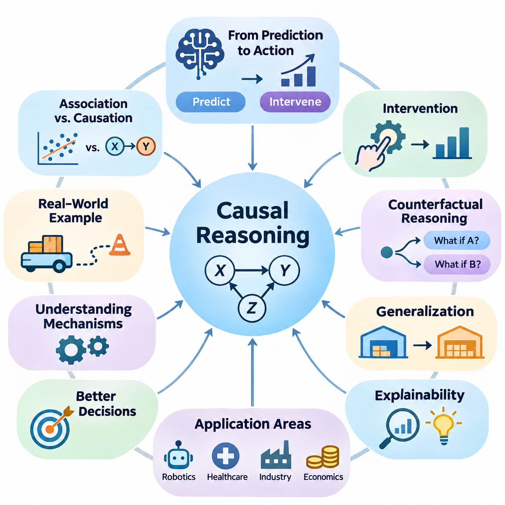
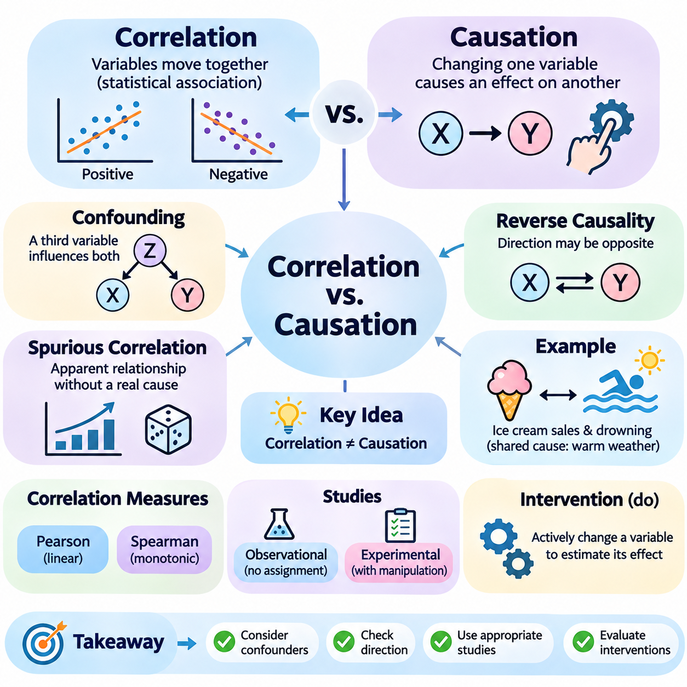
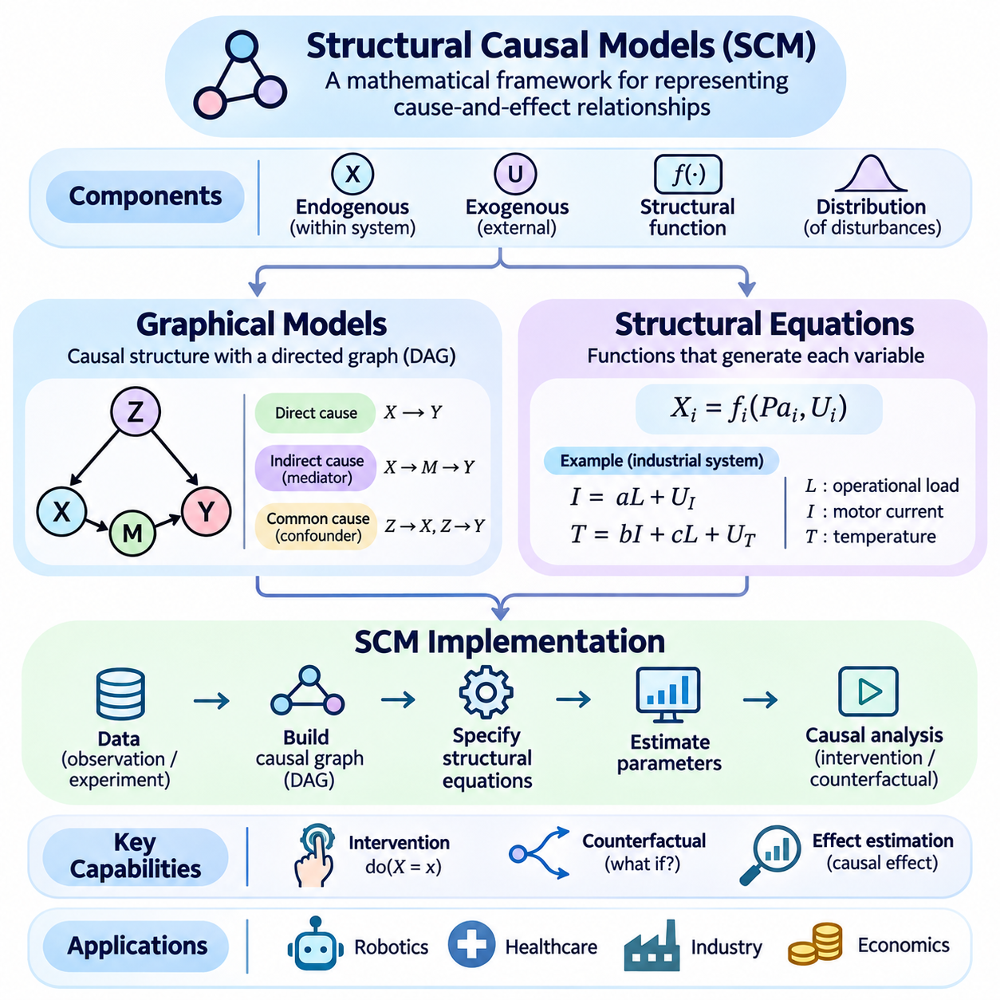
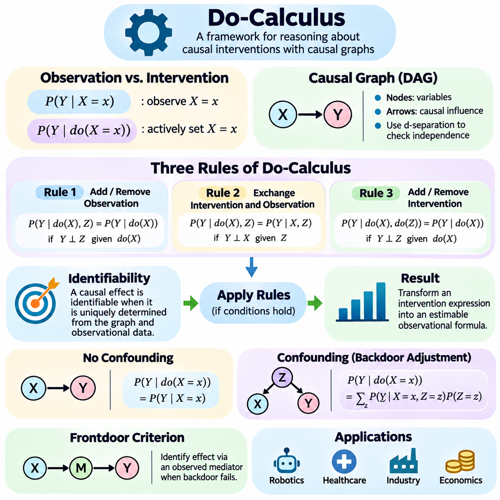
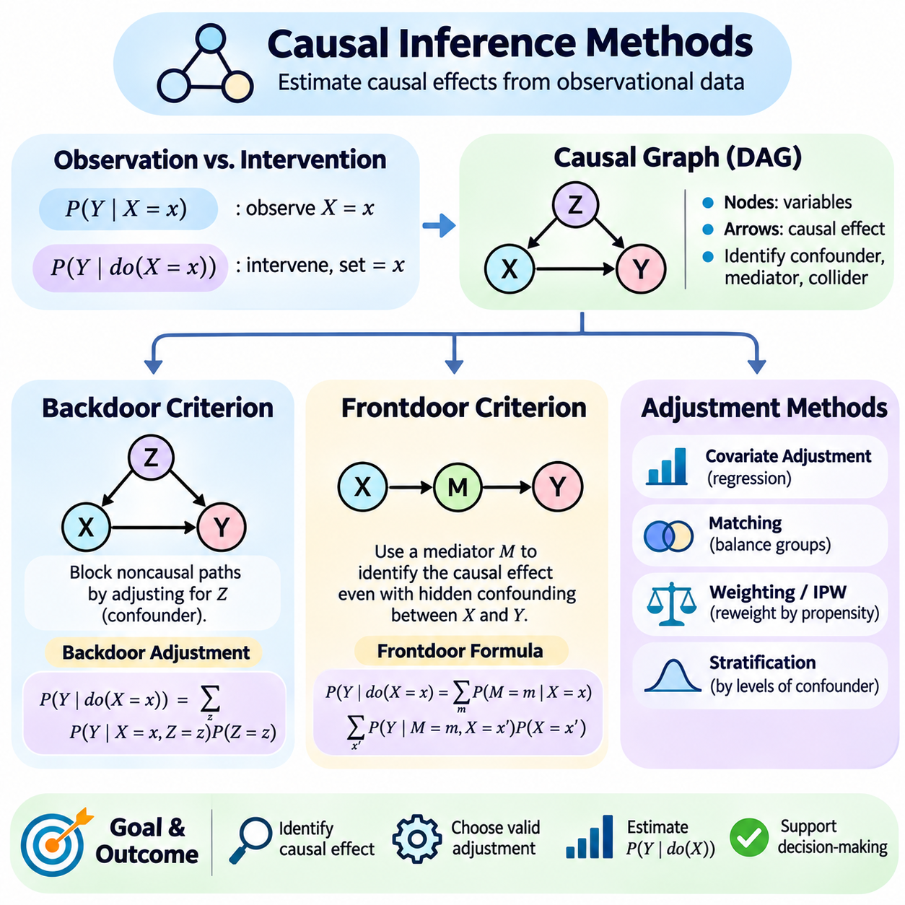
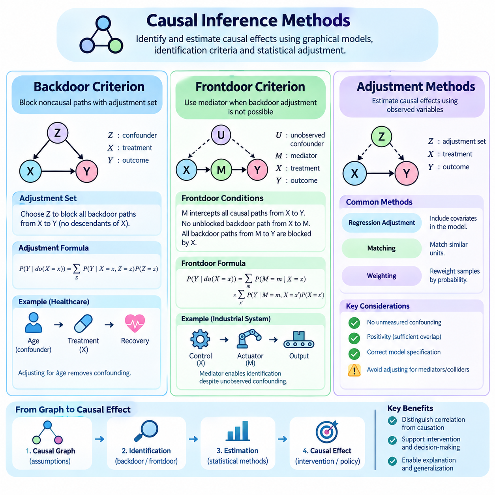
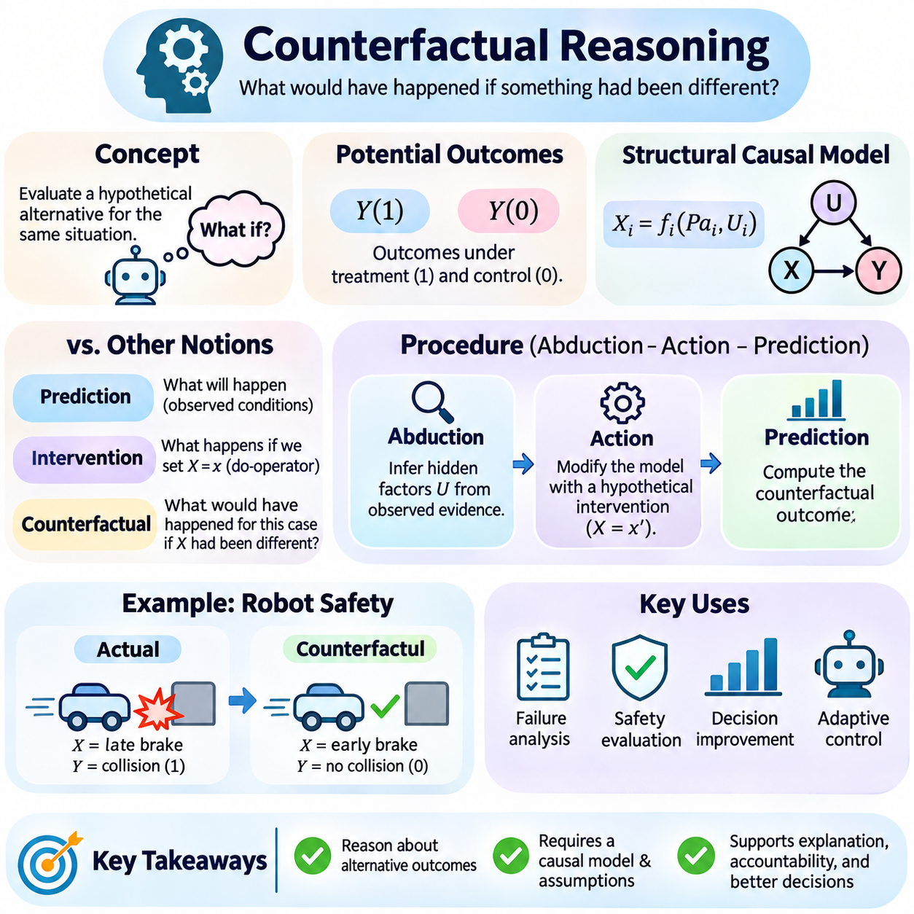
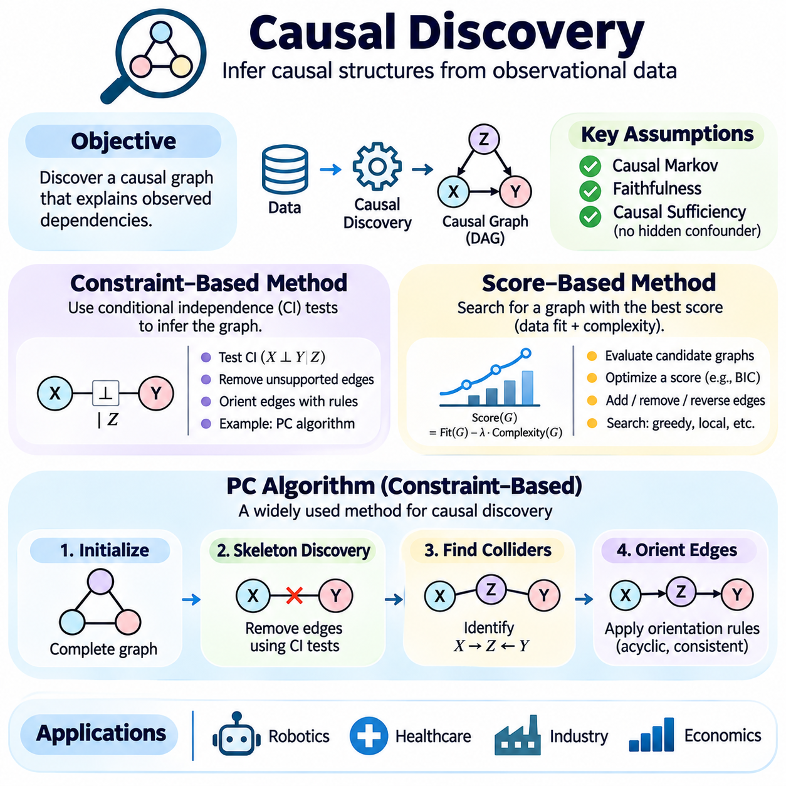
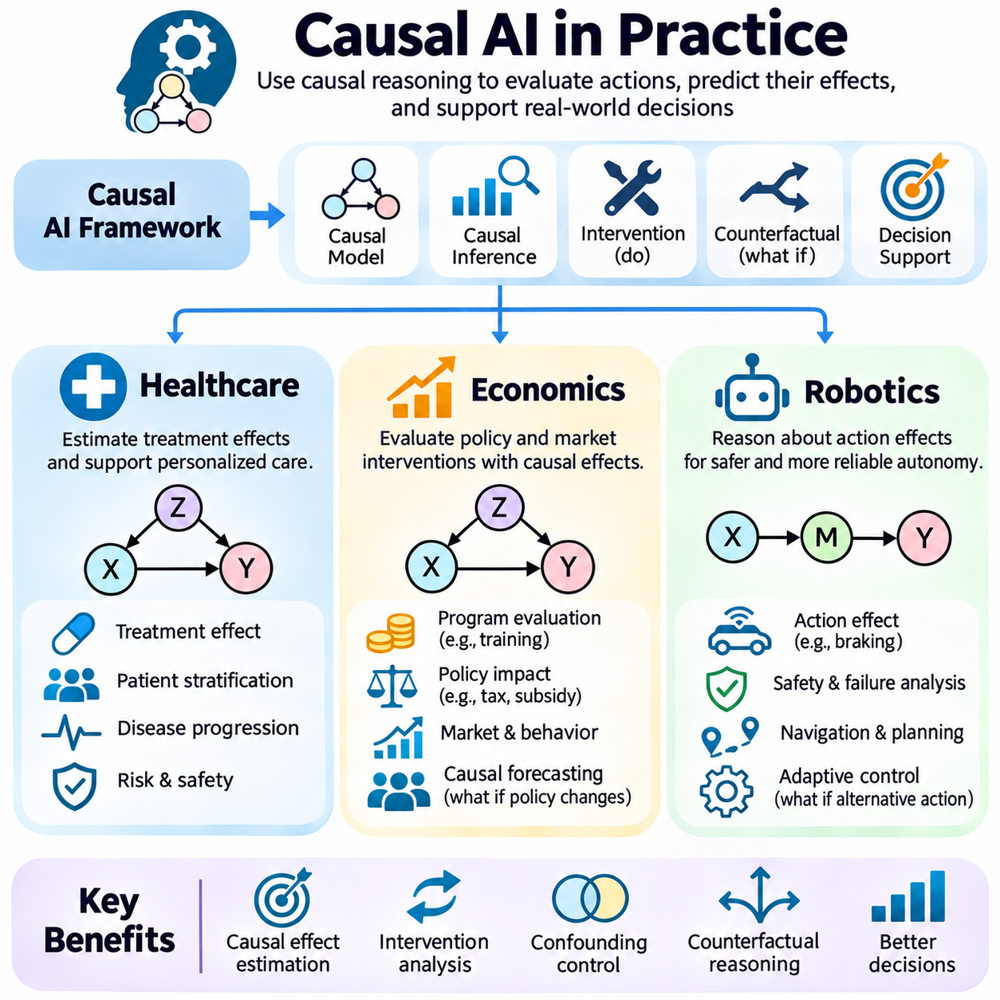
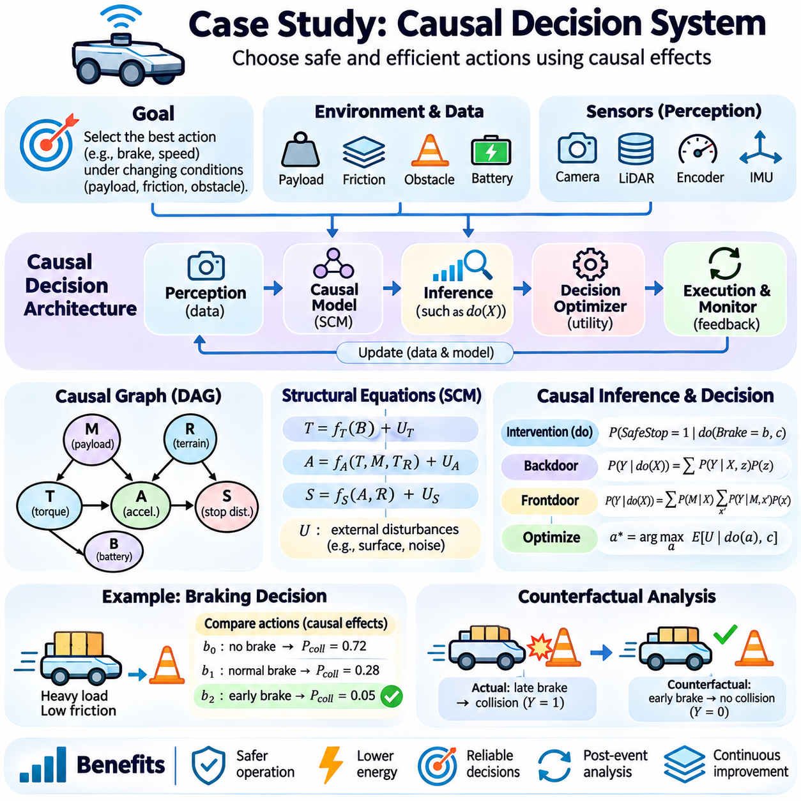

**Volume 03. Reasoning in AI**

# 03. Causal Reasoning

## 03.01 Why Causality Matters

{width="7.268055555555556in" height="7.268055555555556in"}

Causality is a fundamental concept in artificial intelligence because intelligent systems must understand not only what happens but also why events occur. Traditional machine learning identifies statistical patterns in observed data, while causal reasoning investigates the mechanisms that generate those patterns. This distinction enables AI systems to move beyond prediction toward explanation, intervention, and informed decision-making.

Many AI applications depend on relationships that cannot be understood through statistical association alone. A model may discover that two variables frequently change together without determining whether one influences the other. Causal reasoning introduces a framework for distinguishing genuine causal relationships from coincidental patterns, shared influences, and misleading correlations that arise within observational datasets.

The importance of causality becomes particularly evident when an AI system must choose an action rather than merely predict an outcome. Predictive models estimate what is likely to happen under observed conditions, whereas causal models attempt to estimate what would happen if specific conditions were deliberately changed. This capability is essential for autonomous systems, medical decisions, economic planning, and intelligent control.

Consider an autonomous robot operating in a warehouse. Historical observations may indicate that reduced navigation speed is associated with increased obstacle density. However, the robot must understand whether obstacles cause slower movement or whether another factor, such as congestion, influences both variables. Causal reasoning helps distinguish these possibilities and supports more reliable navigation strategies.

Causal reasoning also provides a foundation for understanding interventions. An intervention represents a deliberate modification of a variable within a system, allowing the consequences of that modification to be investigated. Unlike passive observation, intervention focuses on the effects of actively changing system conditions. This distinction is central to determining whether a proposed action will produce the intended result.

For example, an industrial AI system may observe that equipment failures frequently occur when operating temperatures are high. A purely predictive model might use temperature as a warning indicator. A causal model investigates whether temperature contributes directly to failure, whether mechanical friction increases both temperature and failure risk, or whether multiple interacting mechanisms explain the observed relationship.

Understanding these mechanisms improves the effectiveness of corrective actions. If excessive temperature directly contributes to component degradation, improved cooling may reduce failures. If temperature is merely a symptom of mechanical wear, cooling alone may not address the underlying problem. Causal reasoning therefore helps decision systems select interventions that target actual sources of undesirable outcomes.

Another important contribution of causality is its ability to support counterfactual reasoning. Counterfactual questions examine alternative outcomes under hypothetical conditions that differ from what actually occurred. Instead of asking only why a particular event happened, an intelligent system can investigate what might have happened if a different action had been taken, while accounting for the assumptions required by its causal model.

Counterfactual reasoning is especially valuable in evaluating decisions after an event has occurred. An autonomous vehicle involved in an emergency maneuver may need to determine whether an alternative braking strategy could have prevented a collision. Such analysis requires more than recognizing patterns in recorded trajectories because it must estimate the consequences of actions that were not actually performed.

Causal understanding also contributes to generalization across changing environments. Machine learning models frequently perform well when training and deployment data share similar statistical properties. However, performance may deteriorate when environmental conditions, operational procedures, or data distributions change. Causal models can provide more stable representations when the underlying causal mechanisms remain unchanged.

For instance, a robot trained in one warehouse may encounter different lighting conditions, floor materials, and traffic patterns in another facility. A system that relies primarily on superficial visual correlations may struggle with these changes. A system that captures relevant causal relationships between physical actions, environmental properties, and resulting motion may transfer its knowledge more effectively.

This advantage does not imply that causal models automatically generalize to every new environment. Their reliability depends on whether the assumed causal structure remains valid and whether important mechanisms have changed. Nevertheless, explicitly representing causal assumptions allows engineers to investigate which relationships are expected to remain stable and which must be reconsidered during deployment.

Causality is also closely related to explainable artificial intelligence. Many high-capacity models produce accurate predictions without providing a clear account of the mechanisms responsible for their outputs. Causal explanations seek to identify how changing relevant factors would influence an outcome. Such explanations can be more actionable than descriptions of statistical feature importance alone.

In healthcare, a predictive model may identify patients with an elevated probability of developing a particular condition. However, identifying risk does not establish which treatment will improve patient outcomes. Causal inference attempts to estimate treatment effects while accounting for confounding factors, selection mechanisms, and differences between patient populations that may distort observational comparisons.

Similar challenges arise in economics and public policy. An observed relationship between education and income does not by itself establish the effect of additional education on future earnings. Family background, economic opportunities, prior ability, and other variables may influence both. Causal analysis provides methods for evaluating proposed interventions while making the necessary assumptions explicit.

The distinction between observational, interventional, and counterfactual reasoning represents a major conceptual advancement in intelligent decision systems. Observational reasoning examines patterns in available evidence. Interventional reasoning estimates the consequences of deliberate actions. Counterfactual reasoning investigates alternative outcomes for situations that have already occurred, using a specified causal model.

These three forms of reasoning answer different questions and require different kinds of evidence. Observational data can support estimates of statistical dependence, but intervention effects may not be identifiable without additional assumptions or experimental information. Counterfactual conclusions generally require further assumptions about the underlying mechanisms and the circumstances of individual cases.

Causal reasoning is therefore not simply another prediction algorithm. It is a framework for representing assumptions about how variables influence one another and for deriving conclusions under those assumptions. Its mathematical foundations include causal graphical models, structural equations, probability theory, and intervention operators, which together support systematic investigation of cause-and-effect relationships.

Structural causal models provide one important approach to representing these mechanisms. Variables are connected through structural equations that describe how their values are generated from other variables and external influences. By modifying selected equations, researchers can represent interventions and examine how their effects propagate through the modeled system under specified assumptions.

Causal graphs offer another useful representation by expressing hypothesized relationships between variables. Directed edges indicate causal influences, while the overall graph structure helps identify potential confounding pathways and dependencies. These representations make causal assumptions visible and provide a basis for evaluating whether particular causal effects can be estimated from available evidence.

A major challenge is that causal relationships cannot generally be established from observational correlations alone. Different causal structures may generate identical observational distributions, making them difficult or impossible to distinguish without additional information. Controlled experiments, temporal knowledge, domain expertise, natural experiments, and carefully justified assumptions can help address these limitations.

Randomized controlled experiments are particularly valuable because random assignment can reduce systematic differences between treatment groups. However, experimentation may be expensive, unsafe, unethical, or operationally impractical. Causal inference methods therefore investigate when observational data can support credible effect estimates and what assumptions are necessary for those estimates to be interpreted causally.

Confounding is one of the central problems in causal analysis. A confounder influences both a potential cause and its outcome, potentially creating a misleading association. If relevant confounders are not properly addressed, an AI system may incorrectly attribute an observed effect to the wrong variable. Understanding confounding is essential for reliable intervention planning and causal estimation.

Causal reasoning also supports the development of more trustworthy autonomous agents. Agents interact continuously with their environments, taking actions that influence future observations and available choices. By modeling how actions affect environmental states, an agent can evaluate alternative strategies, anticipate unintended consequences, and distinguish controllable factors from external disturbances.

In robotics, this capability connects perception, planning, and control. A mobile robot must understand how wheel commands influence motion, how surface conditions affect traction, and how obstacles constrain feasible trajectories. Causal models can complement probabilistic state estimation and learned dynamics by making assumptions about action-dependent physical relationships explicit.

The relationship between causality and reinforcement learning is particularly significant. Reinforcement learning develops policies through interactions and reward feedback, but conventional approaches do not necessarily recover explicit causal structures. Incorporating causal knowledge may improve exploration, transfer, and planning when the knowledge is accurate and relevant to the environment.

Causal reasoning can also improve failure analysis in complex AI systems. When an unexpected result occurs, engineers must distinguish its immediate symptoms from the mechanisms that produced it. A causal investigation examines how software behavior, sensor measurements, environmental conditions, and control actions interact, helping identify corrective measures that address underlying failure mechanisms.

Despite these advantages, causal modeling introduces substantial challenges. Incorrect assumptions about causal structure can produce misleading conclusions even when the mathematical calculations are internally consistent. Hidden confounders, measurement errors, feedback loops, selection bias, and incomplete knowledge of system dynamics can all undermine the reliability of causal estimates and explanations.

Consequently, causal AI requires careful validation rather than unquestioned acceptance of inferred relationships. Researchers should examine alternative causal structures, test sensitivity to uncertain assumptions, compare predictions against experimental evidence when possible, and monitor whether estimated effects remain reliable as operational conditions change. Causal conclusions must always be interpreted within their identification assumptions.

The broader significance of causality lies in its contribution to intelligent systems that can reason about consequences rather than merely recognize recurring patterns. Prediction remains essential, but autonomous decision-making additionally requires understanding how actions alter the world. Causal reasoning provides a conceptual and mathematical bridge between statistical learning, scientific explanation, and purposeful action.

As artificial intelligence becomes increasingly integrated into robotics, healthcare, industrial automation, and scientific research, the ability to distinguish correlation from causation becomes more important. Systems that combine predictive accuracy with defensible causal knowledge are better positioned to support intervention planning, transparent explanations, and reliable decisions under changing conditions.

Ultimately, causality matters because intelligence involves understanding the consequences of choices. An AI system that can predict an outcome may recognize what is likely to happen, but a system equipped with valid causal knowledge can also evaluate how deliberate actions might change that outcome. This capability forms an essential foundation for more adaptive, accountable, and decision-oriented artificial intelligence.

## 03.02 Correlation vs Causation

{width="7.268055555555556in" height="7.268055555555556in"}

Correlation and causation are fundamental concepts in statistical reasoning and artificial intelligence, but they describe different types of relationships between variables. Correlation indicates that two variables exhibit a statistical association, while causation means that changing one variable produces an effect on another under specified conditions. Understanding this distinction is essential for developing AI systems that support reliable explanations and decisions.

A correlation exists when variations in one variable are statistically associated with variations in another. Positive correlation occurs when both variables tend to increase or decrease together, while negative correlation occurs when one tends to increase as the other decreases. However, correlation does not establish the direction of influence, identify the underlying mechanism, or demonstrate that an intervention will produce a particular outcome.

Causation describes a relationship in which a change to one factor influences another through a causal mechanism. For example, increasing the applied force on an object may change its acceleration when other relevant physical conditions remain controlled. Establishing causation requires more than observing a statistical pattern because alternative explanations, including confounding variables and reverse causality, must be considered.

A common example involves ice cream sales and drowning incidents, which may increase during the same season. Although these variables can be positively correlated, purchasing ice cream does not necessarily cause drowning. Warmer weather encourages swimming and increases demand for ice cream, creating an association through a shared influence. This illustrates how a third variable can explain an observed statistical relationship.

Such third variables are often called confounders when they influence both the exposure and outcome in a causal analysis. Confounding can create an apparent relationship between variables even when no direct causal effect exists. It can also exaggerate, reduce, or reverse an actual causal effect. Identifying relevant confounders is therefore a critical step when interpreting observational data and estimating intervention effects.

Reverse causality presents another challenge because the direction of influence may differ from the interpretation suggested by observed data. For example, a company may find that employee training hours correlate with poor performance. One explanation is that training reduces productivity, but another is that struggling employees receive additional training. Without understanding the direction of influence, management may select an ineffective intervention.

Spurious correlation occurs when variables appear statistically related without a meaningful causal connection. Such relationships can arise through coincidence, shared trends, data selection, or unmeasured influences. In large datasets containing thousands of variables, apparently strong correlations may emerge by chance. AI systems that search extensively for patterns are particularly vulnerable to discovering associations that lack causal significance.

Statistical correlation coefficients quantify the strength and direction of certain associations. Pearson correlation measures linear relationships between numerical variables, while Spearman correlation evaluates monotonic relationships using ranks. These measures are useful for exploratory analysis, but neither determines whether a relationship is causal. A strong coefficient cannot replace evidence about mechanisms, interventions, or alternative explanations.

Correlation coefficients also have limitations when relationships are nonlinear or depend on contextual conditions. Two variables may have a strong nonlinear dependency while exhibiting a Pearson correlation near zero. Conversely, a high correlation may result from shared temporal trends rather than meaningful interaction. Consequently, statistical association should be examined using appropriate methods and interpreted within the underlying data-generating process.

Observational studies investigate relationships without deliberately assigning the conditions experienced by participants or systems. Such studies are common in healthcare, economics, robotics, and industrial monitoring because controlled experimentation may be expensive or impractical. However, observational relationships may reflect confounding, selection effects, or reverse causality, making causal interpretation dependent on additional assumptions and supporting evidence.

Experimental studies provide stronger opportunities to investigate causation by deliberately manipulating a variable and observing the resulting changes. Randomized controlled experiments assign treatments randomly, helping reduce systematic differences between treatment groups. When experiments are properly designed and conducted, differences in outcomes can support causal conclusions, although measurement quality, compliance, and external validity remain important considerations.

Randomization does not eliminate every possible source of error. Small samples may produce imbalanced groups, participants may fail to follow assigned treatments, and measurement procedures may introduce systematic bias. Experimental results may also depend on environmental conditions that differ from real-world deployment. Therefore, causal conclusions require careful attention to experimental design, uncertainty, and the population to which findings are generalized.

Causal reasoning introduces interventions as a conceptual distinction from ordinary observation. Observing that a machine operates at high temperature is different from deliberately increasing its temperature. The observational relationship may reflect operating load or mechanical wear, while an intervention attempts to isolate the consequences of changing temperature itself. This distinction helps clarify why predictive associations cannot automatically be interpreted as causal effects.

In causal inference, the expression P(Y \| X = x) represents an observational conditional probability, while P(Y \| do(X = x)) represents a distribution under an intervention that sets X to a specified value. These quantities can differ because observing a condition does not necessarily reproduce the consequences of actively imposing it. The distinction provides a mathematical foundation for separating association from intervention-based reasoning.

Causal graphical models help represent assumptions about relationships among variables. Directed edges describe hypothesized causal influences, allowing analysts to examine whether an observed association may arise through direct effects, common causes, or indirect pathways. Graphical representations do not automatically prove causation, but they make assumptions explicit and support systematic evaluation of possible explanations.

For example, consider a robot whose battery temperature and motor current increase together during demanding operations. A causal graph might represent operational load as a common influence on both measurements. It might also include heat generation caused by electrical resistance. Distinguishing these mechanisms helps engineers determine whether reducing current, improving cooling, or modifying operating conditions would address overheating.

Selection bias can also create misleading associations when observations are collected from a restricted or systematically selected population. For example, analyzing only machines that have already experienced failures may distort relationships between operating conditions and component quality. Conditioning on certain variables can introduce associations that are absent in the broader population, demonstrating why data collection procedures matter for causal interpretation.

Another important consideration is temporal ordering. Causes generally precede their effects, making time information valuable when evaluating competing explanations. However, temporal precedence alone does not establish causation. Two events may occur sequentially because of a common underlying process, and feedback systems may contain causal influences operating in both directions across different time steps.

In machine learning, predictive performance and causal validity are separate evaluation objectives. A model may accurately predict customer purchases using variables that have no direct causal influence on purchasing decisions. Such features may be useful for forecasting but unreliable for selecting interventions. Changing a predictive feature does not necessarily change the outcome, even when the model assigns that feature substantial importance.

This distinction becomes particularly important when AI models are used for automated decision-making. A predictive system may identify that frequent maintenance is associated with equipment failures. However, machines experiencing early signs of deterioration may receive more maintenance. Reducing maintenance based on the observed association could increase failures rather than prevent them, illustrating the risks of confusing prediction with causation.

Causal inference methods attempt to estimate intervention effects from available evidence. Approaches include randomized experiments, covariate adjustment, matching, instrumental variables, difference-in-differences, and regression discontinuity designs. Each method relies on particular assumptions about data generation, treatment assignment, or system structure. Their validity depends on whether those assumptions are justified in the application.

Covariate adjustment attempts to account for measured confounders by comparing observations under comparable conditions. However, adjusting for every available variable is not necessarily appropriate. Some variables may be consequences of the treatment or common effects of other variables, and conditioning on them can introduce bias. Causal knowledge is therefore necessary when selecting variables for adjustment.

Counterfactual reasoning extends causal analysis by asking what would have happened under an alternative condition. For example, an autonomous vehicle may investigate whether a collision would have occurred if braking had begun earlier. The observed trajectory provides evidence about what actually happened, while the alternative outcome must be estimated using assumptions about vehicle dynamics, environmental conditions, and other relevant factors.

A central difficulty in causal inference is that only one outcome is typically observed for a particular unit under a particular circumstance. A patient either receives a treatment or does not, and a robot executes one action rather than every possible alternative simultaneously. The outcomes of unchosen alternatives remain unobserved, requiring experimental comparisons, statistical assumptions, or structural models for estimation.

Correlation remains extremely valuable despite these limitations. Statistical associations support prediction, anomaly detection, feature selection, exploratory analysis, and hypothesis generation. They can reveal relationships worthy of further investigation and help identify variables relevant to system behavior. The objective of causal reasoning is not to replace correlation but to determine when an association supports conclusions about interventions and mechanisms.

In practical AI engineering, correlation analysis often provides an initial understanding of complex datasets. Engineers may examine relationships among sensor readings, environmental conditions, system commands, and operational outcomes. These observations can guide causal hypotheses, which are subsequently evaluated through domain knowledge, controlled experiments, structural modeling, or appropriate observational inference methods.

The distinction between correlation and causation is especially important for autonomous and physical AI systems because their decisions directly affect real environments. A robot must not assume that modifying a correlated sensor measurement will necessarily change the physical condition being measured. Reliable control requires understanding how actions influence system dynamics and which observed variables represent causes, effects, or indirect indicators.

Ultimately, correlation describes statistical relationships, while causation concerns the consequences of changing conditions through underlying mechanisms. Both are essential components of intelligent reasoning, but they answer different questions. AI systems that recognize this distinction can avoid misleading interpretations, evaluate interventions more carefully, and develop more reliable explanations and decisions across complex real-world environments.

## 03.03 Structural Causal Models

{width="7.268055555555556in" height="7.268055555555556in"}

Structural Causal Models (SCMs) provide a mathematical framework for representing cause-and-effect relationships within complex systems. Unlike conventional statistical models that primarily describe associations, SCMs specify how variables are generated through causal mechanisms. By combining graphical representations, structural equations, and external influences, these models support observational analysis, intervention estimation, and counterfactual reasoning.

An SCM typically consists of endogenous variables, exogenous variables, structural functions, and a probability distribution over external disturbances. Endogenous variables represent quantities determined within the modeled system, while exogenous variables capture influences originating outside its specified mechanisms. Structural functions describe how each endogenous variable depends on its direct causes and relevant external factors.

Graphical models provide an intuitive representation of the causal relationships encoded by an SCM. Variables are represented as nodes, and directed edges indicate hypothesized causal influences. A directed edge from X to Y expresses the assumption that X directly influences the mechanism generating Y. The graph therefore represents more than statistical dependence because its direction and structure encode causal assumptions.

Directed Acyclic Graphs (DAGs) are commonly used to represent recursive causal models without directed feedback cycles. Their structure allows variables to be ordered so that causes precede their descendants within the model. This ordering supports systematic simulation and probabilistic factorization. Systems containing feedback may require time-indexed variables or more general cyclic structural models.

A graphical model can distinguish direct causes, indirect causes, and common causes. If X influences M and M subsequently influences Y, then M represents a mediator along an indirect causal pathway. If Z influences both X and Y, it may act as a confounder when estimating the effect of X on Y. These distinctions are essential for selecting appropriate causal adjustment strategies.

Graphical representations also support the analysis of conditional independence. In a DAG, d-separation provides a graphical criterion for determining independence relationships implied by the graph under the causal Markov assumption. Such relationships can help evaluate model compatibility with observed data, although observational independence alone generally cannot establish a unique causal direction.

Structural equations provide the mathematical foundation underlying causal graphs. Each endogenous variable is expressed as a function of its parent variables and an exogenous disturbance. A general equation can be written as X_i = f_i(Pa_i, U_i), where Pa_i denotes the direct causes of X_i and U_i represents external influences. The functions may be linear, nonlinear, deterministic, or stochastic through their disturbances.

Consider a simplified industrial system containing operational load, motor current, and component temperature. Operational load may influence motor current, while both load and current may affect temperature. Structural equations can represent these mechanisms using physical relationships or learned functions. External disturbances may capture unmeasured environmental conditions, manufacturing differences, and sensor uncertainty.

For example, motor current might be modeled as I = aL + U_I, where L represents operational load and a describes its influence. Temperature might be modeled as T = bI + cL + U_T, where b and c represent causal coefficients. These equations illustrate how multiple mechanisms can contribute to an observed outcome, although their validity depends on the assumptions and evidence supporting the model.

The probabilistic behavior of an SCM arises from the distribution of its exogenous variables. Even when structural functions are deterministic, uncertainty in external disturbances produces variability in observable outcomes. Dependencies among exogenous variables may represent shared unobserved influences. Consequently, assumptions about disturbance independence are important when interpreting graphical structures and estimating causal effects.

One of the most important capabilities of SCMs is representing interventions. An intervention replaces the structural equation of a selected variable with an externally specified value or mechanism. The do-operator expresses this operation mathematically. Setting X to x through do(X = x) removes the original mechanism determining X while preserving the remaining structural relationships, subject to the model\'s assumptions.

This intervention differs fundamentally from conditioning on an observed value. Observing that motor current is high may provide information about operational load or mechanical resistance. Deliberately setting motor current to a specified value changes the system through an external action. The resulting temperature distribution may therefore differ from the distribution observed among naturally occurring high-current conditions.

SCMs also provide a framework for counterfactual reasoning. A counterfactual asks what would have happened under a different intervention while considering evidence from an actual observed situation. A common procedure involves inferring relevant exogenous disturbances from observations, modifying the structural model through an intervention, and predicting the alternative outcome using the updated mechanisms.

For example, an engineer may investigate whether an overheating event would have been avoided if operational load had been reduced. The SCM uses observed operating conditions to infer relevant disturbances, then evaluates temperature under the hypothetical lower load. Such analysis depends on the correctness of the structural equations and on assumptions about disturbances that may not be fully identifiable from observations.

Implementing an SCM begins with defining the variables, causal assumptions, and intended reasoning tasks. Engineers identify observable quantities, possible external influences, and hypothesized directional relationships. Domain knowledge, physical principles, experimental evidence, and temporal information can guide this process. The resulting causal graph should explicitly represent the assumptions used for subsequent calculations.

The next implementation stage involves specifying structural functions for each endogenous variable. Simple applications may use linear equations, while complex systems may require nonlinear functions, neural networks, or physics-based models. Parameters can be estimated from suitable observational or experimental data when identification conditions hold. Flexible function approximation does not eliminate the need for justified causal assumptions.

A practical implementation can represent variables and their parent relationships using a graph data structure. Each node stores its structural function and relevant disturbance information. For an acyclic model, simulation proceeds in topological order, generating parent variables before evaluating their descendants. Repeated sampling of exogenous disturbances produces synthetic observations consistent with the specified model.

Intervention simulation requires modifying the structural mechanism associated with the targeted variable. Instead of evaluating its original equation, the implementation assigns the intervention value and propagates its consequences through downstream equations. Comparing outcome distributions across intervention scenarios enables estimation of causal effects within the assumed model, including average treatment effects and conditional effects.

Counterfactual implementation requires additional attention because it concerns the same underlying unit under alternative conditions. The system must infer or characterize exogenous disturbances compatible with observed evidence, retain those disturbances across hypothetical scenarios, and recompute outcomes after intervention. When disturbances are not uniquely determined, counterfactual results may require probabilistic inference rather than a single deterministic estimate.

SCM implementations can be developed using Python libraries for numerical computation, probabilistic modeling, and graph analysis. NumPy can support structural calculations, NetworkX can represent causal graphs, and specialized causal inference libraries can assist with identification and estimation. However, software tools automate mathematical operations rather than independently verifying whether the specified causal assumptions are correct.

Model validation should examine both observational compatibility and causal credibility. Engineers can compare simulated distributions with empirical measurements, evaluate conditional independence implications, and test predictions against controlled interventions when available. Sensitivity analysis can investigate how conclusions change under alternative structures, uncertain parameters, or possible hidden confounding.

An important limitation is causal identifiability. Different SCMs may generate the same observational distribution while implying different intervention effects or counterfactual outcomes. Consequently, fitting structural equations accurately to observed data does not guarantee that the underlying causal mechanisms have been recovered. Additional experiments, domain constraints, or identification assumptions may be necessary.

In robotics, SCMs can represent relationships among actuator commands, environmental conditions, sensor measurements, and physical motion. A mobile robot may model how motor torque affects wheel rotation, how surface friction influences traction, and how these mechanisms determine displacement. Such models can support intervention analysis, fault diagnosis, and evaluation of alternative control strategies.

SCMs are also useful in healthcare, economics, and industrial automation because they connect observed outcomes with explicit assumptions about their generating mechanisms. Healthcare applications may estimate treatment effects, economic applications may evaluate policy interventions, and industrial systems may investigate failure causes. Each domain requires careful consideration of confounding, measurement limitations, and the validity of structural assumptions.

The integration of SCMs with machine learning creates opportunities for combining flexible predictive models with explicit causal structure. Neural networks may approximate complex structural functions, while causal graphs constrain how information and interventions propagate. This combination can support model-based reasoning and adaptation, but reliable causal interpretation still requires assumptions that cannot generally be learned from predictive accuracy alone.

Ultimately, Structural Causal Models establish a unified framework connecting graphical models, structural equations, interventions, and counterfactual reasoning. Their central contribution is the explicit representation of how variables are generated and how outcomes may change when mechanisms are modified. When carefully constructed and validated, SCMs provide a powerful foundation for explainable, intervention-aware, and decision-oriented artificial intelligence.

## 03.04 Do Calculus

{width="7.268055555555556in" height="7.268055555555556in"}

Do-calculus is a mathematical framework for reasoning about causal interventions using graphical causal models. Developed within the theory of causal inference, it provides formal rules for transforming expressions involving interventions into expressions that may be estimated from observational data. Its central purpose is to determine when causal effects can be identified from available information under explicitly stated assumptions about causal structure.

Traditional probability theory describes relationships among observed variables through conditional distributions. However, observing that a variable takes a particular value differs from actively forcing it to that value. Do-calculus formalizes this distinction through the do-operator, which represents an external intervention that modifies the mechanism generating a selected variable while leaving other structural mechanisms unchanged.

The expression P(Y \| X = x) describes the distribution of Y among observations where X equals x. In contrast, P(Y \| do(X = x)) describes the distribution of Y when X is deliberately set to x. These expressions may differ because observational conditioning preserves the original data-generating process, whereas intervention replaces the mechanism determining X and changes the relevant causal relationships.

Do-calculus operates on causal graphical models, particularly directed acyclic graphs representing hypothesized causal mechanisms. Nodes correspond to variables, while directed edges encode causal influences. Graph structure determines which conditional independence relationships hold under specific interventions. These graphical properties provide the foundation for deciding whether observational and interventional expressions can be transformed into one another.

The mathematical foundation of do-calculus consists of three transformation rules involving observations, interventions, and conditional independence. Each rule specifies conditions under which an expression can be modified without changing its causal meaning. These conditions are evaluated using d-separation in appropriately modified causal graphs, allowing causal identification to be expressed as a systematic mathematical procedure.

The first rule permits the insertion or deletion of an observation when that observation provides no additional information about the outcome under the relevant intervention and conditioning context. This rule relies on conditional independence in a graph where incoming edges to intervened variables have been removed. It helps simplify causal expressions by eliminating observational conditions that are irrelevant to the target distribution.

The second rule permits exchanging an intervention with an observation when specific graphical independence conditions are satisfied. This transformation is important because observational quantities are often easier to estimate than experimental intervention distributions. The rule does not claim that observing and intervening are generally equivalent; equivalence holds only when the required graphical conditions are satisfied.

The third rule permits inserting or deleting an intervention when the intervention has no effect on the target distribution under the specified conditions. Its graphical test uses a modified graph that accounts for interventions and the relevant conditioning variables. This rule can eliminate unnecessary intervention operators and is essential for deriving causal effects from observational distributions.

Together, the three rules provide a formal mechanism for manipulating causal expressions. Their application may transform a target intervention distribution into a formula containing only observational probabilities. When such a transformation is possible using the available assumptions and data, the causal effect is identifiable. When it is not possible, additional assumptions, measurements, or experimental information may be required.

Causal identifiability is a central concept underlying do-calculus. A causal effect is identifiable when all causal models compatible with the assumed graph and observational distribution imply the same intervention effect. Identifiability concerns whether the target effect is uniquely determined by the available information, rather than whether a particular statistical estimator can calculate it accurately from a finite sample.

A simple causal graph containing X as a cause of Y without confounding illustrates the basic principle. If no open backdoor paths connect X and Y, the intervention distribution may equal the observational conditional distribution. Under the relevant causal assumptions, P(Y \| do(X = x)) can then be identified using P(Y \| X = x), provided the required probabilities are defined.

Confounding makes causal identification more challenging. Suppose Z influences both X and Y, creating a backdoor path between the treatment and outcome. The observational association between X and Y may then include the influence of Z. If Z is observed and satisfies the appropriate adjustment conditions, the causal effect can be identified by averaging conditional outcome distributions over the distribution of Z.

The resulting adjustment formula can be expressed as P(Y \| do(X = x)) = sum_z P(Y \| X = x, Z = z)P(Z = z). This formula is valid under appropriate causal assumptions, including a sufficient adjustment set and the required positivity conditions. It demonstrates how causal effects may be recovered from observational probabilities without directly performing the intervention.

Not every causal identification problem can be solved through ordinary confounder adjustment. Some systems contain unobserved common causes that prevent direct backdoor adjustment. In certain graphical structures, the frontdoor criterion provides an alternative route to identification by using an observed mediator between treatment and outcome, together with specific assumptions about confounding pathways.

For example, suppose X influences mediator M, which subsequently influences outcome Y. If the frontdoor conditions hold, the causal effect of X on Y may be identifiable even when X and Y share an unobserved confounder. The derivation combines intervention transformations and observational distributions, illustrating how do-calculus extends beyond straightforward conditioning on measured confounders.

The frontdoor example demonstrates why causal graphs are essential. Statistical associations alone cannot determine whether a mediator provides a valid identification pathway. The graphical structure must establish that the relevant causal paths are intercepted and that specified backdoor paths satisfy the required conditions. Incorrect assumptions about these relationships can produce invalid causal estimates.

Do-calculus also provides a foundation for automated causal identification algorithms. Such algorithms analyze graphical structures and recursively apply identification principles to derive expressions for intervention distributions. The ID algorithm is a prominent example for identifying causal effects in appropriate graphical models, including models representing certain latent confounding structures.

The relationship between do-calculus and structural causal models is particularly important. Structural causal models specify how variables are generated through functions of their direct causes and external disturbances. Interventions modify these functions, while do-calculus provides rules for reasoning about the resulting probability distributions. The two approaches therefore connect mechanistic causal modeling with formal probabilistic identification.

In practical applications, do-calculus separates causal identification from statistical estimation. Identification determines whether a causal quantity can be expressed using available distributions. Estimation then uses data and statistical methods to approximate that expression. A mathematically identifiable effect may still be difficult to estimate because of limited samples, measurement errors, model misspecification, or weak data coverage.

Positivity is another important consideration when applying identified formulas. If certain treatment values never occur within relevant combinations of observed variables, the required conditional distributions may not be estimable from the available data. Consequently, graphical identifiability alone does not guarantee reliable numerical estimation in a particular dataset or operational environment.

Do-calculus is especially relevant to healthcare, where treatment decisions often depend on observational evidence. A medical AI system may need to estimate whether a treatment improves outcomes despite differences in patient characteristics. Causal graphs can represent treatment assignment, disease severity, and recovery mechanisms, while do-calculus helps determine whether treatment effects are identifiable under the assumed relationships.

In economics, do-calculus can support reasoning about interventions involving pricing, employment, education, and policy decisions. Observed associations may reflect confounding influences or indirect mechanisms. By representing hypothesized causal structures explicitly, analysts can investigate which intervention effects are recoverable from observational distributions and which require additional experimental or institutional information.

Robotics provides another important application because autonomous agents continually intervene in physical environments. A robot may need to determine how motor commands affect motion while accounting for surface friction, payload, and environmental disturbances. Do-calculus can clarify whether causal effects of control actions can be inferred from recorded operating data under an assumed causal model.

For example, a mobile robot may observe a relationship between motor current and travel speed. However, operational load and terrain conditions may influence both variables. A causal graph can represent these mechanisms, and do-calculus can help determine whether adjusting for measured environmental factors identifies the effect of a controlled change in motor current on resulting motion.

The reliability of do-calculus depends on the correctness of the assumed causal graph. Its rules are mathematically valid under their stated graphical conditions, but an incorrect graph may produce misleading conclusions. Hidden confounders, omitted variables, feedback mechanisms, and measurement errors can undermine the assumptions required for identification. Domain expertise and experimental validation therefore remain essential.

Do-calculus does not automatically discover causal relationships from raw data. Instead, it reasons about causal effects given a suitable causal model and available probability distributions. Causal discovery methods may help propose graphical structures, but their outputs require scrutiny. Separating structure discovery, causal identification, and effect estimation is important for developing transparent and reliable causal AI systems.

Ultimately, do-calculus provides a rigorous mathematical bridge between observation and intervention. By applying graphical independence conditions and formal transformation rules, it establishes when causal effects can be identified from available evidence. Its significance extends beyond statistical prediction because it enables AI systems to reason systematically about the consequences of actions, supporting more explainable and intervention-aware decision-making.

## 03.05 Causal Inference Methods

{width="7.268055555555556in" height="7.268055555555556in"}

{width="7.268055555555556in" height="7.268055555555556in"}

Causal inference methods provide systematic approaches for estimating how interventions influence outcomes when direct experimentation is limited or unavailable. Unlike conventional statistical analysis, which focuses on observed associations, causal inference seeks to distinguish genuine causal effects from relationships produced by confounding and selection mechanisms. The backdoor criterion, frontdoor criterion, and adjustment methods form essential components of this framework.

The foundation of causal inference is the distinction between observational and interventional distributions. Observational probabilities describe relationships found in collected data, while interventional probabilities describe outcomes under deliberate changes to a variable. Estimating P(Y \| do(X = x)) from observational information requires assumptions about causal structure, measurement quality, and the mechanisms generating the variables.

Directed acyclic graphs provide a graphical representation of these assumptions. Nodes represent variables, and directed edges indicate hypothesized causal influences. A causal graph helps identify confounders, mediators, colliders, and alternative pathways connecting treatment and outcome variables. These relationships determine which variables should be adjusted for and whether the desired causal effect is identifiable.

The backdoor criterion identifies sets of variables that can block noncausal paths between a treatment X and an outcome Y. A backdoor path begins with an arrow entering X and may create statistical association unrelated to the causal effect of X on Y. A valid backdoor adjustment set blocks every such path without including descendants of X, under the classical backdoor criterion.

Consider a healthcare example where patient age influences both treatment selection and recovery outcomes. Age creates a backdoor pathway between treatment and recovery because it affects both variables. Comparing treated and untreated patients without accounting for age may produce a misleading estimate. Adjusting for age can remove this source of confounding when the relevant causal assumptions are satisfied.

The backdoor adjustment formula expresses the intervention distribution as P(Y \| do(X = x)) = sum_z P(Y \| X = x, Z = z)P(Z = z). Here, Z represents a valid adjustment set, and the summation averages conditional outcomes across the population distribution of Z. For continuous variables, integration replaces summation. The formula also requires appropriate positivity and consistency assumptions.

Selecting an adjustment set requires understanding the causal roles of candidate variables. Confounders generally require control when they open noncausal paths, but mediators and colliders require different treatment. Conditioning on a mediator can remove part of the total causal effect, while conditioning on a collider can introduce spurious associations. Therefore, adjusting for every available variable is not necessarily valid.

A collider occurs when two variables independently influence a common effect, such as X causing Z while Y also causes Z. Without conditioning, the path through Z is blocked under the usual graphical assumptions. Conditioning on Z or certain descendants can open the path and create an artificial association between X and Y. This phenomenon demonstrates why causal graphs are necessary for principled adjustment decisions.

The backdoor criterion is powerful but cannot resolve every identification problem. If an unobserved variable influences both treatment and outcome, the relevant backdoor path may remain open despite adjustment for measured variables. In such cases, ordinary covariate adjustment may be insufficient, and alternative identification strategies or additional information may be required.

The frontdoor criterion provides an alternative identification strategy when a mediator captures the causal influence of treatment on outcome. Consider a structure in which X influences mediator M, and M subsequently influences Y. Under specific graphical conditions, the mediator can enable identification of the total causal effect even when an unobserved confounder affects both X and Y.

The classical frontdoor criterion requires that M intercept every directed causal path from X to Y. It also requires no unblocked backdoor path from X to M and that all backdoor paths from M to Y are blocked by X. These conditions ensure that the relevant causal relationships can be recovered through observational quantities despite certain forms of hidden confounding.

Under the frontdoor assumptions, the intervention distribution can be identified through P(Y \| do(X = x)) = sum_m P(M = m \| X = x) sum_x\' P(Y \| M = m, X = x\')P(X = x\'). This expression combines the observed relationship between treatment and mediator with the adjusted relationship between mediator and outcome. Its validity depends on the specified graph and suitable probability support.

A practical example involves an industrial controller, an intermediate actuator response, and a final system outcome. The controller command influences actuator behavior, which subsequently affects mechanical motion. If all directed effects pass through the measured actuator response and the required frontdoor conditions hold, the causal effect of the command may be identifiable despite certain unobserved influences.

The frontdoor criterion has important limitations. It requires a suitable observed mediator and strong assumptions about the pathways connecting treatment, mediator, and outcome. Direct causal effects bypassing the mediator can invalidate the classical criterion. Measurement errors in the mediator and unrecognized confounding can also undermine identification, making domain knowledge essential.

Adjustment methods translate identification assumptions into practical statistical procedures. Regression adjustment estimates outcome relationships conditional on treatment and covariates. Standardization then averages predicted outcomes over a target population. When the adjustment set is causally valid and the outcome model is correctly specified, this approach can estimate intervention effects from observational data.

Matching methods attempt to compare treated and untreated observations with similar measured characteristics. Exact matching, nearest-neighbor matching, and propensity-score matching are common approaches. These methods seek to improve comparability between groups, but matching does not eliminate unmeasured confounding and may introduce additional uncertainty when suitable comparison observations are scarce.

Propensity scores represent the probability of receiving a treatment conditional on observed covariates. They can support matching, stratification, weighting, and diagnostic assessment of treatment-group overlap. Under conditional exchangeability and positivity, appropriate propensity-score methods can help estimate causal effects. However, predictive accuracy of a treatment-assignment model does not guarantee causal validity.

Inverse probability weighting assigns observations weights based on their estimated treatment probabilities. The objective is to construct a weighted population in which measured confounders are balanced across treatment groups. Extreme weights can arise when treatment probabilities approach zero or one, increasing estimation variance. Weight stabilization, trimming, and overlap diagnostics may improve practical reliability.

Doubly robust estimators combine outcome regression with treatment-assignment modeling. Under suitable identification conditions, certain estimators remain consistent if either the outcome model or propensity model is correctly specified, even when the other is misspecified. Examples include augmented inverse probability weighting and targeted maximum likelihood estimation, although both still require valid causal assumptions.

Choosing among adjustment methods depends on the causal graph, data characteristics, treatment type, and target estimand. Average treatment effects describe population-level intervention consequences, while conditional treatment effects characterize variation across subgroups. Different methods may target different populations or require different assumptions. The estimand should therefore be defined before selecting an estimator.

Causal inference also requires careful consideration of positivity, consistency, and exchangeability. Positivity requires sufficient treatment variation across relevant covariate combinations. Consistency connects observed outcomes with the corresponding potential outcomes under received treatments. Exchangeability requires that treatment assignment be independent of relevant potential outcomes after appropriate adjustment.

Sensitivity analysis evaluates how conclusions might change when assumptions are violated. Analysts can investigate unmeasured confounding, alternative adjustment sets, model misspecification, and limited overlap. Such analyses do not automatically prove causal validity, but they reveal how strongly conclusions depend on uncertain assumptions and help communicate the limitations of estimated intervention effects.

In robotics, causal inference methods can support evaluation of control policies, sensor configurations, and environmental interventions. A robot may observe that higher motor current is associated with reduced travel speed, but payload and terrain conditions may influence both variables. A valid adjustment strategy can help distinguish the effect of an intervention from associations produced by operational conditions.

Industrial AI systems can apply similar reasoning to predictive maintenance and process optimization. Equipment receiving frequent maintenance may exhibit higher failure rates because deteriorating machines require additional attention. Causal analysis can account for relevant pre-maintenance conditions and estimate whether maintenance actually reduces failures, avoiding decisions based solely on misleading observational correlations.

The integration of causal inference with machine learning enables flexible estimation of complex relationships while preserving explicit identification requirements. Neural networks and ensemble models may estimate outcome regressions or propensity scores, while causal graphs determine which variables and relationships are appropriate. Cross-fitting and orthogonal estimation can reduce certain statistical biases, but cannot repair incorrect causal assumptions.

Ultimately, the backdoor criterion, frontdoor criterion, and adjustment methods provide complementary tools for translating causal assumptions into estimable quantities. Their effectiveness depends on valid graphical structures, sufficient observational information, and careful statistical implementation. Together, they support AI systems that move beyond correlation toward principled evaluation of interventions, policies, and real-world decisions.

## 03.06 Counterfactual Reasoning [w/Code]

{width="7.268055555555556in" height="7.268055555555556in"}

Counterfactual reasoning is a fundamental component of causal intelligence that examines what would have happened if circumstances or actions had been different. Unlike conventional prediction, which estimates outcomes under observed conditions, counterfactual reasoning evaluates hypothetical alternatives to actual events. It enables artificial intelligence systems to analyze decisions, explain failures, assess responsibility, and improve future actions through causal understanding.

A counterfactual question compares an observed outcome with an alternative outcome that did not occur. For example, an autonomous robot may ask whether a collision would have been avoided if braking had started earlier. The actual trajectory provides evidence about the observed event, while the hypothetical trajectory requires a causal model of motion, control actions, environmental conditions, and relevant uncertainties.

Counterfactual reasoning differs from ordinary statistical association because it concerns alternative outcomes for the same underlying situation. Observing that robots with lower speeds experience fewer collisions does not establish what would have happened to a particular robot under a different speed. Counterfactual analysis requires assumptions connecting observed evidence with the consequences of hypothetical interventions.

The potential outcomes framework represents counterfactuals through variables such as Y(1) and Y(0), describing outcomes under two alternative treatments. For an individual unit, only the outcome corresponding to the treatment actually received is observed. The other outcome remains counterfactual. This fundamental limitation creates the problem of causal inference and motivates statistical identification assumptions.

Individual treatment effects can be expressed as Y(1) − Y(0), representing the difference between two potential outcomes for the same unit. However, this quantity is generally not directly observable because both outcomes cannot be realized simultaneously. Population-level effects, including average treatment effects, can sometimes be identified through randomized experiments or observational methods under appropriate assumptions.

Structural Causal Models provide another foundation for counterfactual reasoning by representing variables as functions of their direct causes and exogenous disturbances. These models describe how observed outcomes arise from underlying mechanisms. Counterfactual analysis modifies selected mechanisms while preserving relevant background conditions, allowing hypothetical outcomes to be evaluated within a consistent causal representation.

A common counterfactual procedure consists of abduction, action, and prediction. Abduction infers the external disturbances compatible with observed evidence. Action modifies the structural model by introducing a hypothetical intervention. Prediction evaluates the modified model using the inferred disturbances, producing an estimate or probability distribution for the alternative outcome.

During abduction, observed measurements constrain the possible hidden factors that generated an event. For example, a robot\'s measured acceleration and wheel speed may provide information about traction and external disturbances. If the evidence does not uniquely determine these factors, the model must represent uncertainty through a posterior distribution rather than assume a single hidden state.

The action stage replaces the structural equation associated with the hypothetical intervention. If the question concerns earlier braking, the original braking command is replaced by an alternative control action. Other structural mechanisms remain unchanged unless the intervention explicitly modifies them. This separation preserves the distinction between changing a decision and changing unrelated environmental conditions.

Prediction evaluates the consequences of the hypothetical action through the modified causal model. A vehicle dynamics model may estimate the resulting speed, stopping distance, and collision outcome under the alternative braking command. Repeated simulation over plausible external disturbances produces a counterfactual outcome distribution, reflecting uncertainty about the actual event and model parameters.

Counterfactual reasoning can be expressed using notation such as Y_x(u), representing the outcome Y under intervention X = x for a unit characterized by background factors u. Conditional counterfactual probabilities, such as P(Y_x = y \| E = e), incorporate observed evidence E = e. These expressions distinguish individualized hypothetical reasoning from population-level intervention distributions.

An important distinction exists between intervention reasoning and counterfactual reasoning. Intervention analysis estimates outcomes when a variable is externally set across a population or system. Counterfactual analysis additionally conditions on evidence about an actual situation and asks what an alternative action would have produced for that situation. The latter therefore requires stronger assumptions about structural mechanisms and background disturbances.

Counterfactual reasoning is closely related to causal explanation. A system may identify an action as a contributing cause when changing that action under an appropriate hypothetical scenario changes the outcome. However, causal attribution can become complex when several factors interact, when multiple causes are sufficient, or when the outcome would occur through an alternative pathway.

In robotics, counterfactual reasoning supports failure analysis, safety evaluation, and adaptive control. After a navigation failure, an autonomous mobile robot may evaluate whether a different route, reduced speed, or earlier obstacle detection would have prevented the event. Such analysis can identify weaknesses in perception, planning, or control without requiring the original hazardous situation to be repeated physically.

Counterfactual simulation is particularly useful when real-world experimentation would be expensive or unsafe. Digital twins and physics-based simulators can reproduce relevant system conditions and evaluate alternative actions. Nevertheless, simulated counterfactuals depend on the fidelity of the environment model, sensor assumptions, actuator dynamics, and contact physics, making validation against real observations essential.

In reinforcement learning, counterfactual reasoning can support policy evaluation and decision improvement. An agent may compare the observed reward from an executed action with estimated rewards from alternative actions under the same inferred environment state. Model-based approaches can simulate hypothetical transitions, although reliable comparisons require accurate transition models and appropriate treatment of hidden environmental factors.

Counterfactual reasoning also contributes to explainable artificial intelligence by examining which input changes would alter a model\'s prediction. For example, a classification system may identify a minimal feature modification that changes its output. However, such counterfactual explanations are not necessarily causal unless the proposed feature changes are feasible and consistent with the underlying data-generating mechanisms.

Causal counterfactual explanations should distinguish actionable variables from immutable or indirectly determined characteristics. Changing a variable in isolation may produce an unrealistic hypothetical instance if that variable depends on other factors. Structural constraints help ensure that proposed alternatives correspond to plausible interventions rather than arbitrary modifications of correlated features.

Healthcare applications use counterfactual reasoning to investigate treatment decisions and alternative patient outcomes. A clinician may ask whether a patient would have recovered under a different therapy. Such questions require careful consideration of patient characteristics, treatment assignment, disease mechanisms, and unmeasured influences. Individual counterfactual conclusions often remain uncertain even when population treatment effects are identifiable.

In economics and public policy, counterfactual analysis evaluates outcomes under policies that were not implemented. Researchers may investigate how employment, income, or economic growth would have changed under alternative regulations. Because only the implemented policy is observed in a particular historical context, credible conclusions require identification strategies, comparison groups, structural assumptions, or validated simulation models.

Counterfactual fairness applies causal reasoning to decisions involving sensitive attributes and their downstream effects. A decision may be considered counterfactually fair under a specified model if its outcome remains appropriately invariant when a protected attribute is hypothetically changed while relevant background factors are held consistent. Such assessments depend strongly on the chosen causal model and the fairness definition.

A major challenge is counterfactual identifiability. Different structural causal models may agree on all observed data and even certain intervention distributions while producing different counterfactual predictions. Therefore, observational accuracy alone cannot establish the correctness of individualized hypothetical outcomes. Additional experimental evidence, structural assumptions, or domain knowledge may be necessary.

Implementation typically begins by specifying a causal graph, structural equations, disturbance distributions, and observed evidence. The system then performs inference over hidden disturbances, applies a hypothetical intervention, and simulates alternative outcomes. Python-based implementations may use numerical libraries, probabilistic programming, and simulation environments, with uncertainty propagated throughout the procedure.

Validation should evaluate both predictive consistency and causal plausibility. Engineers can compare model predictions with controlled experiments, test alternative structural assumptions, and quantify sensitivity to uncertain parameters. For safety-critical applications, counterfactual results should be interpreted as model-dependent estimates rather than definitive descriptions of events that never occurred.

Ultimately, counterfactual reasoning extends artificial intelligence beyond recognizing patterns and estimating intervention effects toward understanding alternative possibilities for specific events. By connecting observed evidence, causal mechanisms, and hypothetical actions, it supports explanation, diagnosis, policy evaluation, and adaptive decision-making. Its reliability depends on explicit assumptions, calibrated uncertainty, and careful validation of the underlying causal model.

## 03.07 Causal Discovery

{width="7.268055555555556in" height="7.268055555555556in"}

Causal discovery is the process of inferring causal structures from observed data, statistical relationships, and background assumptions. Unlike causal inference, which estimates effects using an assumed causal model, causal discovery attempts to determine the model itself. Its objective is to identify plausible causal connections among variables while distinguishing direct influences, indirect pathways, and relationships generated by common causes.

Causal discovery typically represents relationships through directed acyclic graphs, where nodes correspond to variables and directed edges represent potential causal influences. Observational data can reveal statistical dependencies, but these dependencies do not uniquely determine causal directions. Consequently, discovery algorithms rely on assumptions about the data-generating process, conditional independence, causal sufficiency, and the absence of certain structural ambiguities.

Constraint-based methods infer causal structures by testing conditional independence relationships among variables. Their central principle is that the graphical structure of a causal model implies particular statistical independence constraints. By identifying which variables become independent after conditioning on other variables, these methods eliminate unsupported connections and progressively reconstruct a graph compatible with the observed independence patterns.

Conditional independence is commonly expressed as X independent of Y given Z, indicating that knowing X provides no additional information about Y after Z is observed. In causal graphs, such relationships are analyzed through d-separation. Under the causal Markov condition and faithfulness assumption, statistical independence patterns can be used to infer graphical separation properties and constrain possible causal structures.

The causal Markov condition states that each variable is conditionally independent of its nondescendants given its direct parents. Faithfulness assumes that observed conditional independencies arise from graphical separation rather than accidental cancellation of causal effects. Violations of these assumptions can cause discovery algorithms to remove genuine connections or introduce incorrect structural interpretations.

Constraint-based discovery generally begins with a graph containing possible connections between variables. Statistical independence tests then remove edges when evidence supports conditional independence. Subsequent orientation rules assign directions to selected edges while avoiding directed cycles and structures inconsistent with identified separation relationships. The resulting graph may represent an equivalence class rather than one uniquely determined causal model.

Common independence tests include partial-correlation tests for suitable Gaussian relationships and chi-square or likelihood-ratio tests for categorical variables. Nonlinear and nonparametric alternatives can detect more complex dependencies. Test selection depends on variable types, distributional assumptions, sample size, and computational resources. Errors in independence testing can propagate through the entire discovered graph.

Score-based causal discovery takes a different approach by evaluating candidate graphical structures using an objective function. Instead of removing edges primarily through independence tests, it searches for graphs that provide a favorable balance between statistical fit and structural complexity. This formulation transforms causal structure learning into a combinatorial optimization problem over possible directed acyclic graphs.

A typical score-based method combines a likelihood term measuring how well a graph explains observed data with a penalty discouraging excessive complexity. Bayesian Information Criterion and Bayesian scoring approaches are widely used examples. Complexity penalties help reduce overfitting, while likelihood-based terms reward structures that represent the observed statistical relationships effectively.

Searching every possible directed acyclic graph becomes computationally infeasible as the number of variables increases. Practical algorithms therefore use heuristic search strategies, including greedy hill climbing, local edge modifications, and equivalence-class search. Candidate operations may add, remove, or reverse edges, provided the resulting structure satisfies acyclicity and any imposed domain constraints.

Greedy Equivalence Search is a prominent score-based approach that searches over equivalence classes of causal graphs. Its forward phase introduces relationships that improve the score, while its backward phase removes unnecessary relationships. Under suitable assumptions and consistent scoring criteria, the method can recover the correct Markov equivalence class asymptotically, although finite-sample performance depends on data quality.

Constraint-based and score-based methods have complementary strengths and limitations. Constraint-based approaches make conditional independence assumptions explicit but can be sensitive to statistical testing errors. Score-based approaches integrate model fit and complexity but may become trapped in local optima or depend strongly on score assumptions. Hybrid approaches combine independence constraints with score optimization.

The PC algorithm, named after Peter Spirtes and Clark Glymour, is a foundational constraint-based causal discovery algorithm. It begins with a complete undirected graph and systematically removes edges using conditional independence tests. The algorithm then identifies collider structures and applies orientation rules to infer directions supported by the observed independence relationships and graphical assumptions.

During the skeleton discovery stage, the PC algorithm first tests marginal independence between connected variable pairs. It subsequently examines conditional independence using progressively larger conditioning sets drawn from appropriate adjacency sets. When two variables are judged conditionally independent, their connecting edge is removed and a separating set is recorded for later orientation decisions.

The algorithm next identifies unshielded triples consisting of X connected to Z and Z connected to Y, while X and Y are not directly connected. If Z is absent from the separating set associated with X and Y, the triple is oriented as X pointing to Z and Y pointing to Z. This structure represents a collider and provides information about causal direction.

After identifying colliders, the PC algorithm applies orientation rules commonly known as Meek rules. These rules propagate directions while avoiding new unshielded colliders unsupported by the separation information and preventing directed cycles. The final result is generally a completed partially directed acyclic graph, representing the Markov equivalence class compatible with the inferred independence structure.

A Markov equivalence class contains causal graphs that imply the same conditional independence relationships. Such graphs share a skeleton and the same unshielded collider structures. Observational independence information alone generally cannot distinguish every edge direction within the class. Consequently, an undirected edge in the PC output represents unresolved orientation rather than proof that no causal influence exists.

The classical PC algorithm assumes causal sufficiency, meaning that relevant common causes of measured variables are themselves measured, together with the causal Markov and faithfulness assumptions. It also assumes reliable independence testing and an acyclic causal structure. When latent confounders or selection effects are important, alternative methods such as FCI may provide more appropriate representations.

The PC algorithm is computationally attractive for sparse graphs because conditioning sets can often be restricted to relatively small neighborhoods. However, complexity increases with graph density and the size of conditioning sets. High-dimensional datasets may require substantial computational resources, and limited sample sizes can make high-order conditional independence tests unreliable.

Practical implementations must also address the sensitivity of PC results to significance thresholds and variable ordering. A liberal independence threshold may preserve unsupported edges, while an overly aggressive threshold may remove genuine relationships. Variants such as PC-stable reduce order dependence during skeleton estimation by fixing adjacency information within each conditioning level.

Consider a robotics dataset containing motor torque, wheel speed, terrain friction, payload mass, and vehicle acceleration. A causal discovery algorithm can examine conditional dependencies to propose relationships among these variables. However, physical knowledge remains necessary to distinguish plausible causal directions, identify feedback effects, and determine whether unmeasured environmental influences violate the assumptions.

In healthcare, causal discovery can generate hypotheses about relationships among symptoms, treatments, biological markers, and patient outcomes. In industrial systems, it may reveal candidate dependencies among temperature, vibration, component degradation, and equipment failures. Such findings should be interpreted as model-based causal hypotheses rather than experimentally confirmed causal mechanisms.

Causal discovery becomes especially challenging in systems containing feedback loops, temporal dependencies, measurement errors, and hidden variables. Standard directed acyclic graph methods may be inappropriate for instantaneous cyclic mechanisms. Time-series extensions and dynamic causal models can incorporate temporal ordering, while latent-variable methods attempt to represent uncertainty arising from unobserved common causes.

Evaluating discovered graphs requires more than measuring predictive accuracy. Structural Hamming distance compares estimated and reference graph structures when a credible reference is available. Precision and recall assess recovered connections or orientations, while intervention-based validation can test whether proposed causal relationships produce the expected responses. Stability across datasets and modeling choices is also important.

Integrating causal discovery with domain expertise improves interpretability and reduces implausible conclusions. Known temporal ordering, physical constraints, and established mechanisms can restrict candidate edges or orientations. Nevertheless, prior knowledge should be documented explicitly because incorrect restrictions can bias the discovered structure. Robust analysis should examine how conclusions change under alternative assumptions.

Ultimately, constraint-based methods, score-based methods, and the PC algorithm provide systematic approaches for learning candidate causal structures from data. Their value lies in organizing statistical evidence into interpretable graphical hypotheses that can support subsequent causal identification and intervention analysis. Reliable causal discovery requires transparent assumptions, appropriate statistical testing, uncertainty assessment, and experimental validation.

## 03.08 Causal AI in Practice

{width="7.268055555555556in" height="7.268055555555556in"}

Causal AI in practice applies causal reasoning to real-world decisions where understanding the consequences of actions is more important than identifying statistical correlations. Traditional machine learning predicts outcomes from observed patterns, while causal AI investigates how outcomes change under interventions. Healthcare, economics, and robotics demonstrate how causal models support decision-making under uncertainty, confounding, and changing environments.

The practical foundation of causal AI combines structural causal models, causal graphs, intervention analysis, and counterfactual reasoning. These components represent how variables influence one another and distinguish observation from deliberate action. Successful deployment requires clearly defined causal questions, credible structural assumptions, appropriate data collection, and validation methods that test whether estimated effects reflect actual mechanisms.

Healthcare is a major application domain because medical decisions involve interventions that directly affect patient outcomes. Predictive models may identify patients at risk of complications, but risk prediction alone cannot determine which treatment will improve recovery. Causal AI attempts to estimate treatment effects by accounting for patient characteristics, disease severity, treatment selection mechanisms, and relevant biological processes.

Consider a clinical system evaluating whether a medication reduces hospitalization risk. Patients receiving the medication may initially have more severe conditions than untreated patients, producing confounding by indication. A simple comparison of hospitalization rates could therefore underestimate the treatment benefit or suggest harm. Causal inference methods attempt to separate treatment effects from differences in underlying patient risk.

Randomized controlled trials provide strong evidence for treatment effects by reducing systematic differences between treatment groups. However, trials may be expensive, ethically constrained, or insufficiently representative of routine clinical populations. Observational causal inference can complement trials through adjustment, matching, weighting, and carefully justified identification strategies, although unmeasured confounding remains a concern.

Personalized treatment decisions require estimating how intervention effects vary across patient subgroups. Conditional average treatment effects can describe differences associated with age, disease stage, or other relevant characteristics. Machine learning models may estimate heterogeneous effects, but their usefulness depends on sufficient treatment overlap, reliable measurements, and appropriate control of confounding rather than predictive accuracy alone.

Counterfactual reasoning supports clinical decision analysis by asking what might have happened to a patient under an alternative treatment. Such questions are fundamentally uncertain because only the outcome associated with the actual treatment is observed. Structural causal models can represent hypothetical alternatives, but individualized counterfactual conclusions depend on assumptions that may not be identifiable from observational evidence alone.

Causal AI also supports medical diagnosis and disease progression analysis. A system may distinguish symptoms caused by an underlying disease from measurements affected by treatment or clinical procedures. Causal graphs can clarify these dependencies and help avoid inappropriate adjustment for mediators or colliders. Nevertheless, discovered relationships require clinical expertise, external validation, and careful consideration of measurement bias.

Healthcare deployment introduces additional requirements involving patient safety, privacy, fairness, and accountability. Causal estimates should be accompanied by uncertainty assessments and sensitivity analyses. Models must be evaluated across relevant patient populations, particularly when treatment policies or clinical practices change. Causal AI should support professional judgment rather than replace evidence-based clinical decision processes.

Economics provides another important application because economic variables are connected through complex behavioral and institutional mechanisms. Employment, wages, inflation, education, investment, and consumption influence one another, while external conditions create confounding relationships. Causal AI helps distinguish whether an observed association reflects a genuine intervention effect or broader changes affecting several variables simultaneously.

For example, a government may evaluate whether a training program improves employment outcomes. Participants may differ from nonparticipants in motivation, prior education, or economic circumstances. Comparing employment rates directly may therefore produce selection bias. Causal analysis attempts to estimate the program\'s effect by constructing credible comparisons and accounting for relevant differences between groups.

Economic causal inference frequently uses natural experiments and quasi-experimental designs. Difference-in-differences compares changes across treated and comparison groups under assumptions such as parallel trends. Regression discontinuity exploits assignment thresholds, while instrumental variables use external sources of variation under specific validity conditions. These approaches can support identification when randomized experiments are unavailable.

Structural economic models represent behavioral mechanisms through equations describing how individuals, firms, and institutions respond to incentives. Such models can support counterfactual policy simulation, including alternative tax rates, subsidies, or market regulations. However, predictions depend on assumptions about behavior, equilibrium responses, and policy implementation, which may change when interventions alter the economic environment.

Causal AI can also improve business decisions involving pricing, advertising, supply chains, and resource allocation. A company may observe that customers exposed to more advertising purchase more products, but high-interest customers may also receive more advertisements. Causal estimation separates incremental advertising effects from targeting bias, enabling decisions based on expected intervention outcomes rather than correlation.

Robotics represents a particularly direct application of causal AI because autonomous systems continuously interact with physical environments through actions. A robot must understand how control commands affect motion, how environmental conditions alter system responses, and which interventions can prevent failures. Causal reasoning connects perception, planning, and control by modeling mechanisms that generate observable physical consequences.

An autonomous mobile robot may observe that increased motor current coincides with reduced travel speed. This relationship could arise from heavier payloads, increased terrain resistance, or mechanical faults rather than a negative causal effect of motor current. A causal model distinguishes these mechanisms and helps determine whether changing torque commands, reducing payload, or selecting another route would improve performance.

Structural causal models can represent relationships among actuator commands, wheel traction, vehicle acceleration, sensor measurements, and environmental disturbances. Interventions modify selected control variables while preserving other mechanisms. This supports reasoning about how a robot would respond to alternative actions and helps distinguish controllable causes from external factors that require compensation or adaptation.

Counterfactual reasoning is valuable for robotic safety and failure diagnosis. Following a collision or navigation error, a system can evaluate whether earlier braking, a different trajectory, or improved obstacle detection would have prevented the event. Digital twins and physics-based simulations provide environments for testing such alternatives, although their conclusions depend on model fidelity and accurate reconstruction of the original conditions.

Causal discovery can support robotic system identification by proposing dependencies among sensors, actuators, and environmental variables. Constraint-based and score-based methods may reveal candidate relationships in operational logs. However, physical systems often contain feedback loops, temporal dependencies, and hidden disturbances. These characteristics require methods that account for dynamics and avoid interpreting ordinary correlations as verified causal directions.

Causal AI can enhance reinforcement learning by improving the representation of action consequences and environmental mechanisms. A causal world model may help an agent distinguish changes caused by its actions from unrelated disturbances. This distinction can support policy transfer, targeted exploration, and adaptation to changing conditions, provided the learned causal structure remains valid across operating environments.

In multi-robot systems, causal reasoning can support fleet coordination and operational optimization. A fleet manager may investigate whether delays result from route congestion, charging schedules, task allocation, or communication latency. Causal models can help identify effective interventions, such as redistributing tasks or changing charging policies, while accounting for interactions among robots and shared infrastructure.

Across healthcare, economics, and robotics, the distinction between identification and estimation remains essential. Identification establishes whether a causal effect can be determined under specified assumptions. Estimation approximates that effect using available data. Deployment additionally requires evaluating whether the estimated relationship remains valid under distribution shifts, operational constraints, and interventions not represented adequately in historical observations.

Reliable causal AI systems should document causal assumptions, measurement limitations, uncertainty, and the scope of supported interventions. Sensitivity analysis can reveal dependence on hidden confounding or alternative structural assumptions. Controlled experiments, natural experiments, and prospective evaluations provide opportunities to test causal predictions, while monitoring helps detect changes in the underlying mechanisms after deployment.

Ultimately, causal AI transforms predictive systems into decision-support systems capable of evaluating possible actions and their consequences. Healthcare emphasizes treatment effectiveness and patient outcomes, economics emphasizes policy and resource allocation, and robotics emphasizes physical control and autonomous adaptation. Across these domains, practical success depends on combining causal theory, statistical evidence, domain expertise, and rigorous validation.

## 03.09 Case Study

{width="7.268055555555556in" height="7.268055555555556in"}

A Causal Decision System is an artificial intelligence architecture that selects actions by estimating their causal effects rather than relying only on statistical predictions. Its purpose is to determine which intervention is most likely to achieve a desired outcome under specified constraints. A practical case study can be developed around an autonomous mobile robot that must choose safe and efficient actions in changing operational environments.

The system operates in an environment containing variable payloads, surface friction, obstacles, and battery conditions. Conventional prediction models may estimate travel speed or collision probability from sensor observations, but they cannot automatically determine the consequences of changing a control action. A causal decision system explicitly represents how motor commands, environmental conditions, and vehicle dynamics influence operational outcomes.

The architecture integrates a perception layer, causal knowledge model, inference engine, decision optimizer, and execution monitor. Perception collects measurements from cameras, LiDAR, wheel encoders, inertial sensors, and motor controllers. The causal model represents relationships among relevant variables, while the inference engine evaluates interventions. The optimizer selects actions, and the monitor compares actual responses with predicted outcomes.

The causal graph contains variables describing commanded torque, wheel traction, vehicle acceleration, payload mass, terrain resistance, battery voltage, and stopping distance. Directed edges represent hypothesized physical mechanisms. Payload and terrain conditions may influence both motor current and acceleration, creating confounding relationships. Distinguishing these pathways is necessary before interpreting operational correlations as causal effects.

Structural causal equations describe the mechanisms generating system behavior. Vehicle acceleration may depend on available traction, commanded torque, total mass, and resistance forces. Battery voltage may influence actuator capability, while wheel slip modifies the relationship between torque and motion. Exogenous disturbances represent unmeasured variations in surface conditions, mechanical efficiency, and sensor noise.

The initial development stage involves collecting synchronized operational data across representative conditions. Records include control commands, sensor measurements, environmental estimates, and observed outcomes. Data collection should cover different payloads, speeds, surfaces, and battery states. Controlled experiments are particularly valuable because deliberate changes in selected variables help distinguish causal effects from confounding influences.

Before estimating intervention effects, engineers define the target decision and causal estimand. For example, the system may evaluate the probability of stopping before an obstacle when a braking command is applied at a particular distance. This target differs from predicting stopping performance among historical cases with similar commands because the decision requires evaluating the consequences of actively applying an intervention.

The inference engine estimates quantities such as P(SafeStop = 1 \| do(Brake = b), Context = c). Context may include vehicle speed, estimated friction, payload, and available stopping distance. A valid causal model determines whether this intervention distribution can be identified from recorded data. When observational identification is insufficient, controlled trials or physics-based models may provide additional information.

Backdoor adjustment can be used when measured variables block noncausal pathways between control actions and outcomes. For instance, payload and terrain conditions may influence both the controller\'s selected torque and observed acceleration. Adjusting for an appropriate set of pre-action variables can help estimate the effect of torque interventions, provided causal sufficiency, positivity, and other required identification assumptions are satisfied.

When direct adjustment is inadequate, the system may investigate alternative identification strategies. A measured intermediate response, such as actuator force, could support frontdoor identification only if all required graphical conditions hold. The existence of a mediator alone is insufficient. Engineers must verify that the relevant directed paths and confounding relationships satisfy the assumptions before applying an identification formula.

The decision optimizer compares candidate actions using estimated intervention outcomes. A utility function may reward successful navigation, low energy consumption, and timely task completion while penalizing collision risk and excessive actuator stress. The optimizer selects an action that maximizes expected utility subject to operational constraints. Safety-critical limits should be enforced independently of uncertain causal estimates.

Consider a robot approaching an obstacle while carrying a heavy payload on a low-friction surface. A correlation-based controller may rely on historical stopping distances without adequately accounting for changed conditions. The causal decision system instead evaluates alternative braking commands under the current context, estimating their effects on deceleration, wheel slip, stopping distance, and collision probability.

Counterfactual reasoning supports post-event analysis and model improvement. If the robot stops too late, the system can ask whether earlier braking or a lower approach speed would have prevented the incident. Structural causal models reconstruct plausible background disturbances from observed evidence, replace the selected action, and simulate alternative outcomes. The resulting conclusions remain conditional on model assumptions.

A Python implementation can represent the causal graph through a directed graph library and estimate structural mechanisms using numerical or probabilistic models. Data processing components align sensor timestamps, handle missing measurements, and construct relevant features. An inference module computes intervention estimates, while an optimization module evaluates candidate actions. The execution interface applies approved commands to the robot controller.

Simulation provides a controlled environment for testing the complete decision pipeline. A digital twin can vary payload, friction, obstacle position, and actuator response while recording the consequences of alternative interventions. Such experiments help evaluate causal predictions and decision policies without exposing physical equipment to unnecessary risk. However, simulation accuracy must be checked against real operating data.

Model validation should distinguish causal identification, statistical estimation, and decision performance. Identification analysis verifies whether intervention effects follow from the assumed causal structure. Estimation analysis measures uncertainty, calibration, and sensitivity to limited data. Decision evaluation measures safety violations, task success, energy consumption, and robustness under changing operating conditions.

A useful benchmark compares the causal decision system with a conventional predictive controller under matched scenarios. Both systems receive equivalent sensor information and operate within the same safety constraints. Performance differences can then be examined across changes in payload, friction, and battery state. Repeated trials and confidence intervals are necessary to distinguish genuine improvements from random variation.

Distribution shift is a major deployment challenge because environmental conditions may differ from those represented in training data. New floor materials, mechanical wear, or altered payload configurations can invalidate estimated relationships. The monitoring layer should detect unexpected residuals, declining prediction calibration, and changes in relevant causal mechanisms. Unsupported conditions should trigger conservative fallback behavior.

Uncertainty management is essential when causal estimates influence physical actions. The system should distinguish uncertainty arising from limited observations, hidden disturbances, and imperfect structural assumptions. Candidate actions can be evaluated under plausible parameter ranges or uncertainty distributions. When safety cannot be established with sufficient confidence, the controller should reduce speed, request assistance, or enter a verified safe state.

The system also requires governance mechanisms for traceability and accountability. Each decision record should include the observed context, candidate interventions, causal model version, estimated outcomes, uncertainty measures, selected action, and execution result. Such records support debugging, incident investigation, reproducibility, and model updates. They also help engineers distinguish incorrect causal assumptions from failures in sensing or actuation.

Continuous improvement can combine operational feedback with controlled intervention experiments. When prediction errors reveal systematic discrepancies, engineers can revise structural equations, reconsider confounding variables, or update disturbance models. Causal discovery methods may suggest additional relationships, but proposed changes require physical plausibility checks and validation before integration into safety-critical decision processes.

The architecture can extend beyond individual robots to fleet-level decision-making. A fleet coordinator may evaluate whether changing task allocation, charging schedules, or route assignments reduces congestion and energy consumption. Interactions among robots introduce shared causes and interference effects, requiring models that represent system-wide dependencies rather than assuming each robot operates independently.

The same causal decision architecture can support healthcare treatment selection, industrial maintenance, and economic resource allocation. Although variables and safety requirements differ, the central workflow remains consistent: define the intervention, specify causal assumptions, identify effects, estimate outcomes, optimize decisions, and monitor consequences. Domain-specific expertise determines which actions are feasible and which assumptions are defensible.

Ultimately, a Causal Decision System connects causal knowledge with operational action selection. Its principal advantage is not guaranteed superiority over predictive methods, but the explicit evaluation of interventions under transparent assumptions. By integrating structural models, statistical estimation, counterfactual analysis, optimization, and feedback, it provides a foundation for more interpretable, adaptive, and accountable AI decision-making.
