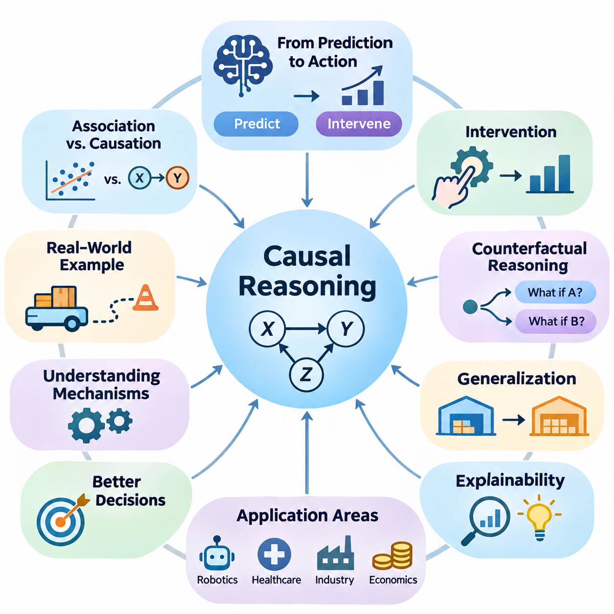
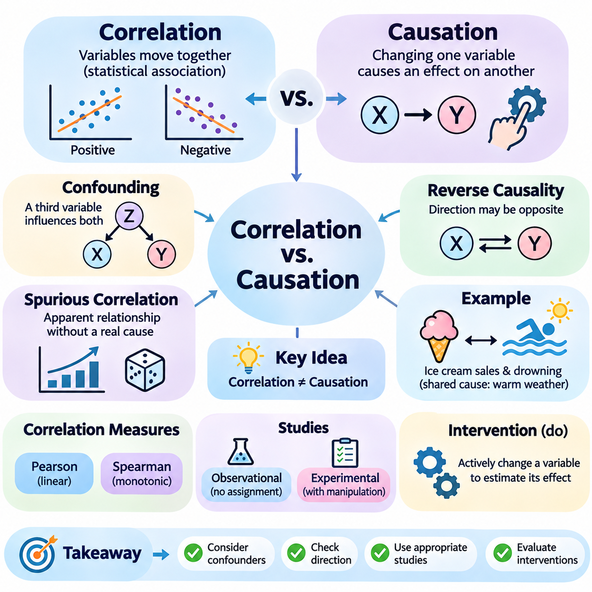
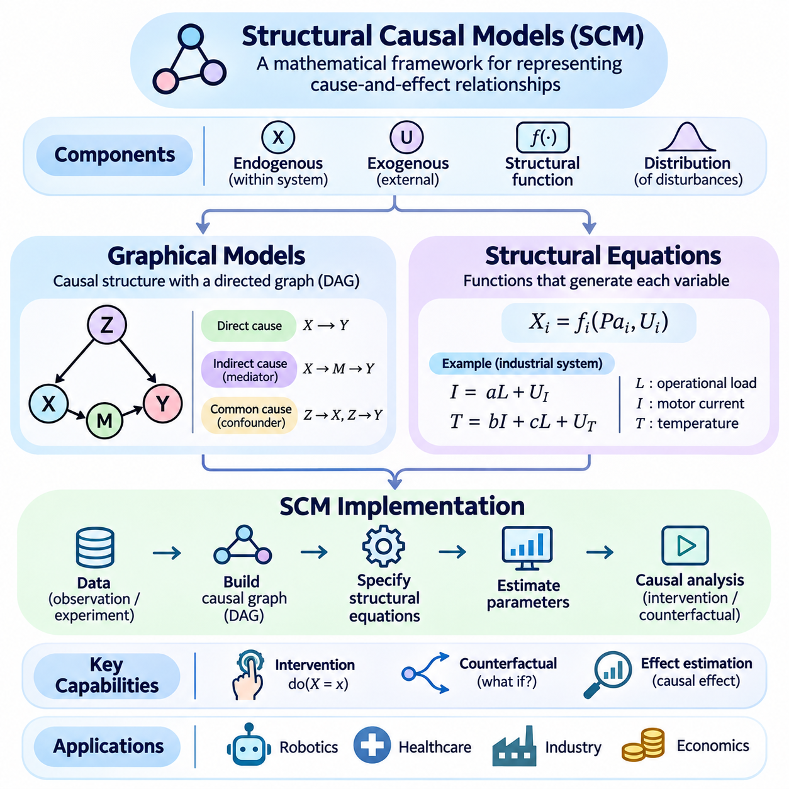
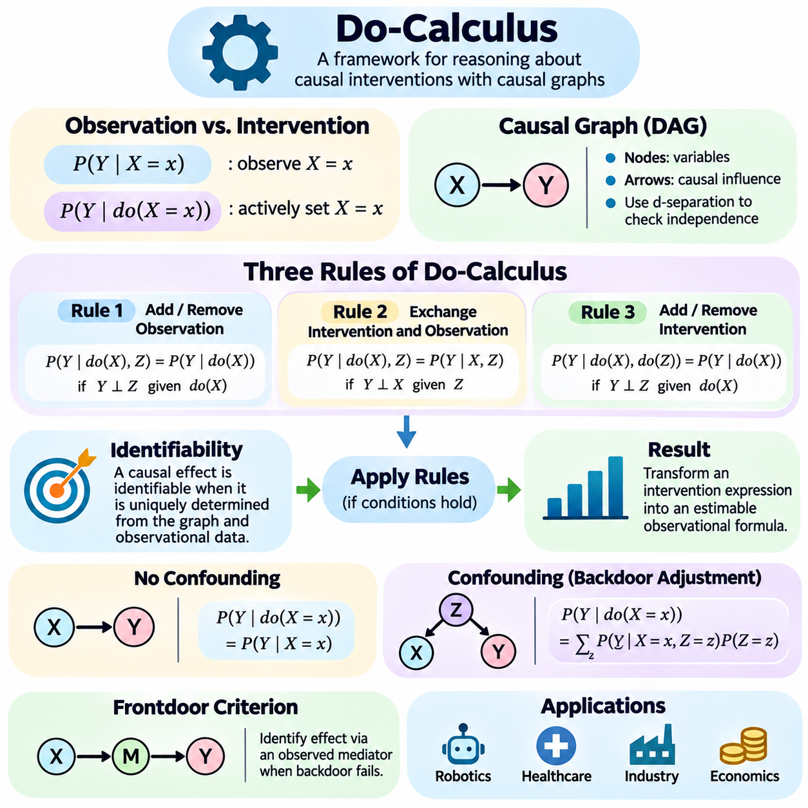
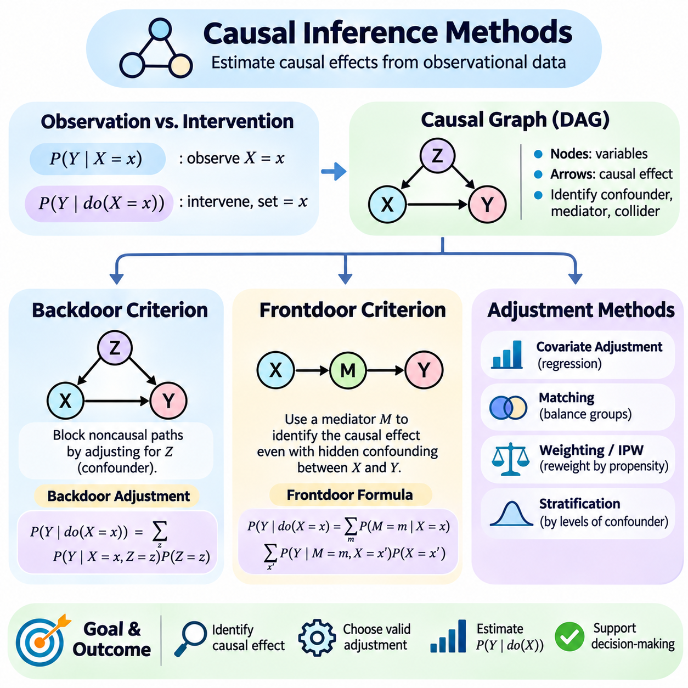
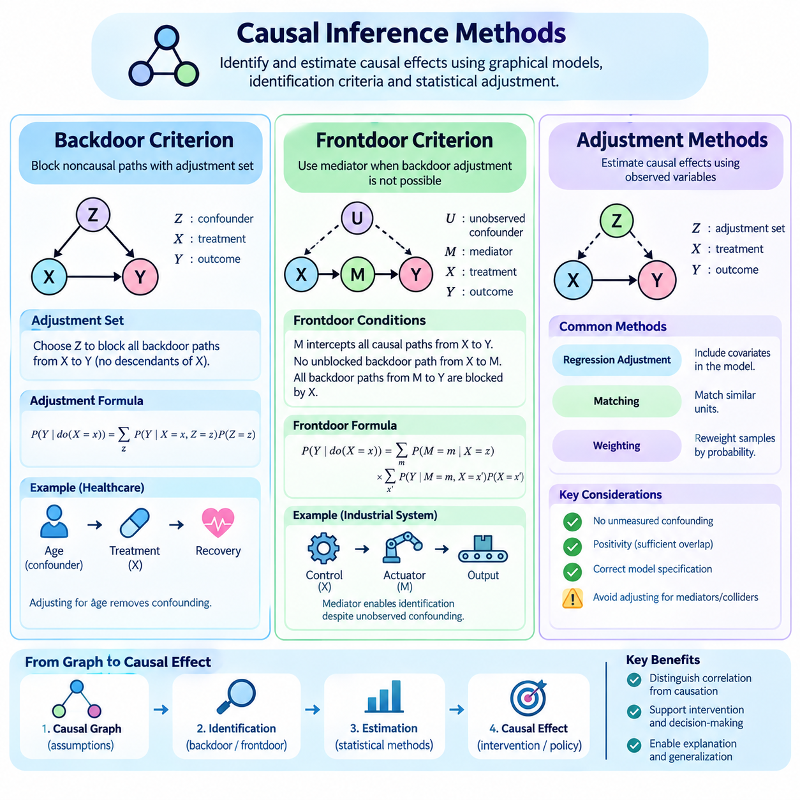
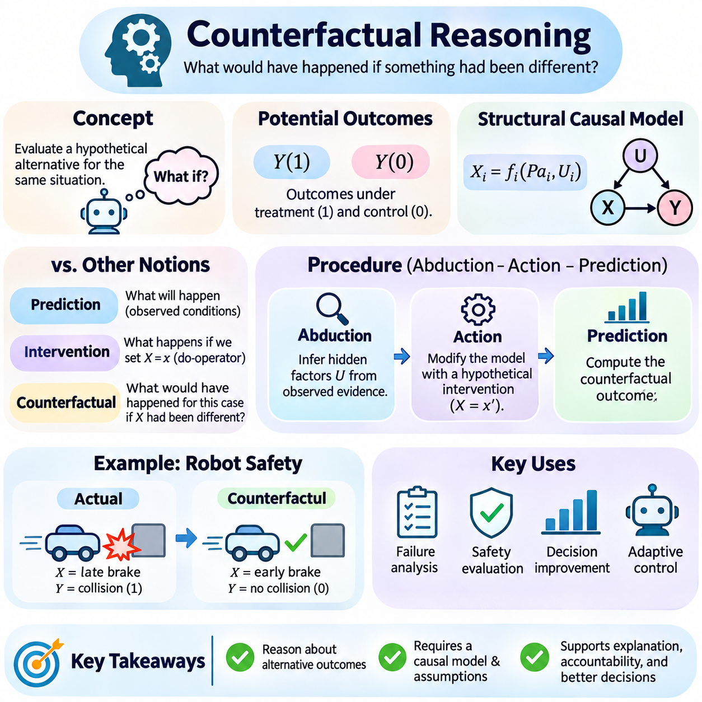
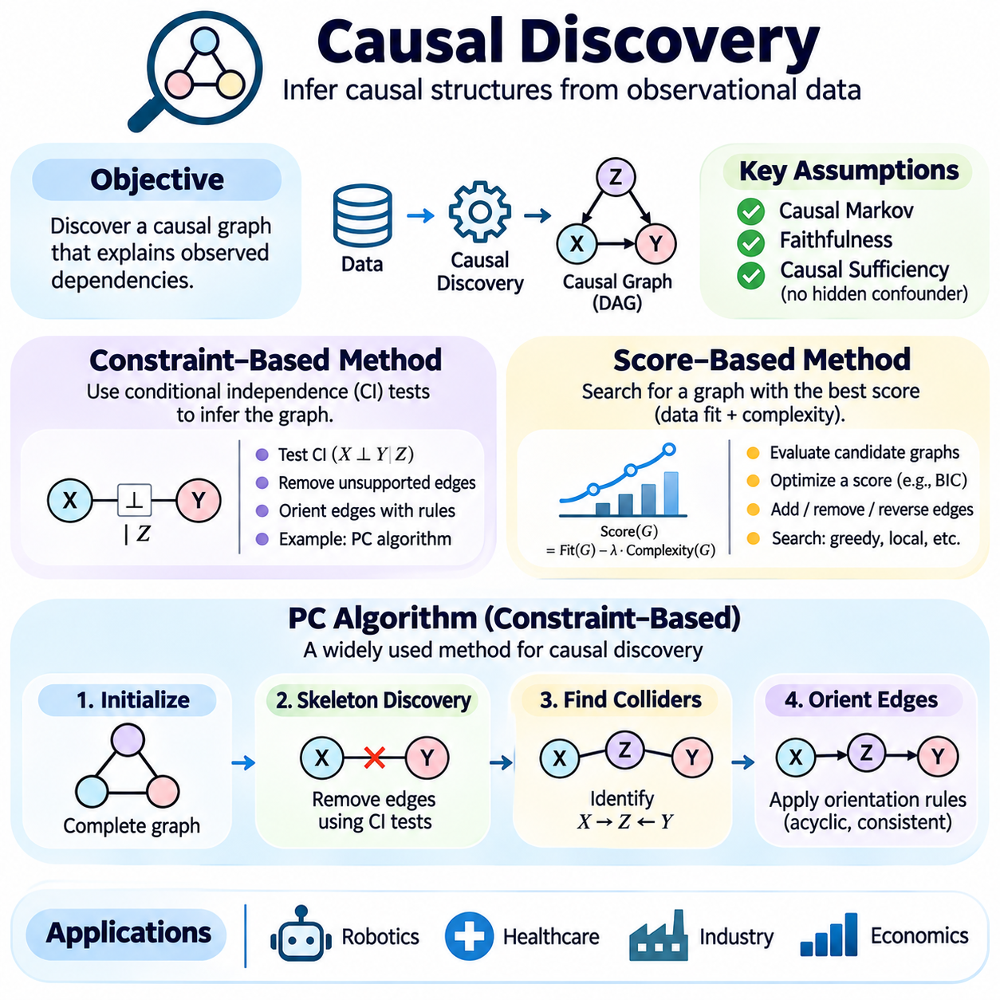
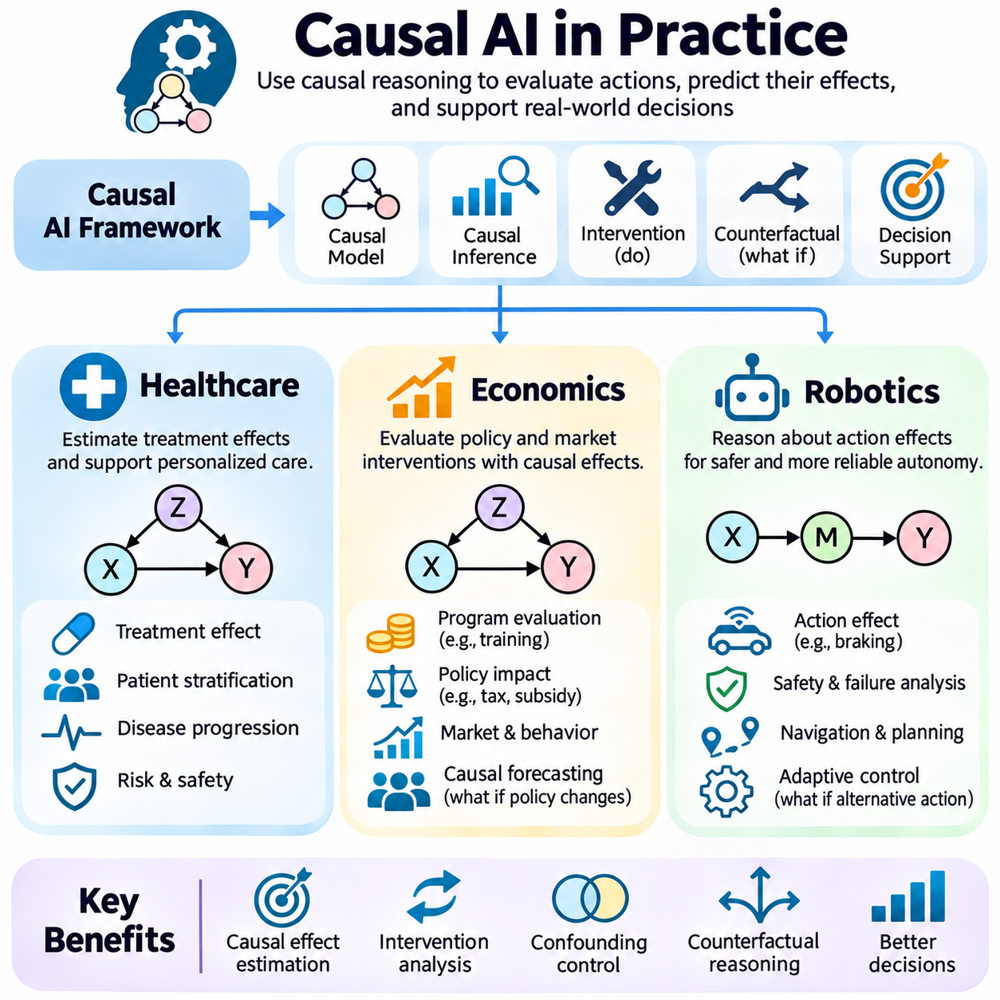
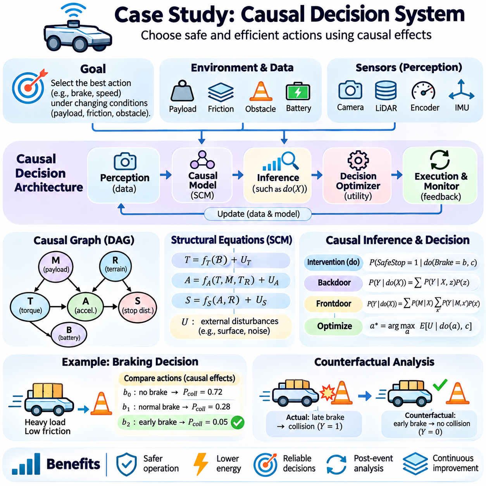

**Volume 03. Reasoning in AI**

# 03. Causal Reasoning

## 03.01 Why Causality Matters

{width="7.268055555555556in" height="7.268055555555556in"}

인과성(Causality)은 지능형 시스템(Intelligent Systems)이 단순히 어떤 사건이 발생하는지를 파악하는 것뿐만 아니라, 그 사건이 왜 발생하는지도 이해해야 한다는 점에서 인공지능(Artificial Intelligence)의 핵심 개념이다. 전통적인 기계학습(Machine Learning)은 관측 데이터(Observed Data)에서 통계적 패턴(Statistical Patterns)을 식별하지만, 인과 추론(Causal Reasoning)은 그러한 패턴을 생성하는 근본적인 메커니즘(Mechanisms)을 탐구한다. 이러한 차이를 통해 인공지능 시스템은 예측(Prediction)을 넘어 설명(Explanation), 개입(Intervention), 정보에 기반한 의사결정(Informed Decision-Making)으로 발전할 수 있다.

많은 인공지능 응용 분야에서는 통계적 연관성(Statistical Association)만으로 이해할 수 없는 관계가 존재한다. 모델(Model)은 두 변수(Variables)가 자주 함께 변화한다는 사실을 발견할 수 있지만, 한 변수가 다른 변수에 영향을 미치는지는 판단하지 못할 수 있다. 인과 추론(Causal Reasoning)은 실제 인과관계(Causal Relationships)를 우연한 패턴(Coincidental Patterns), 공통 원인(Shared Influences), 관측 데이터셋(Observational Datasets)에서 발생하는 오해를 유발하는 상관관계(Misleading Correlations)와 구별하기 위한 체계를 제공한다.

인과성(Causality)의 중요성은 인공지능 시스템이 단순히 결과를 예측하는 것이 아니라 행동(Action)을 선택해야 할 때 특히 분명해진다. 예측 모델(Predictive Models)은 관측된 조건에서 발생할 가능성이 높은 결과를 추정하지만, 인과 모델(Causal Models)은 특정 조건을 의도적으로 변경했을 때 어떤 결과가 발생할지를 추정한다. 이러한 능력은 자율 시스템(Autonomous Systems), 의료 의사결정(Medical Decision-Making), 경제 계획(Economic Planning), 지능형 제어(Intelligent Control)에 필수적이다.

창고에서 작동하는 자율 로봇(Autonomous Robot)을 생각해 볼 수 있다. 과거 관측 데이터(Historical Observations)는 장애물 밀도(Obstacle Density)가 증가할수록 주행 속도(Navigation Speed)가 감소한다는 관계를 보여줄 수 있다. 그러나 로봇은 장애물이 속도 감소의 원인인지, 아니면 혼잡도(Congestion)와 같은 다른 요인이 두 변수 모두에 영향을 미치는지를 이해해야 한다. 인과 추론(Causal Reasoning)은 이러한 가능성을 구별하고 더욱 신뢰할 수 있는 주행 전략(Navigation Strategies)을 수립하도록 지원한다.

인과 추론(Causal Reasoning)은 개입(Intervention)을 이해하기 위한 기초도 제공한다. 개입은 시스템 내부의 특정 변수(Variable)를 의도적으로 변경하여 그 결과를 조사하는 행위를 의미한다. 수동적인 관측(Passive Observation)과 달리 개입은 시스템 조건을 능동적으로 변경했을 때 발생하는 효과에 초점을 맞춘다. 이러한 구별은 제안된 행동(Proposed Action)이 의도한 결과(Intended Result)를 만들어낼 수 있는지를 판단하는 데 핵심적이다.

예를 들어 산업용 인공지능 시스템(Industrial AI System)은 장비의 작동 온도(Operating Temperature)가 높을 때 고장(Equipment Failure)이 자주 발생한다는 사실을 관측할 수 있다. 순수한 예측 모델(Predictive Model)은 온도를 경고 지표(Warning Indicator)로 사용할 수 있다. 반면 인과 모델(Causal Model)은 온도가 고장에 직접 기여하는지, 기계적 마찰(Mechanical Friction)이 온도와 고장 위험을 동시에 증가시키는지, 또는 여러 상호작용 메커니즘(Interacting Mechanisms)이 관측된 관계를 설명하는지를 조사한다.

이러한 메커니즘(Mechanisms)을 이해하면 시정 조치(Corrective Actions)의 효과를 높일 수 있다. 과도한 온도가 부품 열화(Component Degradation)에 직접 기여한다면 냉각 성능(Improved Cooling)을 개선하여 고장을 줄일 수 있다. 반대로 온도가 기계적 마모(Mechanical Wear)의 증상에 불과하다면 냉각만으로는 근본적인 문제를 해결하지 못할 수 있다. 따라서 인과 추론(Causal Reasoning)은 의사결정 시스템(Decision Systems)이 바람직하지 않은 결과의 실제 원인을 대상으로 개입하도록 지원한다.

인과성(Causality)의 또 다른 중요한 기여는 반사실적 추론(Counterfactual Reasoning)을 지원한다는 점이다. 반사실적 질문(Counterfactual Questions)은 실제 발생한 상황과 다른 가상의 조건(Hypothetical Conditions)에서 나타났을 대안적 결과(Alternative Outcomes)를 검토한다. 지능형 시스템은 특정 사건이 왜 발생했는지를 묻는 데 그치지 않고, 다른 행동을 선택했다면 어떤 결과가 발생했을지를 인과 모델(Causal Model)에 필요한 가정을 고려하여 조사할 수 있다.

반사실적 추론(Counterfactual Reasoning)은 사건 발생 이후 의사결정(Decision)을 평가할 때 특히 유용하다. 긴급 회피 기동(Emergency Maneuver)을 수행한 자율주행차(Autonomous Vehicle)는 다른 제동 전략(Braking Strategy)을 사용했다면 충돌(Collision)을 방지할 수 있었는지를 판단해야 할 수 있다. 이러한 분석은 기록된 주행 궤적(Recorded Trajectories)에서 패턴을 인식하는 것 이상을 요구하며, 실제 수행되지 않은 행동의 결과를 추정해야 한다.

인과적 이해(Causal Understanding)는 변화하는 환경(Changing Environments) 전반에서 일반화(Generalization)하는 능력에도 기여한다. 기계학습 모델(Machine Learning Models)은 학습 데이터(Training Data)와 배포 데이터(Deployment Data)가 유사한 통계적 특성(Statistical Properties)을 공유할 때 높은 성능을 보이는 경우가 많다. 그러나 환경 조건, 운영 절차 또는 데이터 분포(Data Distributions)가 변화하면 성능이 저하될 수 있다. 인과 모델(Causal Models)은 근본적인 인과 메커니즘(Causal Mechanisms)이 유지되는 경우 더욱 안정적인 표현(Representations)을 제공할 수 있다.

예를 들어 한 창고에서 학습한 로봇(Robot)은 다른 시설에서 서로 다른 조명 조건(Lighting Conditions), 바닥 재질(Floor Materials), 교통 패턴(Traffic Patterns)을 마주할 수 있다. 표면적인 시각적 상관관계(Visual Correlations)에 주로 의존하는 시스템은 이러한 변화에 적응하기 어려울 수 있다. 반면 물리적 행동(Physical Actions), 환경 속성(Environmental Properties), 결과적인 움직임(Resulting Motion) 사이의 관련 인과관계를 포착한 시스템은 지식을 더욱 효과적으로 전이(Transfer)할 수 있다.

이러한 장점이 인과 모델(Causal Models)이 모든 새로운 환경(New Environments)에 자동으로 일반화(Generalization)된다는 의미는 아니다. 모델의 신뢰성(Reliability)은 가정한 인과 구조(Causal Structure)가 여전히 유효한지, 중요한 메커니즘(Mechanisms)이 변화했는지에 따라 달라진다. 그럼에도 인과적 가정(Causal Assumptions)을 명시적으로 표현하면 엔지니어가 어떤 관계가 안정적으로 유지될 것으로 예상되는지, 배포(Deployment) 과정에서 어떤 관계를 재검토해야 하는지 조사할 수 있다.

인과성(Causality)은 설명 가능한 인공지능(Explainable Artificial Intelligence)과도 밀접하게 관련된다. 많은 고용량 모델(High-Capacity Models)은 정확한 예측을 생성하지만, 출력 결과를 만들어낸 메커니즘을 명확하게 설명하지 못한다. 인과적 설명(Causal Explanations)은 관련 요인을 변경했을 때 결과가 어떻게 달라지는지를 식별하려 한다. 이러한 설명은 통계적 특성 중요도(Statistical Feature Importance)에 대한 설명보다 실제 행동에 더욱 직접적으로 활용될 수 있다.

의료(Healthcare) 분야에서 예측 모델(Predictive Model)은 특정 질환이 발생할 확률이 높은 환자를 식별할 수 있다. 그러나 위험(Risk)을 식별하는 것만으로 어떤 치료(Treatment)가 환자의 결과(Patient Outcomes)를 개선할지는 알 수 없다. 인과 추론(Causal Inference)은 관측 비교(Observational Comparisons)를 왜곡할 수 있는 교란 요인(Confounding Factors), 선택 메커니즘(Selection Mechanisms), 환자 집단(Patient Populations) 간 차이를 고려하여 치료 효과(Treatment Effects)를 추정하려 한다.

경제학(Economics)과 공공 정책(Public Policy)에서도 유사한 문제가 발생한다. 교육(Education)과 소득(Income) 사이에 관측된 관계만으로 추가 교육이 미래 소득(Future Earnings)에 미치는 효과를 확정할 수는 없다. 가족 배경(Family Background), 경제적 기회(Economic Opportunities), 기존 능력(Prior Ability), 기타 변수들이 두 요소 모두에 영향을 미칠 수 있기 때문이다. 인과 분석(Causal Analysis)은 필요한 가정을 명시하면서 제안된 개입(Proposed Interventions)을 평가하는 방법을 제공한다.

관측적 추론(Observational Reasoning), 개입적 추론(Interventional Reasoning), 반사실적 추론(Counterfactual Reasoning)의 구별은 지능형 의사결정 시스템(Intelligent Decision Systems)의 중요한 개념적 발전을 나타낸다. 관측적 추론은 이용 가능한 증거(Evidence)의 패턴을 조사한다. 개입적 추론은 의도적인 행동의 결과를 추정한다. 반사실적 추론은 특정 인과 모델(Causal Model)을 사용하여 이미 발생한 상황에서 가능한 대안적 결과(Alternative Outcomes)를 조사한다.

이 세 가지 추론 방식(Reasoning Methods)은 서로 다른 질문에 답하며, 서로 다른 종류의 증거(Evidence)를 요구한다. 관측 데이터(Observational Data)는 통계적 의존성(Statistical Dependence)의 추정을 지원할 수 있지만, 추가적인 가정이나 실험 정보(Experimental Information)가 없다면 개입 효과(Intervention Effects)를 식별하지 못할 수 있다. 반사실적 결론(Counterfactual Conclusions)은 일반적으로 근본적인 메커니즘과 개별 사례의 상황에 관한 추가 가정을 필요로 한다.

따라서 인과 추론(Causal Reasoning)은 단순히 또 다른 예측 알고리즘(Prediction Algorithm)이 아니다. 이는 변수들이 서로 어떤 영향을 미치는지에 관한 가정을 표현하고, 그러한 가정 아래에서 결론을 도출하기 위한 체계(Framework)이다. 수학적 기반(Mathematical Foundations)에는 인과 그래프 모델(Causal Graphical Models), 구조 방정식(Structural Equations), 확률 이론(Probability Theory), 개입 연산자(Intervention Operators)가 포함되며, 이들은 원인과 결과 관계(Cause-and-Effect Relationships)를 체계적으로 조사하도록 지원한다.

구조적 인과 모델(Structural Causal Models)은 이러한 메커니즘을 표현하는 중요한 접근법 중 하나이다. 변수들은 다른 변수와 외생적 영향(External Influences)으로부터 값이 어떻게 생성되는지를 설명하는 구조 방정식(Structural Equations)을 통해 연결된다. 연구자는 선택한 방정식을 수정하여 개입(Interventions)을 표현하고, 지정된 가정 아래에서 그 효과가 모델링된 시스템 전체로 어떻게 전파되는지를 조사할 수 있다.

인과 그래프(Causal Graphs)는 변수 사이에 가정된 관계를 표현하는 또 다른 유용한 방법이다. 방향성 간선(Directed Edges)은 인과적 영향(Causal Influences)을 나타내며, 전체 그래프 구조(Graph Structure)는 잠재적인 교란 경로(Confounding Pathways)와 의존성(Dependencies)을 식별하도록 지원한다. 이러한 표현은 인과적 가정(Causal Assumptions)을 명확하게 드러내고, 특정 인과 효과(Causal Effects)를 이용 가능한 증거로 추정할 수 있는지 평가하는 기초를 제공한다.

중요한 과제는 일반적으로 관측된 상관관계(Observational Correlations)만으로 인과관계(Causal Relationships)를 확립할 수 없다는 점이다. 서로 다른 인과 구조(Causal Structures)가 동일한 관측 분포(Observational Distributions)를 생성할 수 있으므로 추가 정보 없이는 구별하기 어렵거나 불가능할 수 있다. 통제 실험(Controlled Experiments), 시간적 지식(Temporal Knowledge), 도메인 전문지식(Domain Expertise), 자연 실험(Natural Experiments), 신중하게 정당화된 가정은 이러한 한계를 해결하는 데 도움을 줄 수 있다.

무작위 대조 실험(Randomized Controlled Experiments)은 무작위 배정(Random Assignment)을 통해 처치 집단(Treatment Groups) 사이의 체계적인 차이를 줄일 수 있기 때문에 특히 가치가 있다. 그러나 실험은 비용이 많이 들거나 위험하거나 비윤리적이거나 운영상 실행하기 어려울 수 있다. 따라서 인과 추론 방법(Causal Inference Methods)은 관측 데이터가 어떤 조건에서 신뢰할 수 있는 효과 추정(Effect Estimates)을 지원하는지, 그리고 그 추정치를 인과적으로 해석하기 위해 어떤 가정이 필요한지를 조사한다.

교란(Confounding)은 인과 분석(Causal Analysis)의 핵심 문제 중 하나이다. 교란 변수(Confounder)는 잠재적 원인(Potential Cause)과 그 결과(Outcome) 모두에 영향을 미쳐 오해를 유발하는 연관성(Association)을 만들어낼 수 있다. 관련 교란 변수를 적절히 처리하지 않으면 인공지능 시스템은 관측된 효과를 잘못된 변수에 귀속시킬 수 있다. 교란을 이해하는 것은 신뢰할 수 있는 개입 계획(Intervention Planning)과 인과 효과 추정(Causal Estimation)에 필수적이다.

인과 추론(Causal Reasoning)은 더욱 신뢰할 수 있는 자율 에이전트(Autonomous Agents)의 개발도 지원한다. 에이전트는 환경(Environment)과 지속적으로 상호작용하며 미래 관측(Future Observations)과 이용 가능한 선택(Available Choices)에 영향을 미치는 행동을 수행한다. 행동이 환경 상태(Environmental States)에 미치는 영향을 모델링함으로써 에이전트는 대안 전략(Alternative Strategies)을 평가하고, 의도하지 않은 결과(Unintended Consequences)를 예측하며, 제어 가능한 요인(Controllable Factors)과 외부 교란(External Disturbances)을 구별할 수 있다.

로보틱스(Robotics)에서 이러한 능력은 인지(Perception), 계획(Planning), 제어(Control)를 연결한다. 이동 로봇(Mobile Robot)은 바퀴 명령(Wheel Commands)이 움직임(Motion)에 어떤 영향을 미치는지, 표면 조건(Surface Conditions)이 접지력(Traction)에 어떤 영향을 미치는지, 장애물(Obstacles)이 실행 가능한 궤적(Feasible Trajectories)을 어떻게 제한하는지 이해해야 한다. 인과 모델(Causal Models)은 행동에 의존하는 물리적 관계(Action-Dependent Physical Relationships)에 대한 가정을 명시함으로써 확률적 상태 추정(Probabilistic State Estimation)과 학습된 동역학(Learned Dynamics)을 보완할 수 있다.

인과성(Causality)과 강화학습(Reinforcement Learning)의 관계는 특히 중요하다. 강화학습은 환경과의 상호작용(Interactions) 및 보상 피드백(Reward Feedback)을 통해 정책(Policies)을 개발하지만, 기존 접근법이 반드시 명시적인 인과 구조(Explicit Causal Structures)를 복원하는 것은 아니다. 인과 지식(Causal Knowledge)이 정확하고 환경과 관련성이 있다면 이를 통합하여 탐색(Exploration), 전이(Transfer), 계획(Planning)을 개선할 수 있다.

인과 추론(Causal Reasoning)은 복잡한 인공지능 시스템(Complex AI Systems)의 고장 분석(Failure Analysis)도 개선할 수 있다. 예상하지 못한 결과가 발생하면 엔지니어는 즉각적인 증상(Immediate Symptoms)과 그 결과를 생성한 메커니즘(Mechanisms)을 구별해야 한다. 인과적 조사(Causal Investigation)는 소프트웨어 동작(Software Behavior), 센서 측정(Sensor Measurements), 환경 조건(Environmental Conditions), 제어 행동(Control Actions)이 어떻게 상호작용하는지 분석하여 근본적인 고장 메커니즘을 해결하는 시정 조치(Corrective Measures)를 식별하도록 지원한다.

이러한 장점에도 불구하고 인과 모델링(Causal Modeling)은 상당한 도전 과제를 수반한다. 인과 구조(Causal Structure)에 대한 잘못된 가정은 수학적 계산이 내부적으로 일관되더라도 오해를 유발하는 결론을 만들어낼 수 있다. 숨겨진 교란 변수(Hidden Confounders), 측정 오류(Measurement Errors), 피드백 루프(Feedback Loops), 선택 편향(Selection Bias), 시스템 동역학(System Dynamics)에 대한 불완전한 지식은 모두 인과 추정(Causal Estimates)과 설명(Explanations)의 신뢰성을 약화시킬 수 있다.

따라서 인과 인공지능(Causal AI)은 추론된 관계를 무조건 수용하기보다 신중한 검증(Validation)을 요구한다. 연구자는 대안적인 인과 구조(Alternative Causal Structures)를 검토하고, 불확실한 가정에 대한 민감도(Sensitivity)를 시험하며, 가능한 경우 실험적 증거(Experimental Evidence)와 예측을 비교하고, 운영 조건이 변화할 때 추정된 효과가 계속 신뢰할 수 있는지 모니터링해야 한다. 인과적 결론(Causal Conclusions)은 항상 식별 가정(Identification Assumptions)의 범위 안에서 해석해야 한다.

인과성(Causality)의 더 넓은 의미는 반복되는 패턴을 인식하는 데 그치지 않고 결과(Consequences)에 대해 추론할 수 있는 지능형 시스템(Intelligent Systems)의 발전에 기여한다는 점에 있다. 예측(Prediction)은 여전히 필수적이지만, 자율적 의사결정(Autonomous Decision-Making)에는 행동이 세상을 어떻게 변화시키는지에 대한 이해도 필요하다. 인과 추론(Causal Reasoning)은 통계적 학습(Statistical Learning), 과학적 설명(Scientific Explanation), 목적 지향적 행동(Purposeful Action)을 연결하는 개념적·수학적 가교(Conceptual and Mathematical Bridge)를 제공한다.

인공지능(Artificial Intelligence)이 로보틱스(Robotics), 의료(Healthcare), 산업 자동화(Industrial Automation), 과학 연구(Scientific Research)에 점점 더 깊이 통합됨에 따라 상관관계(Correlation)와 인과관계(Causation)를 구별하는 능력은 더욱 중요해지고 있다. 예측 정확도(Predictive Accuracy)와 타당한 인과 지식(Defensible Causal Knowledge)을 결합한 시스템은 변화하는 조건에서도 개입 계획(Intervention Planning), 투명한 설명(Transparent Explanations), 신뢰할 수 있는 의사결정(Reliable Decisions)을 더욱 효과적으로 지원할 수 있다.

궁극적으로 인과성(Causality)이 중요한 이유는 지능(Intelligence)이 선택(Choices)의 결과를 이해하는 능력을 포함하기 때문이다. 결과를 예측할 수 있는 인공지능 시스템은 어떤 일이 발생할 가능성이 높은지 인식할 수 있지만, 유효한 인과 지식(Valid Causal Knowledge)을 갖춘 시스템은 의도적인 행동(Deliberate Actions)이 그 결과를 어떻게 변화시킬 수 있는지도 평가할 수 있다. 이러한 능력은 더욱 적응적(Adaptive)이고, 책임성(Accountability)을 갖추며, 의사결정 중심적(Decision-Oriented)인 인공지능을 구현하기 위한 필수적인 기반을 형성한다.

## 03.02 Correlation vs Causation

{width="7.268055555555556in" height="7.268055555555556in"}

상관관계(Correlation)와 인과관계(Causation)는 통계적 추론(Statistical Reasoning)과 인공지능(Artificial Intelligence)의 핵심 개념이지만, 변수(Variables) 사이의 서로 다른 유형의 관계를 설명한다. 상관관계는 두 변수 사이에 통계적 연관성(Statistical Association)이 존재함을 나타내는 반면, 인과관계는 특정 조건에서 한 변수를 변경하면 다른 변수에 영향을 미친다는 것을 의미한다. 이러한 차이를 이해하는 것은 신뢰할 수 있는 설명(Explanations)과 의사결정(Decisions)을 지원하는 인공지능 시스템을 개발하는 데 필수적이다.

상관관계(Correlation)는 한 변수의 변화가 다른 변수의 변화와 통계적으로 연관되어 있을 때 존재한다. 양의 상관관계(Positive Correlation)는 두 변수가 함께 증가하거나 감소하는 경향을 나타내며, 음의 상관관계(Negative Correlation)는 한 변수가 증가할 때 다른 변수가 감소하는 경향을 의미한다. 그러나 상관관계만으로는 영향의 방향(Direction of Influence)을 확립하거나, 근본적인 메커니즘(Underlying Mechanism)을 식별하거나, 개입(Intervention)이 특정 결과를 만들어낸다는 사실을 입증할 수 없다.

인과관계(Causation)는 한 요인의 변화가 인과 메커니즘(Causal Mechanism)을 통해 다른 요인에 영향을 미치는 관계를 설명한다. 예를 들어 다른 관련 물리적 조건(Physical Conditions)이 일정하게 유지될 때 물체에 가해지는 힘(Applied Force)을 증가시키면 가속도(Acceleration)가 변할 수 있다. 인과관계를 확립하려면 단순히 통계적 패턴(Statistical Pattern)을 관측하는 것 이상이 필요하며, 교란 변수(Confounding Variables)와 역인과성(Reverse Causality)을 포함한 대안적 설명(Alternative Explanations)을 고려해야 한다.

대표적인 사례로 아이스크림 판매량(Ice Cream Sales)과 익사 사고(Drowning Incidents)가 같은 계절에 증가하는 현상을 들 수 있다. 두 변수는 양의 상관관계(Positive Correlation)를 보일 수 있지만, 아이스크림 구매가 반드시 익사 사고를 유발하는 것은 아니다. 따뜻한 날씨(Warmer Weather)는 수영 활동을 증가시키는 동시에 아이스크림 수요도 높이므로, 공통된 영향 요인(Shared Influence)을 통해 연관성이 형성된다. 이는 제3의 변수(Third Variable)가 관측된 통계적 관계를 설명할 수 있음을 보여준다.

이러한 제3의 변수는 인과 분석(Causal Analysis)에서 노출 변수(Exposure)와 결과 변수(Outcome) 모두에 영향을 미치는 경우 교란 변수(Confounders)라고 불린다. 교란(Confounding)은 직접적인 인과 효과(Direct Causal Effect)가 존재하지 않더라도 변수 사이에 겉보기 관계(Apparent Relationship)를 만들어낼 수 있다. 또한 실제 인과 효과를 과장하거나 감소시키거나 반대로 나타나게 할 수도 있다. 따라서 관련 교란 변수를 식별하는 것은 관측 데이터(Observational Data)를 해석하고 개입 효과(Intervention Effects)를 추정할 때 매우 중요하다.

역인과성(Reverse Causality)은 영향의 방향이 관측 데이터에서 암시되는 해석과 다를 수 있기 때문에 또 다른 문제를 발생시킨다. 예를 들어 기업에서 직원 교육 시간(Employee Training Hours)이 낮은 업무 성과(Poor Performance)와 상관관계를 보인다고 가정할 수 있다. 한 가지 해석은 교육이 생산성을 감소시킨다는 것이지만, 다른 해석은 성과가 낮은 직원에게 추가 교육이 제공된다는 것이다. 영향의 방향을 이해하지 못하면 경영진은 효과가 없는 개입(Intervention)을 선택할 수 있다.

허위 상관관계(Spurious Correlation)는 의미 있는 인과적 연결(Causal Connection)이 없는데도 변수들이 통계적으로 관련되어 보이는 현상이다. 이러한 관계는 우연(Coincidence), 공통 추세(Shared Trends), 데이터 선택(Data Selection), 측정되지 않은 영향(Unmeasured Influences)으로 인해 발생할 수 있다. 수천 개의 변수가 포함된 대규모 데이터셋(Large Datasets)에서는 우연히 강한 상관관계가 나타날 수 있다. 광범위하게 패턴을 탐색하는 인공지능 시스템은 인과적 의미가 없는 연관성을 발견할 위험이 특히 높다.

통계적 상관계수(Statistical Correlation Coefficients)는 특정 연관성의 강도(Strength)와 방향(Direction)을 정량화한다. 피어슨 상관계수(Pearson Correlation)는 수치형 변수(Numerical Variables) 사이의 선형 관계(Linear Relationships)를 측정하며, 스피어만 상관계수(Spearman Correlation)는 순위(Ranks)를 사용하여 단조 관계(Monotonic Relationships)를 평가한다. 이러한 측정값은 탐색적 분석(Exploratory Analysis)에 유용하지만, 어느 것도 관계가 인과적인지를 판단하지는 못한다. 높은 상관계수만으로 메커니즘, 개입 또는 대안적 설명에 관한 증거를 대체할 수 없다.

상관계수(Correlation Coefficients)는 관계가 비선형(Nonlinear)이거나 맥락적 조건(Contextual Conditions)에 의존할 때에도 한계를 가진다. 두 변수 사이에 강한 비선형 의존성(Nonlinear Dependency)이 존재하더라도 피어슨 상관계수는 0에 가까울 수 있다. 반대로 높은 상관관계가 의미 있는 상호작용이 아니라 공통된 시간적 추세(Temporal Trends)에서 비롯될 수도 있다. 따라서 통계적 연관성(Statistical Association)은 적절한 방법으로 분석하고, 근본적인 데이터 생성 과정(Data-Generating Process)을 고려하여 해석해야 한다.

관측 연구(Observational Studies)는 참여자나 시스템이 경험하는 조건을 의도적으로 배정하지 않고 관계를 조사한다. 이러한 연구는 통제 실험(Controlled Experimentation)이 비용이 많이 들거나 실행하기 어려울 수 있는 의료(Healthcare), 경제학(Economics), 로보틱스(Robotics), 산업 모니터링(Industrial Monitoring)에서 널리 사용된다. 그러나 관측된 관계에는 교란(Confounding), 선택 효과(Selection Effects), 역인과성(Reverse Causality)이 반영될 수 있으므로, 인과적 해석은 추가적인 가정과 뒷받침하는 증거에 의존한다.

실험 연구(Experimental Studies)는 변수를 의도적으로 조작하고 그에 따른 변화를 관측함으로써 인과관계를 조사할 수 있는 더 강력한 기회를 제공한다. 무작위 대조 실험(Randomized Controlled Experiments)은 처치(Treatments)를 무작위로 배정하여 처치 집단(Treatment Groups) 사이의 체계적인 차이를 줄이는 데 도움을 준다. 실험이 적절하게 설계되고 수행되면 결과의 차이는 인과적 결론(Causal Conclusions)을 뒷받침할 수 있지만, 측정 품질(Measurement Quality), 처치 준수(Compliance), 외적 타당도(External Validity)도 여전히 중요하다.

무작위화(Randomization)가 모든 오류 원인(Sources of Error)을 제거하는 것은 아니다. 작은 표본(Small Samples)은 집단 간 불균형(Imbalanced Groups)을 발생시킬 수 있고, 참여자가 배정된 처치를 따르지 않을 수도 있으며, 측정 절차(Measurement Procedures)가 체계적 편향(Systematic Bias)을 유발할 수도 있다. 또한 실험 결과는 실제 배포 환경(Real-World Deployment)과 다른 환경 조건(Environmental Conditions)에 의존할 수 있다. 따라서 인과적 결론에는 실험 설계(Experimental Design), 불확실성(Uncertainty), 연구 결과를 일반화할 대상 집단(Target Population)에 대한 신중한 검토가 필요하다.

인과 추론(Causal Reasoning)은 일반적인 관측(Observation)과 구별되는 개념으로 개입(Interventions)을 도입한다. 기계가 높은 온도에서 작동하는 것을 관측하는 것과 기계의 온도를 의도적으로 증가시키는 것은 서로 다르다. 관측된 관계는 작동 부하(Operating Load)나 기계적 마모(Mechanical Wear)를 반영할 수 있지만, 개입은 온도 자체를 변경했을 때의 결과를 분리하여 조사하려 한다. 이러한 차이는 예측적 연관성(Predictive Associations)을 자동으로 인과 효과(Causal Effects)로 해석할 수 없는 이유를 명확하게 설명한다.

인과 추론(Causal Inference)에서 P(Y \| X = x)는 관측 조건부 확률(Observational Conditional Probability)을 나타내며, P(Y \| do(X = x))는 변수 X를 특정 값으로 설정하는 개입(Intervention) 아래의 확률 분포(Probability Distribution)를 나타낸다. 두 값은 서로 다를 수 있는데, 특정 조건을 관측하는 것이 그 조건을 능동적으로 강제했을 때의 결과를 반드시 재현하지는 않기 때문이다. 이러한 구별은 연관성(Association)과 개입 기반 추론(Intervention-Based Reasoning)을 분리하기 위한 수학적 기반(Mathematical Foundation)을 제공한다.

인과 그래프 모델(Causal Graphical Models)은 변수 사이의 관계에 관한 가정을 표현하는 데 도움을 준다. 방향성 간선(Directed Edges)은 가정된 인과적 영향(Hypothesized Causal Influences)을 나타내며, 분석가는 이를 통해 관측된 연관성이 직접 효과(Direct Effects), 공통 원인(Common Causes), 간접 경로(Indirect Pathways) 중 무엇에서 발생할 수 있는지 조사할 수 있다. 그래프 표현(Graphical Representations)이 인과관계를 자동으로 증명하는 것은 아니지만, 가정을 명시하고 가능한 설명을 체계적으로 평가하도록 지원한다.

예를 들어 로봇의 배터리 온도(Battery Temperature)와 모터 전류(Motor Current)가 높은 부하의 작업(Demanding Operations) 중에 함께 증가한다고 가정할 수 있다. 인과 그래프(Causal Graph)는 작동 부하(Operational Load)를 두 측정값 모두에 영향을 미치는 공통 요인(Common Influence)으로 표현할 수 있다. 또한 전기 저항(Electrical Resistance)에 의해 발생하는 열 생성(Heat Generation)을 포함할 수도 있다. 이러한 메커니즘을 구별하면 엔지니어는 전류 감소, 냉각 성능 개선 또는 작동 조건 변경 중 어떤 방법이 과열(Overheating) 문제를 해결할 수 있는지 판단할 수 있다.

선택 편향(Selection Bias)은 관측값이 제한되거나 체계적으로 선택된 모집단(Population)에서 수집될 때 오해를 유발하는 연관성을 만들어낼 수 있다. 예를 들어 이미 고장을 경험한 기계만 분석하면 작동 조건(Operating Conditions)과 부품 품질(Component Quality) 사이의 관계가 왜곡될 수 있다. 특정 변수에 조건을 부여하는 것(Conditioning)은 전체 모집단에서는 존재하지 않는 연관성을 만들어낼 수 있으며, 이는 데이터 수집 절차(Data Collection Procedures)가 인과적 해석에 중요한 이유를 보여준다.

또 다른 중요한 고려 사항은 시간적 순서(Temporal Ordering)이다. 원인(Causes)은 일반적으로 결과(Effects)보다 먼저 발생하므로 시간 정보(Time Information)는 경쟁하는 설명(Competing Explanations)을 평가하는 데 유용하다. 그러나 시간적 선행성(Temporal Precedence)만으로 인과관계가 확립되는 것은 아니다. 두 사건은 공통된 근본 과정(Underlying Process) 때문에 순차적으로 발생할 수 있으며, 피드백 시스템(Feedback Systems)에서는 서로 다른 시간 단계(Time Steps)에 걸쳐 양방향의 인과적 영향이 존재할 수 있다.

기계학습(Machine Learning)에서 예측 성능(Predictive Performance)과 인과적 타당성(Causal Validity)은 서로 다른 평가 목표(Evaluation Objectives)이다. 모델은 구매 결정에 직접적인 인과적 영향을 미치지 않는 변수를 사용하더라도 고객 구매(Customer Purchases)를 정확하게 예측할 수 있다. 이러한 특성(Features)은 예측(Forecasting)에는 유용할 수 있지만 개입을 선택하는 데에는 신뢰하기 어려울 수 있다. 모델이 특정 특성에 높은 중요도(Feature Importance)를 부여하더라도 그 특성을 변경한다고 반드시 결과가 달라지는 것은 아니다.

이러한 차이는 인공지능 모델이 자동화된 의사결정(Automated Decision-Making)에 사용될 때 특히 중요해진다. 예측 시스템(Predictive System)은 잦은 유지보수(Frequent Maintenance)가 장비 고장(Equipment Failures)과 연관되어 있음을 식별할 수 있다. 그러나 초기 열화 징후(Early Signs of Deterioration)가 나타나는 기계일수록 더 많은 유지보수를 받을 수 있다. 관측된 연관성만을 근거로 유지보수를 줄이면 고장을 예방하기보다 오히려 증가시킬 수 있으며, 이는 예측과 인과관계를 혼동할 때 발생하는 위험을 보여준다.

인과 추론 방법(Causal Inference Methods)은 이용 가능한 증거(Evidence)로부터 개입 효과(Intervention Effects)를 추정하려 한다. 주요 접근법에는 무작위 실험(Randomized Experiments), 공변량 조정(Covariate Adjustment), 매칭(Matching), 도구변수(Instrumental Variables), 이중차분법(Difference-in-Differences), 회귀 불연속 설계(Regression Discontinuity Designs)가 포함된다. 각 방법은 데이터 생성(Data Generation), 처치 배정(Treatment Assignment), 시스템 구조(System Structure)에 관한 특정 가정에 의존하며, 그 타당성은 해당 가정이 실제 응용 분야에서 정당화되는지에 따라 결정된다.

공변량 조정(Covariate Adjustment)은 비교 가능한 조건에서 관측값을 비교함으로써 측정된 교란 변수(Measured Confounders)의 영향을 고려하려 한다. 그러나 이용 가능한 모든 변수를 조정하는 것이 반드시 적절한 것은 아니다. 일부 변수는 처치(Treatment)의 결과이거나 다른 변수들의 공통 효과(Common Effects)일 수 있으며, 이러한 변수에 조건을 부여하면 편향(Bias)이 발생할 수 있다. 따라서 조정할 변수를 선택할 때에는 인과 지식(Causal Knowledge)이 필요하다.

반사실적 추론(Counterfactual Reasoning)은 대안적인 조건(Alternative Condition)에서 어떤 일이 발생했을지를 질문함으로써 인과 분석(Causal Analysis)을 확장한다. 예를 들어 자율주행차(Autonomous Vehicle)는 제동(Braking)을 더 일찍 시작했다면 충돌(Collision)이 발생했을지를 조사할 수 있다. 관측된 주행 궤적(Observed Trajectory)은 실제 발생한 사건에 대한 증거를 제공하지만, 대안적 결과(Alternative Outcome)는 차량 동역학(Vehicle Dynamics), 환경 조건(Environmental Conditions), 기타 관련 요인에 관한 가정을 사용하여 추정해야 한다.

인과 추론(Causal Inference)의 핵심적인 어려움은 특정 개체(Unit)가 특정 상황(Circumstance)에서 경험한 하나의 결과만 일반적으로 관측할 수 있다는 점이다. 환자는 치료(Treatment)를 받거나 받지 않으며, 로봇은 가능한 모든 대안적 행동(Alternative Actions)을 동시에 수행하는 대신 하나의 행동을 실행한다. 선택되지 않은 대안의 결과는 관측되지 않으므로 실험적 비교(Experimental Comparisons), 통계적 가정(Statistical Assumptions), 구조적 모델(Structural Models)을 통해 추정해야 한다.

이러한 한계에도 불구하고 상관관계(Correlation)는 여전히 매우 가치가 있다. 통계적 연관성(Statistical Associations)은 예측(Prediction), 이상 탐지(Anomaly Detection), 특성 선택(Feature Selection), 탐색적 분석(Exploratory Analysis), 가설 생성(Hypothesis Generation)을 지원한다. 또한 추가 조사가 필요한 관계를 발견하고 시스템 동작(System Behavior)과 관련된 변수를 식별하도록 돕는다. 인과 추론(Causal Reasoning)의 목적은 상관관계를 대체하는 것이 아니라, 어떤 경우에 연관성이 개입과 메커니즘에 관한 결론을 뒷받침하는지 판단하는 것이다.

실제 인공지능 엔지니어링(AI Engineering)에서 상관관계 분석(Correlation Analysis)은 복잡한 데이터셋(Complex Datasets)을 이해하기 위한 초기 단계로 활용되는 경우가 많다. 엔지니어는 센서 측정값(Sensor Readings), 환경 조건(Environmental Conditions), 시스템 명령(System Commands), 운영 결과(Operational Outcomes) 사이의 관계를 조사할 수 있다. 이러한 관측은 인과 가설(Causal Hypotheses)의 수립을 안내하며, 이후 도메인 지식(Domain Knowledge), 통제 실험(Controlled Experiments), 구조적 모델링(Structural Modeling), 적절한 관측 기반 추론 방법(Observational Inference Methods)을 통해 평가할 수 있다.

상관관계(Correlation)와 인과관계(Causation)의 구별은 자율 시스템(Autonomous Systems)과 피지컬 인공지능(Physical AI Systems)에서 특히 중요하다. 이러한 시스템의 의사결정은 실제 환경(Real Environments)에 직접적인 영향을 미치기 때문이다. 로봇은 상관관계가 있는 센서 측정값(Correlated Sensor Measurement)을 변경한다고 해서 측정 대상인 물리적 상태(Physical Condition)가 반드시 변화한다고 가정해서는 안 된다. 신뢰할 수 있는 제어(Reliable Control)를 위해서는 행동이 시스템 동역학(System Dynamics)에 어떤 영향을 미치는지, 관측된 변수 중 무엇이 원인(Causes), 결과(Effects), 간접 지표(Indirect Indicators)에 해당하는지 이해해야 한다.

궁극적으로 상관관계(Correlation)는 통계적 관계(Statistical Relationships)를 설명하는 반면, 인과관계(Causation)는 근본적인 메커니즘(Underlying Mechanisms)을 통해 조건을 변경했을 때 발생하는 결과(Consequences)를 다룬다. 두 개념 모두 지능형 추론(Intelligent Reasoning)의 필수 구성 요소이지만 서로 다른 질문에 답한다. 이러한 차이를 인식하는 인공지능 시스템은 잘못된 해석(Misleading Interpretations)을 방지하고, 개입(Interventions)을 더욱 신중하게 평가하며, 복잡한 실제 환경(Real-World Environments)에서 더욱 신뢰할 수 있는 설명과 의사결정을 수행할 수 있다.

## 03.03 Structural Causal Models

{width="7.268055555555556in" height="7.268055555555556in"}

구조적 인과 모델(Structural Causal Models, SCMs)은 복잡한 시스템(Complex Systems) 내부의 원인과 결과 관계(Cause-and-Effect Relationships)를 표현하기 위한 수학적 체계(Mathematical Framework)를 제공한다. 주로 연관성(Associations)을 설명하는 기존 통계 모델(Statistical Models)과 달리, 구조적 인과 모델은 인과 메커니즘(Causal Mechanisms)을 통해 변수(Variables)가 어떻게 생성되는지를 명시한다. 그래프 표현(Graphical Representations), 구조 방정식(Structural Equations), 외부 영향(External Influences)을 결합하여 관측 분석(Observational Analysis), 개입 효과 추정(Intervention Estimation), 반사실적 추론(Counterfactual Reasoning)을 지원한다.

구조적 인과 모델(SCM)은 일반적으로 내생 변수(Endogenous Variables), 외생 변수(Exogenous Variables), 구조 함수(Structural Functions), 외부 교란(External Disturbances)에 대한 확률 분포(Probability Distribution)로 구성된다. 내생 변수는 모델링된 시스템 내부에서 결정되는 값을 나타내며, 외생 변수는 명시된 메커니즘 외부에서 발생하는 영향을 포착한다. 구조 함수는 각 내생 변수가 직접적인 원인(Direct Causes)과 관련 외부 요인(External Factors)에 어떻게 의존하는지를 설명한다.

그래프 모델(Graphical Models)은 구조적 인과 모델(SCM)에 인코딩된 인과관계(Causal Relationships)를 직관적으로 표현한다. 변수는 노드(Nodes)로 표현되고, 방향성 간선(Directed Edges)은 가정된 인과적 영향(Hypothesized Causal Influences)을 나타낸다. X에서 Y로 향하는 방향성 간선은 X가 Y를 생성하는 메커니즘에 직접 영향을 미친다는 가정을 의미한다. 따라서 그래프는 단순한 통계적 의존성(Statistical Dependence)을 넘어 방향과 구조를 통해 인과적 가정(Causal Assumptions)을 표현한다.

방향성 비순환 그래프(Directed Acyclic Graphs, DAGs)는 방향성 피드백 순환(Directed Feedback Cycles)이 없는 재귀적 인과 모델(Recursive Causal Models)을 표현하는 데 일반적으로 사용된다. 이러한 구조에서는 원인이 모델 내의 후손 변수(Descendant Variables)보다 먼저 배치되도록 변수의 순서를 정할 수 있다. 이 순서는 체계적인 시뮬레이션(Systematic Simulation)과 확률적 인수분해(Probabilistic Factorization)를 지원한다. 피드백(Feedback)이 포함된 시스템은 시간 인덱스 변수(Time-Indexed Variables) 또는 보다 일반적인 순환 구조 모델(Cyclic Structural Models)을 필요로 할 수 있다.

그래프 모델(Graphical Model)은 직접 원인(Direct Causes), 간접 원인(Indirect Causes), 공통 원인(Common Causes)을 구별할 수 있다. X가 M에 영향을 미치고 M이 다시 Y에 영향을 미친다면, M은 간접 인과 경로(Indirect Causal Pathway)에 있는 매개 변수(Mediator)를 나타낸다. Z가 X와 Y 모두에 영향을 미친다면, X가 Y에 미치는 효과를 추정할 때 Z는 교란 변수(Confounder)로 작용할 수 있다. 이러한 구별은 적절한 인과 조정 전략(Causal Adjustment Strategies)을 선택하는 데 필수적이다.

그래프 표현(Graphical Representations)은 조건부 독립성(Conditional Independence)의 분석도 지원한다. 방향성 비순환 그래프(DAG)에서 d-분리(d-Separation)는 인과 마르코프 가정(Causal Markov Assumption) 아래 그래프가 함축하는 독립 관계(Independence Relationships)를 판단하기 위한 그래프 기준(Graphical Criterion)을 제공한다. 이러한 관계는 관측 데이터(Observed Data)와 모델의 적합성(Model Compatibility)을 평가하는 데 도움을 줄 수 있지만, 관측된 독립성만으로는 일반적으로 유일한 인과 방향(Causal Direction)을 확립할 수 없다.

구조 방정식(Structural Equations)은 인과 그래프(Causal Graphs)의 기초가 되는 수학적 기반(Mathematical Foundation)을 제공한다. 각 내생 변수(Endogenous Variable)는 부모 변수(Parent Variables)와 외생적 교란(Exogenous Disturbance)의 함수로 표현된다. 일반적인 방정식은 X_i = f_i(Pa_i, U_i)로 나타낼 수 있으며, 여기서 Pa_i는 X_i의 직접 원인(Direct Causes)을, U_i는 외부 영향(External Influences)을 의미한다. 이러한 함수는 선형(Linear), 비선형(Nonlinear), 결정론적(Deterministic) 형태이거나 교란을 통해 확률적(Stochastic) 특성을 가질 수 있다.

작동 부하(Operational Load), 모터 전류(Motor Current), 부품 온도(Component Temperature)를 포함하는 단순화된 산업 시스템(Industrial System)을 생각해 볼 수 있다. 작동 부하는 모터 전류에 영향을 미칠 수 있으며, 부하와 전류 모두 온도에 영향을 줄 수 있다. 구조 방정식(Structural Equations)은 물리적 관계(Physical Relationships) 또는 학습된 함수(Learned Functions)를 사용하여 이러한 메커니즘을 표현할 수 있다. 외부 교란(External Disturbances)은 측정되지 않은 환경 조건(Environmental Conditions), 제조 차이(Manufacturing Differences), 센서 불확실성(Sensor Uncertainty)을 포착할 수 있다.

예를 들어 모터 전류는 I = aL + U_I로 모델링할 수 있으며, 여기서 L은 작동 부하(Operational Load)를 나타내고 a는 그 영향력을 설명한다. 온도는 T = bI + cL + U_T로 모델링할 수 있으며, b와 c는 인과 계수(Causal Coefficients)를 나타낸다. 이러한 방정식은 여러 메커니즘이 관측된 결과(Observed Outcome)에 어떻게 기여할 수 있는지를 보여주지만, 그 타당성(Validity)은 모델을 뒷받침하는 가정과 증거에 따라 달라진다.

구조적 인과 모델(SCM)의 확률적 동작(Probabilistic Behavior)은 외생 변수(Exogenous Variables)의 분포에서 발생한다. 구조 함수(Structural Functions)가 결정론적(Deterministic)이더라도 외부 교란(External Disturbances)의 불확실성(Uncertainty)은 관측 가능한 결과(Observable Outcomes)에 변동성(Variability)을 발생시킨다. 외생 변수 사이의 의존성(Dependencies)은 관측되지 않은 공통 영향(Shared Unobserved Influences)을 나타낼 수 있다. 따라서 교란의 독립성(Disturbance Independence)에 관한 가정은 그래프 구조를 해석하고 인과 효과(Causal Effects)를 추정할 때 중요하다.

구조적 인과 모델(SCM)의 가장 중요한 능력 중 하나는 개입(Interventions)을 표현하는 것이다. 개입은 선택된 변수의 구조 방정식(Structural Equation)을 외부에서 지정한 값 또는 메커니즘으로 대체한다. do-연산자(do-Operator)는 이러한 연산을 수학적으로 표현한다. do(X = x)를 통해 X를 x로 설정하면 X를 결정하던 기존 메커니즘이 제거되는 반면, 모델의 가정 아래 나머지 구조적 관계(Structural Relationships)는 유지된다.

이러한 개입(Intervention)은 관측된 값에 조건을 부여하는 것(Conditioning)과 근본적으로 다르다. 모터 전류가 높다는 사실을 관측하면 작동 부하(Operational Load)나 기계적 저항(Mechanical Resistance)에 관한 정보를 얻을 수 있다. 반면 모터 전류를 특정 값으로 의도적으로 설정하면 외부 행동(External Action)을 통해 시스템을 변경하게 된다. 따라서 결과적인 온도 분포(Temperature Distribution)는 자연적으로 발생한 고전류 조건(High-Current Conditions)에서 관측되는 분포와 다를 수 있다.

구조적 인과 모델(SCM)은 반사실적 추론(Counterfactual Reasoning)을 위한 체계도 제공한다. 반사실적 질문(Counterfactual Question)은 실제 관측된 상황(Observed Situation)의 증거를 고려하면서 다른 개입이 수행되었다면 어떤 일이 발생했을지를 묻는다. 일반적인 절차는 관측값으로부터 관련 외생적 교란(Exogenous Disturbances)을 추론하고, 개입을 통해 구조 모델(Structural Model)을 수정한 다음, 변경된 메커니즘을 사용하여 대안적 결과(Alternative Outcome)를 예측하는 과정으로 구성된다.

예를 들어 엔지니어는 작동 부하(Operational Load)를 줄였다면 과열 사건(Overheating Event)을 방지할 수 있었는지 조사할 수 있다. 구조적 인과 모델(SCM)은 관측된 작동 조건(Operating Conditions)을 사용하여 관련 교란을 추론한 다음, 가상의 낮은 부하(Hypothetical Lower Load)에서 온도를 평가한다. 이러한 분석은 구조 방정식(Structural Equations)의 정확성과 관측값만으로 완전히 식별되지 않을 수 있는 교란에 관한 가정에 의존한다.

구조적 인과 모델(SCM)의 구현(Implementation)은 변수, 인과적 가정(Causal Assumptions), 의도된 추론 작업(Reasoning Tasks)을 정의하는 것에서 시작한다. 엔지니어는 관측 가능한 값(Observable Quantities), 가능한 외부 영향(External Influences), 가정된 방향성 관계(Hypothesized Directional Relationships)를 식별한다. 도메인 지식(Domain Knowledge), 물리적 원리(Physical Principles), 실험적 증거(Experimental Evidence), 시간 정보(Temporal Information)는 이러한 과정을 안내할 수 있다. 결과적인 인과 그래프(Causal Graph)는 이후 계산에 사용되는 가정을 명시적으로 표현해야 한다.

다음 구현 단계에서는 각 내생 변수(Endogenous Variable)에 대한 구조 함수(Structural Functions)를 지정한다. 단순한 응용에서는 선형 방정식(Linear Equations)을 사용할 수 있지만, 복잡한 시스템에서는 비선형 함수(Nonlinear Functions), 신경망(Neural Networks), 물리 기반 모델(Physics-Based Models)이 필요할 수 있다. 식별 조건(Identification Conditions)이 충족되면 적절한 관측 데이터(Observational Data) 또는 실험 데이터(Experimental Data)로부터 매개변수(Parameters)를 추정할 수 있다. 유연한 함수 근사(Function Approximation)가 정당화된 인과적 가정의 필요성을 제거하는 것은 아니다.

실용적인 구현(Practical Implementation)에서는 그래프 자료구조(Graph Data Structure)를 사용하여 변수와 부모 관계(Parent Relationships)를 표현할 수 있다. 각 노드(Node)는 구조 함수(Structural Function)와 관련 교란 정보(Disturbance Information)를 저장한다. 비순환 모델(Acyclic Model)의 경우 시뮬레이션(Simulation)은 위상 정렬 순서(Topological Order)에 따라 진행되며, 후손 변수(Descendants)를 계산하기 전에 부모 변수(Parent Variables)를 생성한다. 외생적 교란(Exogenous Disturbances)을 반복적으로 샘플링하면 지정된 모델과 일치하는 합성 관측값(Synthetic Observations)을 생성할 수 있다.

개입 시뮬레이션(Intervention Simulation)은 대상 변수(Targeted Variable)와 연결된 구조적 메커니즘(Structural Mechanism)을 수정해야 한다. 기존 방정식을 평가하는 대신 구현 시스템은 개입 값(Intervention Value)을 할당하고 그 결과를 하위 방정식(Downstream Equations)으로 전파한다. 여러 개입 시나리오(Intervention Scenarios)의 결과 분포(Outcome Distributions)를 비교하면 가정된 모델 내부에서 평균 처치 효과(Average Treatment Effects)와 조건부 효과(Conditional Effects)를 포함한 인과 효과를 추정할 수 있다.

반사실적 구현(Counterfactual Implementation)은 대안적 조건에서 동일한 개체(Same Underlying Unit)를 다루기 때문에 추가적인 주의가 필요하다. 시스템은 관측된 증거(Observed Evidence)와 양립할 수 있는 외생적 교란(Exogenous Disturbances)을 추론하거나 특성화하고, 가상 시나리오(Hypothetical Scenarios) 전반에서 이러한 교란을 유지하며, 개입 이후 결과를 다시 계산해야 한다. 교란을 유일하게 결정할 수 없는 경우 반사실적 결과는 단일한 결정론적 추정(Deterministic Estimate)이 아니라 확률적 추론(Probabilistic Inference)을 필요로 할 수 있다.

구조적 인과 모델(SCM)은 수치 계산(Numerical Computation), 확률적 모델링(Probabilistic Modeling), 그래프 분석(Graph Analysis)을 위한 파이썬(Python) 라이브러리를 사용하여 구현할 수 있다. 넘파이(NumPy)는 구조적 계산(Structural Calculations)을 지원하고, 네트워크엑스(NetworkX)는 인과 그래프(Causal Graphs)를 표현할 수 있으며, 전문 인과 추론 라이브러리(Specialized Causal Inference Libraries)는 식별(Identification)과 추정(Estimation)을 지원할 수 있다. 그러나 소프트웨어 도구(Software Tools)는 수학적 연산을 자동화할 뿐, 지정된 인과적 가정이 올바른지를 독립적으로 검증하지는 않는다.

모델 검증(Model Validation)은 관측 데이터와의 적합성(Observational Compatibility)과 인과적 신뢰성(Causal Credibility)을 모두 검토해야 한다. 엔지니어는 시뮬레이션 분포(Simulated Distributions)를 실제 측정값(Empirical Measurements)과 비교하고, 조건부 독립성(Conditional Independence)에 관한 함의를 평가하며, 가능한 경우 통제된 개입(Controlled Interventions)의 결과와 예측을 비교할 수 있다. 민감도 분석(Sensitivity Analysis)은 대안적 구조(Alternative Structures), 불확실한 매개변수(Uncertain Parameters), 잠재적인 숨겨진 교란(Hidden Confounding)에 따라 결론이 어떻게 변화하는지 조사할 수 있다.

중요한 한계 중 하나는 인과적 식별 가능성(Causal Identifiability)이다. 서로 다른 구조적 인과 모델(SCMs)이 동일한 관측 분포(Observational Distribution)를 생성하면서도 서로 다른 개입 효과(Intervention Effects)나 반사실적 결과(Counterfactual Outcomes)를 암시할 수 있다. 따라서 구조 방정식을 관측 데이터에 정확하게 적합(Fitting)시켰다고 해서 근본적인 인과 메커니즘(Causal Mechanisms)이 복원되었다고 보장할 수는 없다. 추가 실험(Experiments), 도메인 제약조건(Domain Constraints), 식별 가정(Identification Assumptions)이 필요할 수 있다.

로보틱스(Robotics)에서 구조적 인과 모델(SCM)은 액추에이터 명령(Actuator Commands), 환경 조건(Environmental Conditions), 센서 측정값(Sensor Measurements), 물리적 움직임(Physical Motion) 사이의 관계를 표현할 수 있다. 이동 로봇(Mobile Robot)은 모터 토크(Motor Torque)가 바퀴 회전(Wheel Rotation)에 미치는 영향, 표면 마찰(Surface Friction)이 접지력(Traction)에 미치는 영향, 이러한 메커니즘이 변위(Displacement)를 결정하는 과정을 모델링할 수 있다. 이러한 모델은 개입 분석(Intervention Analysis), 고장 진단(Fault Diagnosis), 대안적 제어 전략(Alternative Control Strategies)의 평가를 지원한다.

구조적 인과 모델(SCM)은 관측된 결과(Observed Outcomes)를 생성 메커니즘(Generating Mechanisms)에 관한 명시적 가정과 연결하기 때문에 의료(Healthcare), 경제학(Economics), 산업 자동화(Industrial Automation)에서도 유용하다. 의료 응용에서는 치료 효과(Treatment Effects)를 추정하고, 경제 응용에서는 정책 개입(Policy Interventions)을 평가하며, 산업 시스템에서는 고장 원인(Failure Causes)을 조사할 수 있다. 각 분야에서는 교란(Confounding), 측정 한계(Measurement Limitations), 구조적 가정(Structural Assumptions)의 타당성을 신중하게 고려해야 한다.

구조적 인과 모델(SCM)과 기계학습(Machine Learning)의 통합은 유연한 예측 모델(Flexible Predictive Models)과 명시적인 인과 구조(Explicit Causal Structure)를 결합할 기회를 제공한다. 신경망(Neural Networks)은 복잡한 구조 함수(Structural Functions)를 근사할 수 있으며, 인과 그래프(Causal Graphs)는 정보와 개입이 전파되는 방식을 제약한다. 이러한 결합은 모델 기반 추론(Model-Based Reasoning)과 적응(Adaptation)을 지원할 수 있지만, 신뢰할 수 있는 인과적 해석(Causal Interpretation)을 위해서는 예측 정확도(Predictive Accuracy)만으로는 일반적으로 학습할 수 없는 가정이 여전히 필요하다.

궁극적으로 구조적 인과 모델(Structural Causal Models)은 그래프 모델(Graphical Models), 구조 방정식(Structural Equations), 개입(Interventions), 반사실적 추론(Counterfactual Reasoning)을 연결하는 통합 체계(Unified Framework)를 확립한다. 핵심적인 기여는 변수들이 어떻게 생성되고 메커니즘이 수정될 때 결과가 어떻게 변화할 수 있는지를 명시적으로 표현하는 데 있다. 신중하게 구축하고 검증한 구조적 인과 모델은 설명 가능한 인공지능(Explainable Artificial Intelligence), 개입 인식형 인공지능(Intervention-Aware AI), 의사결정 중심 인공지능(Decision-Oriented AI)을 위한 강력한 기반을 제공한다.

## 03.04 Do Calculus

{width="7.268055555555556in" height="7.268055555555556in"}

Do-미적분(Do-Calculus)은 인과 그래프 모델(Causal Graphical Models)을 사용하여 인과적 개입(Causal Interventions)을 추론하기 위한 수학적 체계(Mathematical Framework)이다. 인과 추론(Causal Inference) 이론에서 발전한 이 방법은 개입이 포함된 수식을 관측 데이터(Observational Data)로부터 추정할 수 있는 수식으로 변환하기 위한 형식적 규칙(Formal Rules)을 제공한다. 핵심 목적은 인과 구조(Causal Structure)에 관한 명시적인 가정 아래에서 이용 가능한 정보만으로 인과 효과(Causal Effects)를 식별할 수 있는지를 판단하는 것이다.

전통적인 확률 이론(Probability Theory)은 조건부 분포(Conditional Distributions)를 통해 관측된 변수(Observed Variables) 사이의 관계를 설명한다. 그러나 어떤 변수가 특정 값을 가진다는 사실을 관측하는 것과 그 변수를 해당 값으로 강제로 설정하는 것은 서로 다르다. Do-미적분(Do-Calculus)은 선택된 변수를 생성하는 메커니즘(Mechanism)을 수정하면서 다른 구조적 메커니즘(Structural Mechanisms)은 변경하지 않는 외부 개입(External Intervention)을 나타내는 do-연산자(do-Operator)를 통해 이러한 차이를 형식화한다.

P(Y \| X = x)는 X가 x인 관측값에서 Y의 분포를 설명한다. 반면 P(Y \| do(X = x))는 X를 의도적으로 x로 설정했을 때 Y의 분포를 나타낸다. 두 수식은 서로 다를 수 있는데, 관측적 조건화(Observational Conditioning)는 기존 데이터 생성 과정(Data-Generating Process)을 유지하지만, 개입(Intervention)은 X를 결정하는 메커니즘을 대체하고 관련 인과관계(Causal Relationships)를 변경하기 때문이다.

Do-미적분(Do-Calculus)은 인과 그래프 모델(Causal Graphical Models), 특히 가정된 인과 메커니즘(Hypothesized Causal Mechanisms)을 표현하는 방향성 비순환 그래프(Directed Acyclic Graphs, DAGs)를 기반으로 작동한다. 노드(Nodes)는 변수에 대응하고, 방향성 간선(Directed Edges)은 인과적 영향(Causal Influences)을 표현한다. 그래프 구조(Graph Structure)는 특정 개입 아래에서 어떤 조건부 독립 관계(Conditional Independence Relationships)가 성립하는지를 결정한다. 이러한 그래프 속성(Graphical Properties)은 관측 수식과 개입 수식을 서로 변환할 수 있는지 판단하는 기초를 제공한다.

Do-미적분(Do-Calculus)의 수학적 기반은 관측(Observations), 개입(Interventions), 조건부 독립성(Conditional Independence)을 다루는 세 가지 변환 규칙(Transformation Rules)으로 구성된다. 각 규칙은 인과적 의미(Causal Meaning)를 변경하지 않고 수식을 수정할 수 있는 조건을 명시한다. 이러한 조건은 적절하게 수정된 인과 그래프에서 d-분리(d-Separation)를 사용하여 평가되며, 이를 통해 인과적 식별(Causal Identification)을 체계적인 수학적 절차로 표현할 수 있다.

첫 번째 규칙(First Rule)은 관련 개입과 조건화 맥락(Conditioning Context)에서 특정 관측값이 결과에 추가 정보를 제공하지 않을 때 해당 관측값을 삽입하거나 삭제할 수 있도록 허용한다. 이 규칙은 개입된 변수로 들어오는 간선(Incoming Edges)을 제거한 그래프에서의 조건부 독립성(Conditional Independence)에 의존한다. 이를 통해 목표 분포(Target Distribution)와 관련이 없는 관측 조건(Observational Conditions)을 제거하여 인과 수식(Causal Expressions)을 단순화할 수 있다.

두 번째 규칙(Second Rule)은 특정 그래프 독립성 조건(Graphical Independence Conditions)이 충족될 때 개입(Intervention)을 관측(Observation)으로 교환하거나 그 반대로 변환할 수 있도록 허용한다. 이러한 변환은 관측량(Observational Quantities)이 실험적 개입 분포(Experimental Intervention Distributions)보다 추정하기 쉬운 경우가 많기 때문에 중요하다. 이 규칙은 관측과 개입이 일반적으로 동등하다고 주장하는 것이 아니며, 필요한 그래프 조건이 충족될 때에만 동등성이 성립한다.

세 번째 규칙(Third Rule)은 지정된 조건에서 개입이 목표 분포(Target Distribution)에 영향을 미치지 않을 때 해당 개입을 삽입하거나 삭제할 수 있도록 허용한다. 그래프 검증(Graphical Test)은 개입과 관련 조건화 변수(Conditioning Variables)를 고려하여 수정된 그래프를 사용한다. 이 규칙은 불필요한 개입 연산자(Intervention Operators)를 제거할 수 있으며, 관측 분포(Observational Distributions)로부터 인과 효과(Causal Effects)를 도출하는 데 필수적이다.

이 세 가지 규칙은 인과 수식(Causal Expressions)을 조작하기 위한 형식적 메커니즘(Formal Mechanism)을 제공한다. 이러한 규칙을 적용하면 목표 개입 분포(Target Intervention Distribution)를 관측 확률(Observational Probabilities)만 포함하는 수식으로 변환할 수 있다. 이용 가능한 가정과 데이터를 사용하여 이러한 변환이 가능하다면 인과 효과는 식별 가능(Identifiable)하다. 변환이 불가능하다면 추가적인 가정(Assumptions), 측정값(Measurements), 실험 정보(Experimental Information)가 필요할 수 있다.

인과적 식별 가능성(Causal Identifiability)은 Do-미적분(Do-Calculus)의 기초가 되는 핵심 개념이다. 인과 효과(Causal Effect)는 가정된 그래프와 관측 분포(Observational Distribution)에 부합하는 모든 인과 모델(Causal Models)이 동일한 개입 효과(Intervention Effect)를 함축할 때 식별 가능하다. 식별 가능성은 특정 통계적 추정기(Statistical Estimator)가 유한 표본(Finite Sample)에서 효과를 정확하게 계산할 수 있는지가 아니라, 이용 가능한 정보에 의해 목표 효과가 유일하게 결정되는지에 관한 문제이다.

교란(Confounding)이 없는 상태에서 X가 Y의 원인이 되는 단순한 인과 그래프(Causal Graph)는 기본 원리를 보여준다. X와 Y를 연결하는 열린 후문 경로(Open Backdoor Paths)가 존재하지 않는다면 개입 분포(Intervention Distribution)는 관측 조건부 분포(Observational Conditional Distribution)와 같을 수 있다. 관련 인과적 가정(Causal Assumptions) 아래에서 필요한 확률이 정의되어 있다면 P(Y \| do(X = x))는 P(Y \| X = x)를 사용하여 식별할 수 있다.

교란(Confounding)이 존재하면 인과적 식별(Causal Identification)은 더욱 어려워진다. Z가 X와 Y 모두에 영향을 미쳐 처치 변수(Treatment Variable)와 결과 변수(Outcome Variable) 사이에 후문 경로(Backdoor Path)를 형성한다고 가정할 수 있다. 이 경우 X와 Y 사이의 관측된 연관성(Observed Association)에는 Z의 영향이 포함될 수 있다. Z가 관측 가능하고 적절한 조정 조건(Adjustment Conditions)을 충족한다면, Z의 분포에 대해 조건부 결과 분포(Conditional Outcome Distributions)를 평균화하여 인과 효과를 식별할 수 있다.

이러한 조정 공식(Adjustment Formula)은 P(Y \| do(X = x)) = sum_z P(Y \| X = x, Z = z)P(Z = z)로 표현할 수 있다. 이 공식은 충분한 조정 집합(Sufficient Adjustment Set)과 필요한 양의 확률 조건(Positivity Conditions)을 포함하여 적절한 인과적 가정이 성립할 때 유효하다. 이는 직접 개입을 수행하지 않더라도 관측 확률(Observational Probabilities)로부터 인과 효과(Causal Effects)를 복원할 수 있음을 보여준다.

모든 인과적 식별 문제(Causal Identification Problems)를 일반적인 교란 변수 조정(Confounder Adjustment)으로 해결할 수 있는 것은 아니다. 일부 시스템에는 직접적인 후문 조정(Backdoor Adjustment)을 방해하는 관측되지 않은 공통 원인(Unobserved Common Causes)이 존재한다. 특정 그래프 구조(Graphical Structures)에서는 전문 기준(Frontdoor Criterion)이 처치와 결과 사이의 관측 가능한 매개 변수(Observed Mediator)를 활용하여 인과 효과를 식별하는 대안적 방법을 제공한다. 이때 교란 경로(Confounding Pathways)에 관한 특정 가정이 필요하다.

예를 들어 X가 매개 변수(Mediator) M에 영향을 미치고, M이 다시 결과(Outcome) Y에 영향을 미친다고 가정할 수 있다. 전문 조건(Frontdoor Conditions)이 충족되면 X와 Y가 관측되지 않은 교란 변수(Unobserved Confounder)를 공유하더라도 X가 Y에 미치는 인과 효과를 식별할 수 있다. 이러한 도출 과정은 개입 변환(Intervention Transformations)과 관측 분포(Observational Distributions)를 결합하며, Do-미적분(Do-Calculus)이 단순히 측정된 교란 변수에 조건을 부여하는 방법을 넘어선다는 점을 보여준다.

전문 기준(Frontdoor Criterion)의 사례는 인과 그래프(Causal Graphs)가 왜 필수적인지를 보여준다. 통계적 연관성(Statistical Associations)만으로는 매개 변수가 유효한 식별 경로(Identification Pathway)를 제공하는지 판단할 수 없다. 그래프 구조는 관련 인과 경로(Causal Paths)가 차단되는지, 지정된 후문 경로(Backdoor Paths)가 필요한 조건을 충족하는지를 확립해야 한다. 이러한 관계에 관한 잘못된 가정은 유효하지 않은 인과 추정치(Causal Estimates)를 생성할 수 있다.

Do-미적분(Do-Calculus)은 자동화된 인과적 식별 알고리즘(Automated Causal Identification Algorithms)의 기반도 제공한다. 이러한 알고리즘은 그래프 구조(Graphical Structures)를 분석하고 식별 원리(Identification Principles)를 재귀적으로 적용하여 개입 분포(Intervention Distributions)에 대한 수식을 도출한다. ID 알고리즘(ID Algorithm)은 특정 잠재 교란 구조(Latent Confounding Structures)를 표현하는 모델을 포함하여 적절한 그래프 모델에서 인과 효과를 식별하는 대표적인 사례이다.

Do-미적분(Do-Calculus)과 구조적 인과 모델(Structural Causal Models, SCMs)의 관계는 특히 중요하다. 구조적 인과 모델은 직접적인 원인(Direct Causes)과 외부 교란(External Disturbances)의 함수를 통해 변수들이 어떻게 생성되는지 명시한다. 개입(Interventions)은 이러한 함수를 수정하며, Do-미적분은 그 결과로 나타나는 확률 분포(Probability Distributions)를 추론하기 위한 규칙을 제공한다. 따라서 두 접근법은 메커니즘 기반 인과 모델링(Mechanistic Causal Modeling)과 형식적 확률적 식별(Formal Probabilistic Identification)을 연결한다.

실제 응용에서 Do-미적분(Do-Calculus)은 인과적 식별(Causal Identification)과 통계적 추정(Statistical Estimation)을 분리한다. 식별은 인과적 수량(Causal Quantity)을 이용 가능한 분포로 표현할 수 있는지를 판단한다. 이후 추정은 데이터와 통계적 방법(Statistical Methods)을 사용하여 해당 수식을 근사한다. 수학적으로 식별 가능한 효과라도 제한된 표본(Limited Samples), 측정 오류(Measurement Errors), 모델 지정 오류(Model Misspecification), 부족한 데이터 범위(Weak Data Coverage) 때문에 정확하게 추정하기 어려울 수 있다.

양의 확률 조건(Positivity)은 식별된 공식을 적용할 때 고려해야 하는 또 다른 중요한 요소이다. 관측 변수의 특정 조합에서 일부 처치 값(Treatment Values)이 전혀 나타나지 않는다면, 필요한 조건부 분포(Conditional Distributions)를 이용 가능한 데이터로부터 추정하지 못할 수 있다. 따라서 그래프 기반 식별 가능성(Graphical Identifiability)만으로 특정 데이터셋(Dataset)이나 운영 환경(Operational Environment)에서 신뢰할 수 있는 수치적 추정(Numerical Estimation)이 보장되는 것은 아니다.

Do-미적분(Do-Calculus)은 치료 결정(Treatment Decisions)이 관측 증거(Observational Evidence)에 의존하는 경우가 많은 의료(Healthcare) 분야에서 특히 중요하다. 의료 인공지능 시스템(Medical AI System)은 환자 특성(Patient Characteristics)의 차이에도 불구하고 특정 치료가 결과를 개선하는지 추정해야 할 수 있다. 인과 그래프(Causal Graphs)는 치료 배정(Treatment Assignment), 질병 중증도(Disease Severity), 회복 메커니즘(Recovery Mechanisms)을 표현할 수 있으며, Do-미적분은 가정된 관계 아래에서 치료 효과(Treatment Effects)를 식별할 수 있는지 판단하도록 지원한다.

경제학(Economics)에서 Do-미적분(Do-Calculus)은 가격 책정(Pricing), 고용(Employment), 교육(Education), 정책 결정(Policy Decisions)에 관련된 개입을 추론하는 데 활용될 수 있다. 관측된 연관성(Observed Associations)은 교란 영향(Confounding Influences)이나 간접 메커니즘(Indirect Mechanisms)을 반영할 수 있다. 가정된 인과 구조(Causal Structures)를 명시적으로 표현함으로써 분석가는 관측 분포로부터 복원할 수 있는 개입 효과와 추가적인 실험 정보(Experimental Information) 또는 제도적 정보(Institutional Information)가 필요한 효과를 구별할 수 있다.

로보틱스(Robotics)는 자율 에이전트(Autonomous Agents)가 물리적 환경(Physical Environments)에 지속적으로 개입한다는 점에서 또 다른 중요한 응용 분야이다. 로봇은 표면 마찰(Surface Friction), 적재 하중(Payload), 환경 교란(Environmental Disturbances)을 고려하면서 모터 명령(Motor Commands)이 움직임(Motion)에 어떤 영향을 미치는지 판단해야 할 수 있다. Do-미적분(Do-Calculus)은 가정된 인과 모델 아래에서 기록된 운영 데이터(Recorded Operating Data)로부터 제어 행동(Control Actions)의 인과 효과를 추론할 수 있는지 명확하게 판단하도록 지원한다.

예를 들어 이동 로봇(Mobile Robot)은 모터 전류(Motor Current)와 주행 속도(Travel Speed) 사이의 관계를 관측할 수 있다. 그러나 작동 부하(Operational Load)와 지형 조건(Terrain Conditions)은 두 변수 모두에 영향을 미칠 수 있다. 인과 그래프(Causal Graph)는 이러한 메커니즘을 표현할 수 있으며, Do-미적분(Do-Calculus)은 측정된 환경 요인(Environmental Factors)을 조정하는 것이 모터 전류의 제어된 변화(Controlled Change)가 결과적인 움직임(Resulting Motion)에 미치는 효과를 식별하는 데 충분한지 판단하도록 지원한다.

Do-미적분(Do-Calculus)의 신뢰성(Reliability)은 가정된 인과 그래프(Causal Graph)의 정확성에 의존한다. 규칙 자체는 명시된 그래프 조건(Graphical Conditions) 아래에서 수학적으로 유효하지만, 잘못된 그래프는 오해를 유발하는 결론을 만들어낼 수 있다. 숨겨진 교란 변수(Hidden Confounders), 누락된 변수(Omitted Variables), 피드백 메커니즘(Feedback Mechanisms), 측정 오류(Measurement Errors)는 식별에 필요한 가정을 약화시킬 수 있다. 따라서 도메인 전문지식(Domain Expertise)과 실험적 검증(Experimental Validation)은 여전히 필수적이다.

Do-미적분(Do-Calculus)은 원시 데이터(Raw Data)로부터 인과관계(Causal Relationships)를 자동으로 발견하지 않는다. 대신 적절한 인과 모델(Causal Model)과 이용 가능한 확률 분포(Probability Distributions)가 주어졌을 때 인과 효과를 추론한다. 인과 발견 방법(Causal Discovery Methods)은 그래프 구조(Graphical Structures)를 제안하는 데 도움을 줄 수 있지만, 그 결과는 신중하게 검토해야 한다. 구조 발견(Structure Discovery), 인과적 식별(Causal Identification), 효과 추정(Effect Estimation)을 구분하는 것은 투명하고 신뢰할 수 있는 인과 인공지능(Causal AI Systems)을 개발하는 데 중요하다.

궁극적으로 Do-미적분(Do-Calculus)은 관측(Observation)과 개입(Intervention)을 연결하는 엄밀한 수학적 가교(Mathematical Bridge)를 제공한다. 그래프 독립성 조건(Graphical Independence Conditions)과 형식적 변환 규칙(Formal Transformation Rules)을 적용하여 이용 가능한 증거로부터 인과 효과를 식별할 수 있는 조건을 확립한다. 이러한 중요성은 통계적 예측(Statistical Prediction)을 넘어선다. 인공지능 시스템이 행동의 결과(Consequences of Actions)를 체계적으로 추론하도록 지원함으로써 더욱 설명 가능하고(Explainable), 개입을 인식하는(Intervention-Aware) 의사결정(Decision-Making)을 가능하게 하기 때문이다.

## 03.05 Causal Inference Methods

{width="7.268055555555556in" height="7.268055555555556in"}

{width="7.268055555555556in" height="7.268055555555556in"}

인과 추론 방법(Causal Inference Methods)은 직접적인 실험(Direct Experimentation)이 제한되거나 불가능한 상황에서 개입(Interventions)이 결과(Outcomes)에 어떤 영향을 미치는지 추정하기 위한 체계적인 접근법(Systematic Approaches)을 제공한다. 관측된 연관성(Observed Associations)에 초점을 맞추는 기존 통계 분석(Statistical Analysis)과 달리, 인과 추론(Causal Inference)은 실제 인과 효과(Genuine Causal Effects)를 교란(Confounding)과 선택 메커니즘(Selection Mechanisms)에 의해 발생한 관계와 구별하려 한다. 후문 기준(Backdoor Criterion), 전문 기준(Frontdoor Criterion), 조정 방법(Adjustment Methods)은 이러한 체계의 핵심 구성 요소이다.

인과 추론(Causal Inference)의 기초는 관측 분포(Observational Distributions)와 개입 분포(Interventional Distributions)의 구별에 있다. 관측 확률(Observational Probabilities)은 수집된 데이터에서 발견되는 관계를 설명하는 반면, 개입 확률(Interventional Probabilities)은 변수를 의도적으로 변경했을 때의 결과를 설명한다. 관측 정보(Observational Information)로부터 P(Y \| do(X = x))를 추정하려면 인과 구조(Causal Structure), 측정 품질(Measurement Quality), 변수를 생성하는 메커니즘(Generating Mechanisms)에 관한 가정이 필요하다.

방향성 비순환 그래프(Directed Acyclic Graphs, DAGs)는 이러한 가정을 그래프 형태로 표현한다. 노드(Nodes)는 변수를 나타내며, 방향성 간선(Directed Edges)은 가정된 인과적 영향(Hypothesized Causal Influences)을 나타낸다. 인과 그래프(Causal Graph)는 처치 변수(Treatment Variables)와 결과 변수(Outcome Variables)를 연결하는 교란 변수(Confounders), 매개 변수(Mediators), 충돌 변수(Colliders), 대안적 경로(Alternative Pathways)를 식별하는 데 도움을 준다. 이러한 관계는 어떤 변수를 조정해야 하는지와 원하는 인과 효과(Causal Effect)를 식별할 수 있는지를 결정한다.

후문 기준(Backdoor Criterion)은 처치 변수 X와 결과 변수 Y 사이의 비인과 경로(Noncausal Paths)를 차단할 수 있는 변수 집합(Variable Sets)을 식별한다. 후문 경로(Backdoor Path)는 X로 들어오는 화살표로 시작하며, X가 Y에 미치는 인과 효과와 무관한 통계적 연관성(Statistical Association)을 만들어낼 수 있다. 유효한 후문 조정 집합(Backdoor Adjustment Set)은 고전적인 후문 기준(Classical Backdoor Criterion) 아래에서 X의 후손 변수(Descendants)를 포함하지 않으면서 이러한 모든 경로를 차단한다.

환자의 나이(Patient Age)가 치료 선택(Treatment Selection)과 회복 결과(Recovery Outcomes) 모두에 영향을 미치는 의료 사례를 생각해 볼 수 있다. 나이는 두 변수 모두에 영향을 미치므로 치료와 회복 사이에 후문 경로(Backdoor Path)를 형성한다. 나이를 고려하지 않고 치료받은 환자와 치료받지 않은 환자를 비교하면 잘못된 추정치(Misleading Estimate)가 생성될 수 있다. 관련 인과적 가정(Causal Assumptions)이 충족되는 경우 나이를 조정하면 이러한 교란 원인(Source of Confounding)을 제거할 수 있다.

후문 조정 공식(Backdoor Adjustment Formula)은 개입 분포(Intervention Distribution)를 P(Y \| do(X = x)) = sum_z P(Y \| X = x, Z = z)P(Z = z)로 표현한다. 여기서 Z는 유효한 조정 집합(Valid Adjustment Set)을 나타내며, 합산(Summation)은 Z의 모집단 분포(Population Distribution)에 걸쳐 조건부 결과(Conditional Outcomes)를 평균화한다. 연속 변수(Continuous Variables)의 경우 합산 대신 적분(Integration)을 사용한다. 이 공식에는 적절한 양의 확률 조건(Positivity)과 일관성 가정(Consistency Assumptions)도 필요하다.

조정 집합(Adjustment Set)을 선택하려면 후보 변수(Candidate Variables)의 인과적 역할(Causal Roles)을 이해해야 한다. 교란 변수(Confounders)는 일반적으로 비인과 경로(Noncausal Paths)를 열어 놓는 경우 통제가 필요하지만, 매개 변수(Mediators)와 충돌 변수(Colliders)는 서로 다른 방식으로 다루어야 한다. 매개 변수에 조건을 부여하면 전체 인과 효과(Total Causal Effect)의 일부가 제거될 수 있으며, 충돌 변수에 조건을 부여하면 허위 연관성(Spurious Associations)이 발생할 수 있다. 따라서 이용 가능한 모든 변수를 조정하는 것이 반드시 타당한 것은 아니다.

충돌 변수(Collider)는 X와 Y가 모두 Z에 영향을 미치는 것처럼 두 변수가 하나의 공통 결과(Common Effect)에 독립적으로 영향을 미칠 때 발생한다. 조건화(Conditioning)를 수행하지 않으면 일반적인 그래프 가정(Graphical Assumptions) 아래에서 Z를 통과하는 경로가 차단된다. 그러나 Z 또는 특정 후손 변수(Descendants)에 조건을 부여하면 경로가 열리면서 X와 Y 사이에 인위적인 연관성(Artificial Association)이 형성될 수 있다. 이러한 현상은 원칙에 따른 조정 결정(Principled Adjustment Decisions)에 인과 그래프가 필요한 이유를 보여준다.

후문 기준(Backdoor Criterion)은 강력하지만 모든 식별 문제(Identification Problems)를 해결할 수 있는 것은 아니다. 관측되지 않은 변수(Unobserved Variable)가 처치와 결과 모두에 영향을 미친다면, 측정된 변수를 조정하더라도 관련 후문 경로(Backdoor Path)가 열린 상태로 남을 수 있다. 이러한 경우 일반적인 공변량 조정(Covariate Adjustment)만으로는 충분하지 않을 수 있으며, 대안적인 식별 전략(Identification Strategies)이나 추가 정보가 필요할 수 있다.

전문 기준(Frontdoor Criterion)은 매개 변수(Mediator)가 처치(Treatment)의 인과적 영향을 결과(Outcome)로 전달하는 경우 대안적인 식별 전략(Identification Strategy)을 제공한다. X가 매개 변수 M에 영향을 미치고, M이 다시 Y에 영향을 미치는 구조를 생각해 볼 수 있다. 특정 그래프 조건(Graphical Conditions)이 충족되면 관측되지 않은 교란 변수(Unobserved Confounder)가 X와 Y 모두에 영향을 미치더라도 매개 변수를 통해 전체 인과 효과(Total Causal Effect)를 식별할 수 있다.

고전적인 전문 기준(Classical Frontdoor Criterion)은 M이 X에서 Y로 이어지는 모든 방향성 인과 경로(Directed Causal Paths)를 가로막을 것을 요구한다. 또한 X에서 M으로 향하는 차단되지 않은 후문 경로(Unblocked Backdoor Path)가 없어야 하며, M에서 Y로 향하는 모든 후문 경로는 X에 의해 차단되어야 한다. 이러한 조건은 특정 형태의 숨겨진 교란(Hidden Confounding)이 존재하더라도 관련 인과관계를 관측량(Observational Quantities)을 통해 복원할 수 있도록 한다.

전문 가정(Frontdoor Assumptions) 아래에서 개입 분포(Intervention Distribution)는 P(Y \| do(X = x)) = sum_m P(M = m \| X = x) sum_x\' P(Y \| M = m, X = x\')P(X = x\')를 통해 식별할 수 있다. 이 수식은 처치와 매개 변수 사이의 관측된 관계(Observed Relationship)를 매개 변수와 결과 사이의 조정된 관계(Adjusted Relationship)와 결합한다. 공식의 타당성(Validity)은 지정된 그래프와 적절한 확률적 지지 조건(Probability Support)에 의존한다.

실제 사례로 산업용 제어기(Industrial Controller), 중간 액추에이터 반응(Intermediate Actuator Response), 최종 시스템 결과(Final System Outcome)를 고려할 수 있다. 제어기 명령(Controller Command)은 액추에이터 동작(Actuator Behavior)에 영향을 미치고, 이는 다시 기계적 움직임(Mechanical Motion)에 영향을 준다. 모든 방향성 효과(Directed Effects)가 측정된 액추에이터 반응을 통과하고 필요한 전문 조건(Frontdoor Conditions)이 충족된다면, 특정 관측되지 않은 영향(Unobserved Influences)이 존재하더라도 명령의 인과 효과를 식별할 수 있다.

전문 기준(Frontdoor Criterion)에는 중요한 한계가 존재한다. 적절하게 관측된 매개 변수(Observed Mediator)가 필요하며, 처치와 매개 변수 및 결과를 연결하는 경로에 관한 강한 가정(Strong Assumptions)이 요구된다. 매개 변수를 우회하는 직접 인과 효과(Direct Causal Effects)는 고전적인 전문 기준을 무효화할 수 있다. 또한 매개 변수의 측정 오류(Measurement Errors)와 인식되지 않은 교란(Unrecognized Confounding)은 식별을 약화시킬 수 있으므로 도메인 지식(Domain Knowledge)이 필수적이다.

조정 방법(Adjustment Methods)은 식별 가정(Identification Assumptions)을 실용적인 통계적 절차(Statistical Procedures)로 변환한다. 회귀 조정(Regression Adjustment)은 처치와 공변량(Covariates)에 조건을 부여한 결과 관계(Outcome Relationships)를 추정한다. 이후 표준화(Standardization)는 목표 모집단(Target Population)에 걸쳐 예측 결과(Predicted Outcomes)를 평균화한다. 조정 집합이 인과적으로 유효하고 결과 모델(Outcome Model)이 올바르게 지정되었다면, 이 접근법은 관측 데이터로부터 개입 효과를 추정할 수 있다.

매칭 방법(Matching Methods)은 측정된 특성(Measured Characteristics)이 유사한 처치 집단(Treated Observations)과 비처치 집단(Untreated Observations)의 관측값을 비교하려 한다. 정확 매칭(Exact Matching), 최근접 이웃 매칭(Nearest-Neighbor Matching), 성향점수 매칭(Propensity-Score Matching)이 대표적인 접근법이다. 이러한 방법은 집단 사이의 비교 가능성(Comparability)을 개선하려 하지만, 측정되지 않은 교란(Unmeasured Confounding)을 제거하지는 못하며 적절한 비교 관측값(Comparison Observations)이 부족하면 추가적인 불확실성(Uncertainty)이 발생할 수 있다.

성향점수(Propensity Scores)는 관측된 공변량(Observed Covariates)을 조건으로 특정 처치(Treatment)를 받을 확률을 나타낸다. 성향점수는 매칭(Matching), 층화(Stratification), 가중치 부여(Weighting), 처치 집단 간 중첩(Overlap)의 진단 평가(Diagnostic Assessment)를 지원할 수 있다. 조건부 교환 가능성(Conditional Exchangeability)과 양의 확률 조건(Positivity) 아래에서 적절한 성향점수 방법은 인과 효과를 추정하는 데 도움을 줄 수 있다. 그러나 처치 배정 모델(Treatment-Assignment Model)의 예측 정확도(Predictive Accuracy)가 높다고 해서 인과적 타당성(Causal Validity)이 보장되는 것은 아니다.

역확률 가중치(Inverse Probability Weighting)는 추정된 처치 확률(Estimated Treatment Probabilities)을 기반으로 관측값에 가중치(Weights)를 부여한다. 목적은 측정된 교란 변수(Measured Confounders)가 처치 집단 사이에서 균형을 이루는 가중 모집단(Weighted Population)을 구성하는 것이다. 처치 확률이 0 또는 1에 가까워지면 극단적인 가중치(Extreme Weights)가 발생하여 추정 분산(Estimation Variance)이 증가할 수 있다. 가중치 안정화(Weight Stabilization), 절단(Trimming), 중첩 진단(Overlap Diagnostics)은 실제 적용에서 신뢰성을 개선할 수 있다.

이중 강건 추정기(Doubly Robust Estimators)는 결과 회귀(Outcome Regression)와 처치 배정 모델링(Treatment-Assignment Modeling)을 결합한다. 적절한 식별 조건(Identification Conditions) 아래에서 일부 추정기는 결과 모델(Outcome Model) 또는 성향점수 모델(Propensity Model) 중 하나가 올바르게 지정되면 다른 하나가 잘못 지정되어도 일치성(Consistency)을 유지한다. 대표적인 사례로 증강 역확률 가중치(Augmented Inverse Probability Weighting)와 표적 최대우도 추정(Targeted Maximum Likelihood Estimation)이 있지만, 두 방법 모두 유효한 인과적 가정이 필요하다.

조정 방법(Adjustment Methods)의 선택은 인과 그래프(Causal Graph), 데이터 특성(Data Characteristics), 처치 유형(Treatment Type), 목표 추정 대상(Target Estimand)에 따라 달라진다. 평균 처치 효과(Average Treatment Effects)는 모집단 수준(Population-Level)의 개입 결과를 설명하는 반면, 조건부 처치 효과(Conditional Treatment Effects)는 하위 집단(Subgroups) 사이의 효과 차이를 나타낸다. 서로 다른 방법은 서로 다른 모집단을 대상으로 하거나 서로 다른 가정을 요구할 수 있다. 따라서 추정기(Estimator)를 선택하기 전에 추정 대상(Estimand)을 정의해야 한다.

인과 추론(Causal Inference)은 양의 확률 조건(Positivity), 일관성(Consistency), 교환 가능성(Exchangeability)에 대한 신중한 고려도 필요하다. 양의 확률 조건은 관련 공변량 조합(Covariate Combinations) 전반에서 충분한 처치 변동(Treatment Variation)이 존재할 것을 요구한다. 일관성은 관측된 결과(Observed Outcomes)를 실제로 받은 처치에 대응하는 잠재적 결과(Potential Outcomes)와 연결한다. 교환 가능성은 적절한 조정 이후 처치 배정(Treatment Assignment)이 관련 잠재적 결과와 독립적일 것을 요구한다.

민감도 분석(Sensitivity Analysis)은 가정이 위반될 때 결론이 어떻게 달라질 수 있는지를 평가한다. 분석가는 측정되지 않은 교란(Unmeasured Confounding), 대안적 조정 집합(Alternative Adjustment Sets), 모델 지정 오류(Model Misspecification), 제한된 중첩(Limited Overlap)을 조사할 수 있다. 이러한 분석이 인과적 타당성(Causal Validity)을 자동으로 증명하는 것은 아니지만, 결론이 불확실한 가정에 얼마나 크게 의존하는지 보여주고 추정된 개입 효과(Estimated Intervention Effects)의 한계를 전달하는 데 도움을 준다.

로보틱스(Robotics)에서 인과 추론 방법(Causal Inference Methods)은 제어 정책(Control Policies), 센서 구성(Sensor Configurations), 환경 개입(Environmental Interventions)의 평가를 지원할 수 있다. 로봇은 높은 모터 전류(Motor Current)가 낮은 주행 속도(Travel Speed)와 연관되어 있음을 관측할 수 있지만, 적재 하중(Payload)과 지형 조건(Terrain Conditions)이 두 변수 모두에 영향을 미칠 수 있다. 유효한 조정 전략(Adjustment Strategy)은 개입의 효과를 작동 조건(Operational Conditions)에 의해 발생한 연관성과 구별하는 데 도움을 준다.

산업 인공지능 시스템(Industrial AI Systems)은 예지보전(Predictive Maintenance)과 공정 최적화(Process Optimization)에도 유사한 추론을 적용할 수 있다. 유지보수(Maintenance)를 자주 받는 장비는 열화가 진행된 기계일수록 추가적인 관리가 필요하기 때문에 더 높은 고장률(Failure Rates)을 보일 수 있다. 인과 분석(Causal Analysis)은 유지보수 이전의 관련 조건(Pre-Maintenance Conditions)을 고려하고 유지보수가 실제로 고장을 감소시키는지 추정함으로써, 오해를 유발하는 관측 상관관계(Observational Correlations)만을 기반으로 의사결정을 내리는 것을 방지할 수 있다.

인과 추론(Causal Inference)과 기계학습(Machine Learning)의 통합은 명시적인 식별 요구사항(Identification Requirements)을 유지하면서 복잡한 관계를 유연하게 추정할 수 있도록 한다. 신경망(Neural Networks)과 앙상블 모델(Ensemble Models)은 결과 회귀(Outcome Regressions) 또는 성향점수(Propensity Scores)를 추정할 수 있으며, 인과 그래프(Causal Graphs)는 어떤 변수와 관계가 적절한지를 결정한다. 교차 적합(Cross-Fitting)과 직교 추정(Orthogonal Estimation)은 특정 통계적 편향(Statistical Biases)을 줄일 수 있지만, 잘못된 인과적 가정(Causal Assumptions)을 수정할 수는 없다.

궁극적으로 후문 기준(Backdoor Criterion), 전문 기준(Frontdoor Criterion), 조정 방법(Adjustment Methods)은 인과적 가정(Causal Assumptions)을 추정 가능한 수량(Estimable Quantities)으로 변환하기 위한 상호 보완적인 도구(Complementary Tools)를 제공한다. 이들의 효과는 유효한 그래프 구조(Valid Graphical Structures), 충분한 관측 정보(Sufficient Observational Information), 신중한 통계적 구현(Statistical Implementation)에 달려 있다. 이러한 방법은 인공지능 시스템이 상관관계(Correlation)를 넘어 개입(Interventions), 정책(Policies), 실제 의사결정(Real-World Decisions)을 원칙에 따라 평가하도록 지원한다.

## 03.06 Counterfactual Reasoning [w/Code]

{width="7.268055555555556in" height="7.268055555555556in"}

반사실적 추론(Counterfactual Reasoning)은 상황이나 행동이 달랐다면 어떤 일이 발생했을지를 조사하는 인과 지능(Causal Intelligence)의 핵심 구성 요소이다. 관측된 조건에서 결과를 추정하는 기존 예측(Conventional Prediction)과 달리, 반사실적 추론은 실제 사건(Actual Events)에 대한 가상의 대안(Hypothetical Alternatives)을 평가한다. 이를 통해 인공지능 시스템(Artificial Intelligence Systems)은 인과적 이해(Causal Understanding)를 바탕으로 의사결정(Decisions)을 분석하고, 실패(Failures)를 설명하며, 책임(Responsibility)을 평가하고, 미래 행동(Future Actions)을 개선할 수 있다.

반사실적 질문(Counterfactual Question)은 관측된 결과(Observed Outcome)를 실제로 발생하지 않은 대안적 결과(Alternative Outcome)와 비교한다. 예를 들어 자율 로봇(Autonomous Robot)은 제동(Braking)을 더 일찍 시작했다면 충돌(Collision)을 피할 수 있었는지 질문할 수 있다. 실제 궤적(Actual Trajectory)은 관측된 사건에 대한 증거를 제공하지만, 가상의 궤적(Hypothetical Trajectory)을 추정하려면 운동(Motion), 제어 행동(Control Actions), 환경 조건(Environmental Conditions), 관련 불확실성(Uncertainties)에 대한 인과 모델(Causal Model)이 필요하다.

반사실적 추론(Counterfactual Reasoning)은 동일한 근본 상황(Underlying Situation)에 대한 대안적 결과를 다룬다는 점에서 일반적인 통계적 연관성(Statistical Association)과 다르다. 낮은 속도로 주행하는 로봇에서 충돌이 적게 발생한다는 관측만으로 특정 로봇이 다른 속도로 주행했다면 어떤 일이 발생했을지를 확립할 수는 없다. 반사실적 분석(Counterfactual Analysis)은 관측된 증거(Observed Evidence)와 가상 개입(Hypothetical Interventions)의 결과를 연결하는 가정을 필요로 한다.

잠재적 결과 프레임워크(Potential Outcomes Framework)는 Y(1)과 Y(0) 같은 변수를 통해 반사실적 결과를 표현하며, 이는 두 가지 대안적 처치(Alternative Treatments) 아래에서 발생하는 결과를 설명한다. 개별 단위(Individual Unit)에 대해서는 실제로 받은 처치에 해당하는 결과만 관측된다. 다른 결과는 반사실적 결과(Counterfactual Outcome)로 남는다. 이러한 근본적인 한계는 인과 추론(Causal Inference)의 문제를 발생시키며, 통계적 식별 가정(Statistical Identification Assumptions)의 필요성을 제기한다.

개별 처치 효과(Individual Treatment Effects)는 Y(1) − Y(0)으로 표현할 수 있으며, 동일한 개체에 대한 두 잠재적 결과(Potential Outcomes)의 차이를 나타낸다. 그러나 두 결과를 동시에 실현할 수 없으므로 일반적으로 이 값은 직접 관측할 수 없다. 평균 처치 효과(Average Treatment Effects)를 포함한 모집단 수준 효과(Population-Level Effects)는 적절한 가정 아래에서 무작위 실험(Randomized Experiments)이나 관측 기반 방법(Observational Methods)을 통해 식별할 수 있는 경우가 있다.

구조적 인과 모델(Structural Causal Models, SCMs)은 변수를 직접적인 원인(Direct Causes)과 외생적 교란(Exogenous Disturbances)의 함수로 표현함으로써 반사실적 추론을 위한 또 다른 기반을 제공한다. 이러한 모델은 근본적인 메커니즘(Underlying Mechanisms)을 통해 관측된 결과가 어떻게 발생하는지 설명한다. 반사실적 분석(Counterfactual Analysis)은 관련 배경 조건(Background Conditions)을 유지하면서 선택된 메커니즘을 수정하여 일관된 인과 표현(Consistent Causal Representation) 내에서 가상의 결과를 평가할 수 있도록 한다.

일반적인 반사실적 절차(Counterfactual Procedure)는 귀추(Abduction), 행동(Action), 예측(Prediction)으로 구성된다. 귀추 단계에서는 관측된 증거와 양립할 수 있는 외부 교란(External Disturbances)을 추론한다. 행동 단계에서는 가상 개입(Hypothetical Intervention)을 도입하여 구조 모델(Structural Model)을 수정한다. 예측 단계에서는 추론된 교란을 사용하여 수정된 모델을 평가하고, 대안적 결과(Alternative Outcome)에 대한 추정치 또는 확률 분포(Probability Distribution)를 생성한다.

귀추(Abduction) 단계에서는 관측된 측정값(Observed Measurements)이 사건을 발생시킨 숨겨진 요인(Hidden Factors)의 가능한 범위를 제한한다. 예를 들어 로봇의 측정된 가속도(Measured Acceleration)와 바퀴 속도(Wheel Speed)는 접지력(Traction)과 외부 교란(External Disturbances)에 관한 정보를 제공할 수 있다. 증거만으로 이러한 요인을 유일하게 결정할 수 없다면, 모델은 단일한 숨겨진 상태(Hidden State)를 가정하는 대신 사후 확률 분포(Posterior Distribution)를 통해 불확실성을 표현해야 한다.

행동 단계(Action Stage)는 가상 개입(Hypothetical Intervention)과 관련된 구조 방정식(Structural Equation)을 대체한다. 질문이 조기 제동(Earlier Braking)에 관한 것이라면 기존 제동 명령(Braking Command)을 대안적 제어 행동(Alternative Control Action)으로 대체한다. 다른 구조적 메커니즘(Structural Mechanisms)은 개입이 명시적으로 수정하지 않는 한 변경되지 않는다. 이러한 분리는 의사결정(Decision)을 변경하는 것과 관련 없는 환경 조건(Environmental Conditions)을 변경하는 것 사이의 차이를 유지한다.

예측 단계(Prediction Stage)는 수정된 인과 모델(Modified Causal Model)을 통해 가상 행동(Hypothetical Action)의 결과를 평가한다. 차량 동역학 모델(Vehicle Dynamics Model)은 대안적 제동 명령 아래에서 발생하는 속도(Speed), 정지 거리(Stopping Distance), 충돌 결과(Collision Outcome)를 추정할 수 있다. 가능한 외부 교란(Plausible External Disturbances)에 대해 반복적으로 시뮬레이션하면 실제 사건과 모델 매개변수(Model Parameters)에 관한 불확실성을 반영하는 반사실적 결과 분포(Counterfactual Outcome Distribution)를 생성할 수 있다.

반사실적 추론(Counterfactual Reasoning)은 Y_x(u)와 같은 표기법(Notation)을 사용하여 표현할 수 있으며, 이는 배경 요인(Background Factors) u로 특징지어지는 개체에 대해 X = x라는 개입 아래에서 발생하는 결과 Y를 나타낸다. P(Y_x = y \| E = e)와 같은 조건부 반사실적 확률(Conditional Counterfactual Probabilities)은 관측된 증거 E = e를 반영한다. 이러한 수식은 개별화된 가상 추론(Individualized Hypothetical Reasoning)을 모집단 수준 개입 분포(Population-Level Intervention Distributions)와 구별한다.

개입 추론(Intervention Reasoning)과 반사실적 추론(Counterfactual Reasoning) 사이에는 중요한 차이가 존재한다. 개입 분석(Intervention Analysis)은 모집단이나 시스템 전반에서 변수를 외부적으로 설정했을 때의 결과를 추정한다. 반면 반사실적 분석은 실제 상황에 관한 증거를 추가로 조건화하고, 해당 상황에서 대안적 행동이 어떤 결과를 만들어냈을지를 질문한다. 따라서 후자는 구조적 메커니즘(Structural Mechanisms)과 배경 교란(Background Disturbances)에 관한 더 강한 가정을 필요로 한다.

반사실적 추론(Counterfactual Reasoning)은 인과적 설명(Causal Explanation)과 밀접하게 관련된다. 시스템은 적절한 가상 시나리오(Hypothetical Scenario)에서 특정 행동을 변경했을 때 결과가 달라진다면 그 행동을 기여 원인(Contributing Cause)으로 식별할 수 있다. 그러나 여러 요인이 상호작용하거나, 복수의 원인이 각각 충분한 조건(Sufficient Causes)이 되거나, 대안적 경로(Alternative Pathway)를 통해 동일한 결과가 발생할 수 있다면 인과적 귀속(Causal Attribution)은 복잡해질 수 있다.

로보틱스(Robotics)에서 반사실적 추론(Counterfactual Reasoning)은 실패 분석(Failure Analysis), 안전성 평가(Safety Evaluation), 적응형 제어(Adaptive Control)를 지원한다. 자율 이동 로봇(Autonomous Mobile Robot)은 내비게이션 실패(Navigation Failure) 이후 다른 경로(Route), 낮은 속도(Reduced Speed), 조기 장애물 탐지(Earlier Obstacle Detection)가 해당 사건을 예방할 수 있었는지 평가할 수 있다. 이러한 분석은 원래의 위험 상황(Hazardous Situation)을 물리적으로 반복하지 않고도 인식(Perception), 계획(Planning), 제어(Control)의 취약점을 식별할 수 있도록 한다.

반사실적 시뮬레이션(Counterfactual Simulation)은 실제 환경에서의 실험(Real-World Experimentation)이 비용이 많이 들거나 위험할 때 특히 유용하다. 디지털 트윈(Digital Twins)과 물리 기반 시뮬레이터(Physics-Based Simulators)는 관련 시스템 조건(System Conditions)을 재현하고 대안적 행동(Alternative Actions)을 평가할 수 있다. 그러나 시뮬레이션된 반사실적 결과(Simulated Counterfactuals)는 환경 모델(Environment Model), 센서 가정(Sensor Assumptions), 액추에이터 동역학(Actuator Dynamics), 접촉 물리(Contact Physics)의 충실도(Fidelity)에 의존하므로 실제 관측값을 통한 검증이 필수적이다.

강화학습(Reinforcement Learning)에서 반사실적 추론(Counterfactual Reasoning)은 정책 평가(Policy Evaluation)와 의사결정 개선(Decision Improvement)을 지원할 수 있다. 에이전트(Agent)는 실행한 행동에서 관측된 보상(Observed Reward)을 동일하게 추론된 환경 상태(Environment State)에서 대안적 행동이 만들어냈을 것으로 추정되는 보상과 비교할 수 있다. 모델 기반 접근법(Model-Based Approaches)은 가상 상태 전이(Hypothetical Transitions)를 시뮬레이션할 수 있지만, 신뢰할 수 있는 비교를 위해서는 정확한 전이 모델(Transition Models)과 숨겨진 환경 요인(Hidden Environmental Factors)에 대한 적절한 처리가 필요하다.

반사실적 추론(Counterfactual Reasoning)은 어떤 입력 변화(Input Changes)가 모델의 예측(Prediction)을 변경하는지 조사함으로써 설명 가능한 인공지능(Explainable Artificial Intelligence)에도 기여한다. 예를 들어 분류 시스템(Classification System)은 출력(Output)을 변경하는 최소한의 특성 수정(Minimal Feature Modification)을 식별할 수 있다. 그러나 제안된 특성 변경이 실행 가능하고 근본적인 데이터 생성 메커니즘(Data-Generating Mechanisms)과 일치하지 않는다면 이러한 반사실적 설명(Counterfactual Explanations)이 반드시 인과적인 것은 아니다.

인과적 반사실적 설명(Causal Counterfactual Explanations)은 행동으로 변경 가능한 변수(Actionable Variables)와 불변 특성(Immutable Characteristics) 또는 간접적으로 결정되는 특성(Indirectly Determined Characteristics)을 구별해야 한다. 특정 변수가 다른 요인에 의존한다면 해당 변수만 독립적으로 변경하는 것은 비현실적인 가상 사례(Unrealistic Hypothetical Instance)를 생성할 수 있다. 구조적 제약조건(Structural Constraints)은 제안된 대안이 상관된 특성(Correlated Features)의 임의적인 수정이 아니라 실제로 가능한 개입(Plausible Interventions)에 대응하도록 돕는다.

의료 분야(Healthcare Applications)는 반사실적 추론(Counterfactual Reasoning)을 사용하여 치료 결정(Treatment Decisions)과 대안적 환자 결과(Alternative Patient Outcomes)를 조사한다. 임상의(Clinician)는 환자가 다른 치료법(Alternative Therapy)을 받았다면 회복했을지를 질문할 수 있다. 이러한 질문은 환자 특성(Patient Characteristics), 치료 배정(Treatment Assignment), 질병 메커니즘(Disease Mechanisms), 측정되지 않은 영향(Unmeasured Influences)을 신중하게 고려해야 한다. 모집단 치료 효과(Population Treatment Effects)를 식별할 수 있더라도 개별 반사실적 결론(Individual Counterfactual Conclusions)은 불확실한 경우가 많다.

경제학(Economics)과 공공 정책(Public Policy)에서 반사실적 분석(Counterfactual Analysis)은 실제로 시행되지 않은 정책(Policies) 아래에서 발생했을 결과를 평가한다. 연구자는 대안적 규제(Alternative Regulations)가 시행되었다면 고용(Employment), 소득(Income), 경제 성장(Economic Growth)이 어떻게 변화했을지를 조사할 수 있다. 특정 역사적 맥락(Historical Context)에서는 실제 시행된 정책만 관측되므로 신뢰할 수 있는 결론을 얻으려면 식별 전략(Identification Strategies), 비교 집단(Comparison Groups), 구조적 가정(Structural Assumptions), 검증된 시뮬레이션 모델(Validated Simulation Models)이 필요하다.

반사실적 공정성(Counterfactual Fairness)은 민감한 속성(Sensitive Attributes)과 그 하위 효과(Downstream Effects)가 관련된 의사결정에 인과 추론(Causal Reasoning)을 적용한다. 지정된 모델 아래에서 보호 속성(Protected Attribute)을 가상으로 변경하더라도 관련 배경 요인(Background Factors)을 일관되게 유지했을 때 의사결정 결과(Decision Outcome)가 적절하게 불변(Invariant)이라면 반사실적으로 공정하다고 판단할 수 있다. 이러한 평가는 선택한 인과 모델(Causal Model)과 공정성 정의(Fairness Definition)에 크게 의존한다.

주요 과제 중 하나는 반사실적 식별 가능성(Counterfactual Identifiability)이다. 서로 다른 구조적 인과 모델(Structural Causal Models)이 모든 관측 데이터(Observed Data)와 일부 개입 분포(Intervention Distributions)에 대해서는 일치하면서도 서로 다른 반사실적 예측(Counterfactual Predictions)을 생성할 수 있다. 따라서 관측 정확도(Observational Accuracy)만으로는 개별화된 가상 결과(Individualized Hypothetical Outcomes)의 정확성을 확립할 수 없다. 추가적인 실험적 증거(Experimental Evidence), 구조적 가정(Structural Assumptions), 도메인 지식(Domain Knowledge)이 필요할 수 있다.

구현(Implementation)은 일반적으로 인과 그래프(Causal Graph), 구조 방정식(Structural Equations), 교란 분포(Disturbance Distributions), 관측된 증거(Observed Evidence)를 정의하는 것에서 시작한다. 이후 시스템은 숨겨진 교란(Hidden Disturbances)에 대한 추론을 수행하고, 가상 개입(Hypothetical Intervention)을 적용하며, 대안적 결과(Alternative Outcomes)를 시뮬레이션한다. 파이썬 기반 구현(Python-Based Implementations)은 수치 계산 라이브러리(Numerical Libraries), 확률적 프로그래밍(Probabilistic Programming), 시뮬레이션 환경(Simulation Environments)을 사용할 수 있으며, 전체 절차에서 불확실성(Uncertainty)을 전파해야 한다.

검증(Validation)은 예측 일관성(Predictive Consistency)과 인과적 개연성(Causal Plausibility)을 모두 평가해야 한다. 엔지니어는 모델 예측(Model Predictions)을 통제 실험(Controlled Experiments)과 비교하고, 대안적인 구조적 가정(Alternative Structural Assumptions)을 검증하며, 불확실한 매개변수(Uncertain Parameters)에 대한 민감도(Sensitivity)를 정량화할 수 있다. 안전 필수 응용(Safety-Critical Applications)에서는 반사실적 결과를 실제로 발생하지 않은 사건에 대한 확정적 설명(Definitive Descriptions)이 아니라 모델에 의존하는 추정치(Model-Dependent Estimates)로 해석해야 한다.

궁극적으로 반사실적 추론(Counterfactual Reasoning)은 인공지능(Artificial Intelligence)의 능력을 패턴 인식(Pattern Recognition)과 개입 효과 추정(Intervention Effect Estimation)에서 더 나아가 특정 사건에 대한 대안적 가능성(Alternative Possibilities)을 이해하는 수준으로 확장한다. 관측된 증거(Observed Evidence), 인과 메커니즘(Causal Mechanisms), 가상 행동(Hypothetical Actions)을 연결함으로써 설명(Explanation), 진단(Diagnosis), 정책 평가(Policy Evaluation), 적응형 의사결정(Adaptive Decision-Making)을 지원한다. 그 신뢰성(Reliability)은 명시적인 가정(Explicit Assumptions), 보정된 불확실성(Calibrated Uncertainty), 근본적인 인과 모델(Underlying Causal Model)에 대한 신중한 검증에 달려 있다.

## 03.07 Causal Discovery

{width="7.268055555555556in" height="7.268055555555556in"}

인과 발견(Causal Discovery)은 관측 데이터(Observed Data), 통계적 관계(Statistical Relationships), 배경 가정(Background Assumptions)으로부터 인과 구조(Causal Structures)를 추론하는 과정이다. 가정된 인과 모델(Causal Model)을 사용하여 효과를 추정하는 인과 추론(Causal Inference)과 달리, 인과 발견은 모델 자체를 결정하려 한다. 그 목적은 직접적인 영향(Direct Influences), 간접 경로(Indirect Pathways), 공통 원인(Common Causes)에 의해 생성된 관계를 구별하면서 변수 사이의 가능한 인과적 연결(Causal Connections)을 식별하는 것이다.

인과 발견(Causal Discovery)은 일반적으로 방향성 비순환 그래프(Directed Acyclic Graphs, DAGs)를 통해 관계를 표현하며, 노드(Nodes)는 변수에 대응하고 방향성 간선(Directed Edges)은 잠재적인 인과적 영향(Potential Causal Influences)을 나타낸다. 관측 데이터(Observational Data)는 통계적 의존성(Statistical Dependencies)을 드러낼 수 있지만, 이러한 의존성만으로 인과 방향(Causal Directions)을 유일하게 결정할 수는 없다. 따라서 발견 알고리즘(Discovery Algorithms)은 데이터 생성 과정(Data-Generating Process), 조건부 독립성(Conditional Independence), 인과적 충분성(Causal Sufficiency), 특정 구조적 모호성(Structural Ambiguities)의 부재에 관한 가정에 의존한다.

제약 기반 방법(Constraint-Based Methods)은 변수 사이의 조건부 독립 관계(Conditional Independence Relationships)를 검정하여 인과 구조(Causal Structures)를 추론한다. 핵심 원리는 인과 모델(Causal Model)의 그래프 구조(Graphical Structure)가 특정한 통계적 독립 제약조건(Statistical Independence Constraints)을 함축한다는 것이다. 다른 변수에 조건을 부여한 이후 어떤 변수들이 독립적이 되는지를 식별함으로써, 이러한 방법은 뒷받침되지 않는 연결을 제거하고 관측된 독립성 패턴(Independence Patterns)과 일치하는 그래프를 점진적으로 재구성한다.

조건부 독립성(Conditional Independence)은 일반적으로 Z가 주어졌을 때 X와 Y가 독립적이라는 형태로 표현되며, 이는 Z를 관측한 이후 X를 알아도 Y에 관한 추가 정보가 제공되지 않음을 의미한다. 인과 그래프(Causal Graphs)에서는 이러한 관계를 d-분리(d-Separation)를 통해 분석한다. 인과 마르코프 조건(Causal Markov Condition)과 충실성 가정(Faithfulness Assumption) 아래에서 통계적 독립성 패턴을 사용하여 그래프 분리 속성(Graphical Separation Properties)을 추론하고 가능한 인과 구조를 제한할 수 있다.

인과 마르코프 조건(Causal Markov Condition)은 각 변수가 직접적인 부모 변수(Direct Parents)가 주어졌을 때 자신의 비후손 변수(Nondescendants)와 조건부 독립(Conditionally Independent)이라는 것을 의미한다. 충실성(Faithfulness)은 관측된 조건부 독립성이 인과 효과의 우연한 상쇄(Accidental Cancellation)가 아니라 그래프 분리(Graphical Separation)에서 발생한다고 가정한다. 이러한 가정이 위반되면 발견 알고리즘(Discovery Algorithms)이 실제 연결을 제거하거나 잘못된 구조적 해석(Structural Interpretations)을 도입할 수 있다.

제약 기반 발견(Constraint-Based Discovery)은 일반적으로 변수 사이의 가능한 연결을 포함하는 그래프에서 시작한다. 이후 통계적 독립성 검정(Statistical Independence Tests)을 수행하여 조건부 독립성을 뒷받침하는 증거가 발견되면 간선(Edges)을 제거한다. 다음으로 방향 결정 규칙(Orientation Rules)을 적용하여 방향성 순환(Directed Cycles)과 식별된 분리 관계(Separation Relationships)에 모순되는 구조를 피하면서 선택된 간선에 방향을 부여한다. 결과 그래프는 유일하게 결정된 인과 모델이 아니라 동치 클래스(Equivalence Class)를 나타낼 수 있다.

대표적인 독립성 검정(Independence Tests)에는 적절한 가우시안 관계(Gaussian Relationships)에 대한 편상관 검정(Partial-Correlation Tests)과 범주형 변수(Categorical Variables)에 대한 카이제곱 검정(Chi-Square Tests) 또는 우도비 검정(Likelihood-Ratio Tests)이 포함된다. 비선형(Nonlinear) 및 비모수적 대안(Nonparametric Alternatives)은 더 복잡한 의존성을 탐지할 수 있다. 검정 방법의 선택은 변수 유형(Variable Types), 분포 가정(Distributional Assumptions), 표본 크기(Sample Size), 계산 자원(Computational Resources)에 따라 달라진다. 독립성 검정의 오류는 발견된 그래프 전체로 전파될 수 있다.

점수 기반 인과 발견(Score-Based Causal Discovery)은 목적 함수(Objective Function)를 사용하여 후보 그래프 구조(Candidate Graphical Structures)를 평가하는 다른 접근법이다. 주로 독립성 검정을 통해 간선을 제거하는 대신, 통계적 적합도(Statistical Fit)와 구조적 복잡성(Structural Complexity) 사이에서 유리한 균형을 제공하는 그래프를 탐색한다. 이러한 정식화(Formulation)는 인과 구조 학습(Causal Structure Learning)을 가능한 방향성 비순환 그래프에 대한 조합 최적화 문제(Combinatorial Optimization Problem)로 변환한다.

일반적인 점수 기반 방법(Score-Based Method)은 그래프가 관측 데이터를 얼마나 잘 설명하는지를 측정하는 우도 항(Likelihood Term)과 과도한 복잡성을 억제하는 벌점 항(Penalty Term)을 결합한다. 베이지안 정보 기준(Bayesian Information Criterion, BIC)과 베이지안 점수 접근법(Bayesian Scoring Approaches)이 널리 사용되는 사례이다. 복잡성 벌점(Complexity Penalties)은 과적합(Overfitting)을 줄이는 데 도움을 주며, 우도 기반 항(Likelihood-Based Terms)은 관측된 통계적 관계를 효과적으로 표현하는 구조에 높은 점수를 부여한다.

변수의 수가 증가하면 가능한 모든 방향성 비순환 그래프(Directed Acyclic Graphs)를 탐색하는 것은 계산적으로 실현하기 어려워진다. 따라서 실제 알고리즘은 탐욕적 언덕 오르기(Greedy Hill Climbing), 국소 간선 수정(Local Edge Modifications), 동치 클래스 탐색(Equivalence-Class Search)을 포함한 휴리스틱 탐색 전략(Heuristic Search Strategies)을 사용한다. 후보 연산(Candidate Operations)은 결과 구조가 비순환성(Acyclicity)과 부과된 도메인 제약조건(Domain Constraints)을 충족하는 경우 간선을 추가하거나 제거하거나 방향을 반전할 수 있다.

탐욕적 동치 탐색(Greedy Equivalence Search, GES)은 인과 그래프의 동치 클래스(Equivalence Classes)를 탐색하는 대표적인 점수 기반 접근법(Score-Based Approach)이다. 전방 단계(Forward Phase)에서는 점수를 개선하는 관계를 도입하고, 후방 단계(Backward Phase)에서는 불필요한 관계를 제거한다. 적절한 가정과 일치성 있는 점수 기준(Consistent Scoring Criteria) 아래에서 이 방법은 점근적으로(Asymptotically) 올바른 마르코프 동치 클래스(Markov Equivalence Class)를 복원할 수 있지만, 유한 표본 성능(Finite-Sample Performance)은 데이터 품질에 따라 달라진다.

제약 기반 방법(Constraint-Based Methods)과 점수 기반 방법(Score-Based Methods)은 상호 보완적인 강점과 한계를 가진다. 제약 기반 접근법은 조건부 독립성 가정(Conditional Independence Assumptions)을 명시적으로 표현하지만 통계적 검정 오류(Statistical Testing Errors)에 민감할 수 있다. 점수 기반 접근법은 모델 적합도(Model Fit)와 복잡성(Complexity)을 통합하지만 국소 최적해(Local Optima)에 갇히거나 점수 가정(Score Assumptions)에 크게 의존할 수 있다. 하이브리드 접근법(Hybrid Approaches)은 독립성 제약조건(Independence Constraints)과 점수 최적화(Score Optimization)를 결합한다.

PC 알고리즘(PC Algorithm)은 피터 스피르테스(Peter Spirtes)와 클라크 글라이머(Clark Glymour)의 이름을 따서 명명된 대표적인 제약 기반 인과 발견 알고리즘(Constraint-Based Causal Discovery Algorithm)이다. 이 알고리즘은 완전 무방향 그래프(Complete Undirected Graph)에서 시작하여 조건부 독립성 검정(Conditional Independence Tests)을 통해 간선을 체계적으로 제거한다. 이후 충돌 구조(Collider Structures)를 식별하고 방향 결정 규칙(Orientation Rules)을 적용하여 관측된 독립 관계와 그래프 가정에 의해 뒷받침되는 방향을 추론한다.

골격 발견 단계(Skeleton Discovery Stage)에서 PC 알고리즘은 먼저 연결된 변수 쌍(Connected Variable Pairs) 사이의 주변 독립성(Marginal Independence)을 검정한다. 이후 적절한 인접 집합(Adjacency Sets)에서 선택한 조건화 집합(Conditioning Sets)의 크기를 점진적으로 증가시키면서 조건부 독립성을 조사한다. 두 변수가 조건부 독립이라고 판단되면 연결 간선을 제거하고, 이후 방향 결정(Orientation Decisions)에 활용하기 위해 분리 집합(Separating Set)을 기록한다.

다음으로 알고리즘은 X와 Z가 연결되고 Z와 Y가 연결되어 있지만 X와 Y는 직접 연결되지 않은 비차폐 삼중 구조(Unshielded Triples)를 식별한다. Z가 X와 Y에 관련된 분리 집합(Separating Set)에 포함되지 않는다면, 해당 삼중 구조는 X에서 Z로 향하는 화살표와 Y에서 Z로 향하는 화살표로 방향이 결정된다. 이러한 구조는 충돌 변수(Collider)를 나타내며 인과 방향(Causal Direction)에 관한 정보를 제공한다.

충돌 변수(Colliders)를 식별한 이후 PC 알고리즘은 일반적으로 미크 규칙(Meek Rules)으로 알려진 방향 결정 규칙(Orientation Rules)을 적용한다. 이러한 규칙은 분리 정보(Separation Information)에 의해 뒷받침되지 않는 새로운 비차폐 충돌 구조(Unshielded Colliders)를 생성하지 않고 방향성 순환(Directed Cycles)을 방지하면서 방향을 전파한다. 최종 결과는 일반적으로 추론된 독립성 구조(Independence Structure)와 일치하는 마르코프 동치 클래스(Markov Equivalence Class)를 나타내는 완성된 부분 방향성 비순환 그래프(Completed Partially Directed Acyclic Graph, CPDAG)이다.

마르코프 동치 클래스(Markov Equivalence Class)는 동일한 조건부 독립 관계(Conditional Independence Relationships)를 함축하는 인과 그래프(Causal Graphs)의 집합이다. 이러한 그래프는 동일한 골격(Skeleton)과 동일한 비차폐 충돌 구조(Unshielded Collider Structures)를 공유한다. 관측된 독립성 정보(Observational Independence Information)만으로는 일반적으로 동치 클래스 내의 모든 간선 방향(Edge Directions)을 구별할 수 없다. 따라서 PC 알고리즘 출력의 무방향 간선(Undirected Edge)은 인과적 영향이 존재하지 않는다는 증거가 아니라 방향이 아직 결정되지 않았음을 의미한다.

고전적인 PC 알고리즘(Classical PC Algorithm)은 측정된 변수들의 관련 공통 원인(Common Causes)이 모두 측정되었다는 인과적 충분성(Causal Sufficiency)을 가정하며, 인과 마르코프 조건(Causal Markov Condition)과 충실성 가정(Faithfulness Assumption)도 요구한다. 또한 신뢰할 수 있는 독립성 검정(Reliable Independence Testing)과 비순환 인과 구조(Acyclic Causal Structure)를 가정한다. 잠재 교란 변수(Latent Confounders)나 선택 효과(Selection Effects)가 중요한 경우에는 FCI(Fast Causal Inference)와 같은 대안적 방법이 더 적절한 표현을 제공할 수 있다.

PC 알고리즘은 희소 그래프(Sparse Graphs)에서 조건화 집합(Conditioning Sets)을 비교적 작은 이웃 집합(Neighborhoods)으로 제한할 수 있는 경우가 많기 때문에 계산 측면에서 유리하다. 그러나 그래프 밀도(Graph Density)와 조건화 집합의 크기가 증가하면 계산 복잡도(Computational Complexity)도 증가한다. 고차원 데이터셋(High-Dimensional Datasets)은 상당한 계산 자원(Computational Resources)을 필요로 할 수 있으며, 제한된 표본 크기(Limited Sample Sizes)는 고차 조건부 독립성 검정(High-Order Conditional Independence Tests)의 신뢰성을 떨어뜨릴 수 있다.

실제 구현(Practical Implementations)에서는 유의수준 임계값(Significance Thresholds)과 변수 순서(Variable Ordering)에 대한 PC 알고리즘 결과의 민감도(Sensitivity)도 고려해야 한다. 독립성 판단 기준이 지나치게 관대하면 뒷받침되지 않는 간선이 유지될 수 있으며, 지나치게 공격적인 기준은 실제 관계를 제거할 수 있다. PC-stable과 같은 변형 알고리즘(Algorithm Variants)은 각 조건화 수준(Conditioning Level)에서 인접 정보(Adjacency Information)를 고정함으로써 골격 추정(Skeleton Estimation) 과정의 순서 의존성(Order Dependence)을 줄인다.

모터 토크(Motor Torque), 바퀴 속도(Wheel Speed), 지형 마찰(Terrain Friction), 적재 질량(Payload Mass), 차량 가속도(Vehicle Acceleration)를 포함하는 로보틱스 데이터셋(Robotics Dataset)을 생각해 볼 수 있다. 인과 발견 알고리즘(Causal Discovery Algorithm)은 조건부 의존성(Conditional Dependencies)을 조사하여 이러한 변수 사이의 관계를 제안할 수 있다. 그러나 가능한 인과 방향(Causal Directions)을 구별하고, 피드백 효과(Feedback Effects)를 식별하며, 측정되지 않은 환경적 영향(Unmeasured Environmental Influences)이 가정을 위반하는지 판단하려면 물리적 지식(Physical Knowledge)이 여전히 필요하다.

의료 분야(Healthcare)에서 인과 발견(Causal Discovery)은 증상(Symptoms), 치료(Treatments), 생물학적 지표(Biological Markers), 환자 결과(Patient Outcomes) 사이의 관계에 관한 가설을 생성할 수 있다. 산업 시스템(Industrial Systems)에서는 온도(Temperature), 진동(Vibration), 부품 열화(Component Degradation), 장비 고장(Equipment Failures) 사이의 후보 의존 관계(Candidate Dependencies)를 드러낼 수 있다. 이러한 발견은 실험적으로 확인된 인과 메커니즘(Experimentally Confirmed Causal Mechanisms)이 아니라 모델 기반 인과 가설(Model-Based Causal Hypotheses)로 해석해야 한다.

인과 발견(Causal Discovery)은 피드백 루프(Feedback Loops), 시간적 의존성(Temporal Dependencies), 측정 오류(Measurement Errors), 숨겨진 변수(Hidden Variables)를 포함하는 시스템에서 특히 어려워진다. 표준 방향성 비순환 그래프 방법(Standard Directed Acyclic Graph Methods)은 즉각적인 순환 메커니즘(Instantaneous Cyclic Mechanisms)에 적합하지 않을 수 있다. 시계열 확장 방법(Time-Series Extensions)과 동적 인과 모델(Dynamic Causal Models)은 시간적 순서(Temporal Ordering)를 반영할 수 있으며, 잠재 변수 방법(Latent-Variable Methods)은 관측되지 않은 공통 원인(Unobserved Common Causes)에서 발생하는 불확실성을 표현하려 한다.

발견된 그래프(Discovered Graphs)를 평가하려면 예측 정확도(Predictive Accuracy)를 측정하는 것 이상의 검증이 필요하다. 구조적 해밍 거리(Structural Hamming Distance)는 신뢰할 수 있는 참조 그래프(Reference Graph)가 존재할 때 추정된 그래프 구조와 참조 구조를 비교한다. 정밀도(Precision)와 재현율(Recall)은 복원된 연결 또는 방향의 품질을 평가하며, 개입 기반 검증(Intervention-Based Validation)은 제안된 인과관계가 예상된 반응을 생성하는지 검정할 수 있다. 데이터셋과 모델링 선택에 따른 안정성(Stability)도 중요하다.

인과 발견(Causal Discovery)에 도메인 전문지식(Domain Expertise)을 통합하면 해석 가능성(Interpretability)이 향상되고 타당하지 않은 결론을 줄일 수 있다. 알려진 시간적 순서(Known Temporal Ordering), 물리적 제약조건(Physical Constraints), 확립된 메커니즘(Established Mechanisms)은 후보 간선(Candidate Edges)이나 방향(Orientations)을 제한할 수 있다. 그러나 잘못된 제약조건은 발견된 구조에 편향(Bias)을 발생시킬 수 있으므로 사전 지식(Prior Knowledge)을 명시적으로 문서화해야 한다. 강건한 분석(Robust Analysis)은 대안적 가정(Alternative Assumptions)에 따라 결론이 어떻게 달라지는지 검토해야 한다.

궁극적으로 제약 기반 방법(Constraint-Based Methods), 점수 기반 방법(Score-Based Methods), PC 알고리즘(PC Algorithm)은 데이터로부터 후보 인과 구조(Candidate Causal Structures)를 학습하기 위한 체계적인 접근법을 제공한다. 이들의 가치는 통계적 증거(Statistical Evidence)를 해석 가능한 그래프 가설(Graphical Hypotheses)로 구성하여 후속 인과적 식별(Causal Identification)과 개입 분석(Intervention Analysis)을 지원하는 데 있다. 신뢰할 수 있는 인과 발견(Reliable Causal Discovery)을 위해서는 투명한 가정(Transparent Assumptions), 적절한 통계적 검정(Statistical Testing), 불확실성 평가(Uncertainty Assessment), 실험적 검증(Experimental Validation)이 필요하다.

## 03.08 Causal AI in Practice

{width="7.268055555555556in" height="7.268055555555556in"}

실제 환경에서의 인과 인공지능(Causal AI in Practice)은 통계적 상관관계(Statistical Correlations)를 식별하는 것보다 행동의 결과(Consequences of Actions)를 이해하는 것이 중요한 현실 세계의 의사결정(Real-World Decisions)에 인과 추론(Causal Reasoning)을 적용한다. 전통적인 기계학습(Traditional Machine Learning)은 관측된 패턴(Observed Patterns)으로부터 결과를 예측하지만, 인과 인공지능(Causal AI)은 개입(Interventions)에 따라 결과가 어떻게 변화하는지를 조사한다. 의료(Healthcare), 경제학(Economics), 로보틱스(Robotics)는 인과 모델(Causal Models)이 불확실성(Uncertainty), 교란(Confounding), 변화하는 환경(Changing Environments)에서 의사결정을 어떻게 지원하는지 보여준다.

인과 인공지능(Causal AI)의 실용적 기반(Practical Foundation)은 구조적 인과 모델(Structural Causal Models), 인과 그래프(Causal Graphs), 개입 분석(Intervention Analysis), 반사실적 추론(Counterfactual Reasoning)을 결합하는 것이다. 이러한 구성 요소는 변수들이 서로 어떤 영향을 미치는지 표현하고 관측(Observation)과 의도적인 행동(Deliberate Action)을 구별한다. 성공적인 배포(Successful Deployment)를 위해서는 명확하게 정의된 인과적 질문(Causal Questions), 신뢰할 수 있는 구조적 가정(Structural Assumptions), 적절한 데이터 수집(Data Collection), 추정된 효과가 실제 메커니즘(Actual Mechanisms)을 반영하는지 검증하는 방법이 필요하다.

의료(Healthcare)는 의학적 의사결정(Medical Decisions)이 환자 결과(Patient Outcomes)에 직접적인 영향을 미치는 개입(Interventions)을 포함하기 때문에 인과 인공지능(Causal AI)의 주요 응용 분야이다. 예측 모델(Predictive Models)은 합병증(Complications)의 위험이 있는 환자를 식별할 수 있지만, 위험 예측(Risk Prediction)만으로 어떤 치료가 회복을 개선할지는 결정할 수 없다. 인과 인공지능은 환자 특성(Patient Characteristics), 질병 중증도(Disease Severity), 치료 선택 메커니즘(Treatment Selection Mechanisms), 관련 생물학적 과정(Biological Processes)을 고려하여 치료 효과(Treatment Effects)를 추정하려 한다.

특정 약물(Medication)이 입원 위험(Hospitalization Risk)을 감소시키는지 평가하는 임상 시스템(Clinical System)을 생각해 볼 수 있다. 해당 약물을 투여받은 환자는 치료받지 않은 환자보다 초기 질환이 더 심각할 수 있으며, 이로 인해 적응증에 의한 교란(Confounding by Indication)이 발생한다. 따라서 입원율(Hospitalization Rates)을 단순 비교하면 치료 효과를 과소평가하거나 오히려 해로운 것으로 판단할 수 있다. 인과 추론 방법(Causal Inference Methods)은 치료 효과와 환자의 기저 위험(Underlying Patient Risk) 차이를 분리하려 한다.

무작위 대조시험(Randomized Controlled Trials, RCTs)은 치료 집단(Treatment Groups) 사이의 체계적인 차이(Systematic Differences)를 줄임으로써 치료 효과(Treatment Effects)에 관한 강력한 증거를 제공한다. 그러나 임상시험(Clinical Trials)은 비용이 많이 들거나 윤리적 제약(Ethical Constraints)이 존재할 수 있으며, 일반적인 임상 환자 집단(Routine Clinical Populations)을 충분히 대표하지 못할 수도 있다. 관측 기반 인과 추론(Observational Causal Inference)은 조정(Adjustment), 매칭(Matching), 가중치 부여(Weighting), 신중하게 정당화된 식별 전략(Identification Strategies)을 통해 임상시험을 보완할 수 있지만, 측정되지 않은 교란(Unmeasured Confounding)은 여전히 중요한 문제로 남는다.

개인화된 치료 결정(Personalized Treatment Decisions)을 위해서는 환자 하위 집단(Patient Subgroups)에 따라 개입 효과(Intervention Effects)가 어떻게 달라지는지 추정해야 한다. 조건부 평균 처치 효과(Conditional Average Treatment Effects, CATE)는 나이(Age), 질병 단계(Disease Stage), 기타 관련 특성에 따른 차이를 설명할 수 있다. 기계학습 모델(Machine Learning Models)은 이질적 효과(Heterogeneous Effects)를 추정할 수 있지만, 그 유용성은 예측 정확도(Predictive Accuracy)만이 아니라 충분한 처치 중첩(Treatment Overlap), 신뢰할 수 있는 측정값(Reliable Measurements), 적절한 교란 통제(Confounding Control)에 달려 있다.

반사실적 추론(Counterfactual Reasoning)은 환자가 다른 치료를 받았다면 어떤 일이 발생했을지를 질문함으로써 임상 의사결정 분석(Clinical Decision Analysis)을 지원한다. 이러한 질문은 실제 치료와 관련된 결과만 관측되기 때문에 근본적으로 불확실하다. 구조적 인과 모델(Structural Causal Models)은 가상의 대안(Hypothetical Alternatives)을 표현할 수 있지만, 개별화된 반사실적 결론(Individualized Counterfactual Conclusions)은 관측 증거(Observational Evidence)만으로 식별할 수 없는 가정에 의존할 수 있다.

인과 인공지능(Causal AI)은 의학적 진단(Medical Diagnosis)과 질병 진행 분석(Disease Progression Analysis)도 지원한다. 시스템은 기저 질환(Underlying Disease)에 의해 발생한 증상(Symptoms)과 치료 또는 임상 절차(Clinical Procedures)의 영향을 받은 측정값을 구별할 수 있다. 인과 그래프(Causal Graphs)는 이러한 의존 관계(Dependencies)를 명확하게 표현하고 매개 변수(Mediators)나 충돌 변수(Colliders)에 대한 부적절한 조정(Adjustment)을 방지하는 데 도움을 준다. 그러나 발견된 관계에는 임상 전문지식(Clinical Expertise), 외부 검증(External Validation), 측정 편향(Measurement Bias)에 대한 신중한 고려가 필요하다.

의료 분야의 배포(Healthcare Deployment)에는 환자 안전(Patient Safety), 개인정보 보호(Privacy), 공정성(Fairness), 책임성(Accountability)에 관한 추가적인 요구사항이 존재한다. 인과 효과 추정치(Causal Estimates)에는 불확실성 평가(Uncertainty Assessments)와 민감도 분석(Sensitivity Analyses)이 함께 제공되어야 한다. 특히 치료 정책(Treatment Policies)이나 임상 관행(Clinical Practices)이 변화하는 경우 관련 환자 집단(Patient Populations) 전반에서 모델을 평가해야 한다. 인과 인공지능은 근거 기반 임상 의사결정 과정(Evidence-Based Clinical Decision Processes)을 대체하기보다 전문적인 판단(Professional Judgment)을 지원해야 한다.

경제학(Economics)은 경제 변수(Economic Variables)가 복잡한 행동 및 제도적 메커니즘(Behavioral and Institutional Mechanisms)을 통해 연결되어 있기 때문에 또 다른 중요한 응용 분야이다. 고용(Employment), 임금(Wages), 인플레이션(Inflation), 교육(Education), 투자(Investment), 소비(Consumption)는 서로 영향을 미치며, 외부 조건(External Conditions)은 교란 관계(Confounding Relationships)를 형성한다. 인과 인공지능(Causal AI)은 관측된 연관성(Observed Association)이 실제 개입 효과(Genuine Intervention Effect)를 반영하는지, 아니면 여러 변수에 동시에 영향을 미치는 광범위한 변화(Broader Changes)를 반영하는지 구별하도록 지원한다.

예를 들어 정부가 직업훈련 프로그램(Training Program)이 고용 성과(Employment Outcomes)를 개선하는지 평가한다고 가정할 수 있다. 프로그램 참여자(Participants)는 동기(Motivation), 이전 교육 수준(Prior Education), 경제적 상황(Economic Circumstances)에서 비참여자(Nonparticipants)와 다를 수 있다. 따라서 고용률(Employment Rates)을 직접 비교하면 선택 편향(Selection Bias)이 발생할 수 있다. 인과 분석(Causal Analysis)은 신뢰할 수 있는 비교(Credible Comparisons)를 구성하고 집단 사이의 관련 차이를 고려하여 프로그램 효과(Program Effect)를 추정하려 한다.

경제학의 인과 추론(Economic Causal Inference)은 자연실험(Natural Experiments)과 준실험 설계(Quasi-Experimental Designs)를 자주 활용한다. 이중차분법(Difference-in-Differences)은 평행 추세(Parallel Trends)와 같은 가정 아래에서 처치 집단(Treated Groups)과 비교 집단(Comparison Groups)의 변화를 비교한다. 회귀 불연속 설계(Regression Discontinuity)는 배정 임계값(Assignment Thresholds)을 활용하며, 도구변수(Instrumental Variables)는 특정 타당성 조건(Validity Conditions) 아래에서 외부적인 변동 원천(External Sources of Variation)을 사용한다. 이러한 접근법은 무작위 실험이 불가능한 경우에도 인과적 식별(Causal Identification)을 지원할 수 있다.

구조적 경제 모델(Structural Economic Models)은 개인(Individuals), 기업(Firms), 제도(Institutions)가 유인(Incentives)에 어떻게 반응하는지를 설명하는 방정식을 통해 행동 메커니즘(Behavioral Mechanisms)을 표현한다. 이러한 모델은 대안적 세율(Alternative Tax Rates), 보조금(Subsidies), 시장 규제(Market Regulations)를 포함하는 반사실적 정책 시뮬레이션(Counterfactual Policy Simulation)을 지원할 수 있다. 그러나 예측 결과는 행동(Behavior), 균형 반응(Equilibrium Responses), 정책 실행(Policy Implementation)에 관한 가정에 의존하며, 이러한 요소는 개입이 경제 환경(Economic Environment)을 변화시킬 때 달라질 수 있다.

인과 인공지능(Causal AI)은 가격 책정(Pricing), 광고(Advertising), 공급망(Supply Chains), 자원 배분(Resource Allocation)과 관련된 기업 의사결정(Business Decisions)도 개선할 수 있다. 기업은 광고에 더 많이 노출된 고객이 더 많은 제품을 구매한다는 사실을 관측할 수 있지만, 구매 관심도가 높은 고객이 더 많은 광고를 받았을 수도 있다. 인과 효과 추정(Causal Estimation)은 광고의 추가적 효과(Incremental Advertising Effects)를 타기팅 편향(Targeting Bias)과 분리하여 상관관계가 아니라 예상되는 개입 결과(Expected Intervention Outcomes)에 기반한 의사결정을 가능하게 한다.

로보틱스(Robotics)는 자율 시스템(Autonomous Systems)이 행동(Actions)을 통해 물리적 환경(Physical Environments)과 지속적으로 상호작용한다는 점에서 인과 인공지능(Causal AI)의 매우 직접적인 응용 분야이다. 로봇은 제어 명령(Control Commands)이 움직임(Motion)에 어떤 영향을 미치는지, 환경 조건(Environmental Conditions)이 시스템 반응(System Responses)을 어떻게 변화시키는지, 어떤 개입(Interventions)이 실패를 예방할 수 있는지 이해해야 한다. 인과 추론(Causal Reasoning)은 관측 가능한 물리적 결과(Observable Physical Consequences)를 생성하는 메커니즘을 모델링함으로써 인식(Perception), 계획(Planning), 제어(Control)를 연결한다.

자율 이동 로봇(Autonomous Mobile Robot)은 모터 전류(Motor Current)의 증가가 주행 속도(Travel Speed)의 감소와 동시에 발생한다는 사실을 관측할 수 있다. 이러한 관계는 모터 전류의 부정적인 인과 효과(Negative Causal Effect)가 아니라 무거운 적재 하중(Heavier Payloads), 증가한 지형 저항(Terrain Resistance), 기계적 결함(Mechanical Faults)에서 비롯될 수 있다. 인과 모델(Causal Model)은 이러한 메커니즘을 구별하고 토크 명령(Torque Commands) 변경, 적재 하중 감소, 대체 경로(Alternative Route) 선택 중 어떤 방법이 성능을 개선할 수 있는지 판단하도록 지원한다.

구조적 인과 모델(Structural Causal Models)은 액추에이터 명령(Actuator Commands), 바퀴 접지력(Wheel Traction), 차량 가속도(Vehicle Acceleration), 센서 측정값(Sensor Measurements), 환경 교란(Environmental Disturbances) 사이의 관계를 표현할 수 있다. 개입(Interventions)은 다른 메커니즘을 유지하면서 선택된 제어 변수(Control Variables)를 수정한다. 이는 로봇이 대안적 행동(Alternative Actions)에 어떻게 반응할지를 추론하도록 지원하며, 제어 가능한 원인(Controllable Causes)과 보상(Compensation) 또는 적응(Adaptation)이 필요한 외부 요인(External Factors)을 구별하는 데 도움을 준다.

반사실적 추론(Counterfactual Reasoning)은 로봇 안전(Robotic Safety)과 실패 진단(Failure Diagnosis)에 유용하다. 충돌(Collision)이나 내비게이션 오류(Navigation Error)가 발생한 이후 시스템은 조기 제동(Earlier Braking), 다른 궤적(Different Trajectory), 개선된 장애물 탐지(Improved Obstacle Detection)가 해당 사건을 예방할 수 있었는지 평가할 수 있다. 디지털 트윈(Digital Twins)과 물리 기반 시뮬레이션(Physics-Based Simulations)은 이러한 대안을 시험할 수 있는 환경을 제공하지만, 그 결론은 모델 충실도(Model Fidelity)와 원래 조건(Original Conditions)의 정확한 재구성에 의존한다.

인과 발견(Causal Discovery)은 센서(Sensors), 액추에이터(Actuators), 환경 변수(Environmental Variables) 사이의 의존 관계를 제안함으로써 로봇 시스템 식별(Robotic System Identification)을 지원할 수 있다. 제약 기반 방법(Constraint-Based Methods)과 점수 기반 방법(Score-Based Methods)은 운영 로그(Operational Logs)에서 후보 관계(Candidate Relationships)를 발견할 수 있다. 그러나 물리 시스템(Physical Systems)에는 피드백 루프(Feedback Loops), 시간적 의존성(Temporal Dependencies), 숨겨진 교란(Hidden Disturbances)이 존재하는 경우가 많다. 이러한 특성은 동역학(Dynamics)을 고려하고 일반적인 상관관계를 검증된 인과 방향(Verified Causal Directions)으로 해석하지 않는 방법을 필요로 한다.

인과 인공지능(Causal AI)은 행동 결과(Action Consequences)와 환경 메커니즘(Environmental Mechanisms)의 표현을 개선함으로써 강화학습(Reinforcement Learning)을 향상시킬 수 있다. 인과 세계 모델(Causal World Model)은 에이전트(Agent)가 자신의 행동으로 발생한 변화와 관련 없는 교란(Unrelated Disturbances)을 구별하도록 지원할 수 있다. 이러한 구별은 학습된 인과 구조(Learned Causal Structure)가 다양한 운영 환경(Operating Environments)에서 유효하게 유지된다는 전제 아래 정책 전이(Policy Transfer), 목표 지향적 탐색(Targeted Exploration), 변화하는 조건에 대한 적응(Adaptation)을 지원할 수 있다.

다중 로봇 시스템(Multi-Robot Systems)에서 인과 추론(Causal Reasoning)은 군집 운영 조정(Fleet Coordination)과 운영 최적화(Operational Optimization)를 지원할 수 있다. 군집 관리자(Fleet Manager)는 지연(Delays)이 경로 혼잡(Route Congestion), 충전 일정(Charging Schedules), 작업 할당(Task Allocation), 통신 지연(Communication Latency) 중 어떤 요인에서 발생하는지 조사할 수 있다. 인과 모델(Causal Models)은 로봇과 공유 인프라(Shared Infrastructure) 사이의 상호작용을 고려하면서 작업 재분배(Redistributing Tasks)나 충전 정책 변경(Changing Charging Policies)과 같은 효과적인 개입을 식별하도록 지원한다.

의료(Healthcare), 경제학(Economics), 로보틱스(Robotics) 전반에서 식별(Identification)과 추정(Estimation)의 구별은 여전히 필수적이다. 식별은 지정된 가정 아래에서 인과 효과(Causal Effect)를 결정할 수 있는지를 확립한다. 추정은 이용 가능한 데이터를 사용하여 해당 효과를 근사한다. 실제 배포(Deployment)에서는 분포 변화(Distribution Shifts), 운영 제약조건(Operational Constraints), 과거 관측 데이터(Historical Observations)에 충분히 반영되지 않은 개입 아래에서도 추정된 관계가 유효하게 유지되는지를 추가로 평가해야 한다.

신뢰할 수 있는 인과 인공지능 시스템(Reliable Causal AI Systems)은 인과적 가정(Causal Assumptions), 측정 한계(Measurement Limitations), 불확실성(Uncertainty), 지원 가능한 개입의 범위(Scope of Supported Interventions)를 문서화해야 한다. 민감도 분석(Sensitivity Analysis)은 숨겨진 교란(Hidden Confounding)이나 대안적 구조 가정(Alternative Structural Assumptions)에 대한 의존성을 드러낼 수 있다. 통제 실험(Controlled Experiments), 자연실험(Natural Experiments), 전향적 평가(Prospective Evaluations)는 인과 예측(Causal Predictions)을 검증할 기회를 제공하며, 모니터링(Monitoring)은 배포 이후 근본적인 메커니즘(Underlying Mechanisms)의 변화를 탐지하도록 지원한다.

궁극적으로 인과 인공지능(Causal AI)은 예측 시스템(Predictive Systems)을 가능한 행동(Possible Actions)과 그 결과(Consequences)를 평가할 수 있는 의사결정 지원 시스템(Decision-Support Systems)으로 발전시킨다. 의료(Healthcare)는 치료 효과(Treatment Effectiveness)와 환자 결과(Patient Outcomes)를 강조하고, 경제학(Economics)은 정책(Policy)과 자원 배분(Resource Allocation)을 강조하며, 로보틱스(Robotics)는 물리적 제어(Physical Control)와 자율적 적응(Autonomous Adaptation)을 강조한다. 이러한 분야 전반에서 실질적인 성공(Practical Success)은 인과 이론(Causal Theory), 통계적 증거(Statistical Evidence), 도메인 전문지식(Domain Expertise), 엄격한 검증(Rigorous Validation)을 결합하는 데 달려 있다.

## 03.09 Case Study

{width="7.268055555555556in" height="7.268055555555556in"}

인과 의사결정 시스템(Causal Decision System)은 통계적 예측(Statistical Predictions)에만 의존하지 않고 행동의 인과 효과(Causal Effects)를 추정하여 행동을 선택하는 인공지능 아키텍처(Artificial Intelligence Architecture)이다. 그 목적은 지정된 제약조건(Constraints) 아래에서 원하는 결과(Desired Outcome)를 달성할 가능성이 가장 높은 개입(Intervention)을 결정하는 것이다. 변화하는 운영 환경(Operational Environments)에서 안전하고 효율적인 행동을 선택해야 하는 자율 이동 로봇(Autonomous Mobile Robot)을 중심으로 실제 사례 연구(Practical Case Study)를 구성할 수 있다.

이 시스템은 가변적인 적재 하중(Variable Payloads), 표면 마찰(Surface Friction), 장애물(Obstacles), 배터리 상태(Battery Conditions)가 존재하는 환경에서 작동한다. 기존 예측 모델(Conventional Prediction Models)은 센서 관측값(Sensor Observations)으로부터 주행 속도(Travel Speed)나 충돌 확률(Collision Probability)을 추정할 수 있지만, 제어 행동(Control Action)을 변경했을 때 발생하는 결과를 자동으로 결정할 수는 없다. 인과 의사결정 시스템(Causal Decision System)은 모터 명령(Motor Commands), 환경 조건(Environmental Conditions), 차량 동역학(Vehicle Dynamics)이 운영 결과(Operational Outcomes)에 어떤 영향을 미치는지 명시적으로 표현한다.

아키텍처(Architecture)는 인식 계층(Perception Layer), 인과 지식 모델(Causal Knowledge Model), 추론 엔진(Inference Engine), 의사결정 최적화기(Decision Optimizer), 실행 모니터(Execution Monitor)를 통합한다. 인식 계층은 카메라(Cameras), 라이다(LiDAR), 휠 엔코더(Wheel Encoders), 관성 센서(Inertial Sensors), 모터 제어기(Motor Controllers)로부터 측정값을 수집한다. 인과 모델(Causal Model)은 관련 변수 사이의 관계를 표현하고, 추론 엔진은 개입을 평가한다. 최적화기는 행동을 선택하며, 모니터는 실제 반응(Actual Responses)을 예측 결과(Predicted Outcomes)와 비교한다.

인과 그래프(Causal Graph)는 명령 토크(Commanded Torque), 바퀴 접지력(Wheel Traction), 차량 가속도(Vehicle Acceleration), 적재 질량(Payload Mass), 지형 저항(Terrain Resistance), 배터리 전압(Battery Voltage), 정지 거리(Stopping Distance)를 설명하는 변수를 포함한다. 방향성 간선(Directed Edges)은 가정된 물리적 메커니즘(Hypothesized Physical Mechanisms)을 나타낸다. 적재 하중과 지형 조건은 모터 전류(Motor Current)와 가속도(Acceleration) 모두에 영향을 미쳐 교란 관계(Confounding Relationships)를 형성할 수 있다. 운영상의 상관관계(Operational Correlations)를 인과 효과로 해석하기 전에 이러한 경로를 구별해야 한다.

구조적 인과 방정식(Structural Causal Equations)은 시스템 동작(System Behavior)을 생성하는 메커니즘을 설명한다. 차량 가속도(Vehicle Acceleration)는 사용 가능한 접지력(Available Traction), 명령 토크(Commanded Torque), 총질량(Total Mass), 저항력(Resistance Forces)에 따라 달라질 수 있다. 배터리 전압(Battery Voltage)은 액추에이터 성능(Actuator Capability)에 영향을 미칠 수 있으며, 바퀴 미끄러짐(Wheel Slip)은 토크와 움직임 사이의 관계를 변화시킨다. 외생적 교란(Exogenous Disturbances)은 표면 조건(Surface Conditions), 기계적 효율(Mechanical Efficiency), 센서 잡음(Sensor Noise)에서 발생하는 측정되지 않은 변동을 나타낸다.

초기 개발 단계(Initial Development Stage)에서는 대표적인 운영 조건(Representative Operating Conditions) 전반에서 시간 동기화된 운영 데이터(Synchronized Operational Data)를 수집한다. 기록에는 제어 명령(Control Commands), 센서 측정값(Sensor Measurements), 환경 추정치(Environmental Estimates), 관측된 결과(Observed Outcomes)가 포함된다. 데이터 수집(Data Collection)은 다양한 적재 하중, 속도, 표면, 배터리 상태를 포함해야 한다. 통제 실험(Controlled Experiments)은 선택된 변수를 의도적으로 변경함으로써 인과 효과와 교란 영향(Confounding Influences)을 구별하는 데 도움을 주기 때문에 특히 중요하다.

개입 효과(Intervention Effects)를 추정하기 전에 엔지니어는 목표 의사결정(Target Decision)과 인과적 추정 대상(Causal Estimand)을 정의한다. 예를 들어 시스템은 특정 거리에서 제동 명령(Braking Command)을 적용했을 때 장애물 앞에서 정지할 확률(Probability of Stopping Before an Obstacle)을 평가할 수 있다. 이 목표는 유사한 명령을 사용한 과거 사례의 정지 성능(Stopping Performance)을 예측하는 것과 다르다. 의사결정에는 개입을 능동적으로 적용했을 때 발생하는 결과를 평가해야 하기 때문이다.

추론 엔진(Inference Engine)은 P(SafeStop = 1 \| do(Brake = b), Context = c)와 같은 확률량(Probability Quantities)을 추정한다. 맥락(Context)에는 차량 속도(Vehicle Speed), 추정 마찰(Estimated Friction), 적재 하중(Payload), 사용 가능한 정지 거리(Available Stopping Distance)가 포함될 수 있다. 유효한 인과 모델(Valid Causal Model)은 이러한 개입 분포(Intervention Distribution)를 기록된 데이터로부터 식별할 수 있는지 결정한다. 관측 기반 식별(Observational Identification)이 충분하지 않다면 통제 시험(Controlled Trials)이나 물리 기반 모델(Physics-Based Models)이 추가 정보를 제공할 수 있다.

후문 조정(Backdoor Adjustment)은 측정된 변수가 제어 행동(Control Actions)과 결과(Outcomes) 사이의 비인과 경로(Noncausal Pathways)를 차단할 때 사용할 수 있다. 예를 들어 적재 하중과 지형 조건은 제어기가 선택한 토크(Selected Torque)와 관측된 가속도(Observed Acceleration) 모두에 영향을 미칠 수 있다. 적절한 행동 이전 변수(Pre-Action Variables) 집합을 조정하면 인과적 충분성(Causal Sufficiency), 양의 확률 조건(Positivity), 기타 필요한 식별 가정(Identification Assumptions)이 충족되는 경우 토크 개입(Torque Interventions)의 효과를 추정하는 데 도움을 줄 수 있다.

직접적인 조정(Direct Adjustment)이 충분하지 않은 경우 시스템은 대안적인 식별 전략(Alternative Identification Strategies)을 검토할 수 있다. 액추에이터 힘(Actuator Force)과 같이 측정 가능한 중간 반응(Intermediate Response)은 필요한 모든 그래프 조건(Graphical Conditions)이 충족될 때에만 전문 식별(Frontdoor Identification)을 지원할 수 있다. 매개 변수(Mediator)가 존재한다는 사실만으로는 충분하지 않다. 엔지니어는 식별 공식(Identification Formula)을 적용하기 전에 관련 방향성 경로(Directed Paths)와 교란 관계(Confounding Relationships)가 가정을 충족하는지 검증해야 한다.

의사결정 최적화기(Decision Optimizer)는 추정된 개입 결과(Estimated Intervention Outcomes)를 사용하여 후보 행동(Candidate Actions)을 비교한다. 효용 함수(Utility Function)는 성공적인 주행(Successful Navigation), 낮은 에너지 소비(Low Energy Consumption), 적시 작업 완료(Timely Task Completion)에 보상을 부여하고 충돌 위험(Collision Risk)과 과도한 액추에이터 응력(Excessive Actuator Stress)에 불이익을 부여할 수 있다. 최적화기는 운영 제약조건(Operational Constraints) 아래에서 기대 효용(Expected Utility)을 최대화하는 행동을 선택한다. 안전 필수 한계(Safety-Critical Limits)는 불확실한 인과 추정치와 독립적으로 강제되어야 한다.

마찰이 낮은 표면(Low-Friction Surface)에서 무거운 적재 하중(Heavy Payload)을 운반하며 장애물에 접근하는 로봇을 생각해 볼 수 있다. 상관관계 기반 제어기(Correlation-Based Controller)는 변화된 조건을 충분히 고려하지 않고 과거 정지 거리(Historical Stopping Distances)에 의존할 수 있다. 반면 인과 의사결정 시스템(Causal Decision System)은 현재 맥락(Current Context)에서 대안적 제동 명령(Alternative Braking Commands)을 평가하고, 감속도(Deceleration), 바퀴 미끄러짐(Wheel Slip), 정지 거리(Stopping Distance), 충돌 확률(Collision Probability)에 미치는 효과를 추정한다.

반사실적 추론(Counterfactual Reasoning)은 사건 발생 이후의 분석(Post-Event Analysis)과 모델 개선(Model Improvement)을 지원한다. 로봇이 너무 늦게 정지했다면 시스템은 더 이른 제동(Earlier Braking)이나 더 낮은 접근 속도(Lower Approach Speed)가 사고를 예방할 수 있었는지 질문할 수 있다. 구조적 인과 모델(Structural Causal Models)은 관측된 증거(Observed Evidence)로부터 가능한 배경 교란(Background Disturbances)을 재구성하고, 선택된 행동을 대체한 후 대안적 결과(Alternative Outcomes)를 시뮬레이션한다. 이러한 결론은 모델 가정(Model Assumptions)에 의존한다.

파이썬 구현(Python Implementation)에서는 방향성 그래프 라이브러리(Directed Graph Library)를 통해 인과 그래프(Causal Graph)를 표현하고, 수치 모델(Numerical Models)이나 확률 모델(Probabilistic Models)을 사용하여 구조적 메커니즘(Structural Mechanisms)을 추정할 수 있다. 데이터 처리 구성 요소(Data Processing Components)는 센서 타임스탬프(Sensor Timestamps)를 정렬하고, 누락된 측정값(Missing Measurements)을 처리하며, 관련 특성(Features)을 구성한다. 추론 모듈(Inference Module)은 개입 추정치(Intervention Estimates)를 계산하고, 최적화 모듈(Optimization Module)은 후보 행동을 평가한다. 실행 인터페이스(Execution Interface)는 승인된 명령을 로봇 제어기(Robot Controller)에 적용한다.

시뮬레이션(Simulation)은 전체 의사결정 파이프라인(Decision Pipeline)을 시험하기 위한 통제된 환경(Controlled Environment)을 제공한다. 디지털 트윈(Digital Twin)은 적재 하중(Payload), 마찰(Friction), 장애물 위치(Obstacle Position), 액추에이터 반응(Actuator Response)을 변화시키면서 대안적 개입(Alternative Interventions)의 결과를 기록할 수 있다. 이러한 실험은 물리적 장비(Physical Equipment)를 불필요한 위험에 노출하지 않고 인과 예측(Causal Predictions)과 의사결정 정책(Decision Policies)을 평가하는 데 도움을 준다. 그러나 시뮬레이션 정확도(Simulation Accuracy)는 실제 운영 데이터(Real Operating Data)와 비교하여 검증해야 한다.

모델 검증(Model Validation)은 인과적 식별(Causal Identification), 통계적 추정(Statistical Estimation), 의사결정 성능(Decision Performance)을 구별해야 한다. 식별 분석(Identification Analysis)은 개입 효과가 가정된 인과 구조(Assumed Causal Structure)로부터 도출되는지 검증한다. 추정 분석(Estimation Analysis)은 불확실성(Uncertainty), 보정 상태(Calibration), 제한된 데이터에 대한 민감도(Sensitivity)를 측정한다. 의사결정 평가(Decision Evaluation)는 안전 위반(Safety Violations), 작업 성공(Task Success), 에너지 소비(Energy Consumption), 변화하는 운영 조건에서의 강건성(Robustness)을 측정한다.

유용한 벤치마크(Benchmark)는 동일하게 구성된 시나리오(Matched Scenarios)에서 인과 의사결정 시스템(Causal Decision System)과 기존 예측 제어기(Conventional Predictive Controller)를 비교하는 것이다. 두 시스템은 동등한 센서 정보(Equivalent Sensor Information)를 제공받고 동일한 안전 제약조건(Safety Constraints) 아래에서 작동한다. 이후 적재 하중(Payload), 마찰(Friction), 배터리 상태(Battery State)의 변화에 따른 성능 차이(Performance Differences)를 조사할 수 있다. 실제 개선(Genuine Improvements)과 무작위 변동(Random Variation)을 구별하려면 반복 시험(Repeated Trials)과 신뢰구간(Confidence Intervals)이 필요하다.

분포 변화(Distribution Shift)는 환경 조건(Environmental Conditions)이 학습 데이터(Training Data)에 포함된 조건과 달라질 수 있기 때문에 주요 배포 과제(Deployment Challenge)이다. 새로운 바닥 재질(New Floor Materials), 기계적 마모(Mechanical Wear), 변경된 적재 구성(Altered Payload Configurations)은 추정된 관계를 무효화할 수 있다. 모니터링 계층(Monitoring Layer)은 예상하지 못한 잔차(Unexpected Residuals), 예측 보정 성능의 저하(Declining Prediction Calibration), 관련 인과 메커니즘(Causal Mechanisms)의 변화를 탐지해야 한다. 지원되지 않는 조건(Unsupported Conditions)이 발생하면 보수적인 대체 동작(Conservative Fallback Behavior)을 실행해야 한다.

불확실성 관리(Uncertainty Management)는 인과 추정치(Causal Estimates)가 물리적 행동(Physical Actions)에 영향을 미칠 때 필수적이다. 시스템은 제한된 관측값(Limited Observations), 숨겨진 교란(Hidden Disturbances), 불완전한 구조적 가정(Imperfect Structural Assumptions)에서 발생하는 불확실성을 구별해야 한다. 후보 행동(Candidate Actions)은 가능한 매개변수 범위(Plausible Parameter Ranges) 또는 불확실성 분포(Uncertainty Distributions) 아래에서 평가할 수 있다. 충분한 신뢰도로 안전성을 확립할 수 없다면 제어기는 속도를 줄이거나, 지원을 요청하거나, 검증된 안전 상태(Verified Safe State)로 전환해야 한다.

시스템에는 추적 가능성(Traceability)과 책임성(Accountability)을 위한 거버넌스 메커니즘(Governance Mechanisms)도 필요하다. 각 의사결정 기록(Decision Record)에는 관측된 맥락(Observed Context), 후보 개입(Candidate Interventions), 인과 모델 버전(Causal Model Version), 추정 결과(Estimated Outcomes), 불확실성 측정값(Uncertainty Measures), 선택된 행동(Selected Action), 실행 결과(Execution Result)가 포함되어야 한다. 이러한 기록은 디버깅(Debugging), 사고 조사(Incident Investigation), 재현성(Reproducibility), 모델 업데이트(Model Updates)를 지원한다. 또한 엔지니어가 잘못된 인과적 가정(Incorrect Causal Assumptions)과 센싱(Sensing) 또는 구동(Actuation)의 실패를 구별하는 데 도움을 준다.

지속적인 개선(Continuous Improvement)은 운영 피드백(Operational Feedback)과 통제된 개입 실험(Controlled Intervention Experiments)을 결합할 수 있다. 예측 오류(Prediction Errors)가 체계적인 불일치(Systematic Discrepancies)를 드러내면 엔지니어는 구조 방정식(Structural Equations)을 수정하거나, 교란 변수(Confounding Variables)를 재검토하거나, 교란 모델(Disturbance Models)을 업데이트할 수 있다. 인과 발견 방법(Causal Discovery Methods)은 추가적인 관계를 제안할 수 있지만, 제안된 변경사항은 안전 필수 의사결정 과정(Safety-Critical Decision Processes)에 통합되기 전에 물리적 타당성 검토(Physical Plausibility Checks)와 검증(Validation)을 거쳐야 한다.

이 아키텍처(Architecture)는 개별 로봇을 넘어 군집 수준 의사결정(Fleet-Level Decision-Making)으로 확장할 수 있다. 군집 조정기(Fleet Coordinator)는 작업 할당(Task Allocation), 충전 일정(Charging Schedules), 경로 배정(Route Assignments)을 변경하는 것이 혼잡(Congestion)과 에너지 소비(Energy Consumption)를 감소시키는지 평가할 수 있다. 로봇 사이의 상호작용(Interactions)은 공유 원인(Shared Causes)과 간섭 효과(Interference Effects)를 발생시키므로, 각 로봇이 독립적으로 작동한다고 가정하기보다 시스템 전체의 의존 관계(System-Wide Dependencies)를 표현하는 모델이 필요하다.

동일한 인과 의사결정 아키텍처(Causal Decision Architecture)는 의료 치료 선택(Healthcare Treatment Selection), 산업 유지보수(Industrial Maintenance), 경제적 자원 배분(Economic Resource Allocation)에도 적용할 수 있다. 변수와 안전 요구사항(Safety Requirements)은 서로 다르지만, 핵심 작업 흐름(Central Workflow)은 일관된다. 개입(Intervention)을 정의하고, 인과적 가정(Causal Assumptions)을 명시하며, 효과를 식별하고, 결과를 추정하며, 의사결정을 최적화하고, 그 결과를 모니터링한다. 도메인별 전문지식(Domain-Specific Expertise)은 어떤 행동이 실행 가능하고 어떤 가정이 타당하게 뒷받침될 수 있는지를 결정한다.

궁극적으로 인과 의사결정 시스템(Causal Decision System)은 인과 지식(Causal Knowledge)을 실제 운영 행동 선택(Operational Action Selection)과 연결한다. 이 시스템의 주요 장점은 예측 방법(Predictive Methods)보다 반드시 우수한 성능을 보장한다는 것이 아니라, 투명한 가정(Transparent Assumptions) 아래에서 개입을 명시적으로 평가한다는 데 있다. 구조적 모델(Structural Models), 통계적 추정(Statistical Estimation), 반사실적 분석(Counterfactual Analysis), 최적화(Optimization), 피드백(Feedback)을 통합함으로써 더욱 해석 가능하고(Interpretable), 적응적이며(Adaptive), 책임성 있는(Accountable) 인공지능 의사결정(AI Decision-Making)을 위한 기반을 제공한다.
