**Volume 03. Reasoning in AI**

# 04. Neural Reasoning

## 04.01 Introduction to Neural Reasoning

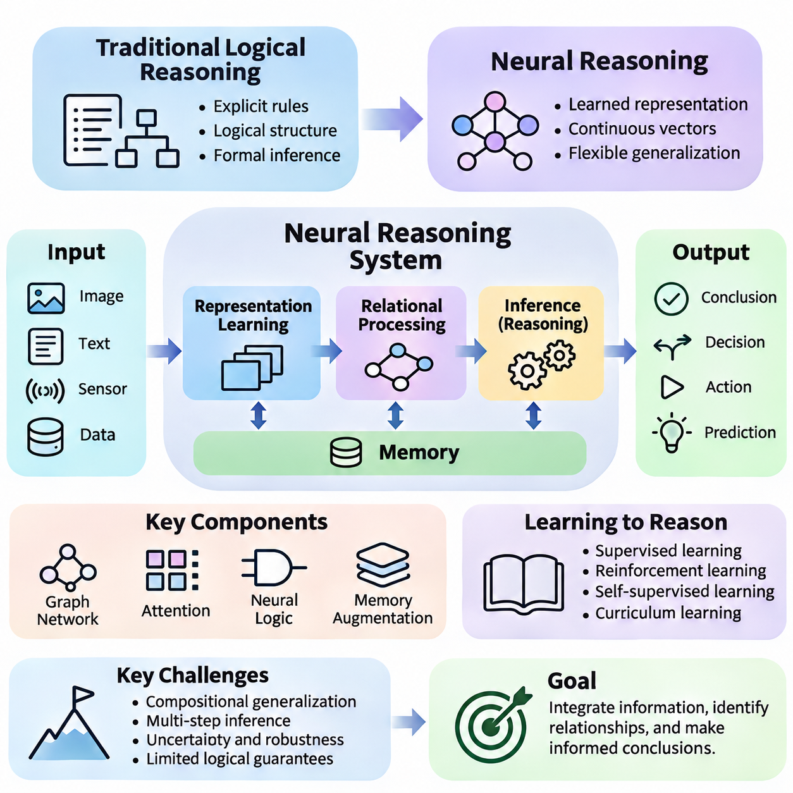{width="7.268055555555556in" height="7.268055555555556in"}

Neural reasoning is an approach to artificial intelligence that enables neural networks to learn patterns of inference, relationships, and decision-making from data. Unlike traditional symbolic reasoning, which depends on explicitly defined rules and logical structures, neural reasoning uses learned representations and computational transformations to approximate reasoning processes across complex and uncertain environments.

The central objective of neural reasoning is to move beyond simple pattern recognition toward systems capable of combining information, identifying relationships, and producing conclusions that depend on multiple pieces of evidence. A neural model may learn to compare objects, infer spatial relationships, predict consequences, or select actions by transforming input information into increasingly meaningful internal representations.

Traditional logical reasoning operates through formal statements, predicates, and inference rules that specify how conclusions follow from premises. Neural reasoning instead represents information through continuous numerical vectors and learned parameters. These representations support flexible generalization, although they do not inherently guarantee logical consistency, mathematical correctness, or the validity of every inferred conclusion.

A fundamental distinction between neural reasoning and conventional deep learning classification lies in the structure of the required computation. Classification generally maps an input to a predefined category, whereas reasoning may require several dependent transformations. For example, determining whether one object can reach another may involve recognizing objects, estimating their positions, identifying obstacles, and evaluating possible interactions.

Neural reasoning systems commonly begin by encoding raw observations into latent representations. Images, text, sensor measurements, and structured records are transformed into numerical features that capture relevant properties. Subsequent neural operations combine these features to estimate relationships, evaluate alternatives, and construct representations that support predictions or decisions within the intended task.

Representation learning plays a central role because the quality of reasoning depends on how effectively relevant information is encoded. Useful representations should preserve important relationships while reducing irrelevant variation. When a model learns meaningful abstractions, it may apply previously acquired relational patterns to unfamiliar examples, although successful transfer depends on training conditions and task complexity.

Relational reasoning is particularly important because many intelligent tasks involve interactions among multiple entities. A robot must understand relationships between obstacles, destinations, and available paths. A visual question-answering system may need to determine which object is behind another. Neural reasoning attempts to learn these relationships through architectures that explicitly or implicitly model interactions between entities.

Graph neural networks provide a natural framework for representing relational structures. Objects or concepts can be modeled as nodes, while relationships are represented as edges. Through message passing, nodes exchange information with their neighbors and update their internal states. Repeated updates allow information to propagate across the graph, supporting reasoning about dependencies and interactions involving multiple entities.

Attention mechanisms offer another approach by allowing neural networks to dynamically emphasize relevant information. Instead of treating every input component equally, attention assigns context-dependent weights to representations. Transformer architectures use attention to integrate information across sequences or sets, enabling complex contextual interactions, although attention alone does not establish reliable reasoning.

Neural reasoning can also incorporate differentiable approximations of logical operations. Neural logic models attempt to represent conjunction, disjunction, implication, or rule application through trainable mathematical functions. Such approaches seek to combine the adaptability of neural networks with aspects of structured inference, but their logical guarantees depend on the specific representation and implementation.

Memory is another essential component of reasoning systems that must integrate information across multiple stages. Memory-augmented neural networks maintain representations of previous observations, intermediate results, or relevant experiences. By retrieving and updating stored information, these architectures can support tasks requiring sequential decisions, multi-step dependencies, and reasoning over information that is not immediately available.

Learning to reason involves more than memorizing correct answers. Training procedures must encourage models to discover reusable computational patterns that generalize beyond familiar examples. Supervised learning, reinforcement learning, self-supervised learning, and curriculum-based training can provide different forms of learning signals, depending on whether the task supplies explicit answers, environmental rewards, or structural constraints.

A major challenge is compositional generalization, which concerns the ability to combine familiar concepts and relationships in unfamiliar configurations. A model may successfully solve examples involving known objects yet fail when those objects appear in new arrangements. Strong neural reasoning therefore requires representations and computational mechanisms that support systematic recombination rather than dependence on superficial statistical associations.

Another challenge involves multi-step inference, where the correctness of a conclusion depends on several intermediate operations. Small errors in entity identification, relationship estimation, or state representation may accumulate across reasoning stages. Architectures with iterative computation, external memory, structured intermediate states, or verification mechanisms can help address these difficulties, but they do not eliminate them automatically.

Neural reasoning also differs from probabilistic and causal reasoning in its primary computational formulation. Probabilistic reasoning explicitly models uncertainty through probability distributions, while causal reasoning examines interventions and cause-and-effect relationships. Neural reasoning uses learned computational representations and can incorporate probabilistic or causal components, but predictive accuracy alone does not establish causal understanding.

Neuro-symbolic reasoning extends this perspective by combining neural representations with symbolic knowledge and inference mechanisms. Neural components can extract concepts from complex observations, while symbolic components can apply explicit constraints or rules. This integration may improve interpretability and consistency in suitable applications, provided that errors in perception and symbolic grounding are carefully managed.

In robotics, neural reasoning connects perception with planning and action selection. An autonomous mobile robot may process camera images, LiDAR measurements, and environmental maps to identify objects and estimate their relationships. A reasoning model can then evaluate navigation constraints, predict interactions, and support task-level decisions, while dedicated planning and safety mechanisms enforce operational requirements.

Industrial applications provide additional examples of relational and sequential reasoning. Manufacturing inspection systems may need to connect observed defects with component locations and assembly dependencies. Logistics systems may evaluate relationships among vehicles, tasks, destinations, and resource constraints. Neural reasoning can support these operations by learning structured dependencies from operational data and historical outcomes.

Evaluation must distinguish genuine reasoning capability from memorization and shortcut learning. Conventional accuracy measurements may conceal failures when test examples resemble training distributions. More informative assessments examine systematic generalization, robustness to irrelevant changes, consistency across equivalent formulations, and performance on tasks requiring increasingly complex relational or sequential computations.

Interpretability remains an important concern because neural reasoning often occurs through distributed representations rather than human-readable inference rules. Attention visualizations, feature attribution, probing methods, and intermediate-state analysis may reveal aspects of model behavior. However, these techniques provide incomplete evidence about internal computation and should not automatically be treated as faithful explanations of reasoning.

Computational efficiency also influences practical neural reasoning architectures. Iterative inference, graph message passing, attention operations, and memory retrieval can increase processing requirements. Real-time systems must balance reasoning depth against latency, memory consumption, and energy constraints. Efficient deployment may require selective computation, model compression, hierarchical processing, or task-specific architectural optimization.

The broader significance of neural reasoning lies in its potential to connect learned perception with structured intelligence. By integrating representation learning, relational computation, attention, memory, and adaptable inference, neural systems can address problems that exceed straightforward input-output prediction. Their reliability ultimately depends on sound architectures, appropriate training objectives, rigorous evaluation, and integration with complementary reasoning methods.

Neural reasoning should therefore be understood as an evolving family of computational approaches rather than a single algorithm or a guaranteed substitute for formal logic. Its development provides a foundation for graph-based reasoning, neural logic, memory-augmented computation, meta-reasoning, and neuro-symbolic systems. Together, these approaches contribute toward artificial intelligence capable of more flexible, structured, and context-sensitive decision-making.

## 04.02 Limitations of Deep Learning

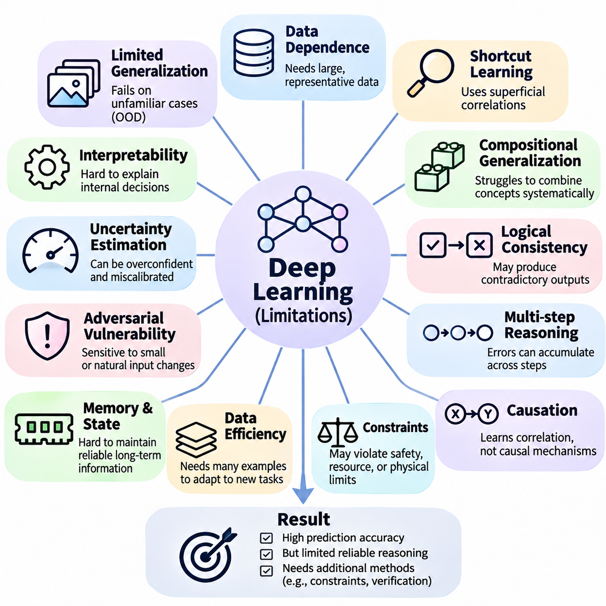{width="7.268055555555556in" height="7.268055555555556in"}

Deep learning has achieved remarkable success in image recognition, natural language processing, speech understanding, and autonomous systems. However, high predictive accuracy does not necessarily imply reliable reasoning capability. Neural networks primarily learn statistical relationships from training data, and these relationships may fail when a task requires explicit logical inference, systematic generalization, or understanding of unfamiliar situations.

One fundamental limitation is the dependence on large quantities of representative training data. Deep neural networks typically require extensive examples to learn complex patterns, particularly when training from scratch. When available data is limited, biased, or incomplete, learned representations may not capture the underlying structure of a problem. This dependence becomes especially problematic in environments where rare events are important.

Deep learning models frequently struggle with out-of-distribution generalization, which occurs when evaluation conditions differ substantially from the training environment. A model trained on familiar object arrangements may perform poorly when the same objects appear in unfamiliar configurations. Such failures indicate that successful prediction on conventional benchmarks does not automatically establish robust understanding of underlying relationships.

Another important limitation is shortcut learning, where a neural network exploits superficial correlations instead of learning the intended reasoning process. For example, an image classifier may associate an object with its typical background rather than identifying its defining characteristics. When these correlations change, predictions can become unreliable even though the relevant semantic information remains available.

Compositional generalization presents a particularly significant challenge for neural reasoning. Humans can often combine familiar concepts into novel structures and apply known rules to previously unseen combinations. Neural networks may instead learn representations closely associated with observed examples. Consequently, they can struggle when tasks require systematic recombination of concepts, relationships, or operations.

Logical consistency is another area where conventional deep learning may exhibit weaknesses. Neural models can produce outputs that appear plausible individually but contradict one another across related questions. Unlike formal reasoning systems, standard neural architectures do not inherently enforce logical validity. Additional constraints, structured representations, or verification mechanisms may be necessary when consistency is essential.

Multi-step reasoning introduces further difficulties because successful conclusions depend on the correctness of intermediate computations. A model may perform individual operations accurately while failing to combine them across longer reasoning sequences. Errors can accumulate as the number of dependencies increases, particularly when intermediate states are represented implicitly rather than explicitly maintained and verified.

Deep learning also faces challenges in distinguishing correlation from causation. Statistical associations learned from observational data do not necessarily reveal how interventions change outcomes. A neural network may predict an event accurately without identifying the mechanisms responsible for it. Reliable causal reasoning generally requires additional assumptions, appropriate data, or explicitly designed causal modeling methods.

Interpretability remains a major limitation because neural networks often distribute information across millions or billions of parameters. Their internal representations do not directly correspond to human-readable rules or explanations. Although visualization, feature attribution, and probing methods provide useful insights, they rarely establish a complete or uniquely determined explanation of the computations responsible for a prediction.

Uncertainty estimation is another critical concern. Neural networks can produce highly confident predictions even when encountering unfamiliar inputs or ambiguous evidence. Confidence scores derived from output probabilities do not automatically represent calibrated uncertainty. Reliable systems therefore require careful calibration, uncertainty-aware modeling, and mechanisms for detecting conditions outside their validated operating domain.

Adversarial vulnerability demonstrates how small input modifications can cause unexpected prediction failures. Carefully constructed perturbations may change model outputs despite having little perceptual significance to humans. More generally, natural changes in illumination, sensor noise, viewpoint, or environmental conditions can reduce performance. Robustness must therefore be evaluated beyond conventional test accuracy.

Memory and persistent state management also create challenges for reasoning-intensive applications. Standard feedforward networks process inputs without maintaining an explicit history of previous decisions. Although recurrent networks, transformers, and memory-augmented architectures can represent historical information, reliable long-term retrieval and consistent state updates remain difficult, especially across extended sequences of dependent operations.

Deep learning systems may also struggle to represent explicit constraints. Many real-world problems require solutions that satisfy safety limits, resource restrictions, logical dependencies, or physical laws. A purely learned predictor may generate outputs that violate these requirements. Constraint-aware architectures, optimization procedures, and symbolic validation can help ensure that generated decisions remain within acceptable boundaries.

Data efficiency becomes particularly important when models must adapt to changing environments. Conventional supervised learning often relies on repeated training with labeled examples, which can be expensive or impractical. Transfer learning, self-supervised learning, and few-shot adaptation reduce some of these requirements, but reliable adaptation to substantially unfamiliar tasks remains an active research challenge.

Catastrophic forgetting presents another difficulty when neural networks learn tasks sequentially. Updating model parameters for new information can degrade previously acquired capabilities. This problem complicates continual learning in systems expected to operate over long periods. Replay mechanisms, parameter regularization, modular architectures, and other continual-learning strategies can mitigate forgetting without completely eliminating it.

Computational cost is an additional limitation of modern deep learning. Large models may require substantial processing power, memory capacity, training data infrastructure, and electrical energy. Reasoning architectures that perform repeated inference or process extensive contextual information can further increase computational demands. Practical deployment therefore requires balancing model capacity, reasoning performance, latency, and resource efficiency.

Real-time autonomous systems expose these limitations particularly clearly. A robot must interpret sensor measurements, maintain environmental awareness, evaluate constraints, and select actions under strict timing requirements. A neural model that performs well in offline experiments may fail when exposed to unexpected obstacles, sensor degradation, or changing operational conditions. Safety-critical decisions require additional validation and control safeguards.

The difficulty of evaluating reasoning capability creates another important challenge. Conventional benchmarks often emphasize final-answer accuracy without determining whether a model learned reusable inference procedures. Strong performance may result from memorization, dataset contamination, or statistical shortcuts. More rigorous evaluation should examine systematic generalization, intermediate correctness, robustness, and performance under controlled distribution changes.

Neural networks also face limitations in transferring knowledge across different levels of abstraction. Recognizing individual objects does not automatically provide an understanding of their functional relationships, and predicting actions does not necessarily establish knowledge of long-term consequences. Effective reasoning requires connecting low-level observations with higher-level concepts, goals, constraints, and structured representations.

These limitations motivate research into architectures that incorporate explicit relational computation, iterative inference, external memory, and structured knowledge. Graph neural networks support reasoning over interconnected entities, while attention mechanisms enable context-dependent information integration. Differentiable logic and neuro-symbolic methods provide additional approaches for combining learned representations with more structured forms of inference.

The limitations of deep learning should not be interpreted as evidence that neural networks cannot perform reasoning. Rather, they reveal that reasoning capability depends on architecture, training objectives, data distribution, computational resources, and evaluation methodology. Understanding these constraints is essential for designing neural reasoning systems that are more reliable, interpretable, adaptable, and capable of generalizing beyond familiar examples.

## 04.03 Reasoning with Neural Networks

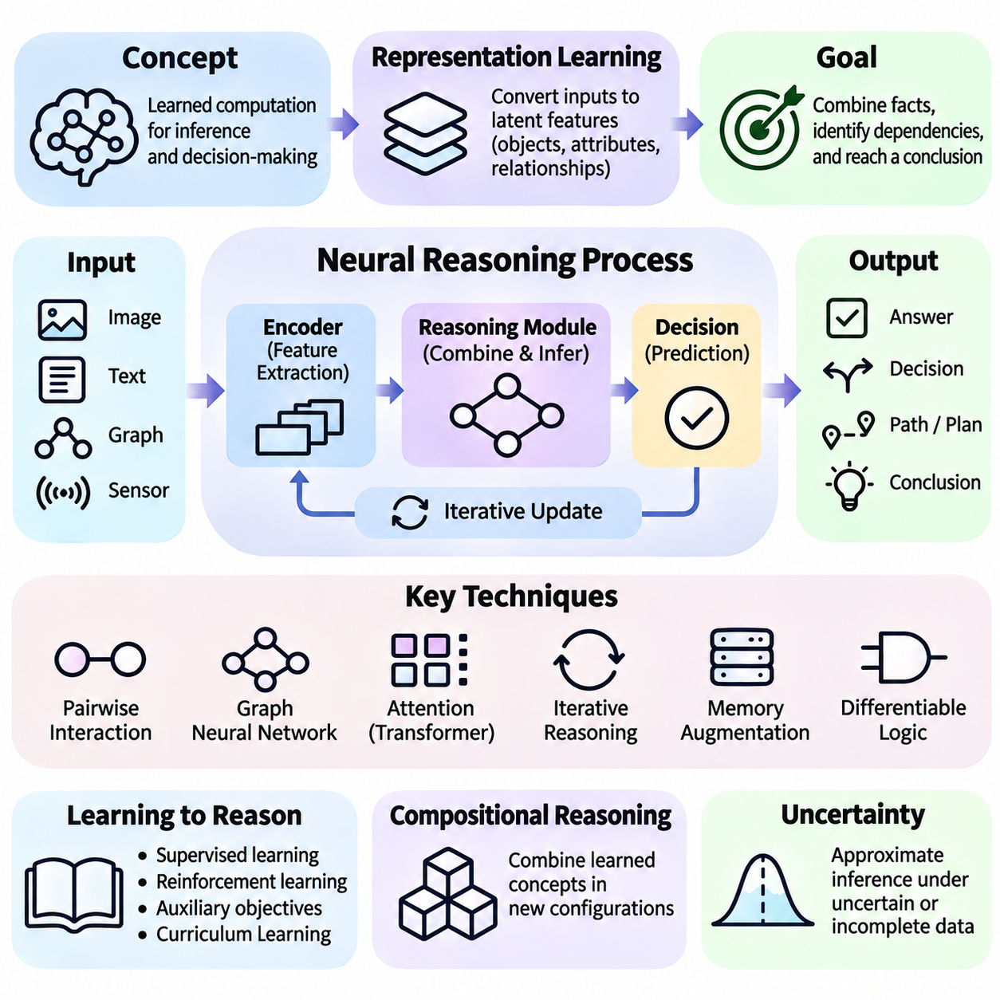{width="7.268055555555556in" height="7.268055555555556in"}

Reasoning with neural networks involves learning computational mechanisms that transform observations into representations capable of supporting structured inference and decision-making. Unlike conventional prediction tasks, reasoning often requires combining multiple facts, identifying dependencies, and evaluating intermediate conclusions. Neural architectures approach these challenges through learned transformations, iterative computation, and representations that encode relevant relationships.

The foundation of neural reasoning lies in representation learning, where raw inputs are converted into numerical features that preserve information required for inference. Images, language, graphs, and sensor measurements can be encoded into latent vectors representing objects, attributes, and contextual relationships. Effective reasoning depends on whether these representations capture meaningful structure rather than superficial correlations within the training data.

A typical neural reasoning process begins with an encoder that extracts relevant features from the input. These features are subsequently processed by computational modules that combine information, estimate relationships, or update internal states. A final prediction or decision module interprets the resulting representation. This architecture can support reasoning-like behavior, although the presence of multiple processing stages does not automatically establish logical validity.

Relational reasoning is a central capability because many problems depend on interactions among entities rather than isolated observations. A neural network may need to determine whether one object supports another, whether two events are connected, or whether a robot can navigate between locations. Such tasks require representations that preserve entity identities and relationships while supporting computations across multiple interacting components.

One approach to relational reasoning uses pairwise interaction models that evaluate relationships between combinations of entities. Each entity is represented by a feature vector, and a shared neural function processes pairs of vectors to produce relational information. Aggregating these interactions enables the model to answer questions involving multiple objects, although computational requirements may increase rapidly as the number of entities grows.

Graph neural networks extend relational computation by organizing information into nodes and edges. Nodes represent entities, while edges describe relationships or possible interactions. During message passing, each node receives information from connected neighbors and updates its representation. Repeated message-passing operations allow neural networks to capture dependencies extending beyond immediate connections within a graph.

Attention mechanisms provide another means of integrating relevant information during reasoning. Attention weights are computed from relationships among learned representations, allowing a network to emphasize contextually important elements. Transformer architectures use self-attention to model interactions across sequences or sets. Their flexibility supports complex information integration, although attention patterns alone do not guarantee systematic inference.

Iterative reasoning enables neural networks to refine internal representations through repeated computational steps. Instead of producing an answer through a single transformation, an iterative model updates its state as additional relationships or constraints are considered. This approach can support multi-step tasks, but reliable performance depends on effective state management, appropriate training objectives, and sufficient computational depth.

Memory-augmented neural networks introduce mechanisms for storing and retrieving information during inference. External memory structures can preserve observations, intermediate results, or previously learned associations. A reasoning controller may retrieve relevant information, update memory contents, and continue computation. Such architectures are useful when tasks require information integration across extended sequences or multiple dependent decisions.

Neural reasoning can also incorporate differentiable approximations of logical operations. Differentiable logic models represent aspects of conjunction, disjunction, implication, or rule application through continuous mathematical functions. These methods allow gradient-based optimization while introducing structured reasoning constraints. However, approximate logical operations do not necessarily provide the formal guarantees associated with symbolic theorem proving.

Learning reasoning procedures requires training objectives that reward appropriate intermediate computations rather than only superficial answer patterns. Supervised learning may provide examples of correct relationships or final conclusions, while reinforcement learning can reward successful sequential decisions. Auxiliary objectives, structured supervision, and curriculum learning may encourage reusable inference mechanisms, although their effectiveness depends on task design.

Compositional reasoning concerns the ability to combine previously learned concepts into unfamiliar configurations. A neural model may learn relationships such as containment, adjacency, or dependency and then apply them to new combinations of entities. Achieving this capability requires representations that preserve relevant structural properties and training conditions that discourage reliance on memorized examples or dataset-specific shortcuts.

Neural reasoning also supports approximate inference under uncertainty. When observations are incomplete or noisy, a network may estimate plausible relationships or hidden states using learned statistical patterns. Probabilistic neural models can represent uncertainty more explicitly through distributions or latent variables. Nevertheless, predictive confidence must be calibrated, and approximate inference should not be confused with logically guaranteed conclusions.

Temporal reasoning extends neural inference to sequences of events and changing system states. Recurrent neural networks, temporal transformers, and state-space models can represent dependencies across time. These architectures may predict future conditions, infer event relationships, or support sequential decisions. Their effectiveness depends on maintaining relevant historical information while avoiding accumulated errors and irrelevant dependencies.

Spatial reasoning requires understanding positions, orientations, distances, and geometric relationships. Neural networks can learn spatial representations from images, point clouds, and other sensor measurements. Geometric neural architectures may incorporate coordinate systems, relative transformations, or equivariant operations. Such inductive biases can improve generalization when spatial relationships remain consistent across different viewpoints or environments.

In robotics, neural reasoning connects perception with planning and control. A mobile robot may identify obstacles, estimate navigable regions, and evaluate relationships between its current position and destination. Learned relational models can support route selection or interaction prediction, while explicit planners and safety controllers enforce operational constraints. This separation is important when decisions must satisfy real-time requirements.

A practical reasoning architecture often combines specialized neural components rather than relying on a single undifferentiated network. Perception modules extract observations, relational modules estimate dependencies, memory components preserve context, and decision modules select outputs. Modular organization can improve maintainability and facilitate targeted evaluation, although communication errors between modules may still affect overall reasoning performance.

Evaluation of neural reasoning must examine more than final prediction accuracy. Relevant tests include relational consistency, multi-step inference accuracy, compositional generalization, robustness to distribution shifts, and sensitivity to irrelevant input changes. Controlled experiments can determine whether a model uses meaningful structural information or exploits statistical shortcuts that fail under unfamiliar conditions.

Interpretability and verification are particularly important when neural reasoning supports consequential decisions. Intermediate representations, attention distributions, and feature attribution methods can provide partial evidence about model behavior. Additional symbolic checks, constraint validation, or external verification can assess whether outputs satisfy explicit requirements. Such mechanisms improve assurance without making the underlying neural computation fully transparent.

Computational efficiency influences the design of practical reasoning systems. Pairwise interactions, graph message passing, iterative updates, and attention operations can increase processing time and memory consumption. Real-time applications may require sparse connectivity, selective attention, limited reasoning iterations, or hierarchical computation. The appropriate architecture depends on the complexity of required relationships and available hardware resources.

Neural reasoning becomes especially valuable when combined with complementary approaches. Symbolic systems provide explicit rules and constraints, probabilistic models represent uncertainty, and causal models support reasoning about interventions. Neural components contribute flexible perception and learned representations. Integrating these capabilities can produce systems that handle complex observations while maintaining stronger structural and operational constraints.

The development of reasoning with neural networks represents a transition from recognizing statistical patterns toward learning structured computational relationships. Graph-based processing, attention, memory, iterative inference, and differentiable logic provide complementary mechanisms for this transition. Their combined potential lies in building systems that generalize across configurations, integrate evidence, and support reliable decisions under changing conditions.

Ultimately, successful neural reasoning depends on aligning representations, architectures, training objectives, and evaluation methods with the structure of the target problem. Increasing model size alone does not guarantee systematic reasoning or dependable generalization. Progress requires explicit attention to relational structure, intermediate computation, uncertainty, verification, and the operational constraints of real-world intelligent systems.

## 04.04 Graph Neural Networks

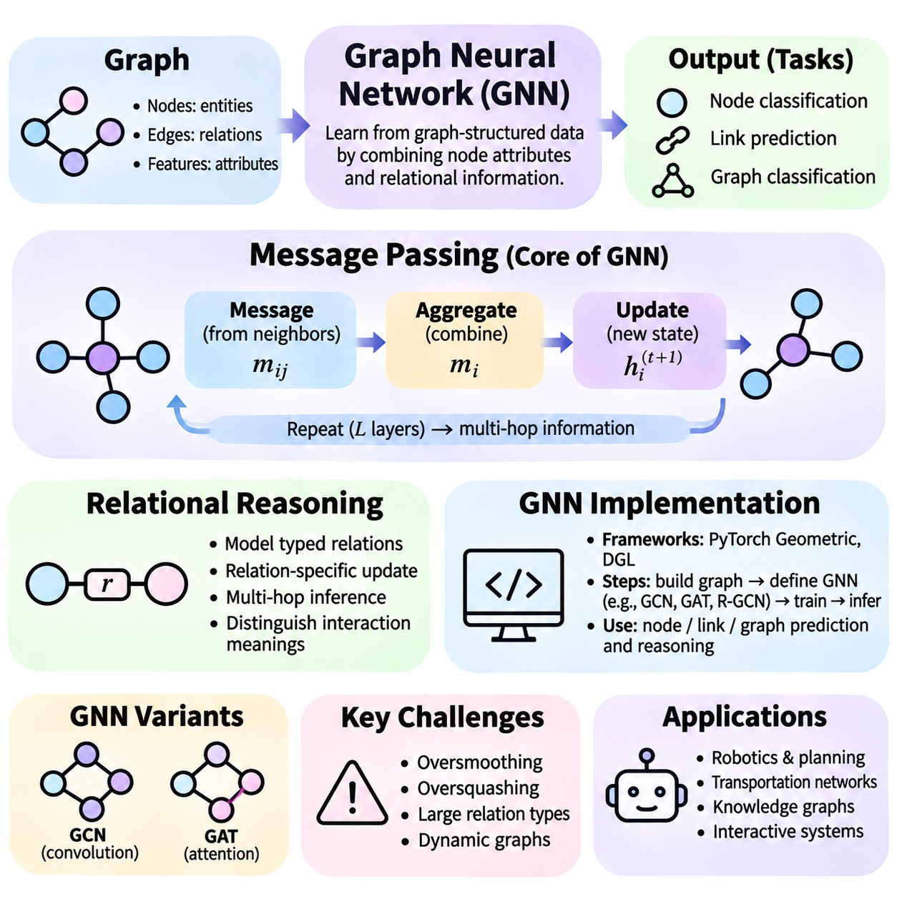{width="7.268055555555556in" height="7.268055555555556in"}

Graph neural networks are neural architectures designed to learn from data represented as interconnected entities and relationships. Unlike conventional networks that primarily process regular structures such as images or sequences, graph neural networks operate on irregular graph structures. Their central advantage is the ability to combine entity attributes with relational information, supporting structured prediction and reasoning across complex systems.

A graph consists of nodes representing entities and edges describing relationships between them. Nodes may represent objects, people, sensors, locations, or abstract concepts, while edges can encode physical connections, semantic associations, or interactions. Each node and edge may contain numerical features. Graph neural networks transform these features into learned representations that reflect both local attributes and relational context.

Message passing is the fundamental computational mechanism used by many graph neural networks. During each message-passing layer, nodes receive information from connected neighbors and combine it with their existing representations. The resulting updates allow information to propagate through the graph. Repeating this process enables nodes to incorporate increasingly distant structural information, although excessive propagation may introduce additional limitations.

A typical message-passing operation consists of message construction, aggregation, and state updating. A learnable function generates messages using neighboring node features and optionally edge attributes. An aggregation function combines incoming messages through operations such as summation, averaging, or maximum selection. An update function then integrates the aggregated information with the receiving node\'s current representation.

Aggregation functions must generally be invariant to the ordering of neighboring nodes because graph connectivity does not imply a fixed sequence. Summation preserves information about the quantity of contributing neighbors, while averaging normalizes their combined influence. Maximum aggregation emphasizes strongly activated features. Selecting an appropriate aggregation mechanism depends on the structural properties and reasoning requirements of the target application.

Graph convolutional networks implement message passing by combining neighboring features through normalized graph connectivity. Their layers propagate information across adjacent nodes while applying trainable transformations. Graph attention networks extend this process by assigning learned importance weights to neighboring entities. These approaches provide different mechanisms for integrating relational information, with tradeoffs involving computational cost and expressive capacity.

The depth of a graph neural network influences the range of relationships available to each node. A single message-passing layer generally incorporates information from immediate neighbors, while multiple layers extend the receptive field across additional graph connections. However, increasing depth can cause oversmoothing, where node representations become excessively similar, or oversquashing, where substantial information is compressed into limited representations.

Relational reasoning extends graph computation beyond simple connectivity by considering the meaning and type of interactions. In a transportation network, edges may represent travel routes, distances, or traffic conditions. In a knowledge graph, relationships may describe ownership, location, or dependency. A relational reasoning model must distinguish these meanings rather than treating every connection as an equivalent source of information.

Relational graph neural networks incorporate edge types or relation-specific transformations into message computation. Different relationships can influence node representations through separate parameters or shared parameterized functions. This approach enables the model to learn how particular interactions affect inference. However, large numbers of relation types can increase parameter requirements and create challenges when observations are sparse.

Multi-hop relational reasoning involves drawing conclusions from sequences of connected relationships. For example, a system may infer that a component is indirectly affected by a failure through several dependency links. Repeated message passing can propagate relevant information across these connections. Successful inference depends on preserving meaningful distinctions among paths, entities, and relationship types during propagation.

Graph neural networks can support node-level, edge-level, and graph-level predictions. Node classification assigns properties or categories to individual entities, while link prediction estimates missing or potential relationships. Graph classification evaluates properties of an entire interconnected structure. These prediction tasks can serve as components of reasoning systems, although predictive success alone does not establish logically valid inference.

In physical AI and robotics, graph representations provide a useful abstraction for interacting objects and system components. Nodes may represent robots, obstacles, navigation regions, or operational tasks, while edges describe spatial proximity, communication links, or dependencies. A graph neural network can estimate interaction patterns and support planning decisions, while explicit safety constraints remain necessary for reliable autonomous operation.

Dynamic graph neural networks extend relational modeling to systems whose entities or connections change over time. In a robot fleet, communication availability, task assignments, and spatial relationships may evolve continuously. Dynamic models update graph representations as observations change, enabling temporal relational reasoning. Maintaining consistency across changing graph structures remains an important engineering challenge.

Implementing a graph neural network begins with defining the graph representation and prediction objective. Developers identify node features, edge attributes, connectivity information, and target outputs. Graph data is commonly represented using feature matrices and edge-index structures or sparse adjacency matrices. Appropriate preprocessing ensures that entity identifiers, relationship directions, and feature dimensions remain consistent throughout training.

A practical implementation can use PyTorch Geometric or Deep Graph Library to construct message-passing architectures. These frameworks provide graph convolution, attention layers, neighborhood sampling, and batching utilities. A typical model applies several graph-processing layers, nonlinear activation functions, and a task-specific output module. The implementation should preserve permutation-invariant aggregation and handle variable graph sizes.

Training graph neural networks generally involves defining a differentiable loss function and optimizing model parameters through backpropagation. Node classification may use cross-entropy loss, while link prediction may use binary classification or ranking objectives. Graph-level regression can employ numerical prediction losses. Training quality depends on representative graph data, suitable optimization settings, and careful separation of training and evaluation information.

Graph datasets require particular attention to information leakage because connected entities may share structural dependencies. Randomly separating nodes or edges can produce overly optimistic results when evaluation information remains indirectly accessible through the graph. Transductive and inductive evaluation settings should therefore be distinguished, and data splitting procedures must reflect the intended deployment conditions.

Scalability becomes challenging when graphs contain millions of nodes or dense connectivity. Full-neighborhood aggregation may require substantial memory and computation, particularly across multiple layers. Neighbor sampling, graph partitioning, mini-batch training, and sparse operations can reduce resource demands. However, sampling may discard relevant relationships, creating a tradeoff between computational efficiency and reasoning completeness.

Graph neural network performance also depends on the relationship between graph structure and the target task. Homophilic graphs often connect entities with similar properties, while heterophilic graphs may connect dissimilar entities. Architectures that work well under one structural assumption may perform poorly under another. Effective model selection therefore requires examining graph topology, feature distributions, and the semantic meaning of connections.

Expressive limitations remain important because standard message-passing architectures cannot distinguish every possible graph structure. Certain configurations produce identical aggregated representations even when their global properties differ. More expressive approaches may incorporate positional encodings, higher-order interactions, subgraph representations, or additional structural features. These extensions can improve discrimination while increasing computational complexity.

Evaluation of graph-based reasoning should examine relational generalization rather than relying exclusively on conventional prediction accuracy. Useful tests include unseen graph structures, new combinations of entities, longer dependency paths, and changes in graph size. Robustness to missing edges, noisy attributes, and incorrect relationships is also important, particularly when graph construction depends on imperfect perception or external data sources.

Interpretability and verification are essential when graph neural networks influence consequential decisions. Attention weights, edge attribution, subgraph explanations, and intermediate node representations can provide partial insights into model behavior. However, these explanations do not automatically establish causal or logical validity. Explicit constraints and independent verification can help determine whether predicted relationships satisfy operational requirements.

The integration of message passing, relational reasoning, and practical implementation provides a foundation for structured neural intelligence. Graph neural networks enable information exchange among connected entities, learn interaction-dependent representations, and support inference across complex relational systems. Their effectiveness ultimately depends on graph quality, architectural expressiveness, computational efficiency, and rigorous evaluation under realistic conditions.

## 04.05 Attention and Reasoning

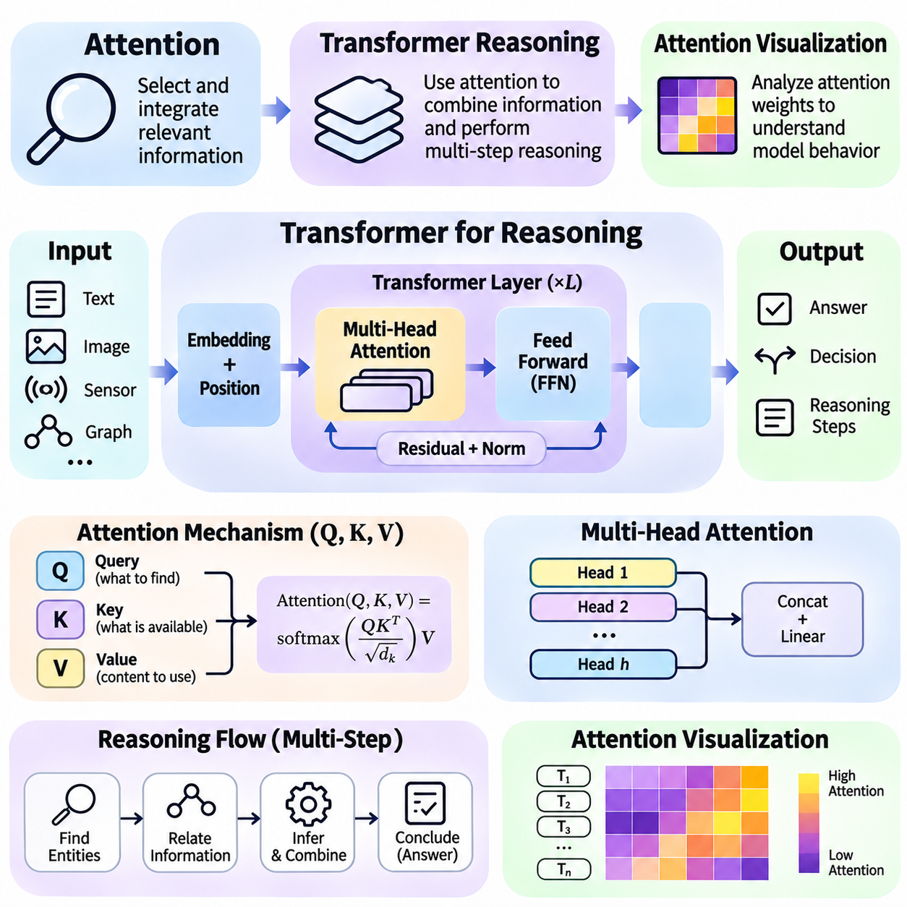{width="7.268055555555556in" height="7.268055555555556in"}

Attention mechanisms provide neural networks with a flexible method for selecting and integrating information relevant to a particular computational objective. Rather than processing every input element with identical influence, attention assigns context-dependent weights to representations. This capability is especially important for reasoning tasks that require identifying relationships, combining evidence, and maintaining dependencies across complex inputs.

The fundamental attention operation uses queries, keys, and values derived from learned representations. A query expresses the information being sought, while keys characterize available information and values contain content to be aggregated. Similarity scores between queries and keys determine attention weights, which are normalized and applied to values. The resulting representation integrates information according to learned contextual relevance.

Scaled dot-product attention computes similarity through matrix multiplication and adjusts scores according to the dimensionality of the key vectors. Softmax normalization converts these scores into weights that sum to one across available positions. This formulation supports efficient parallel computation on modern accelerators. However, high attention weights indicate computational influence within a layer rather than guaranteed semantic importance or causal explanation.

Self-attention allows elements within the same input sequence to exchange information directly. Each token can incorporate representations from other permitted positions, enabling the model to capture contextual dependencies without relying exclusively on sequential recurrence. In language reasoning, this mechanism can connect entities, attributes, and references across a sentence or document. Its effectiveness depends on learned representations and appropriate attention constraints.

Multi-head attention extends this mechanism by computing several attention patterns through separate learned projections. Different heads can represent complementary relationships, including local context, syntactic dependencies, or long-range associations. Their outputs are combined through another learned transformation. Although individual heads sometimes exhibit recognizable patterns, their functions are not necessarily independent or consistently interpretable.

Transformer architectures integrate attention with feedforward transformations, residual connections, and normalization operations. Positional information is introduced because attention alone does not inherently encode sequence order. Repeated transformer layers progressively transform contextual representations. These architectural components support flexible information processing, but reasoning performance also depends on training objectives, data quality, and computational depth.

Transformer reasoning refers to the use of transformer-based models for tasks involving inference, relational integration, planning, and structured decision-making. Such models can learn to combine information distributed across input sequences and generate outputs reflecting multiple dependencies. However, successful completion of reasoning benchmarks does not automatically demonstrate that a model has learned general-purpose logical procedures.

Autoregressive transformers generate outputs sequentially by predicting subsequent tokens from preceding context. This process can produce intermediate explanations, calculations, and proposed reasoning steps. Explicit intermediate text may improve performance on some multi-step tasks by providing additional computational structure. Nevertheless, generated reasoning traces can contain errors or explanations that do not faithfully represent the model\'s internal computations.

Multi-step transformer reasoning often involves maintaining relevant facts while applying successive transformations. A model solving a relational question may identify entities, retrieve associated attributes, compare dependencies, and construct a conclusion. Attention facilitates information exchange among these representations, while feedforward layers contribute nonlinear computation. Reliability decreases when intermediate dependencies are lost or incorrect assumptions propagate.

Cross-attention supports information exchange between different representation sources. In encoder-decoder architectures, decoder queries attend to representations produced by an encoder. Multimodal systems can use related mechanisms to integrate language, images, sensor measurements, or structured observations. This capability supports reasoning across heterogeneous information, provided that relevant features are aligned and appropriately represented.

Attention mechanisms are also applicable to spatial and relational reasoning. Vision transformers process image patches as tokens, enabling interactions across different visual regions. Graph transformers incorporate structural information to model relationships among connected entities. In robotics, attention-based models may integrate observations from cameras, LiDAR, and task descriptions to support environmental interpretation and action selection.

Long-context reasoning presents substantial computational and representational challenges. Standard full self-attention requires pairwise interactions among sequence positions, producing quadratic growth in attention computation and score storage with sequence length. Sparse attention, sliding windows, memory mechanisms, and efficient attention kernels can reduce practical costs. However, processing longer contexts does not guarantee reliable retrieval or reasoning across distant information.

Attention visualization provides a method for examining how attention weights are distributed across input elements. Researchers can extract attention matrices from transformer layers and inspect relationships between query and key positions. These matrices may reveal local concentration, broad information exchange, or repeated structural patterns. Visualization is useful for exploratory analysis, although it should not be treated as a complete explanation of model behavior.

A common visualization approach represents attention weights as a heatmap, where rows correspond to query positions and columns correspond to key positions. Cell intensity reflects the normalized attention weight assigned to each connection. Comparing heatmaps across layers and heads can reveal differences in information routing. Appropriate interpretation requires accounting for padding masks, causal masks, tokenization, and sequence boundaries.

Attention visualization can also be applied to individual tokens or selected input regions. An analyst may examine which earlier words receive attention when a model processes a pronoun, mathematical expression, or relational statement. In visual models, patch-level attention can be projected onto corresponding image regions. These observations can suggest potential dependencies but cannot independently establish which features caused a prediction.

Implementing attention visualization commonly involves accessing attention tensors through model hooks or framework-supported output options. In PyTorch and transformer libraries, attention weights may be available when the relevant model configuration exposes them. The tensors are typically organized by batch, head, query position, and key position. Some optimized attention implementations require alternative settings to return explicit weight matrices.

A reliable visualization workflow begins by selecting an input example and recording its tokenization or spatial partitioning. The model is executed while retaining relevant attention outputs, which are then associated with corresponding input positions. Analysts can inspect individual heads, average selected heads, or compare multiple layers. Each aggregation choice changes the information displayed and may conceal important differences.

Attention rollout attempts to approximate information propagation across multiple transformer layers by combining attention matrices. This technique can provide a broader perspective than inspecting a single layer. However, residual connections, nonlinear transformations, and interactions among attention heads complicate interpretation. Rollout therefore provides a heuristic representation of possible information flow rather than a definitive causal explanation.

The relationship between attention and interpretability remains an important research question. Attention weights describe one component of a model\'s computation, but value projections and downstream transformations also determine the final output. Two models may produce similar predictions with different attention distributions. Consequently, attention visualization should be complemented by perturbation tests, feature attribution, and controlled interventions.

Attention-based reasoning can exhibit failures when models focus on misleading correlations or irrelevant contextual elements. Long sequences may contain distractors that compete with necessary evidence, while unfamiliar input structures can disrupt learned attention patterns. Evaluation should therefore include controlled variations in context length, evidence placement, distractor density, and relational complexity rather than relying only on final-answer accuracy.

In practical autonomous systems, attention mechanisms can help prioritize relevant observations while processing complex sensor inputs. A robot may need to emphasize nearby obstacles, navigation goals, or changing task constraints. However, attention-based prioritization cannot replace explicit safety validation, geometric reasoning, or real-time control guarantees. Deployment requires careful assessment of latency, robustness, and computational resource consumption.

The combination of transformer reasoning and attention visualization provides both a powerful computational framework and a partial means of examining information integration. Transformers support flexible contextual interactions, while visualization exposes selected patterns within their attention operations. Their effective use requires recognizing the distinction between learned information routing, demonstrated reasoning capability, and verified logical correctness.

Ultimately, attention contributes to neural reasoning by enabling context-sensitive information selection and interaction across representations. Transformer architectures extend this capability through repeated attention and nonlinear computation, supporting increasingly complex inference tasks. Attention visualization assists analysis and debugging, but dependable reasoning requires complementary evaluation, uncertainty handling, structural constraints, and independent verification.

## 04.06 Neural Logic Models

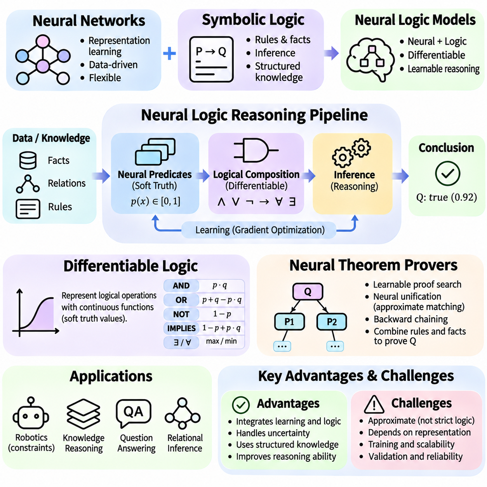{width="7.268055555555556in" height="7.268055555555556in"}

Neural logic models combine the representation-learning capabilities of neural networks with the structured inference principles of symbolic logic. Their objective is to support reasoning over facts, relations, and rules while retaining compatibility with gradient-based learning. By representing logical operations through differentiable computations, these models can integrate uncertain observations with structured knowledge and learn parameters from data.

Traditional symbolic logic relies on discrete truth values, explicit rules, and formally defined inference procedures. Neural networks instead operate on continuous representations optimized through numerical methods. Neural logic models bridge these approaches by introducing mathematical structures that approximate logical relationships. This integration provides flexibility, although approximate inference does not automatically preserve classical logical guarantees.

Differentiable logic represents logical expressions using continuous functions that permit gradient propagation. Instead of restricting propositions to strictly true or false values, many formulations assign degrees of truth within a continuous interval. Logical conjunction, disjunction, and negation can then be modeled using differentiable or almost-everywhere differentiable operators. The selected semantics determine how uncertainty and logical composition interact.

Fuzzy logic provides an important mathematical foundation for differentiable reasoning. Truth values are commonly represented between zero and one, while conjunction and disjunction are implemented through suitable operators. Product-based conjunction, minimum-based operations, and probabilistic-style combinations offer different behaviors. These alternatives influence gradient stability, logical interpretation, and the ability to learn from imperfect observations.

Logical implication introduces additional complexity because its continuous interpretation depends on the chosen logical semantics. Some systems construct implication from negation and disjunction, while others employ fuzzy implication operators. Quantifiers may be approximated through aggregation over available entities. These operations allow neural models to evaluate structured formulas, but their results depend on the domain representation and aggregation assumptions.

A differentiable logic system typically begins by encoding entities, attributes, and relations into numerical representations. Neural predicates estimate the degree to which statements hold for particular objects or object combinations. Logical formulas combine these predicate values through continuous operators. A training objective then encourages consistency between observed examples, learned predicates, and selected logical constraints.

Knowledge-based constraints can guide neural learning by expressing relationships that predictions should satisfy. For example, a robotic navigation model may encode restrictions involving obstacle occupancy, reachable locations, and permitted movements. Differentiable penalties discourage violations during optimization. However, soft penalties do not guarantee satisfaction, so safety-critical applications may require independent constraint checking.

Neural logic networks extend differentiable reasoning by learning combinations of logical operations from data. Their architectures may contain modules resembling conjunction, disjunction, or rule composition, with parameters controlling the influence of individual predicates. Such models can discover useful relational patterns while maintaining some structural interpretability. Nevertheless, learned operations may remain approximate and sensitive to training conditions.

Rule learning is another important capability of neural logic models. Instead of relying entirely on manually specified knowledge, a system may infer candidate relationships from observed facts and examples. Differentiable rule induction allows parameters associated with predicates or rule structures to be optimized. The resulting rules can support generalization, although their validity must be evaluated beyond the training distribution.

Neural theorem provers seek to combine logical proof procedures with learned representations. Classical theorem proving derives conclusions by applying inference rules to established premises. Neural approaches introduce continuous similarity functions or learned selection mechanisms into parts of this process. Their objective is to make structured proof search compatible with statistical learning while retaining meaningful relationships between premises and conclusions.

A neural theorem prover may represent facts and rules as logical clauses containing predicates, variables, and constants. During inference, the system attempts to match a query with relevant facts or rule conclusions. Traditional unification requires exact symbolic compatibility, whereas neural unification can compare learned embeddings. This permits approximate matching between related predicates, although similarity does not establish logical equivalence.

Differentiable unification is a central mechanism in several neural theorem-proving architectures. Symbolic terms are associated with continuous representations, and a similarity function estimates how well candidate expressions match. These scores influence subsequent proof operations and may be optimized through gradient descent. The approach can tolerate incomplete or imperfect knowledge but introduces uncertainty into the interpretation of proof validity.

Backward chaining provides a useful framework for neural theorem proving. Starting from a target query, the system identifies rules whose conclusions could support the query and recursively evaluates their premises. Neural similarity functions can rank or score possible matches during this process. The resulting proof paths represent candidate explanations, although approximate matching means they should not automatically be treated as formally valid proofs.

Forward chaining offers a complementary strategy by repeatedly applying rules to known facts and deriving additional statements. Neural implementations can approximate rule activation and aggregate candidate conclusions through differentiable operations. This approach supports iterative knowledge propagation and relational inference. However, unrestricted rule expansion can increase computational demands and amplify incorrect or uncertain conclusions.

Proof search complexity remains a significant challenge for neural theorem provers. Large knowledge bases may contain many candidate facts, rules, and variable assignments. Exploring all possible proof paths can become computationally infeasible. Practical systems therefore use bounded search depth, candidate pruning, learned retrieval, or restricted rule structures. These approximations improve efficiency but may exclude valid reasoning paths.

Training neural theorem provers requires objectives that connect proof behavior with desired conclusions. Supervised examples may identify correct answers, relevant facts, or valid proof steps. Some architectures learn from final query outcomes without explicit proof annotations. Negative examples and consistency constraints can improve discrimination. Nevertheless, models may exploit embedding similarities without learning the intended logical relationships.

Knowledge graphs provide a natural application domain for neural theorem proving. Entities and relations can be expressed as logical facts, while rules describe patterns connecting multiple relationships. A neural prover may infer missing links by evaluating chains of related facts and learned rules. This capability is useful for knowledge completion and question answering, although inferred relationships should be distinguished from verified facts.

Differentiable logic and neural theorem proving address related but distinct problems. Differentiable logic focuses on expressing logical constraints and operations through trainable continuous functions. Neural theorem proving emphasizes deriving conclusions through structured proof procedures that incorporate learned matching or guidance. Combining both approaches can support systems that learn relational representations while performing constrained, multi-step inference.

Implementation commonly relies on automatic differentiation frameworks such as PyTorch. Developers define predicate representations, continuous logical operators, rule evaluation procedures, and task-specific loss functions. A differentiable reasoning model can then be optimized through backpropagation. Numerical stability requires attention to gradient saturation, aggregation behavior, and the treatment of uncertain or contradictory evidence.

Evaluation must distinguish predictive performance from logical correctness. Useful measurements include query accuracy, rule consistency, proof-path validity, generalization to unseen entities, and robustness to incomplete knowledge. Models should also be tested on longer inference chains and unfamiliar rule combinations. When formal correctness is required, neural conclusions can be checked using an independent symbolic reasoner or theorem prover.

Scalability and interpretability remain major engineering considerations. Continuous predicate evaluation, variable grounding, and recursive proof search may require substantial memory and computation. Sparse reasoning, selective retrieval, modular rule evaluation, and hybrid execution can reduce these costs. Interpretability benefits from explicit rule structures, but numerical similarity scores and learned representations can still obscure the actual basis of a conclusion.

In robotics and industrial AI, neural logic models can connect learned perception with explicit operational knowledge. A robot may estimate object relationships from sensor observations while logical rules describe task dependencies or forbidden actions. Neural reasoning can propose candidate decisions, and symbolic verification can reject those violating mandatory constraints. This division supports flexible inference without relying solely on approximate logical satisfaction.

Neural logic models represent an important direction toward integrating statistical learning with structured reasoning. Differentiable logic enables optimization over continuous approximations of logical expressions, while neural theorem provers incorporate learned representations into proof-oriented inference. Their practical value depends on balancing expressiveness, computational efficiency, uncertainty handling, and verifiable correctness, particularly in systems requiring dependable decisions.

## 04.07 Memory Augmented Networks

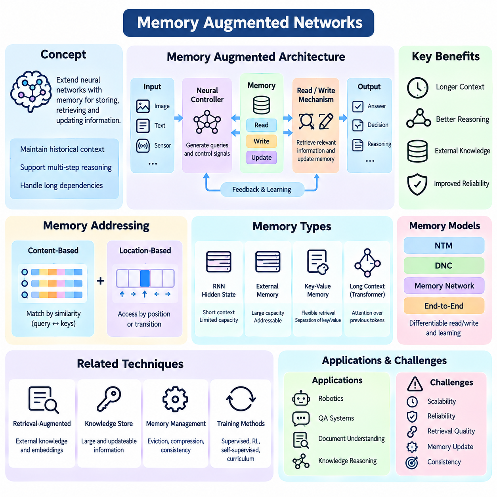{width="7.268055555555556in" height="7.268055555555556in"}

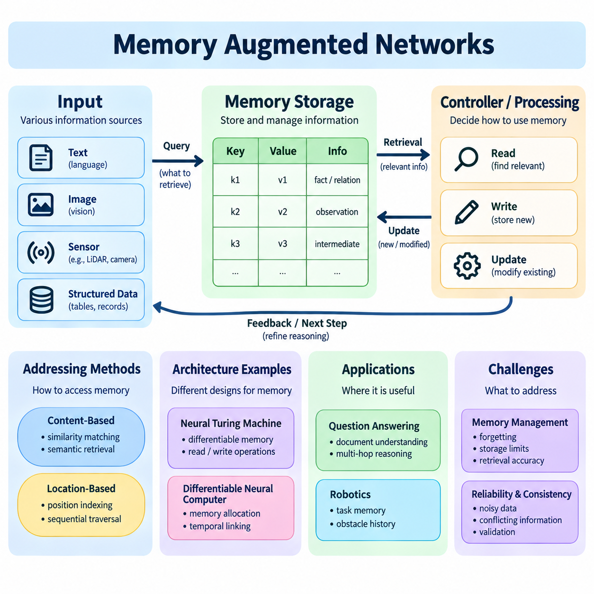{width="7.268055555555556in" height="7.268055555555556in"}

Memory-augmented networks extend conventional neural architectures by introducing mechanisms for storing, retrieving, and updating information during computation. While feedforward networks primarily transform current inputs, memory-augmented systems preserve selected information across processing steps. This capability supports reasoning tasks that require historical context, intermediate conclusions, and dependencies extending beyond a single observation.

Memory plays a fundamental role in intelligent reasoning because many decisions depend on information that is no longer directly observable. A system answering questions about a document must retain relevant facts across multiple sentences, while a robot must remember previously observed obstacles or task instructions. Memory-augmented architectures provide computational structures for maintaining such information and accessing it when required.

Traditional recurrent neural networks maintain information through hidden states that evolve over time. Long short-term memory networks and gated recurrent units improve this process through mechanisms that regulate information retention and modification. However, fixed-dimensional hidden states can become insufficient when tasks require extensive histories, precise retrieval, or multiple independent pieces of information.

External memory architectures address these limitations by separating computational control from information storage. A neural controller processes inputs and determines how memory should be accessed, while a memory matrix stores representations across multiple addressable locations. This separation allows models to maintain larger collections of information without forcing all historical context into a single compressed hidden state.

A memory-augmented system typically includes a controller, memory storage, and read-write mechanisms. The controller generates queries or control signals that determine which memory locations are relevant. Read operations retrieve stored representations, while write operations modify existing entries or create new information. Effective reasoning depends on coordinating these operations without losing important historical knowledge.

Content-based addressing retrieves memory entries according to their similarity to a query representation. A controller compares the current query with stored memory keys and assigns retrieval weights to relevant locations. The resulting memory readout combines selected values through weighted aggregation. This mechanism supports associative retrieval, allowing information to be accessed through semantic relationships rather than fixed addresses.

Location-based addressing provides an alternative mechanism by accessing memory according to positions or learned transitions between locations. Some architectures combine content-based and location-based strategies to support both associative retrieval and sequential traversal. This flexibility is useful for tasks involving ordered instructions, temporal dependencies, or structured sequences that require controlled movement through stored information.

Neural Turing Machines introduced a differentiable framework combining neural controllers with external memory and attention-based read-write operations. Their design allows gradient-based training of memory access behavior. Differentiable Neural Computers extend related ideas through mechanisms for memory allocation, temporal linking, and structured retrieval. These architectures demonstrate how neural networks can learn operations resembling algorithmic memory manipulation.

Memory networks provide another approach by organizing stored information into representations that can be queried during inference. A question or task representation interacts with memory entries to identify relevant evidence. Multiple retrieval iterations, often called memory hops, allow the model to refine its understanding through successive information access. Such mechanisms are valuable when conclusions depend on several distributed facts.

End-to-end memory networks use differentiable attention to retrieve and combine stored information while learning from task-level supervision. The model can update an internal query representation after each memory access, enabling iterative reasoning. However, successful retrieval depends on meaningful memory encoding, appropriate similarity functions, and training examples that encourage the use of relevant evidence.

Key-value memory architectures separate retrieval identifiers from stored content. Keys represent features used to locate information, while values contain the corresponding knowledge or observations. This separation can improve retrieval flexibility when the information needed for matching differs from the information required for reasoning. Key-value structures are particularly useful for knowledge retrieval and question-answering systems.

Transformer models also incorporate memory-related mechanisms through contextual representations and attention over previous tokens. Their context windows provide access to earlier information within a bounded sequence, although this differs from persistent external memory. Extended-context architectures, recurrent memory modules, and retrieval-augmented systems attempt to preserve or recover information beyond ordinary context limitations.

Retrieval-augmented neural systems connect learned reasoning models with external knowledge stores. Relevant documents, embeddings, or structured records can be retrieved when needed rather than encoded entirely within model parameters. This approach improves access to large and updateable information collections. Nevertheless, retrieval quality, source reliability, and consistency between retrieved evidence and generated conclusions remain critical.

Memory management introduces the challenge of deciding what information should be retained, modified, or discarded. Storing every observation indefinitely is computationally expensive and may introduce irrelevant or contradictory information. Learned write gates, importance scores, and memory replacement policies can regulate storage. Reliable systems must balance information preservation with capacity constraints and changing task requirements.

Forgetting is not always undesirable because outdated information can interfere with current reasoning. A dynamic environment may require replacing obsolete observations while preserving stable facts and long-term goals. Effective memory systems distinguish temporary state, episodic experience, and persistent knowledge. This distinction supports adaptive reasoning without allowing stale information to dominate new decisions.

Temporal reasoning benefits from memory structures that preserve event order and historical dependencies. A system may need to determine which event occurred first, whether an action caused a later state change, or how a sequence of observations relates to the current situation. Temporal links and sequence-aware retrieval can support these tasks, although chronological association alone does not establish causal relationships.

Memory-augmented networks also support multi-step reasoning by retaining intermediate results between computational operations. A model solving a complex question may retrieve an initial fact, derive a partial conclusion, and use that conclusion to guide subsequent retrieval. This iterative process can reduce the need to recompute earlier information. However, incorrect intermediate states may propagate through later reasoning steps.

In robotics, memory-augmented reasoning supports navigation, task execution, and environmental understanding. A mobile robot may store observations of previously visited locations, detected obstacles, and unfinished tasks. Memory retrieval can help maintain contextual awareness when objects temporarily disappear from sensor view. Accurate localization, timestamp management, and safety validation remain necessary to prevent outdated memories from causing unsafe actions.

Multi-agent systems can extend memory mechanisms through shared knowledge stores or distributed information exchange. Robots operating within a fleet may maintain local memories while contributing selected observations to a collective representation. Such architectures support coordination and task allocation, but communication delays, conflicting observations, and inconsistent updates require explicit synchronization and conflict-resolution mechanisms.

Training memory-augmented networks requires learning not only task predictions but also effective information access strategies. Gradient-based optimization can adjust memory queries, attention weights, and write operations when these components are differentiable. Auxiliary supervision may encourage accurate retrieval or state tracking. Training becomes difficult when useful memory operations involve long delays or sparse feedback.

Evaluation should examine retrieval accuracy, memory retention, reasoning consistency, and generalization across sequence lengths. Controlled experiments can test whether models remember relevant information despite distractors or changing contexts. Additional measurements include memory utilization, update correctness, computational latency, and robustness to corrupted entries. Strong task accuracy alone does not establish reliable memory management.

Memory-augmented architectures face practical limitations involving computational cost, storage capacity, and information integrity. Large memories increase retrieval demands, while repeated updates can introduce interference between stored representations. Approximate nearest-neighbor search, hierarchical indexing, and selective retrieval can improve scalability. However, efficiency mechanisms must be evaluated for their impact on reasoning completeness and evidence quality.

Memory-augmented networks provide a foundation for neural systems that reason across time, preserve intermediate knowledge, and adapt to changing environments. External memory, differentiable addressing, iterative retrieval, and structured storage extend the capabilities of conventional neural computation. Their effectiveness ultimately depends on accurate information selection, consistent state updates, efficient retrieval, and verification of memory-supported conclusions.

## 04.08 Meta Reasoning and Learning to Reason

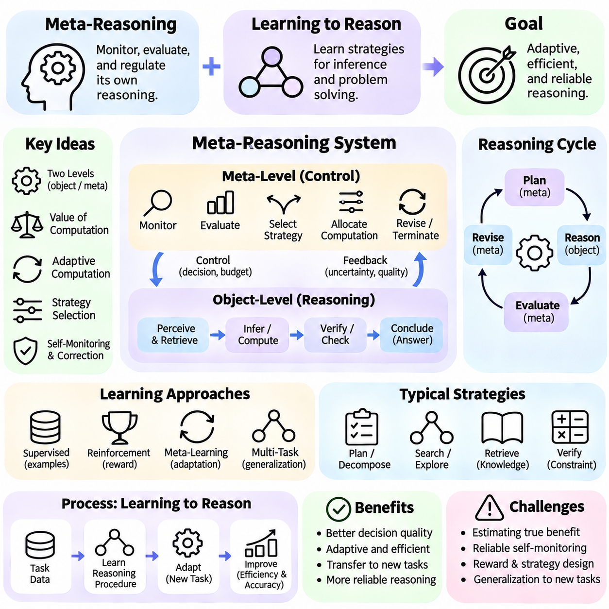{width="7.268055555555556in" height="7.268055555555556in"}

Meta-reasoning refers to the ability of an intelligent system to monitor, evaluate, and regulate its own reasoning processes. Rather than focusing exclusively on solving an external problem, meta-reasoning examines how a solution is being constructed and whether the current strategy remains appropriate. This capability enables adaptive allocation of computational resources, improved decision quality, and more systematic handling of uncertainty.

Learning to reason extends conventional machine learning by developing strategies for performing inference rather than merely memorizing input-output associations. A reasoning model must identify relevant information, select useful operations, and combine intermediate results to reach conclusions. Learning these capabilities requires training environments that reward transferable procedures, especially when problems differ from examples encountered during training.

Meta-reasoning introduces a distinction between object-level reasoning and meta-level control. Object-level reasoning performs operations directly related to the task, such as evaluating evidence or deriving conclusions. Meta-level control monitors these operations and decides whether to continue, revise, or terminate the reasoning process. The interaction between these levels determines how effectively a system uses its available computational capacity.

A central objective of meta-reasoning is to determine when additional computation is worthwhile. Some problems can be solved through immediate pattern recognition, while others require extended analysis or multiple inference steps. A meta-reasoning controller can estimate the expected benefit of further computation relative to its cost. This principle is closely related to the value of computation and rational allocation of limited reasoning resources.

The value of computation represents the expected improvement in decision quality obtained by performing an additional computational operation. A system may compare the potential reduction in uncertainty or error against increased latency, energy consumption, and processing cost. When the expected benefit becomes smaller than the cost, reasoning may terminate. Reliable estimation is difficult because the usefulness of future computations is itself uncertain.

Adaptive computation allows neural models to vary their processing effort according to task difficulty. Instead of applying a fixed number of computational steps to every input, adaptive architectures can allocate additional iterations to challenging examples. Mechanisms such as learned halting decisions and recurrent refinement support this behavior. Their effectiveness depends on preventing premature termination and unnecessary computation.

Learning to reason often involves training models to execute sequences of operations that resemble structured inference procedures. Examples include comparing alternatives, applying constraints, decomposing problems, and combining partial conclusions. Neural architectures can learn these behaviors through supervised objectives or reinforcement signals. However, successful performance on familiar tasks does not guarantee systematic generalization to unfamiliar reasoning structures.

Meta-learning provides a related framework in which models learn how to adapt their learning or reasoning behavior across tasks. Instead of optimizing only for one problem distribution, meta-learning attempts to acquire reusable adaptation strategies. A model trained across diverse tasks may learn representations or update rules that accelerate performance on new problems. This capability remains sensitive to differences between training and deployment conditions.

Gradient-based meta-learning methods optimize model parameters so that limited additional training can produce effective adaptation. Model-Agnostic Meta-Learning is a representative approach that seeks parameter initializations suitable for rapid task-specific updates. Although originally developed for learning adaptation, related principles can support reasoning systems that adjust strategies when encountering new rules, objectives, or problem structures.

Reinforcement learning can train meta-reasoning policies that select computational actions based on their expected usefulness. Possible actions include retrieving information, exploring an alternative hypothesis, invoking a specialized solver, or producing a final answer. Rewards may reflect accuracy, computational efficiency, and constraint satisfaction. Designing appropriate rewards is essential because poorly specified objectives can encourage shortcuts rather than dependable reasoning.

Reasoning strategy selection is another important component of meta-level intelligence. A system may choose between direct prediction, symbolic inference, probabilistic estimation, search, or simulation depending on problem characteristics. Selecting an unsuitable strategy can waste resources or introduce systematic errors. Effective meta-reasoning therefore requires representations of task structure, available methods, and the limitations of each reasoning approach.

Self-monitoring mechanisms estimate whether intermediate reasoning states remain consistent with available evidence and task constraints. A model may track unresolved assumptions, contradictory observations, or uncertain conclusions during inference. These signals can trigger additional verification or strategy revision. However, confidence estimates generated by the same model may be poorly calibrated and should not automatically be treated as reliable correctness indicators.

Self-correction attempts to improve reasoning outcomes by revisiting earlier conclusions and identifying possible mistakes. A system may compare alternative solutions, inspect intermediate dependencies, or test whether a proposed answer satisfies known constraints. Iterative refinement can improve performance when useful feedback is available. Without independent evidence or effective verification, repeated revisions may reinforce errors or introduce new inconsistencies.

Uncertainty-aware meta-reasoning connects confidence estimation with computational control. When uncertainty is high, a system may retrieve additional evidence, expand its search, or request external verification. When uncertainty is sufficiently low and the expected value of further computation is limited, it may terminate. This process requires calibrated uncertainty measures and explicit consideration of the consequences of incorrect decisions.

Hierarchical reasoning architectures organize computation across multiple levels of abstraction. A high-level controller may decompose a problem into subgoals, while lower-level modules execute specialized inference operations. The controller evaluates intermediate outcomes and determines subsequent actions. Such structures can support complex tasks, although errors in decomposition or coordination may propagate through the reasoning hierarchy.

Learning reusable reasoning procedures is closely related to algorithmic generalization. Models may be trained on tasks involving sorting, arithmetic, graph traversal, or logical deduction to encourage systematic operations. Evaluation on larger inputs and unfamiliar combinations helps determine whether learned procedures transfer beyond training examples. Strong generalization requires more than reproducing superficial patterns observed during optimization.

Memory-augmented architectures can strengthen meta-reasoning by retaining previous attempts, intermediate conclusions, and information about successful strategies. A controller may retrieve earlier problem-solving experiences to guide current computation. This supports adaptation across related tasks and reduces redundant exploration. However, stored strategies must be evaluated against current conditions because previously effective methods may become inappropriate.

Tool-augmented reasoning provides another mechanism for adaptive problem solving. A neural controller can decide when to use calculators, search engines, symbolic solvers, simulators, or external databases. These tools may provide capabilities that are difficult to reproduce through internal neural computation alone. Meta-reasoning determines which tool to invoke, how to interpret its output, and whether additional validation is required.

In autonomous robotics, meta-reasoning can regulate the selection of planning and perception strategies according to environmental complexity. A robot operating in a predictable corridor may use a lightweight navigation procedure, while an unfamiliar obstacle configuration may require additional mapping or trajectory evaluation. Such adaptation must respect real-time deadlines, safety constraints, and the reliability of available sensor information.

Multi-agent systems can apply meta-reasoning to coordinate distributed problem-solving resources. A supervisory agent may assign subtasks to specialized agents, compare proposed solutions, and determine whether further collaboration is necessary. This approach can improve coverage of complex problems but introduces communication overhead and coordination uncertainty. Effective operation requires explicit responsibility assignment and verification of shared conclusions.

Training meta-reasoning systems presents challenges because useful control decisions may influence outcomes only after many computational steps. Delayed rewards, sparse supervision, and changing task distributions complicate optimization. Curriculum learning, process-level feedback, and controlled reasoning environments can provide additional training signals. Nevertheless, models must be evaluated for robustness rather than assuming that longer reasoning always improves results.

Evaluation of learning-to-reason systems should distinguish final-answer accuracy from reasoning efficiency, transferability, and reliability. Useful measurements include computational cost, inference depth, uncertainty calibration, strategy-selection accuracy, and performance on unseen problem structures. Controlled tests should examine whether additional reasoning improves outcomes and whether models recognize situations requiring external verification.

Meta-reasoning and learning to reason provide a foundation for neural systems that adapt not only their predictions but also their problem-solving procedures. By combining computational control, strategy selection, uncertainty estimation, and experience-based adaptation, these systems can allocate reasoning effort more effectively. Dependable deployment requires calibrated decisions, independent verification, and careful management of computational and safety constraints.

## 04.09 Neuro Symbolic Reasoning

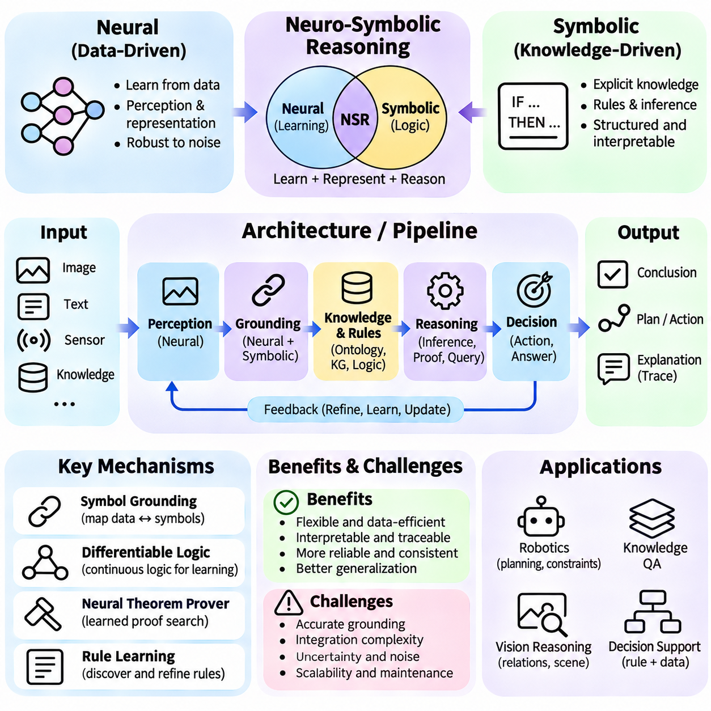{width="7.268055555555556in" height="7.268055555555556in"}

Neuro-symbolic reasoning integrates neural representation learning with symbolic knowledge and explicit inference procedures. Neural networks provide flexible mechanisms for interpreting complex observations, while symbolic systems represent entities, relationships, and rules in structured forms. Their combination aims to support reasoning that is both adaptable to uncertain data and constrained by interpretable knowledge, overcoming selected limitations of purely neural or symbolic approaches.

Neural and symbolic approaches possess complementary strengths. Neural models learn patterns from images, language, and sensor measurements, often tolerating noise and incomplete observations. Symbolic reasoning supports explicit rule application, variable manipulation, and structured deduction. However, neural models may produce inconsistent conclusions, while symbolic systems depend on correctly defined knowledge and reliable conversion of observations into logical representations.

A neuro-symbolic architecture commonly separates perception, knowledge representation, reasoning, and decision generation into interacting components. Neural perception modules transform raw inputs into candidate entities and relations. Symbolic components organize these outputs into facts and apply rules to derive conclusions. Feedback between the components can refine interpretations, although the overall reliability depends on the correctness of each interface.

The connection between continuous neural representations and discrete symbolic structures is a central design challenge. Neural embeddings encode statistical relationships within vector spaces, whereas symbolic expressions identify explicit objects, predicates, and logical dependencies. Mapping between these representations requires entity recognition, relation extraction, grounding, and uncertainty management. Errors in this conversion can propagate through subsequent inference.

Symbol grounding connects symbolic concepts to observable entities or measurable properties. A robot may associate the predicate Obstacle(x) with an object detected through cameras or LiDAR, while another predicate represents whether a location is reachable. Neural perception estimates these properties from sensory evidence. Symbolic reasoning then evaluates relationships among grounded objects, provided that identity, spatial reference, and observation uncertainty are handled consistently.

Knowledge representation determines which relationships a neuro-symbolic system can reason about. Ontologies define concepts, categories, and semantic constraints, while knowledge graphs organize entities and their connections. Logical rules express dependencies that may not be directly observable. These structures provide reusable domain knowledge, but incomplete ontologies, incorrect relations, and inconsistent facts can limit the validity of derived conclusions.

Rule-based inference enables explicit reasoning over facts extracted or predicted by neural models. For example, a system may infer that a navigation path is unsuitable when its required clearance is smaller than the robot\'s physical dimensions. Neural modules estimate environmental properties, while symbolic rules evaluate operational constraints. This separation supports traceable decisions, although uncertain measurements must not be treated as unquestionably true.

Differentiable logic offers one approach to integrating learning and symbolic inference. Logical expressions are represented using continuous operators so that their parameters can participate in gradient-based optimization. Soft truth values allow uncertain neural predictions to influence logical evaluations. However, differentiable satisfaction scores approximate selected logical semantics and do not necessarily establish strict compliance with classical logical constraints.

Neural theorem proving provides another integration strategy by combining structured proof search with learned similarity functions. Facts and rules may be represented as logical clauses, while neural embeddings support approximate matching between predicates. Backward chaining or related inference procedures construct candidate proof paths. Such methods can discover useful relational associations, but approximate unification does not guarantee formally valid deductions.

Probabilistic neuro-symbolic reasoning explicitly represents uncertainty associated with facts, rules, or observations. Neural models may estimate probabilities for detected objects or relationships, while probabilistic logic combines these estimates under defined assumptions. This supports reasoning when evidence is incomplete or noisy. Care is required because correlated observations and uncertain rule dependencies can invalidate simplistic probability combinations.

Learning symbolic rules from data reduces dependence on entirely hand-crafted knowledge bases. Neural representations can help identify recurring relational patterns, while rule induction mechanisms propose candidate logical structures. These rules may then be evaluated against observed examples and existing constraints. Successful rule discovery requires testing whether learned relationships generalize beyond statistical correlations present in the training data.

Neuro-symbolic systems can also use symbolic knowledge to guide neural learning. Logical constraints may be incorporated into loss functions, training objectives, or data selection procedures. For example, mutually exclusive object categories or known spatial relationships can discourage inconsistent predictions. Such guidance improves structural coherence when constraints are correct, but incorrect rules may systematically bias the learned model.

Multi-step reasoning benefits from combining neural retrieval with symbolic composition. A system answering a complex question may identify relevant entities, retrieve associated facts, apply relational rules, and construct a conclusion. Neural components support flexible evidence selection, while symbolic operations preserve explicit dependencies. The resulting reasoning chain can be inspected, although its validity still depends on accurate premises and sound inference procedures.

Planning provides an important application of neuro-symbolic reasoning. Neural models can estimate environmental states, action outcomes, or task feasibility, while symbolic planners represent goals, preconditions, and action effects. A planning system can search for sequences satisfying operational requirements. Neural predictions improve adaptability, but uncertain state estimates and inaccurate action models may compromise the feasibility of generated plans.

Causal reasoning introduces additional requirements because logical association alone does not establish causation. Neuro-symbolic systems may combine learned causal representations with structural causal models or explicit intervention rules. This supports analysis of how actions influence outcomes under specified assumptions. Counterfactual conclusions require a defensible causal model and cannot be justified solely through neural similarity or relational inference.

Explainability is frequently cited as a benefit of neuro-symbolic architectures because symbolic rules and proof traces can expose parts of the decision process. A system may report which observations and rules supported a conclusion. Nevertheless, an interpretable symbolic trace does not explain every neural computation that produced its premises. Reliable explanations must distinguish observed evidence, learned predictions, inferred statements, and independently verified facts.

Consistency checking is essential when neural predictions conflict with symbolic knowledge. A perception model may identify mutually incompatible object states, or new observations may contradict stored facts. Constraint solvers and logical reasoners can detect selected inconsistencies and request revision. However, resolving conflicts requires policies for evidence priority, temporal validity, and uncertainty rather than automatically rejecting every unexpected observation.

Hybrid execution architectures distribute computation between neural models and symbolic engines according to task requirements. Neural modules handle perception, semantic matching, and uncertain prediction, while symbolic components perform constraint evaluation, rule execution, or formal verification. Interfaces must preserve data types, confidence information, and entity identities. Poor integration can eliminate the advantages of combining the two approaches.

Scalability remains a challenge because symbolic search and neural computation have different resource requirements. Large knowledge graphs, complex rules, and extensive variable grounding can create substantial inference costs. Retrieval filtering, sparse reasoning, modular knowledge organization, and bounded proof search can reduce computational demands. These optimizations must be assessed for their effects on completeness and correctness.

In robotics, neuro-symbolic reasoning can connect perception, task planning, and safety constraints within a unified decision process. A mobile robot may detect obstacles through neural vision, represent navigable regions symbolically, and evaluate route restrictions using explicit rules. For multi-robot operations, shared knowledge can support task coordination. Safety-critical actions still require validated control mechanisms and independent checks.

Industrial inspection provides another practical application. Neural vision systems can detect candidate defects, while symbolic knowledge represents inspection standards, component relationships, and procedural requirements. A reasoning engine may determine whether an observation violates a specification or requires additional measurement. This combination supports traceability, but measurement uncertainty and the validity of inspection rules must remain explicit.

Evaluation of neuro-symbolic reasoning should examine perception accuracy, rule consistency, inference validity, generalization, and end-to-end decision quality. Controlled experiments can vary observation noise, missing facts, contradictory evidence, and rule complexity. Comparisons with neural-only and symbolic-only baselines help identify the actual contribution of integration. Formal verification may be necessary when conclusions affect safety or regulatory compliance.

Neuro-symbolic reasoning offers a framework for combining adaptable statistical representations with structured knowledge and explicit inference. Its effectiveness depends on reliable grounding, appropriate uncertainty handling, sound logical operations, and carefully designed neural-symbolic interfaces. Rather than guaranteeing correctness through integration alone, dependable systems use complementary learning, reasoning, verification, and feedback mechanisms to support trustworthy decisions.

## 04.10 Case Studies

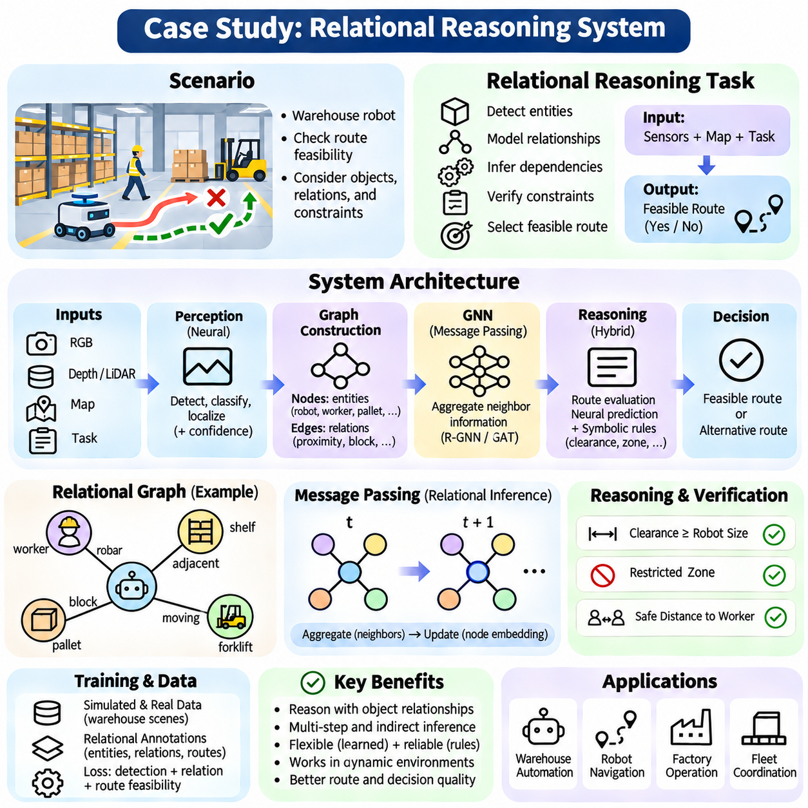{width="7.268055555555556in" height="7.268055555555556in"}

A relational reasoning system demonstrates how neural networks can identify entities, represent their interactions, and derive conclusions from structured relationships. Unlike conventional prediction models that focus on isolated features, relational systems evaluate how objects influence one another. This case study examines an architecture combining neural perception, graph representations, message passing, and rule-based verification for dependable relational inference.

Consider an autonomous mobile robot operating in an industrial warehouse containing shelves, pallets, workers, and transport vehicles. The robot must determine whether a requested route is feasible while accounting for dynamic obstacles and operational restrictions. Successful reasoning requires more than detecting objects individually. The system must identify spatial relationships, movement dependencies, and constraints affecting navigation decisions.

The system receives observations from RGB cameras, depth sensors, and LiDAR, together with a warehouse map and task instructions. Neural perception modules detect objects, estimate positions, and classify environmental features. Each observation is associated with a timestamp and confidence estimate. Sensor calibration and coordinate transformations establish a common spatial reference for constructing consistent relationships among detected entities.

Detected entities are represented as graph nodes containing attributes such as object category, position, velocity, dimensions, and observation confidence. Graph edges describe relationships including proximity, containment, connectivity, and potential obstruction. A worker approaching a corridor may be connected to nearby routes through spatial relations. This graph representation converts raw observations into a structure suitable for relational inference.

Graph construction requires explicit criteria for determining which entities should be connected. Spatial distance, geometric overlap, semantic compatibility, and operational relevance can influence edge creation. Dynamic relationships must be updated as objects move or disappear. Incorrect associations may introduce false dependencies, making temporal consistency, object tracking, and uncertainty-aware graph maintenance essential.

A graph neural network processes the relational representation through repeated message-passing operations. Each node receives information from connected neighbors and updates its internal embedding using learned aggregation functions. Multiple layers allow information to propagate across increasingly distant graph neighborhoods. This enables the system to evaluate dependencies that cannot be inferred from isolated object attributes.

For example, a pallet blocking an intersection may affect several connected corridors even when the robot cannot directly observe every affected route. Message passing propagates information about obstruction and connectivity through the graph. The resulting node representations encode both local observations and relational context. However, learned propagation does not guarantee that every inferred dependency is geometrically or logically correct.

Attention mechanisms can improve relational processing by assigning different importance to neighboring entities and relationships. A moving worker near the robot\'s planned trajectory may receive greater attention than a distant stationary object. Graph attention networks learn context-dependent interaction weights. These weights help prioritize information but should not be interpreted as definitive explanations of safety relevance or causal influence.

The reasoning module evaluates candidate routes using graph embeddings, geometric constraints, and task requirements. Neural components estimate route suitability or potential conflicts, while symbolic rules enforce restrictions involving clearance, restricted zones, and permitted movement. A route is rejected when verified constraints are violated. This hybrid design separates flexible prediction from requirements that demand explicit validation.

Multi-step relational inference becomes necessary when route feasibility depends on indirect relationships. A blocked corridor may require selecting an alternative passage, which changes proximity to workers and access to loading stations. The system evaluates these dependencies through successive graph updates and planning operations. Intermediate conclusions must remain consistent with the latest observations and the operational map.

A practical implementation can use PyTorch and a graph learning framework such as PyTorch Geometric. Node features are encoded into numerical vectors, while edge attributes represent distances, relative orientations, and relation types. Message-passing layers generate updated embeddings, followed by task-specific prediction heads. A separate constraint evaluator checks proposed actions against operational requirements.

Training data may include simulated warehouse scenes, annotated object relationships, and examples of feasible or infeasible routes. Supervised learning optimizes object relation predictions and route classification. Additional losses can encourage consistency between predicted relationships and known geometric constraints. Simulation provides controlled variation, but deployment requires evaluation against real sensor noise and unfamiliar environments.

Negative examples are important because a model must distinguish meaningful dependencies from coincidental proximity. Two objects may be spatially close without affecting the same navigation decision. Training should therefore include distractors, ambiguous configurations, and cases where similar visual scenes require different conclusions. Such examples reduce reliance on superficial correlations and encourage more robust relational representations.

Temporal reasoning extends the system beyond static graph analysis. Object positions and relationships change as workers move, pallets are relocated, or vehicles enter intersections. A temporal graph model can incorporate historical observations and motion estimates to predict near-term interactions. Nevertheless, predictions must be refreshed as new measurements arrive, and stale graph states must not determine safety-critical actions.

Memory mechanisms preserve relevant information when objects temporarily leave sensor coverage. A robot may remember that a corridor was previously obstructed while recognizing that the observation may no longer be valid. Memory entries require timestamps, confidence updates, and expiration policies. This prevents historical information from being treated as permanent truth while supporting reasoning under partial observability.

The system can incorporate uncertainty by associating probabilities or confidence measures with detected entities and predicted relations. Low-confidence observations may trigger additional sensing or conservative planning. Uncertainty should propagate through relational inference rather than disappearing during graph aggregation. Calibration is necessary because neural confidence scores do not automatically correspond to reliable probabilities.

Explainability can be supported by recording the facts, relationships, and rules contributing to each route decision. An operator may inspect which corridor was classified as blocked and which operational restriction caused rejection. Graph visualization and attention inspection can assist debugging. However, explanatory traces must distinguish learned predictions from independently verified constraints and actual causal evidence.

Evaluation should measure object detection accuracy, relation classification, graph consistency, and route decision correctness. Additional tests examine performance under occlusion, sensor noise, changing graph size, and unfamiliar warehouse layouts. Multi-step reasoning accuracy is especially important because errors can accumulate across connected relationships. Comparisons with non-relational baselines help quantify the contribution of graph reasoning.

Operational evaluation must also consider latency, memory consumption, and computational scalability. Dense graphs increase message-passing costs, while frequent updates create additional processing demands. Spatial filtering, sparse connectivity, and incremental graph updates can reduce resource requirements. The system must meet real-time planning deadlines without sacrificing mandatory safety checks or critical environmental information.

Failure analysis should examine missed obstacles, incorrect object associations, outdated relationships, and contradictory sensor observations. A relational model may predict a feasible route even when its graph representation omits a critical obstruction. Independent collision checking and validated motion planning must therefore remain active. When evidence is insufficient, the system should request updated observations or select a verified safe fallback.

The architecture can be extended to multi-robot coordination by representing robots, tasks, shared corridors, and charging stations within a collective graph. Relational reasoning can identify resource conflicts, route interference, and task dependencies. Distributed updates allow multiple robots to contribute observations, but synchronization delays and inconsistent information require explicit coordination policies.

A controlled experiment can compare a conventional feature-based model, a graph neural network, and a hybrid neuro-symbolic system on identical warehouse scenarios. Evaluation should examine route accuracy, constraint violations, inference latency, and generalization to larger environments. Ablation experiments can isolate the effects of message passing, attention, memory, and symbolic verification on overall system behavior.

This case study illustrates how relational reasoning transforms isolated perception results into structured environmental understanding. Graph neural networks provide learned interaction modeling, while temporal memory and symbolic constraints support context preservation and explicit validation. Dependable operation requires accurate graph construction, uncertainty management, rigorous evaluation, and independent safety mechanisms rather than relying on neural predictions alone.
