**Volume 03. Reasoning in AI**

# 04. Neural Reasoning

## 04.01 Introduction to Neural Reasoning

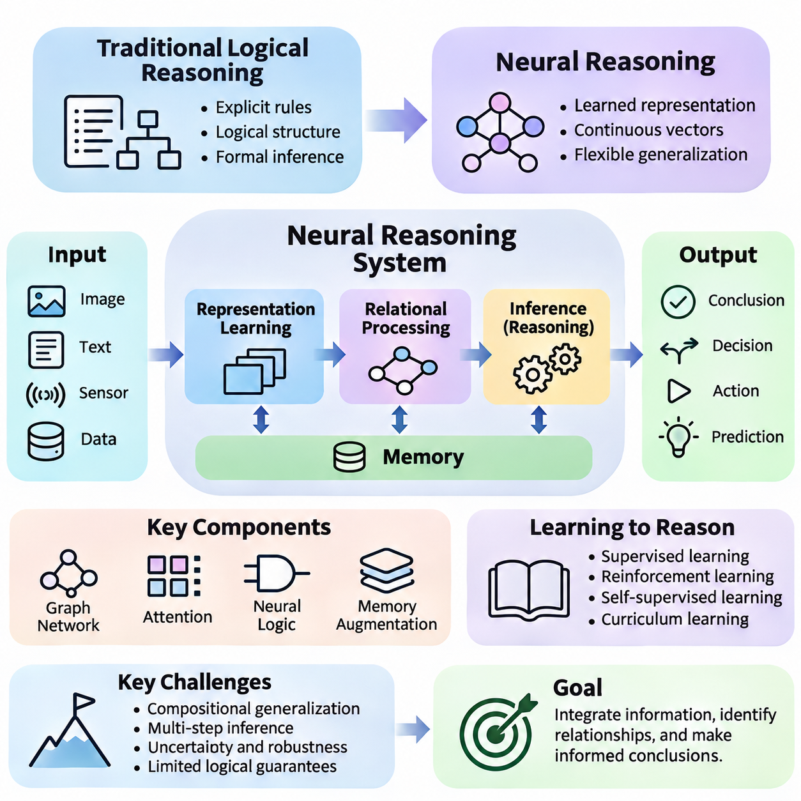{width="7.268055555555556in" height="7.268055555555556in"}

신경 추론(Neural Reasoning)은 신경망(Neural Networks)이 데이터(Data)로부터 추론(Inference), 관계(Relationships), 의사결정(Decision-Making)의 패턴을 학습하도록 하는 인공지능(Artificial Intelligence) 접근 방식이다. 명시적으로 정의된 규칙(Rules)과 논리 구조(Logical Structures)에 의존하는 전통적인 기호 추론(Symbolic Reasoning)과 달리, 신경 추론은 학습된 표현(Learned Representations)과 계산적 변환(Computational Transformations)을 활용하여 복잡하고 불확실한 환경에서 추론 과정을 근사적으로 수행한다.

신경 추론의 핵심 목표는 단순한 패턴 인식(Pattern Recognition)을 넘어 정보를 결합하고, 관계를 식별하며, 여러 증거에 의존하는 결론을 도출할 수 있는 시스템을 구현하는 것이다. 신경 모델(Neural Model)은 입력 정보를 점차 의미 있는 내부 표현(Internal Representations)으로 변환함으로써 객체 비교(Object Comparison), 공간 관계 추론(Spatial Relationship Inference), 결과 예측(Outcome Prediction), 행동 선택(Action Selection) 등을 학습할 수 있다.

전통적인 논리 추론(Logical Reasoning)은 전제(Premises)로부터 결론(Conclusions)이 어떻게 도출되는지를 명시하는 형식적 명제(Formal Statements), 술어(Predicates), 추론 규칙(Inference Rules)을 통해 작동한다. 반면 신경 추론은 정보를 연속적인 수치 벡터(Continuous Numerical Vectors)와 학습된 매개변수(Learned Parameters)로 표현한다. 이러한 표현은 유연한 일반화(Generalization)를 지원하지만, 논리적 일관성(Logical Consistency), 수학적 정확성(Mathematical Correctness), 추론 결과의 타당성(Validity)을 본질적으로 보장하지는 않는다.

신경 추론과 일반적인 딥러닝 분류(Deep Learning Classification)의 근본적인 차이는 요구되는 계산 구조(Computational Structure)에 있다. 분류(Classification)는 일반적으로 입력을 미리 정의된 범주(Category)에 대응시키지만, 추론은 여러 단계의 상호 의존적인 변환을 요구할 수 있다. 예를 들어 한 객체가 다른 객체에 도달할 수 있는지 판단하려면 객체 인식(Object Recognition), 위치 추정(Position Estimation), 장애물 식별(Obstacle Identification), 가능한 상호작용 평가(Interaction Evaluation)가 필요할 수 있다.

신경 추론 시스템(Neural Reasoning Systems)은 일반적으로 원시 관측값(Raw Observations)을 잠재 표현(Latent Representations)으로 인코딩(Encoding)하는 과정에서 시작한다. 이미지(Images), 텍스트(Text), 센서 측정값(Sensor Measurements), 구조화된 기록(Structured Records)은 관련 속성을 포착하는 수치 특징(Numerical Features)으로 변환된다. 이후 신경 연산(Neural Operations)은 이러한 특징을 결합하여 관계를 추정하고, 대안을 평가하며, 주어진 작업의 예측과 의사결정을 지원하는 표현을 구성한다.

표현 학습(Representation Learning)은 관련 정보가 얼마나 효과적으로 인코딩되는지에 따라 추론의 품질이 달라지기 때문에 핵심적인 역할을 수행한다. 유용한 표현은 중요하지 않은 변동(Irrelevant Variation)을 줄이면서 핵심 관계를 보존해야 한다. 모델이 의미 있는 추상화(Meaningful Abstractions)를 학습하면 기존에 습득한 관계 패턴(Relational Patterns)을 새로운 사례에 적용할 수 있지만, 성공적인 전이(Transfer)는 학습 조건(Training Conditions)과 작업 복잡도(Task Complexity)에 따라 달라진다.

관계 추론(Relational Reasoning)은 많은 지능형 작업(Intelligent Tasks)이 여러 개체(Entity) 사이의 상호작용을 포함하기 때문에 특히 중요하다. 로봇(Robot)은 장애물(Obstacles), 목적지(Destinations), 이동 가능한 경로(Available Paths) 사이의 관계를 이해해야 한다. 시각 질의응답 시스템(Visual Question Answering System)은 어떤 객체가 다른 객체 뒤에 있는지 판단해야 할 수 있다. 신경 추론은 개체 간 상호작용을 명시적 또는 암묵적으로 모델링하는 구조를 통해 이러한 관계를 학습한다.

그래프 신경망(Graph Neural Networks, GNN)은 관계 구조(Relational Structures)를 표현하기 위한 자연스러운 프레임워크(Framework)를 제공한다. 객체나 개념은 노드(Nodes)로, 관계는 엣지(Edges)로 모델링할 수 있다. 메시지 전달(Message Passing)을 통해 노드는 이웃 노드와 정보를 교환하고 내부 상태(Internal States)를 갱신한다. 반복적인 갱신은 그래프 전체에 정보가 전파되도록 하며, 여러 개체가 관련된 의존성(Dependencies)과 상호작용(Interactions)에 대한 추론을 지원한다.

어텐션 메커니즘(Attention Mechanisms)은 신경망이 관련 정보에 동적으로 집중하도록 하는 또 다른 접근 방식이다. 모든 입력 요소를 동일하게 처리하는 대신, 어텐션은 표현에 문맥 의존적 가중치(Context-Dependent Weights)를 부여한다. 트랜스포머 구조(Transformer Architectures)는 어텐션을 활용하여 시퀀스(Sequences)나 집합(Sets) 전반의 정보를 통합하고 복잡한 문맥적 상호작용(Contextual Interactions)을 가능하게 하지만, 어텐션 자체만으로 신뢰할 수 있는 추론이 보장되지는 않는다.

신경 추론은 논리 연산(Logical Operations)의 미분 가능한 근사(Differentiable Approximations)를 포함할 수도 있다. 신경 논리 모델(Neural Logic Models)은 논리곱(Conjunction), 논리합(Disjunction), 함의(Implication), 규칙 적용(Rule Application)을 학습 가능한 수학적 함수(Trainable Mathematical Functions)로 표현하려고 한다. 이러한 접근 방식은 신경망의 적응성(Adaptability)과 구조화된 추론(Structured Inference)의 일부 특성을 결합하려 하지만, 논리적 보장(Logical Guarantees)은 구체적인 표현 방식과 구현에 따라 달라진다.

메모리(Memory)는 여러 단계에 걸쳐 정보를 통합해야 하는 추론 시스템의 또 다른 필수 구성 요소이다. 메모리 증강 신경망(Memory-Augmented Neural Networks)은 이전 관측값(Previous Observations), 중간 결과(Intermediate Results), 관련 경험(Relevant Experiences)의 표현을 유지한다. 저장된 정보를 검색(Retrieval)하고 갱신(Update)함으로써 순차적 의사결정(Sequential Decisions), 다단계 의존성(Multi-Step Dependencies), 즉시 이용할 수 없는 정보에 대한 추론을 지원할 수 있다.

추론 학습(Learning to Reason)은 정답을 단순히 암기하는 것 이상의 과정을 포함한다. 학습 절차(Training Procedures)는 모델이 익숙한 사례를 넘어 일반화할 수 있는 재사용 가능한 계산 패턴(Reusable Computational Patterns)을 발견하도록 유도해야 한다. 지도 학습(Supervised Learning), 강화 학습(Reinforcement Learning), 자기지도 학습(Self-Supervised Learning), 커리큘럼 기반 학습(Curriculum-Based Training)은 작업에서 명시적인 정답, 환경 보상(Environmental Rewards), 구조적 제약(Structural Constraints)을 제공하는지에 따라 서로 다른 학습 신호(Learning Signals)를 제공할 수 있다.

주요 과제 중 하나는 구성적 일반화(Compositional Generalization)로, 익숙한 개념과 관계를 새로운 구성으로 결합하는 능력을 의미한다. 모델은 알려진 객체를 포함하는 사례를 성공적으로 해결하더라도 해당 객체가 새로운 배열로 나타나면 실패할 수 있다. 따라서 강력한 신경 추론은 피상적인 통계적 연관성(Superficial Statistical Associations)에 의존하기보다 체계적인 재조합(Systematic Recombination)을 지원하는 표현과 계산 메커니즘(Computational Mechanisms)을 필요로 한다.

또 다른 과제는 결론의 정확성이 여러 중간 연산(Intermediate Operations)에 의존하는 다단계 추론(Multi-Step Inference)이다. 개체 식별(Entity Identification), 관계 추정(Relationship Estimation), 상태 표현(State Representation)에서 발생하는 작은 오류가 추론 단계 전반에 걸쳐 누적될 수 있다. 반복 계산(Iterative Computation), 외부 메모리(External Memory), 구조화된 중간 상태(Structured Intermediate States), 검증 메커니즘(Verification Mechanisms)을 갖춘 구조는 이러한 문제를 완화할 수 있지만 자동으로 제거하지는 못한다.

신경 추론은 주요 계산적 정식화(Computational Formulation) 측면에서 확률적 추론(Probabilistic Reasoning) 및 인과 추론(Causal Reasoning)과도 차이가 있다. 확률적 추론은 확률 분포(Probability Distributions)를 통해 불확실성(Uncertainty)을 명시적으로 모델링하며, 인과 추론은 개입(Interventions)과 원인·결과 관계(Cause-and-Effect Relationships)를 분석한다. 신경 추론은 학습된 계산 표현을 사용하며 확률적 또는 인과적 구성 요소를 통합할 수 있지만, 예측 정확도(Predictive Accuracy)만으로 인과적 이해(Causal Understanding)가 입증되지는 않는다.

신경-기호 추론(Neuro-Symbolic Reasoning)은 신경 표현(Neural Representations)과 기호적 지식(Symbolic Knowledge), 추론 메커니즘(Inference Mechanisms)을 결합하여 이러한 관점을 확장한다. 신경 구성 요소(Neural Components)는 복잡한 관측값에서 개념을 추출하고, 기호 구성 요소(Symbolic Components)는 명시적인 제약이나 규칙을 적용할 수 있다. 이러한 통합은 적절한 응용 분야에서 해석 가능성(Interpretability)과 일관성(Consistency)을 향상시킬 수 있지만, 인식 오류(Perception Errors)와 기호적 기반화(Symbolic Grounding)에서 발생하는 문제를 신중하게 관리해야 한다.

로보틱스(Robotics)에서 신경 추론은 인식(Perception)을 계획(Planning) 및 행동 선택(Action Selection)과 연결한다. 자율 이동 로봇(Autonomous Mobile Robot)은 카메라 이미지(Camera Images), 라이다 측정값(LiDAR Measurements), 환경 지도(Environmental Maps)를 처리하여 객체를 식별하고 관계를 추정할 수 있다. 이후 추론 모델(Reasoning Model)은 주행 제약(Navigation Constraints)을 평가하고 상호작용을 예측하며 작업 수준의 의사결정(Task-Level Decisions)을 지원하고, 별도의 계획 및 안전 메커니즘(Safety Mechanisms)이 운영 요구사항을 강제한다.

산업 응용(Industrial Applications)은 관계 추론과 순차 추론(Sequential Reasoning)의 추가적인 사례를 제공한다. 제조 검사 시스템(Manufacturing Inspection Systems)은 관측된 결함(Observed Defects)을 부품 위치(Component Locations) 및 조립 의존성(Assembly Dependencies)과 연결해야 할 수 있다. 물류 시스템(Logistics Systems)은 차량, 작업, 목적지, 자원 제약(Resource Constraints) 사이의 관계를 평가할 수 있다. 신경 추론은 운영 데이터(Operational Data)와 과거 결과(Historical Outcomes)로부터 구조화된 의존성을 학습하여 이러한 작업을 지원할 수 있다.

평가(Evaluation)는 실제 추론 능력(Genuine Reasoning Capability)을 암기(Memorization) 및 지름길 학습(Shortcut Learning)과 구분해야 한다. 기존의 정확도 측정(Accuracy Measurements)은 테스트 사례(Test Examples)가 학습 분포(Training Distributions)와 유사할 때 실패를 감출 수 있다. 보다 유용한 평가는 체계적 일반화(Systematic Generalization), 무관한 변화에 대한 강건성(Robustness), 동등한 표현 사이의 일관성(Consistency), 점점 복잡해지는 관계 및 순차 계산을 요구하는 작업에서의 성능을 분석한다.

해석 가능성(Interpretability)은 신경 추론이 사람이 읽을 수 있는 추론 규칙보다 분산 표현(Distributed Representations)을 통해 수행되는 경우가 많기 때문에 중요한 문제로 남아 있다. 어텐션 시각화(Attention Visualization), 특징 기여도 분석(Feature Attribution), 프로빙 기법(Probing Methods), 중간 상태 분석(Intermediate-State Analysis)은 모델 동작(Model Behavior)의 일부 측면을 드러낼 수 있다. 그러나 이러한 기법은 내부 계산(Internal Computation)에 대한 불완전한 증거를 제공하므로 추론 과정의 충실한 설명(Faithful Explanations)으로 자동 간주해서는 안 된다.

계산 효율성(Computational Efficiency) 역시 실제 신경 추론 구조에 영향을 미친다. 반복 추론(Iterative Inference), 그래프 메시지 전달(Graph Message Passing), 어텐션 연산(Attention Operations), 메모리 검색(Memory Retrieval)은 계산 요구량을 증가시킬 수 있다. 실시간 시스템(Real-Time Systems)은 추론 깊이(Reasoning Depth)와 지연시간(Latency), 메모리 사용량(Memory Consumption), 에너지 제약(Energy Constraints) 사이의 균형을 유지해야 한다. 효율적인 배포(Deployment)를 위해 선택적 계산(Selective Computation), 모델 압축(Model Compression), 계층적 처리(Hierarchical Processing), 작업별 구조 최적화(Task-Specific Architectural Optimization)가 필요할 수 있다.

신경 추론의 보다 광범위한 중요성은 학습된 인식(Learned Perception)을 구조화된 지능(Structured Intelligence)과 연결할 수 있는 잠재력에 있다. 표현 학습, 관계 계산(Relational Computation), 어텐션, 메모리, 적응형 추론(Adaptable Inference)을 통합함으로써 신경 시스템은 단순한 입력-출력 예측(Input-Output Prediction)을 넘어서는 문제를 다룰 수 있다. 이러한 시스템의 신뢰성(Reliability)은 궁극적으로 적절한 구조, 학습 목표(Training Objectives), 엄격한 평가(Rigorous Evaluation), 상호 보완적인 추론 방법(Complementary Reasoning Methods)과의 통합에 달려 있다.

따라서 신경 추론은 단일 알고리즘(Single Algorithm)이나 형식 논리(Formal Logic)를 대체하는 보장된 수단이 아니라, 지속적으로 발전하는 계산적 접근 방식(Computational Approaches)의 집합으로 이해해야 한다. 신경 추론의 발전은 그래프 기반 추론(Graph-Based Reasoning), 신경 논리(Neural Logic), 메모리 증강 계산(Memory-Augmented Computation), 메타 추론(Meta-Reasoning), 신경-기호 시스템(Neuro-Symbolic Systems)의 기반을 제공한다. 이러한 접근 방식은 더욱 유연하고 구조화되며 문맥에 민감한 의사결정(Context-Sensitive Decision-Making)을 수행할 수 있는 인공지능의 발전에 기여한다.

## 04.02 Limitations of Deep Learning

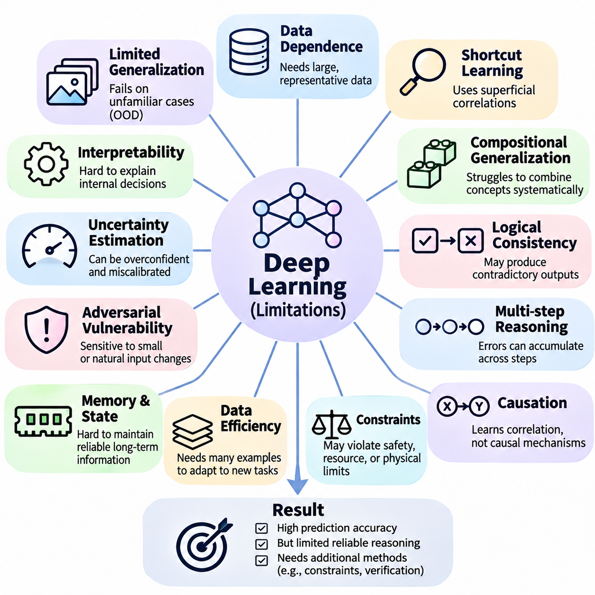{width="7.268055555555556in" height="7.268055555555556in"}

딥러닝(Deep Learning)은 이미지 인식(Image Recognition), 자연어 처리(Natural Language Processing), 음성 이해(Speech Understanding), 자율 시스템(Autonomous Systems)에서 놀라운 성과를 달성했다. 그러나 높은 예측 정확도(Predictive Accuracy)가 반드시 신뢰할 수 있는 추론 능력(Reasoning Capability)을 의미하는 것은 아니다. 신경망(Neural Networks)은 주로 학습 데이터(Training Data)에서 통계적 관계(Statistical Relationships)를 학습하며, 이러한 관계는 명시적 논리 추론(Explicit Logical Inference), 체계적 일반화(Systematic Generalization), 익숙하지 않은 상황에 대한 이해가 필요한 작업에서 실패할 수 있다.

근본적인 한계 중 하나는 대량의 대표성 있는 학습 데이터(Representative Training Data)에 대한 의존성이다. 심층 신경망(Deep Neural Networks)은 일반적으로 복잡한 패턴을 학습하기 위해 광범위한 사례를 필요로 하며, 특히 처음부터 학습(Training from Scratch)하는 경우 이러한 요구가 더욱 커진다. 사용 가능한 데이터가 제한적이거나 편향(Bias)되어 있거나 불완전하면 학습된 표현(Learned Representations)이 문제의 근본적인 구조(Underlying Structure)를 충분히 포착하지 못할 수 있다. 이러한 의존성은 드물게 발생하는 사건(Rare Events)이 중요한 환경에서 특히 문제가 된다.

딥러닝 모델(Deep Learning Models)은 평가 조건(Evaluation Conditions)이 학습 환경(Training Environment)과 크게 달라질 때 발생하는 분포 외 일반화(Out-of-Distribution Generalization)에 어려움을 겪는 경우가 많다. 익숙한 객체 배열(Object Arrangements)로 학습된 모델은 동일한 객체가 새로운 구성으로 나타날 때 성능이 저하될 수 있다. 이러한 실패는 기존 벤치마크(Conventional Benchmarks)에서의 성공적인 예측이 근본적인 관계에 대한 강건한 이해(Robust Understanding)를 자동으로 입증하지는 않는다는 사실을 보여준다.

또 다른 중요한 한계는 신경망이 의도된 추론 과정(Intended Reasoning Process)을 학습하는 대신 피상적인 상관관계(Superficial Correlations)를 활용하는 지름길 학습(Shortcut Learning)이다. 예를 들어 이미지 분류기(Image Classifier)는 객체의 본질적인 특징(Defining Characteristics)을 식별하기보다 일반적인 배경(Typical Background)과 객체를 연관 지을 수 있다. 이러한 상관관계가 변화하면 관련 의미 정보(Semantic Information)가 여전히 존재하더라도 예측의 신뢰성이 저하될 수 있다.

구성적 일반화(Compositional Generalization)는 신경 추론(Neural Reasoning)에서 특히 중요한 과제이다. 인간은 익숙한 개념을 새로운 구조로 결합하고 기존 규칙을 이전에 경험하지 못한 조합에 적용할 수 있는 경우가 많다. 반면 신경망은 관측된 사례와 밀접하게 연관된 표현을 학습할 수 있다. 따라서 개념(Concepts), 관계(Relationships), 연산(Operations)을 체계적으로 재조합(Systematic Recombination)해야 하는 작업에서 어려움을 겪을 수 있다.

논리적 일관성(Logical Consistency)은 기존 딥러닝이 취약성을 보일 수 있는 또 다른 영역이다. 신경 모델(Neural Models)은 개별적으로는 그럴듯하지만 서로 관련된 질문에 대해 모순되는 출력을 생성할 수 있다. 형식 추론 시스템(Formal Reasoning Systems)과 달리 일반적인 신경망 구조(Neural Architectures)는 논리적 타당성(Logical Validity)을 본질적으로 강제하지 않는다. 일관성이 필수적인 경우 추가적인 제약 조건(Constraints), 구조화된 표현(Structured Representations), 검증 메커니즘(Verification Mechanisms)이 필요할 수 있다.

다단계 추론(Multi-Step Reasoning)은 성공적인 결론이 중간 계산(Intermediate Computations)의 정확성에 의존하기 때문에 추가적인 어려움을 발생시킨다. 모델은 개별 연산을 정확하게 수행하면서도 긴 추론 과정(Reasoning Sequences)에 걸쳐 이를 결합하는 데 실패할 수 있다. 특히 중간 상태(Intermediate States)를 명시적으로 유지하고 검증하기보다 암묵적으로 표현하는 경우, 의존성(Dependencies)의 수가 증가함에 따라 오류가 누적될 수 있다.

딥러닝은 상관관계(Correlation)와 인과관계(Causation)를 구분하는 데에도 어려움을 겪는다. 관측 데이터(Observational Data)에서 학습된 통계적 연관성(Statistical Associations)이 개입(Interventions)에 따른 결과 변화를 반드시 설명하는 것은 아니다. 신경망은 사건을 정확하게 예측하더라도 그 사건을 발생시키는 메커니즘(Mechanisms)을 식별하지 못할 수 있다. 신뢰할 수 있는 인과 추론(Causal Reasoning)을 위해서는 일반적으로 추가적인 가정(Assumptions), 적절한 데이터, 명시적으로 설계된 인과 모델링 방법(Causal Modeling Methods)이 필요하다.

해석 가능성(Interpretability)은 신경망이 수백만 또는 수십억 개의 매개변수(Parameters)에 정보를 분산하여 저장하는 경우가 많기 때문에 주요 한계로 남아 있다. 내부 표현(Internal Representations)은 사람이 읽을 수 있는 규칙이나 설명과 직접적으로 대응하지 않는다. 시각화(Visualization), 특징 기여도 분석(Feature Attribution), 프로빙 기법(Probing Methods)은 유용한 통찰을 제공하지만, 예측을 생성한 계산 과정에 대한 완전하거나 유일하게 결정되는 설명을 확립하는 경우는 드물다.

불확실성 추정(Uncertainty Estimation)은 또 다른 핵심적인 문제이다. 신경망은 익숙하지 않은 입력(Unfamiliar Inputs)이나 모호한 증거(Ambiguous Evidence)를 접하더라도 매우 높은 확신을 가진 예측을 생성할 수 있다. 출력 확률(Output Probabilities)에서 도출된 신뢰도 점수(Confidence Scores)가 자동으로 보정된 불확실성(Calibrated Uncertainty)을 나타내는 것은 아니다. 따라서 신뢰할 수 있는 시스템에는 신중한 보정(Calibration), 불확실성 인식 모델링(Uncertainty-Aware Modeling), 검증된 운영 영역(Validated Operating Domain)을 벗어나는 조건을 탐지하는 메커니즘이 필요하다.

적대적 취약성(Adversarial Vulnerability)은 작은 입력 수정(Input Modifications)이 예상하지 못한 예측 실패를 유발할 수 있음을 보여준다. 정교하게 구성된 교란(Perturbations)은 인간에게 지각적으로 거의 의미가 없더라도 모델 출력을 변화시킬 수 있다. 더 일반적으로 조명(Illumination), 센서 잡음(Sensor Noise), 시점(Viewpoint), 환경 조건(Environmental Conditions)의 자연스러운 변화도 성능을 저하시킬 수 있다. 따라서 강건성(Robustness)은 기존 테스트 정확도(Test Accuracy)를 넘어 평가되어야 한다.

메모리(Memory)와 지속적인 상태 관리(Persistent State Management) 역시 추론 집약적 응용(Reasoning-Intensive Applications)에서 어려움을 발생시킨다. 일반적인 피드포워드 신경망(Feedforward Networks)은 이전 의사결정의 명시적인 이력(Explicit History)을 유지하지 않고 입력을 처리한다. 순환 신경망(Recurrent Networks), 트랜스포머(Transformers), 메모리 증강 구조(Memory-Augmented Architectures)는 과거 정보를 표현할 수 있지만, 특히 의존적인 연산이 길게 이어지는 경우 신뢰할 수 있는 장기 검색(Long-Term Retrieval)과 일관된 상태 갱신(State Updates)은 여전히 어렵다.

딥러닝 시스템은 명시적인 제약 조건(Explicit Constraints)을 표현하는 데에도 어려움을 겪을 수 있다. 많은 현실 문제는 안전 한계(Safety Limits), 자원 제한(Resource Restrictions), 논리적 의존성(Logical Dependencies), 물리 법칙(Physical Laws)을 만족하는 해법을 요구한다. 순수하게 학습된 예측 모델(Predictor)은 이러한 요구사항을 위반하는 출력을 생성할 수 있다. 제약 인식 구조(Constraint-Aware Architectures), 최적화 절차(Optimization Procedures), 기호적 검증(Symbolic Validation)은 생성된 의사결정이 허용 가능한 범위 내에 유지되도록 지원할 수 있다.

데이터 효율성(Data Efficiency)은 모델이 변화하는 환경에 적응해야 할 때 특히 중요해진다. 기존 지도 학습(Supervised Learning)은 레이블이 지정된 사례(Labeled Examples)를 활용한 반복적인 학습에 의존하는 경우가 많으며, 이는 비용이 높거나 현실적으로 어려울 수 있다. 전이 학습(Transfer Learning), 자기지도 학습(Self-Supervised Learning), 소수 샷 적응(Few-Shot Adaptation)은 이러한 요구사항의 일부를 줄이지만, 상당히 익숙하지 않은 작업에 대한 신뢰할 수 있는 적응(Reliable Adaptation)은 여전히 활발한 연구 과제이다.

파국적 망각(Catastrophic Forgetting)은 신경망이 작업을 순차적으로 학습할 때 발생하는 또 다른 어려움이다. 새로운 정보를 학습하기 위해 모델 매개변수를 갱신하면 이전에 습득한 능력이 저하될 수 있다. 이러한 문제는 장기간 운영되어야 하는 시스템의 지속 학습(Continual Learning)을 복잡하게 만든다. 재생 메커니즘(Replay Mechanisms), 매개변수 정규화(Parameter Regularization), 모듈형 구조(Modular Architectures), 기타 지속 학습 전략(Continual-Learning Strategies)은 망각을 완화할 수 있지만 완전히 제거하지는 못한다.

계산 비용(Computational Cost)은 현대 딥러닝의 또 다른 한계이다. 대규모 모델(Large Models)은 상당한 처리 능력(Processing Power), 메모리 용량(Memory Capacity), 학습 데이터 인프라(Training Data Infrastructure), 전력 에너지(Electrical Energy)를 요구할 수 있다. 반복 추론(Repeated Inference)을 수행하거나 광범위한 문맥 정보(Contextual Information)를 처리하는 추론 구조는 계산 요구량을 더욱 증가시킬 수 있다. 따라서 실제 배포(Practical Deployment)에서는 모델 용량(Model Capacity), 추론 성능(Reasoning Performance), 지연시간(Latency), 자원 효율성(Resource Efficiency) 사이의 균형이 필요하다.

실시간 자율 시스템(Real-Time Autonomous Systems)은 이러한 한계를 특히 명확하게 드러낸다. 로봇(Robot)은 엄격한 시간 제약(Timing Requirements) 아래에서 센서 측정값(Sensor Measurements)을 해석하고, 환경 인식(Environmental Awareness)을 유지하며, 제약 조건을 평가하고, 행동을 선택해야 한다. 오프라인 실험(Offline Experiments)에서 우수한 성능을 보인 신경 모델도 예상하지 못한 장애물, 센서 성능 저하(Sensor Degradation), 변화하는 운영 조건(Operational Conditions)에 노출되면 실패할 수 있다. 안전 필수 의사결정(Safety-Critical Decisions)에는 추가적인 검증(Validation)과 제어 안전장치(Control Safeguards)가 필요하다.

추론 능력을 평가하는 어려움 역시 중요한 과제이다. 기존 벤치마크(Conventional Benchmarks)는 모델이 재사용 가능한 추론 절차(Reusable Inference Procedures)를 학습했는지 판단하지 않고 최종 답변 정확도(Final-Answer Accuracy)를 강조하는 경우가 많다. 높은 성능은 암기(Memorization), 데이터셋 오염(Dataset Contamination), 통계적 지름길(Statistical Shortcuts)에서 비롯될 수 있다. 보다 엄격한 평가는 체계적 일반화(Systematic Generalization), 중간 단계의 정확성(Intermediate Correctness), 강건성(Robustness), 통제된 분포 변화(Controlled Distribution Changes)에서의 성능을 분석해야 한다.

신경망은 서로 다른 추상화 수준(Levels of Abstraction) 사이에서 지식을 전이하는 데에도 한계를 보인다. 개별 객체를 인식한다고 해서 객체의 기능적 관계(Functional Relationships)를 자동으로 이해하는 것은 아니며, 행동을 예측한다고 해서 장기적 결과(Long-Term Consequences)에 대한 지식이 반드시 형성되는 것도 아니다. 효과적인 추론에는 저수준 관측값(Low-Level Observations)을 고수준 개념(Higher-Level Concepts), 목표(Goals), 제약 조건(Constraints), 구조화된 표현(Structured Representations)과 연결하는 과정이 필요하다.

이러한 한계는 명시적인 관계 계산(Explicit Relational Computation), 반복 추론(Iterative Inference), 외부 메모리(External Memory), 구조화된 지식(Structured Knowledge)을 통합하는 구조에 대한 연구를 촉진한다. 그래프 신경망(Graph Neural Networks)은 상호 연결된 개체에 대한 추론을 지원하며, 어텐션 메커니즘(Attention Mechanisms)은 문맥 의존적 정보 통합(Context-Dependent Information Integration)을 가능하게 한다. 미분 가능 논리(Differentiable Logic)와 신경-기호 방법(Neuro-Symbolic Methods)은 학습된 표현을 보다 구조화된 추론 방식과 결합하기 위한 추가적인 접근법을 제공한다.

딥러닝의 한계를 신경망이 추론을 수행할 수 없다는 증거로 해석해서는 안 된다. 오히려 이러한 한계는 추론 능력이 모델 구조(Architecture), 학습 목표(Training Objectives), 데이터 분포(Data Distribution), 계산 자원(Computational Resources), 평가 방법론(Evaluation Methodology)에 따라 달라진다는 사실을 보여준다. 이러한 제약을 이해하는 것은 더욱 신뢰할 수 있고, 해석 가능하며, 적응력이 높고, 익숙한 사례를 넘어 일반화할 수 있는 신경 추론 시스템(Neural Reasoning Systems)을 설계하는 데 필수적이다.

## 04.03 Reasoning with Neural Networks

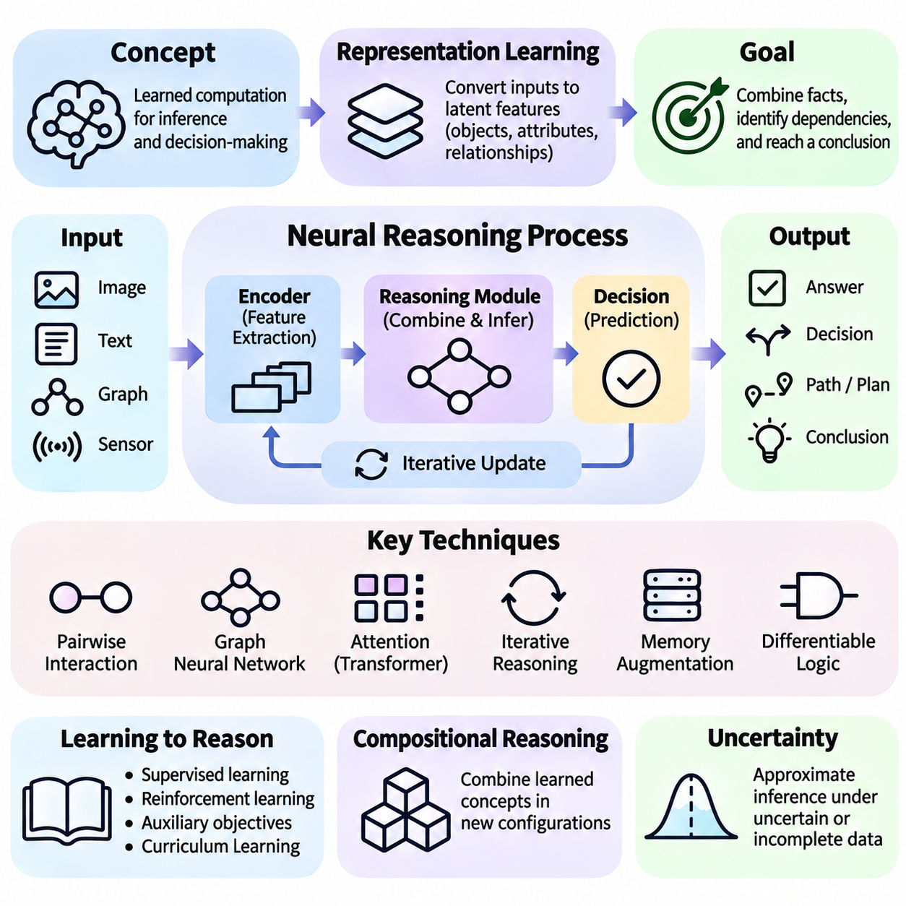{width="7.268055555555556in" height="7.268055555555556in"}

신경망을 활용한 추론(Reasoning with Neural Networks)은 관측값(Observations)을 구조화된 추론(Structured Inference)과 의사결정(Decision-Making)을 지원할 수 있는 표현(Representations)으로 변환하는 계산 메커니즘(Computational Mechanisms)을 학습하는 과정이다. 기존 예측 작업(Conventional Prediction Tasks)과 달리 추론은 여러 사실(Facts)을 결합하고, 의존성(Dependencies)을 식별하며, 중간 결론(Intermediate Conclusions)을 평가해야 하는 경우가 많다. 신경망 구조(Neural Architectures)는 학습된 변환(Learned Transformations), 반복 계산(Iterative Computation), 관련 관계를 인코딩하는 표현을 통해 이러한 과제에 접근한다.

신경 추론(Neural Reasoning)의 기반은 원시 입력(Raw Inputs)을 추론에 필요한 정보를 보존하는 수치 특징(Numerical Features)으로 변환하는 표현 학습(Representation Learning)에 있다. 이미지(Images), 언어(Language), 그래프(Graphs), 센서 측정값(Sensor Measurements)은 객체(Objects), 속성(Attributes), 문맥적 관계(Contextual Relationships)를 나타내는 잠재 벡터(Latent Vectors)로 인코딩될 수 있다. 효과적인 추론은 이러한 표현이 학습 데이터(Training Data)의 피상적인 상관관계(Superficial Correlations)가 아니라 의미 있는 구조(Meaningful Structure)를 포착하는지에 따라 달라진다.

일반적인 신경 추론 과정(Neural Reasoning Process)은 입력에서 관련 특징을 추출하는 인코더(Encoder)로 시작한다. 이후 이러한 특징은 정보를 결합하고, 관계를 추정하며, 내부 상태(Internal States)를 갱신하는 계산 모듈(Computational Modules)에 의해 처리된다. 최종 예측 또는 의사결정 모듈(Prediction or Decision Module)은 결과 표현을 해석한다. 이러한 구조는 추론과 유사한 동작(Reasoning-Like Behavior)을 지원할 수 있지만, 여러 처리 단계가 존재한다는 사실만으로 논리적 타당성(Logical Validity)이 자동으로 입증되지는 않는다.

관계 추론(Relational Reasoning)은 많은 문제가 독립적인 관측값(Isolated Observations)이 아니라 개체(Entities) 사이의 상호작용(Interactions)에 의존하기 때문에 핵심적인 능력이다. 신경망은 한 객체가 다른 객체를 지지하는지, 두 사건이 연결되어 있는지, 로봇(Robot)이 특정 위치 사이를 이동할 수 있는지 판단해야 할 수 있다. 이러한 작업에는 개체의 정체성(Entity Identities)과 관계를 보존하면서 여러 상호작용 구성 요소(Interacting Components)에 걸친 계산을 지원하는 표현이 필요하다.

관계 추론의 한 가지 접근 방식은 개체 조합 사이의 관계를 평가하는 쌍별 상호작용 모델(Pairwise Interaction Models)을 사용하는 것이다. 각 개체는 특징 벡터(Feature Vector)로 표현되며, 공유 신경 함수(Shared Neural Function)가 벡터 쌍을 처리하여 관계 정보(Relational Information)를 생성한다. 이러한 상호작용을 집계(Aggregation)하면 모델이 여러 객체와 관련된 질문에 답할 수 있지만, 개체 수가 증가함에 따라 계산 요구량(Computational Requirements)이 빠르게 증가할 수 있다.

그래프 신경망(Graph Neural Networks, GNN)은 정보를 노드(Nodes)와 엣지(Edges)로 구성하여 관계 계산(Relational Computation)을 확장한다. 노드는 개체를 나타내고, 엣지는 관계 또는 가능한 상호작용을 설명한다. 메시지 전달(Message Passing) 과정에서 각 노드는 연결된 이웃 노드(Neighbor Nodes)로부터 정보를 수신하고 자신의 표현을 갱신한다. 반복적인 메시지 전달 연산은 신경망이 그래프 내부의 직접적인 연결을 넘어 확장되는 의존성을 포착하도록 한다.

어텐션 메커니즘(Attention Mechanisms)은 추론 과정에서 관련 정보를 통합하는 또 다른 수단을 제공한다. 어텐션 가중치(Attention Weights)는 학습된 표현 사이의 관계를 기반으로 계산되며, 신경망이 문맥적으로 중요한 요소(Contextually Important Elements)를 강조하도록 한다. 트랜스포머 구조(Transformer Architectures)는 자기 어텐션(Self-Attention)을 활용하여 시퀀스(Sequences) 또는 집합(Sets) 전반의 상호작용을 모델링한다. 이러한 유연성은 복잡한 정보 통합을 지원하지만, 어텐션 패턴(Attention Patterns)만으로 체계적인 추론(Systematic Inference)이 보장되지는 않는다.

반복 추론(Iterative Reasoning)은 신경망이 반복적인 계산 단계를 통해 내부 표현(Internal Representations)을 정교화하도록 한다. 단일 변환(Single Transformation)을 통해 답을 생성하는 대신, 반복 모델(Iterative Model)은 추가적인 관계나 제약 조건(Constraints)을 고려하면서 상태(State)를 갱신한다. 이러한 접근 방식은 다단계 작업(Multi-Step Tasks)을 지원할 수 있지만, 신뢰할 수 있는 성능은 효과적인 상태 관리(State Management), 적절한 학습 목표(Training Objectives), 충분한 계산 깊이(Computational Depth)에 따라 달라진다.

메모리 증강 신경망(Memory-Augmented Neural Networks)은 추론 과정에서 정보를 저장하고 검색하기 위한 메커니즘을 도입한다. 외부 메모리 구조(External Memory Structures)는 관측값, 중간 결과(Intermediate Results), 이전에 학습된 연관성(Learned Associations)을 보존할 수 있다. 추론 제어기(Reasoning Controller)는 관련 정보를 검색하고, 메모리 내용을 갱신하며, 계산을 계속 수행할 수 있다. 이러한 구조는 긴 시퀀스 또는 여러 의존적인 의사결정에 걸쳐 정보를 통합해야 하는 작업에서 유용하다.

신경 추론은 논리 연산(Logical Operations)의 미분 가능한 근사(Differentiable Approximations)를 포함할 수도 있다. 미분 가능 논리 모델(Differentiable Logic Models)은 논리곱(Conjunction), 논리합(Disjunction), 함의(Implication), 규칙 적용(Rule Application)의 일부 특성을 연속적인 수학 함수(Continuous Mathematical Functions)로 표현한다. 이러한 방법은 구조화된 추론 제약(Structured Reasoning Constraints)을 도입하면서 경사 기반 최적화(Gradient-Based Optimization)를 가능하게 한다. 그러나 근사적인 논리 연산이 기호 정리 증명(Symbolic Theorem Proving)의 형식적 보장(Formal Guarantees)을 반드시 제공하는 것은 아니다.

추론 절차 학습(Learning Reasoning Procedures)에는 피상적인 정답 패턴(Superficial Answer Patterns)뿐 아니라 적절한 중간 계산(Intermediate Computations)을 보상하는 학습 목표가 필요하다. 지도 학습(Supervised Learning)은 올바른 관계나 최종 결론의 사례를 제공할 수 있으며, 강화 학습(Reinforcement Learning)은 성공적인 순차적 의사결정(Sequential Decisions)에 보상을 부여할 수 있다. 보조 목표(Auxiliary Objectives), 구조화된 지도(Structured Supervision), 커리큘럼 학습(Curriculum Learning)은 재사용 가능한 추론 메커니즘(Reusable Inference Mechanisms)을 촉진할 수 있지만, 효과는 작업 설계(Task Design)에 따라 달라진다.

구성적 추론(Compositional Reasoning)은 이전에 학습한 개념을 익숙하지 않은 구성으로 결합하는 능력과 관련된다. 신경 모델(Neural Model)은 포함 관계(Containment), 인접 관계(Adjacency), 의존 관계(Dependency) 등을 학습한 다음 이를 새로운 개체 조합에 적용할 수 있다. 이러한 능력을 달성하려면 관련 구조적 속성(Structural Properties)을 보존하는 표현과 암기된 사례(Memorized Examples) 또는 데이터셋 특유의 지름길(Dataset-Specific Shortcuts)에 대한 의존성을 줄이는 학습 조건이 필요하다.

신경 추론은 불확실성(Uncertainty) 아래에서의 근사 추론(Approximate Inference)도 지원한다. 관측값이 불완전하거나 잡음(Noise)을 포함하는 경우, 신경망은 학습된 통계적 패턴(Statistical Patterns)을 활용하여 가능한 관계나 숨겨진 상태(Hidden States)를 추정할 수 있다. 확률적 신경 모델(Probabilistic Neural Models)은 확률 분포(Distributions) 또는 잠재 변수(Latent Variables)를 통해 불확실성을 더욱 명시적으로 표현할 수 있다. 그러나 예측 신뢰도(Predictive Confidence)는 보정(Calibration)되어야 하며, 근사 추론을 논리적으로 보장된 결론(Logically Guaranteed Conclusions)과 혼동해서는 안 된다.

시간 추론(Temporal Reasoning)은 신경 추론을 사건의 시퀀스(Event Sequences)와 변화하는 시스템 상태(System States)로 확장한다. 순환 신경망(Recurrent Neural Networks), 시간 트랜스포머(Temporal Transformers), 상태 공간 모델(State-Space Models)은 시간에 따른 의존성(Temporal Dependencies)을 표현할 수 있다. 이러한 구조는 미래 상태(Future Conditions)를 예측하고, 사건 관계(Event Relationships)를 추론하며, 순차적 의사결정을 지원할 수 있다. 효과적인 동작을 위해서는 관련 과거 정보(Historical Information)를 유지하면서 누적 오류(Accumulated Errors)와 불필요한 의존성을 방지해야 한다.

공간 추론(Spatial Reasoning)은 위치(Positions), 방향(Orientations), 거리(Distances), 기하학적 관계(Geometric Relationships)를 이해하는 능력을 요구한다. 신경망은 이미지, 포인트 클라우드(Point Clouds), 기타 센서 측정값으로부터 공간 표현(Spatial Representations)을 학습할 수 있다. 기하학적 신경망 구조(Geometric Neural Architectures)는 좌표계(Coordinate Systems), 상대 변환(Relative Transformations), 등변 연산(Equivariant Operations)을 포함할 수 있다. 이러한 귀납적 편향(Inductive Biases)은 서로 다른 시점이나 환경에서도 공간 관계가 일관되게 유지될 때 일반화 성능(Generalization Performance)을 향상시킬 수 있다.

로보틱스(Robotics)에서 신경 추론은 인식(Perception)을 계획(Planning) 및 제어(Control)와 연결한다. 이동 로봇(Mobile Robot)은 장애물(Obstacles)을 식별하고, 주행 가능한 영역(Navigable Regions)을 추정하며, 현재 위치(Current Position)와 목적지(Destination) 사이의 관계를 평가할 수 있다. 학습된 관계 모델(Learned Relational Models)은 경로 선택(Route Selection)이나 상호작용 예측(Interaction Prediction)을 지원하고, 명시적 계획기(Explicit Planners)와 안전 제어기(Safety Controllers)는 운영 제약(Operational Constraints)을 강제한다. 이러한 역할 분리는 의사결정이 실시간 요구사항(Real-Time Requirements)을 충족해야 할 때 중요하다.

실용적인 추론 구조(Practical Reasoning Architecture)는 하나의 구분되지 않은 신경망에 의존하기보다 특화된 신경 구성 요소(Specialized Neural Components)를 결합하는 경우가 많다. 인식 모듈(Perception Modules)은 관측 정보를 추출하고, 관계 모듈(Relational Modules)은 의존성을 추정하며, 메모리 구성 요소(Memory Components)는 문맥(Context)을 보존하고, 의사결정 모듈(Decision Modules)은 출력을 선택한다. 모듈형 구성(Modular Organization)은 유지보수성(Maintainability)을 향상시키고 목표 지향적인 평가(Targeted Evaluation)를 용이하게 할 수 있지만, 모듈 간 통신 오류(Communication Errors)는 여전히 전체 추론 성능에 영향을 미칠 수 있다.

신경 추론의 평가(Evaluation)는 최종 예측 정확도(Final Prediction Accuracy) 이상의 요소를 검토해야 한다. 관련 테스트에는 관계적 일관성(Relational Consistency), 다단계 추론 정확도(Multi-Step Inference Accuracy), 구성적 일반화(Compositional Generalization), 분포 변화(Distribution Shifts)에 대한 강건성(Robustness), 무관한 입력 변화(Irrelevant Input Changes)에 대한 민감도가 포함된다. 통제된 실험(Controlled Experiments)은 모델이 의미 있는 구조적 정보(Structural Information)를 활용하는지, 아니면 익숙하지 않은 조건에서 실패하는 통계적 지름길(Statistical Shortcuts)을 이용하는지 판단하는 데 도움이 된다.

해석 가능성(Interpretability)과 검증(Verification)은 신경 추론이 중대한 결과를 초래할 수 있는 의사결정(Consequential Decisions)을 지원할 때 특히 중요하다. 중간 표현(Intermediate Representations), 어텐션 분포(Attention Distributions), 특징 기여도 분석(Feature Attribution Methods)은 모델 동작(Model Behavior)에 대한 부분적인 증거를 제공할 수 있다. 추가적인 기호적 검사(Symbolic Checks), 제약 조건 검증(Constraint Validation), 외부 검증(External Verification)은 출력이 명시적인 요구사항(Explicit Requirements)을 만족하는지 평가할 수 있다. 이러한 메커니즘은 신경망 내부 계산을 완전히 투명하게 만들지는 못하지만 시스템의 신뢰성 확보(Assurance)를 향상시킨다.

계산 효율성(Computational Efficiency)은 실용적인 추론 시스템의 설계에 영향을 미친다. 쌍별 상호작용(Pairwise Interactions), 그래프 메시지 전달(Graph Message Passing), 반복 갱신(Iterative Updates), 어텐션 연산(Attention Operations)은 처리 시간(Processing Time)과 메모리 사용량(Memory Consumption)을 증가시킬 수 있다. 실시간 응용(Real-Time Applications)에서는 희소 연결성(Sparse Connectivity), 선택적 어텐션(Selective Attention), 제한된 추론 반복(Limited Reasoning Iterations), 계층적 계산(Hierarchical Computation)이 필요할 수 있다. 적절한 구조는 요구되는 관계의 복잡도와 사용 가능한 하드웨어 자원(Hardware Resources)에 따라 결정된다.

신경 추론은 상호 보완적인 접근 방식(Complementary Approaches)과 결합될 때 특히 높은 가치를 제공한다. 기호 시스템(Symbolic Systems)은 명시적인 규칙과 제약 조건을 제공하고, 확률 모델(Probabilistic Models)은 불확실성을 표현하며, 인과 모델(Causal Models)은 개입(Interventions)에 관한 추론을 지원한다. 신경 구성 요소(Neural Components)는 유연한 인식(Flexible Perception)과 학습된 표현을 제공한다. 이러한 능력을 통합하면 복잡한 관측 정보를 처리하면서 더욱 강력한 구조적 및 운영적 제약(Structural and Operational Constraints)을 유지하는 시스템을 구축할 수 있다.

신경망을 활용한 추론의 발전은 통계적 패턴 인식(Statistical Pattern Recognition)에서 구조화된 계산 관계(Structured Computational Relationships)의 학습으로 전환되는 과정을 나타낸다. 그래프 기반 처리(Graph-Based Processing), 어텐션(Attention), 메모리(Memory), 반복 추론(Iterative Inference), 미분 가능 논리(Differentiable Logic)는 이러한 전환을 위한 상호 보완적인 메커니즘을 제공한다. 이들의 결합된 잠재력은 다양한 구성에 걸쳐 일반화하고, 증거를 통합하며, 변화하는 조건에서 신뢰할 수 있는 의사결정을 지원하는 시스템을 구축하는 데 있다.

궁극적으로 성공적인 신경 추론은 표현(Representations), 구조(Architectures), 학습 목표(Training Objectives), 평가 방법(Evaluation Methods)을 대상 문제(Target Problem)의 구조와 일치시키는 데 달려 있다. 단순히 모델 크기(Model Size)를 증가시키는 것만으로 체계적인 추론(Systematic Reasoning)이나 신뢰할 수 있는 일반화(Dependable Generalization)가 보장되지는 않는다. 발전을 위해서는 관계 구조(Relational Structure), 중간 계산(Intermediate Computation), 불확실성(Uncertainty), 검증(Verification), 실제 지능형 시스템(Real-World Intelligent Systems)의 운영 제약(Operational Constraints)에 대한 명시적인 고려가 필요하다.

## 04.04 Graph Neural Networks

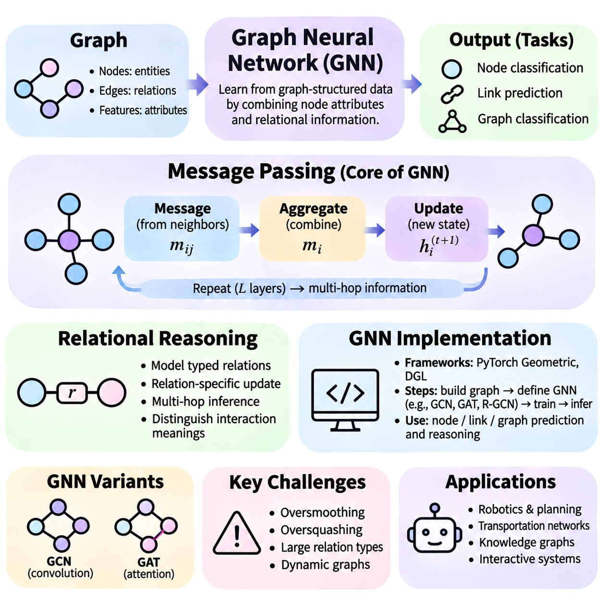{width="7.268055555555556in" height="7.268055555555556in"}

그래프 신경망(Graph Neural Networks, GNN)은 상호 연결된 개체(Interconnected Entities)와 관계(Relationships)로 표현된 데이터로부터 학습하도록 설계된 신경망 구조(Neural Architectures)이다. 이미지나 시퀀스(Sequences)와 같은 규칙적인 구조를 주로 처리하는 기존 신경망(Conventional Neural Networks)과 달리, 그래프 신경망은 불규칙한 그래프 구조(Irregular Graph Structures)에서 작동한다. 핵심적인 장점은 개체의 속성(Entity Attributes)과 관계 정보(Relational Information)를 결합하여 복잡한 시스템 전반에서 구조화된 예측(Structured Prediction)과 추론(Reasoning)을 지원할 수 있다는 것이다.

그래프(Graph)는 개체를 나타내는 노드(Nodes)와 개체 사이의 관계를 설명하는 엣지(Edges)로 구성된다. 노드는 객체(Objects), 사람(People), 센서(Sensors), 위치(Locations), 추상적 개념(Abstract Concepts)을 나타낼 수 있으며, 엣지는 물리적 연결(Physical Connections), 의미적 연관성(Semantic Associations), 상호작용(Interactions)을 인코딩할 수 있다. 각 노드와 엣지는 수치 특징(Numerical Features)을 포함할 수 있다. 그래프 신경망은 이러한 특징을 지역적 속성(Local Attributes)과 관계적 문맥(Relational Context)을 반영하는 학습된 표현(Learned Representations)으로 변환한다.

메시지 전달(Message Passing)은 많은 그래프 신경망에서 사용되는 기본적인 계산 메커니즘(Computational Mechanism)이다. 각 메시지 전달 계층(Message-Passing Layer)에서 노드는 연결된 이웃 노드(Neighbor Nodes)로부터 정보를 수신하고 이를 기존 표현과 결합한다. 이러한 갱신(Update)을 통해 정보가 그래프 전체로 전파(Propagation)될 수 있다. 이 과정을 반복하면 노드는 점차 멀리 떨어진 구조적 정보(Structural Information)를 통합할 수 있지만, 지나치게 많은 정보 전파는 추가적인 한계를 발생시킬 수 있다.

일반적인 메시지 전달 연산(Message-Passing Operation)은 메시지 생성(Message Construction), 집계(Aggregation), 상태 갱신(State Updating)으로 구성된다. 학습 가능한 함수(Learnable Function)는 이웃 노드의 특징과 선택적으로 엣지 속성(Edge Attributes)을 활용하여 메시지를 생성한다. 집계 함수(Aggregation Function)는 합산(Summation), 평균(Averaging), 최댓값 선택(Maximum Selection)과 같은 연산을 통해 수신된 메시지를 결합한다. 이후 갱신 함수(Update Function)는 집계된 정보를 수신 노드의 현재 표현(Current Representation)과 통합한다.

집계 함수는 일반적으로 이웃 노드의 순서에 영향을 받지 않는 순열 불변성(Permutation Invariance)을 만족해야 한다. 그래프 연결성(Graph Connectivity)은 고정된 순서를 의미하지 않기 때문이다. 합산은 기여하는 이웃 노드의 수량 정보를 보존하고, 평균은 결합된 영향력을 정규화(Normalization)한다. 최댓값 집계(Maximum Aggregation)는 강하게 활성화된 특징(Strongly Activated Features)을 강조한다. 적절한 집계 메커니즘의 선택은 대상 응용 분야(Target Application)의 구조적 특성(Structural Properties)과 추론 요구사항(Reasoning Requirements)에 따라 달라진다.

그래프 합성곱 신경망(Graph Convolutional Networks, GCN)은 정규화된 그래프 연결성(Normalized Graph Connectivity)을 통해 이웃 노드의 특징을 결합하는 방식으로 메시지 전달을 구현한다. 각 계층은 학습 가능한 변환(Trainable Transformations)을 적용하면서 인접 노드(Adjacent Nodes) 사이에 정보를 전파한다. 그래프 어텐션 신경망(Graph Attention Networks, GAT)은 이웃 개체에 학습된 중요도 가중치(Learned Importance Weights)를 부여하여 이 과정을 확장한다. 이러한 접근 방식은 계산 비용(Computational Cost)과 표현 능력(Expressive Capacity) 사이의 절충 관계를 가지면서 관계 정보를 통합하는 서로 다른 메커니즘을 제공한다.

그래프 신경망의 깊이(Depth)는 각 노드가 활용할 수 있는 관계의 범위에 영향을 미친다. 단일 메시지 전달 계층은 일반적으로 직접 연결된 이웃의 정보를 통합하며, 여러 계층은 추가적인 그래프 연결을 통해 수용 영역(Receptive Field)을 확장한다. 그러나 깊이가 증가하면 노드 표현(Node Representations)이 지나치게 유사해지는 과도한 평활화(Oversmoothing)나 많은 정보가 제한된 표현에 압축되는 과도한 압축(Oversquashing)이 발생할 수 있다.

관계 추론(Relational Reasoning)은 상호작용의 의미와 유형을 고려함으로써 단순한 연결성을 넘어 그래프 계산(Graph Computation)을 확장한다. 교통 네트워크(Transportation Network)에서 엣지는 이동 경로(Travel Routes), 거리(Distances), 교통 상황(Traffic Conditions)을 나타낼 수 있다. 지식 그래프(Knowledge Graph)에서는 소유 관계(Ownership), 위치(Location), 의존 관계(Dependency)를 설명할 수 있다. 관계 추론 모델(Relational Reasoning Model)은 모든 연결을 동일한 정보원으로 취급하지 않고 이러한 의미를 구별해야 한다.

관계형 그래프 신경망(Relational Graph Neural Networks)은 엣지 유형(Edge Types) 또는 관계별 변환(Relation-Specific Transformations)을 메시지 계산에 통합한다. 서로 다른 관계는 별도의 매개변수(Parameters) 또는 공유된 매개변수화 함수(Shared Parameterized Functions)를 통해 노드 표현에 영향을 미칠 수 있다. 이러한 접근 방식은 특정 상호작용이 추론에 미치는 영향을 모델이 학습하도록 한다. 그러나 관계 유형의 수가 많아지면 매개변수 요구량(Parameter Requirements)이 증가하고 관측값이 희소한 경우(Sparse Observations) 학습에 어려움이 발생할 수 있다.

다중 홉 관계 추론(Multi-Hop Relational Reasoning)은 연결된 관계의 연속으로부터 결론을 도출하는 과정을 의미한다. 예를 들어 시스템은 여러 의존성 연결(Dependency Links)을 통해 특정 구성 요소(Component)가 장애(Failure)의 간접적인 영향을 받는다고 추론할 수 있다. 반복적인 메시지 전달은 이러한 연결을 따라 관련 정보를 전파할 수 있다. 성공적인 추론은 정보 전파 과정에서 경로(Paths), 개체(Entities), 관계 유형(Relationship Types) 사이의 의미 있는 차이를 보존하는 데 달려 있다.

그래프 신경망은 노드 수준 예측(Node-Level Predictions), 엣지 수준 예측(Edge-Level Predictions), 그래프 수준 예측(Graph-Level Predictions)을 지원할 수 있다. 노드 분류(Node Classification)는 개별 개체에 속성이나 범주를 할당하고, 링크 예측(Link Prediction)은 누락되었거나 잠재적으로 존재하는 관계를 추정한다. 그래프 분류(Graph Classification)는 전체 상호 연결 구조의 속성을 평가한다. 이러한 예측 작업은 추론 시스템의 구성 요소로 활용될 수 있지만, 예측의 성공만으로 논리적으로 타당한 추론(Logically Valid Inference)이 입증되지는 않는다.

피지컬 인공지능(Physical AI)과 로보틱스(Robotics)에서 그래프 표현(Graph Representations)은 상호작용하는 객체와 시스템 구성 요소(System Components)를 추상화하는 유용한 방법을 제공한다. 노드는 로봇(Robots), 장애물(Obstacles), 주행 영역(Navigation Regions), 운영 작업(Operational Tasks)을 나타내고, 엣지는 공간적 근접성(Spatial Proximity), 통신 연결(Communication Links), 의존성을 설명할 수 있다. 그래프 신경망은 상호작용 패턴(Interaction Patterns)을 추정하고 계획 의사결정(Planning Decisions)을 지원할 수 있지만, 신뢰할 수 있는 자율 운영(Autonomous Operation)을 위해서는 명시적인 안전 제약(Safety Constraints)이 여전히 필요하다.

동적 그래프 신경망(Dynamic Graph Neural Networks)은 개체나 연결이 시간에 따라 변화하는 시스템으로 관계 모델링(Relational Modeling)을 확장한다. 로봇 군집(Robot Fleet)에서는 통신 가용성(Communication Availability), 작업 할당(Task Assignments), 공간 관계(Spatial Relationships)가 지속적으로 변화할 수 있다. 동적 모델(Dynamic Models)은 관측값이 변화함에 따라 그래프 표현을 갱신하여 시간적 관계 추론(Temporal Relational Reasoning)을 가능하게 한다. 변화하는 그래프 구조 전반에서 일관성(Consistency)을 유지하는 것은 중요한 엔지니어링 과제로 남아 있다.

그래프 신경망 구현(GNN Implementation)은 그래프 표현(Graph Representation)과 예측 목표(Prediction Objective)를 정의하는 것에서 시작한다. 개발자는 노드 특징(Node Features), 엣지 속성(Edge Attributes), 연결 정보(Connectivity Information), 목표 출력(Target Outputs)을 식별한다. 그래프 데이터(Graph Data)는 일반적으로 특징 행렬(Feature Matrices), 엣지 인덱스 구조(Edge-Index Structures), 희소 인접 행렬(Sparse Adjacency Matrices)을 사용하여 표현된다. 적절한 전처리(Preprocessing)는 학습 과정 전반에서 개체 식별자(Entity Identifiers), 관계 방향(Relationship Directions), 특징 차원(Feature Dimensions)의 일관성을 보장한다.

실용적인 구현에서는 파이토치 지오메트릭(PyTorch Geometric) 또는 딥 그래프 라이브러리(Deep Graph Library, DGL)를 활용하여 메시지 전달 구조(Message-Passing Architectures)를 구성할 수 있다. 이러한 프레임워크(Frameworks)는 그래프 합성곱(Graph Convolution), 어텐션 계층(Attention Layers), 이웃 샘플링(Neighborhood Sampling), 배치 처리 유틸리티(Batching Utilities)를 제공한다. 일반적인 모델은 여러 그래프 처리 계층(Graph-Processing Layers), 비선형 활성화 함수(Nonlinear Activation Functions), 작업별 출력 모듈(Task-Specific Output Module)을 적용한다. 구현 과정에서는 순열 불변 집계(Permutation-Invariant Aggregation)를 유지하고 다양한 그래프 크기(Variable Graph Sizes)를 처리해야 한다.

그래프 신경망 학습(Training)은 일반적으로 미분 가능한 손실 함수(Differentiable Loss Function)를 정의하고 역전파(Backpropagation)를 통해 모델 매개변수를 최적화하는 과정을 포함한다. 노드 분류에는 교차 엔트로피 손실(Cross-Entropy Loss)을 사용할 수 있으며, 링크 예측에는 이진 분류(Binary Classification) 또는 순위 기반 목표(Ranking Objectives)를 사용할 수 있다. 그래프 수준 회귀(Graph-Level Regression)는 수치 예측 손실(Numerical Prediction Losses)을 활용할 수 있다. 학습 품질은 대표성 있는 그래프 데이터(Representative Graph Data), 적절한 최적화 설정(Optimization Settings), 학습 정보와 평가 정보의 신중한 분리(Careful Separation)에 따라 달라진다.

그래프 데이터셋(Graph Datasets)은 연결된 개체들이 구조적 의존성(Structural Dependencies)을 공유할 수 있기 때문에 정보 누출(Information Leakage)에 특별한 주의가 필요하다. 노드나 엣지를 무작위로 분리하면 평가 정보(Evaluation Information)가 그래프를 통해 간접적으로 접근 가능한 상태로 남아 지나치게 낙관적인 결과를 생성할 수 있다. 따라서 전이적 평가(Transductive Evaluation)와 귀납적 평가(Inductive Evaluation)를 구분해야 하며, 데이터 분할 절차(Data Splitting Procedures)는 실제 배포 조건(Intended Deployment Conditions)을 반영해야 한다.

확장성(Scalability)은 그래프에 수백만 개의 노드가 포함되거나 연결성이 밀집(Dense Connectivity)될 때 어려워진다. 전체 이웃 집계(Full-Neighborhood Aggregation)는 특히 여러 계층에 걸쳐 상당한 메모리와 계산 자원을 요구할 수 있다. 이웃 샘플링(Neighbor Sampling), 그래프 분할(Graph Partitioning), 미니배치 학습(Mini-Batch Training), 희소 연산(Sparse Operations)은 자원 요구량을 줄일 수 있다. 그러나 샘플링은 관련 관계를 누락시킬 수 있으므로 계산 효율성(Computational Efficiency)과 추론 완전성(Reasoning Completeness) 사이의 절충 관계가 발생한다.

그래프 신경망의 성능은 그래프 구조(Graph Structure)와 대상 작업(Target Task) 사이의 관계에도 영향을 받는다. 동질성 그래프(Homophilic Graphs)는 유사한 속성을 가진 개체들을 연결하는 경우가 많지만, 이질성 그래프(Heterophilic Graphs)는 서로 다른 속성을 가진 개체들을 연결할 수 있다. 특정 구조적 가정(Structural Assumption)에서 잘 작동하는 모델이 다른 조건에서는 성능이 저하될 수 있다. 따라서 효과적인 모델 선택(Model Selection)을 위해서는 그래프 토폴로지(Graph Topology), 특징 분포(Feature Distributions), 연결의 의미적 특성(Semantic Meaning)을 분석해야 한다.

표현력의 한계(Expressive Limitations) 역시 중요하다. 표준 메시지 전달 구조(Standard Message-Passing Architectures)는 가능한 모든 그래프 구조를 구별할 수 없기 때문이다. 일부 그래프 구성(Graph Configurations)은 전역 속성(Global Properties)이 서로 다르더라도 동일한 집계 표현(Aggregated Representations)을 생성할 수 있다. 더 높은 표현력을 가진 접근 방식은 위치 인코딩(Positional Encodings), 고차 상호작용(Higher-Order Interactions), 부분 그래프 표현(Subgraph Representations), 추가적인 구조적 특징(Structural Features)을 포함할 수 있다. 이러한 확장은 구별 능력(Discrimination Capability)을 향상시킬 수 있지만 계산 복잡도(Computational Complexity)를 증가시킨다.

그래프 기반 추론(Graph-Based Reasoning)의 평가는 기존 예측 정확도(Prediction Accuracy)에만 의존하지 않고 관계적 일반화(Relational Generalization)를 분석해야 한다. 유용한 테스트에는 이전에 관측하지 못한 그래프 구조(Unseen Graph Structures), 새로운 개체 조합(New Combinations of Entities), 더 긴 의존성 경로(Longer Dependency Paths), 그래프 크기 변화(Changes in Graph Size)가 포함된다. 누락된 엣지(Missing Edges), 잡음이 포함된 속성(Noisy Attributes), 잘못된 관계(Incorrect Relationships)에 대한 강건성(Robustness)도 중요하며, 특히 그래프 구성이 불완전한 인식(Imper­fect Perception)이나 외부 데이터 소스(External Data Sources)에 의존하는 경우 더욱 중요하다.

해석 가능성(Interpretability)과 검증(Verification)은 그래프 신경망이 중대한 결과를 초래할 수 있는 의사결정(Consequential Decisions)에 영향을 미칠 때 필수적이다. 어텐션 가중치(Attention Weights), 엣지 기여도 분석(Edge Attribution), 부분 그래프 설명(Subgraph Explanations), 중간 노드 표현(Intermediate Node Representations)은 모델 동작(Model Behavior)에 대한 부분적인 통찰을 제공할 수 있다. 그러나 이러한 설명이 인과적 타당성(Causal Validity)이나 논리적 타당성(Logical Validity)을 자동으로 입증하는 것은 아니다. 명시적인 제약 조건(Explicit Constraints)과 독립적인 검증(Independent Verification)은 예측된 관계가 운영 요구사항(Operational Requirements)을 만족하는지 판단하는 데 도움이 된다.

메시지 전달(Message Passing), 관계 추론(Relational Reasoning), 실용적인 구현(Practical Implementation)의 통합은 구조화된 신경 지능(Structured Neural Intelligence)의 기반을 제공한다. 그래프 신경망(Graph Neural Networks)은 연결된 개체 사이의 정보 교환(Information Exchange)을 가능하게 하고, 상호작용에 의존하는 표현(Interaction-Dependent Representations)을 학습하며, 복잡한 관계 시스템(Relational Systems) 전반의 추론을 지원한다. 궁극적으로 그 효과는 그래프 품질(Graph Quality), 구조적 표현력(Architectural Expressiveness), 계산 효율성(Computational Efficiency), 현실적인 조건에서의 엄격한 평가(Rigorous Evaluation)에 따라 결정된다.

## 04.05 Attention and Reasoning

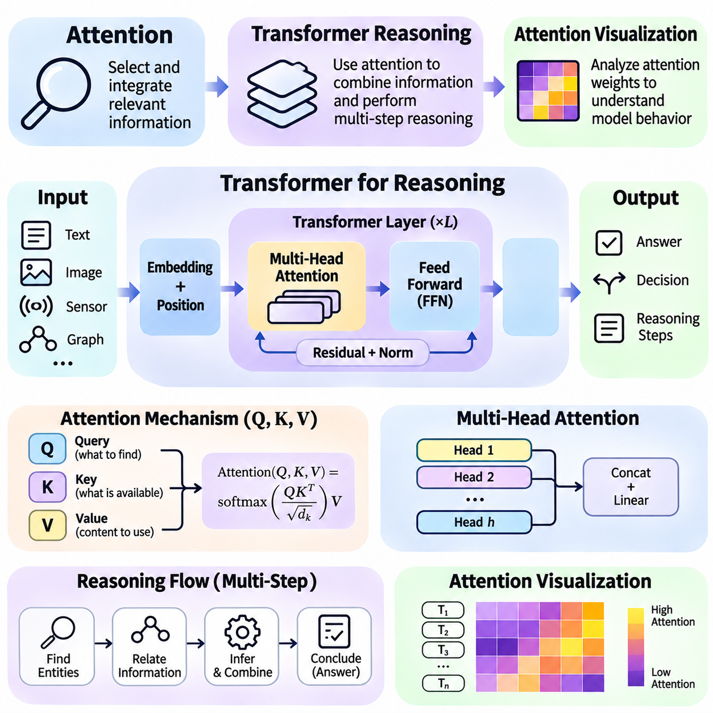{width="7.268055555555556in" height="7.268055555555556in"}

어텐션 메커니즘(Attention Mechanisms)은 신경망(Neural Networks)이 특정 계산 목표(Computational Objective)와 관련된 정보를 선택하고 통합할 수 있도록 하는 유연한 방법을 제공한다. 모든 입력 요소(Input Elements)를 동일한 영향력으로 처리하는 대신, 어텐션은 표현(Representations)에 문맥 의존적 가중치(Context-Dependent Weights)를 부여한다. 이러한 능력은 관계(Relationships)를 식별하고, 증거(Evidence)를 결합하며, 복잡한 입력 전반에 걸쳐 의존성(Dependencies)을 유지해야 하는 추론 작업(Reasoning Tasks)에서 특히 중요하다.

기본적인 어텐션 연산(Attention Operation)은 학습된 표현(Learned Representations)으로부터 생성된 쿼리(Queries), 키(Keys), 값(Values)을 사용한다. 쿼리는 찾고자 하는 정보를 나타내고, 키는 사용 가능한 정보의 특성을 표현하며, 값은 집계할 내용(Content)을 포함한다. 쿼리와 키 사이의 유사도 점수(Similarity Scores)는 어텐션 가중치(Attention Weights)를 결정하며, 이 가중치는 정규화(Normalization)된 후 값에 적용된다. 결과 표현(Resulting Representation)은 학습된 문맥적 관련성(Contextual Relevance)에 따라 정보를 통합한다.

스케일드 내적 어텐션(Scaled Dot-Product Attention)은 행렬 곱셈(Matrix Multiplication)을 통해 유사도를 계산하고 키 벡터(Key Vectors)의 차원(Dimensionality)에 따라 점수를 조정한다. 소프트맥스 정규화(Softmax Normalization)는 이러한 점수를 사용 가능한 위치 전체에서 합이 1이 되는 가중치로 변환한다. 이러한 수식화(Formulation)는 최신 가속기(Modern Accelerators)에서 효율적인 병렬 계산(Parallel Computation)을 지원한다. 그러나 높은 어텐션 가중치는 특정 계층(Layer) 내부의 계산적 영향력(Computational Influence)을 나타낼 뿐, 의미적 중요성(Semantic Importance)이나 인과적 설명(Causal Explanation)을 보장하지는 않는다.

자기 어텐션(Self-Attention)은 동일한 입력 시퀀스(Input Sequence) 내부의 요소들이 직접 정보를 교환할 수 있도록 한다. 각 토큰(Token)은 허용된 다른 위치의 표현을 통합할 수 있으므로, 모델은 순차적 순환 처리(Sequential Recurrence)에만 의존하지 않고 문맥적 의존성(Contextual Dependencies)을 포착할 수 있다. 언어 추론(Language Reasoning)에서 이러한 메커니즘은 문장이나 문서 전반에 걸쳐 개체(Entities), 속성(Attributes), 참조 관계(References)를 연결할 수 있다. 그 효과는 학습된 표현과 적절한 어텐션 제약(Attention Constraints)에 따라 달라진다.

멀티헤드 어텐션(Multi-Head Attention)은 서로 다른 학습된 투영(Learned Projections)을 통해 여러 어텐션 패턴(Attention Patterns)을 계산함으로써 이러한 메커니즘을 확장한다. 서로 다른 헤드(Heads)는 지역 문맥(Local Context), 구문적 의존성(Syntactic Dependencies), 장거리 연관성(Long-Range Associations)을 포함한 상호 보완적인 관계를 표현할 수 있다. 각 헤드의 출력은 또 다른 학습된 변환을 통해 결합된다. 개별 헤드가 식별 가능한 패턴을 나타내는 경우도 있지만, 그 기능이 반드시 독립적이거나 일관되게 해석 가능한 것은 아니다.

트랜스포머 구조(Transformer Architectures)는 어텐션(Attention)을 피드포워드 변환(Feedforward Transformations), 잔차 연결(Residual Connections), 정규화 연산(Normalization Operations)과 통합한다. 어텐션 자체는 시퀀스 순서(Sequence Order)를 본질적으로 인코딩하지 않기 때문에 위치 정보(Positional Information)가 추가된다. 반복되는 트랜스포머 계층(Transformer Layers)은 문맥적 표현(Contextual Representations)을 점진적으로 변환한다. 이러한 구조적 구성 요소(Architectural Components)는 유연한 정보 처리를 지원하지만, 추론 성능(Reasoning Performance)은 학습 목표(Training Objectives), 데이터 품질(Data Quality), 계산 깊이(Computational Depth)에도 영향을 받는다.

트랜스포머 추론(Transformer Reasoning)은 추론(Inference), 관계 정보 통합(Relational Integration), 계획(Planning), 구조화된 의사결정(Structured Decision-Making)이 필요한 작업에 트랜스포머 기반 모델(Transformer-Based Models)을 활용하는 것을 의미한다. 이러한 모델은 입력 시퀀스 전반에 분산된 정보를 결합하고 여러 의존성을 반영하는 출력을 생성하도록 학습할 수 있다. 그러나 추론 벤치마크(Reasoning Benchmarks)에서 성공적인 결과를 얻었다고 해서 모델이 범용 논리 절차(General-Purpose Logical Procedures)를 학습했다는 사실이 자동으로 입증되는 것은 아니다.

자기회귀 트랜스포머(Autoregressive Transformers)는 이전 문맥(Preceding Context)을 기반으로 다음 토큰(Subsequent Tokens)을 예측하여 출력을 순차적으로 생성한다. 이러한 과정은 중간 설명(Intermediate Explanations), 계산(Calculations), 제안된 추론 단계(Proposed Reasoning Steps)를 생성할 수 있다. 명시적인 중간 텍스트(Explicit Intermediate Text)는 추가적인 계산 구조(Computational Structure)를 제공함으로써 일부 다단계 작업(Multi-Step Tasks)의 성능을 향상시킬 수 있다. 그러나 생성된 추론 과정(Reasoning Traces)에는 오류가 포함될 수 있으며, 모델의 내부 계산(Internal Computations)을 충실하게 반영하지 않는 설명이 나타날 수도 있다.

다단계 트랜스포머 추론(Multi-Step Transformer Reasoning)은 연속적인 변환(Successive Transformations)을 적용하면서 관련 사실(Relevant Facts)을 유지하는 과정을 포함하는 경우가 많다. 관계적 질문(Relational Question)을 해결하는 모델은 개체를 식별하고, 관련 속성을 검색하며, 의존성을 비교하고, 결론을 구성할 수 있다. 어텐션은 이러한 표현 사이의 정보 교환(Information Exchange)을 촉진하고, 피드포워드 계층(Feedforward Layers)은 비선형 계산(Nonlinear Computation)에 기여한다. 중간 의존성(Intermediate Dependencies)이 손실되거나 잘못된 가정(Incorrect Assumptions)이 전파되면 신뢰성(Reliability)이 저하된다.

교차 어텐션(Cross-Attention)은 서로 다른 표현 소스(Representation Sources) 사이의 정보 교환을 지원한다. 인코더-디코더 구조(Encoder-Decoder Architectures)에서 디코더 쿼리(Decoder Queries)는 인코더(Encoder)가 생성한 표현에 어텐션을 적용한다. 멀티모달 시스템(Multimodal Systems)은 관련 메커니즘을 활용하여 언어(Language), 이미지(Images), 센서 측정값(Sensor Measurements), 구조화된 관측값(Structured Observations)을 통합할 수 있다. 이러한 능력은 관련 특징(Relevant Features)이 정렬(Alignment)되고 적절하게 표현된다는 조건에서 이질적인 정보(Heterogeneous Information)에 대한 추론을 지원한다.

어텐션 메커니즘은 공간 추론(Spatial Reasoning)과 관계 추론(Relational Reasoning)에도 적용할 수 있다. 비전 트랜스포머(Vision Transformers)는 이미지 패치(Image Patches)를 토큰으로 처리하여 서로 다른 시각 영역(Visual Regions) 사이의 상호작용을 가능하게 한다. 그래프 트랜스포머(Graph Transformers)는 연결된 개체 사이의 관계를 모델링하기 위해 구조적 정보(Structural Information)를 통합한다. 로보틱스(Robotics)에서 어텐션 기반 모델(Attention-Based Models)은 카메라(Cameras), 라이다(LiDAR), 작업 설명(Task Descriptions)으로부터 얻은 관측값을 통합하여 환경 해석(Environmental Interpretation)과 행동 선택(Action Selection)을 지원할 수 있다.

긴 문맥 추론(Long-Context Reasoning)은 상당한 계산적 및 표현적 과제(Computational and Representational Challenges)를 제시한다. 표준 전체 자기 어텐션(Full Self-Attention)은 시퀀스 위치 사이의 쌍별 상호작용(Pairwise Interactions)을 요구하므로, 시퀀스 길이에 따라 어텐션 계산량과 점수 저장 공간(Score Storage)이 이차적으로 증가한다. 희소 어텐션(Sparse Attention), 슬라이딩 윈도우(Sliding Windows), 메모리 메커니즘(Memory Mechanisms), 효율적인 어텐션 커널(Efficient Attention Kernels)은 실제 비용을 줄일 수 있다. 그러나 더 긴 문맥을 처리한다고 해서 멀리 떨어진 정보의 신뢰할 수 있는 검색(Reliable Retrieval)이나 추론이 보장되는 것은 아니다.

어텐션 시각화(Attention Visualization)는 어텐션 가중치가 입력 요소 전반에 어떻게 분포하는지 분석하는 방법을 제공한다. 연구자는 트랜스포머 계층에서 어텐션 행렬(Attention Matrices)을 추출하고 쿼리 위치(Query Positions)와 키 위치(Key Positions) 사이의 관계를 조사할 수 있다. 이러한 행렬은 지역적 집중(Local Concentration), 광범위한 정보 교환(Broad Information Exchange), 반복적인 구조적 패턴(Structural Patterns)을 보여줄 수 있다. 시각화는 탐색적 분석(Exploratory Analysis)에 유용하지만, 모델 동작(Model Behavior)에 대한 완전한 설명으로 간주해서는 안 된다.

일반적인 시각화 접근 방식은 어텐션 가중치를 히트맵(Heatmap)으로 표현하며, 행(Rows)은 쿼리 위치에 대응하고 열(Columns)은 키 위치에 대응한다. 셀의 강도(Cell Intensity)는 각 연결에 할당된 정규화된 어텐션 가중치(Normalized Attention Weight)를 반영한다. 계층과 헤드 전반의 히트맵을 비교하면 정보 전달 경로(Information Routing)의 차이를 확인할 수 있다. 적절한 해석을 위해서는 패딩 마스크(Padding Masks), 인과 마스크(Causal Masks), 토큰화(Tokenization), 시퀀스 경계(Sequence Boundaries)를 고려해야 한다.

어텐션 시각화는 개별 토큰(Individual Tokens)이나 선택된 입력 영역(Selected Input Regions)에도 적용할 수 있다. 분석가는 모델이 대명사(Pronoun), 수학적 표현(Mathematical Expression), 관계적 진술(Relational Statement)을 처리할 때 이전의 어떤 단어에 어텐션을 부여하는지 조사할 수 있다. 시각 모델(Visual Models)에서는 패치 수준 어텐션(Patch-Level Attention)을 대응하는 이미지 영역(Image Regions)에 투영할 수 있다. 이러한 관측은 잠재적인 의존성(Potential Dependencies)을 시사할 수 있지만, 어떤 특징이 예측을 유발했는지를 독립적으로 입증할 수는 없다.

어텐션 시각화 구현(Attention Visualization Implementation)은 일반적으로 모델 훅(Model Hooks)이나 프레임워크에서 지원하는 출력 옵션(Framework-Supported Output Options)을 통해 어텐션 텐서(Attention Tensors)에 접근하는 과정을 포함한다. 파이토치(PyTorch)와 트랜스포머 라이브러리(Transformer Libraries)에서는 관련 모델 설정(Model Configuration)이 이를 지원할 경우 어텐션 가중치를 얻을 수 있다. 텐서는 일반적으로 배치(Batch), 헤드(Head), 쿼리 위치(Query Position), 키 위치(Key Position)를 기준으로 구성된다. 일부 최적화된 어텐션 구현(Optimized Attention Implementations)에서는 명시적인 가중치 행렬(Weight Matrices)을 반환하기 위해 대체 설정(Alternative Settings)이 필요하다.

신뢰할 수 있는 시각화 작업 흐름(Visualization Workflow)은 입력 사례(Input Example)를 선택하고 토큰화(Tokenization) 또는 공간 분할(Spatial Partitioning)을 기록하는 것에서 시작한다. 관련 어텐션 출력을 보존하면서 모델을 실행한 다음, 이를 대응하는 입력 위치(Input Positions)와 연결한다. 분석가는 개별 헤드를 조사하거나, 선택된 헤드의 평균을 계산하거나, 여러 계층을 비교할 수 있다. 각각의 집계 방식(Aggregation Choice)은 표시되는 정보를 변화시키며 중요한 차이를 숨길 수도 있다.

어텐션 롤아웃(Attention Rollout)은 여러 트랜스포머 계층에 걸친 어텐션 행렬을 결합하여 정보 전파(Information Propagation)를 근사적으로 추정한다. 이 기법은 단일 계층을 조사하는 것보다 더 넓은 관점을 제공할 수 있다. 그러나 잔차 연결(Residual Connections), 비선형 변환(Nonlinear Transformations), 어텐션 헤드 사이의 상호작용(Interactions Among Attention Heads)은 해석을 복잡하게 만든다. 따라서 롤아웃은 확정적인 인과적 설명(Definitive Causal Explanation)이 아니라 가능한 정보 흐름(Possible Information Flow)에 대한 휴리스틱 표현(Heuristic Representation)을 제공한다.

어텐션과 해석 가능성(Interpretability) 사이의 관계는 여전히 중요한 연구 문제(Research Question)이다. 어텐션 가중치는 모델 계산의 한 구성 요소를 설명하지만, 값 투영(Value Projections)과 후속 변환(Downstream Transformations) 역시 최종 출력(Final Output)을 결정한다. 두 모델은 서로 다른 어텐션 분포(Attention Distributions)를 가지면서도 유사한 예측을 생성할 수 있다. 따라서 어텐션 시각화는 교란 테스트(Perturbation Tests), 특징 기여도 분석(Feature Attribution), 통제된 개입(Controlled Interventions)과 함께 활용되어야 한다.

어텐션 기반 추론(Attention-Based Reasoning)은 모델이 오해를 유발하는 상관관계(Misleading Correlations)나 관련 없는 문맥 요소(Irrelevant Contextual Elements)에 집중할 때 실패할 수 있다. 긴 시퀀스에는 필요한 증거(Necessary Evidence)와 경쟁하는 방해 요소(Distractors)가 포함될 수 있으며, 익숙하지 않은 입력 구조(Unfamiliar Input Structures)는 학습된 어텐션 패턴을 교란할 수 있다. 따라서 평가는 최종 답변 정확도(Final-Answer Accuracy)에만 의존하지 않고 문맥 길이(Context Length), 증거 배치(Evidence Placement), 방해 요소 밀도(Distractor Density), 관계적 복잡도(Relational Complexity)의 통제된 변화를 포함해야 한다.

실제 자율 시스템(Autonomous Systems)에서 어텐션 메커니즘은 복잡한 센서 입력(Sensor Inputs)을 처리하면서 관련 관측값(Relevant Observations)의 우선순위를 결정하는 데 도움을 줄 수 있다. 로봇은 주변 장애물(Nearby Obstacles), 주행 목표(Navigation Goals), 변화하는 작업 제약(Task Constraints)을 강조해야 할 수 있다. 그러나 어텐션 기반 우선순위 결정(Attention-Based Prioritization)은 명시적인 안전 검증(Explicit Safety Validation), 기하학적 추론(Geometric Reasoning), 실시간 제어 보장(Real-Time Control Guarantees)을 대체할 수 없다. 실제 배포(Deployment)에는 지연시간(Latency), 강건성(Robustness), 계산 자원 소비(Computational Resource Consumption)에 대한 신중한 평가가 필요하다.

트랜스포머 추론(Transformer Reasoning)과 어텐션 시각화(Attention Visualization)의 결합은 강력한 계산 프레임워크(Computational Framework)와 정보 통합(Information Integration)을 부분적으로 분석할 수 있는 수단을 동시에 제공한다. 트랜스포머는 유연한 문맥적 상호작용(Contextual Interactions)을 지원하고, 시각화는 어텐션 연산 내부의 선택된 패턴을 드러낸다. 이를 효과적으로 활용하려면 학습된 정보 전달 경로(Learned Information Routing), 입증된 추론 능력(Demonstrated Reasoning Capability), 검증된 논리적 정확성(Verified Logical Correctness) 사이의 차이를 인식해야 한다.

궁극적으로 어텐션은 표현 사이에서 문맥에 민감한 정보 선택(Context-Sensitive Information Selection)과 상호작용(Interaction)을 가능하게 함으로써 신경 추론(Neural Reasoning)에 기여한다. 트랜스포머 구조는 반복적인 어텐션과 비선형 계산(Nonlinear Computation)을 통해 이러한 능력을 확장하여 점점 더 복잡한 추론 작업을 지원한다. 어텐션 시각화는 분석(Analysis)과 디버깅(Debugging)을 지원하지만, 신뢰할 수 있는 추론(Dependable Reasoning)을 위해서는 상호 보완적인 평가(Evaluation), 불확실성 처리(Uncertainty Handling), 구조적 제약(Structural Constraints), 독립적인 검증(Independent Verification)이 필요하다.

## 04.06 Neural Logic Models

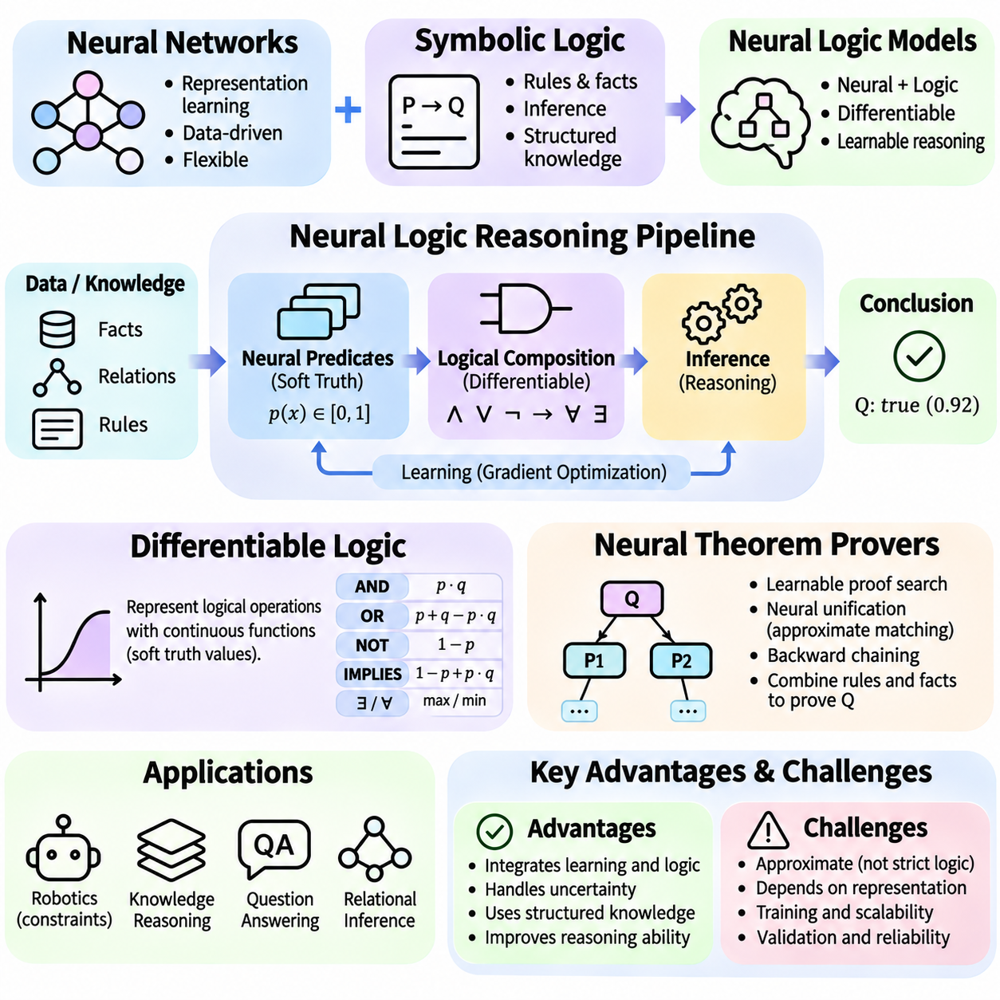{width="7.268055555555556in" height="7.268055555555556in"}

신경 논리 모델(Neural Logic Models)은 신경망(Neural Networks)의 표현 학습 능력(Representation-Learning Capabilities)과 기호 논리(Symbolic Logic)의 구조화된 추론 원리(Structured Inference Principles)를 결합한다. 이러한 모델의 목표는 경사 기반 학습(Gradient-Based Learning)과의 호환성을 유지하면서 사실(Facts), 관계(Relations), 규칙(Rules)에 대한 추론을 지원하는 것이다. 논리 연산(Logical Operations)을 미분 가능한 계산(Differentiable Computations)으로 표현함으로써 불확실한 관측값(Uncertain Observations)과 구조화된 지식(Structured Knowledge)을 통합하고 데이터로부터 매개변수(Parameters)를 학습할 수 있다.

전통적인 기호 논리(Traditional Symbolic Logic)는 이산적 진리값(Discrete Truth Values), 명시적 규칙(Explicit Rules), 형식적으로 정의된 추론 절차(Formally Defined Inference Procedures)에 의존한다. 반면 신경망은 수치적 방법(Numerical Methods)을 통해 최적화되는 연속적 표현(Continuous Representations)을 사용한다. 신경 논리 모델은 논리적 관계(Logical Relationships)를 근사하는 수학적 구조(Mathematical Structures)를 도입하여 이러한 접근 방식을 연결한다. 이러한 통합은 유연성을 제공하지만, 근사 추론(Approximate Inference)이 고전 논리(Classical Logic)의 형식적 보장(Formal Guarantees)을 자동으로 유지하는 것은 아니다.

미분 가능 논리(Differentiable Logic)는 경사 전파(Gradient Propagation)가 가능한 연속 함수(Continuous Functions)를 사용하여 논리 표현식(Logical Expressions)을 나타낸다. 명제(Propositions)를 엄격한 참(True) 또는 거짓(False) 값으로 제한하는 대신, 많은 정식화(Formulations)는 연속 구간(Continuous Interval) 내에서 진리의 정도(Degrees of Truth)를 부여한다. 이후 논리곱(Conjunction), 논리합(Disjunction), 부정(Negation)은 미분 가능하거나 거의 모든 지점에서 미분 가능한 연산자(Almost-Everywhere Differentiable Operators)를 사용하여 모델링할 수 있다. 선택된 의미론(Semantics)은 불확실성과 논리적 합성(Logical Composition)이 상호작용하는 방식을 결정한다.

퍼지 논리(Fuzzy Logic)는 미분 가능한 추론(Differentiable Reasoning)을 위한 중요한 수학적 기반(Mathematical Foundation)을 제공한다. 진리값(Truth Values)은 일반적으로 0과 1 사이의 값으로 표현되며, 논리곱과 논리합은 적절한 연산자(Operators)를 통해 구현된다. 곱 기반 논리곱(Product-Based Conjunction), 최솟값 기반 연산(Minimum-Based Operations), 확률적 방식의 결합(Probabilistic-Style Combinations)은 서로 다른 동작 특성을 제공한다. 이러한 대안은 경사 안정성(Gradient Stability), 논리적 해석(Logical Interpretation), 불완전한 관측값(Imperfect Observations)으로부터 학습하는 능력에 영향을 미친다.

논리적 함의(Logical Implication)는 연속적 해석(Continuous Interpretation)이 선택된 논리 의미론(Logical Semantics)에 따라 달라지기 때문에 추가적인 복잡성을 발생시킨다. 일부 시스템은 부정(Negation)과 논리합(Disjunction)으로부터 함의를 구성하고, 다른 시스템은 퍼지 함의 연산자(Fuzzy Implication Operators)를 사용한다. 한정자(Quantifiers)는 사용 가능한 개체(Entities)에 대한 집계(Aggregation)를 통해 근사할 수 있다. 이러한 연산은 신경 모델이 구조화된 논리식(Structured Formulas)을 평가하도록 하지만, 결과는 도메인 표현(Domain Representation)과 집계 가정(Aggregation Assumptions)에 따라 달라진다.

미분 가능 논리 시스템(Differentiable Logic System)은 일반적으로 개체(Entities), 속성(Attributes), 관계(Relations)를 수치적 표현(Numerical Representations)으로 인코딩하는 것에서 시작한다. 신경 술어(Neural Predicates)는 특정 객체 또는 객체 조합에 대해 명제(Statements)가 성립하는 정도를 추정한다. 논리식(Logical Formulas)은 연속 연산자(Continuous Operators)를 통해 이러한 술어값(Predicate Values)을 결합한다. 이후 학습 목표(Training Objective)는 관측된 사례(Observed Examples), 학습된 술어(Learned Predicates), 선택된 논리적 제약 조건(Logical Constraints) 사이의 일관성을 높이도록 한다.

지식 기반 제약 조건(Knowledge-Based Constraints)은 예측이 충족해야 하는 관계를 표현함으로써 신경망 학습(Neural Learning)을 안내할 수 있다. 예를 들어 로봇 주행 모델(Robotic Navigation Model)은 장애물 점유(Obstacle Occupancy), 도달 가능한 위치(Reachable Locations), 허용된 이동(Permitted Movements)에 관한 제한을 인코딩할 수 있다. 미분 가능한 페널티(Differentiable Penalties)는 최적화(Optimization) 과정에서 제약 조건 위반을 억제한다. 그러나 소프트 페널티(Soft Penalties)는 제약 조건의 충족을 보장하지 않으므로 안전 필수 응용(Safety-Critical Applications)에서는 독립적인 제약 조건 검사(Independent Constraint Checking)가 필요할 수 있다.

신경 논리 네트워크(Neural Logic Networks)는 데이터로부터 논리 연산의 조합(Combinations of Logical Operations)을 학습함으로써 미분 가능한 추론을 확장한다. 이러한 구조는 논리곱(Conjunction), 논리합(Disjunction), 규칙 합성(Rule Composition)과 유사한 모듈을 포함할 수 있으며, 매개변수(Parameters)는 개별 술어(Individual Predicates)의 영향력을 제어한다. 이러한 모델은 일정 수준의 구조적 해석 가능성(Structural Interpretability)을 유지하면서 유용한 관계 패턴(Relational Patterns)을 발견할 수 있다. 그러나 학습된 연산은 여전히 근사적일 수 있으며 학습 조건(Training Conditions)에 민감할 수 있다.

규칙 학습(Rule Learning)은 신경 논리 모델의 또 다른 중요한 능력이다. 시스템은 수동으로 정의된 지식(Manually Specified Knowledge)에 전적으로 의존하는 대신 관측된 사실(Observed Facts)과 사례(Examples)로부터 후보 관계(Candidate Relationships)를 추론할 수 있다. 미분 가능한 규칙 귀납(Differentiable Rule Induction)은 술어 또는 규칙 구조(Rule Structures)와 관련된 매개변수를 최적화하도록 한다. 결과적으로 생성된 규칙은 일반화(Generalization)를 지원할 수 있지만, 그 타당성(Validity)은 학습 분포(Training Distribution)를 넘어 평가되어야 한다.

신경 정리 증명기(Neural Theorem Provers)는 논리적 증명 절차(Logical Proof Procedures)와 학습된 표현(Learned Representations)을 결합하는 것을 목표로 한다. 고전적 정리 증명(Classical Theorem Proving)은 확립된 전제(Premises)에 추론 규칙(Inference Rules)을 적용하여 결론을 도출한다. 신경망 기반 접근 방식(Neural Approaches)은 이러한 과정의 일부에 연속적 유사도 함수(Continuous Similarity Functions) 또는 학습된 선택 메커니즘(Learned Selection Mechanisms)을 도입한다. 목표는 전제와 결론 사이의 의미 있는 관계를 유지하면서 구조화된 증명 탐색(Structured Proof Search)을 통계적 학습(Statistical Learning)과 호환되도록 만드는 것이다.

신경 정리 증명기는 술어(Predicates), 변수(Variables), 상수(Constants)를 포함하는 논리 절(Logic Clauses)로 사실과 규칙을 표현할 수 있다. 추론 과정에서 시스템은 질의(Query)를 관련 사실이나 규칙의 결론과 일치시키려고 시도한다. 전통적인 단일화(Unification)는 정확한 기호적 호환성(Exact Symbolic Compatibility)을 요구하지만, 신경 단일화(Neural Unification)는 학습된 임베딩(Learned Embeddings)을 비교할 수 있다. 이를 통해 관련 술어 사이의 근사적 매칭(Approximate Matching)이 가능해지지만, 유사성이 논리적 동등성(Logical Equivalence)을 입증하는 것은 아니다.

미분 가능 단일화(Differentiable Unification)는 여러 신경 정리 증명 구조(Neural Theorem-Proving Architectures)의 핵심 메커니즘이다. 기호 항(Symbolic Terms)은 연속적 표현(Continuous Representations)과 연결되며, 유사도 함수(Similarity Function)는 후보 표현식(Candidate Expressions)이 얼마나 잘 일치하는지 추정한다. 이러한 점수는 후속 증명 연산(Proof Operations)에 영향을 미치며 경사 하강법(Gradient Descent)을 통해 최적화될 수 있다. 이 접근 방식은 불완전하거나 부정확한 지식(Incomplete or Imperfect Knowledge)을 처리할 수 있지만, 증명 타당성(Proof Validity)의 해석에 불확실성을 도입한다.

역방향 연쇄 추론(Backward Chaining)은 신경 정리 증명을 위한 유용한 프레임워크(Framework)를 제공한다. 목표 질의(Target Query)에서 시작하여 시스템은 해당 질의를 뒷받침할 수 있는 결론을 가진 규칙을 식별하고, 그 전제들을 재귀적으로 평가한다. 신경 유사도 함수(Neural Similarity Functions)는 이 과정에서 가능한 매칭의 순위를 결정하거나 점수를 부여할 수 있다. 결과적으로 생성된 증명 경로(Proof Paths)는 후보 설명(Candidate Explanations)을 나타내지만, 근사적 매칭이 포함되므로 이를 자동으로 형식적으로 유효한 증명(Formally Valid Proofs)으로 간주해서는 안 된다.

순방향 연쇄 추론(Forward Chaining)은 알려진 사실(Known Facts)에 규칙을 반복적으로 적용하여 추가적인 명제(Statements)를 도출하는 상호 보완적인 전략이다. 신경망 구현(Neural Implementations)은 미분 가능한 연산(Differentiable Operations)을 통해 규칙 활성화(Rule Activation)를 근사하고 후보 결론(Candidate Conclusions)을 집계할 수 있다. 이러한 접근 방식은 반복적인 지식 전파(Iterative Knowledge Propagation)와 관계 추론(Relational Inference)을 지원한다. 그러나 제한 없는 규칙 확장(Unrestricted Rule Expansion)은 계산 요구량(Computational Demands)을 증가시키고 잘못되거나 불확실한 결론을 증폭시킬 수 있다.

증명 탐색 복잡도(Proof Search Complexity)는 신경 정리 증명기의 중요한 과제로 남아 있다. 대규모 지식 베이스(Large Knowledge Bases)에는 수많은 후보 사실(Candidate Facts), 규칙(Rules), 변수 할당(Variable Assignments)이 포함될 수 있다. 가능한 모든 증명 경로를 탐색하는 것은 계산적으로 실행 불가능해질 수 있다. 따라서 실용적인 시스템은 제한된 탐색 깊이(Bounded Search Depth), 후보 가지치기(Candidate Pruning), 학습된 검색(Learned Retrieval), 제한된 규칙 구조(Restricted Rule Structures)를 사용한다. 이러한 근사 기법은 효율성을 향상시키지만 유효한 추론 경로(Valid Reasoning Paths)를 제외할 수 있다.

신경 정리 증명기의 학습에는 증명 동작(Proof Behavior)을 원하는 결론(Desired Conclusions)과 연결하는 목표 함수(Objectives)가 필요하다. 지도 학습 사례(Supervised Examples)는 올바른 답변(Correct Answers), 관련 사실(Relevant Facts), 유효한 증명 단계(Valid Proof Steps)를 식별할 수 있다. 일부 구조는 명시적인 증명 주석(Proof Annotations) 없이 최종 질의 결과(Final Query Outcomes)로부터 학습한다. 부정 사례(Negative Examples)와 일관성 제약(Consistency Constraints)은 구별 능력(Discrimination)을 향상시킬 수 있다. 그러나 모델은 의도된 논리적 관계를 학습하지 않고 임베딩 유사성(Embedding Similarities)을 활용할 수도 있다.

지식 그래프(Knowledge Graphs)는 신경 정리 증명을 위한 자연스러운 응용 영역(Application Domain)을 제공한다. 개체와 관계는 논리적 사실(Logical Facts)로 표현할 수 있으며, 규칙은 여러 관계를 연결하는 패턴을 설명한다. 신경 증명기(Neural Prover)는 관련 사실과 학습된 규칙의 연쇄(Chains)를 평가하여 누락된 링크(Missing Links)를 추론할 수 있다. 이러한 능력은 지식 완성(Knowledge Completion)과 질의응답(Question Answering)에 유용하지만, 추론된 관계(Inferred Relationships)는 검증된 사실(Verified Facts)과 구별되어야 한다.

미분 가능 논리(Differentiable Logic)와 신경 정리 증명(Neural Theorem Proving)은 서로 관련되어 있지만 구별되는 문제를 다룬다. 미분 가능 논리는 학습 가능한 연속 함수(Trainable Continuous Functions)를 통해 논리적 제약과 연산을 표현하는 데 초점을 맞춘다. 신경 정리 증명은 학습된 매칭(Learned Matching)이나 탐색 유도(Guidance)를 포함하는 구조화된 증명 절차(Structured Proof Procedures)를 통해 결론을 도출하는 데 중점을 둔다. 두 접근 방식을 결합하면 관계 표현(Relational Representations)을 학습하면서 제약된 다단계 추론(Constrained Multi-Step Inference)을 수행하는 시스템을 지원할 수 있다.

구현(Implementation)은 일반적으로 파이토치(PyTorch)와 같은 자동 미분 프레임워크(Automatic Differentiation Frameworks)에 의존한다. 개발자는 술어 표현(Predicate Representations), 연속 논리 연산자(Continuous Logical Operators), 규칙 평가 절차(Rule Evaluation Procedures), 작업별 손실 함수(Task-Specific Loss Functions)를 정의한다. 이후 미분 가능한 추론 모델(Differentiable Reasoning Model)은 역전파(Backpropagation)를 통해 최적화될 수 있다. 수치적 안정성(Numerical Stability)을 확보하려면 경사 포화(Gradient Saturation), 집계 동작(Aggregation Behavior), 불확실하거나 모순되는 증거(Uncertain or Contradictory Evidence)의 처리에 주의해야 한다.

평가(Evaluation)에서는 예측 성능(Predictive Performance)과 논리적 정확성(Logical Correctness)을 구별해야 한다. 유용한 평가 지표(Measurements)에는 질의 정확도(Query Accuracy), 규칙 일관성(Rule Consistency), 증명 경로 타당성(Proof-Path Validity), 이전에 관측하지 못한 개체에 대한 일반화(Generalization to Unseen Entities), 불완전한 지식에 대한 강건성(Robustness to Incomplete Knowledge)이 포함된다. 모델은 더 긴 추론 연쇄(Longer Inference Chains)와 익숙하지 않은 규칙 조합(Unfamiliar Rule Combinations)에 대해서도 테스트되어야 한다. 형식적 정확성(Formal Correctness)이 요구되는 경우 신경망의 결론은 독립적인 기호 추론기(Symbolic Reasoner) 또는 정리 증명기(Theorem Prover)를 사용하여 검사할 수 있다.

확장성(Scalability)과 해석 가능성(Interpretability)은 주요 엔지니어링 고려사항(Engineering Considerations)으로 남아 있다. 연속적 술어 평가(Continuous Predicate Evaluation), 변수 그라운딩(Variable Grounding), 재귀적 증명 탐색(Recursive Proof Search)은 상당한 메모리와 계산 자원을 요구할 수 있다. 희소 추론(Sparse Reasoning), 선택적 검색(Selective Retrieval), 모듈형 규칙 평가(Modular Rule Evaluation), 하이브리드 실행(Hybrid Execution)은 이러한 비용을 줄일 수 있다. 명시적인 규칙 구조(Explicit Rule Structures)는 해석 가능성을 향상시키지만, 수치적 유사도 점수(Numerical Similarity Scores)와 학습된 표현은 여전히 결론의 실제 근거를 불명확하게 만들 수 있다.

로보틱스(Robotics)와 산업 인공지능(Industrial AI)에서 신경 논리 모델은 학습된 인식(Learned Perception)을 명시적인 운영 지식(Explicit Operational Knowledge)과 연결할 수 있다. 로봇은 센서 관측값(Sensor Observations)으로부터 객체 관계(Object Relationships)를 추정하고, 논리 규칙(Logical Rules)은 작업 의존성(Task Dependencies)이나 금지된 행동(Forbidden Actions)을 설명할 수 있다. 신경 추론(Neural Reasoning)은 후보 의사결정(Candidate Decisions)을 제안하고, 기호적 검증(Symbolic Verification)은 필수 제약 조건(Mandatory Constraints)을 위반하는 결정을 거부할 수 있다. 이러한 역할 분담은 근사적인 논리적 충족(Approximate Logical Satisfaction)에만 의존하지 않으면서 유연한 추론을 지원한다.

신경 논리 모델(Neural Logic Models)은 통계적 학습(Statistical Learning)과 구조화된 추론(Structured Reasoning)을 통합하는 중요한 발전 방향을 나타낸다. 미분 가능 논리(Differentiable Logic)는 논리 표현식(Logical Expressions)의 연속적 근사(Continuous Approximations)에 대한 최적화를 가능하게 하고, 신경 정리 증명기(Neural Theorem Provers)는 학습된 표현을 증명 지향 추론(Proof-Oriented Inference)에 통합한다. 이러한 모델의 실용적 가치는 표현력(Expressiveness), 계산 효율성(Computational Efficiency), 불확실성 처리(Uncertainty Handling), 검증 가능한 정확성(Verifiable Correctness) 사이의 균형에 달려 있으며, 특히 신뢰할 수 있는 의사결정(Dependable Decisions)이 요구되는 시스템에서 더욱 중요하다.

## 04.07 Memory Augmented Networks

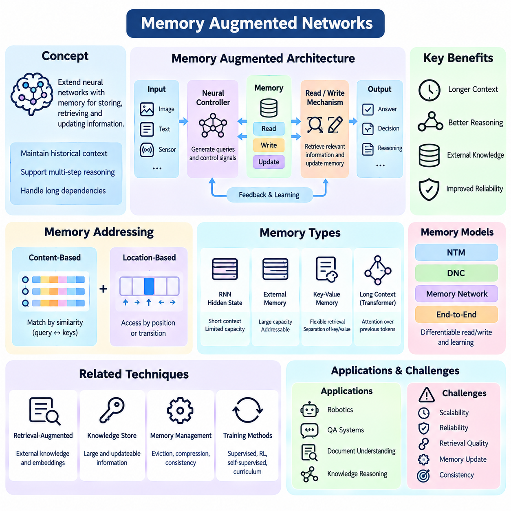{width="7.268055555555556in" height="7.268055555555556in"}

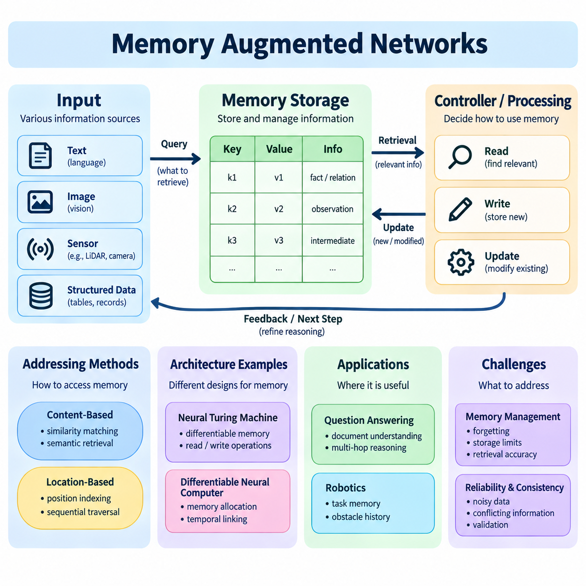{width="7.268055555555556in" height="7.268055555555556in"}

메모리 증강 신경망(Memory-Augmented Networks)은 계산 과정에서 정보를 저장(Storage), 검색(Retrieval), 갱신(Updating)하는 메커니즘을 도입하여 기존 신경망 구조(Conventional Neural Architectures)를 확장한다. 피드포워드 신경망(Feedforward Networks)이 주로 현재 입력(Current Inputs)을 변환하는 데 초점을 맞추는 반면, 메모리 증강 시스템(Memory-Augmented Systems)은 여러 처리 단계(Processing Steps)에 걸쳐 선택된 정보를 보존한다. 이러한 능력은 과거 문맥(Historical Context), 중간 결론(Intermediate Conclusions), 단일 관측값(Single Observation)을 넘어서는 의존성(Dependencies)이 필요한 추론 작업(Reasoning Tasks)을 지원한다.

메모리(Memory)는 많은 의사결정(Decision-Making)이 더 이상 직접 관측할 수 없는 정보에 의존하기 때문에 지능형 추론(Intelligent Reasoning)에서 근본적인 역할을 수행한다. 문서에 관한 질문에 답하는 시스템은 여러 문장에 걸쳐 관련 사실(Relevant Facts)을 유지해야 하며, 로봇(Robot)은 이전에 관측한 장애물(Obstacles)이나 작업 지시(Task Instructions)를 기억해야 한다. 메모리 증강 구조(Memory-Augmented Architectures)는 이러한 정보를 유지하고 필요할 때 접근할 수 있도록 하는 계산 구조(Computational Structures)를 제공한다.

전통적인 순환 신경망(Recurrent Neural Networks, RNN)은 시간에 따라 변화하는 은닉 상태(Hidden States)를 통해 정보를 유지한다. 장단기 메모리 네트워크(Long Short-Term Memory Networks, LSTM)와 게이트 순환 유닛(Gated Recurrent Units, GRU)은 정보의 유지(Retention)와 수정(Modification)을 조절하는 메커니즘을 통해 이러한 과정을 개선한다. 그러나 고정 차원의 은닉 상태(Fixed-Dimensional Hidden States)는 광범위한 이력(Extensive Histories), 정확한 검색(Precise Retrieval), 여러 독립적인 정보가 필요한 작업에서 충분하지 않을 수 있다.

외부 메모리 구조(External Memory Architectures)는 계산 제어(Computational Control)와 정보 저장(Information Storage)을 분리하여 이러한 한계를 해결한다. 신경 제어기(Neural Controller)는 입력을 처리하고 메모리에 접근하는 방법을 결정하며, 메모리 행렬(Memory Matrix)은 여러 주소 지정 가능한 위치(Addressable Locations)에 표현을 저장한다. 이러한 분리는 모든 과거 문맥을 하나의 압축된 은닉 상태(Compressed Hidden State)에 저장하지 않고도 더 큰 정보 집합(Information Collections)을 유지할 수 있도록 한다.

메모리 증강 시스템(Memory-Augmented System)은 일반적으로 제어기(Controller), 메모리 저장소(Memory Storage), 읽기-쓰기 메커니즘(Read-Write Mechanisms)으로 구성된다. 제어기는 어떤 메모리 위치(Memory Locations)가 관련되어 있는지 결정하는 쿼리(Queries) 또는 제어 신호(Control Signals)를 생성한다. 읽기 연산(Read Operations)은 저장된 표현을 검색하고, 쓰기 연산(Write Operations)은 기존 항목(Existing Entries)을 수정하거나 새로운 정보를 생성한다. 효과적인 추론은 중요한 과거 지식(Historical Knowledge)을 잃지 않으면서 이러한 연산을 조정하는 능력에 달려 있다.

내용 기반 주소 지정(Content-Based Addressing)은 쿼리 표현(Query Representation)과의 유사성(Similarity)에 따라 메모리 항목(Memory Entries)을 검색한다. 제어기는 현재 쿼리를 저장된 메모리 키(Memory Keys)와 비교하고 관련 위치에 검색 가중치(Retrieval Weights)를 할당한다. 결과적인 메모리 읽기 출력(Memory Readout)은 가중 집계(Weighted Aggregation)를 통해 선택된 값(Values)을 결합한다. 이러한 메커니즘은 고정된 주소(Fixed Addresses)가 아니라 의미적 관계(Semantic Relationships)를 통해 정보에 접근하는 연관 검색(Associative Retrieval)을 지원한다.

위치 기반 주소 지정(Location-Based Addressing)은 위치(Positions) 또는 위치 사이의 학습된 전이(Learned Transitions)에 따라 메모리에 접근하는 대안적인 메커니즘을 제공한다. 일부 구조는 내용 기반 전략(Content-Based Strategies)과 위치 기반 전략(Location-Based Strategies)을 결합하여 연관 검색과 순차적 탐색(Sequential Traversal)을 모두 지원한다. 이러한 유연성은 순서가 있는 지시(Ordered Instructions), 시간적 의존성(Temporal Dependencies), 저장된 정보를 따라 제어된 이동이 필요한 구조화된 시퀀스(Structured Sequences)를 처리하는 데 유용하다.

신경 튜링 머신(Neural Turing Machines, NTM)은 신경 제어기(Neural Controllers), 외부 메모리(External Memory), 어텐션 기반 읽기-쓰기 연산(Attention-Based Read-Write Operations)을 결합한 미분 가능한 프레임워크(Differentiable Framework)를 도입했다. 이러한 설계는 메모리 접근 동작(Memory Access Behavior)을 경사 기반 학습(Gradient-Based Training)으로 학습할 수 있도록 한다. 미분 가능 신경 컴퓨터(Differentiable Neural Computers, DNC)는 메모리 할당(Memory Allocation), 시간적 연결(Temporal Linking), 구조화된 검색(Structured Retrieval)을 위한 메커니즘을 통해 관련 개념을 확장한다. 이러한 구조는 신경망이 알고리즘적 메모리 조작(Algorithmic Memory Manipulation)과 유사한 연산을 학습할 수 있음을 보여준다.

메모리 네트워크(Memory Networks)는 저장된 정보를 추론 과정에서 질의할 수 있는 표현으로 구성하는 또 다른 접근 방식을 제공한다. 질문 또는 작업 표현(Question or Task Representation)은 메모리 항목과 상호작용하여 관련 증거(Relevant Evidence)를 식별한다. 일반적으로 메모리 홉(Memory Hops)이라고 불리는 여러 검색 반복(Multiple Retrieval Iterations)은 연속적인 정보 접근을 통해 모델이 이해를 정교화하도록 한다. 이러한 메커니즘은 여러 위치에 분산된 사실(Distributed Facts)에 결론이 의존하는 경우 유용하다.

종단 간 메모리 네트워크(End-to-End Memory Networks)는 미분 가능한 어텐션(Differentiable Attention)을 사용하여 저장된 정보를 검색하고 결합하면서 작업 수준 지도 학습(Task-Level Supervision)으로부터 학습한다. 모델은 각 메모리 접근 이후 내부 쿼리 표현(Internal Query Representation)을 갱신하여 반복 추론(Iterative Reasoning)을 수행할 수 있다. 그러나 성공적인 검색은 의미 있는 메모리 인코딩(Meaningful Memory Encoding), 적절한 유사도 함수(Similarity Functions), 관련 증거의 활용을 촉진하는 학습 사례(Training Examples)에 따라 달라진다.

키-값 메모리 구조(Key-Value Memory Architectures)는 검색 식별자(Retrieval Identifiers)와 저장된 내용(Stored Content)을 분리한다. 키(Keys)는 정보를 찾는 데 사용되는 특징(Features)을 나타내고, 값(Values)은 해당 지식(Knowledge)이나 관측값(Observations)을 포함한다. 이러한 분리는 매칭(Matching)에 필요한 정보와 추론(Reasoning)에 필요한 정보가 서로 다른 경우 검색 유연성(Retrieval Flexibility)을 향상시킬 수 있다. 키-값 구조(Key-Value Structures)는 특히 지식 검색(Knowledge Retrieval)과 질의응답 시스템(Question-Answering Systems)에 유용하다.

트랜스포머 모델(Transformer Models)도 문맥적 표현(Contextual Representations)과 이전 토큰(Previous Tokens)에 대한 어텐션(Attention)을 통해 메모리 관련 메커니즘을 통합한다. 문맥 창(Context Windows)은 제한된 시퀀스(Bounded Sequence) 내에서 이전 정보에 접근할 수 있도록 하지만, 이는 지속적인 외부 메모리(Persistent External Memory)와는 다르다. 확장 문맥 구조(Extended-Context Architectures), 순환 메모리 모듈(Recurrent Memory Modules), 검색 증강 시스템(Retrieval-Augmented Systems)은 일반적인 문맥 제한(Context Limitations)을 넘어 정보를 보존하거나 복구하려고 시도한다.

검색 증강 신경 시스템(Retrieval-Augmented Neural Systems)은 학습된 추론 모델(Learned Reasoning Models)을 외부 지식 저장소(External Knowledge Stores)와 연결한다. 관련 문서(Documents), 임베딩(Embeddings), 구조화된 기록(Structured Records)은 모델 매개변수(Model Parameters) 내부에 모든 정보를 인코딩하는 대신 필요할 때 검색할 수 있다. 이러한 접근 방식은 규모가 크고 갱신 가능한 정보 집합(Large and Updateable Information Collections)에 대한 접근성을 향상시킨다. 그러나 검색 품질(Retrieval Quality), 출처 신뢰성(Source Reliability), 검색된 증거와 생성된 결론 사이의 일관성(Consistency)은 여전히 중요하다.

메모리 관리(Memory Management)는 어떤 정보를 유지(Retain), 수정(Modify), 폐기(Discard)할 것인지 결정해야 하는 과제를 발생시킨다. 모든 관측값을 무기한 저장하는 것은 계산 비용이 높으며 관련 없거나 모순되는 정보(Irrelevant or Contradictory Information)를 유입시킬 수 있다. 학습된 쓰기 게이트(Learned Write Gates), 중요도 점수(Importance Scores), 메모리 교체 정책(Memory Replacement Policies)은 저장 과정을 조절할 수 있다. 신뢰할 수 있는 시스템은 정보 보존(Information Preservation), 용량 제약(Capacity Constraints), 변화하는 작업 요구사항(Changing Task Requirements) 사이의 균형을 유지해야 한다.

망각(Forgetting)이 항상 바람직하지 않은 것은 아니다. 오래된 정보(Outdated Information)가 현재 추론(Current Reasoning)을 방해할 수 있기 때문이다. 동적 환경(Dynamic Environment)에서는 안정적인 사실(Stable Facts)과 장기 목표(Long-Term Goals)를 보존하면서 더 이상 유효하지 않은 관측값(Obsolete Observations)을 교체해야 할 수 있다. 효과적인 메모리 시스템(Effective Memory Systems)은 임시 상태(Temporary State), 일화적 경험(Episodic Experience), 지속적 지식(Persistent Knowledge)을 구별한다. 이러한 구분은 오래된 정보가 새로운 의사결정을 지배하지 않도록 하면서 적응적 추론(Adaptive Reasoning)을 지원한다.

시간 추론(Temporal Reasoning)은 사건 순서(Event Order)와 과거 의존성(Historical Dependencies)을 보존하는 메모리 구조(Memory Structures)의 이점을 활용한다. 시스템은 어떤 사건이 먼저 발생했는지, 특정 행동이 이후 상태 변화(Later State Change)를 유발했는지, 일련의 관측값이 현재 상황(Current Situation)과 어떻게 관련되는지 판단해야 할 수 있다. 시간적 연결(Temporal Links)과 시퀀스 인식 검색(Sequence-Aware Retrieval)은 이러한 작업을 지원할 수 있지만, 시간적 연관성(Chronological Association)만으로 인과관계(Causal Relationships)가 입증되는 것은 아니다.

메모리 증강 신경망은 계산 연산(Computational Operations) 사이에 중간 결과(Intermediate Results)를 유지함으로써 다단계 추론(Multi-Step Reasoning)도 지원한다. 복잡한 질문을 해결하는 모델은 초기 사실(Initial Fact)을 검색하고, 부분 결론(Partial Conclusion)을 도출한 다음, 해당 결론을 활용하여 후속 검색(Subsequent Retrieval)을 수행할 수 있다. 이러한 반복 과정(Iterative Process)은 이전 정보를 다시 계산해야 하는 필요성을 줄일 수 있다. 그러나 잘못된 중간 상태(Incorrect Intermediate States)는 이후 추론 단계(Later Reasoning Steps)로 전파될 수 있다.

로보틱스(Robotics)에서 메모리 증강 추론(Memory-Augmented Reasoning)은 주행(Navigation), 작업 실행(Task Execution), 환경 이해(Environmental Understanding)를 지원한다. 이동 로봇(Mobile Robot)은 이전에 방문한 위치(Previously Visited Locations), 감지된 장애물(Detected Obstacles), 완료되지 않은 작업(Unfinished Tasks)에 대한 관측값을 저장할 수 있다. 메모리 검색(Memory Retrieval)은 객체가 센서 시야(Sensor View)에서 일시적으로 사라진 경우에도 문맥적 인식(Contextual Awareness)을 유지하는 데 도움이 된다. 오래된 메모리(Outdated Memories)가 위험한 행동을 유발하지 않도록 정확한 위치 추정(Accurate Localization), 타임스탬프 관리(Timestamp Management), 안전 검증(Safety Validation)이 필요하다.

다중 에이전트 시스템(Multi-Agent Systems)은 공유 지식 저장소(Shared Knowledge Stores) 또는 분산 정보 교환(Distributed Information Exchange)을 통해 메모리 메커니즘을 확장할 수 있다. 로봇 군집(Robot Fleet)에서 작동하는 로봇들은 로컬 메모리(Local Memories)를 유지하면서 선택된 관측값을 집단적 표현(Collective Representation)에 제공할 수 있다. 이러한 구조는 협조(Coordination)와 작업 할당(Task Allocation)을 지원하지만, 통신 지연(Communication Delays), 충돌하는 관측값(Conflicting Observations), 일관되지 않은 갱신(Inconsistent Updates)을 처리하기 위한 명시적인 동기화(Synchronization) 및 충돌 해결 메커니즘(Conflict-Resolution Mechanisms)이 필요하다.

메모리 증강 신경망의 학습(Training)은 작업 예측(Task Predictions)뿐 아니라 효과적인 정보 접근 전략(Information Access Strategies)도 학습해야 한다. 경사 기반 최적화(Gradient-Based Optimization)는 관련 구성 요소가 미분 가능한 경우 메모리 쿼리(Memory Queries), 어텐션 가중치(Attention Weights), 쓰기 연산(Write Operations)을 조정할 수 있다. 보조 지도 학습(Auxiliary Supervision)은 정확한 검색(Accurate Retrieval)이나 상태 추적(State Tracking)을 촉진할 수 있다. 그러나 유용한 메모리 연산에 긴 지연(Long Delays)이나 희소한 피드백(Sparse Feedback)이 수반되면 학습이 어려워진다.

평가(Evaluation)는 검색 정확도(Retrieval Accuracy), 메모리 유지(Memory Retention), 추론 일관성(Reasoning Consistency), 시퀀스 길이에 따른 일반화(Generalization Across Sequence Lengths)를 검토해야 한다. 통제된 실험(Controlled Experiments)은 방해 요소(Distractors)나 변화하는 문맥(Changing Contexts)이 존재하더라도 모델이 관련 정보를 기억하는지 테스트할 수 있다. 추가적인 측정 항목(Measurements)에는 메모리 활용률(Memory Utilization), 갱신 정확성(Update Correctness), 계산 지연시간(Computational Latency), 손상된 항목(Corrupted Entries)에 대한 강건성(Robustness)이 포함된다. 높은 작업 정확도(Task Accuracy)만으로 신뢰할 수 있는 메모리 관리(Reliable Memory Management)가 입증되는 것은 아니다.

메모리 증강 구조(Memory-Augmented Architectures)는 계산 비용(Computational Cost), 저장 용량(Storage Capacity), 정보 무결성(Information Integrity)과 관련된 실용적 한계를 가진다. 대규모 메모리(Large Memories)는 검색 요구량(Retrieval Demands)을 증가시키며, 반복적인 갱신(Repeated Updates)은 저장된 표현 사이의 간섭(Interference)을 유발할 수 있다. 근사 최근접 이웃 검색(Approximate Nearest-Neighbor Search), 계층적 인덱싱(Hierarchical Indexing), 선택적 검색(Selective Retrieval)은 확장성(Scalability)을 향상시킬 수 있다. 그러나 효율화 메커니즘(Efficiency Mechanisms)이 추론 완전성(Reasoning Completeness)과 증거 품질(Evidence Quality)에 미치는 영향을 평가해야 한다.

메모리 증강 신경망(Memory-Augmented Networks)은 시간에 걸쳐 추론하고, 중간 지식(Intermediate Knowledge)을 보존하며, 변화하는 환경에 적응하는 신경 시스템(Neural Systems)의 기반을 제공한다. 외부 메모리(External Memory), 미분 가능한 주소 지정(Differentiable Addressing), 반복 검색(Iterative Retrieval), 구조화된 저장(Structured Storage)은 기존 신경 계산(Conventional Neural Computation)의 능력을 확장한다. 궁극적으로 이러한 구조의 효과는 정확한 정보 선택(Accurate Information Selection), 일관된 상태 갱신(Consistent State Updates), 효율적인 검색(Efficient Retrieval), 메모리 기반 결론(Memory-Supported Conclusions)의 검증(Verification)에 달려 있다.

## 04.08 Meta Reasoning and Learning to Reason

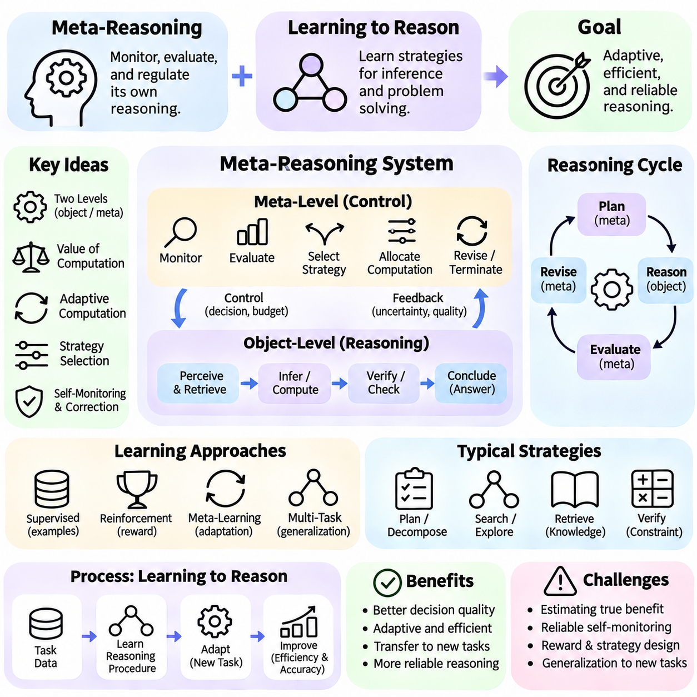{width="7.268055555555556in" height="7.268055555555556in"}

메타 추론(Meta-Reasoning)은 지능형 시스템(Intelligent System)이 자신의 추론 과정(Reasoning Processes)을 모니터링(Monitoring), 평가(Evaluation), 조절(Regulation)하는 능력을 의미한다. 메타 추론은 외부 문제(External Problem)를 해결하는 데에만 집중하는 대신, 해결책(Solution)이 어떻게 구성되고 있는지와 현재 전략(Current Strategy)이 여전히 적절한지를 검토한다. 이러한 능력은 계산 자원(Computational Resources)의 적응적 할당(Adaptive Allocation), 의사결정 품질(Decision Quality)의 향상, 불확실성(Uncertainty)의 체계적인 처리를 가능하게 한다.

추론 학습(Learning to Reason)은 단순히 입력과 출력 사이의 연관성(Input-Output Associations)을 암기하는 것이 아니라 추론(Inference)을 수행하기 위한 전략(Strategies)을 개발함으로써 기존 기계학습(Conventional Machine Learning)을 확장한다. 추론 모델(Reasoning Model)은 관련 정보(Relevant Information)를 식별하고, 유용한 연산(Useful Operations)을 선택하며, 중간 결과(Intermediate Results)를 결합하여 결론에 도달해야 한다. 이러한 능력을 학습하려면 특히 학습 과정에서 접한 사례와 다른 문제에 대해서도 전이 가능한 절차(Transferable Procedures)를 보상하는 학습 환경(Training Environments)이 필요하다.

메타 추론은 객체 수준 추론(Object-Level Reasoning)과 메타 수준 제어(Meta-Level Control)를 구분한다. 객체 수준 추론은 증거 평가(Evidence Evaluation)나 결론 도출(Deriving Conclusions)과 같이 작업과 직접 관련된 연산을 수행한다. 메타 수준 제어는 이러한 연산을 모니터링하고 추론 과정을 계속할지, 수정할지, 종료할지를 결정한다. 두 수준 사이의 상호작용(Interaction)은 시스템이 사용 가능한 계산 능력(Computational Capacity)을 얼마나 효과적으로 활용하는지를 결정한다.

메타 추론의 핵심 목표(Central Objective)는 추가적인 계산(Additional Computation)이 언제 가치가 있는지 판단하는 것이다. 일부 문제는 즉각적인 패턴 인식(Pattern Recognition)을 통해 해결할 수 있지만, 다른 문제는 확장된 분석(Extended Analysis)이나 여러 추론 단계(Multiple Inference Steps)를 필요로 한다. 메타 추론 제어기(Meta-Reasoning Controller)는 추가 계산으로부터 기대되는 이익(Expected Benefit)을 비용(Cost)과 비교하여 추정할 수 있다. 이러한 원리는 계산 가치(Value of Computation) 및 제한된 추론 자원(Limited Reasoning Resources)의 합리적 할당(Rational Allocation)과 밀접하게 관련된다.

계산 가치(Value of Computation)는 추가적인 계산 연산(Computational Operation)을 수행함으로써 얻을 수 있는 의사결정 품질(Decision Quality)의 기대 향상(Expected Improvement)을 나타낸다. 시스템은 불확실성(Uncertainty)이나 오류(Error)의 잠재적인 감소 효과를 증가하는 지연시간(Latency), 에너지 소비(Energy Consumption), 처리 비용(Processing Cost)과 비교할 수 있다. 기대 이익(Expected Benefit)이 비용보다 작아지면 추론을 종료할 수 있다. 그러나 미래 계산(Future Computations)의 유용성 자체가 불확실하기 때문에 이를 신뢰성 있게 추정하는 것은 어렵다.

적응형 계산(Adaptive Computation)은 신경 모델(Neural Models)이 작업 난이도(Task Difficulty)에 따라 처리 노력(Processing Effort)을 조절할 수 있도록 한다. 모든 입력에 고정된 수의 계산 단계(Fixed Number of Computational Steps)를 적용하는 대신, 적응형 구조(Adaptive Architectures)는 어려운 사례에 추가적인 반복 계산(Additional Iterations)을 할당할 수 있다. 학습된 종료 결정(Learned Halting Decisions)과 순환적 정교화(Recurrent Refinement) 같은 메커니즘은 이러한 동작을 지원한다. 그 효과는 조기 종료(Premature Termination)와 불필요한 계산(Unnecessary Computation)을 방지하는 능력에 달려 있다.

추론 학습은 구조화된 추론 절차(Structured Inference Procedures)와 유사한 일련의 연산을 수행하도록 모델을 학습시키는 과정을 포함하는 경우가 많다. 대표적인 사례에는 대안 비교(Comparing Alternatives), 제약 조건 적용(Applying Constraints), 문제 분해(Problem Decomposition), 부분 결론 결합(Combining Partial Conclusions)이 있다. 신경망 구조(Neural Architectures)는 지도 학습 목표(Supervised Objectives)나 강화 신호(Reinforcement Signals)를 통해 이러한 동작을 학습할 수 있다. 그러나 익숙한 작업에서 성공적인 성능을 보인다고 해서 새로운 추론 구조(Unfamiliar Reasoning Structures)에 대한 체계적 일반화(Systematic Generalization)가 보장되는 것은 아니다.

메타 학습(Meta-Learning)은 모델이 여러 작업에 걸쳐 자신의 학습 또는 추론 동작(Learning or Reasoning Behavior)을 적응시키는 방법을 학습하는 관련 프레임워크(Framework)를 제공한다. 메타 학습은 하나의 문제 분포(Problem Distribution)에 대해서만 최적화하는 대신, 재사용 가능한 적응 전략(Reusable Adaptation Strategies)을 습득하려고 한다. 다양한 작업으로 학습된 모델은 새로운 문제에서 성능 향상을 가속하는 표현(Representations)이나 갱신 규칙(Update Rules)을 학습할 수 있다. 그러나 이러한 능력은 학습 조건(Training Conditions)과 실제 배포 조건(Deployment Conditions) 사이의 차이에 민감하다.

경사 기반 메타 학습 방법(Gradient-Based Meta-Learning Methods)은 제한된 추가 학습(Limited Additional Training)만으로 효과적인 적응(Effective Adaptation)이 가능하도록 모델 매개변수(Model Parameters)를 최적화한다. 모델 불가지론적 메타 학습(Model-Agnostic Meta-Learning, MAML)은 빠른 작업별 갱신(Rapid Task-Specific Updates)에 적합한 매개변수 초기값(Parameter Initializations)을 찾는 대표적인 접근 방식이다. 원래 학습 적응(Learning Adaptation)을 위해 개발되었지만, 관련 원리는 새로운 규칙(Rules), 목표(Objectives), 문제 구조(Problem Structures)를 접했을 때 전략을 조정하는 추론 시스템에도 적용될 수 있다.

강화학습(Reinforcement Learning)은 기대 유용성(Expected Usefulness)에 따라 계산 행동(Computational Actions)을 선택하는 메타 추론 정책(Meta-Reasoning Policies)을 학습시킬 수 있다. 가능한 행동에는 정보 검색(Retrieving Information), 대안 가설 탐색(Exploring an Alternative Hypothesis), 전문 해결기 호출(Invoking a Specialized Solver), 최종 답변 생성(Producing a Final Answer)이 포함된다. 보상(Rewards)은 정확도(Accuracy), 계산 효율성(Computational Efficiency), 제약 조건 충족(Constraint Satisfaction)을 반영할 수 있다. 부적절하게 정의된 목표(Poorly Specified Objectives)는 신뢰할 수 있는 추론 대신 지름길(Shortcuts)을 유도할 수 있으므로 적절한 보상 설계(Reward Design)가 필수적이다.

추론 전략 선택(Reasoning Strategy Selection)은 메타 수준 지능(Meta-Level Intelligence)의 또 다른 중요한 구성 요소이다. 시스템은 문제의 특성(Problem Characteristics)에 따라 직접 예측(Direct Prediction), 기호 추론(Symbolic Inference), 확률적 추정(Probabilistic Estimation), 탐색(Search), 시뮬레이션(Simulation) 중에서 적절한 방법을 선택할 수 있다. 부적절한 전략을 선택하면 자원이 낭비되거나 체계적인 오류(Systematic Errors)가 발생할 수 있다. 따라서 효과적인 메타 추론에는 작업 구조(Task Structure), 사용 가능한 방법(Available Methods), 각 추론 접근 방식의 한계(Limitations)에 대한 표현이 필요하다.

자기 모니터링 메커니즘(Self-Monitoring Mechanisms)은 중간 추론 상태(Intermediate Reasoning States)가 사용 가능한 증거(Available Evidence)와 작업 제약 조건(Task Constraints)에 계속 부합하는지 추정한다. 모델은 추론 과정에서 해결되지 않은 가정(Unresolved Assumptions), 모순되는 관측값(Contradictory Observations), 불확실한 결론(Uncertain Conclusions)을 추적할 수 있다. 이러한 신호는 추가 검증(Additional Verification)이나 전략 수정(Strategy Revision)을 유발할 수 있다. 그러나 동일한 모델이 생성한 신뢰도 추정값(Confidence Estimates)은 보정 상태(Calibration)가 불량할 수 있으므로 신뢰할 수 있는 정확성 지표(Correctness Indicators)로 자동으로 간주해서는 안 된다.

자기 수정(Self-Correction)은 이전 결론(Earlier Conclusions)을 다시 검토하고 가능한 오류(Possible Mistakes)를 식별하여 추론 결과(Reasoning Outcomes)를 개선하려고 한다. 시스템은 대안적인 해결책(Alternative Solutions)을 비교하거나, 중간 의존성(Intermediate Dependencies)을 조사하거나, 제안된 답변(Proposed Answer)이 알려진 제약 조건(Known Constraints)을 충족하는지 테스트할 수 있다. 유용한 피드백(Useful Feedback)이 제공되면 반복적 정교화(Iterative Refinement)를 통해 성능을 향상시킬 수 있다. 그러나 독립적인 증거(Independent Evidence)나 효과적인 검증(Effective Verification)이 없으면 반복적인 수정이 오류를 강화하거나 새로운 불일치(Inconsistencies)를 발생시킬 수 있다.

불확실성 인식 메타 추론(Uncertainty-Aware Meta-Reasoning)은 신뢰도 추정(Confidence Estimation)을 계산 제어(Computational Control)와 연결한다. 불확실성이 높으면 시스템은 추가 증거(Additional Evidence)를 검색하거나, 탐색 범위(Search)를 확장하거나, 외부 검증(External Verification)을 요청할 수 있다. 불확실성이 충분히 낮고 추가 계산의 기대 가치(Expected Value)가 제한적이면 추론을 종료할 수 있다. 이러한 과정에는 보정된 불확실성 측정값(Calibrated Uncertainty Measures)과 잘못된 의사결정(Incorrect Decisions)의 결과에 대한 명시적인 고려가 필요하다.

계층적 추론 구조(Hierarchical Reasoning Architectures)는 여러 추상화 수준(Levels of Abstraction)에 걸쳐 계산을 구성한다. 상위 수준 제어기(High-Level Controller)는 문제를 하위 목표(Subgoals)로 분해하고, 하위 수준 모듈(Lower-Level Modules)은 전문화된 추론 연산(Specialized Inference Operations)을 수행할 수 있다. 제어기는 중간 결과(Intermediate Outcomes)를 평가하고 후속 행동(Subsequent Actions)을 결정한다. 이러한 구조는 복잡한 작업(Complex Tasks)을 지원할 수 있지만, 문제 분해(Decomposition)나 조정(Coordination) 과정의 오류가 추론 계층(Reasoning Hierarchy) 전반으로 전파될 수 있다.

재사용 가능한 추론 절차(Reusable Reasoning Procedures)를 학습하는 것은 알고리즘적 일반화(Algorithmic Generalization)와 밀접하게 관련된다. 모델은 정렬(Sorting), 산술(Arithmetic), 그래프 탐색(Graph Traversal), 논리적 연역(Logical Deduction)과 관련된 작업을 통해 체계적인 연산(Systematic Operations)을 학습하도록 훈련될 수 있다. 더 큰 입력(Larger Inputs)과 익숙하지 않은 조합(Unfamiliar Combinations)에 대한 평가는 학습된 절차가 학습 사례(Training Examples)를 넘어 전이되는지 판단하는 데 도움이 된다. 강력한 일반화(Strong Generalization)를 위해서는 최적화 과정에서 관측된 피상적인 패턴(Superficial Patterns)을 재현하는 것 이상의 능력이 필요하다.

메모리 증강 구조(Memory-Augmented Architectures)는 이전 시도(Previous Attempts), 중간 결론(Intermediate Conclusions), 성공적인 전략(Successful Strategies)에 관한 정보를 유지함으로써 메타 추론을 강화할 수 있다. 제어기(Controller)는 현재 계산을 안내하기 위해 이전 문제 해결 경험(Problem-Solving Experiences)을 검색할 수 있다. 이는 관련 작업 사이의 적응(Adaptation)을 지원하고 중복 탐색(Redundant Exploration)을 줄인다. 그러나 이전에 효과적이었던 방법이 현재에는 부적절할 수 있으므로 저장된 전략(Stored Strategies)을 현재 조건(Current Conditions)에 비추어 평가해야 한다.

도구 증강 추론(Tool-Augmented Reasoning)은 적응형 문제 해결(Adaptive Problem Solving)을 위한 또 다른 메커니즘을 제공한다. 신경 제어기(Neural Controller)는 계산기(Calculators), 검색 엔진(Search Engines), 기호 해결기(Symbolic Solvers), 시뮬레이터(Simulators), 외부 데이터베이스(External Databases)를 언제 사용할지 결정할 수 있다. 이러한 도구는 내부 신경 계산(Internal Neural Computation)만으로 재현하기 어려운 능력을 제공할 수 있다. 메타 추론은 어떤 도구를 호출할지, 도구의 출력(Output)을 어떻게 해석할지, 추가 검증(Additional Validation)이 필요한지를 결정한다.

자율 로보틱스(Autonomous Robotics)에서 메타 추론은 환경 복잡도(Environmental Complexity)에 따라 계획 전략(Planning Strategies)과 인식 전략(Perception Strategies)의 선택을 조절할 수 있다. 예측 가능한 복도(Predictable Corridor)에서 작동하는 로봇은 경량 주행 절차(Lightweight Navigation Procedure)를 사용할 수 있지만, 익숙하지 않은 장애물 배치(Unfamiliar Obstacle Configuration)에서는 추가적인 지도 작성(Mapping)이나 궤적 평가(Trajectory Evaluation)가 필요할 수 있다. 이러한 적응은 실시간 마감시간(Real-Time Deadlines), 안전 제약 조건(Safety Constraints), 사용 가능한 센서 정보(Sensor Information)의 신뢰성을 준수해야 한다.

다중 에이전트 시스템(Multi-Agent Systems)은 분산 문제 해결 자원(Distributed Problem-Solving Resources)을 조정하기 위해 메타 추론을 적용할 수 있다. 감독 에이전트(Supervisory Agent)는 하위 작업(Subtasks)을 전문 에이전트(Specialized Agents)에 할당하고, 제안된 해결책(Proposed Solutions)을 비교하며, 추가 협업(Further Collaboration)이 필요한지 결정할 수 있다. 이러한 접근 방식은 복잡한 문제의 처리 범위(Coverage)를 향상시킬 수 있지만, 통신 오버헤드(Communication Overhead)와 조정 불확실성(Coordination Uncertainty)을 발생시킨다. 효과적인 운영에는 명시적인 책임 할당(Responsibility Assignment)과 공유 결론(Shared Conclusions)의 검증이 필요하다.

메타 추론 시스템(Meta-Reasoning Systems)의 학습은 유용한 제어 결정(Control Decisions)이 여러 계산 단계가 지난 후에야 결과에 영향을 미칠 수 있기 때문에 어려움을 수반한다. 지연 보상(Delayed Rewards), 희소한 지도 신호(Sparse Supervision), 변화하는 작업 분포(Changing Task Distributions)는 최적화(Optimization)를 복잡하게 만든다. 커리큘럼 학습(Curriculum Learning), 과정 수준 피드백(Process-Level Feedback), 통제된 추론 환경(Controlled Reasoning Environments)은 추가적인 학습 신호(Training Signals)를 제공할 수 있다. 그러나 더 긴 추론이 항상 결과를 개선한다고 가정하기보다는 모델의 강건성(Robustness)을 평가해야 한다.

추론 학습 시스템(Learning-to-Reason Systems)의 평가는 최종 답변 정확도(Final-Answer Accuracy)를 추론 효율성(Reasoning Efficiency), 전이 가능성(Transferability), 신뢰성(Reliability)과 구별해야 한다. 유용한 측정 항목에는 계산 비용(Computational Cost), 추론 깊이(Inference Depth), 불확실성 보정(Uncertainty Calibration), 전략 선택 정확도(Strategy-Selection Accuracy), 이전에 관측하지 못한 문제 구조(Unseen Problem Structures)에 대한 성능이 포함된다. 통제된 테스트(Controlled Tests)는 추가적인 추론이 결과를 개선하는지와 모델이 외부 검증(External Verification)이 필요한 상황을 인식하는지 조사해야 한다.

메타 추론(Meta-Reasoning)과 추론 학습(Learning to Reason)은 예측(Predictions)뿐 아니라 문제 해결 절차(Problem-Solving Procedures)까지 적응시키는 신경 시스템(Neural Systems)의 기반을 제공한다. 계산 제어(Computational Control), 전략 선택(Strategy Selection), 불확실성 추정(Uncertainty Estimation), 경험 기반 적응(Experience-Based Adaptation)을 결합함으로써 이러한 시스템은 추론 노력(Reasoning Effort)을 더욱 효과적으로 할당할 수 있다. 신뢰할 수 있는 실제 배포(Dependable Deployment)를 위해서는 보정된 의사결정(Calibrated Decisions), 독립적인 검증(Independent Verification), 계산 및 안전 제약 조건(Computational and Safety Constraints)의 신중한 관리가 필요하다.

## 04.09 Neuro Symbolic Reasoning

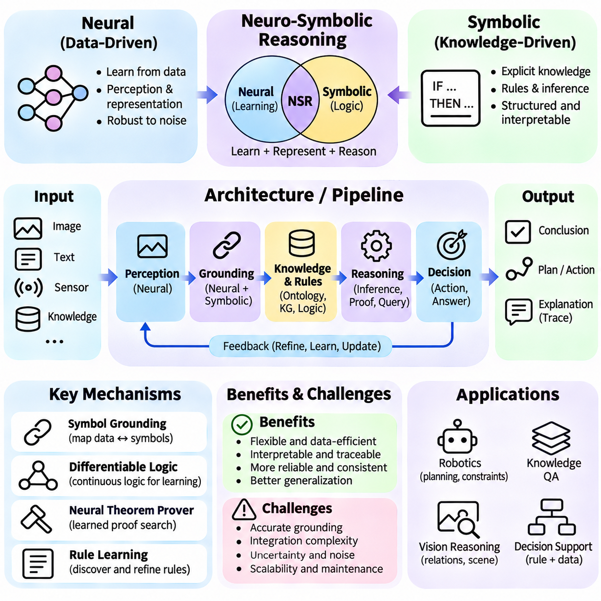{width="7.268055555555556in" height="7.268055555555556in"}

신경-기호 추론(Neuro-Symbolic Reasoning)은 신경망 표현 학습(Neural Representation Learning)과 기호적 지식(Symbolic Knowledge), 명시적 추론 절차(Explicit Inference Procedures)를 통합한다. 신경망(Neural Networks)은 복잡한 관측값(Complex Observations)을 해석하는 유연한 메커니즘을 제공하며, 기호 시스템(Symbolic Systems)은 개체(Entities), 관계(Relationships), 규칙(Rules)을 구조화된 형태로 표현한다. 이러한 결합은 불확실한 데이터(Uncertain Data)에 적응하면서도 해석 가능한 지식(Interpretable Knowledge)에 의해 제약되는 추론을 지원하고, 순수 신경망 접근 방식(Purely Neural Approaches)과 순수 기호적 접근 방식(Purely Symbolic Approaches)의 일부 한계를 극복하는 것을 목표로 한다.

신경망 접근 방식(Neural Approaches)과 기호적 접근 방식(Symbolic Approaches)은 상호 보완적인 강점(Complementary Strengths)을 가진다. 신경 모델(Neural Models)은 이미지(Images), 언어(Language), 센서 측정값(Sensor Measurements)으로부터 패턴을 학습하며, 잡음(Noise)과 불완전한 관측값(Incomplete Observations)을 처리하는 경우가 많다. 기호 추론(Symbolic Reasoning)은 명시적 규칙 적용(Explicit Rule Application), 변수 조작(Variable Manipulation), 구조화된 연역(Structured Deduction)을 지원한다. 그러나 신경 모델은 일관되지 않은 결론(Inconsistent Conclusions)을 생성할 수 있으며, 기호 시스템은 올바르게 정의된 지식과 관측값을 논리적 표현(Logical Representations)으로 신뢰성 있게 변환하는 과정에 의존한다.

신경-기호 구조(Neuro-Symbolic Architecture)는 일반적으로 인식(Perception), 지식 표현(Knowledge Representation), 추론(Reasoning), 의사결정 생성(Decision Generation)을 상호작용하는 구성 요소로 분리한다. 신경 인식 모듈(Neural Perception Modules)은 원시 입력(Raw Inputs)을 후보 개체(Candidate Entities)와 관계(Relations)로 변환한다. 기호적 구성 요소(Symbolic Components)는 이러한 출력을 사실(Facts)로 구성하고 규칙을 적용하여 결론을 도출한다. 구성 요소 사이의 피드백(Feedback)은 해석을 정교화할 수 있지만, 전체적인 신뢰성(Reliability)은 각 인터페이스(Interface)의 정확성에 달려 있다.

연속적인 신경망 표현(Continuous Neural Representations)과 이산적인 기호 구조(Discrete Symbolic Structures) 사이의 연결은 핵심적인 설계 과제(Design Challenge)이다. 신경 임베딩(Neural Embeddings)은 벡터 공간(Vector Spaces) 내에서 통계적 관계(Statistical Relationships)를 인코딩하는 반면, 기호 표현식(Symbolic Expressions)은 명시적인 객체(Objects), 술어(Predicates), 논리적 의존성(Logical Dependencies)을 식별한다. 이러한 표현 사이의 매핑(Mapping)에는 개체 인식(Entity Recognition), 관계 추출(Relation Extraction), 그라운딩(Grounding), 불확실성 관리(Uncertainty Management)가 필요하다. 변환 과정에서 발생한 오류는 후속 추론(Subsequent Inference)으로 전파될 수 있다.

기호 그라운딩(Symbol Grounding)은 기호적 개념(Symbolic Concepts)을 관측 가능한 개체(Observable Entities) 또는 측정 가능한 속성(Measurable Properties)과 연결한다. 로봇은 술어 Obstacle(x)를 카메라(Cameras)나 라이다(LiDAR)를 통해 감지한 객체와 연결할 수 있으며, 다른 술어는 특정 위치의 도달 가능성(Reachability)을 표현할 수 있다. 신경 인식(Neural Perception)은 감각적 증거(Sensory Evidence)로부터 이러한 속성을 추정한다. 이후 기호 추론은 객체 식별(Object Identity), 공간 참조(Spatial Reference), 관측 불확실성(Observation Uncertainty)이 일관되게 처리된다는 조건에서 그라운딩된 객체(Grounded Objects) 사이의 관계를 평가한다.

지식 표현(Knowledge Representation)은 신경-기호 시스템이 어떤 관계에 대해 추론할 수 있는지를 결정한다. 온톨로지(Ontologies)는 개념(Concepts), 범주(Categories), 의미적 제약 조건(Semantic Constraints)을 정의하며, 지식 그래프(Knowledge Graphs)는 개체와 그 연결 관계를 구성한다. 논리 규칙(Logical Rules)은 직접 관측할 수 없는 의존성(Dependencies)을 표현한다. 이러한 구조는 재사용 가능한 도메인 지식(Reusable Domain Knowledge)을 제공하지만, 불완전한 온톨로지(Incomplete Ontologies), 잘못된 관계(Incorrect Relations), 일관되지 않은 사실(Inconsistent Facts)은 도출된 결론의 타당성(Validity)을 제한할 수 있다.

규칙 기반 추론(Rule-Based Inference)은 신경 모델이 추출하거나 예측한 사실에 대해 명시적인 추론을 수행할 수 있도록 한다. 예를 들어 시스템은 주행 경로(Navigation Path)에 필요한 여유 공간(Clearance)이 로봇의 물리적 치수(Physical Dimensions)보다 작을 경우 해당 경로가 부적절하다고 추론할 수 있다. 신경 모듈(Neural Modules)은 환경 속성(Environmental Properties)을 추정하고, 기호 규칙(Symbolic Rules)은 운영 제약 조건(Operational Constraints)을 평가한다. 이러한 분리는 추적 가능한 의사결정(Traceable Decisions)을 지원하지만, 불확실한 측정값(Uncertain Measurements)을 의심의 여지 없이 참인 사실로 취급해서는 안 된다.

미분 가능 논리(Differentiable Logic)는 학습과 기호 추론을 통합하는 하나의 접근 방식을 제공한다. 논리 표현식(Logical Expressions)은 연속 연산자(Continuous Operators)를 사용하여 표현되므로 관련 매개변수(Parameters)가 경사 기반 최적화(Gradient-Based Optimization)에 참여할 수 있다. 소프트 진리값(Soft Truth Values)은 불확실한 신경망 예측(Uncertain Neural Predictions)이 논리적 평가(Logical Evaluations)에 영향을 미치도록 한다. 그러나 미분 가능한 충족 점수(Differentiable Satisfaction Scores)는 선택된 논리 의미론(Logical Semantics)을 근사하는 것이며, 고전 논리 제약 조건(Classical Logical Constraints)의 엄격한 준수를 반드시 입증하는 것은 아니다.

신경 정리 증명(Neural Theorem Proving)은 구조화된 증명 탐색(Structured Proof Search)과 학습된 유사도 함수(Learned Similarity Functions)를 결합하는 또 다른 통합 전략이다. 사실과 규칙은 논리 절(Logical Clauses)로 표현될 수 있으며, 신경 임베딩(Neural Embeddings)은 술어 사이의 근사적 매칭(Approximate Matching)을 지원한다. 역방향 연쇄 추론(Backward Chaining) 또는 관련 추론 절차(Inference Procedures)는 후보 증명 경로(Candidate Proof Paths)를 구성한다. 이러한 방법은 유용한 관계적 연관성(Relational Associations)을 발견할 수 있지만, 근사적 단일화(Approximate Unification)가 형식적으로 유효한 연역(Formally Valid Deductions)을 보장하는 것은 아니다.

확률적 신경-기호 추론(Probabilistic Neuro-Symbolic Reasoning)은 사실(Facts), 규칙(Rules), 관측값(Observations)에 관련된 불확실성(Uncertainty)을 명시적으로 표현한다. 신경 모델은 감지된 객체(Detected Objects)나 관계(Relationships)에 대한 확률을 추정할 수 있으며, 확률 논리(Probabilistic Logic)는 정의된 가정(Defined Assumptions)에 따라 이러한 추정값을 결합한다. 이는 증거(Evidence)가 불완전하거나 잡음이 포함된 경우의 추론을 지원한다. 그러나 상관관계가 있는 관측값(Correlated Observations)과 불확실한 규칙 의존성(Uncertain Rule Dependencies)은 단순한 확률 결합(Simplistic Probability Combinations)을 무효화할 수 있으므로 주의가 필요하다.

데이터 기반 기호 규칙 학습(Learning Symbolic Rules from Data)은 전적으로 수작업으로 구성된 지식 베이스(Hand-Crafted Knowledge Bases)에 대한 의존성을 줄인다. 신경 표현(Neural Representations)은 반복적으로 나타나는 관계 패턴(Relational Patterns)을 식별하는 데 도움을 줄 수 있으며, 규칙 귀납 메커니즘(Rule Induction Mechanisms)은 후보 논리 구조(Candidate Logical Structures)를 제안한다. 이후 이러한 규칙은 관측된 사례(Observed Examples)와 기존 제약 조건(Existing Constraints)에 대해 평가될 수 있다. 성공적인 규칙 발견(Rule Discovery)을 위해서는 학습된 관계가 학습 데이터(Training Data)에 존재하는 통계적 상관관계(Statistical Correlations)를 넘어 일반화되는지 검증해야 한다.

신경-기호 시스템은 기호적 지식(Symbolic Knowledge)을 사용하여 신경망 학습(Neural Learning)을 안내할 수도 있다. 논리적 제약 조건(Logical Constraints)은 손실 함수(Loss Functions), 학습 목표(Training Objectives), 데이터 선택 절차(Data Selection Procedures)에 통합될 수 있다. 예를 들어 상호 배타적인 객체 범주(Mutually Exclusive Object Categories)나 알려진 공간 관계(Known Spatial Relationships)는 일관되지 않은 예측(Inconsistent Predictions)을 억제할 수 있다. 이러한 지도(Guidance)는 제약 조건이 올바른 경우 구조적 일관성(Structural Coherence)을 향상시키지만, 잘못된 규칙은 학습된 모델에 체계적인 편향(Systematic Bias)을 유발할 수 있다.

다단계 추론(Multi-Step Reasoning)은 신경망 검색(Neural Retrieval)과 기호적 합성(Symbolic Composition)을 결합함으로써 이점을 얻는다. 복잡한 질문에 답하는 시스템은 관련 개체(Relevant Entities)를 식별하고, 연관된 사실(Associated Facts)을 검색하며, 관계 규칙(Relational Rules)을 적용하고, 결론을 구성할 수 있다. 신경망 구성 요소(Neural Components)는 유연한 증거 선택(Flexible Evidence Selection)을 지원하고, 기호 연산(Symbolic Operations)은 명시적인 의존성(Explicit Dependencies)을 보존한다. 결과적인 추론 연쇄(Reasoning Chain)는 검사할 수 있지만, 그 타당성은 여전히 정확한 전제(Accurate Premises)와 건전한 추론 절차(Sound Inference Procedures)에 달려 있다.

계획(Planning)은 신경-기호 추론의 중요한 응용 분야이다. 신경 모델은 환경 상태(Environmental States), 행동 결과(Action Outcomes), 작업 실행 가능성(Task Feasibility)을 추정할 수 있으며, 기호 계획기(Symbolic Planners)는 목표(Goals), 전제조건(Preconditions), 행동 효과(Action Effects)를 표현한다. 계획 시스템(Planning System)은 운영 요구사항(Operational Requirements)을 충족하는 행동 시퀀스(Action Sequences)를 탐색할 수 있다. 신경망 예측은 적응성(Adaptability)을 향상시키지만, 불확실한 상태 추정(Uncertain State Estimates)과 부정확한 행동 모델(Inaccurate Action Models)은 생성된 계획의 실행 가능성(Feasibility)을 저하시킬 수 있다.

인과 추론(Causal Reasoning)은 논리적 연관성(Logical Association)만으로 인과관계(Causation)가 성립하지 않기 때문에 추가적인 요구사항을 도입한다. 신경-기호 시스템은 학습된 인과 표현(Learned Causal Representations)을 구조적 인과 모델(Structural Causal Models) 또는 명시적 개입 규칙(Explicit Intervention Rules)과 결합할 수 있다. 이는 명시된 가정(Specified Assumptions) 아래에서 행동이 결과에 어떤 영향을 미치는지 분석하도록 지원한다. 반사실적 결론(Counterfactual Conclusions)은 타당하게 뒷받침되는 인과 모델(Defensible Causal Model)을 필요로 하며, 신경 유사성(Neural Similarity)이나 관계 추론(Relational Inference)만으로 정당화될 수 없다.

설명 가능성(Explainability)은 기호 규칙(Symbolic Rules)과 증명 추적(Proof Traces)이 의사결정 과정(Decision Process)의 일부를 드러낼 수 있기 때문에 신경-기호 구조의 장점으로 자주 언급된다. 시스템은 어떤 관측값과 규칙이 결론을 뒷받침했는지 보고할 수 있다. 그러나 해석 가능한 기호적 추적(Interpretable Symbolic Trace)이 그 전제를 생성한 모든 신경망 계산(Neural Computations)을 설명하는 것은 아니다. 신뢰할 수 있는 설명(Reliable Explanations)은 관측된 증거(Observed Evidence), 학습된 예측(Learned Predictions), 추론된 명제(Inferred Statements), 독립적으로 검증된 사실(Independently Verified Facts)을 구별해야 한다.

일관성 검사(Consistency Checking)는 신경망 예측(Neural Predictions)이 기호적 지식(Symbolic Knowledge)과 충돌할 때 필수적이다. 인식 모델(Perception Model)은 서로 양립할 수 없는 객체 상태(Mutually Incompatible Object States)를 식별하거나, 새로운 관측값(New Observations)이 저장된 사실(Stored Facts)과 모순될 수 있다. 제약 조건 해결기(Constraint Solvers)와 논리 추론기(Logical Reasoners)는 특정 불일치를 감지하고 수정을 요청할 수 있다. 그러나 충돌을 해결하려면 모든 예상 밖의 관측값을 자동으로 거부하는 대신 증거 우선순위(Evidence Priority), 시간적 유효성(Temporal Validity), 불확실성(Uncertainty)에 관한 정책이 필요하다.

하이브리드 실행 구조(Hybrid Execution Architectures)는 작업 요구사항(Task Requirements)에 따라 신경 모델(Neural Models)과 기호 엔진(Symbolic Engines) 사이에 계산을 분배한다. 신경 모듈은 인식(Perception), 의미적 매칭(Semantic Matching), 불확실한 예측(Uncertain Prediction)을 처리하고, 기호적 구성 요소는 제약 조건 평가(Constraint Evaluation), 규칙 실행(Rule Execution), 형식적 검증(Formal Verification)을 수행한다. 인터페이스(Interfaces)는 데이터 유형(Data Types), 신뢰도 정보(Confidence Information), 개체 식별 정보(Entity Identities)를 보존해야 한다. 부적절한 통합(Poor Integration)은 두 접근 방식을 결합하여 얻을 수 있는 장점을 상실하게 만들 수 있다.

확장성(Scalability)은 기호 탐색(Symbolic Search)과 신경망 계산(Neural Computation)이 서로 다른 자원 요구사항(Resource Requirements)을 가지기 때문에 여전히 중요한 과제이다. 대규모 지식 그래프(Large Knowledge Graphs), 복잡한 규칙(Complex Rules), 광범위한 변수 그라운딩(Extensive Variable Grounding)은 상당한 추론 비용(Inference Costs)을 발생시킬 수 있다. 검색 필터링(Retrieval Filtering), 희소 추론(Sparse Reasoning), 모듈형 지식 구성(Modular Knowledge Organization), 제한된 증명 탐색(Bounded Proof Search)은 계산 요구량(Computational Demands)을 줄일 수 있다. 이러한 최적화는 완전성(Completeness)과 정확성(Correctness)에 미치는 영향을 기준으로 평가되어야 한다.

로보틱스(Robotics)에서 신경-기호 추론은 인식(Perception), 작업 계획(Task Planning), 안전 제약 조건(Safety Constraints)을 통합된 의사결정 과정(Unified Decision Process)으로 연결할 수 있다. 이동 로봇(Mobile Robot)은 신경망 비전(Neural Vision)을 통해 장애물을 감지하고, 주행 가능한 영역(Navigable Regions)을 기호적으로 표현하며, 명시적인 규칙을 사용하여 경로 제한(Route Restrictions)을 평가할 수 있다. 다중 로봇 운영(Multi-Robot Operations)에서는 공유 지식(Shared Knowledge)이 작업 조정(Task Coordination)을 지원할 수 있다. 그러나 안전 필수 행동(Safety-Critical Actions)에는 검증된 제어 메커니즘(Validated Control Mechanisms)과 독립적인 검사(Independent Checks)가 여전히 필요하다.

산업 검사(Industrial Inspection)는 또 다른 실용적인 응용 분야이다. 신경망 비전 시스템(Neural Vision Systems)은 후보 결함(Candidate Defects)을 감지하고, 기호적 지식(Symbolic Knowledge)은 검사 기준(Inspection Standards), 구성 요소 관계(Component Relationships), 절차적 요구사항(Procedural Requirements)을 표현할 수 있다. 추론 엔진(Reasoning Engine)은 관측값이 사양(Specification)을 위반하는지 또는 추가 측정(Additional Measurement)이 필요한지를 판단할 수 있다. 이러한 결합은 추적 가능성(Traceability)을 지원하지만, 측정 불확실성(Measurement Uncertainty)과 검사 규칙의 타당성(Validity of Inspection Rules)은 명시적으로 유지되어야 한다.

신경-기호 추론의 평가(Evaluation)는 인식 정확도(Perception Accuracy), 규칙 일관성(Rule Consistency), 추론 타당성(Inference Validity), 일반화(Generalization), 종단 간 의사결정 품질(End-to-End Decision Quality)을 검토해야 한다. 통제된 실험(Controlled Experiments)은 관측 잡음(Observation Noise), 누락된 사실(Missing Facts), 모순되는 증거(Contradictory Evidence), 규칙 복잡도(Rule Complexity)를 변화시킬 수 있다. 신경망 단독 기준 모델(Neural-Only Baselines) 및 기호 시스템 단독 기준 모델(Symbolic-Only Baselines)과의 비교는 통합의 실제 기여도(Actual Contribution)를 식별하는 데 도움이 된다. 결론이 안전(Safety)이나 규제 준수(Regulatory Compliance)에 영향을 미치는 경우 형식적 검증(Formal Verification)이 필요할 수 있다.

신경-기호 추론(Neuro-Symbolic Reasoning)은 적응 가능한 통계적 표현(Adaptable Statistical Representations)을 구조화된 지식(Structured Knowledge) 및 명시적 추론(Explicit Inference)과 결합하는 프레임워크를 제공한다. 그 효과는 신뢰할 수 있는 그라운딩(Reliable Grounding), 적절한 불확실성 처리(Appropriate Uncertainty Handling), 건전한 논리 연산(Sound Logical Operations), 신중하게 설계된 신경-기호 인터페이스(Neural-Symbolic Interfaces)에 달려 있다. 신뢰할 수 있는 시스템(Dependable Systems)은 통합 자체가 정확성을 보장한다고 가정하는 대신, 상호 보완적인 학습(Learning), 추론(Reasoning), 검증(Verification), 피드백(Feedback) 메커니즘을 활용하여 신뢰성 있는 의사결정(Trustworthy Decisions)을 지원한다.

## 04.10 Case Studies

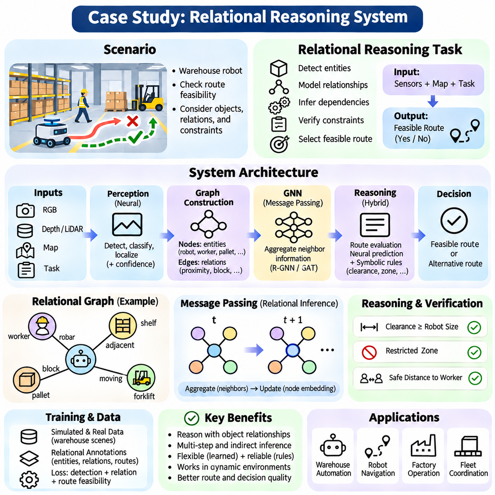{width="7.268055555555556in" height="7.268055555555556in"}

관계 추론 시스템(Relational Reasoning System)은 신경망(Neural Networks)이 개체(Entities)를 식별하고, 개체 사이의 상호작용(Interactions)을 표현하며, 구조화된 관계(Structured Relationships)로부터 결론을 도출하는 방법을 보여준다. 개별 특징(Isolated Features)에 집중하는 기존 예측 모델(Conventional Prediction Models)과 달리, 관계 추론 시스템은 객체(Objects)가 서로에게 어떤 영향을 미치는지 평가한다. 이 사례 연구(Case Study)는 신뢰할 수 있는 관계 추론(Relational Inference)을 위해 신경 인식(Neural Perception), 그래프 표현(Graph Representations), 메시지 전달(Message Passing), 규칙 기반 검증(Rule-Based Verification)을 결합한 구조를 살펴본다.

선반(Shelves), 팔레트(Pallets), 작업자(Workers), 운송 차량(Transport Vehicles)이 존재하는 산업용 창고(Industrial Warehouse)에서 자율 이동 로봇(Autonomous Mobile Robot)이 작동하는 상황을 고려할 수 있다. 로봇은 동적 장애물(Dynamic Obstacles)과 운영 제한(Operational Restrictions)을 고려하면서 요청된 경로(Requested Route)의 실행 가능성(Feasibility)을 판단해야 한다. 성공적인 추론을 위해서는 개별 객체를 감지하는 것 이상의 능력이 필요하다. 시스템은 공간 관계(Spatial Relationships), 이동 의존성(Movement Dependencies), 주행 의사결정(Navigation Decisions)에 영향을 미치는 제약 조건(Constraints)을 식별해야 한다.

시스템은 창고 지도(Warehouse Map)와 작업 지시(Task Instructions)를 함께 사용하면서 RGB 카메라(RGB Cameras), 깊이 센서(Depth Sensors), 라이다(LiDAR)로부터 관측값(Observations)을 수신한다. 신경 인식 모듈(Neural Perception Modules)은 객체를 감지하고 위치를 추정하며 환경 특징(Environmental Features)을 분류한다. 각 관측값에는 타임스탬프(Timestamp)와 신뢰도 추정값(Confidence Estimate)이 연결된다. 센서 보정(Sensor Calibration)과 좌표 변환(Coordinate Transformations)은 감지된 개체 사이의 일관된 관계를 구성하기 위한 공통 공간 기준(Common Spatial Reference)을 설정한다.

감지된 개체(Detected Entities)는 객체 범주(Object Category), 위치(Position), 속도(Velocity), 치수(Dimensions), 관측 신뢰도(Observation Confidence) 등의 속성을 포함하는 그래프 노드(Graph Nodes)로 표현된다. 그래프 엣지(Graph Edges)는 근접성(Proximity), 포함 관계(Containment), 연결성(Connectivity), 잠재적 장애 관계(Potential Obstruction) 등을 설명한다. 복도에 접근하는 작업자는 공간 관계(Spatial Relations)를 통해 주변 경로와 연결될 수 있다. 이러한 그래프 표현(Graph Representation)은 원시 관측값(Raw Observations)을 관계 추론(Relational Inference)에 적합한 구조로 변환한다.

그래프 구성(Graph Construction)에는 어떤 개체를 서로 연결해야 하는지 결정하기 위한 명시적인 기준(Explicit Criteria)이 필요하다. 공간 거리(Spatial Distance), 기하학적 중첩(Geometric Overlap), 의미적 호환성(Semantic Compatibility), 운영 관련성(Operational Relevance)은 엣지 생성(Edge Creation)에 영향을 미칠 수 있다. 객체가 이동하거나 사라지면 동적 관계(Dynamic Relationships)를 갱신해야 한다. 잘못된 연관 관계(Incorrect Associations)는 거짓 의존성(False Dependencies)을 유발할 수 있으므로 시간적 일관성(Temporal Consistency), 객체 추적(Object Tracking), 불확실성 인식 그래프 유지관리(Uncertainty-Aware Graph Maintenance)가 필수적이다.

그래프 신경망(Graph Neural Network, GNN)은 반복적인 메시지 전달 연산(Message-Passing Operations)을 통해 관계 표현(Relational Representation)을 처리한다. 각 노드(Node)는 연결된 이웃 노드(Connected Neighbors)로부터 정보를 수신하고 학습된 집계 함수(Learned Aggregation Functions)를 사용하여 내부 임베딩(Internal Embedding)을 갱신한다. 여러 계층(Multiple Layers)을 사용하면 정보가 점점 더 먼 그래프 이웃(Graph Neighborhoods)으로 전파될 수 있다. 이를 통해 시스템은 개별 객체 속성(Isolated Object Attributes)만으로 추론할 수 없는 의존성(Dependencies)을 평가할 수 있다.

예를 들어 교차로(Intersection)를 차단하는 팔레트(Pallet)는 로봇이 영향을 받는 모든 경로를 직접 관측하지 못하더라도 여러 연결된 복도(Connected Corridors)에 영향을 미칠 수 있다. 메시지 전달(Message Passing)은 장애 상태(Obstruction)와 연결성(Connectivity)에 관한 정보를 그래프 전반으로 전파한다. 결과적인 노드 표현(Node Representations)은 지역 관측값(Local Observations)과 관계적 문맥(Relational Context)을 모두 인코딩한다. 그러나 학습된 정보 전파(Learned Propagation)가 모든 추론된 의존성(Inferred Dependencies)의 기하학적 또는 논리적 정확성을 보장하는 것은 아니다.

어텐션 메커니즘(Attention Mechanisms)은 인접 개체(Neighboring Entities)와 관계(Relationships)에 서로 다른 중요도를 부여하여 관계 정보 처리(Relational Processing)를 개선할 수 있다. 로봇의 계획된 궤적(Planned Trajectory) 근처에서 이동하는 작업자는 멀리 떨어진 정지 객체(Distant Stationary Object)보다 더 높은 어텐션을 받을 수 있다. 그래프 어텐션 네트워크(Graph Attention Networks, GAT)는 문맥 의존적 상호작용 가중치(Context-Dependent Interaction Weights)를 학습한다. 이러한 가중치는 정보의 우선순위를 결정하는 데 도움이 되지만, 안전 관련성(Safety Relevance)이나 인과적 영향(Causal Influence)에 대한 확정적인 설명으로 해석해서는 안 된다.

추론 모듈(Reasoning Module)은 그래프 임베딩(Graph Embeddings), 기하학적 제약 조건(Geometric Constraints), 작업 요구사항(Task Requirements)을 사용하여 후보 경로(Candidate Routes)를 평가한다. 신경망 구성 요소(Neural Components)는 경로 적합성(Route Suitability)이나 잠재적 충돌(Potential Conflicts)을 추정하고, 기호 규칙(Symbolic Rules)은 여유 공간(Clearance), 제한 구역(Restricted Zones), 허용된 이동(Permitted Movement)에 관한 제한을 강제한다. 검증된 제약 조건(Verified Constraints)을 위반하는 경로는 거부된다. 이러한 하이브리드 설계(Hybrid Design)는 유연한 예측(Flexible Prediction)과 명시적인 검증(Explicit Validation)이 필요한 요구사항을 분리한다.

경로 실행 가능성(Route Feasibility)이 간접적인 관계(Indirect Relationships)에 의존할 때 다단계 관계 추론(Multi-Step Relational Inference)이 필요해진다. 차단된 복도(Blocked Corridor)는 대체 통로(Alternative Passage)를 선택하도록 만들 수 있으며, 이는 작업자와의 근접성(Proximity to Workers) 및 적재 작업 구역(Loading Stations)에 대한 접근성을 변화시킨다. 시스템은 연속적인 그래프 갱신(Graph Updates)과 계획 연산(Planning Operations)을 통해 이러한 의존성을 평가한다. 중간 결론(Intermediate Conclusions)은 최신 관측값(Latest Observations)과 운영 지도(Operational Map)에 일관되게 부합해야 한다.

실용적인 구현(Practical Implementation)에는 파이토치(PyTorch)와 파이토치 지오메트릭(PyTorch Geometric) 같은 그래프 학습 프레임워크(Graph Learning Framework)를 사용할 수 있다. 노드 특징(Node Features)은 수치 벡터(Numerical Vectors)로 인코딩되고, 엣지 속성(Edge Attributes)은 거리(Distances), 상대 방향(Relative Orientations), 관계 유형(Relation Types)을 표현한다. 메시지 전달 계층(Message-Passing Layers)은 갱신된 임베딩(Updated Embeddings)을 생성하며, 이후 작업별 예측 헤드(Task-Specific Prediction Heads)가 적용된다. 별도의 제약 조건 평가기(Constraint Evaluator)는 제안된 행동(Proposed Actions)이 운영 요구사항(Operational Requirements)을 충족하는지 검사한다.

학습 데이터(Training Data)에는 시뮬레이션된 창고 장면(Simulated Warehouse Scenes), 주석이 부여된 객체 관계(Annotated Object Relationships), 실행 가능한 경로와 실행 불가능한 경로(Feasible or Infeasible Routes)의 사례가 포함될 수 있다. 지도 학습(Supervised Learning)은 객체 관계 예측(Object Relation Predictions)과 경로 분류(Route Classification)를 최적화한다. 추가 손실 함수(Additional Losses)는 예측된 관계와 알려진 기하학적 제약 조건(Known Geometric Constraints) 사이의 일관성을 촉진할 수 있다. 시뮬레이션(Simulation)은 통제된 변화를 제공하지만, 실제 배포(Deployment)에는 현실적인 센서 잡음(Real Sensor Noise)과 익숙하지 않은 환경(Unfamiliar Environments)에 대한 평가가 필요하다.

부정 사례(Negative Examples)는 모델이 의미 있는 의존성(Meaningful Dependencies)과 우연한 근접성(Coincidental Proximity)을 구별해야 하므로 중요하다. 두 객체는 공간적으로 가까이 있더라도 동일한 주행 의사결정(Navigation Decision)에 영향을 미치지 않을 수 있다. 따라서 학습에는 방해 요소(Distractors), 모호한 배치(Ambiguous Configurations), 유사한 시각적 장면(Similar Visual Scenes)이 서로 다른 결론을 요구하는 사례가 포함되어야 한다. 이러한 사례는 피상적인 상관관계(Superficial Correlations)에 대한 의존성을 줄이고 더욱 강건한 관계 표현(Robust Relational Representations)을 학습하도록 촉진한다.

시간 추론(Temporal Reasoning)은 시스템을 정적 그래프 분석(Static Graph Analysis) 이상으로 확장한다. 작업자가 이동하거나 팔레트가 재배치되거나 차량이 교차로에 진입하면 객체 위치(Object Positions)와 관계(Relationships)가 변화한다. 시간 그래프 모델(Temporal Graph Model)은 과거 관측값(Historical Observations)과 움직임 추정값(Motion Estimates)을 통합하여 가까운 미래의 상호작용(Near-Term Interactions)을 예측할 수 있다. 그러나 새로운 측정값(New Measurements)이 들어오면 예측을 갱신해야 하며, 오래된 그래프 상태(Stale Graph States)가 안전 필수 행동(Safety-Critical Actions)을 결정해서는 안 된다.

메모리 메커니즘(Memory Mechanisms)은 객체가 센서 관측 범위(Sensor Coverage)를 일시적으로 벗어났을 때 관련 정보를 보존한다. 로봇은 이전에 복도가 차단되었다는 사실을 기억하면서도 해당 관측값이 더 이상 유효하지 않을 수 있음을 인식할 수 있다. 메모리 항목(Memory Entries)에는 타임스탬프(Timestamps), 신뢰도 갱신(Confidence Updates), 만료 정책(Expiration Policies)이 필요하다. 이는 과거 정보(Historical Information)가 영구적인 사실(Permanent Truth)로 취급되는 것을 방지하면서 부분 관측 가능성(Partial Observability) 아래에서 추론을 지원한다.

시스템은 감지된 개체(Detected Entities)와 예측된 관계(Predicted Relations)에 확률(Probabilities) 또는 신뢰도 측정값(Confidence Measures)을 연결하여 불확실성(Uncertainty)을 통합할 수 있다. 신뢰도가 낮은 관측값(Low-Confidence Observations)은 추가적인 센싱(Additional Sensing)이나 보수적인 계획(Conservative Planning)을 유발할 수 있다. 불확실성은 그래프 집계(Graph Aggregation) 과정에서 사라지는 것이 아니라 관계 추론(Relational Inference) 전반으로 전파되어야 한다. 신경망 신뢰도 점수(Neural Confidence Scores)가 자동으로 신뢰할 수 있는 확률(Reliable Probabilities)에 대응하는 것은 아니므로 보정(Calibration)이 필요하다.

설명 가능성(Explainability)은 각 경로 결정(Route Decision)에 기여한 사실(Facts), 관계(Relationships), 규칙(Rules)을 기록함으로써 지원할 수 있다. 운영자(Operator)는 어떤 복도가 차단된 것으로 분류되었는지와 어떤 운영 제한(Operational Restriction)이 경로 거부(Rejection)를 유발했는지 확인할 수 있다. 그래프 시각화(Graph Visualization)와 어텐션 분석(Attention Inspection)은 디버깅(Debugging)을 지원할 수 있다. 그러나 설명 추적(Explanatory Traces)은 학습된 예측(Learned Predictions), 독립적으로 검증된 제약 조건(Independently Verified Constraints), 실제 인과적 증거(Actual Causal Evidence)를 구별해야 한다.

평가(Evaluation)는 객체 감지 정확도(Object Detection Accuracy), 관계 분류(Relation Classification), 그래프 일관성(Graph Consistency), 경로 의사결정 정확성(Route Decision Correctness)을 측정해야 한다. 추가 테스트(Additional Tests)는 가림 현상(Occlusion), 센서 잡음(Sensor Noise), 변화하는 그래프 크기(Changing Graph Size), 익숙하지 않은 창고 배치(Unfamiliar Warehouse Layouts)에서의 성능을 조사한다. 연결된 관계(Connected Relationships)를 따라 오류가 누적될 수 있으므로 다단계 추론 정확도(Multi-Step Reasoning Accuracy)가 특히 중요하다. 비관계형 기준 모델(Non-Relational Baselines)과의 비교는 그래프 추론(Graph Reasoning)의 기여도를 정량화하는 데 도움이 된다.

운영 평가(Operational Evaluation)에서는 지연시간(Latency), 메모리 소비(Memory Consumption), 계산 확장성(Computational Scalability)도 고려해야 한다. 밀집 그래프(Dense Graphs)는 메시지 전달 비용(Message-Passing Costs)을 증가시키며, 빈번한 갱신(Frequent Updates)은 추가적인 처리 요구량(Processing Demands)을 발생시킨다. 공간 필터링(Spatial Filtering), 희소 연결성(Sparse Connectivity), 증분 그래프 갱신(Incremental Graph Updates)은 자원 요구량(Resource Requirements)을 줄일 수 있다. 시스템은 필수적인 안전 검사(Mandatory Safety Checks)나 중요한 환경 정보(Critical Environmental Information)를 희생하지 않으면서 실시간 계획 마감시간(Real-Time Planning Deadlines)을 충족해야 한다.

실패 분석(Failure Analysis)은 감지되지 않은 장애물(Missed Obstacles), 잘못된 객체 연관 관계(Incorrect Object Associations), 오래된 관계(Outdated Relationships), 모순되는 센서 관측값(Contradictory Sensor Observations)을 조사해야 한다. 관계 모델(Relational Model)은 그래프 표현(Graph Representation)에서 중요한 장애물(Critical Obstruction)이 누락된 경우에도 실행 가능한 경로(Feasible Route)를 예측할 수 있다. 따라서 독립적인 충돌 검사(Independent Collision Checking)와 검증된 동작 계획(Validated Motion Planning)은 계속 활성화되어 있어야 한다. 증거가 충분하지 않을 경우 시스템은 갱신된 관측값(Updated Observations)을 요청하거나 검증된 안전 대체 동작(Verified Safe Fallback)을 선택해야 한다.

이 구조는 로봇(Robots), 작업(Tasks), 공유 복도(Shared Corridors), 충전소(Charging Stations)를 집단 그래프(Collective Graph) 내에 표현함으로써 다중 로봇 협조(Multi-Robot Coordination)로 확장할 수 있다. 관계 추론(Relational Reasoning)은 자원 충돌(Resource Conflicts), 경로 간섭(Route Interference), 작업 의존성(Task Dependencies)을 식별할 수 있다. 분산 갱신(Distributed Updates)을 통해 여러 로봇이 관측값을 제공할 수 있지만, 동기화 지연(Synchronization Delays)과 일관되지 않은 정보(Inconsistent Information)를 처리하기 위한 명시적인 협조 정책(Coordination Policies)이 필요하다.

통제된 실험(Controlled Experiment)에서는 동일한 창고 시나리오(Identical Warehouse Scenarios)를 대상으로 기존 특징 기반 모델(Conventional Feature-Based Model), 그래프 신경망(Graph Neural Network), 하이브리드 신경-기호 시스템(Hybrid Neuro-Symbolic System)을 비교할 수 있다. 평가에서는 경로 정확도(Route Accuracy), 제약 조건 위반(Constraint Violations), 추론 지연시간(Inference Latency), 더 큰 환경(Larger Environments)에 대한 일반화(Generalization)를 조사해야 한다. 제거 실험(Ablation Experiments)은 메시지 전달(Message Passing), 어텐션(Attention), 메모리(Memory), 기호적 검증(Symbolic Verification)이 전체 시스템 동작(Overall System Behavior)에 미치는 영향을 개별적으로 분석할 수 있다.

이 사례 연구(Case Study)는 관계 추론(Relational Reasoning)이 개별적인 인식 결과(Isolated Perception Results)를 구조화된 환경 이해(Structured Environmental Understanding)로 변환하는 방법을 보여준다. 그래프 신경망(Graph Neural Networks)은 학습된 상호작용 모델링(Learned Interaction Modeling)을 제공하고, 시간 메모리(Temporal Memory)와 기호적 제약 조건(Symbolic Constraints)은 문맥 보존(Context Preservation)과 명시적 검증(Explicit Validation)을 지원한다. 신뢰할 수 있는 운영(Dependable Operation)을 위해서는 신경망 예측(Neural Predictions)에만 의존하는 대신 정확한 그래프 구성(Accurate Graph Construction), 불확실성 관리(Uncertainty Management), 엄격한 평가(Rigorous Evaluation), 독립적인 안전 메커니즘(Independent Safety Mechanisms)이 필요하다.
