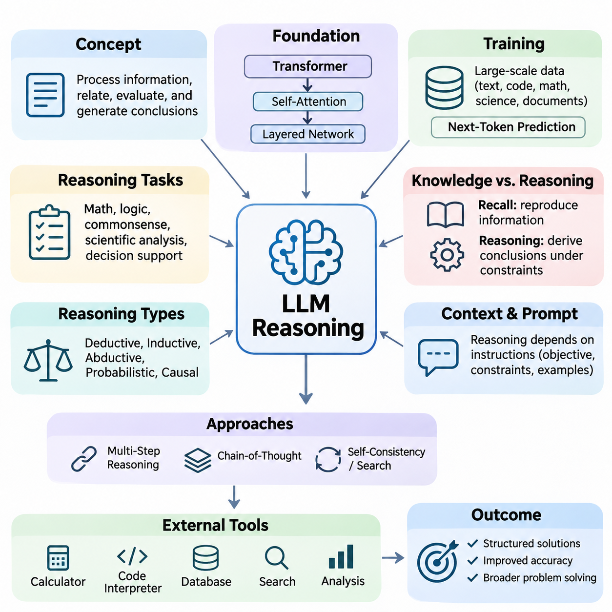
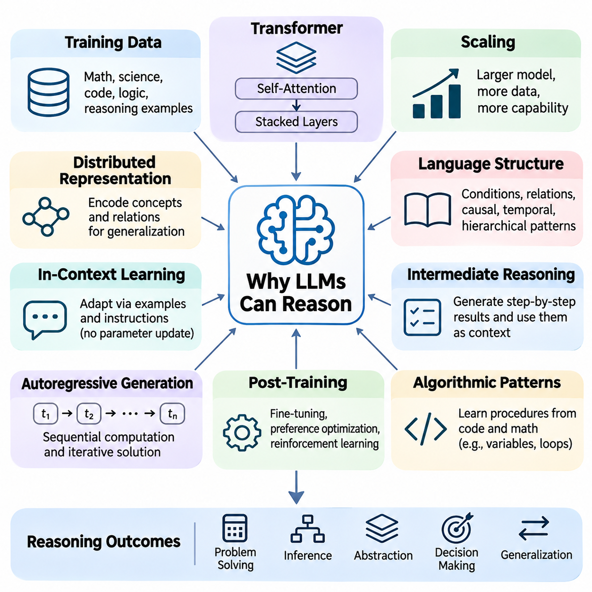
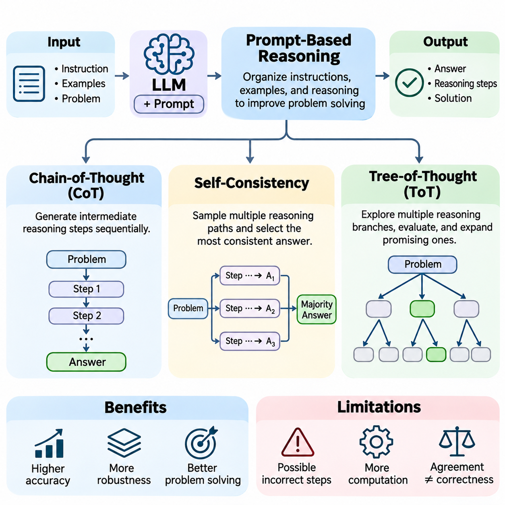
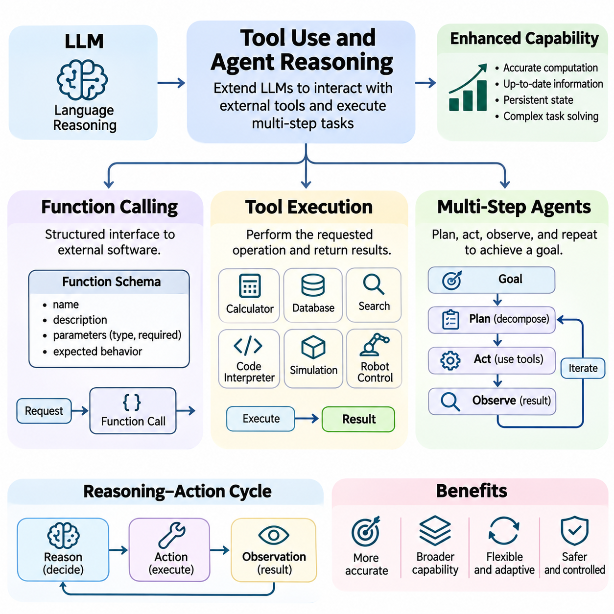
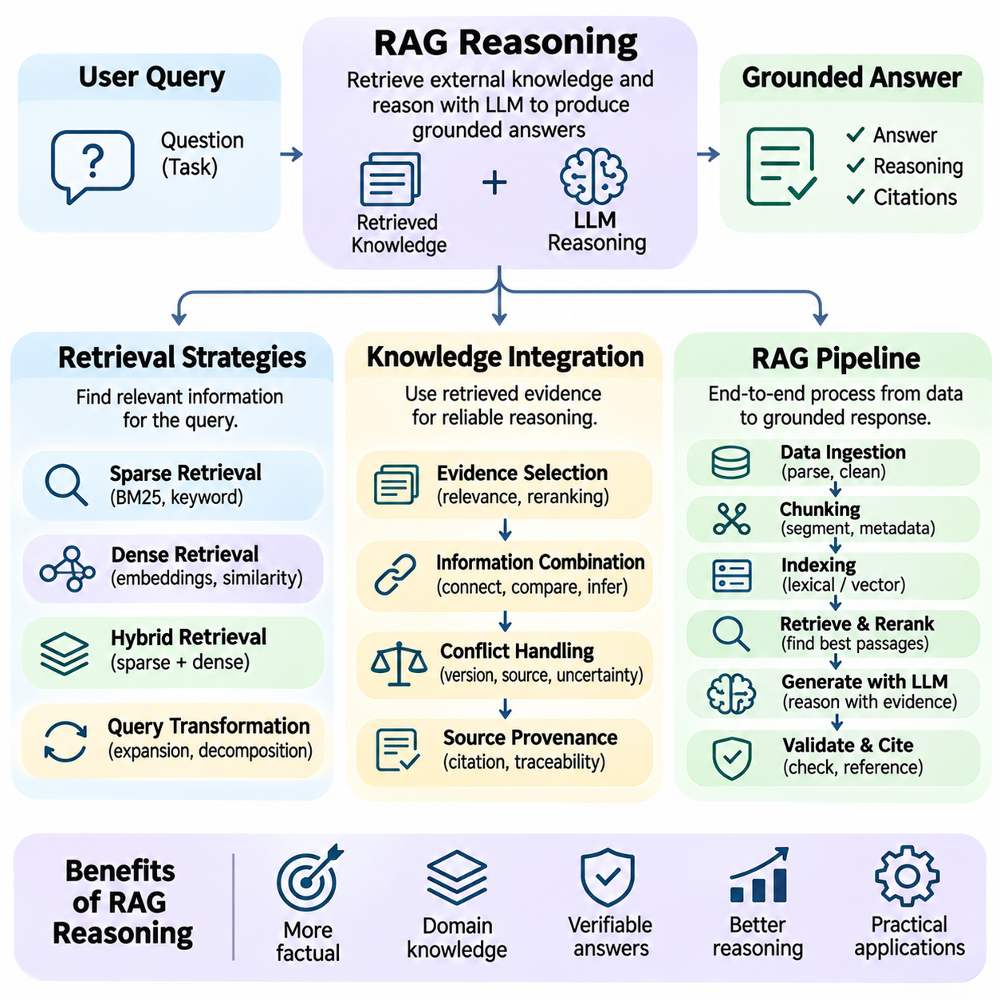
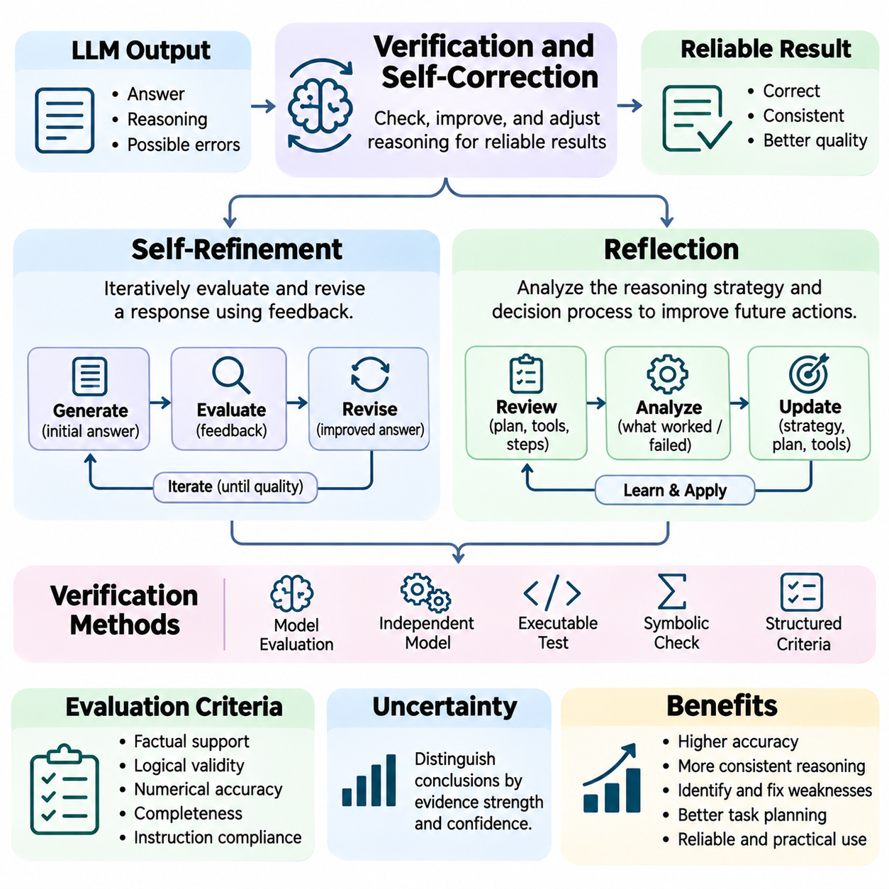
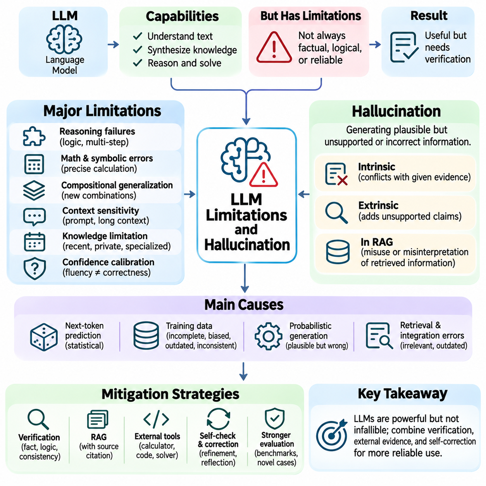
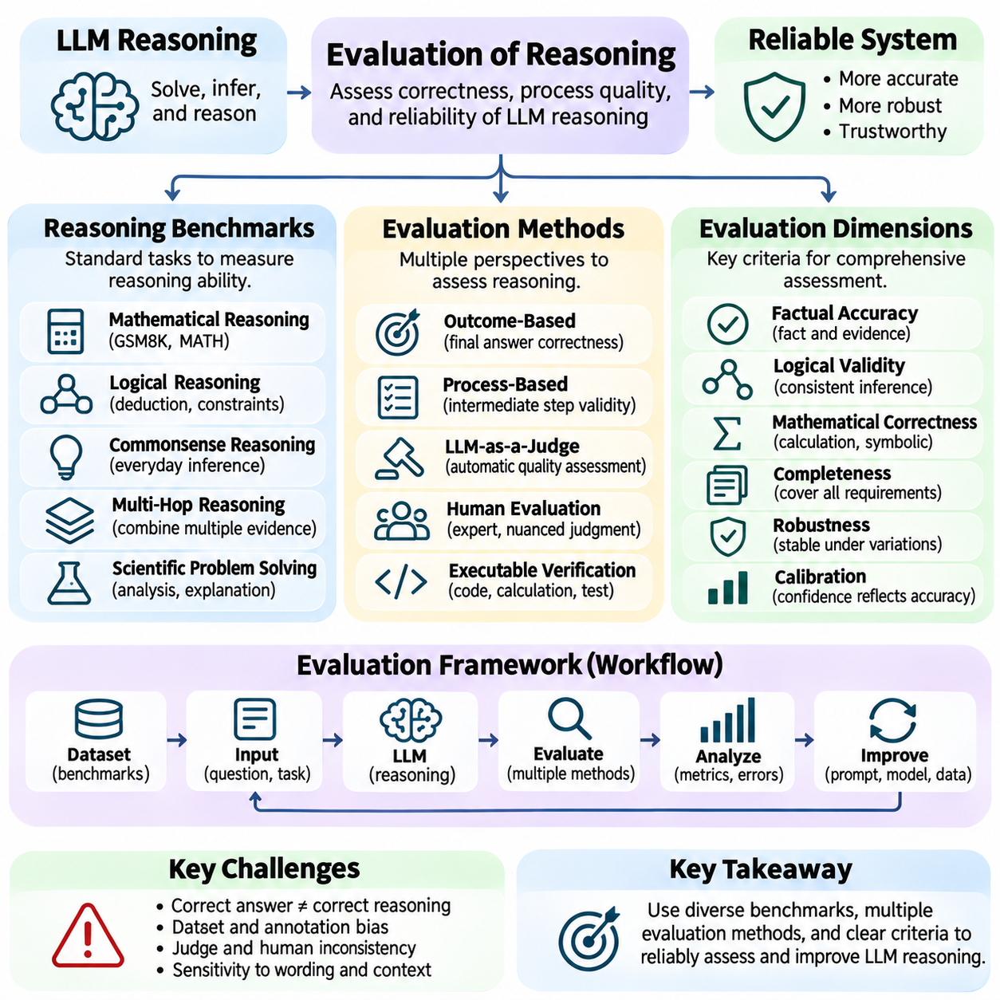
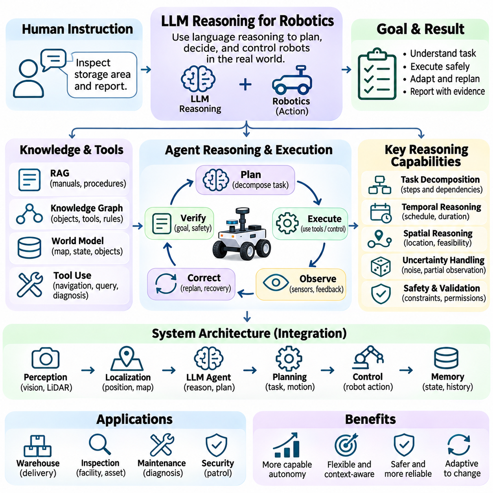
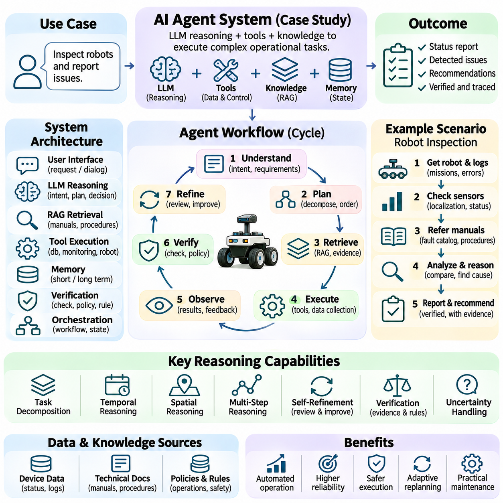

**Volume 03. Reasoning in AI**


# 05. LLM Reasoning

## 05.01 Introduction to LLM Reasoning

{width="7.268055555555556in" height="7.268055555555556in"}

Large Language Model (LLM) reasoning refers to the ability of language models to process information, establish relationships, evaluate alternatives, and generate conclusions through learned computational patterns. Unlike traditional symbolic reasoning systems that explicitly manipulate predefined logical rules, LLMs operate primarily through distributed neural representations. Their reasoning capabilities emerge from training, model architecture, contextual information, and inference-time computation.

Reasoning in LLMs extends beyond producing grammatically correct sentences or retrieving memorized information. It involves combining facts, interpreting constraints, recognizing dependencies, and solving problems that require multiple conceptual steps. Typical reasoning tasks include mathematical problem solving, logical deduction, commonsense inference, scientific analysis, and decision support. Performance varies considerably across models, tasks, and prompting conditions.

The development of LLM reasoning represents an important transition from conventional language processing toward more general computational problem solving. Earlier language models primarily emphasized statistical relationships between words and sequences. Modern transformer-based systems can represent complex contextual dependencies and generate structured solutions. Nevertheless, successful performance does not necessarily imply that a model possesses explicit symbolic rules or human-like understanding.

The transformer architecture provides an important foundation for LLM reasoning through self-attention mechanisms and layered neural transformations. Attention enables information from different positions within a context to influence token representations, while feedforward networks transform these representations into increasingly useful features. Multiple layers allow models to combine linguistic, semantic, and relational information, although the exact mechanisms underlying reasoning remain an active research topic.

Pretraining exposes language models to extensive collections of text, code, mathematical expressions, scientific explanations, and structured documents. Through next-token prediction, models learn statistical regularities that can support inference, analogy, abstraction, and procedural problem solving. Training data containing explanations and worked examples can strengthen these capabilities, but exposure to reasoning patterns does not guarantee their reliable application to unfamiliar situations.

A fundamental distinction exists between knowledge recall and reasoning. Knowledge recall involves reproducing or reconstructing information associated with training examples, whereas reasoning requires applying available information to derive conclusions under particular constraints. For example, recalling a mathematical formula differs from selecting the appropriate formula, identifying relevant variables, and applying it correctly. Practical LLM systems frequently combine both capabilities within the same response.

LLM reasoning can be examined through several complementary categories, including deductive, inductive, abductive, probabilistic, and causal reasoning. Deductive reasoning derives conclusions from premises, while inductive reasoning identifies general patterns from observations. Abductive reasoning proposes plausible explanations, and probabilistic reasoning evaluates uncertainty. Causal reasoning examines interventions and dependencies, although language models may confuse causal relationships with statistical associations.

One distinctive characteristic of LLM reasoning is its dependence on contextual instructions. The same model may produce substantially different solutions depending on how a problem is formulated, which examples are supplied, and whether intermediate analysis is encouraged. Prompt design therefore influences the effective reasoning behavior of a model. Clear objectives, explicit constraints, relevant evidence, and well-defined output requirements can improve consistency without changing the underlying model parameters.

Multi-step reasoning requires a model to maintain relationships between intermediate conclusions while progressing toward a final answer. Complex mathematical questions, planning problems, and technical diagnoses often contain dependencies that cannot be resolved through a single isolated inference. Intermediate representations can help organize these dependencies and identify missing assumptions. However, longer generated explanations do not automatically indicate deeper reasoning or greater correctness.

Chain-of-Thought prompting is a widely studied approach for encouraging intermediate problem-solving steps before producing a conclusion. By presenting examples of structured reasoning or requesting an organized solution, this technique can improve performance on certain complex tasks. Its effectiveness depends on the model and problem domain. Furthermore, generated reasoning explanations should not automatically be interpreted as faithful descriptions of the model\'s internal computational processes.

Reasoning reliability can sometimes be improved by exploring multiple candidate solutions rather than relying on a single generation. Self-consistency methods compare answers obtained through different reasoning samples, while search-based approaches evaluate alternative intermediate states. These strategies introduce additional inference-time computation and may reduce some errors. However, multiple generations can share systematic misconceptions, meaning agreement alone cannot establish factual correctness.

External tools provide another important dimension of LLM reasoning. A language model can coordinate calculators, code interpreters, databases, search systems, and specialized analytical services to perform operations that are difficult to execute reliably through text generation alone. Tool-assisted reasoning separates natural-language interpretation from executable computation. The model formulates operations, receives external results, and integrates those results into subsequent decisions.

Retrieval-Augmented Generation (RAG) extends reasoning by supplying relevant information from external knowledge sources. Instead of depending exclusively on information encoded in model parameters, a retrieval system identifies documents, records, or structured knowledge related to the current question. The LLM then interprets this evidence and constructs a response. Reliable reasoning requires evaluating source relevance, resolving conflicting evidence, and distinguishing supported conclusions from unsupported assumptions.

Agent-based reasoning combines language understanding with iterative planning, tool execution, observation, and adjustment. An LLM-based agent can decompose a goal into manageable tasks, select appropriate tools, evaluate execution results, and revise subsequent actions. Such systems may support software development, information analysis, workflow automation, and robotic task coordination. Their reliability depends on execution controls, state management, verification, and clearly defined operational boundaries.

Verification and self-correction are essential because LLMs can produce fluent explanations containing incorrect assumptions or invalid conclusions. A model may identify inconsistencies by reviewing its own output, but self-evaluation is not an independent guarantee of correctness. Stronger verification incorporates executable tests, formal constraints, external evidence, or independent evaluators. Effective reasoning systems distinguish generating a plausible solution from demonstrating that the solution satisfies the required conditions.

Hallucination remains a major limitation of language-model reasoning. A model may generate nonexistent facts, unsupported citations, incorrect calculations, or logically inconsistent explanations while maintaining convincing linguistic fluency. These errors arise from multiple factors, including insufficient information, ambiguous instructions, distribution shifts, and limitations in learned representations. Confidence expressed through natural language should therefore not be treated as a calibrated probability of correctness.

Reasoning performance also depends on computational resources and inference-time constraints. Longer contexts, additional candidate solutions, external verification, and iterative search can increase computational cost and response latency. More computation may improve difficult-task performance, but improvements are not guaranteed. Practical system design must balance reasoning accuracy, latency, memory consumption, token usage, and operational cost according to application requirements.

Evaluating LLM reasoning requires more than measuring whether generated answers resemble reference text. Mathematical correctness, logical consistency, factual grounding, constraint satisfaction, and robustness under modified problem conditions provide complementary evaluation dimensions. Benchmarks should distinguish memorized patterns from generalizable problem-solving capabilities. Controlled experiments, adversarial examples, and independent verification help reveal weaknesses that conventional accuracy measurements may overlook.

LLM reasoning becomes especially challenging when applied to physical environments such as robotics and autonomous systems. Language models can interpret high-level objectives, explain operational constraints, and propose task sequences, but physical execution requires accurate perception, spatial awareness, temporal coordination, and safety verification. Integrating LLMs with symbolic planners, world models, sensor systems, and deterministic controllers helps connect abstract reasoning with grounded actions.

Hybrid reasoning architectures offer a practical direction for combining the flexibility of language models with the reliability of specialized computational methods. Symbolic logic can enforce explicit constraints, probabilistic models can represent uncertainty, causal models can examine interventions, and neural networks can process complex observations. Within such architectures, an LLM may coordinate reasoning components while external modules provide verifiable computations and domain-specific capabilities.

The central objective of LLM reasoning research is not merely to generate longer explanations, but to develop systems capable of producing accurate, adaptable, grounded, and verifiable conclusions. Progress depends on improvements in training, inference strategies, tool integration, evaluation, and system architecture. Understanding both the capabilities and limitations of language-model reasoning provides the foundation for designing dependable AI agents and increasingly sophisticated intelligent systems.

대규모 언어 모델(LLM, Large Language Model)의 추론(Reasoning)은 언어 모델(Language Model)이 학습된 계산 패턴(Computational Patterns)을 통해 정보를 처리하고, 관계를 설정하며, 대안을 평가하고, 결론을 도출하는 능력을 의미한다. 사전에 정의된 논리 규칙(Logical Rules)을 명시적으로 조작하는 전통적인 기호 추론 시스템(Symbolic Reasoning Systems)과 달리, LLM은 주로 분산 신경 표현(Distributed Neural Representations)을 기반으로 작동한다. 이러한 추론 능력은 학습(Training), 모델 아키텍처(Model Architecture), 문맥 정보(Contextual Information), 추론 시점 계산(Inference-Time Computation)의 상호작용을 통해 형성된다.

LLM의 추론은 문법적으로 올바른 문장을 생성하거나 기억된 정보를 검색하는 수준을 넘어선다. 여기에는 사실을 결합하고, 제약 조건(Constraints)을 해석하며, 의존 관계(Dependencies)를 인식하고, 여러 개념적 단계를 요구하는 문제를 해결하는 과정이 포함된다. 대표적인 추론 작업에는 수학적 문제 해결(Mathematical Problem Solving), 논리적 연역(Logical Deduction), 상식 추론(Commonsense Inference), 과학적 분석(Scientific Analysis), 의사결정 지원(Decision Support)이 있다. 이러한 작업의 성능은 모델, 문제 유형, 프롬프트 조건(Prompting Conditions)에 따라 상당한 차이를 보인다.

LLM 추론의 발전은 기존의 언어 처리(Language Processing)에서 보다 일반적인 계산적 문제 해결(Computational Problem Solving)로 전환되는 중요한 변화를 나타낸다. 초기 언어 모델은 주로 단어와 시퀀스(Sequence) 사이의 통계적 관계(Statistical Relationships)를 학습하는 데 중점을 두었다. 현대의 트랜스포머 기반 시스템(Transformer-Based Systems)은 복잡한 문맥적 의존 관계(Contextual Dependencies)를 표현하고 구조화된 해결책(Structured Solutions)을 생성할 수 있다. 그러나 성공적인 문제 해결 성능이 반드시 명시적인 기호 규칙이나 인간과 유사한 이해 능력을 보유하고 있음을 의미하지는 않는다.

트랜스포머 아키텍처(Transformer Architecture)는 자기 주의 메커니즘(Self-Attention Mechanism)과 계층적 신경 변환(Layered Neural Transformations)을 통해 LLM 추론의 중요한 기반을 제공한다. 어텐션(Attention)은 문맥 내 서로 다른 위치의 정보가 토큰 표현(Token Representations)에 영향을 미치도록 하며, 피드포워드 네트워크(Feedforward Networks)는 이러한 표현을 더욱 유용한 특징(Features)으로 변환한다. 여러 계층은 언어적, 의미적, 관계적 정보를 결합하도록 지원하지만, 추론을 가능하게 하는 정확한 내부 메커니즘은 여전히 활발한 연구 주제이다.

사전 학습(Pretraining)은 언어 모델을 방대한 텍스트, 코드, 수학적 표현(Mathematical Expressions), 과학적 설명, 구조화된 문서에 노출한다. 다음 토큰 예측(Next-Token Prediction)을 통해 모델은 추론(Inference), 유추(Analogy), 추상화(Abstraction), 절차적 문제 해결(Procedural Problem Solving)을 지원할 수 있는 통계적 규칙성을 학습한다. 설명과 풀이 예제를 포함하는 학습 데이터는 이러한 능력을 강화할 수 있지만, 추론 패턴에 대한 학습 경험이 새로운 상황에서의 안정적인 적용을 보장하지는 않는다.

지식 회상(Knowledge Recall)과 추론(Reasoning) 사이에는 근본적인 차이가 존재한다. 지식 회상은 학습 사례와 연관된 정보를 재현하거나 재구성하는 과정인 반면, 추론은 주어진 제약 조건에 따라 사용 가능한 정보를 적용하여 결론을 도출하는 과정이다. 예를 들어, 수학 공식을 기억하는 것과 적절한 공식을 선택하고 관련 변수를 식별하여 정확하게 적용하는 것은 서로 다른 능력이다. 실제 LLM 시스템은 하나의 응답을 생성하는 과정에서 이러한 두 가지 능력을 함께 활용하는 경우가 많다.

LLM 추론은 연역적 추론(Deductive Reasoning), 귀납적 추론(Inductive Reasoning), 가설적 추론(Abductive Reasoning), 확률적 추론(Probabilistic Reasoning), 인과적 추론(Causal Reasoning) 등 여러 상호 보완적인 범주로 구분할 수 있다. 연역적 추론은 전제로부터 결론을 도출하며, 귀납적 추론은 관찰 결과에서 일반적인 패턴을 식별한다. 가설적 추론은 가능한 설명을 제안하고, 확률적 추론은 불확실성(Uncertainty)을 평가한다. 인과적 추론은 개입(Interventions)과 의존 관계를 분석하지만, 언어 모델은 인과관계(Causal Relationships)를 통계적 연관성(Statistical Associations)과 혼동할 수 있다.

LLM 추론의 독특한 특징 중 하나는 문맥적 지시(Contextual Instructions)에 대한 의존성이다. 동일한 모델이라도 문제가 어떻게 표현되는지, 어떤 예제가 제공되는지, 중간 분석(Intermediate Analysis)이 권장되는지에 따라 상당히 다른 해결책을 생성할 수 있다. 따라서 프롬프트 설계(Prompt Design)는 모델의 실질적인 추론 행동(Reasoning Behavior)에 영향을 미친다. 명확한 목표, 명시적인 제약 조건, 관련 증거(Relevant Evidence), 잘 정의된 출력 요구사항(Output Requirements)은 기본 모델 매개변수(Model Parameters)를 변경하지 않고도 추론의 일관성을 향상시킬 수 있다.

다단계 추론(Multi-Step Reasoning)은 최종 답변에 도달하는 과정에서 중간 결론(Intermediate Conclusions) 사이의 관계를 유지하도록 요구한다. 복잡한 수학 문제, 계획 문제(Planning Problems), 기술적 진단(Technical Diagnosis)은 하나의 독립적인 추론만으로 해결할 수 없는 의존 관계를 포함하는 경우가 많다. 중간 표현(Intermediate Representations)은 이러한 의존 관계를 체계화하고 누락된 가정(Assumptions)을 식별하는 데 도움을 줄 수 있다. 그러나 생성된 설명이 길어진다고 해서 반드시 더 깊은 추론이나 높은 정확성을 의미하는 것은 아니다.

사고의 연쇄 프롬프팅(Chain-of-Thought Prompting)은 결론을 생성하기 전에 중간 문제 해결 단계(Intermediate Problem-Solving Steps)를 유도하기 위해 널리 연구되는 접근법이다. 구조화된 추론 예제를 제공하거나 체계적인 해결 과정을 요청하면 특정 복잡한 작업에서 성능을 향상시킬 수 있다. 그러나 효과는 모델과 문제 영역(Problem Domain)에 따라 달라진다. 또한 생성된 추론 설명(Reasoning Explanations)을 모델 내부의 계산 과정(Internal Computational Processes)을 충실하게 나타내는 것으로 자동 해석해서는 안 된다.

추론의 신뢰성(Reasoning Reliability)은 하나의 생성 결과에 의존하기보다 여러 후보 해결책(Candidate Solutions)을 탐색함으로써 향상될 수 있다. 자기 일관성(Self-Consistency) 방법은 서로 다른 추론 샘플(Reasoning Samples)에서 얻은 답변을 비교하며, 탐색 기반 접근법(Search-Based Approaches)은 대안적인 중간 상태(Intermediate States)를 평가한다. 이러한 전략은 추가적인 추론 시점 계산을 필요로 하며 일부 오류를 줄일 수 있다. 그러나 여러 생성 결과가 동일한 체계적 오해(Systematic Misconceptions)를 공유할 수 있으므로, 답변 간 일치만으로 사실적 정확성(Factual Correctness)을 입증할 수는 없다.

외부 도구(External Tools)는 LLM 추론에 또 다른 중요한 차원을 제공한다. 언어 모델은 계산기(Calculators), 코드 인터프리터(Code Interpreters), 데이터베이스(Databases), 검색 시스템(Search Systems), 전문 분석 서비스(Analytical Services)를 조정하여 텍스트 생성만으로는 안정적으로 수행하기 어려운 연산을 실행할 수 있다. 도구 보조 추론(Tool-Assisted Reasoning)은 자연어 해석(Natural-Language Interpretation)과 실행 가능한 계산(Executable Computation)을 분리한다. 모델은 연산을 구성하고 외부 결과를 수신한 뒤, 이를 후속 의사결정에 통합한다.

검색 증강 생성(RAG, Retrieval-Augmented Generation)은 외부 지식 소스(External Knowledge Sources)에서 관련 정보를 제공함으로써 추론 능력을 확장한다. 모델 매개변수에 인코딩된 정보에만 의존하는 대신, 검색 시스템(Retrieval System)은 현재 질문과 관련된 문서, 기록 또는 구조화된 지식(Structured Knowledge)을 식별한다. 이후 LLM은 이러한 증거를 해석하고 응답을 구성한다. 신뢰할 수 있는 추론을 위해서는 출처의 관련성(Source Relevance)을 평가하고, 상충하는 증거(Conflicting Evidence)를 해결하며, 근거가 있는 결론과 뒷받침되지 않은 가정을 구분해야 한다.

에이전트 기반 추론(Agent-Based Reasoning)은 언어 이해(Language Understanding)와 반복적 계획(Iterative Planning), 도구 실행(Tool Execution), 관찰(Observation), 조정(Adjustment)을 결합한다. LLM 기반 에이전트(LLM-Based Agent)는 목표를 관리 가능한 작업으로 분해하고, 적절한 도구를 선택하며, 실행 결과를 평가하고, 후속 행동을 수정할 수 있다. 이러한 시스템은 소프트웨어 개발, 정보 분석, 워크플로 자동화(Workflow Automation), 로봇 작업 조정(Robotic Task Coordination)을 지원할 수 있다. 신뢰성은 실행 제어(Execution Controls), 상태 관리(State Management), 검증(Verification), 명확하게 정의된 운영 경계(Operational Boundaries)에 달려 있다.

검증(Verification)과 자기 수정(Self-Correction)은 LLM이 잘못된 가정이나 유효하지 않은 결론을 포함하면서도 유창한 설명을 생성할 수 있기 때문에 필수적이다. 모델은 자신의 출력을 검토하여 불일치를 식별할 수 있지만, 자기 평가(Self-Evaluation)가 정확성을 독립적으로 보장하지는 않는다. 더욱 강력한 검증은 실행 가능한 테스트(Executable Tests), 형식적 제약 조건(Formal Constraints), 외부 증거(External Evidence), 독립적인 평가기(Independent Evaluators)를 활용한다. 효과적인 추론 시스템은 그럴듯한 해결책을 생성하는 것과 해당 해결책이 요구 조건을 충족한다는 사실을 입증하는 것을 구분한다.

환각(Hallucination)은 언어 모델 추론의 주요 한계로 남아 있다. 모델은 설득력 있는 언어적 유창성(Linguistic Fluency)을 유지하면서 존재하지 않는 사실, 근거 없는 인용(Unsupported Citations), 잘못된 계산, 논리적으로 일관되지 않은 설명을 생성할 수 있다. 이러한 오류는 불충분한 정보, 모호한 지시, 분포 이동(Distribution Shifts), 학습된 표현(Learned Representations)의 한계 등 여러 요인에서 발생한다. 따라서 자연어로 표현된 확신(Confidence)을 정확성에 대한 보정된 확률(Calibrated Probability)로 취급해서는 안 된다.

추론 성능(Reasoning Performance)은 계산 자원(Computational Resources)과 추론 시점 제약(Inference-Time Constraints)의 영향을 받는다. 긴 문맥(Long Contexts), 추가적인 후보 해결책, 외부 검증, 반복적 탐색은 계산 비용(Computational Cost)과 응답 지연 시간(Response Latency)을 증가시킬 수 있다. 더 많은 계산이 어려운 작업의 성능을 향상시킬 수 있지만, 개선이 항상 보장되는 것은 아니다. 실제 시스템 설계에서는 애플리케이션 요구사항에 따라 추론 정확도(Reasoning Accuracy), 지연 시간(Latency), 메모리 사용량(Memory Consumption), 토큰 사용량(Token Usage), 운영 비용(Operational Cost)의 균형을 고려해야 한다.

LLM 추론의 평가(Evaluation)는 생성된 답변이 참조 텍스트(Reference Text)와 얼마나 유사한지를 측정하는 것 이상을 요구한다. 수학적 정확성(Mathematical Correctness), 논리적 일관성(Logical Consistency), 사실적 근거(Factual Grounding), 제약 조건 충족(Constraint Satisfaction), 문제 조건 변경에 대한 강건성(Robustness)은 상호 보완적인 평가 기준을 제공한다. 벤치마크(Benchmarks)는 암기된 패턴과 일반화 가능한 문제 해결 능력(Generalizable Problem-Solving Capabilities)을 구분해야 한다. 통제 실험(Controlled Experiments), 적대적 예제(Adversarial Examples), 독립적 검증은 기존 정확도 측정에서 드러나지 않는 약점을 발견하는 데 도움을 준다.

LLM 추론은 로보틱스(Robotics)와 자율 시스템(Autonomous Systems) 같은 물리적 환경(Physical Environments)에 적용될 때 특히 어려워진다. 언어 모델은 상위 수준의 목표(High-Level Objectives)를 해석하고, 운영 제약 조건을 설명하며, 작업 순서(Task Sequences)를 제안할 수 있다. 그러나 실제 물리적 실행에는 정확한 인식(Perception), 공간 인식(Spatial Awareness), 시간적 조정(Temporal Coordination), 안전 검증(Safety Verification)이 필요하다. LLM을 기호 계획기(Symbolic Planners), 월드 모델(World Models), 센서 시스템(Sensor Systems), 결정론적 제어기(Deterministic Controllers)와 통합하면 추상적 추론(Abstract Reasoning)을 실제 환경에 기반한 행동(Grounded Actions)과 연결할 수 있다.

하이브리드 추론 아키텍처(Hybrid Reasoning Architectures)는 언어 모델의 유연성과 전문 계산 방법(Specialized Computational Methods)의 신뢰성을 결합하기 위한 실용적인 방향을 제공한다. 기호 논리(Symbolic Logic)는 명시적인 제약 조건을 강제할 수 있고, 확률 모델(Probabilistic Models)은 불확실성을 표현하며, 인과 모델(Causal Models)은 개입 효과를 분석하고, 신경망(Neural Networks)은 복잡한 관측 정보를 처리할 수 있다. 이러한 아키텍처에서 LLM은 추론 구성 요소(Reasoning Components)를 조정하고, 외부 모듈(External Modules)은 검증 가능한 계산과 도메인 특화 기능(Domain-Specific Capabilities)을 제공할 수 있다.

LLM 추론 연구의 핵심 목표는 단순히 더 긴 설명을 생성하는 것이 아니라, 정확하고 적응 가능하며 실제 근거에 기반하고 검증 가능한 결론을 생성하는 시스템을 개발하는 것이다. 이러한 발전은 학습(Training), 추론 전략(Inference Strategies), 도구 통합(Tool Integration), 평가(Evaluation), 시스템 아키텍처(System Architecture)의 개선에 달려 있다. 언어 모델 추론의 능력과 한계를 함께 이해하는 것은 신뢰할 수 있는 인공지능 에이전트(AI Agents)와 점점 더 정교해지는 지능형 시스템(Intelligent Systems)을 설계하기 위한 기초가 된다.

## 05.02 Why LLMs Can Reason

{width="7.268055555555556in" height="7.268055555555556in"}

Large Language Models (LLMs) can perform reasoning tasks because their neural architectures learn complex statistical structures, semantic relationships, and computational patterns from extensive training data. Although their primary training objective often involves predicting the next token, successful prediction across diverse contexts requires representations that capture meaningful dependencies. These representations can support inference, abstraction, and problem solving beyond simple memorization.

The transformer architecture plays a central role in developing reasoning capabilities. Self-attention mechanisms allow information from different positions within a sequence to interact dynamically, enabling models to connect premises, identify relevant evidence, and maintain contextual relationships. Stacked transformer layers progressively transform token representations, supporting increasingly complex information processing without explicitly implementing traditional symbolic reasoning algorithms.

During pretraining, LLMs encounter mathematical explanations, scientific arguments, programming examples, logical statements, and natural-language discussions. These materials contain recurring patterns of inference and structured problem solving. By learning to predict sequences containing such patterns, models acquire representations that can support reasoning behavior. However, exposure to reasoning examples does not guarantee that learned procedures will generalize reliably to unfamiliar problems.

Scale contributes significantly to the emergence and improvement of reasoning performance. Increasing model capacity, training data diversity, and computational resources can enable more sophisticated representations and stronger generalization. Certain capabilities become substantially more observable as models improve, although apparent emergence may depend on evaluation thresholds. Scaling alone does not ensure logical consistency, factual accuracy, or robust reasoning across every domain.

Distributed representations allow LLMs to encode concepts and relationships across many neural activations rather than storing knowledge exclusively as isolated symbolic facts. Related concepts may occupy structured regions of representation space, enabling models to combine information through learned transformations. This organization supports semantic generalization, analogy, and contextual interpretation, although the precise relationship between internal representations and explicit reasoning remains under investigation.

Reasoning also benefits from the compositional structure of language. Natural language expresses conditions, comparisons, temporal sequences, causal relationships, and hierarchical dependencies. Learning these structures provides models with patterns that can be recombined when addressing new tasks. For example, understanding conditional expressions can support reasoning about hypothetical situations, while recognizing relational language helps connect entities and properties across multiple statements.

In-context learning enables LLMs to adapt their behavior using information supplied within a prompt without updating their parameters. Examples, instructions, and contextual demonstrations can guide a model toward particular reasoning procedures. This capability allows the same underlying network to perform mathematical analysis, logical classification, or structured decision making. Its effectiveness depends on example quality, task complexity, context organization, and the model\'s learned capabilities.

Intermediate reasoning representations provide another explanation for strong performance on complex tasks. When models generate structured steps, they can externalize partial results and use those results as context for subsequent computation. This process effectively creates a temporary textual workspace. Such representations may reduce the difficulty of solving a complex problem in one step, although generated intermediate statements can contain errors that propagate through later conclusions.

The autoregressive generation process enables sequential computation through repeated token prediction. Each newly generated token becomes part of the context for subsequent predictions, allowing a model to construct and revise an extended solution. This mechanism supports iterative calculations, conditional analysis, and multi-stage explanations. Nevertheless, autoregressive generation does not inherently enforce logical validity, and additional text generation may sometimes reinforce incorrect assumptions.

Training objectives beyond pretraining can strengthen reasoning behavior. Supervised fine-tuning exposes models to examples of desirable solutions, while preference optimization can encourage responses that satisfy task requirements. Reinforcement learning using verifiable outcomes may improve performance on mathematical, coding, and other objectively evaluated problems. These methods influence which reasoning behaviors are reinforced, but their effectiveness depends on reward quality and training design.

Reasoning capabilities can also arise from learning algorithmic patterns embedded in programming languages and mathematical notation. Code provides explicit examples of variables, control flow, recursion, conditional execution, and structured procedures. Mathematical documents demonstrate symbolic transformations and relationships between expressions. Exposure to these representations may help models develop transferable computational strategies, although generating plausible code or equations does not guarantee correct execution.

Attention mechanisms support selective integration of information relevant to a particular inference. A model solving a logical problem may need to connect an initial condition with a later constraint while disregarding unrelated statements. Attention can facilitate these interactions across token positions. However, attention weights alone do not fully explain reasoning, because information processing also depends on feedforward transformations, residual connections, learned representations, and interactions across layers.

Abstraction is another important component of LLM reasoning. Models can sometimes recognize underlying relationships shared by problems with different surface descriptions. A scheduling problem, resource allocation task, and mathematical constraint problem may contain similar dependency structures. Learning transferable patterns allows a model to apply familiar solution strategies in new contexts, although performance often deteriorates when problems differ substantially from training distributions.

LLMs can exhibit forms of relational reasoning by representing connections among entities, attributes, and events. Questions involving family relationships, organizational hierarchies, spatial arrangements, or temporal ordering require combining multiple relational statements. Transformer-based representations can support such combinations through contextual information processing. However, accuracy may decline as relational depth increases or when tasks require strict consistency across many constraints.

The interaction between memorization and generalization is essential for understanding why LLMs can reason. Memorized examples provide useful patterns, while generalization allows those patterns to be adapted to unfamiliar inputs. These mechanisms are not completely independent, because learned representations may combine specific knowledge with reusable procedures. Evaluating reasoning therefore requires distinguishing genuine transfer from performance driven by familiar examples or benchmark contamination.

Inference-time computation can further improve reasoning capabilities by allocating additional resources to difficult problems. Generating alternative solutions, evaluating intermediate states, or performing structured searches can expand the effective problem-solving process. Some systems also use specialized reasoning training to improve the usefulness of additional computation. However, increased computational effort does not guarantee improvement, particularly when candidate solutions share incorrect assumptions.

External tools extend reasoning beyond the model\'s internal neural computations. Calculators provide exact arithmetic, code execution supports algorithmic verification, and retrieval systems supply information unavailable in the immediate context. By selecting tools and incorporating their outputs, an LLM can coordinate a broader reasoning workflow. This does not mean the model independently performs every computation; rather, its reasoning capability includes organizing and interpreting specialized operations.

Despite these capabilities, LLM reasoning differs from formal logical inference. Traditional theorem provers operate under explicit rules that preserve validity when correctly implemented, whereas language models generate outputs through learned probability distributions. Consequently, LLMs may produce convincing but invalid arguments, overlook constraints, or contradict earlier conclusions. Reliable applications often combine neural reasoning with symbolic verification, executable tests, or external evidence.

The ability of LLMs to reason should therefore be understood as an empirical computational capability rather than proof of human-like cognition. Their performance emerges from interactions among architecture, learned representations, training objectives, contextual adaptation, and inference strategies. Understanding these mechanisms explains both their impressive problem-solving abilities and their persistent limitations, providing a foundation for developing more reliable reasoning-oriented AI systems.

대규모 언어 모델(LLM, Large Language Models)이 추론(Reasoning) 작업을 수행할 수 있는 이유는 신경망 아키텍처(Neural Architectures)가 방대한 학습 데이터(Training Data)로부터 복잡한 통계적 구조(Statistical Structures), 의미적 관계(Semantic Relationships), 계산 패턴(Computational Patterns)을 학습하기 때문이다. 주요 학습 목표가 다음 토큰 예측(Next-Token Prediction)인 경우에도 다양한 문맥에서 정확한 예측을 수행하려면 의미 있는 의존 관계(Dependencies)를 포착하는 표현(Representations)이 필요하다. 이러한 표현은 단순한 암기를 넘어 추론(Inference), 추상화(Abstraction), 문제 해결(Problem Solving)을 지원할 수 있다.

트랜스포머 아키텍처(Transformer Architecture)는 추론 능력(Reasoning Capabilities)을 발전시키는 데 핵심적인 역할을 한다. 자기 주의 메커니즘(Self-Attention Mechanisms)은 시퀀스(Sequence) 내 서로 다른 위치의 정보가 동적으로 상호작용하도록 하여 모델이 전제(Premises)를 연결하고, 관련 증거(Relevant Evidence)를 식별하며, 문맥적 관계(Contextual Relationships)를 유지할 수 있도록 한다. 여러 트랜스포머 계층(Transformer Layers)은 토큰 표현(Token Representations)을 점진적으로 변환하여 전통적인 기호 추론 알고리즘(Symbolic Reasoning Algorithms)을 명시적으로 구현하지 않고도 복잡한 정보 처리를 지원한다.

사전 학습(Pretraining) 과정에서 LLM은 수학적 설명(Mathematical Explanations), 과학적 논증(Scientific Arguments), 프로그래밍 예제(Programming Examples), 논리적 명제(Logical Statements), 자연어 토론(Natural-Language Discussions)을 접한다. 이러한 자료에는 반복적으로 나타나는 추론 패턴(Inference Patterns)과 구조화된 문제 해결(Structured Problem Solving) 과정이 포함되어 있다. 모델은 이러한 패턴이 포함된 시퀀스를 예측하도록 학습하면서 추론 행동(Reasoning Behavior)을 지원하는 표현을 습득한다. 그러나 추론 예제에 대한 노출이 익숙하지 않은 문제에서 학습된 절차의 안정적인 일반화(Generalization)를 보장하지는 않는다.

규모 확장(Scaling)은 추론 성능(Reasoning Performance)의 출현과 향상에 중요한 영향을 미친다. 모델 용량(Model Capacity), 학습 데이터의 다양성(Training Data Diversity), 계산 자원(Computational Resources)이 증가하면 더욱 정교한 표현(Sophisticated Representations)과 강력한 일반화 능력(Generalization Capability)을 확보할 수 있다. 모델 성능이 향상되면서 특정 능력이 훨씬 뚜렷하게 관찰되기도 하지만, 이러한 창발적 현상(Emergence)은 평가 임계값(Evaluation Thresholds)의 영향을 받을 수 있다. 규모 확장만으로 모든 영역에서 논리적 일관성(Logical Consistency), 사실적 정확성(Factual Accuracy), 강건한 추론(Robust Reasoning)이 보장되는 것은 아니다.

분산 표현(Distributed Representations)은 LLM이 지식을 개별적인 기호적 사실(Symbolic Facts)로만 저장하는 대신, 다수의 신경 활성화(Neural Activations)에 걸쳐 개념과 관계를 인코딩(Encoding)하도록 한다. 관련 개념들은 표현 공간(Representation Space) 내에서 구조화된 영역을 형성할 수 있으며, 이를 통해 모델은 학습된 변환(Learned Transformations)을 사용하여 정보를 결합한다. 이러한 구조는 의미적 일반화(Semantic Generalization), 유추(Analogy), 문맥적 해석(Contextual Interpretation)을 지원하지만, 내부 표현과 명시적 추론(Explicit Reasoning) 사이의 정확한 관계는 여전히 연구되고 있다.

추론은 언어의 구성적 구조(Compositional Structure)로부터도 이점을 얻는다. 자연어(Natural Language)는 조건(Conditions), 비교(Comparisons), 시간적 순서(Temporal Sequences), 인과관계(Causal Relationships), 계층적 의존 관계(Hierarchical Dependencies)를 표현한다. 이러한 구조를 학습하면 모델은 새로운 작업을 해결할 때 기존 패턴을 재조합(Recombination)할 수 있다. 예를 들어, 조건 표현(Conditional Expressions)을 이해하면 가상 상황(Hypothetical Situations)에 대한 추론을 지원할 수 있으며, 관계적 언어(Relational Language)를 인식하면 여러 문장에 걸쳐 개체(Entities)와 속성(Properties)을 연결하는 데 도움이 된다.

문맥 내 학습(In-Context Learning)은 모델 매개변수(Model Parameters)를 업데이트하지 않고도 프롬프트(Prompt)에 제공된 정보를 활용하여 LLM의 행동을 조정할 수 있도록 한다. 예제(Examples), 지시사항(Instructions), 문맥적 시연(Contextual Demonstrations)은 모델이 특정 추론 절차(Reasoning Procedures)를 따르도록 유도할 수 있다. 이러한 능력은 동일한 신경망(Neural Network)이 수학적 분석(Mathematical Analysis), 논리적 분류(Logical Classification), 구조화된 의사결정(Structured Decision Making)을 수행하도록 한다. 효과는 예제의 품질, 작업의 복잡성, 문맥 구성(Context Organization), 모델이 학습한 능력에 따라 달라진다.

중간 추론 표현(Intermediate Reasoning Representations)은 복잡한 작업에서 높은 성능을 보이는 또 다른 이유를 설명한다. 모델이 구조화된 단계(Structured Steps)를 생성하면 부분적인 결과(Partial Results)를 외부로 표현하고, 이를 후속 계산(Subsequent Computation)의 문맥으로 활용할 수 있다. 이러한 과정은 임시 텍스트 작업 공간(Temporary Textual Workspace)을 효과적으로 형성한다. 중간 표현은 복잡한 문제를 한 번에 해결해야 하는 어려움을 줄일 수 있지만, 생성된 중간 명제(Intermediate Statements)에 오류가 포함되면 이후 결론으로 전파될 수 있다.

자기회귀 생성 과정(Autoregressive Generation Process)은 반복적인 토큰 예측(Repeated Token Prediction)을 통해 순차적 계산(Sequential Computation)을 가능하게 한다. 새롭게 생성된 각 토큰은 후속 예측을 위한 문맥의 일부가 되므로, 모델은 확장된 해결책(Extended Solution)을 구성하고 수정할 수 있다. 이러한 메커니즘은 반복 계산(Iterative Calculations), 조건부 분석(Conditional Analysis), 다단계 설명(Multi-Stage Explanations)을 지원한다. 그러나 자기회귀 생성이 본질적으로 논리적 타당성(Logical Validity)을 보장하는 것은 아니며, 추가적인 텍스트 생성이 잘못된 가정을 강화하는 경우도 있다.

사전 학습 이후의 학습 목표(Training Objectives) 역시 추론 행동(Reasoning Behavior)을 강화할 수 있다. 지도 미세 조정(Supervised Fine-Tuning)은 바람직한 해결책의 예제를 모델에 제공하며, 선호도 최적화(Preference Optimization)는 작업 요구사항(Task Requirements)을 충족하는 응답을 장려할 수 있다. 검증 가능한 결과(Verifiable Outcomes)를 활용하는 강화학습(Reinforcement Learning)은 수학, 코딩 및 객관적으로 평가할 수 있는 문제에서 성능을 향상시킬 수 있다. 이러한 방법은 어떤 추론 행동이 강화되는지에 영향을 주지만, 효과는 보상 품질(Reward Quality)과 학습 설계(Training Design)에 따라 달라진다.

추론 능력은 프로그래밍 언어(Programming Languages)와 수학적 표기법(Mathematical Notation)에 포함된 알고리즘 패턴(Algorithmic Patterns)을 학습하는 과정에서도 형성될 수 있다. 코드는 변수(Variables), 제어 흐름(Control Flow), 재귀(Recursion), 조건부 실행(Conditional Execution), 구조화된 절차(Structured Procedures)의 명시적인 예제를 제공한다. 수학 문서는 기호 변환(Symbolic Transformations)과 수식 사이의 관계를 보여준다. 이러한 표현에 대한 학습은 전이 가능한 계산 전략(Transferable Computational Strategies)의 형성에 기여할 수 있지만, 그럴듯한 코드나 수식을 생성하는 것이 정확한 실행을 보장하지는 않는다.

어텐션 메커니즘(Attention Mechanisms)은 특정 추론에 필요한 정보를 선택적으로 통합(Selective Integration)하도록 지원한다. 논리 문제를 해결하는 모델은 관련 없는 문장을 무시하면서 초기 조건(Initial Condition)과 이후 제약 조건(Later Constraint)을 연결해야 할 수 있다. 어텐션은 토큰 위치(Token Positions) 사이의 이러한 상호작용을 촉진한다. 그러나 정보 처리는 피드포워드 변환(Feedforward Transformations), 잔차 연결(Residual Connections), 학습된 표현(Learned Representations), 계층 간 상호작용(Interactions Across Layers)에도 의존하므로, 어텐션 가중치(Attention Weights)만으로 추론을 완전히 설명할 수는 없다.

추상화(Abstraction)는 LLM 추론의 또 다른 중요한 구성 요소이다. 모델은 표면적인 설명(Surface Descriptions)이 서로 다른 문제들 사이에서 공통된 기저 관계(Underlying Relationships)를 인식할 수 있다. 일정 계획 문제(Scheduling Problem), 자원 할당 작업(Resource Allocation Task), 수학적 제약 문제(Mathematical Constraint Problem)는 유사한 의존 구조(Dependency Structures)를 포함할 수 있다. 전이 가능한 패턴(Transferable Patterns)을 학습하면 모델은 익숙한 해결 전략(Solution Strategies)을 새로운 문맥에 적용할 수 있지만, 문제가 학습 분포(Training Distributions)와 크게 달라지면 성능이 저하되는 경우가 많다.

LLM은 개체(Entities), 속성(Attributes), 사건(Events) 사이의 연결을 표현함으로써 관계적 추론(Relational Reasoning)의 형태를 나타낼 수 있다. 가족관계(Family Relationships), 조직 계층(Organizational Hierarchies), 공간적 배치(Spatial Arrangements), 시간적 순서(Temporal Ordering)를 다루는 질문은 여러 관계적 명제(Relational Statements)를 결합해야 한다. 트랜스포머 기반 표현(Transformer-Based Representations)은 문맥 정보 처리(Contextual Information Processing)를 통해 이러한 결합을 지원할 수 있다. 그러나 관계의 깊이(Relational Depth)가 증가하거나 다수의 제약 조건에 걸쳐 엄격한 일관성이 요구되면 정확도가 저하될 수 있다.

암기(Memorization)와 일반화(Generalization)의 상호작용은 LLM이 추론할 수 있는 이유를 이해하는 데 필수적이다. 암기된 예제(Memorized Examples)는 유용한 패턴을 제공하며, 일반화는 이러한 패턴을 익숙하지 않은 입력(Unfamiliar Inputs)에 맞게 조정하도록 한다. 학습된 표현이 특정 지식(Specific Knowledge)과 재사용 가능한 절차(Reusable Procedures)를 결합할 수 있으므로, 두 메커니즘은 완전히 독립적이지 않다. 따라서 추론 평가는 실제 전이 능력(Genuine Transfer)과 익숙한 예제 또는 벤치마크 오염(Benchmark Contamination)에 의해 나타나는 성능을 구분해야 한다.

추론 시점 계산(Inference-Time Computation)은 어려운 문제에 추가적인 계산 자원을 할당함으로써 추론 능력을 더욱 향상시킬 수 있다. 대안적 해결책(Alternative Solutions)을 생성하고, 중간 상태(Intermediate States)를 평가하거나, 구조화된 탐색(Structured Search)을 수행하면 실질적인 문제 해결 과정(Problem-Solving Process)을 확장할 수 있다. 일부 시스템은 추가 계산의 효용을 높이기 위해 특화된 추론 학습(Specialized Reasoning Training)을 활용하기도 한다. 그러나 계산량 증가가 항상 성능 향상을 보장하지는 않으며, 특히 후보 해결책들이 동일한 잘못된 가정을 공유하는 경우에는 효과가 제한될 수 있다.

외부 도구(External Tools)는 모델 내부의 신경망 계산(Neural Computations)을 넘어 추론 능력을 확장한다. 계산기(Calculators)는 정확한 산술 연산(Arithmetic)을 제공하고, 코드 실행(Code Execution)은 알고리즘 검증(Algorithmic Verification)을 지원하며, 검색 시스템(Retrieval Systems)은 현재 문맥에서 사용할 수 없는 정보를 제공한다. LLM은 도구를 선택하고 결과를 통합함으로써 더 광범위한 추론 워크플로(Reasoning Workflow)를 조정할 수 있다. 이는 모델이 모든 계산을 독립적으로 수행한다는 의미가 아니라, 전문적인 연산을 구성하고 해석하는 능력이 추론 역량에 포함된다는 의미이다.

이러한 능력에도 불구하고 LLM 추론은 형식 논리 추론(Formal Logical Inference)과 차이가 있다. 전통적인 정리 증명기(Theorem Provers)는 올바르게 구현되었을 때 논리적 타당성을 보존하는 명시적 규칙(Explicit Rules)에 따라 작동하지만, 언어 모델은 학습된 확률 분포(Learned Probability Distributions)를 통해 출력을 생성한다. 따라서 LLM은 설득력 있지만 유효하지 않은 논증(Invalid Arguments)을 생성하거나, 제약 조건을 간과하거나, 이전 결론과 모순되는 결과를 제시할 수 있다. 신뢰성이 중요한 애플리케이션은 신경망 추론(Neural Reasoning)을 기호적 검증(Symbolic Verification), 실행 가능한 테스트(Executable Tests), 외부 증거(External Evidence)와 결합하는 경우가 많다.

따라서 LLM의 추론 능력은 인간과 유사한 인지(Human-Like Cognition)의 증거라기보다 경험적으로 관찰되는 계산 능력(Empirical Computational Capability)으로 이해해야 한다. 이러한 성능은 아키텍처(Architecture), 학습된 표현(Learned Representations), 학습 목표(Training Objectives), 문맥적 적응(Contextual Adaptation), 추론 전략(Inference Strategies) 사이의 상호작용에서 형성된다. 이러한 메커니즘을 이해하면 LLM의 뛰어난 문제 해결 능력과 지속적인 한계를 함께 설명할 수 있으며, 더욱 신뢰할 수 있는 추론 지향 인공지능 시스템(Reasoning-Oriented AI Systems)을 개발하기 위한 기반을 마련할 수 있다.

## 05.03 Prompt Based Reasoning

{width="7.268055555555556in" height="7.268055555555556in"}

Prompt-based reasoning is a technique that improves the problem-solving capabilities of Large Language Models (LLMs) by organizing instructions, examples, and intermediate reasoning processes within the input context. Rather than modifying model parameters, it guides how existing capabilities are applied during inference. Major approaches include Chain-of-Thought, Self-Consistency, and Tree-of-Thought, which differ in how they construct, explore, and evaluate candidate solutions.

Chain-of-Thought (CoT) prompting encourages language models to generate intermediate reasoning steps before producing a final answer. Instead of directly mapping a question to a conclusion, the model decomposes a problem into smaller operations and expresses their relationships. This approach can improve performance on mathematical reasoning, symbolic manipulation, and multi-step logical tasks, particularly when intermediate calculations or dependencies are important.

The effectiveness of Chain-of-Thought depends on the model\'s underlying capabilities and the structure of the prompt. Few-shot CoT provides demonstrations containing problems and worked solutions, while zero-shot approaches use instructions encouraging structured problem solving. Larger or reasoning-trained models may benefit from such techniques, but explicit reasoning prompts do not consistently improve every model. Generated explanations can also appear coherent while containing incorrect intermediate conclusions.

A typical Chain-of-Thought workflow begins with interpreting the problem, identifying relevant information, and determining the required operations. The model then generates intermediate statements that connect assumptions with subsequent conclusions. These statements become part of the context for later token predictions, creating a temporary computational workspace. The final answer is produced from the accumulated context, although earlier mistakes may propagate throughout the sequence.

Chain-of-Thought can be applied to arithmetic word problems, logical puzzles, scientific questions, and structured decision-making tasks. For example, a resource allocation problem may require identifying available capacity, evaluating constraints, and calculating feasible assignments. Expressing intermediate results can make the solution easier to inspect and verify. However, textual reasoning traces should not automatically be interpreted as faithful records of the model\'s internal computations.

One limitation of conventional Chain-of-Thought is its reliance on a single generated reasoning trajectory. If an early assumption is incorrect, subsequent steps may reinforce the error rather than recover from it. Language models may also produce plausible explanations for incorrect answers. These weaknesses motivate approaches that generate multiple reasoning candidates, compare their conclusions, and incorporate independent verification when correctness is essential.

Self-Consistency extends Chain-of-Thought by sampling multiple reasoning trajectories for the same problem and aggregating their final answers. Instead of selecting only the first generated solution, the system explores alternative sequences that may use different intermediate operations. The underlying assumption is that correct answers may recur across diverse valid reasoning paths, while some incorrect conclusions may be less consistent across samples.

A Self-Consistency workflow typically generates several candidate solutions using stochastic decoding strategies such as temperature-based sampling. Each trajectory produces an answer that is extracted and normalized into a comparable representation. The system then selects the most frequently occurring answer or applies a suitable aggregation rule. This approach is particularly useful for tasks with clearly defined outputs, including arithmetic questions and certain logical reasoning problems.

The effectiveness of Self-Consistency depends on the diversity and quality of generated reasoning paths. If sampling produces nearly identical trajectories, additional computation may provide little benefit. Conversely, excessive randomness can generate irrelevant or invalid solutions. Sampling parameters, candidate count, answer normalization, and aggregation strategies must therefore be selected according to the problem characteristics and available computational resources.

Self-Consistency introduces an important distinction between agreement and correctness. Multiple generated solutions may converge on the same incorrect answer because they share training biases, misleading assumptions, or systematic reasoning failures. Majority voting is therefore not equivalent to formal verification. For high-stakes applications, consensus should be supplemented with executable calculations, constraint checking, independent evidence, or specialized validation mechanisms.

Compared with a single Chain-of-Thought trajectory, Self-Consistency increases inference-time computation because the model must generate multiple candidate solutions. This additional cost can improve accuracy on suitable tasks, but benefits vary across models and benchmarks. Parallel generation can reduce elapsed time when sufficient hardware resources are available. Practical implementations must balance candidate diversity, accuracy improvement, latency, and token consumption.

Tree-of-Thought (ToT) generalizes sequential reasoning by organizing candidate reasoning states into a branching search structure. Instead of following one linear sequence, the model proposes multiple possible next steps and evaluates their potential usefulness. Promising branches can be expanded, while less suitable alternatives may be abandoned. This structure connects language-model generation with classical search and planning techniques.

In Tree-of-Thought reasoning, each node represents a partial problem-solving state, and each branch represents a possible continuation or decision. The system generates candidate thoughts, evaluates their quality, and selects which states should receive further exploration. A thought may represent a calculation, hypothesis, planning action, or intermediate conclusion. The representation depends on the task and does not necessarily correspond to an individual token or sentence.

Tree-of-Thought can employ search strategies such as breadth-first search, depth-first search, or heuristic-guided exploration. Breadth-first search examines multiple candidates at similar depths, while depth-first search follows a selected branch before exploring alternatives. Heuristic evaluation estimates whether a partial solution is promising. These mechanisms allow the system to reconsider earlier decisions and explore alternative paths when an initial strategy becomes unproductive.

Evaluation is a critical component of Tree-of-Thought because generating many branches without reliable selection can waste computation. Candidate states may be scored by the language model, assessed through external constraints, or tested using executable tools. Model-based evaluations are flexible but may reproduce the generator\'s mistakes. External validators can improve reliability when the task provides objective criteria for correctness or feasibility.

Tree-of-Thought is particularly relevant to problems requiring planning, combinatorial exploration, and strategic decision making. Examples include constrained scheduling, mathematical puzzles, multi-stage resource allocation, and complex task decomposition. Unlike conventional Chain-of-Thought, it can preserve alternative hypotheses and revisit earlier decisions. Nevertheless, its effectiveness depends on search-space design, evaluation quality, branching factors, and computational budgets.

The three approaches represent different levels of reasoning exploration. Chain-of-Thought develops one structured trajectory, Self-Consistency compares multiple independently generated trajectories, and Tree-of-Thought explicitly searches through interconnected partial solutions. Their differences concern not only output formatting but also how inference-time computation is allocated. Selecting an approach requires understanding whether a problem benefits most from decomposition, repeated sampling, or systematic exploration.

Prompt-based reasoning can also be combined with retrieval systems, symbolic solvers, and external tools. Retrieved documents provide supporting evidence, while calculators and executable programs verify intermediate results. Constraint solvers can eliminate invalid branches, and domain-specific evaluators can assess candidate solutions. Such integrations transform prompting techniques into components of broader reasoning architectures rather than relying exclusively on generated natural-language explanations.

Reliable implementation requires careful evaluation of answer accuracy, reasoning robustness, computational efficiency, and failure modes. Experiments should compare direct answering with Chain-of-Thought, Self-Consistency, and Tree-of-Thought under consistent conditions. Evaluation should account for sampling variation, prompt sensitivity, token budgets, and verification procedures. Benchmark results should also be tested against unfamiliar problems to distinguish generalization from memorized reasoning patterns.

Prompt-based reasoning demonstrates how inference strategies can substantially influence the effective capabilities of language models without changing their underlying parameters. Chain-of-Thought supports structured decomposition, Self-Consistency introduces answer aggregation across multiple trajectories, and Tree-of-Thought enables deliberate exploration of alternative states. Together, these methods provide foundations for more capable reasoning systems, especially when combined with external verification and computational tools.

프롬프트 기반 추론(Prompt-Based Reasoning)은 입력 문맥(Input Context) 내에서 지시사항(Instructions), 예제(Examples), 중간 추론 과정(Intermediate Reasoning Processes)을 체계적으로 구성하여 대규모 언어 모델(LLM, Large Language Models)의 문제 해결 능력(Problem-Solving Capabilities)을 향상시키는 기법이다. 모델 매개변수(Model Parameters)를 수정하는 대신, 추론 시점(Inference Time)에 기존 능력이 어떻게 적용되는지를 유도한다. 대표적인 접근법에는 사고의 연쇄(Chain-of-Thought), 자기 일관성(Self-Consistency), 사고의 트리(Tree-of-Thought)가 있으며, 후보 해결책(Candidate Solutions)을 구성하고 탐색하며 평가하는 방식에서 차이가 있다.

사고의 연쇄 프롬프팅(Chain-of-Thought Prompting, CoT)은 언어 모델이 최종 답변을 생성하기 전에 중간 추론 단계(Intermediate Reasoning Steps)를 생성하도록 유도한다. 질문을 결론에 직접 연결하는 대신, 모델은 문제를 더 작은 연산(Operations)으로 분해하고 이들 사이의 관계를 표현한다. 이러한 접근법은 특히 중간 계산(Intermediate Calculations)이나 의존 관계(Dependencies)가 중요한 수학적 추론(Mathematical Reasoning), 기호 조작(Symbolic Manipulation), 다단계 논리 작업(Multi-Step Logical Tasks)의 성능을 향상시킬 수 있다.

사고의 연쇄(Chain-of-Thought)의 효과는 모델의 기본 능력(Underlying Capabilities)과 프롬프트 구조(Prompt Structure)에 따라 달라진다. 퓨샷 사고의 연쇄(Few-Shot CoT)는 문제와 풀이 과정을 포함한 시연 예제(Demonstrations)를 제공하며, 제로샷 접근법(Zero-Shot Approaches)은 구조화된 문제 해결(Structured Problem Solving)을 유도하는 지시사항을 사용한다. 규모가 크거나 추론에 특화되어 학습된 모델(Reasoning-Trained Models)은 이러한 기법의 이점을 얻을 수 있지만, 명시적인 추론 프롬프트가 모든 모델의 성능을 일관되게 향상시키는 것은 아니다. 생성된 설명은 논리적으로 일관되어 보이면서도 잘못된 중간 결론을 포함할 수 있다.

일반적인 사고의 연쇄 작업 흐름(Chain-of-Thought Workflow)은 문제를 해석하고, 관련 정보를 식별하며, 필요한 연산을 결정하는 과정에서 시작된다. 이후 모델은 가정(Assumptions)과 후속 결론(Subsequent Conclusions)을 연결하는 중간 명제(Intermediate Statements)를 생성한다. 이러한 명제는 이후 토큰 예측(Token Predictions)을 위한 문맥의 일부가 되어 임시 계산 작업 공간(Temporary Computational Workspace)을 형성한다. 최종 답변은 누적된 문맥(Accumulated Context)을 기반으로 생성되지만, 초기 단계의 오류가 전체 추론 과정으로 전파될 수 있다.

사고의 연쇄(Chain-of-Thought)는 산술 문장제(Arithmetic Word Problems), 논리 퍼즐(Logical Puzzles), 과학적 질문(Scientific Questions), 구조화된 의사결정 작업(Structured Decision-Making Tasks)에 적용할 수 있다. 예를 들어, 자원 할당 문제(Resource Allocation Problem)는 사용 가능한 용량(Available Capacity)을 식별하고, 제약 조건(Constraints)을 평가하며, 실행 가능한 할당(Feasible Assignments)을 계산해야 할 수 있다. 중간 결과를 명시적으로 표현하면 해결 과정을 검토하고 검증하기 쉬워진다. 그러나 텍스트로 생성된 추론 경로(Reasoning Traces)를 모델 내부 계산(Internal Computations)의 충실한 기록으로 자동 해석해서는 안 된다.

전통적인 사고의 연쇄(Chain-of-Thought)의 한계 중 하나는 단일 생성 추론 경로(Single Generated Reasoning Trajectory)에 의존한다는 점이다. 초기 가정이 잘못되면 후속 단계가 오류를 복구하기보다 강화할 수 있다. 언어 모델은 잘못된 답변에 대해서도 그럴듯한 설명을 생성할 수 있다. 이러한 약점은 여러 추론 후보(Reasoning Candidates)를 생성하고, 결론을 비교하며, 정확성이 중요한 경우 독립적인 검증(Independent Verification)을 통합하는 접근법의 필요성을 제기한다.

자기 일관성(Self-Consistency)은 동일한 문제에 대해 여러 추론 경로(Reasoning Trajectories)를 샘플링(Sampling)하고 최종 답변을 집계(Aggregation)함으로써 사고의 연쇄를 확장한다. 처음 생성된 해결책만 선택하는 대신, 시스템은 서로 다른 중간 연산(Intermediate Operations)을 사용할 수 있는 대안적인 추론 시퀀스(Alternative Reasoning Sequences)를 탐색한다. 이러한 접근법은 올바른 답변이 다양한 유효 추론 경로(Valid Reasoning Paths)에서 반복적으로 나타날 수 있는 반면, 일부 잘못된 결론은 샘플 간 일관성이 낮을 수 있다는 가정에 기반한다.

자기 일관성 작업 흐름(Self-Consistency Workflow)은 일반적으로 온도 기반 샘플링(Temperature-Based Sampling)과 같은 확률적 디코딩 전략(Stochastic Decoding Strategies)을 사용하여 여러 후보 해결책(Candidate Solutions)을 생성한다. 각 추론 경로는 답변을 생성하며, 시스템은 이를 추출(Extraction)하고 정규화(Normalization)하여 비교 가능한 표현(Comparable Representation)으로 변환한다. 이후 가장 빈번하게 나타나는 답변을 선택하거나 적절한 집계 규칙(Aggregation Rule)을 적용한다. 이러한 접근법은 산술 문제와 특정 논리 추론 문제처럼 출력이 명확하게 정의된 작업에 특히 유용하다.

자기 일관성(Self-Consistency)의 효과는 생성된 추론 경로의 다양성(Diversity)과 품질(Quality)에 따라 달라진다. 샘플링이 거의 동일한 추론 경로를 생성한다면 추가 계산(Additional Computation)의 이점은 제한적일 수 있다. 반대로 과도한 무작위성(Randomness)은 관련성이 없거나 유효하지 않은 해결책을 생성할 수 있다. 따라서 샘플링 매개변수(Sampling Parameters), 후보 수(Candidate Count), 답변 정규화(Answer Normalization), 집계 전략(Aggregation Strategies)은 문제의 특성과 사용 가능한 계산 자원(Computational Resources)에 따라 선택해야 한다.

자기 일관성(Self-Consistency)은 합의(Agreement)와 정확성(Correctness) 사이의 중요한 차이를 보여준다. 여러 생성 결과가 동일한 학습 편향(Training Biases), 오해를 유발하는 가정(Misleading Assumptions), 체계적인 추론 실패(Systematic Reasoning Failures)를 공유하기 때문에 같은 잘못된 답변에 수렴할 수 있다. 따라서 다수결 투표(Majority Voting)는 형식적 검증(Formal Verification)과 동일하지 않다. 높은 신뢰성이 요구되는 애플리케이션(High-Stakes Applications)에서는 실행 가능한 계산(Executable Calculations), 제약 조건 검사(Constraint Checking), 독립적인 증거(Independent Evidence), 전문 검증 메커니즘(Specialized Validation Mechanisms)을 통해 합의를 보완해야 한다.

단일 사고의 연쇄 추론 경로(Single Chain-of-Thought Trajectory)와 비교할 때, 자기 일관성(Self-Consistency)은 여러 후보 해결책을 생성해야 하므로 추론 시점 계산량(Inference-Time Computation)을 증가시킨다. 이러한 추가 비용은 적합한 작업에서 정확도를 향상시킬 수 있지만, 효과는 모델과 벤치마크(Benchmarks)에 따라 달라진다. 충분한 하드웨어 자원(Hardware Resources)이 제공되면 병렬 생성(Parallel Generation)을 통해 실제 소요 시간(Elapsed Time)을 줄일 수 있다. 실용적인 구현에서는 후보 다양성(Candidate Diversity), 정확도 향상(Accuracy Improvement), 지연 시간(Latency), 토큰 소비량(Token Consumption) 사이의 균형을 고려해야 한다.

사고의 트리(Tree-of-Thought, ToT)는 후보 추론 상태(Candidate Reasoning States)를 분기형 탐색 구조(Branching Search Structure)로 구성하여 순차적 추론(Sequential Reasoning)을 일반화한다. 하나의 선형 시퀀스(Linear Sequence)를 따르는 대신, 모델은 여러 가능한 다음 단계(Possible Next Steps)를 제안하고 잠재적인 유용성을 평가한다. 유망한 분기(Promising Branches)는 확장하고 적합성이 낮은 대안은 포기할 수 있다. 이러한 구조는 언어 모델 생성(Language-Model Generation)을 전통적인 탐색 및 계획 기법(Classical Search and Planning Techniques)과 연결한다.

사고의 트리 추론(Tree-of-Thought Reasoning)에서 각 노드(Node)는 부분적인 문제 해결 상태(Partial Problem-Solving State)를 나타내며, 각 분기(Branch)는 가능한 후속 진행(Continuation) 또는 결정(Decision)을 나타낸다. 시스템은 후보 사고(Candidate Thoughts)를 생성하고, 품질을 평가하며, 추가 탐색을 수행할 상태를 선택한다. 하나의 사고(Thought)는 계산(Calculation), 가설(Hypothesis), 계획 행동(Planning Action), 중간 결론(Intermediate Conclusion)을 나타낼 수 있다. 이러한 표현은 작업에 따라 달라지며, 반드시 개별 토큰(Token)이나 문장(Sentence)에 대응하는 것은 아니다.

사고의 트리(Tree-of-Thought)는 너비 우선 탐색(Breadth-First Search), 깊이 우선 탐색(Depth-First Search), 휴리스틱 기반 탐색(Heuristic-Guided Exploration)과 같은 탐색 전략(Search Strategies)을 활용할 수 있다. 너비 우선 탐색은 유사한 깊이(Depth)에 있는 여러 후보를 조사하고, 깊이 우선 탐색은 대안을 탐색하기 전에 선택된 분기를 따라 진행한다. 휴리스틱 평가(Heuristic Evaluation)는 부분 해결책(Partial Solution)의 유망성을 추정한다. 이러한 메커니즘은 초기 전략이 비생산적으로 변할 때 이전 결정을 재검토하고 대안 경로(Alternative Paths)를 탐색할 수 있도록 한다.

평가(Evaluation)는 사고의 트리(Tree-of-Thought)의 핵심 구성 요소이다. 신뢰할 수 있는 선택 기준(Reliable Selection Criteria) 없이 많은 분기를 생성하면 계산 자원이 낭비될 수 있기 때문이다. 후보 상태(Candidate States)는 언어 모델이 점수화(Scoring)하거나, 외부 제약 조건(External Constraints)을 통해 평가하거나, 실행 가능한 도구(Executable Tools)를 사용하여 테스트할 수 있다. 모델 기반 평가(Model-Based Evaluation)는 유연하지만 생성 모델의 오류를 반복할 수 있다. 작업에 정확성(Correctness)이나 실행 가능성(Feasibility)에 대한 객관적인 기준(Objective Criteria)이 존재한다면 외부 검증기(External Validators)가 신뢰성을 향상시킬 수 있다.

사고의 트리(Tree-of-Thought)는 계획(Planning), 조합적 탐색(Combinatorial Exploration), 전략적 의사결정(Strategic Decision Making)이 필요한 문제에 특히 적합하다. 대표적인 예로 제약 조건이 있는 일정 계획(Constrained Scheduling), 수학 퍼즐(Mathematical Puzzles), 다단계 자원 할당(Multi-Stage Resource Allocation), 복잡한 작업 분해(Complex Task Decomposition)가 있다. 전통적인 사고의 연쇄와 달리 대안 가설(Alternative Hypotheses)을 유지하고 이전 결정을 재검토할 수 있다. 그러나 효과는 탐색 공간 설계(Search-Space Design), 평가 품질(Evaluation Quality), 분기 계수(Branching Factors), 계산 예산(Computational Budgets)에 따라 달라진다.

세 가지 접근법은 서로 다른 수준의 추론 탐색(Reasoning Exploration)을 나타낸다. 사고의 연쇄(Chain-of-Thought)는 하나의 구조화된 추론 경로(Structured Trajectory)를 발전시키고, 자기 일관성(Self-Consistency)은 독립적으로 생성된 여러 추론 경로를 비교하며, 사고의 트리(Tree-of-Thought)는 상호 연결된 부분 해결책(Interconnected Partial Solutions)을 명시적으로 탐색한다. 이러한 차이는 출력 형식(Output Formatting)뿐 아니라 추론 시점 계산 자원(Inference-Time Computational Resources)을 배분하는 방식에도 관련된다. 적절한 접근법을 선택하려면 문제가 분해(Decomposition), 반복 샘플링(Repeated Sampling), 체계적 탐색(Systematic Exploration) 중 어떤 방식에서 가장 큰 이점을 얻는지 이해해야 한다.

프롬프트 기반 추론(Prompt-Based Reasoning)은 검색 시스템(Retrieval Systems), 기호 솔버(Symbolic Solvers), 외부 도구(External Tools)와 결합할 수도 있다. 검색된 문서(Retrieved Documents)는 근거 자료(Supporting Evidence)를 제공하며, 계산기(Calculators)와 실행 가능한 프로그램(Executable Programs)은 중간 결과(Intermediate Results)를 검증한다. 제약 조건 솔버(Constraint Solvers)는 유효하지 않은 분기를 제거할 수 있고, 도메인 특화 평가기(Domain-Specific Evaluators)는 후보 해결책을 평가할 수 있다. 이러한 통합은 생성된 자연어 설명에만 의존하지 않고 프롬프팅 기법을 더 광범위한 추론 아키텍처(Reasoning Architectures)의 구성 요소로 발전시킨다.

신뢰할 수 있는 구현(Reliable Implementation)을 위해서는 답변 정확도(Answer Accuracy), 추론 강건성(Reasoning Robustness), 계산 효율성(Computational Efficiency), 실패 유형(Failure Modes)에 대한 신중한 평가가 필요하다. 실험에서는 동일한 조건(Consistent Conditions)에서 직접 답변(Direct Answering), 사고의 연쇄(Chain-of-Thought), 자기 일관성(Self-Consistency), 사고의 트리(Tree-of-Thought)를 비교해야 한다. 평가에는 샘플링 변동성(Sampling Variation), 프롬프트 민감도(Prompt Sensitivity), 토큰 예산(Token Budgets), 검증 절차(Verification Procedures)를 고려해야 한다. 또한 벤치마크 결과는 익숙하지 않은 문제(Unfamiliar Problems)를 대상으로 검증하여 일반화(Generalization)와 암기된 추론 패턴(Memorized Reasoning Patterns)을 구분해야 한다.

프롬프트 기반 추론(Prompt-Based Reasoning)은 기본 모델 매개변수(Underlying Model Parameters)를 변경하지 않고도 추론 전략(Inference Strategies)이 언어 모델의 실질적인 능력(Effective Capabilities)에 상당한 영향을 미칠 수 있음을 보여준다. 사고의 연쇄(Chain-of-Thought)는 구조화된 분해(Structured Decomposition)를 지원하고, 자기 일관성(Self-Consistency)은 여러 추론 경로에 대한 답변 집계(Answer Aggregation)를 도입하며, 사고의 트리(Tree-of-Thought)는 대안적인 상태(Alternative States)를 체계적으로 탐색하도록 한다. 이러한 방법들은 외부 검증(External Verification) 및 계산 도구(Computational Tools)와 결합될 때 더욱 강력한 추론 시스템(Reasoning Systems)을 개발하기 위한 기반을 제공한다.

## 05.04 Tool Use and Agent Reasoning

{width="7.268055555555556in" height="7.268055555555556in"}

Tool use and agent reasoning extend Large Language Models (LLMs) beyond text generation by enabling interaction with external computational systems, information sources, and operational environments. Instead of relying exclusively on internal model knowledge, an LLM can select tools, formulate requests, interpret results, and coordinate subsequent actions. This capability supports complex workflows requiring accurate computation, current information, persistent state, and multi-stage decision making.

Function calling provides a structured interface between language models and external software capabilities. A function represents an operation with a defined name, description, input parameters, and expected behavior. The model interprets a user request and generates a structured invocation matching the available function specification. An external application then validates and executes the request, separating language-based decision making from actual software execution.

Function definitions commonly use machine-readable schemas that specify parameter names, data types, required fields, and acceptable values. These schemas constrain the structure of generated requests and reduce ambiguity when transferring information between the model and external systems. However, syntactically valid arguments do not guarantee semantic correctness. Applications must independently validate parameter values, permissions, operational constraints, and execution conditions.

The function-calling process typically begins when an LLM receives a task and identifies whether external functionality is necessary. The model selects an appropriate function and constructs arguments based on the available context. The application executes the requested operation and returns a structured result. The model then interprets that result to produce an answer or determine the next action, creating a controlled interaction between natural-language reasoning and executable operations.

Tool execution transforms a model-generated request into an observable computational action. Tools may include calculators, database queries, search engines, code interpreters, file processors, simulation environments, and robotic control interfaces. Each tool provides specialized capabilities that complement language-model reasoning. Reliable execution requires clear input contracts, predictable outputs, error reporting, resource management, and appropriate security boundaries.

A fundamental distinction exists between requesting a tool operation and successfully executing it. Language models may generate plausible function calls without confirming that the underlying operation has completed. Therefore, execution frameworks must return explicit status information, including successful results, validation failures, timeouts, and operational exceptions. The model should base subsequent reasoning on observed execution outcomes rather than assuming that a requested action succeeded.

Tool outputs introduce external evidence into the reasoning process. A database query may provide factual records, a calculator may return numerical results, and a simulation engine may report predicted system behavior. The LLM incorporates these observations into its context and updates its subsequent decisions. This interaction creates a feedback mechanism in which reasoning influences tool selection, while tool results constrain and inform further reasoning.

Reliable tool integration requires careful treatment of untrusted information. Retrieved documents, web pages, database fields, and execution logs may contain misleading content or instructions unrelated to the authorized task. Systems should distinguish external data from governing instructions and prevent tool outputs from overriding security policies. Permission checks, input sanitization, output validation, and restricted execution environments reduce the risks associated with external interactions.

Multi-step agents extend individual tool calls into coordinated sequences of reasoning and action. An agent receives a goal, decomposes it into subtasks, identifies dependencies, and determines which operations should occur first. After executing an action, it evaluates the result and selects the next step. This iterative process allows an LLM-based system to address tasks that cannot be completed through a single response or isolated function invocation.

A common agent architecture follows a reasoning, action, and observation cycle. The reasoning component interprets the current state and selects an operation, the action component invokes an authorized tool, and the observation component processes the returned result. The cycle continues until the objective is achieved, an explicit stopping condition is reached, or execution cannot safely proceed. This structure connects language-model reasoning with feedback-driven computational workflows.

Task decomposition is essential for managing complex agent objectives. A broad request may involve information gathering, data transformation, computational analysis, verification, and final reporting. The agent organizes these activities into smaller operations with explicit dependencies and expected outputs. Effective decomposition reduces unnecessary tool calls and supports recovery when intermediate tasks fail, although poorly designed plans can introduce additional complexity.

Planning within multi-step agents can be static or adaptive. Static planning establishes an initial sequence of operations before execution, while adaptive planning revises subsequent actions based on observations. Adaptive approaches are useful when external conditions are uncertain or tool results cannot be predicted in advance. However, excessive replanning may increase computational cost and produce unstable behavior without appropriate constraints and termination criteria.

Agent memory and state management preserve information across successive operations. Working memory may contain recent observations, intermediate calculations, pending tasks, and execution status. Persistent storage can maintain documents, structured records, or historical outcomes when authorized by the application. Reliable state management prevents repeated operations, supports task continuation, and enables recovery from interruptions while respecting privacy and data retention requirements.

Error handling is a critical requirement for autonomous tool execution. External services may become unavailable, return malformed data, reject requests, or produce unexpected results. Agents should detect these conditions, classify failures, and determine whether retrying, selecting an alternative tool, or requesting human intervention is appropriate. Retry limits, timeout policies, and rollback mechanisms help prevent uncontrolled execution and repeated harmful operations.

Verification distinguishes successful agent execution from merely completing a sequence of tool calls. A workflow may execute without technical errors while still producing an incorrect or incomplete outcome. Agents therefore need explicit success criteria, consistency checks, and independent validation where possible. Executable tests, database constraints, numerical checks, and human approval can provide stronger evidence that the intended objective has actually been satisfied.

Multi-step agents can integrate reasoning strategies such as Chain-of-Thought, Self-Consistency, and Tree-of-Thought with external tool operations. Structured decomposition helps organize individual actions, multiple candidate plans can be compared, and search-based methods can explore alternative execution paths. External tools provide evidence for evaluating candidate decisions. However, more elaborate reasoning does not automatically improve performance and must be justified by task complexity.

Tool selection and execution scheduling influence the efficiency of agent systems. Independent operations may run concurrently, while dependent actions must follow the correct order. Systems should account for tool latency, computational cost, rate limits, and resource availability. Efficient orchestration minimizes redundant operations and prioritizes actions that provide useful information, reduce uncertainty, or advance the objective toward completion.

Human oversight becomes particularly important when agents interact with external systems that can modify data, initiate transactions, or control physical equipment. Authorization boundaries should define which actions may execute automatically and which require explicit approval. High-impact operations may need confirmation, audit logging, and emergency interruption mechanisms. These controls preserve accountability while allowing agents to automate lower-risk computational tasks.

In robotics and autonomous systems, LLM-based agents can translate high-level instructions into structured task plans and coordinate specialized control modules. A robot may receive a delivery objective, identify required navigation and manipulation operations, and monitor execution feedback. However, safety-critical motion control should remain governed by validated controllers, perception systems, and operational constraints rather than unrestricted language-model outputs.

Evaluating tool-using agents requires measuring task completion, execution correctness, tool-selection accuracy, latency, computational cost, and recovery performance. Benchmarks should include realistic failures, ambiguous instructions, incomplete information, and changing environmental conditions. Successful evaluation must examine both final outcomes and intermediate execution behavior, because an apparently correct answer may conceal unsafe or unauthorized operations.

Tool use and agent reasoning transform LLMs from isolated language generators into components of interactive computational systems. Function calling provides structured access to capabilities, tool execution produces observable results, and multi-step agents coordinate reasoning across extended workflows. Their practical effectiveness depends on reliable interfaces, state management, verification, security, and human oversight, establishing a foundation for dependable agentic AI systems.

도구 사용(Tool Use)과 에이전트 추론(Agent Reasoning)은 대규모 언어 모델(LLM, Large Language Models)이 외부 계산 시스템(External Computational Systems), 정보 소스(Information Sources), 운영 환경(Operational Environments)과 상호작용할 수 있도록 하여 텍스트 생성(Text Generation)을 넘어서는 기능을 제공한다. LLM은 모델 내부 지식(Internal Model Knowledge)에만 의존하는 대신 도구를 선택하고, 요청을 구성하며, 결과를 해석하고, 후속 행동을 조정할 수 있다. 이러한 능력은 정확한 계산(Accurate Computation), 최신 정보(Current Information), 지속적인 상태 관리(Persistent State), 다단계 의사결정(Multi-Stage Decision Making)이 필요한 복잡한 작업 흐름(Complex Workflows)을 지원한다.

함수 호출(Function Calling)은 언어 모델(Language Models)과 외부 소프트웨어 기능(External Software Capabilities) 사이에 구조화된 인터페이스(Structured Interface)를 제공한다. 함수(Function)는 정의된 이름(Name), 설명(Description), 입력 매개변수(Input Parameters), 예상 동작(Expected Behavior)을 갖는 연산을 나타낸다. 모델은 사용자 요청(User Request)을 해석하고 사용 가능한 함수 명세(Function Specification)에 부합하는 구조화된 호출(Structured Invocation)을 생성한다. 이후 외부 애플리케이션(External Application)이 요청을 검증하고 실행함으로써 언어 기반 의사결정(Language-Based Decision Making)과 실제 소프트웨어 실행(Software Execution)을 분리한다.

함수 정의(Function Definitions)는 일반적으로 매개변수 이름(Parameter Names), 데이터 유형(Data Types), 필수 필드(Required Fields), 허용 값(Acceptable Values)을 지정하는 기계 판독 가능 스키마(Machine-Readable Schemas)를 사용한다. 이러한 스키마는 생성된 요청의 구조를 제한하고 모델과 외부 시스템 사이에서 정보를 전달할 때 발생하는 모호성(Ambiguity)을 줄인다. 그러나 문법적으로 유효한 인수(Syntactically Valid Arguments)가 의미적으로 올바른 실행(Semantic Correctness)을 보장하지는 않는다. 애플리케이션은 매개변수 값, 권한(Permissions), 운영 제약 조건(Operational Constraints), 실행 조건(Execution Conditions)을 독립적으로 검증해야 한다.

함수 호출 과정(Function-Calling Process)은 일반적으로 LLM이 작업을 수신하고 외부 기능(External Functionality)이 필요한지를 판단하는 단계에서 시작된다. 모델은 적절한 함수를 선택하고 사용 가능한 문맥(Available Context)을 기반으로 인수(Arguments)를 구성한다. 애플리케이션은 요청된 연산을 실행하고 구조화된 결과(Structured Result)를 반환한다. 이후 모델은 해당 결과를 해석하여 답변을 생성하거나 다음 행동을 결정하며, 이를 통해 자연어 추론(Natural-Language Reasoning)과 실행 가능한 연산(Executable Operations) 사이에 통제된 상호작용(Controlled Interaction)이 형성된다.

도구 실행(Tool Execution)은 모델이 생성한 요청(Model-Generated Request)을 관찰 가능한 계산 행동(Observable Computational Action)으로 변환한다. 도구에는 계산기(Calculators), 데이터베이스 질의(Database Queries), 검색 엔진(Search Engines), 코드 인터프리터(Code Interpreters), 파일 처리기(File Processors), 시뮬레이션 환경(Simulation Environments), 로봇 제어 인터페이스(Robotic Control Interfaces) 등이 포함될 수 있다. 각 도구는 언어 모델 추론을 보완하는 전문 기능(Specialized Capabilities)을 제공한다. 신뢰할 수 있는 실행을 위해서는 명확한 입력 계약(Input Contracts), 예측 가능한 출력(Predictable Outputs), 오류 보고(Error Reporting), 자원 관리(Resource Management), 적절한 보안 경계(Security Boundaries)가 필요하다.

도구 연산을 요청하는 것과 실제로 성공적으로 실행하는 것 사이에는 근본적인 차이가 존재한다. 언어 모델은 기본 연산(Underlying Operation)이 완료되었는지 확인하지 않은 상태에서도 그럴듯한 함수 호출(Function Calls)을 생성할 수 있다. 따라서 실행 프레임워크(Execution Frameworks)는 성공 결과(Successful Results), 검증 실패(Validation Failures), 시간 초과(Timeouts), 운영 예외(Operational Exceptions)를 포함하는 명시적인 상태 정보(Status Information)를 반환해야 한다. 모델은 요청된 행동이 성공했다고 가정하는 대신 관찰된 실행 결과(Observed Execution Outcomes)를 기반으로 후속 추론을 수행해야 한다.

도구 출력(Tool Outputs)은 외부 증거(External Evidence)를 추론 과정(Reasoning Process)에 도입한다. 데이터베이스 질의(Database Query)는 사실적 기록(Factual Records)을 제공하고, 계산기(Calculator)는 수치 결과(Numerical Results)를 반환하며, 시뮬레이션 엔진(Simulation Engine)은 예측된 시스템 동작(Predicted System Behavior)을 보고할 수 있다. LLM은 이러한 관찰 결과(Observations)를 문맥에 통합하고 후속 의사결정(Subsequent Decisions)을 갱신한다. 이러한 상호작용은 추론이 도구 선택(Tool Selection)에 영향을 미치고, 도구 결과가 추가 추론을 제약하고 안내하는 피드백 메커니즘(Feedback Mechanism)을 형성한다.

신뢰할 수 있는 도구 통합(Reliable Tool Integration)을 위해서는 신뢰할 수 없는 정보(Untrusted Information)를 신중하게 처리해야 한다. 검색된 문서(Retrieved Documents), 웹페이지(Web Pages), 데이터베이스 필드(Database Fields), 실행 로그(Execution Logs)에는 오해를 유발하는 내용이나 승인된 작업(Authorized Task)과 무관한 지시사항이 포함될 수 있다. 시스템은 외부 데이터(External Data)와 상위 지시사항(Governing Instructions)을 구분하고 도구 출력이 보안 정책(Security Policies)을 무효화하지 못하도록 해야 한다. 권한 검사(Permission Checks), 입력 정제(Input Sanitization), 출력 검증(Output Validation), 제한된 실행 환경(Restricted Execution Environments)은 외부 상호작용과 관련된 위험을 줄인다.

다단계 에이전트(Multi-Step Agents)는 개별 도구 호출(Individual Tool Calls)을 조정된 추론 및 행동 시퀀스(Coordinated Sequences of Reasoning and Action)로 확장한다. 에이전트(Agent)는 목표(Goal)를 수신하고, 이를 하위 작업(Subtasks)으로 분해하며, 의존 관계(Dependencies)를 식별하고, 어떤 연산을 먼저 수행해야 하는지 결정한다. 행동을 실행한 후에는 결과를 평가하고 다음 단계를 선택한다. 이러한 반복적 과정(Iterative Process)을 통해 LLM 기반 시스템(LLM-Based Systems)은 단일 응답이나 독립적인 함수 호출만으로 완료할 수 없는 작업을 처리할 수 있다.

일반적인 에이전트 아키텍처(Agent Architecture)는 추론(Reasoning), 행동(Action), 관찰(Observation)의 순환 구조(Cycle)를 따른다. 추론 구성 요소(Reasoning Component)는 현재 상태(Current State)를 해석하고 연산을 선택하며, 행동 구성 요소(Action Component)는 승인된 도구(Authorized Tool)를 호출하고, 관찰 구성 요소(Observation Component)는 반환된 결과를 처리한다. 이러한 순환은 목표가 달성되거나, 명시적인 종료 조건(Stopping Condition)에 도달하거나, 안전하게 실행을 지속할 수 없을 때까지 반복된다. 이 구조는 언어 모델 추론을 피드백 기반 계산 작업 흐름(Feedback-Driven Computational Workflows)과 연결한다.

작업 분해(Task Decomposition)는 복잡한 에이전트 목표(Complex Agent Objectives)를 관리하는 데 필수적이다. 광범위한 요청에는 정보 수집(Information Gathering), 데이터 변환(Data Transformation), 계산 분석(Computational Analysis), 검증(Verification), 최종 보고(Final Reporting)가 포함될 수 있다. 에이전트는 이러한 활동을 명시적인 의존 관계(Explicit Dependencies)와 예상 출력(Expected Outputs)을 갖는 작은 연산으로 구성한다. 효과적인 작업 분해는 불필요한 도구 호출(Unnecessary Tool Calls)을 줄이고 중간 작업(Intermediate Tasks)이 실패했을 때 복구를 지원하지만, 잘못 설계된 계획은 추가적인 복잡성을 유발할 수 있다.

다단계 에이전트(Multi-Step Agents)의 계획(Planning)은 정적 계획(Static Planning) 또는 적응형 계획(Adaptive Planning)으로 구성될 수 있다. 정적 계획은 실행 전에 초기 연산 시퀀스(Initial Sequence of Operations)를 수립하는 반면, 적응형 계획은 관찰 결과(Observations)에 따라 후속 행동(Subsequent Actions)을 수정한다. 적응형 접근법(Adaptive Approaches)은 외부 조건(External Conditions)이 불확실하거나 도구 결과(Tool Results)를 사전에 예측하기 어려운 경우 유용하다. 그러나 적절한 제약 조건과 종료 기준(Termination Criteria)이 없다면 과도한 재계획(Replanning)은 계산 비용(Computational Cost)을 증가시키고 불안정한 행동(Unstable Behavior)을 초래할 수 있다.

에이전트 메모리(Agent Memory)와 상태 관리(State Management)는 연속적인 연산(Successive Operations) 사이에서 정보를 보존한다. 작업 메모리(Working Memory)에는 최근 관찰 결과(Recent Observations), 중간 계산(Intermediate Calculations), 대기 중인 작업(Pending Tasks), 실행 상태(Execution Status)가 포함될 수 있다. 영구 저장소(Persistent Storage)는 애플리케이션에서 승인한 경우 문서, 구조화된 기록(Structured Records), 과거 실행 결과(Historical Outcomes)를 유지할 수 있다. 신뢰할 수 있는 상태 관리는 반복 연산(Repeated Operations)을 방지하고, 작업 지속(Task Continuation)을 지원하며, 개인정보 보호(Privacy)와 데이터 보존 요구사항(Data Retention Requirements)을 준수하면서 중단된 작업의 복구를 가능하게 한다.

오류 처리(Error Handling)는 자율적 도구 실행(Autonomous Tool Execution)의 핵심 요구사항이다. 외부 서비스(External Services)는 사용 불가능해지거나, 잘못된 형식의 데이터(Malformed Data)를 반환하거나, 요청을 거부하거나, 예상하지 못한 결과(Unexpected Results)를 생성할 수 있다. 에이전트는 이러한 조건을 감지하고 실패를 분류하며, 재시도(Retrying), 대체 도구 선택(Alternative Tool Selection), 인간 개입(Human Intervention) 요청 중 적절한 대응을 결정해야 한다. 재시도 제한(Retry Limits), 시간 초과 정책(Timeout Policies), 롤백 메커니즘(Rollback Mechanisms)은 통제되지 않은 실행(Uncontrolled Execution)과 반복적인 유해 연산(Harmful Operations)을 방지하는 데 도움을 준다.

검증(Verification)은 단순히 도구 호출 시퀀스를 완료하는 것과 성공적인 에이전트 실행(Successful Agent Execution)을 구분한다. 작업 흐름(Workflow)은 기술적인 오류 없이 실행되더라도 잘못되거나 불완전한 결과(Incorrect or Incomplete Outcome)를 생성할 수 있다. 따라서 에이전트에는 명시적인 성공 기준(Success Criteria), 일관성 검사(Consistency Checks), 가능한 경우 독립적인 검증(Independent Validation)이 필요하다. 실행 가능한 테스트(Executable Tests), 데이터베이스 제약 조건(Database Constraints), 수치 검사(Numerical Checks), 인간 승인(Human Approval)은 의도한 목표(Intended Objective)가 실제로 충족되었다는 더 강력한 증거를 제공할 수 있다.

다단계 에이전트(Multi-Step Agents)는 사고의 연쇄(Chain-of-Thought), 자기 일관성(Self-Consistency), 사고의 트리(Tree-of-Thought)와 같은 추론 전략(Reasoning Strategies)을 외부 도구 연산(External Tool Operations)과 통합할 수 있다. 구조화된 분해(Structured Decomposition)는 개별 행동을 체계화하고, 여러 후보 계획(Candidate Plans)을 비교할 수 있으며, 탐색 기반 방법(Search-Based Methods)은 대안적인 실행 경로(Alternative Execution Paths)를 조사할 수 있다. 외부 도구는 후보 의사결정(Candidate Decisions)을 평가하기 위한 증거를 제공한다. 그러나 더욱 복잡한 추론이 자동으로 성능을 향상시키는 것은 아니므로 작업 복잡성(Task Complexity)에 따라 그 필요성을 판단해야 한다.

도구 선택(Tool Selection)과 실행 스케줄링(Execution Scheduling)은 에이전트 시스템(Agent Systems)의 효율성에 영향을 미친다. 독립적인 연산(Independent Operations)은 동시에 실행할 수 있지만, 의존 관계가 있는 행동(Dependent Actions)은 올바른 순서로 수행해야 한다. 시스템은 도구 지연 시간(Tool Latency), 계산 비용(Computational Cost), 호출 빈도 제한(Rate Limits), 자원 가용성(Resource Availability)을 고려해야 한다. 효율적인 오케스트레이션(Efficient Orchestration)은 중복 연산(Redundant Operations)을 최소화하고, 유용한 정보를 제공하거나 불확실성(Uncertainty)을 줄이거나 목표 완료(Objective Completion)에 기여하는 행동의 우선순위를 높인다.

에이전트가 데이터를 수정하거나, 거래를 시작하거나, 물리적 장비(Physical Equipment)를 제어할 수 있는 외부 시스템과 상호작용할 때는 인간 감독(Human Oversight)이 특히 중요해진다. 승인 경계(Authorization Boundaries)는 자동으로 실행할 수 있는 행동과 명시적인 승인(Explicit Approval)이 필요한 행동을 구분해야 한다. 영향력이 큰 연산(High-Impact Operations)에는 확인(Confirmation), 감사 로그(Audit Logging), 긴급 중단 메커니즘(Emergency Interruption Mechanisms)이 필요할 수 있다. 이러한 통제는 에이전트가 위험도가 낮은 계산 작업(Lower-Risk Computational Tasks)을 자동화하도록 허용하면서도 책임성(Accountability)을 유지한다.

로보틱스(Robotics)와 자율 시스템(Autonomous Systems)에서 LLM 기반 에이전트(LLM-Based Agents)는 상위 수준 지시사항(High-Level Instructions)을 구조화된 작업 계획(Structured Task Plans)으로 변환하고 전문 제어 모듈(Specialized Control Modules)을 조정할 수 있다. 로봇은 배송 목표(Delivery Objective)를 수신하고 필요한 내비게이션(Navigation) 및 조작 연산(Manipulation Operations)을 식별하며 실행 피드백(Execution Feedback)을 모니터링할 수 있다. 그러나 안전 필수 동작 제어(Safety-Critical Motion Control)는 제한 없는 언어 모델 출력(Unrestricted Language-Model Outputs)이 아니라 검증된 제어기(Validated Controllers), 인식 시스템(Perception Systems), 운영 제약 조건(Operational Constraints)에 의해 관리되어야 한다.

도구 사용 에이전트(Tool-Using Agents)의 평가는 작업 완료(Task Completion), 실행 정확성(Execution Correctness), 도구 선택 정확도(Tool-Selection Accuracy), 지연 시간(Latency), 계산 비용(Computational Cost), 복구 성능(Recovery Performance)을 측정해야 한다. 벤치마크(Benchmarks)에는 현실적인 실패(Realistic Failures), 모호한 지시사항(Ambiguous Instructions), 불완전한 정보(Incomplete Information), 변화하는 환경 조건(Changing Environmental Conditions)이 포함되어야 한다. 성공적인 평가는 최종 결과(Final Outcomes)뿐 아니라 중간 실행 행동(Intermediate Execution Behavior)도 검토해야 한다. 겉으로 올바른 답변이 안전하지 않거나 승인되지 않은 연산(Unsafe or Unauthorized Operations)을 감추고 있을 수 있기 때문이다.

도구 사용(Tool Use)과 에이전트 추론(Agent Reasoning)은 LLM을 독립적인 언어 생성기(Isolated Language Generators)에서 상호작용형 계산 시스템(Interactive Computational Systems)의 구성 요소로 발전시킨다. 함수 호출(Function Calling)은 기능에 대한 구조화된 접근(Structured Access)을 제공하고, 도구 실행(Tool Execution)은 관찰 가능한 결과(Observable Results)를 생성하며, 다단계 에이전트(Multi-Step Agents)는 확장된 작업 흐름(Extended Workflows) 전반에 걸쳐 추론을 조정한다. 이러한 시스템의 실질적인 효과는 신뢰할 수 있는 인터페이스(Reliable Interfaces), 상태 관리(State Management), 검증(Verification), 보안(Security), 인간 감독(Human Oversight)에 달려 있으며, 신뢰성 있는 에이전트형 인공지능 시스템(Dependable Agentic AI Systems)을 구축하기 위한 기반을 형성한다.

## 05.05 RAG Reasoning

{width="7.268055555555556in" height="7.268055555555556in"}

Retrieval-Augmented Generation (RAG) reasoning extends Large Language Models (LLMs) by integrating externally retrieved knowledge into their inference processes. Instead of relying exclusively on information encoded during training, a RAG system retrieves relevant evidence and uses it to construct context-grounded responses. This approach supports knowledge-intensive reasoning, improves access to specialized information, and provides opportunities to verify generated conclusions against identifiable sources.

Retrieval strategies determine how a RAG system identifies information relevant to a user\'s question. A retrieval component transforms the query into a representation suitable for searching document collections, databases, or knowledge repositories. The effectiveness of retrieval depends on query interpretation, document organization, indexing methods, and relevance estimation. Poor retrieval can undermine subsequent reasoning even when the language model is otherwise capable.

Sparse retrieval methods identify relevant documents through lexical matching between query terms and indexed content. Traditional approaches such as BM25 evaluate term frequency, document length, and the relative importance of search terms. These methods perform well when questions contain distinctive keywords, identifiers, or technical expressions. However, lexical retrieval may overlook relevant passages that express equivalent meanings using different vocabulary.

Dense retrieval represents queries and documents as numerical embeddings within a learned vector space. Embedding models encode semantic relationships, allowing retrieval systems to identify conceptually related passages without requiring exact keyword overlap. Similarity measures such as cosine similarity or inner product support efficient candidate ranking. Dense retrieval is valuable for paraphrased questions, although embedding similarity does not guarantee factual relevance.

Hybrid retrieval combines sparse and dense approaches to improve coverage across different query types. Keyword matching preserves exact terminology, while semantic retrieval captures conceptual relationships. Results from both methods can be merged through rank fusion or weighted scoring. Hybrid strategies are especially useful in technical knowledge bases containing product identifiers, numerical specifications, domain terminology, and explanatory documents.

Query transformation can improve retrieval by reformulating ambiguous or complex questions. A system may expand terminology, generate alternative queries, or decompose a multi-part request into smaller searches. Multi-hop questions often require retrieving evidence from several documents before a conclusion becomes possible. However, query expansion must preserve the original information need, because poorly generated reformulations can introduce irrelevant assumptions.

Document preparation strongly influences retrieval quality. Source materials are commonly divided into smaller passages through chunking, with optional overlap to preserve continuity across boundaries. Each chunk may contain metadata describing its source, section, timestamp, and access permissions. Chunk size affects the balance between contextual completeness and retrieval precision. Excessively small passages lose relationships, while oversized passages introduce unnecessary information.

Reranking improves retrieval precision by evaluating candidate passages after an initial search. A cross-encoder or specialized relevance model can examine query-document relationships more closely than a fast first-stage retriever. The system then selects passages most likely to support the requested reasoning task. Reranking increases computational cost but can reduce irrelevant context and improve evidence quality when retrieval collections are large.

Knowledge integration begins when retrieved passages are incorporated into the language model\'s working context. The system must determine which facts are relevant, how different sources relate, and whether the evidence supports the requested conclusion. Effective integration requires more than copying retrieved sentences. The model must connect information, resolve references, compare conditions, and distinguish supported conclusions from unsupported assumptions.

Evidence-grounded reasoning connects intermediate inferences to retrieved information. For example, answering a technical compatibility question may require combining hardware specifications, software requirements, and interface constraints from separate documents. The model must identify dependencies and evaluate whether all necessary conditions are satisfied. This process transforms retrieval into a structured reasoning operation rather than simple document summarization.

Knowledge integration becomes more difficult when retrieved sources contain conflicting statements. Disagreement may result from different publication dates, measurement conditions, document versions, or factual errors. A reliable system should preserve source attribution and examine the context of each claim. When conflicts cannot be resolved, the response should communicate uncertainty instead of silently selecting the most convenient statement.

Source provenance provides an important foundation for trustworthy RAG reasoning. Retrieved evidence should retain identifiers, document locations, and relevant metadata so that generated claims can be traced to their origins. Citations allow users and automated evaluators to inspect supporting material. However, attaching a citation does not automatically establish correctness; the cited passage must genuinely support the corresponding claim.

A typical RAG pipeline begins with data ingestion, document parsing, cleaning, and segmentation. The system then generates search indexes, including lexical structures or vector embeddings, and stores associated metadata. During inference, the user query is processed, relevant passages are retrieved, and selected evidence is assembled into a prompt. The language model generates an answer using both the query and retrieved context.

Advanced RAG pipelines introduce iterative retrieval and reasoning. An initial search may reveal missing information, prompting the model to formulate additional queries and gather supporting evidence. The system can repeat retrieval until sufficient information is available or a predefined resource limit is reached. This approach supports multi-hop reasoning and investigative tasks, but requires safeguards against unnecessary searches and error propagation.

Context construction is a critical stage of the RAG pipeline because language models operate under finite context and attention constraints. Retrieved passages must be selected, ordered, and formatted to preserve relevant information without overwhelming the model. Context compression and redundancy removal can improve efficiency. However, aggressive compression may discard qualifiers, numerical details, or relationships essential for accurate reasoning.

RAG systems must also protect against unreliable or malicious retrieved content. External documents may contain outdated information, fabricated claims, or instructions intended to manipulate the model. Retrieved text should be treated as evidence rather than authoritative operational instructions. Access controls, document validation, prompt-injection defenses, and output verification are necessary when RAG operates across sensitive or heterogeneous information sources.

Evaluation of RAG reasoning requires examining retrieval performance and generation quality separately. Retrieval metrics may include recall, precision, and ranking effectiveness, while answer evaluation considers factual correctness, completeness, citation accuracy, and faithfulness to evidence. End-to-end testing should include questions requiring multiple sources, conflicting documents, and unavailable answers. Strong retrieval scores alone do not guarantee correct reasoning.

Computational efficiency influences practical RAG deployment. Embedding generation, vector search, reranking, and language-model inference contribute to latency and infrastructure cost. Caching frequently requested results, optimizing indexes, and selecting appropriate retrieval depths can reduce resource consumption. System design must balance response quality, freshness, scalability, and operational constraints without sacrificing evidence reliability.

RAG reasoning is particularly valuable in enterprise knowledge systems, scientific research, industrial engineering, and autonomous robotics. A robotic agent may retrieve equipment manuals, operating procedures, and environmental constraints before constructing a task plan. Nevertheless, retrieved instructions should not directly override validated safety controls. External knowledge supports high-level decisions, while critical operations require independent verification and controlled execution.

Retrieval-Augmented Generation transforms language-model reasoning into an evidence-oriented computational process. Retrieval strategies identify relevant knowledge, integration mechanisms connect evidence with inference, and the RAG pipeline coordinates information access and response generation. Its reliability depends on source quality, retrieval accuracy, contextual interpretation, verification, and uncertainty management, providing a foundation for trustworthy knowledge-intensive AI systems.

검색 증강 생성(RAG, Retrieval-Augmented Generation) 추론은 외부에서 검색한 지식(Externally Retrieved Knowledge)을 추론 과정(Inference Processes)에 통합함으로써 대규모 언어 모델(LLM, Large Language Models)의 능력을 확장한다. 학습 과정에서 인코딩된 정보(Encoded Information)에만 의존하는 대신, RAG 시스템은 관련 증거(Relevant Evidence)를 검색하고 이를 활용하여 문맥에 근거한 응답(Context-Grounded Responses)을 생성한다. 이러한 접근법은 지식 집약적 추론(Knowledge-Intensive Reasoning)을 지원하고, 전문 정보(Specialized Information)에 대한 접근성을 향상시키며, 식별 가능한 출처(Identifiable Sources)를 통해 생성된 결론을 검증할 기회를 제공한다.

검색 전략(Retrieval Strategies)은 RAG 시스템이 사용자 질문(User Question)과 관련된 정보를 식별하는 방식을 결정한다. 검색 구성 요소(Retrieval Component)는 질의(Query)를 문서 컬렉션(Document Collections), 데이터베이스(Databases), 지식 저장소(Knowledge Repositories)를 검색하기에 적합한 표현(Representation)으로 변환한다. 검색의 효과는 질의 해석(Query Interpretation), 문서 구성(Document Organization), 인덱싱 방법(Indexing Methods), 관련성 추정(Relevance Estimation)에 따라 달라진다. 검색 품질이 낮으면 언어 모델 자체의 능력이 충분하더라도 후속 추론(Subsequent Reasoning)의 성능이 저하될 수 있다.

희소 검색(Sparse Retrieval) 방법은 질의 용어(Query Terms)와 인덱싱된 콘텐츠(Indexed Content) 사이의 어휘적 일치(Lexical Matching)를 통해 관련 문서를 식별한다. BM25와 같은 전통적인 접근법은 용어 빈도(Term Frequency), 문서 길이(Document Length), 검색어의 상대적 중요도(Relative Importance)를 평가한다. 이러한 방법은 질문에 고유한 키워드(Distinctive Keywords), 식별자(Identifiers), 기술적 표현(Technical Expressions)이 포함된 경우 높은 성능을 보인다. 그러나 어휘 기반 검색(Lexical Retrieval)은 서로 다른 어휘를 사용하여 동일한 의미를 표현하는 관련 문단을 놓칠 수 있다.

밀집 검색(Dense Retrieval)은 질의와 문서를 학습된 벡터 공간(Learned Vector Space) 내의 수치 임베딩(Numerical Embeddings)으로 표현한다. 임베딩 모델(Embedding Models)은 의미적 관계(Semantic Relationships)를 인코딩하여 정확한 키워드 일치(Exact Keyword Overlap)가 없어도 개념적으로 관련된 문단을 식별할 수 있도록 한다. 코사인 유사도(Cosine Similarity)나 내적(Inner Product)과 같은 유사도 측정(Similarity Measures)은 효율적인 후보 순위 결정(Candidate Ranking)을 지원한다. 밀집 검색은 표현이 바뀐 질문(Paraphrased Questions)에 유용하지만, 임베딩 유사도가 사실적 관련성(Factual Relevance)을 보장하지는 않는다.

하이브리드 검색(Hybrid Retrieval)은 희소 검색(Sparse Retrieval)과 밀집 검색(Dense Retrieval)을 결합하여 다양한 질의 유형(Query Types)에 대한 검색 범위(Coverage)를 개선한다. 키워드 일치(Keyword Matching)는 정확한 용어를 유지하고, 의미 기반 검색(Semantic Retrieval)은 개념적 관계(Conceptual Relationships)를 포착한다. 두 방법의 결과는 순위 융합(Rank Fusion)이나 가중 점수화(Weighted Scoring)를 통해 병합할 수 있다. 하이브리드 전략은 제품 식별자(Product Identifiers), 수치 사양(Numerical Specifications), 도메인 용어(Domain Terminology), 설명 문서(Explanatory Documents)를 포함하는 기술 지식 기반(Technical Knowledge Bases)에서 특히 유용하다.

질의 변환(Query Transformation)은 모호하거나 복잡한 질문을 재구성(Reformulation)하여 검색 성능을 향상시킬 수 있다. 시스템은 용어를 확장(Terminology Expansion)하거나 대안 질의(Alternative Queries)를 생성하거나 여러 부분으로 구성된 요청(Multi-Part Request)을 작은 검색 작업으로 분해할 수 있다. 다중 홉 질문(Multi-Hop Questions)은 결론에 도달하기 전에 여러 문서에서 증거를 검색해야 하는 경우가 많다. 그러나 질의 확장(Query Expansion)은 원래의 정보 요구(Original Information Need)를 유지해야 하며, 잘못 생성된 재구성 질의는 관련 없는 가정(Irrelevant Assumptions)을 도입할 수 있다.

문서 준비(Document Preparation)는 검색 품질(Retrieval Quality)에 큰 영향을 미친다. 원본 자료(Source Materials)는 일반적으로 청킹(Chunking)을 통해 작은 문단으로 분할되며, 경계 사이의 연속성(Continuity)을 유지하기 위해 선택적으로 중첩(Overlap)을 적용할 수 있다. 각 청크(Chunk)에는 출처(Source), 섹션(Section), 타임스탬프(Timestamp), 접근 권한(Access Permissions)을 설명하는 메타데이터(Metadata)가 포함될 수 있다. 청크 크기(Chunk Size)는 문맥의 완전성(Contextual Completeness)과 검색 정밀도(Retrieval Precision) 사이의 균형에 영향을 미친다. 지나치게 작은 문단은 관계를 잃고, 너무 큰 문단은 불필요한 정보를 포함하게 된다.

재순위화(Reranking)는 초기 검색(Initial Search) 이후 후보 문단(Candidate Passages)을 평가하여 검색 정밀도(Retrieval Precision)를 향상시킨다. 교차 인코더(Cross-Encoder)나 전문 관련성 모델(Specialized Relevance Model)은 빠른 1단계 검색기(First-Stage Retriever)보다 질의와 문서 사이의 관계(Query-Document Relationships)를 더욱 정밀하게 분석할 수 있다. 이후 시스템은 요청된 추론 작업(Reasoning Task)을 지원할 가능성이 높은 문단을 선택한다. 재순위화는 계산 비용(Computational Cost)을 증가시키지만, 검색 대상 컬렉션이 큰 경우 관련 없는 문맥(Irrelevant Context)을 줄이고 증거 품질(Evidence Quality)을 개선할 수 있다.

지식 통합(Knowledge Integration)은 검색된 문단(Retrieved Passages)이 언어 모델의 작업 문맥(Working Context)에 포함될 때 시작된다. 시스템은 어떤 사실이 관련되어 있는지, 서로 다른 출처가 어떻게 연결되는지, 증거가 요청된 결론을 뒷받침하는지를 판단해야 한다. 효과적인 통합은 검색된 문장을 단순히 복사하는 것 이상을 요구한다. 모델은 정보를 연결하고, 참조 관계(References)를 해석하며, 조건을 비교하고, 증거로 뒷받침되는 결론(Supported Conclusions)과 근거 없는 가정(Unsupported Assumptions)을 구분해야 한다.

증거 기반 추론(Evidence-Grounded Reasoning)은 중간 추론(Intermediate Inferences)을 검색된 정보(Retrieved Information)와 연결한다. 예를 들어, 기술적 호환성 질문(Technical Compatibility Question)에 답하려면 서로 다른 문서에 포함된 하드웨어 사양(Hardware Specifications), 소프트웨어 요구사항(Software Requirements), 인터페이스 제약 조건(Interface Constraints)을 결합해야 할 수 있다. 모델은 의존 관계(Dependencies)를 식별하고 필요한 모든 조건이 충족되는지 평가해야 한다. 이러한 과정은 검색을 단순한 문서 요약(Document Summarization)이 아닌 구조화된 추론 연산(Structured Reasoning Operation)으로 전환한다.

검색된 출처(Retrieved Sources)에 상충하는 진술(Conflicting Statements)이 포함되어 있으면 지식 통합(Knowledge Integration)은 더욱 어려워진다. 불일치(Disagreement)는 서로 다른 발행 날짜(Publication Dates), 측정 조건(Measurement Conditions), 문서 버전(Document Versions), 사실적 오류(Factual Errors)로 인해 발생할 수 있다. 신뢰할 수 있는 시스템은 출처 귀속(Source Attribution)을 유지하고 각 주장(Claim)의 문맥을 검토해야 한다. 충돌을 해결할 수 없는 경우에는 가장 편리한 진술을 조용히 선택하는 대신 불확실성(Uncertainty)을 명시해야 한다.

출처 추적성(Source Provenance)은 신뢰할 수 있는 RAG 추론(Trustworthy RAG Reasoning)을 위한 중요한 기반을 제공한다. 검색된 증거(Retrieved Evidence)는 생성된 주장(Generated Claims)을 원래 출처(Origins)까지 추적할 수 있도록 식별자(Identifiers), 문서 위치(Document Locations), 관련 메타데이터(Relevant Metadata)를 유지해야 한다. 인용(Citations)을 통해 사용자와 자동 평가기(Automated Evaluators)는 근거 자료(Supporting Material)를 검토할 수 있다. 그러나 인용을 첨부하는 것만으로 정확성이 자동으로 입증되는 것은 아니며, 인용된 문단이 해당 주장을 실제로 뒷받침해야 한다.

일반적인 RAG 파이프라인(RAG Pipeline)은 데이터 수집(Data Ingestion), 문서 파싱(Document Parsing), 데이터 정제(Cleaning), 문서 분할(Segmentation)로 시작된다. 이후 시스템은 어휘 기반 구조(Lexical Structures)나 벡터 임베딩(Vector Embeddings)을 포함하는 검색 인덱스(Search Indexes)를 생성하고 관련 메타데이터를 저장한다. 추론 시점(Inference Time)에는 사용자 질의(User Query)를 처리하고, 관련 문단을 검색하며, 선택된 증거를 프롬프트(Prompt)에 구성한다. 언어 모델은 질의와 검색된 문맥(Retrieved Context)을 함께 활용하여 답변을 생성한다.

고급 RAG 파이프라인(Advanced RAG Pipelines)은 반복적 검색 및 추론(Iterative Retrieval and Reasoning)을 도입한다. 초기 검색(Initial Search)에서 누락된 정보(Missing Information)가 발견되면 모델은 추가 질의(Additional Queries)를 구성하고 보완 증거(Supporting Evidence)를 수집할 수 있다. 시스템은 충분한 정보가 확보되거나 사전에 정의된 자원 제한(Resource Limit)에 도달할 때까지 검색을 반복할 수 있다. 이러한 접근법은 다중 홉 추론(Multi-Hop Reasoning)과 조사형 작업(Investigative Tasks)을 지원하지만, 불필요한 검색(Unnecessary Searches)과 오류 전파(Error Propagation)를 방지하기 위한 안전장치(Safeguards)가 필요하다.

문맥 구성(Context Construction)은 언어 모델이 제한된 문맥 길이(Context Length)와 어텐션 제약 조건(Attention Constraints) 아래에서 작동하기 때문에 RAG 파이프라인의 핵심 단계이다. 검색된 문단은 모델에 과도한 부담을 주지 않으면서 관련 정보를 보존하도록 선택, 정렬, 형식화(Formatting)되어야 한다. 문맥 압축(Context Compression)과 중복 제거(Redundancy Removal)는 효율성을 향상시킬 수 있다. 그러나 지나치게 공격적인 압축(Aggressive Compression)은 정확한 추론에 필수적인 한정 조건(Qualifiers), 수치 세부사항(Numerical Details), 관계(Relationships)를 제거할 수 있다.

RAG 시스템은 신뢰할 수 없거나 악의적인 검색 콘텐츠(Unreliable or Malicious Retrieved Content)로부터도 보호되어야 한다. 외부 문서(External Documents)에는 오래된 정보(Outdated Information), 조작된 주장(Fabricated Claims), 모델을 조작하려는 지시사항(Manipulative Instructions)이 포함될 수 있다. 검색된 텍스트는 권위 있는 운영 지시사항(Authoritative Operational Instructions)이 아니라 증거(Evidence)로 취급해야 한다. 민감하거나 이질적인 정보 소스(Sensitive or Heterogeneous Information Sources)를 대상으로 RAG를 운영할 때는 접근 통제(Access Controls), 문서 검증(Document Validation), 프롬프트 인젝션 방어(Prompt-Injection Defenses), 출력 검증(Output Verification)이 필요하다.

RAG 추론 평가(Evaluation of RAG Reasoning)는 검색 성능(Retrieval Performance)과 생성 품질(Generation Quality)을 분리하여 검토해야 한다. 검색 지표(Retrieval Metrics)에는 재현율(Recall), 정밀도(Precision), 순위 효과(Ranking Effectiveness)가 포함될 수 있으며, 답변 평가(Answer Evaluation)는 사실적 정확성(Factual Correctness), 완전성(Completeness), 인용 정확도(Citation Accuracy), 증거 충실도(Faithfulness to Evidence)를 고려한다. 엔드투엔드 테스트(End-to-End Testing)에는 여러 출처가 필요한 질문, 상충하는 문서, 답변할 수 없는 질문이 포함되어야 한다. 높은 검색 점수만으로 올바른 추론이 보장되지는 않는다.

계산 효율성(Computational Efficiency)은 실제 RAG 배포(Practical RAG Deployment)에 영향을 미친다. 임베딩 생성(Embedding Generation), 벡터 검색(Vector Search), 재순위화(Reranking), 언어 모델 추론(Language-Model Inference)은 지연 시간(Latency)과 인프라 비용(Infrastructure Cost)을 발생시킨다. 자주 요청되는 결과의 캐싱(Caching), 인덱스 최적화(Index Optimization), 적절한 검색 깊이(Retrieval Depth) 선택은 자원 소비(Resource Consumption)를 줄일 수 있다. 시스템 설계(System Design)는 증거의 신뢰성(Evidence Reliability)을 희생하지 않으면서 응답 품질(Response Quality), 정보 최신성(Freshness), 확장성(Scalability), 운영 제약 조건(Operational Constraints) 사이의 균형을 유지해야 한다.

RAG 추론(RAG Reasoning)은 기업 지식 시스템(Enterprise Knowledge Systems), 과학 연구(Scientific Research), 산업 엔지니어링(Industrial Engineering), 자율 로보틱스(Autonomous Robotics)에서 특히 유용하다. 로봇 에이전트(Robotic Agent)는 작업 계획(Task Plan)을 수립하기 전에 장비 매뉴얼(Equipment Manuals), 운영 절차(Operating Procedures), 환경 제약 조건(Environmental Constraints)을 검색할 수 있다. 그러나 검색된 지시사항이 검증된 안전 제어(Validated Safety Controls)를 직접 무효화해서는 안 된다. 외부 지식(External Knowledge)은 상위 수준 의사결정(High-Level Decisions)을 지원하며, 핵심 작업(Critical Operations)에는 독립적인 검증(Independent Verification)과 통제된 실행(Controlled Execution)이 필요하다.

검색 증강 생성(Retrieval-Augmented Generation)은 언어 모델 추론(Language-Model Reasoning)을 증거 지향 계산 과정(Evidence-Oriented Computational Process)으로 전환한다. 검색 전략(Retrieval Strategies)은 관련 지식(Relevant Knowledge)을 식별하고, 통합 메커니즘(Integration Mechanisms)은 증거와 추론을 연결하며, RAG 파이프라인(RAG Pipeline)은 정보 접근(Information Access)과 응답 생성(Response Generation)을 조정한다. 이러한 시스템의 신뢰성(Reliability)은 출처 품질(Source Quality), 검색 정확도(Retrieval Accuracy), 문맥 해석(Contextual Interpretation), 검증(Verification), 불확실성 관리(Uncertainty Management)에 달려 있으며, 신뢰할 수 있는 지식 집약적 인공지능 시스템(Trustworthy Knowledge-Intensive AI Systems)을 구축하기 위한 기반을 제공한다.

## 05.06 Verification and Self Correction

{width="7.268055555555556in" height="7.268055555555556in"}

Verification and self-correction are essential mechanisms for improving the reliability of Large Language Model (LLM) reasoning. Although language models can generate coherent explanations and complex solutions, their outputs may contain logical inconsistencies, factual inaccuracies, or computational errors. Verification evaluates whether a proposed answer satisfies defined requirements, while self-correction attempts to identify and repair weaknesses through additional reasoning or external feedback.

Verification differs from ordinary answer generation because it focuses on evaluating claims rather than producing new content. A verification process may examine logical validity, mathematical correctness, factual consistency, constraint satisfaction, and alignment with task objectives. Reliable verification requires explicit criteria and suitable evidence. Without independent checks, a model may incorrectly judge its own plausible but flawed reasoning as correct.

Self-refinement is an iterative approach in which an LLM generates an initial response, evaluates its quality, and produces an improved version. The process typically involves generation, feedback, and revision stages. Feedback may identify missing assumptions, unsupported claims, calculation mistakes, or incomplete explanations. By incorporating this information into subsequent prompts, the model attempts to improve the solution without necessarily modifying its underlying parameters.

A self-refinement workflow begins with a candidate answer and a set of evaluation criteria. The model reviews the candidate against those criteria and generates feedback describing potential problems. A revision stage then uses the original task, previous answer, and feedback to construct an updated response. This cycle may continue until predefined quality thresholds are satisfied or a maximum number of iterations is reached.

The effectiveness of self-refinement depends heavily on feedback quality. Specific feedback identifying an incorrect calculation or violated constraint is generally more actionable than vague instructions to improve an answer. External evaluators, executable tests, and retrieved evidence can provide stronger correction signals than unsupported model judgments. When feedback is inaccurate, repeated refinement may reinforce errors or introduce new inconsistencies.

Self-refinement can improve mathematical solutions, software generation, technical writing, and structured planning. In programming tasks, an agent may generate code, execute unit tests, inspect failures, and revise the implementation. In mathematical reasoning, intermediate calculations can be checked against numerical tools. These examples demonstrate how iterative revision becomes more reliable when corrections are grounded in observable results rather than stylistic preferences.

Reflection extends self-correction by examining the reasoning strategy and decision process that produced an outcome. Instead of correcting only the final answer, a reflective system considers whether its assumptions, planning choices, tool selections, or intermediate conclusions were appropriate. This broader evaluation can reveal recurring failure patterns and guide future actions, especially in multi-step agents operating under uncertain conditions.

A reflection process may occur after an unsuccessful attempt, following completion of a task, or at predefined checkpoints during execution. The agent compares observed outcomes with intended objectives and identifies discrepancies. It may then formulate lessons, revise its plan, or select alternative tools. Reflection is most useful when observations provide meaningful evidence about why an approach succeeded or failed.

Reflection and self-refinement are closely related but operate at different levels. Self-refinement primarily modifies an existing output, while reflection can modify the strategy used to generate subsequent outputs. For example, refinement may correct an arithmetic result, whereas reflection may recognize that manual calculation is unreliable and recommend using a calculator. Both mechanisms depend on accurate feedback and appropriate evaluation criteria.

Verification can be implemented through internal model evaluation, independent models, symbolic methods, or executable tools. Internal evaluation asks the generating model to inspect its own answer, while independent evaluation separates generation from assessment. Symbolic solvers can verify formal constraints, and code execution can test numerical or algorithmic claims. Each method provides different levels of assurance depending on the problem structure.

Model-based verification offers flexibility because language models can evaluate natural-language explanations and complex contextual relationships. However, a verifier may share the same biases, misconceptions, or reasoning weaknesses as the original generator. Agreement between models therefore does not establish correctness. Stronger assurance often requires combining model judgments with external evidence, deterministic checks, or formally specified constraints.

Structured verification improves consistency by decomposing evaluation into identifiable criteria. A system may separately examine factual support, logical coherence, numerical accuracy, completeness, and compliance with instructions. This approach makes failures easier to diagnose and reduces dependence on a single overall quality judgment. Nevertheless, verification criteria must be appropriate for the task, since incomplete criteria can overlook important errors.

Uncertainty estimation is another important component of reliable self-correction. A model should distinguish conclusions supported by strong evidence from those based on incomplete information or uncertain assumptions. Confidence expressions alone are insufficient because language-model confidence may be poorly calibrated. External evidence, repeated evaluation, and explicit uncertainty tracking can help determine when further verification or human review is necessary.

Iterative correction introduces computational costs and potential instability. Each refinement cycle consumes additional tokens, inference time, and possibly external tool resources. Excessive revision may cause a correct answer to become incorrect or produce oscillation between alternative solutions. Practical systems therefore require stopping criteria, iteration limits, and mechanisms for preserving verified information across successive revisions.

Reflection is particularly valuable in agent systems that interact with external environments. An autonomous agent may execute a plan, observe unexpected results, and reconsider its assumptions before proceeding. For example, a robotic task planner may discover that a planned route is blocked and revise its high-level strategy. Safety-critical decisions must still be governed by validated controllers and operational constraints rather than unrestricted reflective reasoning.

Memory can support reflection by preserving previous errors, successful strategies, and operational observations. An agent may store concise summaries of failures and use them when encountering similar tasks. Such memory can reduce repeated mistakes and improve task adaptation. However, stored reflections must be validated, updated when conditions change, and protected against contamination by inaccurate conclusions or untrusted external content.

Verification and self-correction can be integrated with Chain-of-Thought, Self-Consistency, Tree-of-Thought, and Retrieval-Augmented Generation. Intermediate reasoning steps can be checked, alternative solutions compared, search branches evaluated, and retrieved evidence used to validate factual claims. These combinations create opportunities for stronger reasoning workflows, but their effectiveness depends on the independence and reliability of verification signals.

Evaluation of self-correcting systems should measure improvement over initial answers rather than only final accuracy. Important indicators include error detection rates, successful correction rates, unnecessary revisions, computational overhead, and performance on unfamiliar tasks. Experiments should distinguish corrections supported by external feedback from revisions based solely on model-generated criticism. This distinction helps identify genuine reliability gains.

Security and accountability remain essential when self-correcting agents can execute actions. A reflective system must not interpret its own revised plan as authorization to exceed established permissions. Tool execution should remain subject to access controls, audit logging, and approval requirements. Verified task completion should be distinguished from persuasive explanations of success, particularly when operations affect external systems or physical environments.

Verification, self-refinement, and reflection provide complementary mechanisms for developing dependable LLM reasoning systems. Verification evaluates whether outputs satisfy defined requirements, self-refinement repairs identified weaknesses, and reflection improves the strategies guiding future decisions. Their combined value emerges when iterative reasoning is grounded in trustworthy evidence, measurable outcomes, and controlled execution rather than unsupported confidence in generated explanations.

검증(Verification)과 자기 수정(Self-Correction)은 대규모 언어 모델(LLM, Large Language Model)의 추론 신뢰성(Reasoning Reliability)을 향상시키기 위한 핵심 메커니즘이다. 언어 모델은 일관성 있는 설명(Coherent Explanations)과 복잡한 해결책(Complex Solutions)을 생성할 수 있지만, 출력에는 논리적 불일치(Logical Inconsistencies), 사실적 부정확성(Factual Inaccuracies), 계산 오류(Computational Errors)가 포함될 수 있다. 검증은 제안된 답변이 정의된 요구사항(Defined Requirements)을 충족하는지 평가하며, 자기 수정은 추가 추론(Additional Reasoning)이나 외부 피드백(External Feedback)을 통해 문제점을 식별하고 수정하려는 과정이다.

검증(Verification)은 새로운 콘텐츠를 생성하기보다 주장(Claims)을 평가하는 데 초점을 맞춘다는 점에서 일반적인 답변 생성(Answer Generation)과 구별된다. 검증 과정(Verification Process)은 논리적 타당성(Logical Validity), 수학적 정확성(Mathematical Correctness), 사실적 일관성(Factual Consistency), 제약 조건 충족(Constraint Satisfaction), 작업 목표와의 정렬(Alignment with Task Objectives)을 검사할 수 있다. 신뢰할 수 있는 검증에는 명시적인 기준(Explicit Criteria)과 적절한 증거(Suitable Evidence)가 필요하다. 독립적인 검사(Independent Checks)가 없다면 모델은 그럴듯하지만 결함이 있는 추론을 잘못된 판단에 따라 올바르다고 평가할 수 있다.

자기 개선(Self-Refinement)은 LLM이 초기 응답(Initial Response)을 생성하고, 품질을 평가한 다음, 개선된 버전(Improved Version)을 생성하는 반복적 접근법(Iterative Approach)이다. 이 과정은 일반적으로 생성(Generation), 피드백(Feedback), 수정(Revision) 단계로 구성된다. 피드백은 누락된 가정(Missing Assumptions), 근거 없는 주장(Unsupported Claims), 계산 실수(Calculation Mistakes), 불완전한 설명(Incomplete Explanations)을 식별할 수 있다. 모델은 이러한 정보를 후속 프롬프트(Subsequent Prompts)에 반영하여 기본 매개변수(Underlying Parameters)를 반드시 수정하지 않고도 해결책을 개선하려고 시도한다.

자기 개선 작업 흐름(Self-Refinement Workflow)은 후보 답변(Candidate Answer)과 평가 기준(Evaluation Criteria)으로 시작된다. 모델은 해당 기준에 따라 후보 답변을 검토하고 잠재적인 문제(Potential Problems)를 설명하는 피드백을 생성한다. 이후 수정 단계(Revision Stage)는 원래 작업(Original Task), 이전 답변(Previous Answer), 피드백을 활용하여 갱신된 응답(Updated Response)을 구성한다. 이러한 순환은 사전에 정의된 품질 임계값(Quality Thresholds)이 충족되거나 최대 반복 횟수(Maximum Number of Iterations)에 도달할 때까지 지속될 수 있다.

자기 개선(Self-Refinement)의 효과는 피드백 품질(Feedback Quality)에 크게 의존한다. 잘못된 계산이나 위반된 제약 조건(Violated Constraint)을 구체적으로 식별하는 피드백은 단순히 답변을 개선하라는 모호한 지시사항보다 일반적으로 실행 가능성이 높다. 외부 평가기(External Evaluators), 실행 가능한 테스트(Executable Tests), 검색된 증거(Retrieved Evidence)는 근거 없는 모델 판단(Unsupported Model Judgments)보다 강력한 수정 신호(Correction Signals)를 제공할 수 있다. 피드백이 부정확하면 반복적인 개선 과정이 오류를 강화하거나 새로운 불일치(New Inconsistencies)를 도입할 수 있다.

자기 개선(Self-Refinement)은 수학적 해결책(Mathematical Solutions), 소프트웨어 생성(Software Generation), 기술 문서 작성(Technical Writing), 구조화된 계획(Structured Planning)을 향상시킬 수 있다. 프로그래밍 작업(Programming Tasks)에서 에이전트(Agent)는 코드를 생성하고, 단위 테스트(Unit Tests)를 실행하며, 실패 원인(Failures)을 분석한 다음 구현(Implementation)을 수정할 수 있다. 수학적 추론(Mathematical Reasoning)에서는 중간 계산(Intermediate Calculations)을 수치 계산 도구(Numerical Tools)로 검사할 수 있다. 이러한 사례는 수정 과정이 문체적 선호(Stylistic Preferences)가 아니라 관찰 가능한 결과(Observable Results)에 근거할 때 반복적 수정(Iterative Revision)의 신뢰성이 높아진다는 점을 보여준다.

성찰(Reflection)은 결과를 생성한 추론 전략(Reasoning Strategy)과 의사결정 과정(Decision Process)을 검토함으로써 자기 수정(Self-Correction)을 확장한다. 성찰 시스템(Reflective System)은 최종 답변(Final Answer)만 수정하는 대신 가정(Assumptions), 계획 선택(Planning Choices), 도구 선택(Tool Selections), 중간 결론(Intermediate Conclusions)이 적절했는지 검토한다. 이러한 폭넓은 평가는 반복적으로 발생하는 실패 패턴(Recurring Failure Patterns)을 발견하고 미래 행동(Future Actions)을 안내할 수 있으며, 특히 불확실한 조건에서 작동하는 다단계 에이전트(Multi-Step Agents)에 유용하다.

성찰 과정(Reflection Process)은 실패한 시도(Unsuccessful Attempt) 이후, 작업 완료(Task Completion) 이후 또는 실행 중 사전에 정의된 점검 지점(Predefined Checkpoints)에서 수행될 수 있다. 에이전트는 관찰된 결과(Observed Outcomes)를 의도한 목표(Intended Objectives)와 비교하고 차이점(Discrepancies)을 식별한다. 이후 교훈(Lessons)을 도출하거나 계획(Plan)을 수정하거나 대체 도구(Alternative Tools)를 선택할 수 있다. 성찰은 특정 접근법이 성공하거나 실패한 이유에 대해 관찰 결과가 의미 있는 증거(Meaningful Evidence)를 제공할 때 가장 유용하다.

성찰(Reflection)과 자기 개선(Self-Refinement)은 밀접하게 관련되어 있지만 서로 다른 수준에서 작동한다. 자기 개선은 주로 기존 출력(Existing Output)을 수정하는 반면, 성찰은 후속 출력(Subsequent Outputs)을 생성하는 데 사용되는 전략 자체를 변경할 수 있다. 예를 들어, 자기 개선은 산술 결과(Arithmetic Result)를 수정할 수 있지만, 성찰은 수동 계산(Manual Calculation)이 신뢰하기 어렵다는 점을 인식하고 계산기(Calculator) 사용을 권장할 수 있다. 두 메커니즘 모두 정확한 피드백(Accurate Feedback)과 적절한 평가 기준(Appropriate Evaluation Criteria)에 의존한다.

검증(Verification)은 내부 모델 평가(Internal Model Evaluation), 독립 모델(Independent Models), 기호적 방법(Symbolic Methods), 실행 가능한 도구(Executable Tools)를 통해 구현할 수 있다. 내부 평가는 답변을 생성한 모델이 자신의 답변을 검사하도록 하며, 독립 평가는 생성(Generation)과 평가(Assessment)를 분리한다. 기호 솔버(Symbolic Solvers)는 형식적 제약 조건(Formal Constraints)을 검증할 수 있고, 코드 실행(Code Execution)은 수치적 주장(Numerical Claims)이나 알고리즘적 주장(Algorithmic Claims)을 테스트할 수 있다. 각 방법은 문제 구조(Problem Structure)에 따라 서로 다른 수준의 신뢰도(Assurance)를 제공한다.

모델 기반 검증(Model-Based Verification)은 언어 모델이 자연어 설명(Natural-Language Explanations)과 복잡한 문맥적 관계(Complex Contextual Relationships)를 평가할 수 있으므로 유연성을 제공한다. 그러나 검증 모델(Verifier)은 원래 생성 모델(Original Generator)과 동일한 편향(Biases), 오개념(Misconceptions), 추론상의 약점(Reasoning Weaknesses)을 공유할 수 있다. 따라서 모델 간 합의(Agreement Between Models)가 정확성을 입증하는 것은 아니다. 더욱 강력한 신뢰성은 모델 판단(Model Judgments)을 외부 증거(External Evidence), 결정론적 검사(Deterministic Checks), 형식적으로 명세된 제약 조건(Formally Specified Constraints)과 결합할 때 확보되는 경우가 많다.

구조화된 검증(Structured Verification)은 평가를 식별 가능한 기준(Identifiable Criteria)으로 분해하여 일관성(Consistency)을 향상시킨다. 시스템은 사실적 근거(Factual Support), 논리적 일관성(Logical Coherence), 수치적 정확성(Numerical Accuracy), 완전성(Completeness), 지시사항 준수(Compliance with Instructions)를 개별적으로 검사할 수 있다. 이러한 접근법은 실패 원인(Failures)을 진단하기 쉽게 만들고 단일 종합 품질 판단(Overall Quality Judgment)에 대한 의존도를 줄인다. 그러나 평가 기준이 불완전하면 중요한 오류를 놓칠 수 있으므로 검증 기준은 작업에 적합해야 한다.

불확실성 추정(Uncertainty Estimation)은 신뢰할 수 있는 자기 수정(Self-Correction)의 또 다른 중요한 구성 요소이다. 모델은 강력한 증거(Strong Evidence)로 뒷받침되는 결론과 불완전한 정보(Incomplete Information) 또는 불확실한 가정(Uncertain Assumptions)에 기반한 결론을 구분해야 한다. 언어 모델의 확신도(Confidence)는 보정 상태(Calibration)가 좋지 않을 수 있으므로 확신을 표현하는 것만으로는 충분하지 않다. 외부 증거(External Evidence), 반복 평가(Repeated Evaluation), 명시적인 불확실성 추적(Explicit Uncertainty Tracking)은 추가 검증(Further Verification)이나 인간 검토(Human Review)가 필요한 시점을 결정하는 데 도움이 된다.

반복적 수정(Iterative Correction)은 계산 비용(Computational Costs)과 잠재적인 불안정성(Potential Instability)을 수반한다. 각 개선 주기(Refinement Cycle)는 추가 토큰(Additional Tokens), 추론 시간(Inference Time), 경우에 따라 외부 도구 자원(External Tool Resources)을 소비한다. 과도한 수정(Excessive Revision)은 올바른 답변을 잘못된 답변으로 바꾸거나 대안적 해결책(Alternative Solutions) 사이에서 진동(Oscillation)을 발생시킬 수 있다. 따라서 실용적인 시스템에는 종료 기준(Stopping Criteria), 반복 제한(Iteration Limits), 연속적인 수정 과정에서 검증된 정보(Verified Information)를 보존하는 메커니즘이 필요하다.

성찰(Reflection)은 외부 환경(External Environments)과 상호작용하는 에이전트 시스템(Agent Systems)에서 특히 중요하다. 자율 에이전트(Autonomous Agent)는 계획을 실행하고 예상하지 못한 결과(Unexpected Results)를 관찰한 후 진행하기 전에 자신의 가정을 재검토할 수 있다. 예를 들어, 로봇 작업 계획기(Robotic Task Planner)는 계획된 경로(Planned Route)가 차단되었다는 사실을 발견하고 상위 수준 전략(High-Level Strategy)을 수정할 수 있다. 그러나 안전 필수 의사결정(Safety-Critical Decisions)은 제한 없는 성찰적 추론(Unrestricted Reflective Reasoning)이 아니라 검증된 제어기(Validated Controllers)와 운영 제약 조건(Operational Constraints)에 의해 관리되어야 한다.

메모리(Memory)는 이전 오류(Previous Errors), 성공적인 전략(Successful Strategies), 운영 관찰 결과(Operational Observations)를 보존함으로써 성찰(Reflection)을 지원할 수 있다. 에이전트는 실패에 대한 간결한 요약(Concise Summaries)을 저장하고 유사한 작업을 수행할 때 이를 활용할 수 있다. 이러한 메모리는 반복적인 실수(Repeated Mistakes)를 줄이고 작업 적응(Task Adaptation)을 향상시킬 수 있다. 그러나 저장된 성찰 결과(Stored Reflections)는 검증되어야 하며, 조건이 변경되면 갱신되어야 하고, 부정확한 결론(Inaccurate Conclusions)이나 신뢰할 수 없는 외부 콘텐츠(Untrusted External Content)에 의한 오염(Contamination)으로부터 보호되어야 한다.

검증(Verification)과 자기 수정(Self-Correction)은 사고의 연쇄(Chain-of-Thought), 자기 일관성(Self-Consistency), 사고의 트리(Tree-of-Thought), 검색 증강 생성(RAG, Retrieval-Augmented Generation)과 통합할 수 있다. 중간 추론 단계(Intermediate Reasoning Steps)를 검사하고, 대안적 해결책(Alternative Solutions)을 비교하며, 탐색 분기(Search Branches)를 평가하고, 검색된 증거(Retrieved Evidence)를 사용하여 사실적 주장(Factual Claims)을 검증할 수 있다. 이러한 결합은 더욱 강력한 추론 작업 흐름(Reasoning Workflows)을 구성할 기회를 제공하지만, 효과는 검증 신호(Verification Signals)의 독립성과 신뢰성에 따라 달라진다.

자기 수정 시스템(Self-Correcting Systems)의 평가는 최종 정확도(Final Accuracy)만 측정하는 것이 아니라 초기 답변(Initial Answers) 대비 개선 정도(Improvement)를 측정해야 한다. 중요한 지표에는 오류 탐지율(Error Detection Rates), 수정 성공률(Successful Correction Rates), 불필요한 수정(Unnecessary Revisions), 계산 오버헤드(Computational Overhead), 익숙하지 않은 작업(Unfamiliar Tasks)에서의 성능이 포함된다. 실험에서는 외부 피드백(External Feedback)에 근거한 수정과 모델이 자체 생성한 비판(Model-Generated Criticism)에만 기반한 수정을 구분해야 한다. 이러한 구분은 실제 신뢰성 향상(Genuine Reliability Gains)을 식별하는 데 도움이 된다.

자기 수정 에이전트(Self-Correcting Agents)가 행동을 실행할 수 있는 경우 보안(Security)과 책임성(Accountability)은 여전히 필수적이다. 성찰 시스템(Reflective System)은 자체적으로 수정한 계획(Revised Plan)을 기존 권한(Established Permissions)을 초과할 수 있는 승인(Authorization)으로 해석해서는 안 된다. 도구 실행(Tool Execution)은 접근 통제(Access Controls), 감사 로그(Audit Logging), 승인 요구사항(Approval Requirements)의 적용을 계속 받아야 한다. 특히 외부 시스템(External Systems)이나 물리적 환경(Physical Environments)에 영향을 미치는 작업에서는 검증된 작업 완료(Verified Task Completion)와 성공을 설득력 있게 설명하는 표현(Persuasive Explanations of Success)을 구분해야 한다.

검증(Verification), 자기 개선(Self-Refinement), 성찰(Reflection)은 신뢰성 있는 LLM 추론 시스템(Dependable LLM Reasoning Systems)을 개발하기 위한 상호 보완적 메커니즘(Complementary Mechanisms)을 제공한다. 검증은 출력이 정의된 요구사항(Defined Requirements)을 충족하는지 평가하고, 자기 개선은 식별된 약점(Identified Weaknesses)을 수정하며, 성찰은 미래 의사결정(Future Decisions)을 안내하는 전략을 개선한다. 이러한 메커니즘의 결합된 가치는 생성된 설명에 대한 근거 없는 확신(Unsupported Confidence)이 아니라 신뢰할 수 있는 증거(Trustworthy Evidence), 측정 가능한 결과(Measurable Outcomes), 통제된 실행(Controlled Execution)에 반복적 추론(Iterative Reasoning)이 기반할 때 나타난다.

## 05.07 LLM Limitations and Hallucination

{width="7.268055555555556in" height="7.268055555555556in"}

Large Language Models (LLMs) demonstrate substantial capabilities in language understanding, knowledge synthesis, and complex reasoning, but their outputs remain subject to fundamental limitations. These limitations arise from training objectives, imperfect data, probabilistic generation, and restricted access to external reality. Hallucination is among the most significant challenges, occurring when a model produces information that appears credible but is unsupported, inaccurate, or fabricated.

Hallucination refers to generated content that conflicts with established facts, supplied evidence, or the requirements of a task. A model may invent references, misrepresent numerical values, attribute statements to nonexistent sources, or describe events that never occurred. Such errors are particularly dangerous because fluent language and confident presentation can conceal factual weaknesses. Linguistic plausibility must therefore be distinguished from factual correctness.

The next-token prediction objective helps explain why hallucinations occur. During pretraining, language models learn statistical relationships between tokens rather than directly verifying every generated statement against external reality. A sequence may receive high probability because it resembles familiar explanations, even when its factual content is incorrect. Consequently, generating coherent text and producing evidence-supported conclusions are related but fundamentally different objectives.

Training data introduces additional limitations through incompleteness, inconsistency, bias, and temporal boundaries. Large datasets contain outdated information, contradictory descriptions, incorrect claims, and uneven coverage of specialized domains. Models may reproduce these weaknesses or combine incompatible information into apparently unified explanations. Increasing training volume can improve coverage but does not automatically eliminate misinformation or guarantee reliable knowledge representation.

Hallucinations can be classified according to their relationship with available evidence. Intrinsic hallucinations contradict information explicitly provided in the source material, while extrinsic hallucinations introduce claims that cannot be supported by that material. In retrieval-based applications, a response may distort retrieved facts or add unsupported details. This distinction is important because source consistency and external factual accuracy require different verification procedures.

Reasoning failures represent another important limitation of LLMs. Models may overlook logical constraints, confuse necessary and sufficient conditions, or produce invalid intermediate deductions. Multi-step problems are especially vulnerable because an early error can propagate through subsequent calculations or conclusions. Even when an explanation follows a convincing structure, its apparent logical coherence does not guarantee that each inference is valid.

Mathematical and symbolic reasoning reveal weaknesses in precise computation and systematic rule application. Language models can recognize familiar mathematical patterns but may make arithmetic mistakes, mishandle variable relationships, or incorrectly manipulate symbolic expressions. Performance often deteriorates when problems require long sequences of exact operations. Calculators, code execution, and symbolic solvers can reduce these errors when their outputs are independently checked.

LLMs also face difficulties with compositional generalization, where familiar concepts must be combined in unfamiliar configurations. A model may solve problems resembling its training examples yet fail when relationships, constraints, or presentation formats change. This behavior indicates that successful benchmark performance does not always imply mastery of general reasoning procedures. Robust evaluation must therefore include distribution shifts and novel problem structures.

Context sensitivity creates another source of instability. Small changes in prompt wording, example order, or irrelevant surrounding information may influence generated conclusions. Long contexts can introduce distraction, conflicting instructions, and difficulties retrieving relevant details. Although modern architectures support extensive input sequences, access to a large context window does not guarantee consistent utilization of every important fact.

Confidence calibration is a central challenge because linguistic certainty does not reliably indicate correctness. A model may present an incorrect answer with strong confidence or express uncertainty about a valid conclusion. Token probabilities and verbal confidence statements are imperfect indicators of factual reliability. Effective systems therefore require calibration studies, evidence-based confidence estimates, and mechanisms for recognizing when insufficient information prevents a justified answer.

Knowledge limitations become particularly important when questions involve recent events, private databases, rapidly changing specifications, or specialized technical information. A model cannot reliably reconstruct facts that were absent from its training data or unavailable in its current context. It may instead generate plausible completions based on related patterns. Retrieval-Augmented Generation and external tools can improve information access, but retrieved evidence must still be validated.

Retrieval-Augmented Generation (RAG) reduces some knowledge-related hallucinations by supplying external documents during inference. However, retrieval errors, misleading passages, outdated sources, and incorrect evidence integration can still produce unsupported answers. A model may cite a document that does not actually justify its conclusion. Reliable RAG therefore requires source attribution, relevance assessment, evidence consistency checks, and explicit handling of missing information.

Self-correction and reflection offer opportunities to identify errors, but they are not inherently reliable. When a model evaluates its own output, it may reproduce the same misconceptions that caused the original mistake. Repeated revision can improve an answer, leave it unchanged, or introduce additional errors. Stronger correction mechanisms combine model-generated feedback with independent validators, executable tests, and verifiable external evidence.

Bias and representational imbalance can affect reasoning quality across languages, cultures, and specialized domains. Training datasets may overrepresent certain perspectives, terminology, or problem types while providing limited coverage elsewhere. These imbalances can influence interpretations, recommendations, and inferred relationships. Evaluating fairness and robustness requires examining performance across diverse contexts rather than assuming that overall accuracy reflects universal reliability.

Prompt injection and misleading contextual information create security-related limitations. External documents, tool responses, or retrieved web pages may contain instructions designed to redirect model behavior away from authorized objectives. Because language models process instructions and data through related representations, separating trusted commands from untrusted content requires deliberate system design. Permission enforcement and tool isolation must not depend solely on the model\'s interpretation.

Agent-based applications amplify the consequences of hallucination because generated statements may influence tool execution and external actions. An agent might select an incorrect database record, invent an operational status, or construct a plan using nonexistent resources. These failures can propagate across multiple steps. Reliable agent systems require explicit state tracking, execution confirmation, authorization controls, and recovery procedures that distinguish assumptions from observed outcomes.

In robotics and autonomous systems, hallucinations can become physical safety risks when language-model outputs influence navigation, manipulation, or mission planning. A model may incorrectly infer that a route is accessible or that an object satisfies a manipulation constraint. Such conclusions must be checked against sensor measurements, validated world models, and safety requirements. Low-level control and emergency protection should remain independent of unrestricted language generation.

Evaluation of hallucination requires distinguishing factual accuracy, faithfulness to provided evidence, logical consistency, and appropriate uncertainty. Benchmarks should include unsupported questions, contradictory documents, unfamiliar reasoning tasks, and situations where abstention is preferable to guessing. Metrics may examine claim-level correctness, citation support, calibration, and error severity. Evaluation should also measure whether verification mechanisms reduce failures without introducing excessive computational costs.

Mitigation strategies combine improvements in training, inference, retrieval, and system architecture. High-quality datasets, targeted fine-tuning, verifiable rewards, constrained generation, tool-assisted computation, and external validation can address different failure modes. No single technique eliminates hallucination across all tasks. Effective mitigation depends on identifying the underlying cause and applying safeguards proportional to the consequences of incorrect outputs.

Understanding LLM limitations is essential for designing trustworthy reasoning systems. Hallucination, logical inconsistency, computational errors, context sensitivity, and unreliable confidence demonstrate that fluent generation is not equivalent to verified intelligence. Dependable applications must connect model outputs to evidence, enforce operational constraints, and communicate uncertainty when necessary. These principles establish the foundation for responsible deployment of LLM reasoning in scientific, industrial, and autonomous environments.

대규모 언어 모델(LLM, Large Language Models)은 언어 이해(Language Understanding), 지식 종합(Knowledge Synthesis), 복잡한 추론(Complex Reasoning)에서 상당한 능력을 보여주지만, 그 출력에는 여전히 근본적인 한계(Fundamental Limitations)가 존재한다. 이러한 한계는 학습 목표(Training Objectives), 불완전한 데이터(Imperfect Data), 확률적 생성(Probabilistic Generation), 외부 현실(External Reality)에 대한 제한적인 접근에서 비롯된다. 환각(Hallucination)은 가장 중요한 문제 중 하나로, 모델이 신뢰할 만해 보이지만 근거가 없거나 부정확하거나 조작된 정보를 생성할 때 발생한다.

환각(Hallucination)은 확립된 사실(Established Facts), 제공된 증거(Supplied Evidence), 작업 요구사항(Task Requirements)과 충돌하는 생성 콘텐츠(Generated Content)를 의미한다. 모델은 존재하지 않는 참고문헌(References)을 만들어 내거나, 수치(Numerical Values)를 잘못 표현하거나, 실제로 존재하지 않는 출처(Nonexistent Sources)에 진술을 귀속시키거나, 발생하지 않은 사건(Events)을 설명할 수 있다. 이러한 오류는 유창한 언어(Fluent Language)와 확신에 찬 표현(Confident Presentation)이 사실적 결함(Factual Weaknesses)을 감출 수 있기 때문에 특히 위험하다. 따라서 언어적 개연성(Linguistic Plausibility)과 사실적 정확성(Factual Correctness)은 명확하게 구분되어야 한다.

다음 토큰 예측 목표(Next-Token Prediction Objective)는 환각이 발생하는 이유를 설명하는 데 도움이 된다. 사전 학습(Pretraining) 과정에서 언어 모델은 생성되는 모든 진술을 외부 현실과 직접 대조하여 검증하기보다 토큰(Token) 사이의 통계적 관계(Statistical Relationships)를 학습한다. 특정 시퀀스(Sequence)는 사실적 내용이 잘못되었더라도 익숙한 설명과 유사하다는 이유로 높은 확률(High Probability)을 부여받을 수 있다. 따라서 일관된 텍스트 생성(Coherent Text Generation)과 증거로 뒷받침되는 결론(Evidence-Supported Conclusions)의 도출은 서로 관련되어 있지만 근본적으로 다른 목표이다.

학습 데이터(Training Data)는 불완전성(Incompleteness), 불일치(Inconsistency), 편향(Bias), 시간적 경계(Temporal Boundaries)를 통해 추가적인 한계를 발생시킨다. 대규모 데이터셋(Large Datasets)에는 오래된 정보(Outdated Information), 상충하는 설명(Contradictory Descriptions), 잘못된 주장(Incorrect Claims), 전문 분야에 대한 불균형한 정보 범위(Uneven Coverage)가 포함되어 있다. 모델은 이러한 약점을 재현하거나 서로 양립할 수 없는 정보를 겉보기에 통합된 설명으로 결합할 수 있다. 학습 데이터의 양을 늘리면 정보 범위가 개선될 수 있지만, 잘못된 정보(Misinformation)가 자동으로 제거되거나 신뢰할 수 있는 지식 표현(Reliable Knowledge Representation)이 보장되는 것은 아니다.

환각(Hallucinations)은 사용 가능한 증거(Available Evidence)와의 관계에 따라 분류할 수 있다. 내재적 환각(Intrinsic Hallucinations)은 원본 자료(Source Material)에 명시적으로 제공된 정보와 모순되는 내용을 생성하는 반면, 외재적 환각(Extrinsic Hallucinations)은 해당 자료로 뒷받침할 수 없는 주장을 도입한다. 검색 기반 애플리케이션(Retrieval-Based Applications)에서는 응답이 검색된 사실(Retrieved Facts)을 왜곡하거나 근거 없는 세부사항(Unsupported Details)을 추가할 수 있다. 이러한 구분은 출처 일관성(Source Consistency)과 외부 사실 정확성(External Factual Accuracy)에 서로 다른 검증 절차(Verification Procedures)가 필요하기 때문에 중요하다.

추론 실패(Reasoning Failures)는 LLM의 또 다른 중요한 한계이다. 모델은 논리적 제약 조건(Logical Constraints)을 간과하거나, 필요조건(Necessary Conditions)과 충분조건(Sufficient Conditions)을 혼동하거나, 유효하지 않은 중간 연역(Invalid Intermediate Deductions)을 생성할 수 있다. 다단계 문제(Multi-Step Problems)는 초기 오류(Early Error)가 후속 계산이나 결론으로 전파될 수 있기 때문에 특히 취약하다. 설명이 설득력 있는 구조(Convincing Structure)를 따르더라도 겉으로 드러나는 논리적 일관성(Apparent Logical Coherence)이 각 추론 단계의 타당성(Validity)을 보장하지는 않는다.

수학적 추론(Mathematical Reasoning)과 기호적 추론(Symbolic Reasoning)은 정확한 계산(Precise Computation)과 체계적인 규칙 적용(Systematic Rule Application)에서 나타나는 약점을 보여준다. 언어 모델은 익숙한 수학적 패턴(Mathematical Patterns)을 인식할 수 있지만, 산술 오류(Arithmetic Mistakes)를 범하거나 변수 관계(Variable Relationships)를 잘못 처리하거나 기호식(Symbolic Expressions)을 부정확하게 변환할 수 있다. 긴 연속적인 정확한 연산(Exact Operations)이 필요한 문제에서는 성능이 저하되는 경우가 많다. 계산기(Calculators), 코드 실행(Code Execution), 기호 솔버(Symbolic Solvers)는 결과를 독립적으로 검사할 때 이러한 오류를 줄일 수 있다.

LLM은 익숙한 개념을 낯선 구성으로 결합해야 하는 구성적 일반화(Compositional Generalization)에서도 어려움을 겪는다. 모델은 학습 예제(Training Examples)와 유사한 문제를 해결할 수 있지만, 관계(Relationships), 제약 조건(Constraints), 제시 형식(Presentation Formats)이 변경되면 실패할 수 있다. 이러한 행동은 성공적인 벤치마크 성능(Benchmark Performance)이 항상 일반적인 추론 절차(General Reasoning Procedures)에 대한 숙달을 의미하지는 않는다는 점을 보여준다. 따라서 강건한 평가(Robust Evaluation)에는 분포 변화(Distribution Shifts)와 새로운 문제 구조(Novel Problem Structures)가 포함되어야 한다.

문맥 민감도(Context Sensitivity)는 불안정성(Instability)을 유발하는 또 다른 요인이다. 프롬프트 표현(Prompt Wording), 예제 순서(Example Order), 관련 없는 주변 정보(Irrelevant Surrounding Information)의 작은 변화가 생성된 결론에 영향을 미칠 수 있다. 긴 문맥(Long Contexts)은 주의 분산(Distraction), 상충하는 지시사항(Conflicting Instructions), 관련 세부정보 검색의 어려움(Difficulties Retrieving Relevant Details)을 초래할 수 있다. 현대적인 아키텍처(Modern Architectures)가 긴 입력 시퀀스(Extensive Input Sequences)를 지원하더라도, 큰 문맥 창(Context Window)에 접근할 수 있다는 사실만으로 모든 중요한 정보를 일관되게 활용할 수 있는 것은 아니다.

확신도 보정(Confidence Calibration)은 언어적 확신(Linguistic Certainty)이 정확성을 신뢰성 있게 나타내지 못한다는 점에서 핵심적인 과제이다. 모델은 잘못된 답변을 강한 확신(Strong Confidence)과 함께 제시하거나, 올바른 결론(Valid Conclusion)에 대해 불확실성을 표현할 수 있다. 토큰 확률(Token Probabilities)과 언어적 확신도 표현(Verbal Confidence Statements)은 사실적 신뢰성(Factual Reliability)을 나타내는 불완전한 지표이다. 따라서 효과적인 시스템에는 보정 연구(Calibration Studies), 증거 기반 확신도 추정(Evidence-Based Confidence Estimates), 충분한 정보가 없어 정당화된 답변을 제시할 수 없는 상황을 인식하는 메커니즘이 필요하다.

지식의 한계(Knowledge Limitations)는 최근 사건(Recent Events), 비공개 데이터베이스(Private Databases), 빠르게 변화하는 사양(Rapidly Changing Specifications), 전문 기술 정보(Specialized Technical Information)를 다루는 질문에서 특히 중요해진다. 모델은 학습 데이터에 포함되지 않았거나 현재 문맥(Current Context)에서 사용할 수 없는 사실을 신뢰성 있게 재구성할 수 없다. 대신 관련 패턴(Related Patterns)을 기반으로 그럴듯한 완성 결과(Plausible Completions)를 생성할 수 있다. 검색 증강 생성(RAG, Retrieval-Augmented Generation)과 외부 도구(External Tools)는 정보 접근성을 향상시킬 수 있지만, 검색된 증거(Retrieved Evidence)는 여전히 검증되어야 한다.

검색 증강 생성(Retrieval-Augmented Generation, RAG)은 추론 시점(Inference Time)에 외부 문서(External Documents)를 제공함으로써 일부 지식 관련 환각(Knowledge-Related Hallucinations)을 줄인다. 그러나 검색 오류(Retrieval Errors), 오해를 유발하는 문단(Misleading Passages), 오래된 출처(Outdated Sources), 잘못된 증거 통합(Incorrect Evidence Integration)은 여전히 근거 없는 답변(Unsupported Answers)을 생성할 수 있다. 모델은 실제로 결론을 정당화하지 못하는 문서를 인용할 수도 있다. 따라서 신뢰할 수 있는 RAG에는 출처 귀속(Source Attribution), 관련성 평가(Relevance Assessment), 증거 일관성 검사(Evidence Consistency Checks), 누락된 정보(Missing Information)에 대한 명시적 처리가 필요하다.

자기 수정(Self-Correction)과 성찰(Reflection)은 오류를 식별할 기회를 제공하지만, 본질적으로 신뢰할 수 있는 것은 아니다. 모델이 자신의 출력을 평가할 때 원래의 실수를 유발한 동일한 오개념(Misconceptions)을 반복할 수 있다. 반복적인 수정(Repeated Revision)은 답변을 개선하거나, 변화 없이 유지하거나, 추가 오류(Additional Errors)를 도입할 수 있다. 더욱 강력한 수정 메커니즘(Correction Mechanisms)은 모델이 생성한 피드백(Model-Generated Feedback)을 독립 검증기(Independent Validators), 실행 가능한 테스트(Executable Tests), 검증 가능한 외부 증거(Verifiable External Evidence)와 결합한다.

편향(Bias)과 표현의 불균형(Representational Imbalance)은 언어(Languages), 문화(Cultures), 전문 분야(Specialized Domains)에 따라 추론 품질(Reasoning Quality)에 영향을 미칠 수 있다. 학습 데이터셋(Training Datasets)은 특정 관점(Perspectives), 용어(Terminology), 문제 유형(Problem Types)을 과도하게 포함하는 반면, 다른 영역에 대해서는 제한적인 정보만 제공할 수 있다. 이러한 불균형은 해석(Interpretations), 권고(Recommendations), 추론된 관계(Inferred Relationships)에 영향을 미칠 수 있다. 공정성(Fairness)과 강건성(Robustness)을 평가하려면 전체 정확도(Overall Accuracy)가 보편적인 신뢰성(Universal Reliability)을 나타낸다고 가정하기보다 다양한 문맥에서의 성능을 검토해야 한다.

프롬프트 인젝션(Prompt Injection)과 오해를 유발하는 문맥 정보(Misleading Contextual Information)는 보안 관련 한계(Security-Related Limitations)를 발생시킨다. 외부 문서(External Documents), 도구 응답(Tool Responses), 검색된 웹페이지(Retrieved Web Pages)에는 모델의 행동을 승인된 목표(Authorized Objectives)에서 벗어나도록 유도하는 지시사항이 포함될 수 있다. 언어 모델은 지시사항(Instructions)과 데이터(Data)를 관련된 표현 체계를 통해 처리하므로, 신뢰할 수 있는 명령(Trusted Commands)과 신뢰할 수 없는 콘텐츠(Untrusted Content)를 분리하려면 의도적인 시스템 설계(Deliberate System Design)가 필요하다. 권한 집행(Permission Enforcement)과 도구 격리(Tool Isolation)는 모델의 해석에만 의존해서는 안 된다.

에이전트 기반 애플리케이션(Agent-Based Applications)은 생성된 진술이 도구 실행(Tool Execution)과 외부 행동(External Actions)에 영향을 미칠 수 있으므로 환각의 결과를 더욱 심각하게 만든다. 에이전트(Agent)는 잘못된 데이터베이스 기록(Database Record)을 선택하거나, 존재하지 않는 운영 상태(Operational Status)를 만들어 내거나, 실제로 존재하지 않는 자원(Nonexistent Resources)을 사용하여 계획을 구성할 수 있다. 이러한 실패는 여러 단계에 걸쳐 전파될 수 있다. 신뢰할 수 있는 에이전트 시스템(Reliable Agent Systems)에는 가정(Assumptions)과 관찰된 결과(Observed Outcomes)를 구분하는 명시적인 상태 추적(Explicit State Tracking), 실행 확인(Execution Confirmation), 권한 통제(Authorization Controls), 복구 절차(Recovery Procedures)가 필요하다.

로보틱스(Robotics)와 자율 시스템(Autonomous Systems)에서는 언어 모델 출력(Language-Model Outputs)이 내비게이션(Navigation), 조작(Manipulation), 임무 계획(Mission Planning)에 영향을 미칠 경우 환각이 물리적 안전 위험(Physical Safety Risks)으로 이어질 수 있다. 모델은 특정 경로(Route)를 통과할 수 있다고 잘못 추론하거나, 물체(Object)가 조작 제약 조건(Manipulation Constraint)을 충족한다고 부정확하게 판단할 수 있다. 이러한 결론은 센서 측정값(Sensor Measurements), 검증된 월드 모델(Validated World Models), 안전 요구사항(Safety Requirements)과 대조하여 검사해야 한다. 저수준 제어(Low-Level Control)와 비상 보호(Emergency Protection)는 제한 없는 언어 생성(Unrestricted Language Generation)과 독립적으로 유지되어야 한다.

환각 평가(Hallucination Evaluation)는 사실적 정확성(Factual Accuracy), 제공된 증거에 대한 충실도(Faithfulness to Provided Evidence), 논리적 일관성(Logical Consistency), 적절한 불확실성 표현(Appropriate Uncertainty)을 구분해야 한다. 벤치마크(Benchmarks)에는 근거가 없는 질문(Unsupported Questions), 상충하는 문서(Contradictory Documents), 익숙하지 않은 추론 작업(Unfamiliar Reasoning Tasks), 추측보다 답변 보류(Abstention)가 바람직한 상황이 포함되어야 한다. 평가 지표(Metrics)는 주장 수준의 정확성(Claim-Level Correctness), 인용 근거(Citation Support), 확신도 보정(Calibration), 오류 심각도(Error Severity)를 검토할 수 있다. 또한 검증 메커니즘(Verification Mechanisms)이 과도한 계산 비용(Computational Costs)을 발생시키지 않으면서 실패를 줄이는지도 측정해야 한다.

완화 전략(Mitigation Strategies)은 학습(Training), 추론(Inference), 검색(Retrieval), 시스템 아키텍처(System Architecture)의 개선을 결합한다. 고품질 데이터셋(High-Quality Datasets), 목표 지향 미세 조정(Targeted Fine-Tuning), 검증 가능한 보상(Verifiable Rewards), 제약 기반 생성(Constrained Generation), 도구 지원 계산(Tool-Assisted Computation), 외부 검증(External Validation)은 서로 다른 실패 유형(Failure Modes)에 대응할 수 있다. 어떤 단일 기법도 모든 작업에서 환각을 완전히 제거하지는 못한다. 효과적인 완화는 근본 원인(Underlying Cause)을 식별하고 잘못된 출력의 결과(Consequences of Incorrect Outputs)에 비례하는 안전장치(Safeguards)를 적용하는 데 달려 있다.

LLM의 한계를 이해하는 것은 신뢰할 수 있는 추론 시스템(Trustworthy Reasoning Systems)을 설계하는 데 필수적이다. 환각(Hallucination), 논리적 불일치(Logical Inconsistency), 계산 오류(Computational Errors), 문맥 민감도(Context Sensitivity), 신뢰할 수 없는 확신도(Unreliable Confidence)는 유창한 생성(Fluent Generation)이 검증된 지능(Verified Intelligence)과 동일하지 않다는 점을 보여준다. 신뢰성 있는 애플리케이션(Dependable Applications)은 모델 출력을 증거(Evidence)와 연결하고, 운영 제약 조건(Operational Constraints)을 강제하며, 필요한 경우 불확실성(Uncertainty)을 명시해야 한다. 이러한 원칙은 과학(Scientific), 산업(Industrial), 자율 환경(Autonomous Environments)에서 LLM 추론을 책임감 있게 배포(Responsible Deployment)하기 위한 기반을 형성한다.

## 05.08 Evaluation of Reasoning

{width="7.268055555555556in" height="7.268055555555556in"}

Evaluation of reasoning examines whether an artificial intelligence system can produce correct conclusions through reliable inference rather than merely generate plausible answers. For Large Language Models (LLMs), evaluation must consider logical validity, factual accuracy, mathematical correctness, and the ability to solve unfamiliar problems. A comprehensive framework distinguishes final-answer performance from the quality of intermediate reasoning and the reliability of the overall decision process.

Reasoning evaluation is challenging because a correct answer does not necessarily imply a correct reasoning process. A model may reach the expected result through memorization, guessing, or an invalid sequence of deductions. Conversely, a largely valid solution may contain a minor computational error that changes its final answer. Evaluation should therefore examine outcome correctness and process quality separately whenever intermediate reasoning is available and meaningful.

Benchmark datasets provide standardized environments for comparing reasoning capabilities across models and configurations. They typically contain questions, reference answers, and evaluation procedures designed to measure specific skills. Common categories include mathematical reasoning, logical deduction, commonsense reasoning, scientific problem solving, and multi-step question answering. However, benchmark scores depend on dataset composition, difficulty, and scoring methodology.

Mathematical reasoning benchmarks assess numerical computation, algebraic manipulation, symbolic relationships, and multi-step problem solving. Datasets such as GSM8K emphasize grade-school mathematical word problems, while MATH includes more demanding mathematical questions. Exact-answer evaluation is often straightforward, but it may overlook differences in solution quality. Symbolic equivalence checks and executable verification can improve assessment when multiple valid expressions exist.

Logical reasoning evaluation focuses on whether models correctly apply inference rules and maintain consistency across propositions. Tasks may involve deductive reasoning, conditional statements, quantified expressions, and constraint satisfaction. Synthetic problems can isolate particular reasoning operations and systematically vary complexity. Such evaluations help reveal whether models follow logical structure or rely on superficial linguistic patterns.

Commonsense reasoning benchmarks investigate the ability to infer everyday relationships, intentions, and consequences from incomplete descriptions. Models must combine background knowledge with contextual interpretation to select plausible conclusions. However, commonsense datasets can contain linguistic shortcuts and annotation biases. Strong performance may therefore reflect familiarity with dataset patterns rather than robust understanding of real-world situations.

Multi-hop reasoning evaluation measures the ability to combine information distributed across several statements, documents, or evidence sources. A question may require identifying an entity, retrieving an associated property, and using that property to infer a final answer. Evaluation should examine whether all necessary evidence was retrieved and correctly integrated. Final-answer accuracy alone cannot determine whether intermediate dependencies were handled correctly.

Process-based evaluation assesses the validity of intermediate reasoning steps instead of judging only the final response. A verifier may inspect whether each deduction follows from previous premises, whether calculations are accurate, and whether assumptions are explicitly justified. Step-level supervision can identify the point at which an error occurs. Nevertheless, natural-language reasoning traces are imperfect evidence of the internal computations that produced an answer.

Outcome-based evaluation measures whether a generated solution satisfies an externally defined success criterion. Exact matching, numerical tolerance, executable tests, and environment-based success signals are common approaches. These methods can provide objective feedback when answers are verifiable. However, outcome scores may fail to distinguish efficient reasoning from accidental success or identify unsafe intermediate actions.

LLM-as-a-judge evaluation uses another language model to assess correctness, coherence, completeness, or reasoning quality. This approach is flexible for open-ended responses where deterministic scoring is difficult. Yet model judges may exhibit position bias, verbosity preference, and shared misconceptions with evaluated systems. Human calibration, independent evidence, and structured rubrics are necessary to reduce unreliable judgments.

Human evaluation remains important for complex reasoning tasks involving ambiguous objectives, nuanced explanations, or domain-specific expertise. Expert reviewers can assess assumptions, evidence quality, and the appropriateness of conclusions. However, human judgments may vary because of expertise differences, subjective interpretations, and evaluation fatigue. Clear rubrics, reviewer agreement analysis, and representative sampling improve consistency.

Robustness evaluation investigates whether reasoning performance remains stable under changes that should not alter the correct answer. Tests may modify wording, reorder premises, introduce irrelevant information, or replace familiar entities with unfamiliar identifiers. Significant performance variation indicates sensitivity to surface features. Counterfactual variations and distribution-shift testing help distinguish transferable reasoning skills from pattern recognition.

Calibration evaluation measures whether expressed confidence corresponds to observed correctness. A well-calibrated system should assign higher confidence to answers that are more likely to be correct. Metrics such as expected calibration error and Brier score can quantify discrepancies between confidence estimates and outcomes. Selective prediction additionally evaluates whether abstaining on uncertain questions improves reliability.

Hallucination evaluation examines unsupported claims, fabricated evidence, and contradictions between generated answers and available sources. In retrieval-augmented systems, assessment should distinguish retrieval relevance, evidence faithfulness, citation accuracy, and factual correctness. Claim-level verification provides finer detail than whole-answer scoring. Evaluation must also include questions for which sufficient evidence is unavailable.

Tool-assisted reasoning introduces additional evaluation dimensions because success depends on both inference and external execution. A system may choose an appropriate tool but provide incorrect arguments, misinterpret returned data, or fail to verify execution results. Evaluation should measure tool selection, argument correctness, execution success, state tracking, and recovery from errors. Recorded tool traces enable more precise diagnosis of failures.

Agent reasoning requires evaluating complete sequences of decisions rather than isolated answers. Planning quality, task completion, resource consumption, adaptability, and compliance with operational constraints all influence performance. Interactive environments can reveal failures that static question-answer benchmarks overlook. Repeated trials are important because stochastic actions and environmental variation may produce different outcomes.

Efficiency is an essential component of practical reasoning evaluation. Additional reasoning tokens, repeated sampling, retrieval operations, and verification steps can improve accuracy while increasing latency and computational cost. Evaluation should report performance alongside inference time, token consumption, energy use, and tool expenses. Accuracy-cost tradeoffs help determine whether more elaborate reasoning strategies provide meaningful operational benefits.

Benchmark contamination threatens evaluation validity when test questions or closely related solutions appear in training data. Memorized answers can inflate scores without demonstrating general reasoning ability. Mitigation approaches include private test sets, newly generated problems, controlled perturbations, and contamination analysis. Evaluation should also examine whether performance generalizes to genuinely novel tasks rather than familiar benchmark formats.

Reasoning evaluation in robotics and autonomous systems must account for physical constraints, uncertainty, and safety. A planning model may generate a logically plausible mission sequence that violates battery limits, collision constraints, or actuator capabilities. Simulation-based testing can examine feasibility before deployment, while hardware validation measures real-world performance. Safety violations must be assessed independently from task completion.

A reliable reasoning evaluation framework combines diverse benchmarks, process verification, outcome testing, robustness analysis, and operational measurements. No single metric can capture logical competence, factual grounding, adaptability, and safety simultaneously. Evaluation results should identify both strengths and failure modes under clearly defined conditions. This multidimensional approach provides a foundation for comparing LLM reasoning systems and improving their trustworthiness in practical applications.

추론 평가(Evaluation of Reasoning)는 인공지능 시스템(Artificial Intelligence System)이 단순히 그럴듯한 답변(Plausible Answers)을 생성하는 것이 아니라 신뢰할 수 있는 추론(Reliable Inference)을 통해 올바른 결론(Correct Conclusions)을 도출할 수 있는지 검토하는 과정이다. 대규모 언어 모델(LLM, Large Language Models)의 경우 논리적 타당성(Logical Validity), 사실적 정확성(Factual Accuracy), 수학적 정확성(Mathematical Correctness), 익숙하지 않은 문제(Unfamiliar Problems)를 해결하는 능력을 고려해야 한다. 포괄적인 평가 프레임워크(Comprehensive Evaluation Framework)는 최종 답변 성능(Final-Answer Performance), 중간 추론의 품질(Intermediate Reasoning Quality), 전체 의사결정 과정의 신뢰성(Decision Process Reliability)을 구분한다.

추론 평가(Reasoning Evaluation)가 어려운 이유는 정답(Correct Answer)이 반드시 올바른 추론 과정(Correct Reasoning Process)을 의미하지 않기 때문이다. 모델은 암기(Memorization), 추측(Guessing), 유효하지 않은 연역 과정(Invalid Sequence of Deductions)을 통해 예상된 결과(Expected Result)에 도달할 수 있다. 반대로 대부분 타당한 해결책(Valid Solution)이라도 사소한 계산 오류(Minor Computational Error)로 인해 최종 답변이 달라질 수 있다. 따라서 중간 추론(Intermediate Reasoning)을 확인할 수 있고 그것이 의미 있는 경우에는 결과 정확성(Outcome Correctness)과 과정 품질(Process Quality)을 별도로 평가해야 한다.

벤치마크 데이터셋(Benchmark Datasets)은 다양한 모델과 구성(Model Configurations)의 추론 능력(Reasoning Capabilities)을 비교하기 위한 표준화된 환경(Standardized Environments)을 제공한다. 일반적으로 특정 능력을 측정하도록 설계된 질문(Questions), 참조 답변(Reference Answers), 평가 절차(Evaluation Procedures)를 포함한다. 대표적인 범주에는 수학적 추론(Mathematical Reasoning), 논리적 연역(Logical Deduction), 상식 추론(Commonsense Reasoning), 과학적 문제 해결(Scientific Problem Solving), 다단계 질문 응답(Multi-Step Question Answering)이 포함된다. 그러나 벤치마크 점수(Benchmark Scores)는 데이터셋 구성(Dataset Composition), 난이도(Difficulty), 채점 방법론(Scoring Methodology)에 따라 달라진다.

수학적 추론 벤치마크(Mathematical Reasoning Benchmarks)는 수치 계산(Numerical Computation), 대수적 조작(Algebraic Manipulation), 기호적 관계(Symbolic Relationships), 다단계 문제 해결(Multi-Step Problem Solving)을 평가한다. GSM8K와 같은 데이터셋은 초등학교 수준의 수학 문장제(Grade-School Mathematical Word Problems)에 중점을 두며, MATH는 더욱 어려운 수학 문제(Mathematical Questions)를 포함한다. 정답 일치 평가(Exact-Answer Evaluation)는 비교적 간단하지만 해결 과정의 품질(Solution Quality) 차이를 놓칠 수 있다. 여러 유효한 수식(Valid Expressions)이 존재하는 경우 기호적 동등성 검사(Symbolic Equivalence Checks)와 실행 기반 검증(Executable Verification)을 통해 평가를 개선할 수 있다.

논리적 추론 평가(Logical Reasoning Evaluation)는 모델이 추론 규칙(Inference Rules)을 올바르게 적용하고 명제(Propositions) 사이의 일관성(Consistency)을 유지하는지에 초점을 맞춘다. 작업에는 연역적 추론(Deductive Reasoning), 조건문(Conditional Statements), 양화 표현(Quantified Expressions), 제약 조건 충족(Constraint Satisfaction)이 포함될 수 있다. 합성 문제(Synthetic Problems)는 특정 추론 연산(Reasoning Operations)을 분리하고 복잡도(Complexity)를 체계적으로 변화시킬 수 있다. 이러한 평가는 모델이 논리적 구조(Logical Structure)를 따르는지 또는 표면적인 언어 패턴(Superficial Linguistic Patterns)에 의존하는지를 밝히는 데 도움이 된다.

상식 추론 벤치마크(Commonsense Reasoning Benchmarks)는 불완전한 설명(Incomplete Descriptions)으로부터 일상적인 관계(Everyday Relationships), 의도(Intentions), 결과(Consequences)를 추론하는 능력을 조사한다. 모델은 배경지식(Background Knowledge)과 문맥 해석(Contextual Interpretation)을 결합하여 그럴듯한 결론(Plausible Conclusions)을 선택해야 한다. 그러나 상식 데이터셋(Commonsense Datasets)에는 언어적 지름길(Linguistic Shortcuts)과 주석 편향(Annotation Biases)이 포함될 수 있다. 따라서 높은 성능은 실제 상황(Real-World Situations)에 대한 강건한 이해(Robust Understanding)보다 데이터셋 패턴(Dataset Patterns)에 대한 친숙도를 반영할 수 있다.

다중 홉 추론 평가(Multi-Hop Reasoning Evaluation)는 여러 진술(Statements), 문서(Documents), 증거 출처(Evidence Sources)에 분산된 정보를 결합하는 능력을 측정한다. 질문에 답하려면 개체(Entity)를 식별하고, 관련 속성(Associated Property)을 검색한 다음, 해당 속성을 사용하여 최종 답변(Final Answer)을 추론해야 할 수 있다. 평가는 필요한 모든 증거(Necessary Evidence)가 검색되고 올바르게 통합되었는지 검토해야 한다. 최종 답변 정확도(Final-Answer Accuracy)만으로는 중간 의존 관계(Intermediate Dependencies)가 올바르게 처리되었는지 판단할 수 없다.

과정 기반 평가(Process-Based Evaluation)는 최종 응답만 판단하는 대신 중간 추론 단계(Intermediate Reasoning Steps)의 타당성(Validity)을 평가한다. 검증기(Verifier)는 각 연역(Deduction)이 이전 전제(Previous Premises)로부터 도출되는지, 계산(Calculations)이 정확한지, 가정(Assumptions)이 명시적으로 정당화되는지 검사할 수 있다. 단계 수준 감독(Step-Level Supervision)은 오류가 발생한 지점을 식별할 수 있다. 그러나 자연어 추론 기록(Natural-Language Reasoning Traces)은 답변을 생성한 내부 계산(Internal Computations)을 완전하게 보여주는 증거가 아니라는 한계가 있다.

결과 기반 평가(Outcome-Based Evaluation)는 생성된 해결책(Generated Solution)이 외부에서 정의된 성공 기준(Externally Defined Success Criterion)을 충족하는지 측정한다. 정확 일치(Exact Matching), 수치 허용오차(Numerical Tolerance), 실행 가능한 테스트(Executable Tests), 환경 기반 성공 신호(Environment-Based Success Signals)가 일반적인 접근법이다. 이러한 방법은 답변을 검증할 수 있을 때 객관적인 피드백(Objective Feedback)을 제공한다. 그러나 결과 점수(Outcome Scores)는 효율적인 추론(Efficient Reasoning)과 우연한 성공(Accidental Success)을 구분하지 못하거나 안전하지 않은 중간 행동(Unsafe Intermediate Actions)을 식별하지 못할 수 있다.

언어 모델 평가자(LLM-as-a-Judge Evaluation)는 다른 언어 모델을 사용하여 정확성(Correctness), 일관성(Coherence), 완전성(Completeness), 추론 품질(Reasoning Quality)을 평가한다. 이러한 접근법은 결정론적 채점(Deterministic Scoring)이 어려운 개방형 응답(Open-Ended Responses)에 유연하게 적용할 수 있다. 그러나 모델 평가자(Model Judges)는 위치 편향(Position Bias), 장황한 표현에 대한 선호(Verbosity Preference), 평가 대상 시스템과 공유하는 오개념(Shared Misconceptions)을 나타낼 수 있다. 신뢰할 수 없는 판단을 줄이기 위해서는 인간 기준 보정(Human Calibration), 독립적인 증거(Independent Evidence), 구조화된 평가 기준(Structured Rubrics)이 필요하다.

인간 평가(Human Evaluation)는 모호한 목표(Ambiguous Objectives), 미묘한 설명(Nuanced Explanations), 도메인별 전문성(Domain-Specific Expertise)이 포함된 복잡한 추론 작업(Complex Reasoning Tasks)에서 여전히 중요하다. 전문가 검토자(Expert Reviewers)는 가정(Assumptions), 증거 품질(Evidence Quality), 결론의 적절성(Appropriateness of Conclusions)을 평가할 수 있다. 그러나 인간의 판단(Human Judgments)은 전문성 차이(Expertise Differences), 주관적 해석(Subjective Interpretations), 평가 피로(Evaluation Fatigue)에 따라 달라질 수 있다. 명확한 평가 기준(Clear Rubrics), 평가자 간 일치도 분석(Reviewer Agreement Analysis), 대표성 있는 표본 추출(Representative Sampling)은 일관성을 향상시킨다.

강건성 평가(Robustness Evaluation)는 정답을 변경하지 않아야 하는 조건 변화에서도 추론 성능(Reasoning Performance)이 안정적으로 유지되는지 조사한다. 테스트에서는 표현 방식(Wording)을 변경하거나, 전제(Premises)의 순서를 바꾸거나, 관련 없는 정보(Irrelevant Information)를 추가하거나, 익숙한 개체를 낯선 식별자(Unfamiliar Identifiers)로 대체할 수 있다. 성능이 크게 달라지면 표면적 특징(Surface Features)에 대한 민감성을 의미한다. 반사실적 변형(Counterfactual Variations)과 분포 변화 테스트(Distribution-Shift Testing)는 전이 가능한 추론 능력(Transferable Reasoning Skills)과 패턴 인식(Pattern Recognition)을 구분하는 데 도움이 된다.

보정 평가(Calibration Evaluation)는 표현된 확신도(Expressed Confidence)가 관찰된 정확성(Observed Correctness)과 얼마나 일치하는지 측정한다. 적절하게 보정된 시스템(Well-Calibrated System)은 정답일 가능성이 높은 답변에 더 높은 확신도를 부여해야 한다. 기대 보정 오차(Expected Calibration Error)와 브라이어 점수(Brier Score) 같은 지표는 확신도 추정값(Confidence Estimates)과 실제 결과(Outcomes) 사이의 차이를 정량화할 수 있다. 선택적 예측(Selective Prediction)은 불확실한 질문에 대한 답변 보류(Abstention)가 신뢰성을 향상시키는지도 평가한다.

환각 평가(Hallucination Evaluation)는 근거 없는 주장(Unsupported Claims), 조작된 증거(Fabricated Evidence), 생성된 답변과 사용 가능한 출처 사이의 모순(Contradictions)을 검사한다. 검색 증강 시스템(Retrieval-Augmented Systems)에서는 검색 관련성(Retrieval Relevance), 증거 충실도(Evidence Faithfulness), 인용 정확도(Citation Accuracy), 사실적 정확성(Factual Correctness)을 구분하여 평가해야 한다. 주장 수준 검증(Claim-Level Verification)은 전체 답변 채점(Whole-Answer Scoring)보다 세밀한 정보를 제공한다. 또한 충분한 증거(Sufficient Evidence)를 확보할 수 없는 질문도 평가에 포함해야 한다.

도구 지원 추론(Tool-Assisted Reasoning)은 성공 여부가 추론(Inference)과 외부 실행(External Execution) 모두에 의존하므로 추가적인 평가 차원(Evaluation Dimensions)을 도입한다. 시스템은 적절한 도구(Appropriate Tool)를 선택하더라도 잘못된 인자(Incorrect Arguments)를 전달하거나, 반환된 데이터(Returned Data)를 잘못 해석하거나, 실행 결과(Execution Results)를 검증하지 못할 수 있다. 평가는 도구 선택(Tool Selection), 인자 정확성(Argument Correctness), 실행 성공(Execution Success), 상태 추적(State Tracking), 오류 복구(Recovery from Errors)를 측정해야 한다. 기록된 도구 실행 추적(Recorded Tool Traces)은 실패 원인을 더욱 정밀하게 진단할 수 있도록 한다.

에이전트 추론(Agent Reasoning)은 개별 답변(Isolated Answers)이 아니라 전체 의사결정 순서(Complete Sequences of Decisions)를 평가해야 한다. 계획 품질(Planning Quality), 작업 완료(Task Completion), 자원 소비(Resource Consumption), 적응성(Adaptability), 운영 제약 조건 준수(Compliance with Operational Constraints)는 모두 성능에 영향을 미친다. 상호작용 환경(Interactive Environments)은 정적인 질문 응답 벤치마크(Static Question-Answer Benchmarks)에서 놓치는 실패를 드러낼 수 있다. 확률적 행동(Stochastic Actions)과 환경 변화(Environmental Variation)가 서로 다른 결과를 생성할 수 있으므로 반복 실험(Repeated Trials)이 중요하다.

효율성(Efficiency)은 실용적인 추론 평가(Practical Reasoning Evaluation)의 필수 구성 요소이다. 추가 추론 토큰(Additional Reasoning Tokens), 반복 샘플링(Repeated Sampling), 검색 연산(Retrieval Operations), 검증 단계(Verification Steps)는 정확성을 높이는 동시에 지연 시간(Latency)과 계산 비용(Computational Cost)을 증가시킬 수 있다. 평가는 성능과 함께 추론 시간(Inference Time), 토큰 소비량(Token Consumption), 에너지 사용량(Energy Use), 도구 비용(Tool Expenses)을 보고해야 한다. 정확도와 비용의 절충 관계(Accuracy-Cost Tradeoffs)는 더욱 복잡한 추론 전략(Elaborate Reasoning Strategies)이 의미 있는 운영상 이점(Operational Benefits)을 제공하는지 판단하는 데 도움이 된다.

벤치마크 오염(Benchmark Contamination)은 테스트 질문(Test Questions)이나 밀접하게 관련된 해결책(Related Solutions)이 학습 데이터(Training Data)에 포함되어 있을 때 평가 타당성(Evaluation Validity)을 위협한다. 암기된 답변(Memorized Answers)은 일반적인 추론 능력(General Reasoning Ability)을 입증하지 못하면서 점수를 부풀릴 수 있다. 완화 접근법(Mitigation Approaches)에는 비공개 테스트 세트(Private Test Sets), 새롭게 생성된 문제(Newly Generated Problems), 통제된 변형(Controlled Perturbations), 오염 분석(Contamination Analysis)이 포함된다. 또한 평가는 익숙한 벤치마크 형식(Familiar Benchmark Formats)이 아니라 실제로 새로운 작업(Genuinely Novel Tasks)으로 성능이 일반화되는지 검토해야 한다.

로보틱스(Robotics)와 자율 시스템(Autonomous Systems)의 추론 평가는 물리적 제약 조건(Physical Constraints), 불확실성(Uncertainty), 안전성(Safety)을 고려해야 한다. 계획 모델(Planning Model)은 논리적으로 그럴듯한 임무 순서(Logically Plausible Mission Sequence)를 생성하더라도 배터리 제한(Battery Limits), 충돌 제약 조건(Collision Constraints), 액추에이터 성능(Actuator Capabilities)을 위반할 수 있다. 시뮬레이션 기반 테스트(Simulation-Based Testing)는 배포 전에 실현 가능성(Feasibility)을 검사할 수 있으며, 하드웨어 검증(Hardware Validation)은 실제 환경 성능(Real-World Performance)을 측정한다. 안전 위반(Safety Violations)은 작업 완료(Task Completion)와 독립적으로 평가되어야 한다.

신뢰할 수 있는 추론 평가 프레임워크(Reliable Reasoning Evaluation Framework)는 다양한 벤치마크(Diverse Benchmarks), 과정 검증(Process Verification), 결과 테스트(Outcome Testing), 강건성 분석(Robustness Analysis), 운영 측정(Operational Measurements)을 결합한다. 단일 지표(Single Metric)만으로 논리적 역량(Logical Competence), 사실적 근거(Factual Grounding), 적응성(Adaptability), 안전성(Safety)을 동시에 포착할 수는 없다. 평가 결과(Evaluation Results)는 명확하게 정의된 조건(Clearly Defined Conditions)에서 강점(Strengths)과 실패 유형(Failure Modes)을 모두 식별해야 한다. 이러한 다차원적 접근법(Multidimensional Approach)은 LLM 추론 시스템을 비교하고 실제 애플리케이션(Practical Applications)에서 신뢰성(Trustworthiness)을 향상시키기 위한 기반을 제공한다.

## 05.09 LLM Reasoning for Robotics

{width="7.268055555555556in" height="7.268055555555556in"}

Large Language Model (LLM) reasoning extends robotic intelligence by enabling machines to interpret natural-language instructions, organize complex tasks, and make context-dependent decisions. Traditional robotic systems rely on explicitly programmed behaviors, geometric planning, and specialized control algorithms. LLMs introduce semantic reasoning that connects human intentions with robotic capabilities. However, reliable deployment requires integrating language-based decisions with perception, physical constraints, and validated control systems.

Robotic reasoning begins with understanding the relationship between language and the physical environment. A command such as inspecting a storage area requires identifying relevant locations, interpreting inspection objectives, and determining available robot capabilities. The LLM converts abstract instructions into structured task representations. These representations must connect linguistic concepts to observable entities, executable actions, and measurable completion conditions.

Task decomposition allows an LLM to transform high-level objectives into manageable robotic operations. A warehouse delivery request may require locating an item, navigating to a pickup station, confirming payload availability, transporting the object, and verifying delivery. Each operation introduces dependencies and preconditions. Effective reasoning must preserve execution order while allowing the robot to revise its plan when environmental conditions change.

Hierarchical planning separates strategic reasoning from motion-level execution. The LLM may select objectives, determine task sequences, and choose appropriate tools, while conventional planners compute trajectories and control commands. This separation reduces the risk of translating uncertain language predictions directly into physical actions. High-level plans must be validated against robot capabilities, operational policies, and current environmental conditions.

Grounding connects language-model reasoning to sensor observations and physical representations. Cameras, LiDAR, depth sensors, and localization systems provide information about objects, obstacles, and spatial relationships. Perception modules convert these measurements into structured environmental descriptions. The LLM can then reason about observed conditions, but its conclusions must remain consistent with sensor confidence, coordinate frames, and measurement uncertainty.

World models provide persistent representations of the environment for reasoning and planning. They may combine semantic maps, geometric occupancy information, object relationships, and temporal state changes. An LLM can query these representations to understand where objects are located and which actions are feasible. However, the world model must distinguish confirmed observations from predictions and outdated information to prevent incorrect decisions.

Knowledge graphs can support robotic reasoning by representing relationships among objects, locations, equipment, procedures, and operational constraints. A graph may describe which charging station serves a particular robot or which tools are required for an inspection. The LLM can use these relationships to construct context-aware plans. Graph-based reasoning becomes especially useful when tasks require combining spatial, functional, and organizational knowledge.

Tool use enables LLMs to interact with robotic software through controlled interfaces. Functions may provide navigation goals, map queries, inventory checks, mission scheduling, or diagnostic information. The model selects an appropriate function and generates structured arguments, while an execution layer validates permissions and parameters. Returned results update the reasoning context, allowing subsequent decisions to reflect actual system responses.

Multi-step robotic agents operate through repeated cycles of planning, execution, observation, and correction. After issuing an action, the agent examines execution feedback and determines whether the intended state was achieved. Unexpected obstacles, unavailable resources, or failed manipulations may trigger replanning. Reliable operation requires explicit state tracking and bounded recovery strategies rather than assuming that every commanded action succeeds.

Retrieval-Augmented Generation (RAG) allows robotic agents to access equipment manuals, maintenance procedures, mission policies, and technical specifications. Retrieved documents provide task-specific knowledge that may not be contained in model parameters. For example, an inspection robot can consult a procedure before selecting measurement steps. Retrieved instructions must be checked for validity, applicability, and authorization before influencing execution.

Uncertainty management is essential because robotic environments are partially observable and continuously changing. Sensor measurements may be noisy, objects may move, and localization estimates may drift. An LLM should distinguish verified observations from uncertain interpretations and request additional measurements when necessary. Confidence thresholds, explicit preconditions, and conservative fallback behaviors help prevent uncertain reasoning from producing unsafe actions.

Temporal reasoning enables robots to account for action duration, task deadlines, resource availability, and changing environmental conditions. A mission planner may need to schedule inspections before battery depletion or coordinate charging with operational demand. Temporal constraints must be represented explicitly rather than inferred solely from conversational descriptions. Scheduling algorithms and execution monitors can verify whether proposed plans remain feasible.

Spatial reasoning connects semantic objectives with geometric feasibility. An LLM may understand that a robot must reach a destination, but navigation requires accurate maps, collision checking, and kinematic constraints. Spatial relationships expressed in language must be translated into coordinate-based representations. Dedicated motion planners should determine executable trajectories while the language model manages task intent and high-level alternatives.

Multi-robot coordination introduces reasoning about shared resources, task allocation, and communication. A fleet-level agent may assign inspection missions to robots according to location, battery state, payload capability, and availability. Coordination must consider conflicting routes and resource contention. Optimization algorithms and fleet management systems should enforce operational constraints while LLM reasoning supports mission interpretation and exception handling.

Human-robot interaction benefits from the ability of LLMs to interpret flexible instructions and explain operational decisions. Users may describe goals without specifying every execution detail, allowing the robot to ask clarifying questions when necessary. Explanations can communicate planned actions, detected obstacles, and reasons for task failure. Nevertheless, conversational explanations must accurately reflect execution logs and observed system states.

Safety architecture must separate language-based reasoning from safety-critical control. LLM-generated plans should pass through deterministic validation layers that enforce speed limits, restricted zones, collision avoidance, and emergency-stop requirements. Independent controllers must retain authority over immediate physical actions. This architecture allows semantic flexibility without allowing unverified model outputs to override established safety mechanisms.

Simulation and digital twins provide environments for evaluating LLM-based robotic reasoning before physical deployment. Simulated missions can test task decomposition, replanning, tool selection, and responses to unexpected events. Digital twins may reproduce robot dynamics, sensor behavior, and operational constraints. However, simulation results must be supplemented with hardware testing because real environments introduce uncertainties that models cannot fully reproduce.

Evaluation of robotic reasoning requires measuring both semantic correctness and physical task performance. Metrics may include task completion rate, planning validity, navigation success, recovery efficiency, latency, and safety violations. Experiments should include ambiguous instructions, missing information, dynamic obstacles, and tool failures. Repeated trials help distinguish reliable reasoning capabilities from occasional success under favorable conditions.

Computational architecture influences how LLM reasoning can be deployed across edge devices, local servers, and cloud infrastructure. Onboard systems provide low-latency access to robot state, while larger remote models may support complex planning and knowledge retrieval. Communication delays and connectivity failures require local autonomy and fallback mechanisms. System designers must balance reasoning capability, response time, energy consumption, and operational reliability.

LLM reasoning for robotics provides a semantic intelligence layer connecting human objectives, environmental knowledge, planning systems, and robotic execution. Its value emerges from integrating language understanding with grounded perception, structured world models, verified tools, and hierarchical control. Reliable robotic intelligence depends not on unrestricted language generation but on evidence-based decisions, explicit constraints, continuous feedback, and independently enforced physical safety.

대규모 언어 모델(LLM, Large Language Model) 추론은 기계가 자연어 명령(Natural-Language Instructions)을 해석하고, 복잡한 작업(Complex Tasks)을 구성하며, 문맥 의존적 의사결정(Context-Dependent Decisions)을 수행할 수 있도록 함으로써 로봇 지능(Robotic Intelligence)을 확장한다. 전통적인 로봇 시스템(Traditional Robotic Systems)은 명시적으로 프로그래밍된 행동(Explicitly Programmed Behaviors), 기하학적 계획(Geometric Planning), 전문 제어 알고리즘(Specialized Control Algorithms)에 의존한다. LLM은 인간의 의도(Human Intentions)와 로봇의 능력(Robotic Capabilities)을 연결하는 의미적 추론(Semantic Reasoning)을 도입한다. 그러나 신뢰할 수 있는 배포(Reliable Deployment)를 위해서는 언어 기반 의사결정(Language-Based Decisions)을 인지(Perception), 물리적 제약 조건(Physical Constraints), 검증된 제어 시스템(Validated Control Systems)과 통합해야 한다.

로봇 추론(Robotic Reasoning)은 언어(Language)와 물리적 환경(Physical Environment) 사이의 관계를 이해하는 것에서 시작된다. 보관 구역을 점검하라는 명령은 관련 위치(Relevant Locations)를 식별하고, 점검 목표(Inspection Objectives)를 해석하며, 사용 가능한 로봇 능력(Available Robot Capabilities)을 판단해야 한다. LLM은 추상적인 지시사항(Abstract Instructions)을 구조화된 작업 표현(Structured Task Representations)으로 변환한다. 이러한 표현은 언어적 개념(Linguistic Concepts)을 관찰 가능한 개체(Observable Entities), 실행 가능한 행동(Executable Actions), 측정 가능한 완료 조건(Measurable Completion Conditions)과 연결해야 한다.

작업 분해(Task Decomposition)는 LLM이 상위 수준 목표(High-Level Objectives)를 관리 가능한 로봇 작업(Manageable Robotic Operations)으로 변환할 수 있도록 한다. 창고 배송 요청(Warehouse Delivery Request)에는 물품 위치 확인(Locating an Item), 픽업 스테이션(Pickup Station)으로의 이동, 적재물 가용성 확인(Confirming Payload Availability), 물체 운송(Transporting the Object), 배송 완료 검증(Verifying Delivery)이 필요할 수 있다. 각 작업에는 의존 관계(Dependencies)와 사전 조건(Preconditions)이 존재한다. 효과적인 추론은 실행 순서(Execution Order)를 유지하면서 환경 조건(Environmental Conditions)이 변경될 때 로봇이 계획을 수정할 수 있도록 해야 한다.

계층적 계획(Hierarchical Planning)은 전략적 추론(Strategic Reasoning)과 동작 수준 실행(Motion-Level Execution)을 분리한다. LLM은 목표(Objectives)를 선택하고, 작업 순서(Task Sequences)를 결정하며, 적절한 도구(Appropriate Tools)를 선택할 수 있고, 전통적인 계획기(Conventional Planners)는 궤적(Trajectories)과 제어 명령(Control Commands)을 계산한다. 이러한 분리는 불확실한 언어 예측(Uncertain Language Predictions)이 물리적 행동(Physical Actions)으로 직접 변환되는 위험을 줄인다. 상위 수준 계획(High-Level Plans)은 로봇 능력(Robot Capabilities), 운영 정책(Operational Policies), 현재 환경 조건(Current Environmental Conditions)에 따라 검증되어야 한다.

그라운딩(Grounding)은 언어 모델 추론(Language-Model Reasoning)을 센서 관측(Sensor Observations)과 물리적 표현(Physical Representations)에 연결한다. 카메라(Cameras), 라이다(LiDAR), 깊이 센서(Depth Sensors), 위치 추정 시스템(Localization Systems)은 물체(Objects), 장애물(Obstacles), 공간적 관계(Spatial Relationships)에 대한 정보를 제공한다. 인지 모듈(Perception Modules)은 이러한 측정값을 구조화된 환경 설명(Structured Environmental Descriptions)으로 변환한다. 이후 LLM은 관찰된 조건(Observed Conditions)에 대해 추론할 수 있지만, 그 결론은 센서 신뢰도(Sensor Confidence), 좌표계(Coordinate Frames), 측정 불확실성(Measurement Uncertainty)과 일치해야 한다.

월드 모델(World Models)은 추론과 계획(Reasoning and Planning)을 위한 지속적인 환경 표현(Persistent Representations of the Environment)을 제공한다. 월드 모델은 의미 지도(Semantic Maps), 기하학적 점유 정보(Geometric Occupancy Information), 물체 관계(Object Relationships), 시간적 상태 변화(Temporal State Changes)를 결합할 수 있다. LLM은 이러한 표현을 조회하여 물체의 위치와 실행 가능한 행동(Feasible Actions)을 이해할 수 있다. 그러나 잘못된 의사결정(Incorrect Decisions)을 방지하려면 월드 모델이 확인된 관측(Confirmed Observations), 예측(Predictions), 오래된 정보(Outdated Information)를 구분해야 한다.

지식 그래프(Knowledge Graphs)는 물체(Objects), 위치(Locations), 장비(Equipment), 절차(Procedures), 운영 제약 조건(Operational Constraints) 사이의 관계를 표현하여 로봇 추론(Robotic Reasoning)을 지원할 수 있다. 그래프는 특정 로봇을 지원하는 충전 스테이션(Charging Station)이나 점검에 필요한 도구(Required Tools)를 설명할 수 있다. LLM은 이러한 관계를 활용하여 문맥 인식 계획(Context-Aware Plans)을 구성할 수 있다. 그래프 기반 추론(Graph-Based Reasoning)은 공간적 지식(Spatial Knowledge), 기능적 지식(Functional Knowledge), 조직적 지식(Organizational Knowledge)을 결합해야 하는 작업에서 특히 유용하다.

도구 사용(Tool Use)은 LLM이 통제된 인터페이스(Controlled Interfaces)를 통해 로봇 소프트웨어(Robotic Software)와 상호작용할 수 있도록 한다. 함수(Functions)는 내비게이션 목표(Navigation Goals), 지도 조회(Map Queries), 재고 확인(Inventory Checks), 임무 스케줄링(Mission Scheduling), 진단 정보(Diagnostic Information)를 제공할 수 있다. 모델은 적절한 함수를 선택하고 구조화된 인자(Structured Arguments)를 생성하며, 실행 계층(Execution Layer)은 권한(Permissions)과 매개변수(Parameters)를 검증한다. 반환된 결과(Returned Results)는 추론 문맥(Reasoning Context)을 갱신하여 후속 의사결정(Subsequent Decisions)이 실제 시스템 응답(Actual System Responses)을 반영하도록 한다.

다단계 로봇 에이전트(Multi-Step Robotic Agents)는 계획(Planning), 실행(Execution), 관측(Observation), 수정(Correction)의 반복적인 순환을 통해 작동한다. 에이전트는 행동을 명령한 후 실행 피드백(Execution Feedback)을 검사하고 의도한 상태(Intended State)가 달성되었는지 판단한다. 예상하지 못한 장애물(Unexpected Obstacles), 사용할 수 없는 자원(Unavailable Resources), 실패한 조작(Failed Manipulations)은 재계획(Replanning)을 유발할 수 있다. 신뢰할 수 있는 운영(Reliable Operation)을 위해서는 명령된 모든 행동이 성공한다고 가정하기보다 명시적인 상태 추적(Explicit State Tracking)과 제한된 복구 전략(Bounded Recovery Strategies)이 필요하다.

검색 증강 생성(RAG, Retrieval-Augmented Generation)은 로봇 에이전트(Robotic Agents)가 장비 매뉴얼(Equipment Manuals), 유지보수 절차(Maintenance Procedures), 임무 정책(Mission Policies), 기술 사양(Technical Specifications)에 접근할 수 있도록 한다. 검색된 문서(Retrieved Documents)는 모델 매개변수(Model Parameters)에 포함되지 않았을 수 있는 작업별 지식(Task-Specific Knowledge)을 제공한다. 예를 들어, 점검 로봇(Inspection Robot)은 측정 단계(Measurement Steps)를 선택하기 전에 관련 절차를 참조할 수 있다. 검색된 지시사항(Retrieved Instructions)은 실행에 영향을 미치기 전에 유효성(Validity), 적용 가능성(Applicability), 권한(Authorization)을 검증해야 한다.

불확실성 관리(Uncertainty Management)는 로봇 환경(Robotic Environments)이 부분적으로 관측 가능(Partially Observable)하고 지속적으로 변화하기 때문에 필수적이다. 센서 측정값(Sensor Measurements)에는 잡음(Noise)이 포함될 수 있고, 물체(Objects)는 이동할 수 있으며, 위치 추정값(Localization Estimates)에는 드리프트(Drift)가 발생할 수 있다. LLM은 검증된 관측(Verified Observations)과 불확실한 해석(Uncertain Interpretations)을 구분하고 필요한 경우 추가 측정(Additional Measurements)을 요청해야 한다. 신뢰도 임계값(Confidence Thresholds), 명시적인 사전 조건(Explicit Preconditions), 보수적인 대체 행동(Conservative Fallback Behaviors)은 불확실한 추론이 안전하지 않은 행동(Unsafe Actions)으로 이어지는 것을 방지하는 데 도움이 된다.

시간적 추론(Temporal Reasoning)은 로봇이 행동 지속 시간(Action Duration), 작업 마감 시간(Task Deadlines), 자원 가용성(Resource Availability), 변화하는 환경 조건(Changing Environmental Conditions)을 고려할 수 있도록 한다. 임무 계획기(Mission Planner)는 배터리가 소진되기 전에 점검 일정을 수립하거나 운영 수요(Operational Demand)에 맞춰 충전(Charging)을 조정해야 할 수 있다. 시간적 제약 조건(Temporal Constraints)은 대화형 설명(Conversational Descriptions)만으로 추론하기보다 명시적으로 표현되어야 한다. 스케줄링 알고리즘(Scheduling Algorithms)과 실행 모니터(Execution Monitors)는 제안된 계획이 계속 실행 가능한지 검증할 수 있다.

공간적 추론(Spatial Reasoning)은 의미적 목표(Semantic Objectives)를 기하학적 실현 가능성(Geometric Feasibility)과 연결한다. LLM은 로봇이 목적지(Destination)에 도달해야 한다는 사실을 이해할 수 있지만, 내비게이션(Navigation)에는 정확한 지도(Accurate Maps), 충돌 검사(Collision Checking), 운동학적 제약 조건(Kinematic Constraints)이 필요하다. 언어로 표현된 공간적 관계(Spatial Relationships)는 좌표 기반 표현(Coordinate-Based Representations)으로 변환되어야 한다. 전용 동작 계획기(Dedicated Motion Planners)는 실행 가능한 궤적(Executable Trajectories)을 결정하고, 언어 모델은 작업 의도(Task Intent)와 상위 수준 대안(High-Level Alternatives)을 관리해야 한다.

다중 로봇 협조(Multi-Robot Coordination)는 공유 자원(Shared Resources), 작업 할당(Task Allocation), 통신(Communication)에 대한 추론을 추가로 요구한다. 플릿 수준 에이전트(Fleet-Level Agent)는 위치(Location), 배터리 상태(Battery State), 적재 능력(Payload Capability), 가용성(Availability)에 따라 로봇에 점검 임무(Inspection Missions)를 할당할 수 있다. 협조 과정에서는 경로 충돌(Conflicting Routes)과 자원 경합(Resource Contention)을 고려해야 한다. 최적화 알고리즘(Optimization Algorithms)과 플릿 관리 시스템(Fleet Management Systems)은 운영 제약 조건(Operational Constraints)을 강제해야 하며, LLM 추론은 임무 해석(Mission Interpretation)과 예외 처리(Exception Handling)를 지원한다.

인간-로봇 상호작용(Human-Robot Interaction)은 LLM이 유연한 지시사항(Flexible Instructions)을 해석하고 운영 의사결정(Operational Decisions)을 설명하는 능력으로부터 이점을 얻는다. 사용자는 모든 실행 세부사항(Execution Details)을 지정하지 않고도 목표(Goals)를 설명할 수 있으며, 필요한 경우 로봇은 명확화 질문(Clarifying Questions)을 할 수 있다. 설명(Explanations)은 계획된 행동(Planned Actions), 감지된 장애물(Detected Obstacles), 작업 실패 원인(Reasons for Task Failure)을 전달할 수 있다. 그러나 대화형 설명(Conversational Explanations)은 실행 로그(Execution Logs)와 관측된 시스템 상태(Observed System States)를 정확하게 반영해야 한다.

안전 아키텍처(Safety Architecture)는 언어 기반 추론(Language-Based Reasoning)을 안전 필수 제어(Safety-Critical Control)와 분리해야 한다. LLM이 생성한 계획(LLM-Generated Plans)은 속도 제한(Speed Limits), 제한 구역(Restricted Zones), 충돌 회피(Collision Avoidance), 비상 정지 요구사항(Emergency-Stop Requirements)을 강제하는 결정론적 검증 계층(Deterministic Validation Layers)을 통과해야 한다. 독립 제어기(Independent Controllers)는 즉각적인 물리적 행동(Immediate Physical Actions)에 대한 제어 권한(Authority)을 유지해야 한다. 이러한 아키텍처는 검증되지 않은 모델 출력(Unverified Model Outputs)이 기존 안전 메커니즘(Established Safety Mechanisms)을 무효화하지 못하도록 하면서 의미적 유연성(Semantic Flexibility)을 제공한다.

시뮬레이션(Simulation)과 디지털 트윈(Digital Twins)은 물리적 배포(Physical Deployment) 전에 LLM 기반 로봇 추론(LLM-Based Robotic Reasoning)을 평가할 수 있는 환경을 제공한다. 시뮬레이션 임무(Simulated Missions)는 작업 분해(Task Decomposition), 재계획(Replanning), 도구 선택(Tool Selection), 예상하지 못한 사건(Unexpected Events)에 대한 대응을 테스트할 수 있다. 디지털 트윈은 로봇 동역학(Robot Dynamics), 센서 동작(Sensor Behavior), 운영 제약 조건(Operational Constraints)을 재현할 수 있다. 그러나 실제 환경(Real Environments)에는 모델이 완전히 재현할 수 없는 불확실성(Uncertainties)이 존재하므로 시뮬레이션 결과(Simulation Results)는 하드웨어 테스트(Hardware Testing)로 보완해야 한다.

로봇 추론 평가(Evaluation of Robotic Reasoning)는 의미적 정확성(Semantic Correctness)과 물리적 작업 성능(Physical Task Performance)을 모두 측정해야 한다. 평가 지표(Metrics)에는 작업 완료율(Task Completion Rate), 계획 타당성(Planning Validity), 내비게이션 성공률(Navigation Success), 복구 효율성(Recovery Efficiency), 지연 시간(Latency), 안전 위반(Safety Violations)이 포함될 수 있다. 실험(Experiments)에는 모호한 지시사항(Ambiguous Instructions), 누락된 정보(Missing Information), 동적 장애물(Dynamic Obstacles), 도구 실패(Tool Failures)가 포함되어야 한다. 반복 실험(Repeated Trials)은 유리한 조건(Favorable Conditions)에서의 우연한 성공(Occasional Success)과 신뢰할 수 있는 추론 능력(Reliable Reasoning Capabilities)을 구분하는 데 도움이 된다.

계산 아키텍처(Computational Architecture)는 LLM 추론을 엣지 장치(Edge Devices), 로컬 서버(Local Servers), 클라우드 인프라(Cloud Infrastructure)에 배포하는 방식에 영향을 미친다. 온보드 시스템(Onboard Systems)은 로봇 상태(Robot State)에 대한 저지연 접근(Low-Latency Access)을 제공하며, 더 큰 원격 모델(Remote Models)은 복잡한 계획(Complex Planning)과 지식 검색(Knowledge Retrieval)을 지원할 수 있다. 통신 지연(Communication Delays)과 연결 장애(Connectivity Failures)에 대응하려면 로컬 자율성(Local Autonomy)과 대체 메커니즘(Fallback Mechanisms)이 필요하다. 시스템 설계자는 추론 능력(Reasoning Capability), 응답 시간(Response Time), 에너지 소비(Energy Consumption), 운영 신뢰성(Operational Reliability) 사이의 균형을 유지해야 한다.

로보틱스를 위한 LLM 추론(LLM Reasoning for Robotics)은 인간의 목표(Human Objectives), 환경 지식(Environmental Knowledge), 계획 시스템(Planning Systems), 로봇 실행(Robotic Execution)을 연결하는 의미적 지능 계층(Semantic Intelligence Layer)을 제공한다. 그 가치는 언어 이해(Language Understanding)를 현실에 근거한 인지(Grounded Perception), 구조화된 월드 모델(Structured World Models), 검증된 도구(Verified Tools), 계층적 제어(Hierarchical Control)와 통합하는 데서 나타난다. 신뢰할 수 있는 로봇 지능(Reliable Robotic Intelligence)은 제한 없는 언어 생성(Unrestricted Language Generation)이 아니라 증거 기반 의사결정(Evidence-Based Decisions), 명시적인 제약 조건(Explicit Constraints), 지속적인 피드백(Continuous Feedback), 독립적으로 강제되는 물리적 안전(Independently Enforced Physical Safety)에 달려 있다.

## 05.10 Case Studies

{width="7.268055555555556in" height="7.268055555555556in"}

An AI agent system demonstrates how Large Language Model (LLM) reasoning can be transformed into autonomous task execution through planning, tool use, memory, and feedback. Unlike a conventional chatbot that primarily generates responses, an agent interprets objectives, selects actions, interacts with external systems, and evaluates results. This case study examines a knowledge-enabled operational agent designed to complete complex requests while maintaining verifiable execution and controlled decision-making.

The proposed agent operates in an enterprise environment where users request equipment inspections, maintenance information, and operational reports. A typical instruction might ask the system to inspect the status of several robotic devices and summarize outstanding issues. Completing this request requires retrieving technical records, checking live system states, identifying abnormalities, and producing an evidence-supported report. The agent must coordinate multiple operations rather than answer from stored knowledge alone.

The system architecture separates user interaction, reasoning, knowledge retrieval, tool execution, memory, and verification into distinct components. An LLM serves as the semantic reasoning engine, while an orchestration layer manages execution states and workflow transitions. External tools provide access to databases, monitoring services, and robotic management interfaces. This separation allows flexible interpretation without granting unrestricted control over operational infrastructure.

When a request arrives, the agent first interprets the user\'s intent and extracts task requirements. It identifies target equipment, requested information, operational constraints, and expected output formats. Ambiguous instructions are resolved through clarification or authorized defaults. The resulting task representation defines measurable completion conditions, enabling the system to determine whether its actions satisfy the original objective.

Task planning converts the structured request into an ordered sequence of operations. For an inspection request, the plan may include identifying devices, retrieving maintenance histories, querying diagnostic services, evaluating fault conditions, and preparing a report. Dependencies determine which operations must precede others. The planner also identifies required permissions, available tools, and possible failure conditions before initiating execution.

Knowledge retrieval provides technical context for the agent\'s decisions. A Retrieval-Augmented Generation (RAG) component searches equipment manuals, maintenance procedures, fault catalogs, and operating policies. Hybrid retrieval combines keyword matching with semantic similarity, while reranking selects relevant passages. Retrieved information is accompanied by source identifiers and timestamps so that technical conclusions can be traced to supporting evidence.

Tool execution connects the reasoning engine to operational data. The agent may invoke functions that retrieve device status, battery measurements, error logs, maintenance schedules, or mission histories. Each function accepts structured parameters and returns machine-readable results. A controlled execution layer validates arguments, enforces access permissions, and records outcomes. The LLM interprets these results but does not directly bypass system-level restrictions.

Memory supports continuity across multi-step operations and repeated interactions. Short-term memory preserves the current objective, completed actions, tool outputs, and unresolved questions. Longer-term memory may store validated equipment characteristics, recurring fault patterns, and previous maintenance outcomes. Memory entries require timestamps, provenance, and update policies. Unverified model-generated assumptions must not be promoted into authoritative operational records.

The agent follows a repeated reasoning and action cycle. It selects the next operation, executes an authorized tool, observes the returned state, and evaluates whether the intended condition was achieved. If information is missing, the agent may retrieve additional evidence or request clarification. If a tool fails, it may retry within defined limits or choose an approved alternative. This feedback loop prevents the system from treating planned actions as completed actions.

A practical inspection scenario begins when the agent receives a request to evaluate a mobile robot reporting intermittent navigation failures. The agent retrieves recent mission logs, localization diagnostics, sensor status, and relevant maintenance documentation. It then compares observed symptoms with documented fault conditions. The system distinguishes measured abnormalities from possible causes, avoiding unsupported claims that a particular component has failed.

Multi-step reasoning becomes necessary when evidence spans several systems. Repeated localization errors may correlate with degraded sensor readings, environmental changes, or software configuration updates. The agent compares timestamps, checks operational dependencies, and evaluates competing explanations. It may request additional diagnostics to distinguish hypotheses. Conclusions remain provisional when the available evidence cannot establish a unique cause.

Verification is applied before the agent generates recommendations or reports. Numerical values are checked against tool outputs, equipment identifiers are matched to records, and cited documents are examined for actual support. Rule-based validators can confirm whether proposed actions comply with maintenance policies. When uncertainty remains, the report identifies unresolved questions and recommended inspections rather than presenting speculation as verified fact.

Self-refinement improves the quality of the generated report through structured review. The agent checks whether all requested devices were examined, whether significant faults were included, and whether recommendations are supported by evidence. Missing information triggers additional retrieval when permitted. Reflection evaluates whether the overall investigation strategy was effective, allowing future workflows to avoid repeated unnecessary searches or unreliable diagnostic assumptions.

Operational safety requires a strict boundary between analytical recommendations and physical control. The agent may propose stopping a robot, scheduling maintenance, or adjusting a mission, but execution must follow authorization policies and validated control interfaces. Safety-critical commands require independent checks and, where appropriate, human approval. Emergency-stop mechanisms and collision protection remain outside unrestricted LLM decision authority.

The system must also defend against prompt injection and unreliable information sources. Retrieved manuals, database comments, and external messages are treated as data rather than privileged instructions. Tool permissions are determined by authenticated identities and execution policies, not by claims embedded in retrieved text. Sensitive records are protected through access controls, audit trails, and restricted data exposure. These safeguards prevent reasoning flexibility from becoming unauthorized system access.

Exception handling is essential because enterprise environments contain incomplete records, unavailable services, and inconsistent device states. The agent must distinguish communication failures from equipment failures and avoid inferring successful operations from missing responses. Timeouts, retries, and escalation rules are explicitly defined. When a task cannot be completed, the system reports verified progress, unresolved dependencies, and the reason execution stopped.

Evaluation of the AI agent system measures both reasoning quality and operational effectiveness. Relevant metrics include task completion rate, factual accuracy, citation validity, tool-call correctness, execution latency, and recovery success. Safety violations and unauthorized actions are assessed separately from successful outcomes. Test scenarios include conflicting documents, missing sensor data, ambiguous requests, and simulated service failures.

Performance optimization focuses on reducing unnecessary model inference, retrieval operations, and tool calls without weakening verification. Frequently accessed technical documents may be cached, independent queries executed concurrently, and lightweight models assigned to routine classification tasks. Complex diagnostic reasoning can use more capable models when necessary. Resource budgets and execution limits prevent uncontrolled loops and excessive operational costs.

Deployment may distribute agent components across edge devices, on-premises servers, and cloud infrastructure. Edge systems maintain direct access to robotic telemetry and immediate operational controls, while local servers coordinate workflows and knowledge repositories. Cloud models may provide advanced language reasoning when connectivity and security policies permit. Network failures must not compromise local safety functions or invalidate confirmed execution states.

This AI agent system illustrates how LLM reasoning becomes operationally useful when combined with structured planning, grounded retrieval, controlled tools, persistent state, and independent verification. Its effectiveness depends on distinguishing hypotheses from observations and recommendations from authorized actions. The resulting architecture supports explainable, auditable, and adaptable automation while preserving human oversight and deterministic safety boundaries in complex environments.

인공지능 에이전트 시스템(AI Agent System)은 대규모 언어 모델(LLM, Large Language Model)의 추론을 계획(Planning), 도구 사용(Tool Use), 메모리(Memory), 피드백(Feedback)을 통해 자율적인 작업 실행(Autonomous Task Execution)으로 전환하는 방법을 보여준다. 주로 응답을 생성하는 전통적인 챗봇(Conventional Chatbot)과 달리, 에이전트(Agent)는 목표(Objectives)를 해석하고, 행동(Actions)을 선택하며, 외부 시스템(External Systems)과 상호작용하고, 결과(Results)를 평가한다. 이 사례 연구(Case Study)는 검증 가능한 실행(Verifiable Execution)과 통제된 의사결정(Controlled Decision-Making)을 유지하면서 복잡한 요청을 완료하도록 설계된 지식 기반 운영 에이전트(Knowledge-Enabled Operational Agent)를 살펴본다.

제안된 에이전트(Proposed Agent)는 사용자가 장비 점검(Equipment Inspections), 유지보수 정보(Maintenance Information), 운영 보고서(Operational Reports)를 요청하는 기업 환경(Enterprise Environment)에서 작동한다. 일반적인 지시사항(Typical Instruction)은 여러 로봇 장치(Robotic Devices)의 상태를 점검하고 해결되지 않은 문제(Outstanding Issues)를 요약하도록 요구할 수 있다. 이러한 요청을 완료하려면 기술 기록(Technical Records)을 검색하고, 실시간 시스템 상태(Live System States)를 확인하며, 이상 상태(Abnormalities)를 식별하고, 증거 기반 보고서(Evidence-Supported Report)를 생성해야 한다. 에이전트는 저장된 지식(Stored Knowledge)만으로 답변하는 것이 아니라 여러 작업을 조정해야 한다.

시스템 아키텍처(System Architecture)는 사용자 상호작용(User Interaction), 추론(Reasoning), 지식 검색(Knowledge Retrieval), 도구 실행(Tool Execution), 메모리(Memory), 검증(Verification)을 서로 다른 구성 요소(Distinct Components)로 분리한다. LLM은 의미적 추론 엔진(Semantic Reasoning Engine)의 역할을 수행하며, 오케스트레이션 계층(Orchestration Layer)은 실행 상태(Execution States)와 작업 흐름 전환(Workflow Transitions)을 관리한다. 외부 도구(External Tools)는 데이터베이스(Databases), 모니터링 서비스(Monitoring Services), 로봇 관리 인터페이스(Robotic Management Interfaces)에 대한 접근을 제공한다. 이러한 분리는 운영 인프라(Operational Infrastructure)에 제한 없는 제어 권한(Unrestricted Control)을 부여하지 않으면서 유연한 해석(Flexible Interpretation)을 가능하게 한다.

요청(Request)이 도착하면 에이전트는 먼저 사용자의 의도(User Intent)를 해석하고 작업 요구사항(Task Requirements)을 추출한다. 대상 장비(Target Equipment), 요청된 정보(Requested Information), 운영 제약 조건(Operational Constraints), 예상 출력 형식(Expected Output Formats)을 식별한다. 모호한 지시사항(Ambiguous Instructions)은 명확화(Clarification) 또는 승인된 기본값(Authorized Defaults)을 통해 해결한다. 그 결과 생성된 작업 표현(Task Representation)은 측정 가능한 완료 조건(Measurable Completion Conditions)을 정의하여 시스템이 수행한 행동이 원래 목표(Original Objective)를 충족하는지 판단할 수 있도록 한다.

작업 계획(Task Planning)은 구조화된 요청(Structured Request)을 순서가 정해진 작업들의 연속(Ordered Sequence of Operations)으로 변환한다. 점검 요청(Inspection Request)의 경우 계획에는 장치 식별(Identifying Devices), 유지보수 이력 검색(Retrieving Maintenance Histories), 진단 서비스 조회(Querying Diagnostic Services), 고장 상태 평가(Evaluating Fault Conditions), 보고서 작성(Preparing a Report)이 포함될 수 있다. 의존 관계(Dependencies)는 어떤 작업이 다른 작업보다 먼저 수행되어야 하는지 결정한다. 계획기(Planner)는 실행을 시작하기 전에 필요한 권한(Required Permissions), 사용 가능한 도구(Available Tools), 잠재적인 실패 조건(Possible Failure Conditions)도 식별한다.

지식 검색(Knowledge Retrieval)은 에이전트의 의사결정(Decisions)에 필요한 기술적 문맥(Technical Context)을 제공한다. 검색 증강 생성(RAG, Retrieval-Augmented Generation) 구성 요소는 장비 매뉴얼(Equipment Manuals), 유지보수 절차(Maintenance Procedures), 고장 카탈로그(Fault Catalogs), 운영 정책(Operating Policies)을 검색한다. 하이브리드 검색(Hybrid Retrieval)은 키워드 일치(Keyword Matching)와 의미적 유사도(Semantic Similarity)를 결합하며, 재순위화(Reranking)는 관련 문단(Relevant Passages)을 선택한다. 검색된 정보에는 출처 식별자(Source Identifiers)와 타임스탬프(Timestamps)가 함께 제공되어 기술적 결론(Technical Conclusions)을 뒷받침하는 증거(Supporting Evidence)를 추적할 수 있다.

도구 실행(Tool Execution)은 추론 엔진(Reasoning Engine)을 운영 데이터(Operational Data)와 연결한다. 에이전트는 장치 상태(Device Status), 배터리 측정값(Battery Measurements), 오류 로그(Error Logs), 유지보수 일정(Maintenance Schedules), 임무 이력(Mission Histories)을 검색하는 함수를 호출할 수 있다. 각 함수(Function)는 구조화된 매개변수(Structured Parameters)를 입력받고 기계가 읽을 수 있는 결과(Machine-Readable Results)를 반환한다. 통제된 실행 계층(Controlled Execution Layer)은 인자(Arguments)를 검증하고, 접근 권한(Access Permissions)을 강제하며, 실행 결과(Outcomes)를 기록한다. LLM은 이러한 결과를 해석하지만 시스템 수준의 제한(System-Level Restrictions)을 직접 우회하지는 않는다.

메모리(Memory)는 다단계 작업(Multi-Step Operations)과 반복적인 상호작용(Repeated Interactions)에서 연속성(Continuity)을 지원한다. 단기 메모리(Short-Term Memory)는 현재 목표(Current Objective), 완료된 행동(Completed Actions), 도구 출력(Tool Outputs), 해결되지 않은 질문(Unresolved Questions)을 보존한다. 장기 메모리(Longer-Term Memory)는 검증된 장비 특성(Validated Equipment Characteristics), 반복적인 고장 패턴(Recurring Fault Patterns), 이전 유지보수 결과(Previous Maintenance Outcomes)를 저장할 수 있다. 메모리 항목(Memory Entries)에는 타임스탬프(Timestamps), 출처 추적 정보(Provenance), 갱신 정책(Update Policies)이 필요하다. 검증되지 않은 모델 생성 가정(Unverified Model-Generated Assumptions)은 권위 있는 운영 기록(Authoritative Operational Records)으로 승격되어서는 안 된다.

에이전트는 반복적인 추론 및 행동 순환(Reasoning and Action Cycle)을 따른다. 다음 작업(Next Operation)을 선택하고, 승인된 도구(Authorized Tool)를 실행하며, 반환된 상태(Returned State)를 관찰하고, 의도한 조건(Intended Condition)이 달성되었는지 평가한다. 정보가 누락된 경우 추가 증거(Additional Evidence)를 검색하거나 명확화(Clarification)를 요청할 수 있다. 도구가 실패하면 정의된 제한(Defined Limits) 내에서 재시도하거나 승인된 대안(Approved Alternative)을 선택할 수 있다. 이러한 피드백 루프(Feedback Loop)는 계획된 행동(Planned Actions)을 완료된 행동(Completed Actions)으로 잘못 취급하는 것을 방지한다.

실제 점검 시나리오(Practical Inspection Scenario)는 에이전트가 간헐적인 내비게이션 장애(Intermittent Navigation Failures)를 보고하는 이동 로봇(Mobile Robot)의 상태를 평가하라는 요청을 받으면서 시작된다. 에이전트는 최근 임무 로그(Recent Mission Logs), 위치 추정 진단 정보(Localization Diagnostics), 센서 상태(Sensor Status), 관련 유지보수 문서(Relevant Maintenance Documentation)를 검색한다. 이후 관찰된 증상(Observed Symptoms)을 문서화된 고장 조건(Documented Fault Conditions)과 비교한다. 시스템은 측정된 이상 상태(Measured Abnormalities)와 가능한 원인(Possible Causes)을 구분하여 특정 구성 요소(Component)가 고장 났다는 근거 없는 주장(Unsupported Claims)을 피한다.

증거(Evidence)가 여러 시스템에 분산되어 있으면 다단계 추론(Multi-Step Reasoning)이 필요해진다. 반복적인 위치 추정 오류(Repeated Localization Errors)는 저하된 센서 측정값(Degraded Sensor Readings), 환경 변화(Environmental Changes), 소프트웨어 구성 업데이트(Software Configuration Updates)와 상관관계(Correlation)를 가질 수 있다. 에이전트는 타임스탬프(Timestamps)를 비교하고, 운영 의존 관계(Operational Dependencies)를 확인하며, 경쟁 가설(Competing Explanations)을 평가한다. 가설을 구분하기 위해 추가 진단(Additional Diagnostics)을 요청할 수도 있다. 사용 가능한 증거가 유일한 원인(Unique Cause)을 확립하지 못하는 경우 결론은 잠정적인 상태(Provisional Conclusions)로 유지된다.

검증(Verification)은 에이전트가 권고사항(Recommendations)이나 보고서(Reports)를 생성하기 전에 적용된다. 수치(Numerical Values)는 도구 출력(Tool Outputs)과 대조하여 검사하고, 장비 식별자(Equipment Identifiers)는 기록(Records)과 일치하는지 확인하며, 인용된 문서(Cited Documents)는 실제로 주장을 뒷받침하는지 검토한다. 규칙 기반 검증기(Rule-Based Validators)는 제안된 행동(Proposed Actions)이 유지보수 정책(Maintenance Policies)을 준수하는지 확인할 수 있다. 불확실성(Uncertainty)이 남아 있는 경우 보고서는 추측(Speculation)을 검증된 사실(Verified Fact)로 제시하는 대신 해결되지 않은 질문(Unresolved Questions)과 권장 점검(Recommended Inspections)을 명시한다.

자기 개선(Self-Refinement)은 구조화된 검토(Structured Review)를 통해 생성된 보고서(Generated Report)의 품질을 향상시킨다. 에이전트는 요청된 모든 장치(Requested Devices)가 검사되었는지, 중요한 고장(Significant Faults)이 포함되었는지, 권고사항(Recommendations)이 증거로 뒷받침되는지 확인한다. 누락된 정보(Missing Information)가 발견되면 허용된 범위에서 추가 검색(Additional Retrieval)을 수행한다. 성찰(Reflection)은 전체 조사 전략(Investigation Strategy)이 효과적이었는지 평가하여 향후 작업 흐름(Future Workflows)에서 반복적이고 불필요한 검색(Unnecessary Searches)이나 신뢰할 수 없는 진단 가정(Unreliable Diagnostic Assumptions)을 피하도록 한다.

운영 안전(Operational Safety)을 위해서는 분석적 권고(Analytical Recommendations)와 물리적 제어(Physical Control) 사이에 엄격한 경계(Strict Boundary)가 필요하다. 에이전트는 로봇 정지(Stopping a Robot), 유지보수 일정 수립(Scheduling Maintenance), 임무 조정(Adjusting a Mission)을 제안할 수 있지만, 실제 실행은 승인 정책(Authorization Policies)과 검증된 제어 인터페이스(Validated Control Interfaces)를 따라야 한다. 안전 필수 명령(Safety-Critical Commands)에는 독립적인 검사(Independent Checks)와 필요한 경우 인간 승인(Human Approval)이 요구된다. 비상 정지 메커니즘(Emergency-Stop Mechanisms)과 충돌 보호(Collision Protection)는 제한 없는 LLM 의사결정 권한(Unrestricted LLM Decision Authority)의 범위 밖에 유지되어야 한다.

시스템은 프롬프트 인젝션(Prompt Injection)과 신뢰할 수 없는 정보 출처(Unreliable Information Sources)도 방어해야 한다. 검색된 매뉴얼(Retrieved Manuals), 데이터베이스 주석(Database Comments), 외부 메시지(External Messages)는 특권적 지시사항(Privileged Instructions)이 아니라 데이터(Data)로 취급한다. 도구 권한(Tool Permissions)은 검색된 텍스트에 포함된 주장(Claims)이 아니라 인증된 신원(Authenticated Identities)과 실행 정책(Execution Policies)에 따라 결정된다. 민감한 기록(Sensitive Records)은 접근 통제(Access Controls), 감사 추적(Audit Trails), 제한된 데이터 노출(Restricted Data Exposure)을 통해 보호된다. 이러한 안전장치(Safeguards)는 추론의 유연성(Reasoning Flexibility)이 무단 시스템 접근(Unauthorized System Access)으로 이어지는 것을 방지한다.

예외 처리(Exception Handling)는 기업 환경(Enterprise Environments)에 불완전한 기록(Incomplete Records), 사용할 수 없는 서비스(Unavailable Services), 일관되지 않은 장치 상태(Inconsistent Device States)가 존재하기 때문에 필수적이다. 에이전트는 통신 장애(Communication Failures)와 장비 고장(Equipment Failures)을 구분해야 하며, 응답이 없다는 이유로 작업이 성공했다고 추론해서는 안 된다. 시간 초과(Timeouts), 재시도(Retries), 상위 단계 보고 규칙(Escalation Rules)은 명시적으로 정의된다. 작업을 완료할 수 없는 경우 시스템은 검증된 진행 상황(Verified Progress), 해결되지 않은 의존 관계(Unresolved Dependencies), 실행이 중단된 이유(Reason Execution Stopped)를 보고한다.

인공지능 에이전트 시스템(AI Agent System)의 평가는 추론 품질(Reasoning Quality)과 운영 효과성(Operational Effectiveness)을 모두 측정한다. 관련 지표(Relevant Metrics)에는 작업 완료율(Task Completion Rate), 사실적 정확성(Factual Accuracy), 인용 유효성(Citation Validity), 도구 호출 정확성(Tool-Call Correctness), 실행 지연 시간(Execution Latency), 복구 성공률(Recovery Success)이 포함된다. 안전 위반(Safety Violations)과 승인되지 않은 행동(Unauthorized Actions)은 성공적인 결과(Successful Outcomes)와 별도로 평가된다. 테스트 시나리오(Test Scenarios)에는 상충하는 문서(Conflicting Documents), 누락된 센서 데이터(Missing Sensor Data), 모호한 요청(Ambiguous Requests), 시뮬레이션된 서비스 장애(Simulated Service Failures)가 포함된다.

성능 최적화(Performance Optimization)는 검증(Verification)을 약화시키지 않으면서 불필요한 모델 추론(Model Inference), 검색 작업(Retrieval Operations), 도구 호출(Tool Calls)을 줄이는 데 중점을 둔다. 자주 접근하는 기술 문서(Technical Documents)는 캐싱(Caching)할 수 있고, 독립적인 질의(Independent Queries)는 병렬로 실행할 수 있으며, 일상적인 분류 작업(Routine Classification Tasks)에는 경량 모델(Lightweight Models)을 할당할 수 있다. 복잡한 진단 추론(Complex Diagnostic Reasoning)에는 필요한 경우 더 높은 성능의 모델(More Capable Models)을 사용할 수 있다. 자원 예산(Resource Budgets)과 실행 제한(Execution Limits)은 통제되지 않는 반복(Uncontrolled Loops)과 과도한 운영 비용(Excessive Operational Costs)을 방지한다.

배포(Deployment)는 에이전트 구성 요소(Agent Components)를 엣지 장치(Edge Devices), 온프레미스 서버(On-Premises Servers), 클라우드 인프라(Cloud Infrastructure)에 분산할 수 있다. 엣지 시스템(Edge Systems)은 로봇 원격 측정 데이터(Robotic Telemetry)와 즉각적인 운영 제어(Immediate Operational Controls)에 직접 접근할 수 있도록 하며, 로컬 서버(Local Servers)는 작업 흐름(Workflows)과 지식 저장소(Knowledge Repositories)를 조정한다. 클라우드 모델(Cloud Models)은 연결 상태(Connectivity)와 보안 정책(Security Policies)이 허용하는 경우 고급 언어 추론(Advanced Language Reasoning)을 제공할 수 있다. 네트워크 장애(Network Failures)는 로컬 안전 기능(Local Safety Functions)을 손상시키거나 확인된 실행 상태(Confirmed Execution States)를 무효화해서는 안 된다.

이 인공지능 에이전트 시스템(AI Agent System)은 LLM 추론이 구조화된 계획(Structured Planning), 근거 기반 검색(Grounded Retrieval), 통제된 도구(Controlled Tools), 지속적인 상태 관리(Persistent State), 독립적인 검증(Independent Verification)과 결합될 때 어떻게 운영상 유용한 기능으로 발전하는지를 보여준다. 시스템의 효과성(Effectiveness)은 가설(Hypotheses)과 관측(Observations), 권고사항(Recommendations)과 승인된 행동(Authorized Actions)을 구분하는 데 달려 있다. 이러한 아키텍처(Architecture)는 복잡한 환경(Complex Environments)에서 인간 감독(Human Oversight)과 결정론적 안전 경계(Deterministic Safety Boundaries)를 유지하면서 설명 가능하고(Explainable), 감사 가능하며(Auditable), 적응 가능한(Adaptable) 자동화(Automation)를 지원한다.
