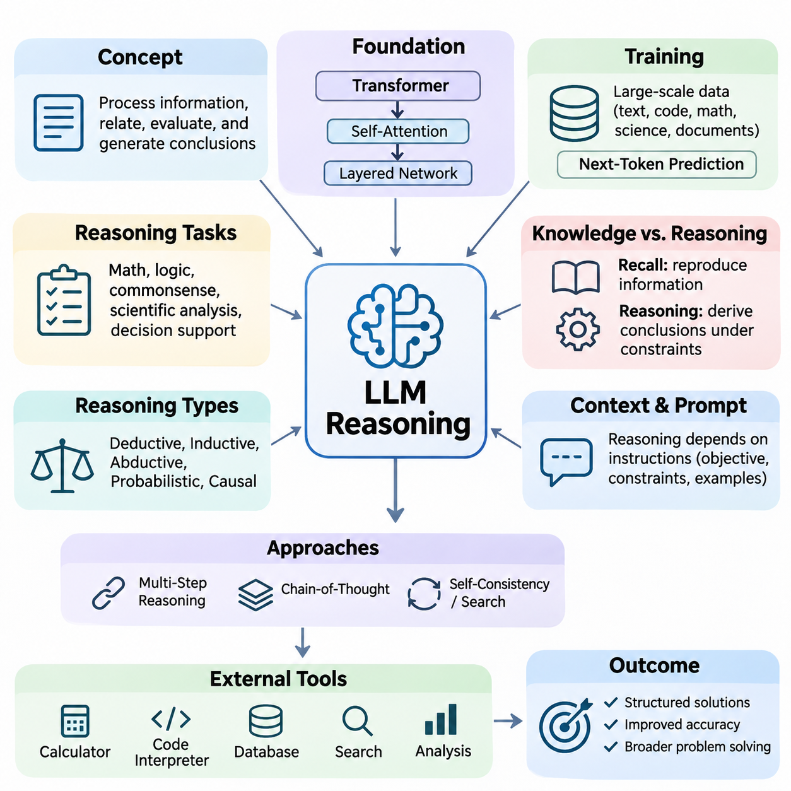
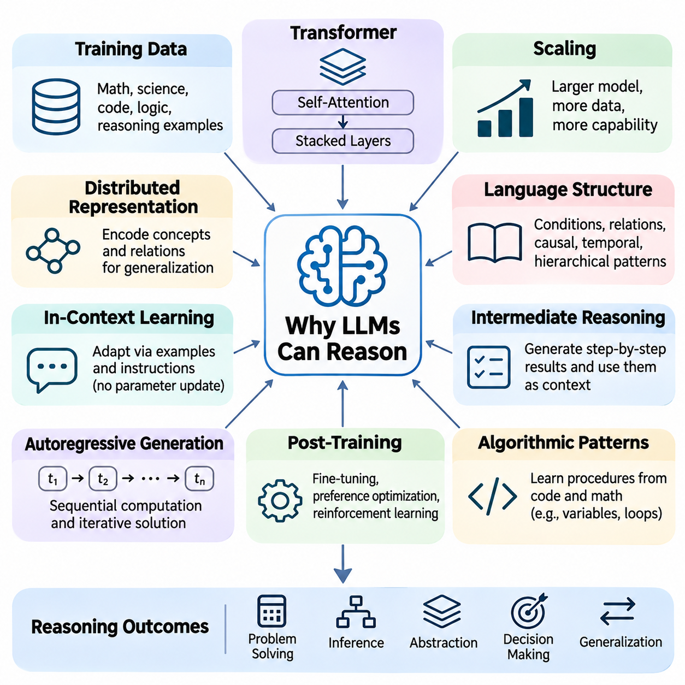
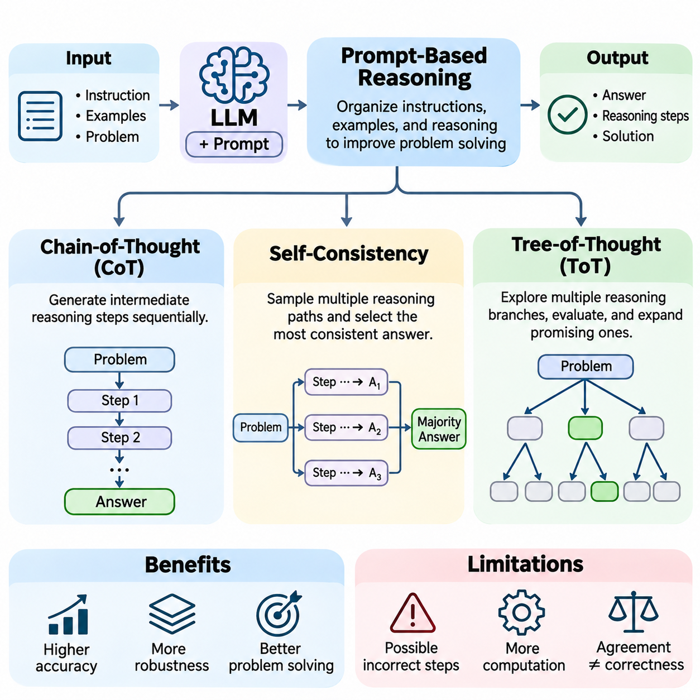
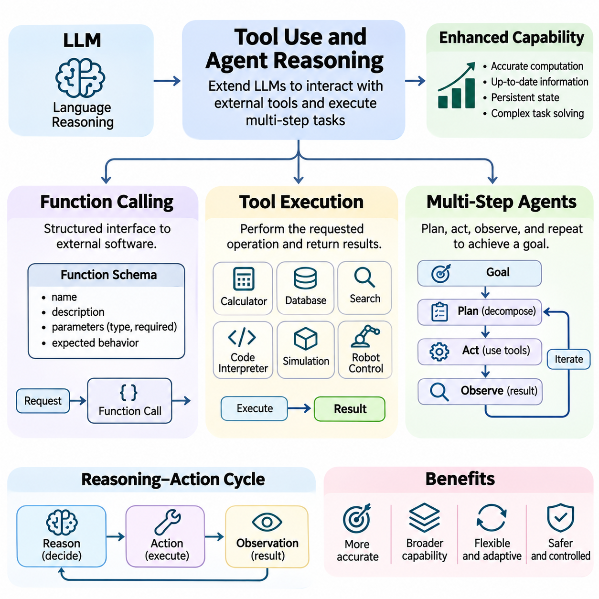
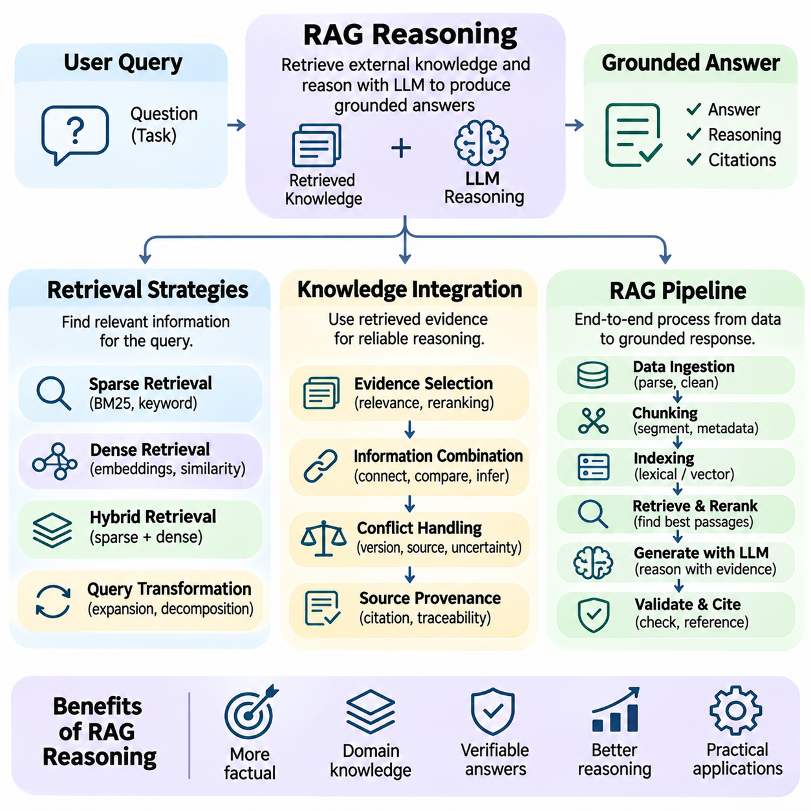
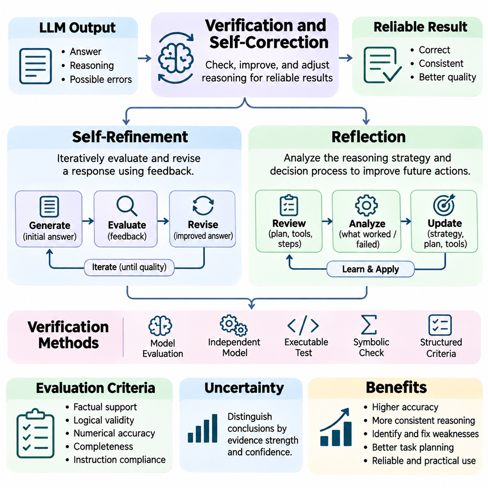
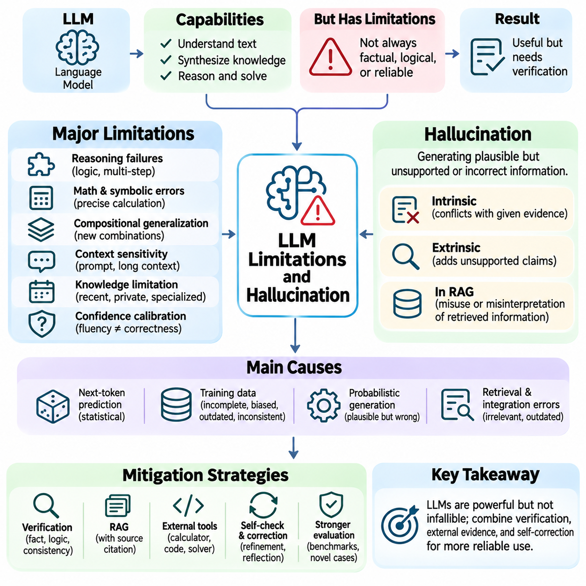
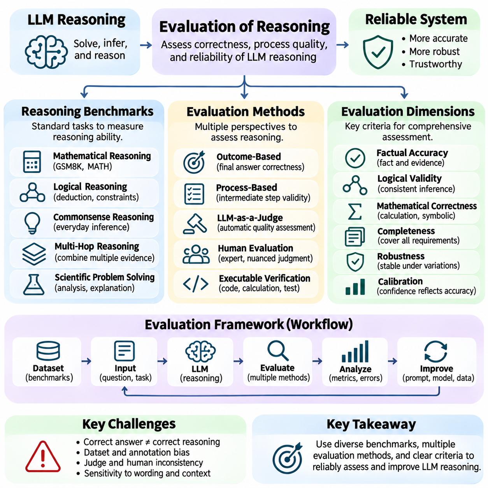
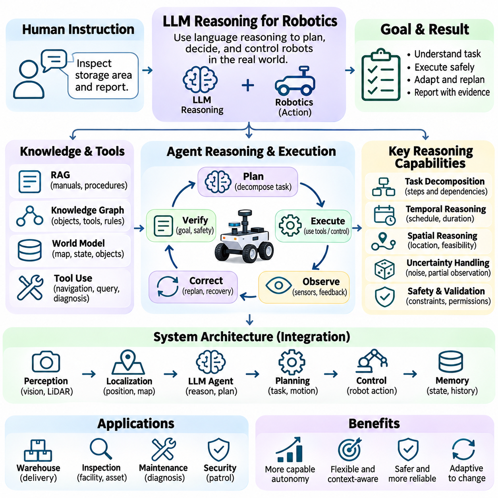
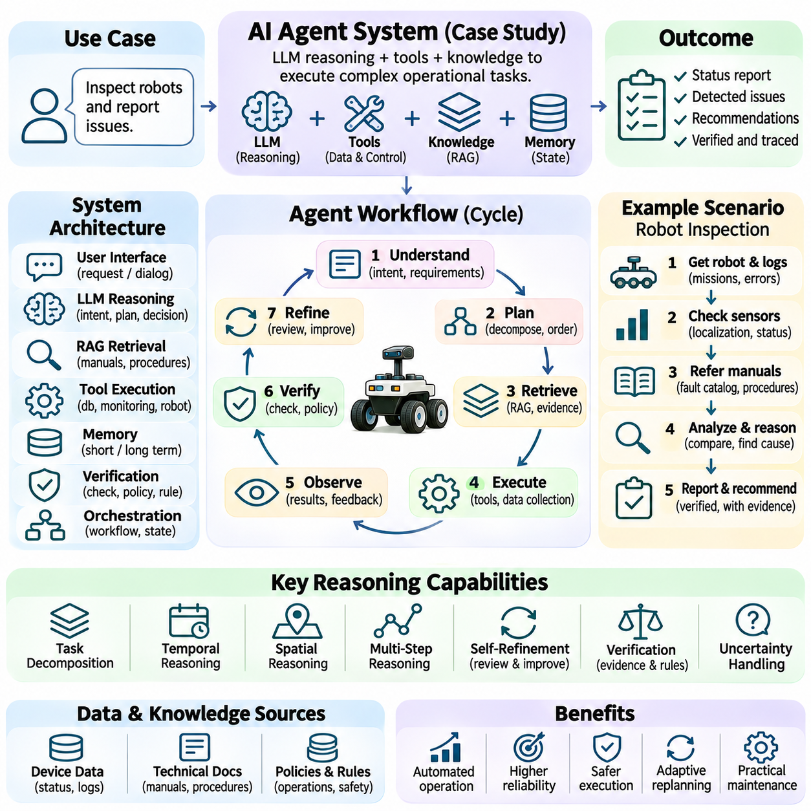

**Volume 03. Reasoning in AI**

# 05. LLM Reasoning

## 05.01 Introduction to LLM Reasoning

{width="7.268055555555556in" height="7.268055555555556in"}

Large Language Model (LLM) reasoning refers to the ability of language models to process information, establish relationships, evaluate alternatives, and generate conclusions through learned computational patterns. Unlike traditional symbolic reasoning systems that explicitly manipulate predefined logical rules, LLMs operate primarily through distributed neural representations. Their reasoning capabilities emerge from training, model architecture, contextual information, and inference-time computation.

Reasoning in LLMs extends beyond producing grammatically correct sentences or retrieving memorized information. It involves combining facts, interpreting constraints, recognizing dependencies, and solving problems that require multiple conceptual steps. Typical reasoning tasks include mathematical problem solving, logical deduction, commonsense inference, scientific analysis, and decision support. Performance varies considerably across models, tasks, and prompting conditions.

The development of LLM reasoning represents an important transition from conventional language processing toward more general computational problem solving. Earlier language models primarily emphasized statistical relationships between words and sequences. Modern transformer-based systems can represent complex contextual dependencies and generate structured solutions. Nevertheless, successful performance does not necessarily imply that a model possesses explicit symbolic rules or human-like understanding.

The transformer architecture provides an important foundation for LLM reasoning through self-attention mechanisms and layered neural transformations. Attention enables information from different positions within a context to influence token representations, while feedforward networks transform these representations into increasingly useful features. Multiple layers allow models to combine linguistic, semantic, and relational information, although the exact mechanisms underlying reasoning remain an active research topic.

Pretraining exposes language models to extensive collections of text, code, mathematical expressions, scientific explanations, and structured documents. Through next-token prediction, models learn statistical regularities that can support inference, analogy, abstraction, and procedural problem solving. Training data containing explanations and worked examples can strengthen these capabilities, but exposure to reasoning patterns does not guarantee their reliable application to unfamiliar situations.

A fundamental distinction exists between knowledge recall and reasoning. Knowledge recall involves reproducing or reconstructing information associated with training examples, whereas reasoning requires applying available information to derive conclusions under particular constraints. For example, recalling a mathematical formula differs from selecting the appropriate formula, identifying relevant variables, and applying it correctly. Practical LLM systems frequently combine both capabilities within the same response.

LLM reasoning can be examined through several complementary categories, including deductive, inductive, abductive, probabilistic, and causal reasoning. Deductive reasoning derives conclusions from premises, while inductive reasoning identifies general patterns from observations. Abductive reasoning proposes plausible explanations, and probabilistic reasoning evaluates uncertainty. Causal reasoning examines interventions and dependencies, although language models may confuse causal relationships with statistical associations.

One distinctive characteristic of LLM reasoning is its dependence on contextual instructions. The same model may produce substantially different solutions depending on how a problem is formulated, which examples are supplied, and whether intermediate analysis is encouraged. Prompt design therefore influences the effective reasoning behavior of a model. Clear objectives, explicit constraints, relevant evidence, and well-defined output requirements can improve consistency without changing the underlying model parameters.

Multi-step reasoning requires a model to maintain relationships between intermediate conclusions while progressing toward a final answer. Complex mathematical questions, planning problems, and technical diagnoses often contain dependencies that cannot be resolved through a single isolated inference. Intermediate representations can help organize these dependencies and identify missing assumptions. However, longer generated explanations do not automatically indicate deeper reasoning or greater correctness.

Chain-of-Thought prompting is a widely studied approach for encouraging intermediate problem-solving steps before producing a conclusion. By presenting examples of structured reasoning or requesting an organized solution, this technique can improve performance on certain complex tasks. Its effectiveness depends on the model and problem domain. Furthermore, generated reasoning explanations should not automatically be interpreted as faithful descriptions of the model\'s internal computational processes.

Reasoning reliability can sometimes be improved by exploring multiple candidate solutions rather than relying on a single generation. Self-consistency methods compare answers obtained through different reasoning samples, while search-based approaches evaluate alternative intermediate states. These strategies introduce additional inference-time computation and may reduce some errors. However, multiple generations can share systematic misconceptions, meaning agreement alone cannot establish factual correctness.

External tools provide another important dimension of LLM reasoning. A language model can coordinate calculators, code interpreters, databases, search systems, and specialized analytical services to perform operations that are difficult to execute reliably through text generation alone. Tool-assisted reasoning separates natural-language interpretation from executable computation. The model formulates operations, receives external results, and integrates those results into subsequent decisions.

Retrieval-Augmented Generation (RAG) extends reasoning by supplying relevant information from external knowledge sources. Instead of depending exclusively on information encoded in model parameters, a retrieval system identifies documents, records, or structured knowledge related to the current question. The LLM then interprets this evidence and constructs a response. Reliable reasoning requires evaluating source relevance, resolving conflicting evidence, and distinguishing supported conclusions from unsupported assumptions.

Agent-based reasoning combines language understanding with iterative planning, tool execution, observation, and adjustment. An LLM-based agent can decompose a goal into manageable tasks, select appropriate tools, evaluate execution results, and revise subsequent actions. Such systems may support software development, information analysis, workflow automation, and robotic task coordination. Their reliability depends on execution controls, state management, verification, and clearly defined operational boundaries.

Verification and self-correction are essential because LLMs can produce fluent explanations containing incorrect assumptions or invalid conclusions. A model may identify inconsistencies by reviewing its own output, but self-evaluation is not an independent guarantee of correctness. Stronger verification incorporates executable tests, formal constraints, external evidence, or independent evaluators. Effective reasoning systems distinguish generating a plausible solution from demonstrating that the solution satisfies the required conditions.

Hallucination remains a major limitation of language-model reasoning. A model may generate nonexistent facts, unsupported citations, incorrect calculations, or logically inconsistent explanations while maintaining convincing linguistic fluency. These errors arise from multiple factors, including insufficient information, ambiguous instructions, distribution shifts, and limitations in learned representations. Confidence expressed through natural language should therefore not be treated as a calibrated probability of correctness.

Reasoning performance also depends on computational resources and inference-time constraints. Longer contexts, additional candidate solutions, external verification, and iterative search can increase computational cost and response latency. More computation may improve difficult-task performance, but improvements are not guaranteed. Practical system design must balance reasoning accuracy, latency, memory consumption, token usage, and operational cost according to application requirements.

Evaluating LLM reasoning requires more than measuring whether generated answers resemble reference text. Mathematical correctness, logical consistency, factual grounding, constraint satisfaction, and robustness under modified problem conditions provide complementary evaluation dimensions. Benchmarks should distinguish memorized patterns from generalizable problem-solving capabilities. Controlled experiments, adversarial examples, and independent verification help reveal weaknesses that conventional accuracy measurements may overlook.

LLM reasoning becomes especially challenging when applied to physical environments such as robotics and autonomous systems. Language models can interpret high-level objectives, explain operational constraints, and propose task sequences, but physical execution requires accurate perception, spatial awareness, temporal coordination, and safety verification. Integrating LLMs with symbolic planners, world models, sensor systems, and deterministic controllers helps connect abstract reasoning with grounded actions.

Hybrid reasoning architectures offer a practical direction for combining the flexibility of language models with the reliability of specialized computational methods. Symbolic logic can enforce explicit constraints, probabilistic models can represent uncertainty, causal models can examine interventions, and neural networks can process complex observations. Within such architectures, an LLM may coordinate reasoning components while external modules provide verifiable computations and domain-specific capabilities.

The central objective of LLM reasoning research is not merely to generate longer explanations, but to develop systems capable of producing accurate, adaptable, grounded, and verifiable conclusions. Progress depends on improvements in training, inference strategies, tool integration, evaluation, and system architecture. Understanding both the capabilities and limitations of language-model reasoning provides the foundation for designing dependable AI agents and increasingly sophisticated intelligent systems.

## 05.02 Why LLMs Can Reason

{width="7.268055555555556in" height="7.268055555555556in"}

Large Language Models (LLMs) can perform reasoning tasks because their neural architectures learn complex statistical structures, semantic relationships, and computational patterns from extensive training data. Although their primary training objective often involves predicting the next token, successful prediction across diverse contexts requires representations that capture meaningful dependencies. These representations can support inference, abstraction, and problem solving beyond simple memorization.

The transformer architecture plays a central role in developing reasoning capabilities. Self-attention mechanisms allow information from different positions within a sequence to interact dynamically, enabling models to connect premises, identify relevant evidence, and maintain contextual relationships. Stacked transformer layers progressively transform token representations, supporting increasingly complex information processing without explicitly implementing traditional symbolic reasoning algorithms.

During pretraining, LLMs encounter mathematical explanations, scientific arguments, programming examples, logical statements, and natural-language discussions. These materials contain recurring patterns of inference and structured problem solving. By learning to predict sequences containing such patterns, models acquire representations that can support reasoning behavior. However, exposure to reasoning examples does not guarantee that learned procedures will generalize reliably to unfamiliar problems.

Scale contributes significantly to the emergence and improvement of reasoning performance. Increasing model capacity, training data diversity, and computational resources can enable more sophisticated representations and stronger generalization. Certain capabilities become substantially more observable as models improve, although apparent emergence may depend on evaluation thresholds. Scaling alone does not ensure logical consistency, factual accuracy, or robust reasoning across every domain.

Distributed representations allow LLMs to encode concepts and relationships across many neural activations rather than storing knowledge exclusively as isolated symbolic facts. Related concepts may occupy structured regions of representation space, enabling models to combine information through learned transformations. This organization supports semantic generalization, analogy, and contextual interpretation, although the precise relationship between internal representations and explicit reasoning remains under investigation.

Reasoning also benefits from the compositional structure of language. Natural language expresses conditions, comparisons, temporal sequences, causal relationships, and hierarchical dependencies. Learning these structures provides models with patterns that can be recombined when addressing new tasks. For example, understanding conditional expressions can support reasoning about hypothetical situations, while recognizing relational language helps connect entities and properties across multiple statements.

In-context learning enables LLMs to adapt their behavior using information supplied within a prompt without updating their parameters. Examples, instructions, and contextual demonstrations can guide a model toward particular reasoning procedures. This capability allows the same underlying network to perform mathematical analysis, logical classification, or structured decision making. Its effectiveness depends on example quality, task complexity, context organization, and the model\'s learned capabilities.

Intermediate reasoning representations provide another explanation for strong performance on complex tasks. When models generate structured steps, they can externalize partial results and use those results as context for subsequent computation. This process effectively creates a temporary textual workspace. Such representations may reduce the difficulty of solving a complex problem in one step, although generated intermediate statements can contain errors that propagate through later conclusions.

The autoregressive generation process enables sequential computation through repeated token prediction. Each newly generated token becomes part of the context for subsequent predictions, allowing a model to construct and revise an extended solution. This mechanism supports iterative calculations, conditional analysis, and multi-stage explanations. Nevertheless, autoregressive generation does not inherently enforce logical validity, and additional text generation may sometimes reinforce incorrect assumptions.

Training objectives beyond pretraining can strengthen reasoning behavior. Supervised fine-tuning exposes models to examples of desirable solutions, while preference optimization can encourage responses that satisfy task requirements. Reinforcement learning using verifiable outcomes may improve performance on mathematical, coding, and other objectively evaluated problems. These methods influence which reasoning behaviors are reinforced, but their effectiveness depends on reward quality and training design.

Reasoning capabilities can also arise from learning algorithmic patterns embedded in programming languages and mathematical notation. Code provides explicit examples of variables, control flow, recursion, conditional execution, and structured procedures. Mathematical documents demonstrate symbolic transformations and relationships between expressions. Exposure to these representations may help models develop transferable computational strategies, although generating plausible code or equations does not guarantee correct execution.

Attention mechanisms support selective integration of information relevant to a particular inference. A model solving a logical problem may need to connect an initial condition with a later constraint while disregarding unrelated statements. Attention can facilitate these interactions across token positions. However, attention weights alone do not fully explain reasoning, because information processing also depends on feedforward transformations, residual connections, learned representations, and interactions across layers.

Abstraction is another important component of LLM reasoning. Models can sometimes recognize underlying relationships shared by problems with different surface descriptions. A scheduling problem, resource allocation task, and mathematical constraint problem may contain similar dependency structures. Learning transferable patterns allows a model to apply familiar solution strategies in new contexts, although performance often deteriorates when problems differ substantially from training distributions.

LLMs can exhibit forms of relational reasoning by representing connections among entities, attributes, and events. Questions involving family relationships, organizational hierarchies, spatial arrangements, or temporal ordering require combining multiple relational statements. Transformer-based representations can support such combinations through contextual information processing. However, accuracy may decline as relational depth increases or when tasks require strict consistency across many constraints.

The interaction between memorization and generalization is essential for understanding why LLMs can reason. Memorized examples provide useful patterns, while generalization allows those patterns to be adapted to unfamiliar inputs. These mechanisms are not completely independent, because learned representations may combine specific knowledge with reusable procedures. Evaluating reasoning therefore requires distinguishing genuine transfer from performance driven by familiar examples or benchmark contamination.

Inference-time computation can further improve reasoning capabilities by allocating additional resources to difficult problems. Generating alternative solutions, evaluating intermediate states, or performing structured searches can expand the effective problem-solving process. Some systems also use specialized reasoning training to improve the usefulness of additional computation. However, increased computational effort does not guarantee improvement, particularly when candidate solutions share incorrect assumptions.

External tools extend reasoning beyond the model\'s internal neural computations. Calculators provide exact arithmetic, code execution supports algorithmic verification, and retrieval systems supply information unavailable in the immediate context. By selecting tools and incorporating their outputs, an LLM can coordinate a broader reasoning workflow. This does not mean the model independently performs every computation; rather, its reasoning capability includes organizing and interpreting specialized operations.

Despite these capabilities, LLM reasoning differs from formal logical inference. Traditional theorem provers operate under explicit rules that preserve validity when correctly implemented, whereas language models generate outputs through learned probability distributions. Consequently, LLMs may produce convincing but invalid arguments, overlook constraints, or contradict earlier conclusions. Reliable applications often combine neural reasoning with symbolic verification, executable tests, or external evidence.

The ability of LLMs to reason should therefore be understood as an empirical computational capability rather than proof of human-like cognition. Their performance emerges from interactions among architecture, learned representations, training objectives, contextual adaptation, and inference strategies. Understanding these mechanisms explains both their impressive problem-solving abilities and their persistent limitations, providing a foundation for developing more reliable reasoning-oriented AI systems.

## 05.03 Prompt Based Reasoning

{width="7.268055555555556in" height="7.268055555555556in"}

Prompt-based reasoning is a technique that improves the problem-solving capabilities of Large Language Models (LLMs) by organizing instructions, examples, and intermediate reasoning processes within the input context. Rather than modifying model parameters, it guides how existing capabilities are applied during inference. Major approaches include Chain-of-Thought, Self-Consistency, and Tree-of-Thought, which differ in how they construct, explore, and evaluate candidate solutions.

Chain-of-Thought (CoT) prompting encourages language models to generate intermediate reasoning steps before producing a final answer. Instead of directly mapping a question to a conclusion, the model decomposes a problem into smaller operations and expresses their relationships. This approach can improve performance on mathematical reasoning, symbolic manipulation, and multi-step logical tasks, particularly when intermediate calculations or dependencies are important.

The effectiveness of Chain-of-Thought depends on the model\'s underlying capabilities and the structure of the prompt. Few-shot CoT provides demonstrations containing problems and worked solutions, while zero-shot approaches use instructions encouraging structured problem solving. Larger or reasoning-trained models may benefit from such techniques, but explicit reasoning prompts do not consistently improve every model. Generated explanations can also appear coherent while containing incorrect intermediate conclusions.

A typical Chain-of-Thought workflow begins with interpreting the problem, identifying relevant information, and determining the required operations. The model then generates intermediate statements that connect assumptions with subsequent conclusions. These statements become part of the context for later token predictions, creating a temporary computational workspace. The final answer is produced from the accumulated context, although earlier mistakes may propagate throughout the sequence.

Chain-of-Thought can be applied to arithmetic word problems, logical puzzles, scientific questions, and structured decision-making tasks. For example, a resource allocation problem may require identifying available capacity, evaluating constraints, and calculating feasible assignments. Expressing intermediate results can make the solution easier to inspect and verify. However, textual reasoning traces should not automatically be interpreted as faithful records of the model\'s internal computations.

One limitation of conventional Chain-of-Thought is its reliance on a single generated reasoning trajectory. If an early assumption is incorrect, subsequent steps may reinforce the error rather than recover from it. Language models may also produce plausible explanations for incorrect answers. These weaknesses motivate approaches that generate multiple reasoning candidates, compare their conclusions, and incorporate independent verification when correctness is essential.

Self-Consistency extends Chain-of-Thought by sampling multiple reasoning trajectories for the same problem and aggregating their final answers. Instead of selecting only the first generated solution, the system explores alternative sequences that may use different intermediate operations. The underlying assumption is that correct answers may recur across diverse valid reasoning paths, while some incorrect conclusions may be less consistent across samples.

A Self-Consistency workflow typically generates several candidate solutions using stochastic decoding strategies such as temperature-based sampling. Each trajectory produces an answer that is extracted and normalized into a comparable representation. The system then selects the most frequently occurring answer or applies a suitable aggregation rule. This approach is particularly useful for tasks with clearly defined outputs, including arithmetic questions and certain logical reasoning problems.

The effectiveness of Self-Consistency depends on the diversity and quality of generated reasoning paths. If sampling produces nearly identical trajectories, additional computation may provide little benefit. Conversely, excessive randomness can generate irrelevant or invalid solutions. Sampling parameters, candidate count, answer normalization, and aggregation strategies must therefore be selected according to the problem characteristics and available computational resources.

Self-Consistency introduces an important distinction between agreement and correctness. Multiple generated solutions may converge on the same incorrect answer because they share training biases, misleading assumptions, or systematic reasoning failures. Majority voting is therefore not equivalent to formal verification. For high-stakes applications, consensus should be supplemented with executable calculations, constraint checking, independent evidence, or specialized validation mechanisms.

Compared with a single Chain-of-Thought trajectory, Self-Consistency increases inference-time computation because the model must generate multiple candidate solutions. This additional cost can improve accuracy on suitable tasks, but benefits vary across models and benchmarks. Parallel generation can reduce elapsed time when sufficient hardware resources are available. Practical implementations must balance candidate diversity, accuracy improvement, latency, and token consumption.

Tree-of-Thought (ToT) generalizes sequential reasoning by organizing candidate reasoning states into a branching search structure. Instead of following one linear sequence, the model proposes multiple possible next steps and evaluates their potential usefulness. Promising branches can be expanded, while less suitable alternatives may be abandoned. This structure connects language-model generation with classical search and planning techniques.

In Tree-of-Thought reasoning, each node represents a partial problem-solving state, and each branch represents a possible continuation or decision. The system generates candidate thoughts, evaluates their quality, and selects which states should receive further exploration. A thought may represent a calculation, hypothesis, planning action, or intermediate conclusion. The representation depends on the task and does not necessarily correspond to an individual token or sentence.

Tree-of-Thought can employ search strategies such as breadth-first search, depth-first search, or heuristic-guided exploration. Breadth-first search examines multiple candidates at similar depths, while depth-first search follows a selected branch before exploring alternatives. Heuristic evaluation estimates whether a partial solution is promising. These mechanisms allow the system to reconsider earlier decisions and explore alternative paths when an initial strategy becomes unproductive.

Evaluation is a critical component of Tree-of-Thought because generating many branches without reliable selection can waste computation. Candidate states may be scored by the language model, assessed through external constraints, or tested using executable tools. Model-based evaluations are flexible but may reproduce the generator\'s mistakes. External validators can improve reliability when the task provides objective criteria for correctness or feasibility.

Tree-of-Thought is particularly relevant to problems requiring planning, combinatorial exploration, and strategic decision making. Examples include constrained scheduling, mathematical puzzles, multi-stage resource allocation, and complex task decomposition. Unlike conventional Chain-of-Thought, it can preserve alternative hypotheses and revisit earlier decisions. Nevertheless, its effectiveness depends on search-space design, evaluation quality, branching factors, and computational budgets.

The three approaches represent different levels of reasoning exploration. Chain-of-Thought develops one structured trajectory, Self-Consistency compares multiple independently generated trajectories, and Tree-of-Thought explicitly searches through interconnected partial solutions. Their differences concern not only output formatting but also how inference-time computation is allocated. Selecting an approach requires understanding whether a problem benefits most from decomposition, repeated sampling, or systematic exploration.

Prompt-based reasoning can also be combined with retrieval systems, symbolic solvers, and external tools. Retrieved documents provide supporting evidence, while calculators and executable programs verify intermediate results. Constraint solvers can eliminate invalid branches, and domain-specific evaluators can assess candidate solutions. Such integrations transform prompting techniques into components of broader reasoning architectures rather than relying exclusively on generated natural-language explanations.

Reliable implementation requires careful evaluation of answer accuracy, reasoning robustness, computational efficiency, and failure modes. Experiments should compare direct answering with Chain-of-Thought, Self-Consistency, and Tree-of-Thought under consistent conditions. Evaluation should account for sampling variation, prompt sensitivity, token budgets, and verification procedures. Benchmark results should also be tested against unfamiliar problems to distinguish generalization from memorized reasoning patterns.

Prompt-based reasoning demonstrates how inference strategies can substantially influence the effective capabilities of language models without changing their underlying parameters. Chain-of-Thought supports structured decomposition, Self-Consistency introduces answer aggregation across multiple trajectories, and Tree-of-Thought enables deliberate exploration of alternative states. Together, these methods provide foundations for more capable reasoning systems, especially when combined with external verification and computational tools.

## 05.04 Tool Use and Agent Reasoning

{width="7.268055555555556in" height="7.268055555555556in"}

Tool use and agent reasoning extend Large Language Models (LLMs) beyond text generation by enabling interaction with external computational systems, information sources, and operational environments. Instead of relying exclusively on internal model knowledge, an LLM can select tools, formulate requests, interpret results, and coordinate subsequent actions. This capability supports complex workflows requiring accurate computation, current information, persistent state, and multi-stage decision making.

Function calling provides a structured interface between language models and external software capabilities. A function represents an operation with a defined name, description, input parameters, and expected behavior. The model interprets a user request and generates a structured invocation matching the available function specification. An external application then validates and executes the request, separating language-based decision making from actual software execution.

Function definitions commonly use machine-readable schemas that specify parameter names, data types, required fields, and acceptable values. These schemas constrain the structure of generated requests and reduce ambiguity when transferring information between the model and external systems. However, syntactically valid arguments do not guarantee semantic correctness. Applications must independently validate parameter values, permissions, operational constraints, and execution conditions.

The function-calling process typically begins when an LLM receives a task and identifies whether external functionality is necessary. The model selects an appropriate function and constructs arguments based on the available context. The application executes the requested operation and returns a structured result. The model then interprets that result to produce an answer or determine the next action, creating a controlled interaction between natural-language reasoning and executable operations.

Tool execution transforms a model-generated request into an observable computational action. Tools may include calculators, database queries, search engines, code interpreters, file processors, simulation environments, and robotic control interfaces. Each tool provides specialized capabilities that complement language-model reasoning. Reliable execution requires clear input contracts, predictable outputs, error reporting, resource management, and appropriate security boundaries.

A fundamental distinction exists between requesting a tool operation and successfully executing it. Language models may generate plausible function calls without confirming that the underlying operation has completed. Therefore, execution frameworks must return explicit status information, including successful results, validation failures, timeouts, and operational exceptions. The model should base subsequent reasoning on observed execution outcomes rather than assuming that a requested action succeeded.

Tool outputs introduce external evidence into the reasoning process. A database query may provide factual records, a calculator may return numerical results, and a simulation engine may report predicted system behavior. The LLM incorporates these observations into its context and updates its subsequent decisions. This interaction creates a feedback mechanism in which reasoning influences tool selection, while tool results constrain and inform further reasoning.

Reliable tool integration requires careful treatment of untrusted information. Retrieved documents, web pages, database fields, and execution logs may contain misleading content or instructions unrelated to the authorized task. Systems should distinguish external data from governing instructions and prevent tool outputs from overriding security policies. Permission checks, input sanitization, output validation, and restricted execution environments reduce the risks associated with external interactions.

Multi-step agents extend individual tool calls into coordinated sequences of reasoning and action. An agent receives a goal, decomposes it into subtasks, identifies dependencies, and determines which operations should occur first. After executing an action, it evaluates the result and selects the next step. This iterative process allows an LLM-based system to address tasks that cannot be completed through a single response or isolated function invocation.

A common agent architecture follows a reasoning, action, and observation cycle. The reasoning component interprets the current state and selects an operation, the action component invokes an authorized tool, and the observation component processes the returned result. The cycle continues until the objective is achieved, an explicit stopping condition is reached, or execution cannot safely proceed. This structure connects language-model reasoning with feedback-driven computational workflows.

Task decomposition is essential for managing complex agent objectives. A broad request may involve information gathering, data transformation, computational analysis, verification, and final reporting. The agent organizes these activities into smaller operations with explicit dependencies and expected outputs. Effective decomposition reduces unnecessary tool calls and supports recovery when intermediate tasks fail, although poorly designed plans can introduce additional complexity.

Planning within multi-step agents can be static or adaptive. Static planning establishes an initial sequence of operations before execution, while adaptive planning revises subsequent actions based on observations. Adaptive approaches are useful when external conditions are uncertain or tool results cannot be predicted in advance. However, excessive replanning may increase computational cost and produce unstable behavior without appropriate constraints and termination criteria.

Agent memory and state management preserve information across successive operations. Working memory may contain recent observations, intermediate calculations, pending tasks, and execution status. Persistent storage can maintain documents, structured records, or historical outcomes when authorized by the application. Reliable state management prevents repeated operations, supports task continuation, and enables recovery from interruptions while respecting privacy and data retention requirements.

Error handling is a critical requirement for autonomous tool execution. External services may become unavailable, return malformed data, reject requests, or produce unexpected results. Agents should detect these conditions, classify failures, and determine whether retrying, selecting an alternative tool, or requesting human intervention is appropriate. Retry limits, timeout policies, and rollback mechanisms help prevent uncontrolled execution and repeated harmful operations.

Verification distinguishes successful agent execution from merely completing a sequence of tool calls. A workflow may execute without technical errors while still producing an incorrect or incomplete outcome. Agents therefore need explicit success criteria, consistency checks, and independent validation where possible. Executable tests, database constraints, numerical checks, and human approval can provide stronger evidence that the intended objective has actually been satisfied.

Multi-step agents can integrate reasoning strategies such as Chain-of-Thought, Self-Consistency, and Tree-of-Thought with external tool operations. Structured decomposition helps organize individual actions, multiple candidate plans can be compared, and search-based methods can explore alternative execution paths. External tools provide evidence for evaluating candidate decisions. However, more elaborate reasoning does not automatically improve performance and must be justified by task complexity.

Tool selection and execution scheduling influence the efficiency of agent systems. Independent operations may run concurrently, while dependent actions must follow the correct order. Systems should account for tool latency, computational cost, rate limits, and resource availability. Efficient orchestration minimizes redundant operations and prioritizes actions that provide useful information, reduce uncertainty, or advance the objective toward completion.

Human oversight becomes particularly important when agents interact with external systems that can modify data, initiate transactions, or control physical equipment. Authorization boundaries should define which actions may execute automatically and which require explicit approval. High-impact operations may need confirmation, audit logging, and emergency interruption mechanisms. These controls preserve accountability while allowing agents to automate lower-risk computational tasks.

In robotics and autonomous systems, LLM-based agents can translate high-level instructions into structured task plans and coordinate specialized control modules. A robot may receive a delivery objective, identify required navigation and manipulation operations, and monitor execution feedback. However, safety-critical motion control should remain governed by validated controllers, perception systems, and operational constraints rather than unrestricted language-model outputs.

Evaluating tool-using agents requires measuring task completion, execution correctness, tool-selection accuracy, latency, computational cost, and recovery performance. Benchmarks should include realistic failures, ambiguous instructions, incomplete information, and changing environmental conditions. Successful evaluation must examine both final outcomes and intermediate execution behavior, because an apparently correct answer may conceal unsafe or unauthorized operations.

Tool use and agent reasoning transform LLMs from isolated language generators into components of interactive computational systems. Function calling provides structured access to capabilities, tool execution produces observable results, and multi-step agents coordinate reasoning across extended workflows. Their practical effectiveness depends on reliable interfaces, state management, verification, security, and human oversight, establishing a foundation for dependable agentic AI systems.

## 05.05 RAG Reasoning

{width="7.268055555555556in" height="7.268055555555556in"}

Retrieval-Augmented Generation (RAG) reasoning extends Large Language Models (LLMs) by integrating externally retrieved knowledge into their inference processes. Instead of relying exclusively on information encoded during training, a RAG system retrieves relevant evidence and uses it to construct context-grounded responses. This approach supports knowledge-intensive reasoning, improves access to specialized information, and provides opportunities to verify generated conclusions against identifiable sources.

Retrieval strategies determine how a RAG system identifies information relevant to a user\'s question. A retrieval component transforms the query into a representation suitable for searching document collections, databases, or knowledge repositories. The effectiveness of retrieval depends on query interpretation, document organization, indexing methods, and relevance estimation. Poor retrieval can undermine subsequent reasoning even when the language model is otherwise capable.

Sparse retrieval methods identify relevant documents through lexical matching between query terms and indexed content. Traditional approaches such as BM25 evaluate term frequency, document length, and the relative importance of search terms. These methods perform well when questions contain distinctive keywords, identifiers, or technical expressions. However, lexical retrieval may overlook relevant passages that express equivalent meanings using different vocabulary.

Dense retrieval represents queries and documents as numerical embeddings within a learned vector space. Embedding models encode semantic relationships, allowing retrieval systems to identify conceptually related passages without requiring exact keyword overlap. Similarity measures such as cosine similarity or inner product support efficient candidate ranking. Dense retrieval is valuable for paraphrased questions, although embedding similarity does not guarantee factual relevance.

Hybrid retrieval combines sparse and dense approaches to improve coverage across different query types. Keyword matching preserves exact terminology, while semantic retrieval captures conceptual relationships. Results from both methods can be merged through rank fusion or weighted scoring. Hybrid strategies are especially useful in technical knowledge bases containing product identifiers, numerical specifications, domain terminology, and explanatory documents.

Query transformation can improve retrieval by reformulating ambiguous or complex questions. A system may expand terminology, generate alternative queries, or decompose a multi-part request into smaller searches. Multi-hop questions often require retrieving evidence from several documents before a conclusion becomes possible. However, query expansion must preserve the original information need, because poorly generated reformulations can introduce irrelevant assumptions.

Document preparation strongly influences retrieval quality. Source materials are commonly divided into smaller passages through chunking, with optional overlap to preserve continuity across boundaries. Each chunk may contain metadata describing its source, section, timestamp, and access permissions. Chunk size affects the balance between contextual completeness and retrieval precision. Excessively small passages lose relationships, while oversized passages introduce unnecessary information.

Reranking improves retrieval precision by evaluating candidate passages after an initial search. A cross-encoder or specialized relevance model can examine query-document relationships more closely than a fast first-stage retriever. The system then selects passages most likely to support the requested reasoning task. Reranking increases computational cost but can reduce irrelevant context and improve evidence quality when retrieval collections are large.

Knowledge integration begins when retrieved passages are incorporated into the language model\'s working context. The system must determine which facts are relevant, how different sources relate, and whether the evidence supports the requested conclusion. Effective integration requires more than copying retrieved sentences. The model must connect information, resolve references, compare conditions, and distinguish supported conclusions from unsupported assumptions.

Evidence-grounded reasoning connects intermediate inferences to retrieved information. For example, answering a technical compatibility question may require combining hardware specifications, software requirements, and interface constraints from separate documents. The model must identify dependencies and evaluate whether all necessary conditions are satisfied. This process transforms retrieval into a structured reasoning operation rather than simple document summarization.

Knowledge integration becomes more difficult when retrieved sources contain conflicting statements. Disagreement may result from different publication dates, measurement conditions, document versions, or factual errors. A reliable system should preserve source attribution and examine the context of each claim. When conflicts cannot be resolved, the response should communicate uncertainty instead of silently selecting the most convenient statement.

Source provenance provides an important foundation for trustworthy RAG reasoning. Retrieved evidence should retain identifiers, document locations, and relevant metadata so that generated claims can be traced to their origins. Citations allow users and automated evaluators to inspect supporting material. However, attaching a citation does not automatically establish correctness; the cited passage must genuinely support the corresponding claim.

A typical RAG pipeline begins with data ingestion, document parsing, cleaning, and segmentation. The system then generates search indexes, including lexical structures or vector embeddings, and stores associated metadata. During inference, the user query is processed, relevant passages are retrieved, and selected evidence is assembled into a prompt. The language model generates an answer using both the query and retrieved context.

Advanced RAG pipelines introduce iterative retrieval and reasoning. An initial search may reveal missing information, prompting the model to formulate additional queries and gather supporting evidence. The system can repeat retrieval until sufficient information is available or a predefined resource limit is reached. This approach supports multi-hop reasoning and investigative tasks, but requires safeguards against unnecessary searches and error propagation.

Context construction is a critical stage of the RAG pipeline because language models operate under finite context and attention constraints. Retrieved passages must be selected, ordered, and formatted to preserve relevant information without overwhelming the model. Context compression and redundancy removal can improve efficiency. However, aggressive compression may discard qualifiers, numerical details, or relationships essential for accurate reasoning.

RAG systems must also protect against unreliable or malicious retrieved content. External documents may contain outdated information, fabricated claims, or instructions intended to manipulate the model. Retrieved text should be treated as evidence rather than authoritative operational instructions. Access controls, document validation, prompt-injection defenses, and output verification are necessary when RAG operates across sensitive or heterogeneous information sources.

Evaluation of RAG reasoning requires examining retrieval performance and generation quality separately. Retrieval metrics may include recall, precision, and ranking effectiveness, while answer evaluation considers factual correctness, completeness, citation accuracy, and faithfulness to evidence. End-to-end testing should include questions requiring multiple sources, conflicting documents, and unavailable answers. Strong retrieval scores alone do not guarantee correct reasoning.

Computational efficiency influences practical RAG deployment. Embedding generation, vector search, reranking, and language-model inference contribute to latency and infrastructure cost. Caching frequently requested results, optimizing indexes, and selecting appropriate retrieval depths can reduce resource consumption. System design must balance response quality, freshness, scalability, and operational constraints without sacrificing evidence reliability.

RAG reasoning is particularly valuable in enterprise knowledge systems, scientific research, industrial engineering, and autonomous robotics. A robotic agent may retrieve equipment manuals, operating procedures, and environmental constraints before constructing a task plan. Nevertheless, retrieved instructions should not directly override validated safety controls. External knowledge supports high-level decisions, while critical operations require independent verification and controlled execution.

Retrieval-Augmented Generation transforms language-model reasoning into an evidence-oriented computational process. Retrieval strategies identify relevant knowledge, integration mechanisms connect evidence with inference, and the RAG pipeline coordinates information access and response generation. Its reliability depends on source quality, retrieval accuracy, contextual interpretation, verification, and uncertainty management, providing a foundation for trustworthy knowledge-intensive AI systems.

## 05.06 Verification and Self Correction

{width="7.268055555555556in" height="7.268055555555556in"}

Verification and self-correction are essential mechanisms for improving the reliability of Large Language Model (LLM) reasoning. Although language models can generate coherent explanations and complex solutions, their outputs may contain logical inconsistencies, factual inaccuracies, or computational errors. Verification evaluates whether a proposed answer satisfies defined requirements, while self-correction attempts to identify and repair weaknesses through additional reasoning or external feedback.

Verification differs from ordinary answer generation because it focuses on evaluating claims rather than producing new content. A verification process may examine logical validity, mathematical correctness, factual consistency, constraint satisfaction, and alignment with task objectives. Reliable verification requires explicit criteria and suitable evidence. Without independent checks, a model may incorrectly judge its own plausible but flawed reasoning as correct.

Self-refinement is an iterative approach in which an LLM generates an initial response, evaluates its quality, and produces an improved version. The process typically involves generation, feedback, and revision stages. Feedback may identify missing assumptions, unsupported claims, calculation mistakes, or incomplete explanations. By incorporating this information into subsequent prompts, the model attempts to improve the solution without necessarily modifying its underlying parameters.

A self-refinement workflow begins with a candidate answer and a set of evaluation criteria. The model reviews the candidate against those criteria and generates feedback describing potential problems. A revision stage then uses the original task, previous answer, and feedback to construct an updated response. This cycle may continue until predefined quality thresholds are satisfied or a maximum number of iterations is reached.

The effectiveness of self-refinement depends heavily on feedback quality. Specific feedback identifying an incorrect calculation or violated constraint is generally more actionable than vague instructions to improve an answer. External evaluators, executable tests, and retrieved evidence can provide stronger correction signals than unsupported model judgments. When feedback is inaccurate, repeated refinement may reinforce errors or introduce new inconsistencies.

Self-refinement can improve mathematical solutions, software generation, technical writing, and structured planning. In programming tasks, an agent may generate code, execute unit tests, inspect failures, and revise the implementation. In mathematical reasoning, intermediate calculations can be checked against numerical tools. These examples demonstrate how iterative revision becomes more reliable when corrections are grounded in observable results rather than stylistic preferences.

Reflection extends self-correction by examining the reasoning strategy and decision process that produced an outcome. Instead of correcting only the final answer, a reflective system considers whether its assumptions, planning choices, tool selections, or intermediate conclusions were appropriate. This broader evaluation can reveal recurring failure patterns and guide future actions, especially in multi-step agents operating under uncertain conditions.

A reflection process may occur after an unsuccessful attempt, following completion of a task, or at predefined checkpoints during execution. The agent compares observed outcomes with intended objectives and identifies discrepancies. It may then formulate lessons, revise its plan, or select alternative tools. Reflection is most useful when observations provide meaningful evidence about why an approach succeeded or failed.

Reflection and self-refinement are closely related but operate at different levels. Self-refinement primarily modifies an existing output, while reflection can modify the strategy used to generate subsequent outputs. For example, refinement may correct an arithmetic result, whereas reflection may recognize that manual calculation is unreliable and recommend using a calculator. Both mechanisms depend on accurate feedback and appropriate evaluation criteria.

Verification can be implemented through internal model evaluation, independent models, symbolic methods, or executable tools. Internal evaluation asks the generating model to inspect its own answer, while independent evaluation separates generation from assessment. Symbolic solvers can verify formal constraints, and code execution can test numerical or algorithmic claims. Each method provides different levels of assurance depending on the problem structure.

Model-based verification offers flexibility because language models can evaluate natural-language explanations and complex contextual relationships. However, a verifier may share the same biases, misconceptions, or reasoning weaknesses as the original generator. Agreement between models therefore does not establish correctness. Stronger assurance often requires combining model judgments with external evidence, deterministic checks, or formally specified constraints.

Structured verification improves consistency by decomposing evaluation into identifiable criteria. A system may separately examine factual support, logical coherence, numerical accuracy, completeness, and compliance with instructions. This approach makes failures easier to diagnose and reduces dependence on a single overall quality judgment. Nevertheless, verification criteria must be appropriate for the task, since incomplete criteria can overlook important errors.

Uncertainty estimation is another important component of reliable self-correction. A model should distinguish conclusions supported by strong evidence from those based on incomplete information or uncertain assumptions. Confidence expressions alone are insufficient because language-model confidence may be poorly calibrated. External evidence, repeated evaluation, and explicit uncertainty tracking can help determine when further verification or human review is necessary.

Iterative correction introduces computational costs and potential instability. Each refinement cycle consumes additional tokens, inference time, and possibly external tool resources. Excessive revision may cause a correct answer to become incorrect or produce oscillation between alternative solutions. Practical systems therefore require stopping criteria, iteration limits, and mechanisms for preserving verified information across successive revisions.

Reflection is particularly valuable in agent systems that interact with external environments. An autonomous agent may execute a plan, observe unexpected results, and reconsider its assumptions before proceeding. For example, a robotic task planner may discover that a planned route is blocked and revise its high-level strategy. Safety-critical decisions must still be governed by validated controllers and operational constraints rather than unrestricted reflective reasoning.

Memory can support reflection by preserving previous errors, successful strategies, and operational observations. An agent may store concise summaries of failures and use them when encountering similar tasks. Such memory can reduce repeated mistakes and improve task adaptation. However, stored reflections must be validated, updated when conditions change, and protected against contamination by inaccurate conclusions or untrusted external content.

Verification and self-correction can be integrated with Chain-of-Thought, Self-Consistency, Tree-of-Thought, and Retrieval-Augmented Generation. Intermediate reasoning steps can be checked, alternative solutions compared, search branches evaluated, and retrieved evidence used to validate factual claims. These combinations create opportunities for stronger reasoning workflows, but their effectiveness depends on the independence and reliability of verification signals.

Evaluation of self-correcting systems should measure improvement over initial answers rather than only final accuracy. Important indicators include error detection rates, successful correction rates, unnecessary revisions, computational overhead, and performance on unfamiliar tasks. Experiments should distinguish corrections supported by external feedback from revisions based solely on model-generated criticism. This distinction helps identify genuine reliability gains.

Security and accountability remain essential when self-correcting agents can execute actions. A reflective system must not interpret its own revised plan as authorization to exceed established permissions. Tool execution should remain subject to access controls, audit logging, and approval requirements. Verified task completion should be distinguished from persuasive explanations of success, particularly when operations affect external systems or physical environments.

Verification, self-refinement, and reflection provide complementary mechanisms for developing dependable LLM reasoning systems. Verification evaluates whether outputs satisfy defined requirements, self-refinement repairs identified weaknesses, and reflection improves the strategies guiding future decisions. Their combined value emerges when iterative reasoning is grounded in trustworthy evidence, measurable outcomes, and controlled execution rather than unsupported confidence in generated explanations.

## 05.07 LLM Limitations and Hallucination

{width="7.268055555555556in" height="7.268055555555556in"}

Large Language Models (LLMs) demonstrate substantial capabilities in language understanding, knowledge synthesis, and complex reasoning, but their outputs remain subject to fundamental limitations. These limitations arise from training objectives, imperfect data, probabilistic generation, and restricted access to external reality. Hallucination is among the most significant challenges, occurring when a model produces information that appears credible but is unsupported, inaccurate, or fabricated.

Hallucination refers to generated content that conflicts with established facts, supplied evidence, or the requirements of a task. A model may invent references, misrepresent numerical values, attribute statements to nonexistent sources, or describe events that never occurred. Such errors are particularly dangerous because fluent language and confident presentation can conceal factual weaknesses. Linguistic plausibility must therefore be distinguished from factual correctness.

The next-token prediction objective helps explain why hallucinations occur. During pretraining, language models learn statistical relationships between tokens rather than directly verifying every generated statement against external reality. A sequence may receive high probability because it resembles familiar explanations, even when its factual content is incorrect. Consequently, generating coherent text and producing evidence-supported conclusions are related but fundamentally different objectives.

Training data introduces additional limitations through incompleteness, inconsistency, bias, and temporal boundaries. Large datasets contain outdated information, contradictory descriptions, incorrect claims, and uneven coverage of specialized domains. Models may reproduce these weaknesses or combine incompatible information into apparently unified explanations. Increasing training volume can improve coverage but does not automatically eliminate misinformation or guarantee reliable knowledge representation.

Hallucinations can be classified according to their relationship with available evidence. Intrinsic hallucinations contradict information explicitly provided in the source material, while extrinsic hallucinations introduce claims that cannot be supported by that material. In retrieval-based applications, a response may distort retrieved facts or add unsupported details. This distinction is important because source consistency and external factual accuracy require different verification procedures.

Reasoning failures represent another important limitation of LLMs. Models may overlook logical constraints, confuse necessary and sufficient conditions, or produce invalid intermediate deductions. Multi-step problems are especially vulnerable because an early error can propagate through subsequent calculations or conclusions. Even when an explanation follows a convincing structure, its apparent logical coherence does not guarantee that each inference is valid.

Mathematical and symbolic reasoning reveal weaknesses in precise computation and systematic rule application. Language models can recognize familiar mathematical patterns but may make arithmetic mistakes, mishandle variable relationships, or incorrectly manipulate symbolic expressions. Performance often deteriorates when problems require long sequences of exact operations. Calculators, code execution, and symbolic solvers can reduce these errors when their outputs are independently checked.

LLMs also face difficulties with compositional generalization, where familiar concepts must be combined in unfamiliar configurations. A model may solve problems resembling its training examples yet fail when relationships, constraints, or presentation formats change. This behavior indicates that successful benchmark performance does not always imply mastery of general reasoning procedures. Robust evaluation must therefore include distribution shifts and novel problem structures.

Context sensitivity creates another source of instability. Small changes in prompt wording, example order, or irrelevant surrounding information may influence generated conclusions. Long contexts can introduce distraction, conflicting instructions, and difficulties retrieving relevant details. Although modern architectures support extensive input sequences, access to a large context window does not guarantee consistent utilization of every important fact.

Confidence calibration is a central challenge because linguistic certainty does not reliably indicate correctness. A model may present an incorrect answer with strong confidence or express uncertainty about a valid conclusion. Token probabilities and verbal confidence statements are imperfect indicators of factual reliability. Effective systems therefore require calibration studies, evidence-based confidence estimates, and mechanisms for recognizing when insufficient information prevents a justified answer.

Knowledge limitations become particularly important when questions involve recent events, private databases, rapidly changing specifications, or specialized technical information. A model cannot reliably reconstruct facts that were absent from its training data or unavailable in its current context. It may instead generate plausible completions based on related patterns. Retrieval-Augmented Generation and external tools can improve information access, but retrieved evidence must still be validated.

Retrieval-Augmented Generation (RAG) reduces some knowledge-related hallucinations by supplying external documents during inference. However, retrieval errors, misleading passages, outdated sources, and incorrect evidence integration can still produce unsupported answers. A model may cite a document that does not actually justify its conclusion. Reliable RAG therefore requires source attribution, relevance assessment, evidence consistency checks, and explicit handling of missing information.

Self-correction and reflection offer opportunities to identify errors, but they are not inherently reliable. When a model evaluates its own output, it may reproduce the same misconceptions that caused the original mistake. Repeated revision can improve an answer, leave it unchanged, or introduce additional errors. Stronger correction mechanisms combine model-generated feedback with independent validators, executable tests, and verifiable external evidence.

Bias and representational imbalance can affect reasoning quality across languages, cultures, and specialized domains. Training datasets may overrepresent certain perspectives, terminology, or problem types while providing limited coverage elsewhere. These imbalances can influence interpretations, recommendations, and inferred relationships. Evaluating fairness and robustness requires examining performance across diverse contexts rather than assuming that overall accuracy reflects universal reliability.

Prompt injection and misleading contextual information create security-related limitations. External documents, tool responses, or retrieved web pages may contain instructions designed to redirect model behavior away from authorized objectives. Because language models process instructions and data through related representations, separating trusted commands from untrusted content requires deliberate system design. Permission enforcement and tool isolation must not depend solely on the model\'s interpretation.

Agent-based applications amplify the consequences of hallucination because generated statements may influence tool execution and external actions. An agent might select an incorrect database record, invent an operational status, or construct a plan using nonexistent resources. These failures can propagate across multiple steps. Reliable agent systems require explicit state tracking, execution confirmation, authorization controls, and recovery procedures that distinguish assumptions from observed outcomes.

In robotics and autonomous systems, hallucinations can become physical safety risks when language-model outputs influence navigation, manipulation, or mission planning. A model may incorrectly infer that a route is accessible or that an object satisfies a manipulation constraint. Such conclusions must be checked against sensor measurements, validated world models, and safety requirements. Low-level control and emergency protection should remain independent of unrestricted language generation.

Evaluation of hallucination requires distinguishing factual accuracy, faithfulness to provided evidence, logical consistency, and appropriate uncertainty. Benchmarks should include unsupported questions, contradictory documents, unfamiliar reasoning tasks, and situations where abstention is preferable to guessing. Metrics may examine claim-level correctness, citation support, calibration, and error severity. Evaluation should also measure whether verification mechanisms reduce failures without introducing excessive computational costs.

Mitigation strategies combine improvements in training, inference, retrieval, and system architecture. High-quality datasets, targeted fine-tuning, verifiable rewards, constrained generation, tool-assisted computation, and external validation can address different failure modes. No single technique eliminates hallucination across all tasks. Effective mitigation depends on identifying the underlying cause and applying safeguards proportional to the consequences of incorrect outputs.

Understanding LLM limitations is essential for designing trustworthy reasoning systems. Hallucination, logical inconsistency, computational errors, context sensitivity, and unreliable confidence demonstrate that fluent generation is not equivalent to verified intelligence. Dependable applications must connect model outputs to evidence, enforce operational constraints, and communicate uncertainty when necessary. These principles establish the foundation for responsible deployment of LLM reasoning in scientific, industrial, and autonomous environments.

## 05.08 Evaluation of Reasoning

{width="7.268055555555556in" height="7.268055555555556in"}

Evaluation of reasoning examines whether an artificial intelligence system can produce correct conclusions through reliable inference rather than merely generate plausible answers. For Large Language Models (LLMs), evaluation must consider logical validity, factual accuracy, mathematical correctness, and the ability to solve unfamiliar problems. A comprehensive framework distinguishes final-answer performance from the quality of intermediate reasoning and the reliability of the overall decision process.

Reasoning evaluation is challenging because a correct answer does not necessarily imply a correct reasoning process. A model may reach the expected result through memorization, guessing, or an invalid sequence of deductions. Conversely, a largely valid solution may contain a minor computational error that changes its final answer. Evaluation should therefore examine outcome correctness and process quality separately whenever intermediate reasoning is available and meaningful.

Benchmark datasets provide standardized environments for comparing reasoning capabilities across models and configurations. They typically contain questions, reference answers, and evaluation procedures designed to measure specific skills. Common categories include mathematical reasoning, logical deduction, commonsense reasoning, scientific problem solving, and multi-step question answering. However, benchmark scores depend on dataset composition, difficulty, and scoring methodology.

Mathematical reasoning benchmarks assess numerical computation, algebraic manipulation, symbolic relationships, and multi-step problem solving. Datasets such as GSM8K emphasize grade-school mathematical word problems, while MATH includes more demanding mathematical questions. Exact-answer evaluation is often straightforward, but it may overlook differences in solution quality. Symbolic equivalence checks and executable verification can improve assessment when multiple valid expressions exist.

Logical reasoning evaluation focuses on whether models correctly apply inference rules and maintain consistency across propositions. Tasks may involve deductive reasoning, conditional statements, quantified expressions, and constraint satisfaction. Synthetic problems can isolate particular reasoning operations and systematically vary complexity. Such evaluations help reveal whether models follow logical structure or rely on superficial linguistic patterns.

Commonsense reasoning benchmarks investigate the ability to infer everyday relationships, intentions, and consequences from incomplete descriptions. Models must combine background knowledge with contextual interpretation to select plausible conclusions. However, commonsense datasets can contain linguistic shortcuts and annotation biases. Strong performance may therefore reflect familiarity with dataset patterns rather than robust understanding of real-world situations.

Multi-hop reasoning evaluation measures the ability to combine information distributed across several statements, documents, or evidence sources. A question may require identifying an entity, retrieving an associated property, and using that property to infer a final answer. Evaluation should examine whether all necessary evidence was retrieved and correctly integrated. Final-answer accuracy alone cannot determine whether intermediate dependencies were handled correctly.

Process-based evaluation assesses the validity of intermediate reasoning steps instead of judging only the final response. A verifier may inspect whether each deduction follows from previous premises, whether calculations are accurate, and whether assumptions are explicitly justified. Step-level supervision can identify the point at which an error occurs. Nevertheless, natural-language reasoning traces are imperfect evidence of the internal computations that produced an answer.

Outcome-based evaluation measures whether a generated solution satisfies an externally defined success criterion. Exact matching, numerical tolerance, executable tests, and environment-based success signals are common approaches. These methods can provide objective feedback when answers are verifiable. However, outcome scores may fail to distinguish efficient reasoning from accidental success or identify unsafe intermediate actions.

LLM-as-a-judge evaluation uses another language model to assess correctness, coherence, completeness, or reasoning quality. This approach is flexible for open-ended responses where deterministic scoring is difficult. Yet model judges may exhibit position bias, verbosity preference, and shared misconceptions with evaluated systems. Human calibration, independent evidence, and structured rubrics are necessary to reduce unreliable judgments.

Human evaluation remains important for complex reasoning tasks involving ambiguous objectives, nuanced explanations, or domain-specific expertise. Expert reviewers can assess assumptions, evidence quality, and the appropriateness of conclusions. However, human judgments may vary because of expertise differences, subjective interpretations, and evaluation fatigue. Clear rubrics, reviewer agreement analysis, and representative sampling improve consistency.

Robustness evaluation investigates whether reasoning performance remains stable under changes that should not alter the correct answer. Tests may modify wording, reorder premises, introduce irrelevant information, or replace familiar entities with unfamiliar identifiers. Significant performance variation indicates sensitivity to surface features. Counterfactual variations and distribution-shift testing help distinguish transferable reasoning skills from pattern recognition.

Calibration evaluation measures whether expressed confidence corresponds to observed correctness. A well-calibrated system should assign higher confidence to answers that are more likely to be correct. Metrics such as expected calibration error and Brier score can quantify discrepancies between confidence estimates and outcomes. Selective prediction additionally evaluates whether abstaining on uncertain questions improves reliability.

Hallucination evaluation examines unsupported claims, fabricated evidence, and contradictions between generated answers and available sources. In retrieval-augmented systems, assessment should distinguish retrieval relevance, evidence faithfulness, citation accuracy, and factual correctness. Claim-level verification provides finer detail than whole-answer scoring. Evaluation must also include questions for which sufficient evidence is unavailable.

Tool-assisted reasoning introduces additional evaluation dimensions because success depends on both inference and external execution. A system may choose an appropriate tool but provide incorrect arguments, misinterpret returned data, or fail to verify execution results. Evaluation should measure tool selection, argument correctness, execution success, state tracking, and recovery from errors. Recorded tool traces enable more precise diagnosis of failures.

Agent reasoning requires evaluating complete sequences of decisions rather than isolated answers. Planning quality, task completion, resource consumption, adaptability, and compliance with operational constraints all influence performance. Interactive environments can reveal failures that static question-answer benchmarks overlook. Repeated trials are important because stochastic actions and environmental variation may produce different outcomes.

Efficiency is an essential component of practical reasoning evaluation. Additional reasoning tokens, repeated sampling, retrieval operations, and verification steps can improve accuracy while increasing latency and computational cost. Evaluation should report performance alongside inference time, token consumption, energy use, and tool expenses. Accuracy-cost tradeoffs help determine whether more elaborate reasoning strategies provide meaningful operational benefits.

Benchmark contamination threatens evaluation validity when test questions or closely related solutions appear in training data. Memorized answers can inflate scores without demonstrating general reasoning ability. Mitigation approaches include private test sets, newly generated problems, controlled perturbations, and contamination analysis. Evaluation should also examine whether performance generalizes to genuinely novel tasks rather than familiar benchmark formats.

Reasoning evaluation in robotics and autonomous systems must account for physical constraints, uncertainty, and safety. A planning model may generate a logically plausible mission sequence that violates battery limits, collision constraints, or actuator capabilities. Simulation-based testing can examine feasibility before deployment, while hardware validation measures real-world performance. Safety violations must be assessed independently from task completion.

A reliable reasoning evaluation framework combines diverse benchmarks, process verification, outcome testing, robustness analysis, and operational measurements. No single metric can capture logical competence, factual grounding, adaptability, and safety simultaneously. Evaluation results should identify both strengths and failure modes under clearly defined conditions. This multidimensional approach provides a foundation for comparing LLM reasoning systems and improving their trustworthiness in practical applications.

## 05.09 LLM Reasoning for Robotics

{width="7.268055555555556in" height="7.268055555555556in"}

Large Language Model (LLM) reasoning extends robotic intelligence by enabling machines to interpret natural-language instructions, organize complex tasks, and make context-dependent decisions. Traditional robotic systems rely on explicitly programmed behaviors, geometric planning, and specialized control algorithms. LLMs introduce semantic reasoning that connects human intentions with robotic capabilities. However, reliable deployment requires integrating language-based decisions with perception, physical constraints, and validated control systems.

Robotic reasoning begins with understanding the relationship between language and the physical environment. A command such as inspecting a storage area requires identifying relevant locations, interpreting inspection objectives, and determining available robot capabilities. The LLM converts abstract instructions into structured task representations. These representations must connect linguistic concepts to observable entities, executable actions, and measurable completion conditions.

Task decomposition allows an LLM to transform high-level objectives into manageable robotic operations. A warehouse delivery request may require locating an item, navigating to a pickup station, confirming payload availability, transporting the object, and verifying delivery. Each operation introduces dependencies and preconditions. Effective reasoning must preserve execution order while allowing the robot to revise its plan when environmental conditions change.

Hierarchical planning separates strategic reasoning from motion-level execution. The LLM may select objectives, determine task sequences, and choose appropriate tools, while conventional planners compute trajectories and control commands. This separation reduces the risk of translating uncertain language predictions directly into physical actions. High-level plans must be validated against robot capabilities, operational policies, and current environmental conditions.

Grounding connects language-model reasoning to sensor observations and physical representations. Cameras, LiDAR, depth sensors, and localization systems provide information about objects, obstacles, and spatial relationships. Perception modules convert these measurements into structured environmental descriptions. The LLM can then reason about observed conditions, but its conclusions must remain consistent with sensor confidence, coordinate frames, and measurement uncertainty.

World models provide persistent representations of the environment for reasoning and planning. They may combine semantic maps, geometric occupancy information, object relationships, and temporal state changes. An LLM can query these representations to understand where objects are located and which actions are feasible. However, the world model must distinguish confirmed observations from predictions and outdated information to prevent incorrect decisions.

Knowledge graphs can support robotic reasoning by representing relationships among objects, locations, equipment, procedures, and operational constraints. A graph may describe which charging station serves a particular robot or which tools are required for an inspection. The LLM can use these relationships to construct context-aware plans. Graph-based reasoning becomes especially useful when tasks require combining spatial, functional, and organizational knowledge.

Tool use enables LLMs to interact with robotic software through controlled interfaces. Functions may provide navigation goals, map queries, inventory checks, mission scheduling, or diagnostic information. The model selects an appropriate function and generates structured arguments, while an execution layer validates permissions and parameters. Returned results update the reasoning context, allowing subsequent decisions to reflect actual system responses.

Multi-step robotic agents operate through repeated cycles of planning, execution, observation, and correction. After issuing an action, the agent examines execution feedback and determines whether the intended state was achieved. Unexpected obstacles, unavailable resources, or failed manipulations may trigger replanning. Reliable operation requires explicit state tracking and bounded recovery strategies rather than assuming that every commanded action succeeds.

Retrieval-Augmented Generation (RAG) allows robotic agents to access equipment manuals, maintenance procedures, mission policies, and technical specifications. Retrieved documents provide task-specific knowledge that may not be contained in model parameters. For example, an inspection robot can consult a procedure before selecting measurement steps. Retrieved instructions must be checked for validity, applicability, and authorization before influencing execution.

Uncertainty management is essential because robotic environments are partially observable and continuously changing. Sensor measurements may be noisy, objects may move, and localization estimates may drift. An LLM should distinguish verified observations from uncertain interpretations and request additional measurements when necessary. Confidence thresholds, explicit preconditions, and conservative fallback behaviors help prevent uncertain reasoning from producing unsafe actions.

Temporal reasoning enables robots to account for action duration, task deadlines, resource availability, and changing environmental conditions. A mission planner may need to schedule inspections before battery depletion or coordinate charging with operational demand. Temporal constraints must be represented explicitly rather than inferred solely from conversational descriptions. Scheduling algorithms and execution monitors can verify whether proposed plans remain feasible.

Spatial reasoning connects semantic objectives with geometric feasibility. An LLM may understand that a robot must reach a destination, but navigation requires accurate maps, collision checking, and kinematic constraints. Spatial relationships expressed in language must be translated into coordinate-based representations. Dedicated motion planners should determine executable trajectories while the language model manages task intent and high-level alternatives.

Multi-robot coordination introduces reasoning about shared resources, task allocation, and communication. A fleet-level agent may assign inspection missions to robots according to location, battery state, payload capability, and availability. Coordination must consider conflicting routes and resource contention. Optimization algorithms and fleet management systems should enforce operational constraints while LLM reasoning supports mission interpretation and exception handling.

Human-robot interaction benefits from the ability of LLMs to interpret flexible instructions and explain operational decisions. Users may describe goals without specifying every execution detail, allowing the robot to ask clarifying questions when necessary. Explanations can communicate planned actions, detected obstacles, and reasons for task failure. Nevertheless, conversational explanations must accurately reflect execution logs and observed system states.

Safety architecture must separate language-based reasoning from safety-critical control. LLM-generated plans should pass through deterministic validation layers that enforce speed limits, restricted zones, collision avoidance, and emergency-stop requirements. Independent controllers must retain authority over immediate physical actions. This architecture allows semantic flexibility without allowing unverified model outputs to override established safety mechanisms.

Simulation and digital twins provide environments for evaluating LLM-based robotic reasoning before physical deployment. Simulated missions can test task decomposition, replanning, tool selection, and responses to unexpected events. Digital twins may reproduce robot dynamics, sensor behavior, and operational constraints. However, simulation results must be supplemented with hardware testing because real environments introduce uncertainties that models cannot fully reproduce.

Evaluation of robotic reasoning requires measuring both semantic correctness and physical task performance. Metrics may include task completion rate, planning validity, navigation success, recovery efficiency, latency, and safety violations. Experiments should include ambiguous instructions, missing information, dynamic obstacles, and tool failures. Repeated trials help distinguish reliable reasoning capabilities from occasional success under favorable conditions.

Computational architecture influences how LLM reasoning can be deployed across edge devices, local servers, and cloud infrastructure. Onboard systems provide low-latency access to robot state, while larger remote models may support complex planning and knowledge retrieval. Communication delays and connectivity failures require local autonomy and fallback mechanisms. System designers must balance reasoning capability, response time, energy consumption, and operational reliability.

LLM reasoning for robotics provides a semantic intelligence layer connecting human objectives, environmental knowledge, planning systems, and robotic execution. Its value emerges from integrating language understanding with grounded perception, structured world models, verified tools, and hierarchical control. Reliable robotic intelligence depends not on unrestricted language generation but on evidence-based decisions, explicit constraints, continuous feedback, and independently enforced physical safety.

## 05.10 Case Studies

{width="7.268055555555556in" height="7.268055555555556in"}

An AI agent system demonstrates how Large Language Model (LLM) reasoning can be transformed into autonomous task execution through planning, tool use, memory, and feedback. Unlike a conventional chatbot that primarily generates responses, an agent interprets objectives, selects actions, interacts with external systems, and evaluates results. This case study examines a knowledge-enabled operational agent designed to complete complex requests while maintaining verifiable execution and controlled decision-making.

The proposed agent operates in an enterprise environment where users request equipment inspections, maintenance information, and operational reports. A typical instruction might ask the system to inspect the status of several robotic devices and summarize outstanding issues. Completing this request requires retrieving technical records, checking live system states, identifying abnormalities, and producing an evidence-supported report. The agent must coordinate multiple operations rather than answer from stored knowledge alone.

The system architecture separates user interaction, reasoning, knowledge retrieval, tool execution, memory, and verification into distinct components. An LLM serves as the semantic reasoning engine, while an orchestration layer manages execution states and workflow transitions. External tools provide access to databases, monitoring services, and robotic management interfaces. This separation allows flexible interpretation without granting unrestricted control over operational infrastructure.

When a request arrives, the agent first interprets the user\'s intent and extracts task requirements. It identifies target equipment, requested information, operational constraints, and expected output formats. Ambiguous instructions are resolved through clarification or authorized defaults. The resulting task representation defines measurable completion conditions, enabling the system to determine whether its actions satisfy the original objective.

Task planning converts the structured request into an ordered sequence of operations. For an inspection request, the plan may include identifying devices, retrieving maintenance histories, querying diagnostic services, evaluating fault conditions, and preparing a report. Dependencies determine which operations must precede others. The planner also identifies required permissions, available tools, and possible failure conditions before initiating execution.

Knowledge retrieval provides technical context for the agent\'s decisions. A Retrieval-Augmented Generation (RAG) component searches equipment manuals, maintenance procedures, fault catalogs, and operating policies. Hybrid retrieval combines keyword matching with semantic similarity, while reranking selects relevant passages. Retrieved information is accompanied by source identifiers and timestamps so that technical conclusions can be traced to supporting evidence.

Tool execution connects the reasoning engine to operational data. The agent may invoke functions that retrieve device status, battery measurements, error logs, maintenance schedules, or mission histories. Each function accepts structured parameters and returns machine-readable results. A controlled execution layer validates arguments, enforces access permissions, and records outcomes. The LLM interprets these results but does not directly bypass system-level restrictions.

Memory supports continuity across multi-step operations and repeated interactions. Short-term memory preserves the current objective, completed actions, tool outputs, and unresolved questions. Longer-term memory may store validated equipment characteristics, recurring fault patterns, and previous maintenance outcomes. Memory entries require timestamps, provenance, and update policies. Unverified model-generated assumptions must not be promoted into authoritative operational records.

The agent follows a repeated reasoning and action cycle. It selects the next operation, executes an authorized tool, observes the returned state, and evaluates whether the intended condition was achieved. If information is missing, the agent may retrieve additional evidence or request clarification. If a tool fails, it may retry within defined limits or choose an approved alternative. This feedback loop prevents the system from treating planned actions as completed actions.

A practical inspection scenario begins when the agent receives a request to evaluate a mobile robot reporting intermittent navigation failures. The agent retrieves recent mission logs, localization diagnostics, sensor status, and relevant maintenance documentation. It then compares observed symptoms with documented fault conditions. The system distinguishes measured abnormalities from possible causes, avoiding unsupported claims that a particular component has failed.

Multi-step reasoning becomes necessary when evidence spans several systems. Repeated localization errors may correlate with degraded sensor readings, environmental changes, or software configuration updates. The agent compares timestamps, checks operational dependencies, and evaluates competing explanations. It may request additional diagnostics to distinguish hypotheses. Conclusions remain provisional when the available evidence cannot establish a unique cause.

Verification is applied before the agent generates recommendations or reports. Numerical values are checked against tool outputs, equipment identifiers are matched to records, and cited documents are examined for actual support. Rule-based validators can confirm whether proposed actions comply with maintenance policies. When uncertainty remains, the report identifies unresolved questions and recommended inspections rather than presenting speculation as verified fact.

Self-refinement improves the quality of the generated report through structured review. The agent checks whether all requested devices were examined, whether significant faults were included, and whether recommendations are supported by evidence. Missing information triggers additional retrieval when permitted. Reflection evaluates whether the overall investigation strategy was effective, allowing future workflows to avoid repeated unnecessary searches or unreliable diagnostic assumptions.

Operational safety requires a strict boundary between analytical recommendations and physical control. The agent may propose stopping a robot, scheduling maintenance, or adjusting a mission, but execution must follow authorization policies and validated control interfaces. Safety-critical commands require independent checks and, where appropriate, human approval. Emergency-stop mechanisms and collision protection remain outside unrestricted LLM decision authority.

The system must also defend against prompt injection and unreliable information sources. Retrieved manuals, database comments, and external messages are treated as data rather than privileged instructions. Tool permissions are determined by authenticated identities and execution policies, not by claims embedded in retrieved text. Sensitive records are protected through access controls, audit trails, and restricted data exposure. These safeguards prevent reasoning flexibility from becoming unauthorized system access.

Exception handling is essential because enterprise environments contain incomplete records, unavailable services, and inconsistent device states. The agent must distinguish communication failures from equipment failures and avoid inferring successful operations from missing responses. Timeouts, retries, and escalation rules are explicitly defined. When a task cannot be completed, the system reports verified progress, unresolved dependencies, and the reason execution stopped.

Evaluation of the AI agent system measures both reasoning quality and operational effectiveness. Relevant metrics include task completion rate, factual accuracy, citation validity, tool-call correctness, execution latency, and recovery success. Safety violations and unauthorized actions are assessed separately from successful outcomes. Test scenarios include conflicting documents, missing sensor data, ambiguous requests, and simulated service failures.

Performance optimization focuses on reducing unnecessary model inference, retrieval operations, and tool calls without weakening verification. Frequently accessed technical documents may be cached, independent queries executed concurrently, and lightweight models assigned to routine classification tasks. Complex diagnostic reasoning can use more capable models when necessary. Resource budgets and execution limits prevent uncontrolled loops and excessive operational costs.

Deployment may distribute agent components across edge devices, on-premises servers, and cloud infrastructure. Edge systems maintain direct access to robotic telemetry and immediate operational controls, while local servers coordinate workflows and knowledge repositories. Cloud models may provide advanced language reasoning when connectivity and security policies permit. Network failures must not compromise local safety functions or invalidate confirmed execution states.

This AI agent system illustrates how LLM reasoning becomes operationally useful when combined with structured planning, grounded retrieval, controlled tools, persistent state, and independent verification. Its effectiveness depends on distinguishing hypotheses from observations and recommendations from authorized actions. The resulting architecture supports explainable, auditable, and adaptable automation while preserving human oversight and deterministic safety boundaries in complex environments.
