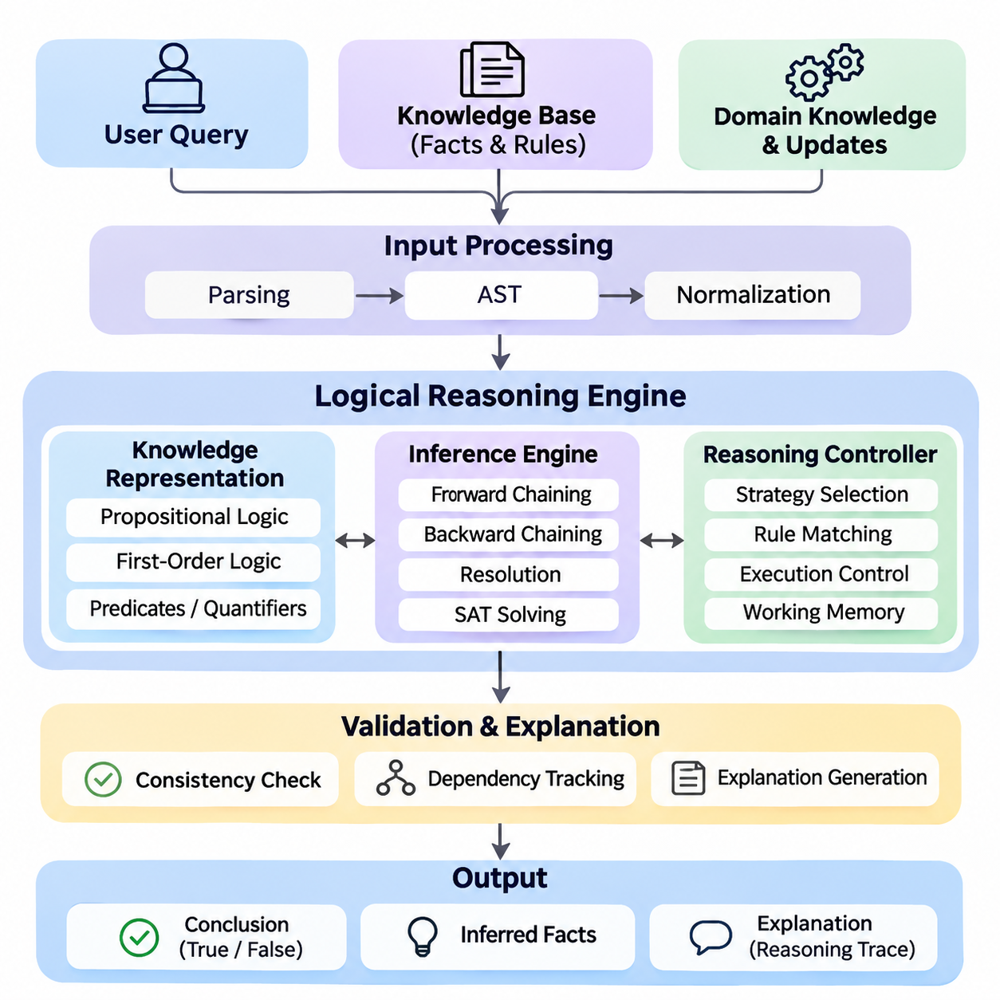
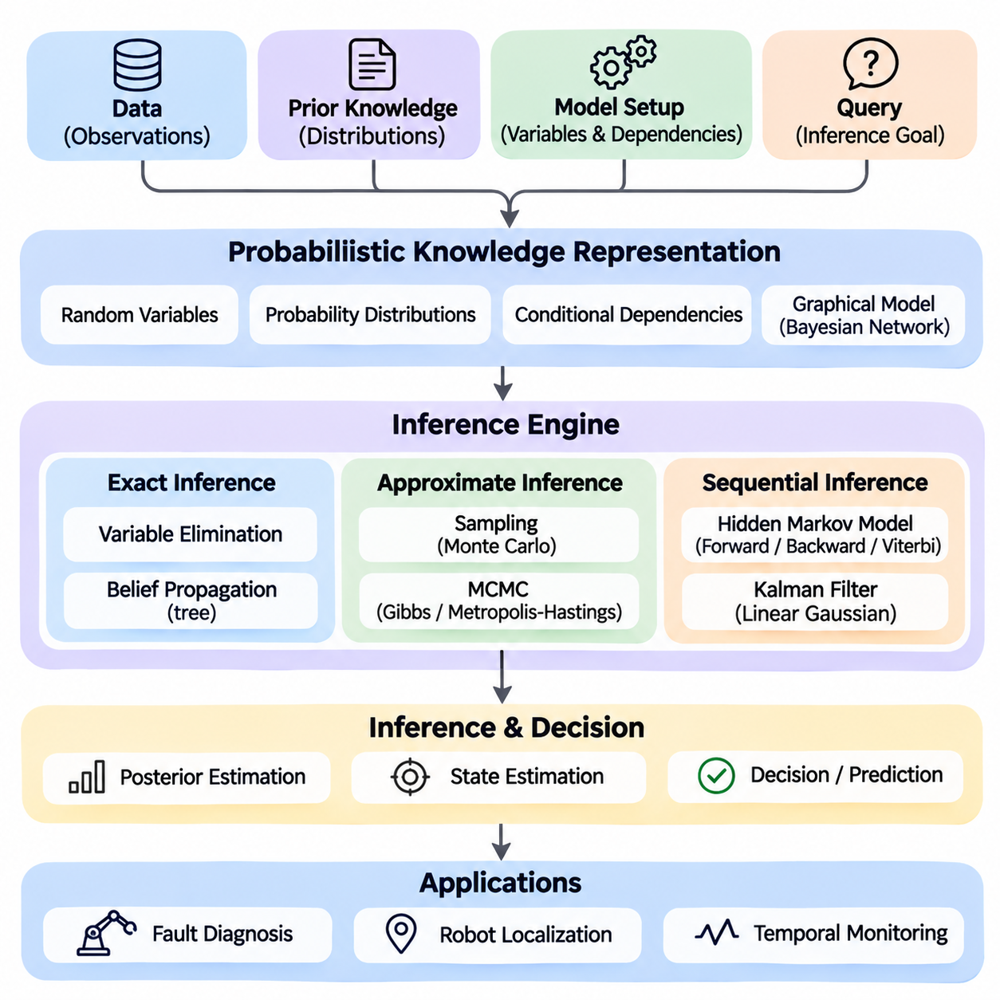
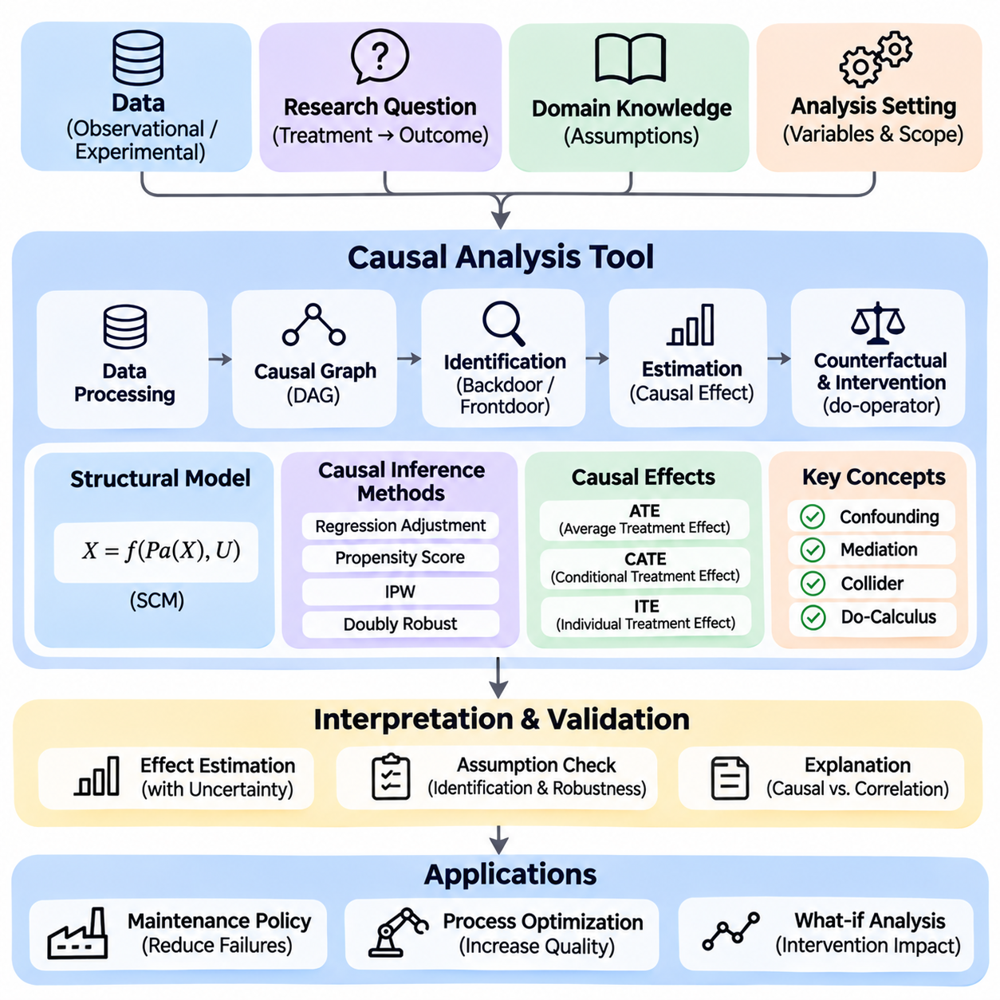
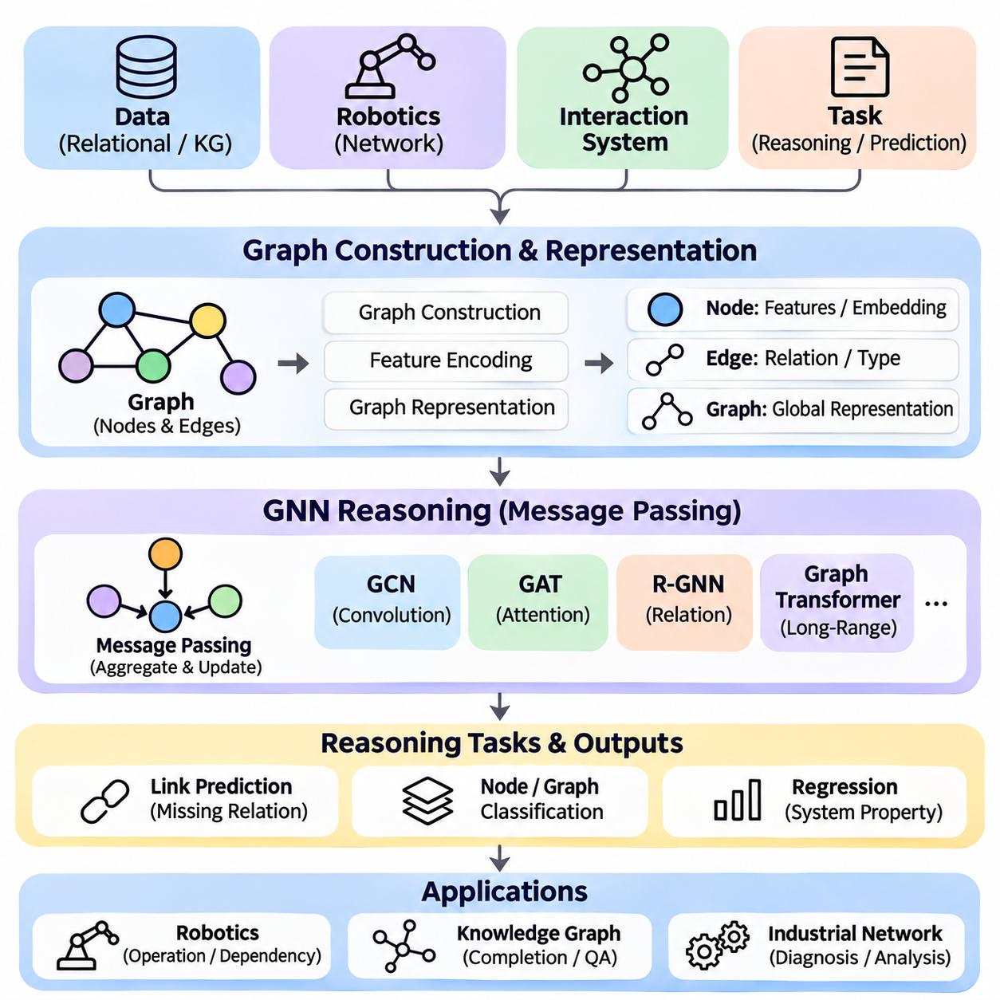
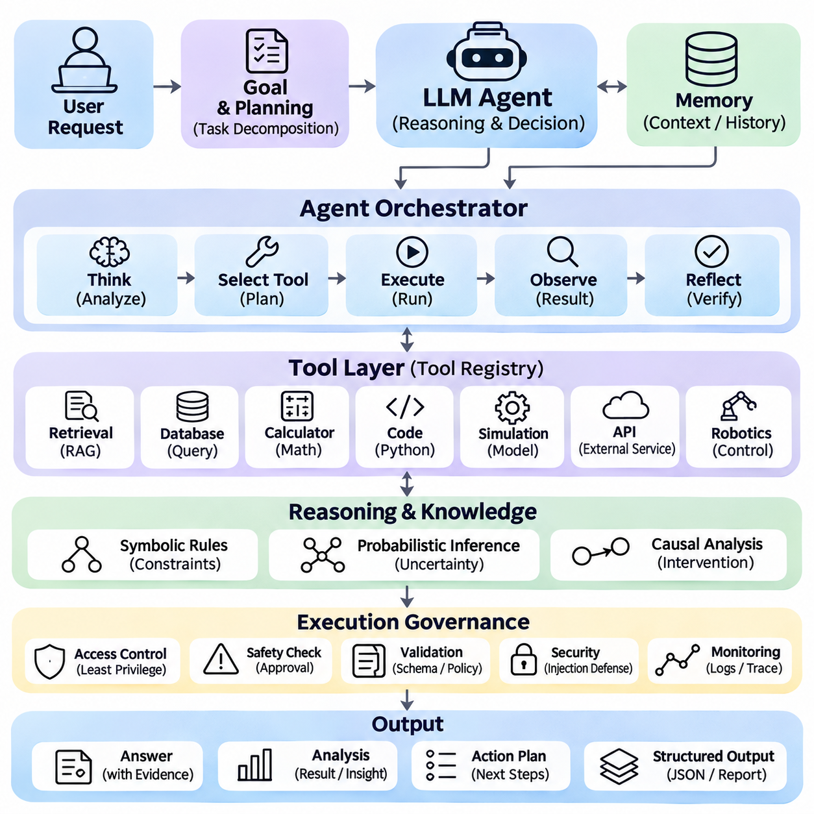
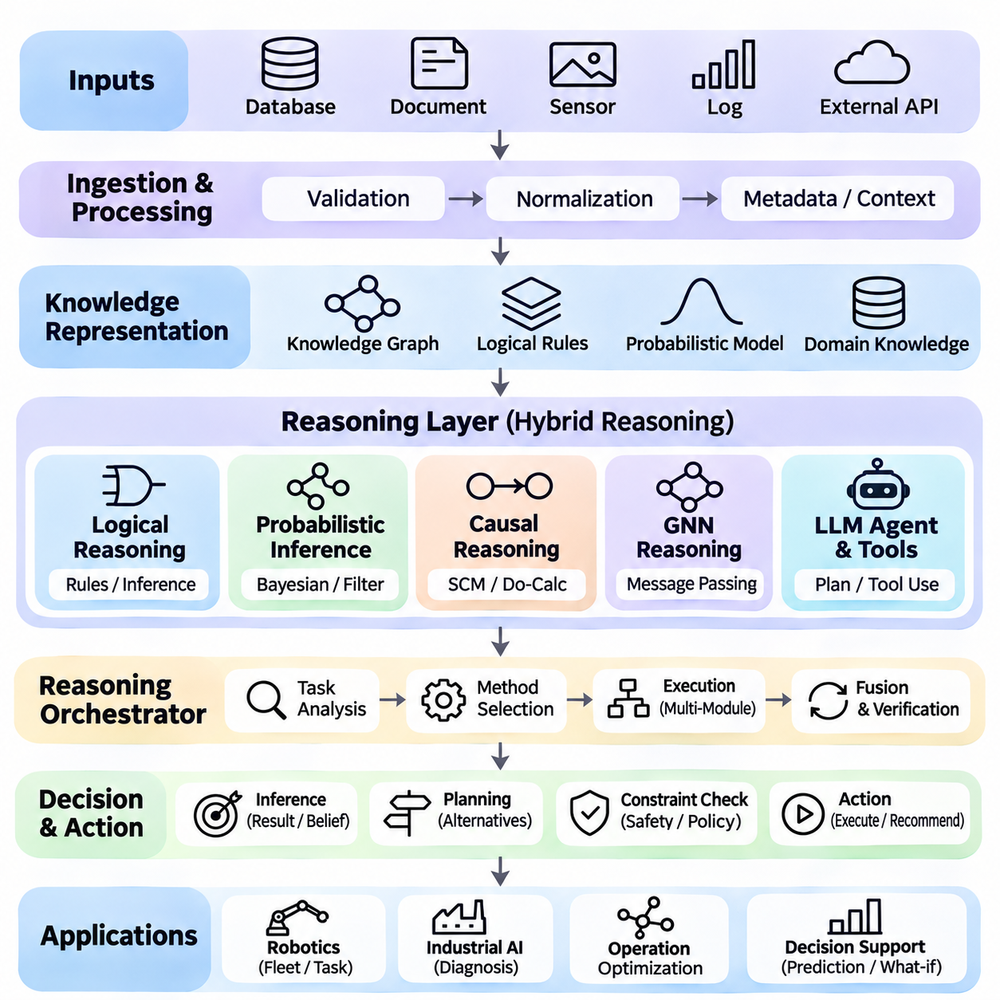

**Volume 03. Reasoning in AI**


# 06. Integrated Projects

## 06.01 Logical Reasoning Engine [w/Code]

{width="7.268055555555556in" height="7.268055555555556in"}

A Logical Reasoning Engine is an integrated artificial intelligence system that derives valid conclusions from explicitly represented knowledge, logical rules, and user queries. Unlike statistical prediction systems, its primary objective is to establish whether conclusions follow from defined premises. The project combines propositional logic, first-order logic, inference algorithms, and rule-based reasoning into a modular, explainable computational framework.

The central objective is to construct a reasoning engine capable of representing facts, evaluating logical expressions, applying inference rules, and answering structured questions. The system should distinguish established facts from inferred conclusions and unsupported statements. Its architecture must support knowledge acquisition, symbolic representation, inference execution, consistency checking, and explanation generation while maintaining predictable behavior.

Knowledge representation forms the foundation of the engine. Propositional logic represents statements as Boolean variables connected through conjunction, disjunction, negation, implication, and equivalence. First-order logic extends this representation through predicates, variables, constants, functions, and quantifiers. These mechanisms allow the engine to describe objects, properties, relationships, and general rules within a formally defined domain.

A practical implementation begins with a knowledge base containing facts and rules. Facts represent known conditions, while rules specify relationships that permit additional conclusions. For example, a robotic system may store that Robot_A is located in Zone_1 and that every robot operating in Zone_1 requires authorization. The reasoning engine can then infer the authorization requirement for Robot_A without explicitly storing that conclusion.

The input processing layer converts logical statements into internal representations suitable for computation. A parser identifies operators, predicates, arguments, variables, and quantifiers while validating grammatical structure. Abstract syntax trees provide hierarchical representations of expressions, allowing subsequent components to inspect and transform them. Normalization procedures prepare formulas for consistent interpretation and efficient inference.

Propositional reasoning provides an accessible starting point for implementation. Truth-table evaluation determines the truth value of compound expressions under specified assignments. Logical entailment testing establishes whether a conclusion follows from a knowledge base under every satisfying interpretation. Although truth tables are useful for small problems, their exponential growth motivates more efficient satisfiability algorithms for larger reasoning tasks.

A SAT solver determines whether a propositional formula admits at least one satisfying assignment. The engine can transform expressions into conjunctive normal form and apply algorithms such as Davis--Putnam--Logemann--Loveland or conflict-driven clause learning. Logical entailment can be tested by checking whether the knowledge base combined with the negation of a proposed conclusion is unsatisfiable.

First-order reasoning introduces variable binding and relational inference. Unification identifies substitutions that make compatible logical expressions identical, enabling general rules to operate on specific facts. Resolution applies logically valid transformations to clauses and can support proof by contradiction. A complete implementation must carefully handle substitutions, variable standardization, quantifier scope, and the limitations of automated theorem proving.

Rule-based reasoning provides another execution mechanism through forward chaining and backward chaining. Forward chaining begins with available facts and repeatedly applies applicable rules to derive additional knowledge. Backward chaining begins with a query and searches for premises that would establish its truth. These strategies support different computational requirements, including continuous knowledge updates and targeted question answering.

A hybrid inference controller can select reasoning strategies according to query characteristics and knowledge-base structure. Forward chaining is useful when many derived facts will be reused, while backward chaining reduces unnecessary computation for narrowly focused queries. Resolution and satisfiability checking provide complementary capabilities for general logical verification. Strategy selection must preserve the semantics and soundness guarantees of each supported reasoning method.

The inference engine should maintain a working memory containing established facts, intermediate conclusions, and active reasoning states. A rule-matching component identifies applicable implications, while an execution controller determines their processing order. Duplicate detection prevents repeated derivations, and dependency tracking records which premises support each conclusion. These mechanisms improve computational efficiency and enable transparent explanation generation.

Logical consistency is essential because contradictory knowledge can undermine classical reasoning. The engine should detect incompatible assertions, conflicting constraints, and unsatisfiable rule combinations. Consistency checking can employ SAT solving, theorem proving, or specialized integrity constraints. When contradictions are detected, the system should identify relevant premises and report the conflict rather than silently treating the knowledge base as reliable.

Not every practical domain follows monotonic reasoning, where previously established conclusions remain valid after additional knowledge is introduced. Non-monotonic reasoning allows conclusions to be reconsidered when new evidence appears. Default reasoning supports assumptions that normally hold, while defeasible reasoning permits exceptions to override general rules. These capabilities require explicit priority mechanisms and carefully defined inference semantics.

Temporal reasoning extends the engine to represent events, ordering, duration, and changing conditions. Logical rules can describe whether an action occurred before another event or whether a condition must remain true during an operation. Spatial reasoning represents relationships such as containment, adjacency, overlap, and relative position. Together, these extensions support intelligent systems operating within dynamic physical environments.

A useful engineering architecture separates the knowledge repository, parser, inference controller, reasoning algorithms, and query interface. Each component exposes clearly defined inputs and outputs, allowing independent testing and replacement. Python provides a practical implementation environment through classes representing terms, predicates, formulas, substitutions, and inference rules. Modular interfaces make the engine extensible without tightly coupling domain knowledge to algorithms.

The query interface accepts structured logical questions and returns conclusions with supporting evidence. Responses should distinguish proven statements, disproven statements, and conclusions that remain undetermined under the selected reasoning semantics. Importantly, failure to prove a statement does not necessarily establish its negation. The system must explicitly document whether it uses open-world assumptions, closed-world assumptions, or a combination of both.

Explainability is a major advantage of symbolic reasoning. Each inference step can be recorded as a proof trace identifying the applied rule, matched premises, substitutions, and resulting conclusion. These records can form a proof tree or dependency graph that users can inspect. Explanation generation should present the essential reasoning path while avoiding unnecessary intermediate operations that obscure the logical justification.

An industrial robotics application demonstrates the practical value of the engine. A mobile robot may receive facts describing its location, payload, operating mode, and environmental restrictions. Logical rules can determine whether a requested task satisfies operational constraints. If a robot carries hazardous material and a destination prohibits such cargo, the system can reject the mission and provide the specific rule responsible for that decision.

Integration with probabilistic and neural components can extend the system beyond purely symbolic inputs. Perception models may generate candidate observations, while probabilistic modules estimate their reliability. The logical engine evaluates verified or appropriately qualified symbolic assertions against operational rules. Such integration must preserve uncertainty information rather than automatically converting every uncertain prediction into an unquestioned fact.

Testing should cover parser correctness, logical equivalence, inference soundness, substitution accuracy, contradiction detection, and proof reproducibility. Unit tests can verify individual rules, while integration tests examine multi-step deductions across interconnected knowledge. Benchmark problems should include satisfiable and unsatisfiable formulas, recursive rules, contradictory assertions, and queries involving multiple variables.

Performance evaluation should measure inference latency, memory consumption, rule-matching efficiency, and scalability as knowledge-base size increases. Additional measurements can examine proof length, query throughput, and the computational impact of recursive reasoning. Different inference strategies should be compared under equivalent logical assumptions. Performance improvements must not compromise correctness or introduce unsupported conclusions.

The engine must also address practical limitations. General first-order logical entailment is undecidable, and unrestricted reasoning may fail to terminate. Recursive rules, large search spaces, and complex quantified expressions can impose substantial computational costs. Practical implementations therefore benefit from restricted logical fragments, indexing, caching, execution budgets, and controlled search strategies that balance expressiveness with predictable performance.

The completed project should provide a reusable reasoning service capable of knowledge management, formal inference, query answering, consistency analysis, and traceable explanation. Its modular design creates a foundation for subsequent probabilistic, causal, neural, and language-model reasoning projects. More importantly, it demonstrates how explicit logical structures can support verifiable decisions within larger intelligent systems.

논리 추론 엔진(Logical Reasoning Engine)은 명시적으로 표현된 지식(Knowledge), 논리 규칙(Logical Rules), 사용자 질의(User Queries)를 기반으로 타당한 결론(Valid Conclusions)을 도출하는 통합 인공지능 시스템(Integrated Artificial Intelligence System)이다. 통계적 예측 시스템(Statistical Prediction Systems)과 달리, 주요 목적은 정의된 전제(Premises)로부터 결론이 논리적으로 도출되는지를 검증하는 것이다. 이 프로젝트는 명제 논리(Propositional Logic), 일차 논리(First-Order Logic), 추론 알고리즘(Inference Algorithms), 규칙 기반 추론(Rule-Based Reasoning)을 모듈형(Modular)이며 설명 가능한(Explainable) 계산 프레임워크(Computational Framework)로 통합한다.

핵심 목표는 사실(Facts)을 표현하고, 논리 표현식(Logical Expressions)을 평가하며, 추론 규칙(Inference Rules)을 적용하고, 구조화된 질문(Structured Questions)에 응답할 수 있는 추론 엔진(Reasoning Engine)을 구축하는 것이다. 시스템은 확립된 사실(Established Facts), 추론된 결론(Inferred Conclusions), 근거가 부족한 진술(Unsupported Statements)을 구분해야 한다. 또한 예측 가능한 동작(Predictable Behavior)을 유지하면서 지식 획득(Knowledge Acquisition), 기호 표현(Symbolic Representation), 추론 실행(Inference Execution), 일관성 검사(Consistency Checking), 설명 생성(Explanation Generation)을 지원해야 한다.

지식 표현(Knowledge Representation)은 추론 엔진의 기반을 형성한다. 명제 논리(Propositional Logic)는 논리곱(Conjunction), 논리합(Disjunction), 부정(Negation), 함의(Implication), 동치(Equivalence)로 연결된 불리언 변수(Boolean Variables)를 사용하여 명제를 표현한다. 일차 논리(First-Order Logic)는 술어(Predicates), 변수(Variables), 상수(Constants), 함수(Functions), 한정자(Quantifiers)를 통해 표현 범위를 확장한다. 이러한 메커니즘은 형식적으로 정의된 영역(Domain) 내에서 객체(Objects), 속성(Properties), 관계(Relationships), 일반 규칙(General Rules)을 기술할 수 있도록 한다.

실용적인 구현(Practical Implementation)은 사실(Facts)과 규칙(Rules)을 포함하는 지식 베이스(Knowledge Base)에서 시작한다. 사실은 알려진 조건(Known Conditions)을 나타내며, 규칙은 추가적인 결론을 도출할 수 있는 관계를 정의한다. 예를 들어 로봇 시스템(Robotic System)은 Robot_A가 Zone_1에 위치하며, Zone_1에서 작동하는 모든 로봇에는 승인(Authorization)이 필요하다는 정보를 저장할 수 있다. 추론 엔진은 해당 결론을 명시적으로 저장하지 않아도 Robot_A에 대한 승인 요구사항을 도출할 수 있다.

입력 처리 계층(Input Processing Layer)은 논리적 진술(Logical Statements)을 계산에 적합한 내부 표현(Internal Representations)으로 변환한다. 파서(Parser)는 연산자(Operators), 술어(Predicates), 인수(Arguments), 변수(Variables), 한정자(Quantifiers)를 식별하고 문법적 구조(Grammatical Structure)를 검증한다. 추상 구문 트리(Abstract Syntax Trees)는 표현식의 계층적 구조(Hierarchical Representations)를 제공하여 후속 구성요소가 이를 분석하고 변환하도록 지원한다. 정규화 절차(Normalization Procedures)는 일관된 해석과 효율적인 추론을 위해 논리식을 준비한다.

명제 추론(Propositional Reasoning)은 구현을 위한 접근하기 쉬운 출발점을 제공한다. 진리표 평가(Truth-Table Evaluation)는 지정된 진리값 할당(Truth Assignments)에 따라 복합 논리식(Compound Expressions)의 진리값을 결정한다. 논리적 함의 검사(Logical Entailment Testing)는 지식 베이스를 만족하는 모든 해석(Interpretations)에서 특정 결론이 성립하는지를 확인한다. 진리표는 소규모 문제에 유용하지만, 지수적 증가(Exponential Growth) 특성으로 인해 대규모 추론 작업에서는 더욱 효율적인 만족 가능성 알고리즘(Satisfiability Algorithms)이 필요하다.

SAT 해결기(SAT Solver)는 명제 논리식(Propositional Formula)에 적어도 하나의 만족 가능한 할당(Satisfying Assignment)이 존재하는지를 판단한다. 추론 엔진은 표현식을 논리곱 정규형(Conjunctive Normal Form)으로 변환하고, 데이비스-퍼트넘-로그만-러브랜드 알고리즘(Davis--Putnam--Logemann--Loveland) 또는 충돌 기반 절 학습(Conflict-Driven Clause Learning)을 적용할 수 있다. 논리적 함의(Logical Entailment)는 지식 베이스와 제안된 결론의 부정을 결합한 논리식이 만족 불가능(Unsatisfiable)한지를 검사하여 검증할 수 있다.

일차 추론(First-Order Reasoning)은 변수 바인딩(Variable Binding)과 관계형 추론(Relational Inference)을 도입한다. 단일화(Unification)는 호환 가능한 논리 표현식을 동일하게 만드는 치환(Substitutions)을 식별하여 일반 규칙이 구체적인 사실에 적용되도록 한다. 해결법(Resolution)은 논리적으로 타당한 절 변환(Clause Transformations)을 적용하며, 모순을 통한 증명(Proof by Contradiction)을 지원할 수 있다. 완전한 구현을 위해서는 치환, 변수 표준화(Variable Standardization), 한정자 범위(Quantifier Scope), 자동 정리 증명(Automated Theorem Proving)의 한계를 신중하게 처리해야 한다.

규칙 기반 추론(Rule-Based Reasoning)은 전방 연쇄(Forward Chaining)와 후방 연쇄(Backward Chaining)를 통해 또 다른 실행 메커니즘을 제공한다. 전방 연쇄는 사용 가능한 사실에서 시작하여 적용 가능한 규칙을 반복적으로 실행함으로써 추가 지식을 도출한다. 후방 연쇄는 질의(Query)에서 시작하여 해당 결론을 성립시키는 전제들을 탐색한다. 이러한 전략은 지속적인 지식 갱신(Continuous Knowledge Updates)과 목표 지향적 질의응답(Targeted Question Answering)을 포함한 서로 다른 계산 요구사항을 지원한다.

하이브리드 추론 제어기(Hybrid Inference Controller)는 질의 특성(Query Characteristics)과 지식 베이스 구조(Knowledge-Base Structure)에 따라 추론 전략을 선택할 수 있다. 전방 연쇄는 여러 파생 사실(Derived Facts)을 반복적으로 활용할 때 유용하며, 후방 연쇄는 특정 질의에 집중하여 불필요한 계산을 줄인다. 해결법(Resolution)과 만족 가능성 검사(Satisfiability Checking)는 일반적인 논리 검증을 위한 상호 보완적 기능을 제공한다. 전략 선택은 각 추론 방법이 지원하는 의미론(Semantics)과 건전성 보장(Soundness Guarantees)을 유지해야 한다.

추론 엔진은 확립된 사실, 중간 결론(Intermediate Conclusions), 활성 추론 상태(Active Reasoning States)를 포함하는 작업 메모리(Working Memory)를 관리해야 한다. 규칙 매칭 구성요소(Rule-Matching Component)는 적용 가능한 함의를 식별하며, 실행 제어기(Execution Controller)는 처리 순서를 결정한다. 중복 탐지(Duplicate Detection)는 동일한 결론의 반복 도출을 방지하고, 의존성 추적(Dependency Tracking)은 각 결론을 뒷받침하는 전제를 기록한다. 이러한 메커니즘은 계산 효율성(Computational Efficiency)을 향상시키고 투명한 설명 생성을 가능하게 한다.

논리적 일관성(Logical Consistency)은 모순된 지식(Contradictory Knowledge)이 고전적 추론(Classical Reasoning)의 신뢰성을 훼손할 수 있기 때문에 필수적이다. 추론 엔진은 양립할 수 없는 주장(Incompatible Assertions), 충돌하는 제약조건(Conflicting Constraints), 만족 불가능한 규칙 조합(Unsatisfiable Rule Combinations)을 탐지해야 한다. 일관성 검사는 SAT 해결, 정리 증명(Theorem Proving), 특수 무결성 제약조건(Integrity Constraints)을 활용할 수 있다. 모순이 발견되면 관련 전제를 식별하고 충돌 내용을 보고해야 한다.

모든 실제 응용 영역이 새로운 지식이 추가되어도 기존 결론이 유지되는 단조 추론(Monotonic Reasoning)을 따르는 것은 아니다. 비단조 추론(Non-Monotonic Reasoning)은 새로운 증거가 등장하면 기존 결론을 재검토할 수 있도록 한다. 기본 추론(Default Reasoning)은 일반적으로 성립하는 가정을 지원하며, 취소 가능 추론(Defeasible Reasoning)은 예외가 일반 규칙보다 우선하도록 허용한다. 이러한 기능에는 명시적인 우선순위 메커니즘(Priority Mechanisms)과 신중하게 정의된 추론 의미론(Inference Semantics)이 필요하다.

시간 추론(Temporal Reasoning)은 사건(Events), 순서(Ordering), 지속시간(Duration), 변화하는 조건(Changing Conditions)을 표현하도록 추론 엔진을 확장한다. 논리 규칙은 특정 동작이 다른 사건보다 먼저 발생했는지 또는 작업 중 특정 조건이 계속 유지되어야 하는지를 기술할 수 있다. 공간 추론(Spatial Reasoning)은 포함(Containment), 인접(Adjacency), 중첩(Overlap), 상대적 위치(Relative Position)와 같은 관계를 표현한다. 이러한 확장은 동적인 물리적 환경(Dynamic Physical Environments)에서 작동하는 지능형 시스템(Intelligent Systems)을 지원한다.

효율적인 엔지니어링 아키텍처(Engineering Architecture)는 지식 저장소(Knowledge Repository), 파서(Parser), 추론 제어기(Inference Controller), 추론 알고리즘(Reasoning Algorithms), 질의 인터페이스(Query Interface)를 분리한다. 각 구성요소는 명확하게 정의된 입력과 출력을 제공하여 독립적인 테스트와 교체를 가능하게 한다. 파이썬(Python)은 항(Terms), 술어(Predicates), 논리식(Formulas), 치환(Substitutions), 추론 규칙을 표현하는 클래스를 통해 실용적인 구현 환경을 제공한다. 모듈형 인터페이스(Modular Interfaces)는 영역 지식과 알고리즘의 강한 결합 없이 확장성을 확보한다.

질의 인터페이스(Query Interface)는 구조화된 논리적 질문을 받아 근거와 함께 결론을 반환한다. 응답은 증명된 진술(Proven Statements), 반증된 진술(Disproven Statements), 선택된 추론 의미론에서 결정되지 않은 결론(Undetermined Conclusions)을 구분해야 한다. 특히 어떤 진술을 증명하지 못했다는 사실이 반드시 그 진술의 부정을 증명하는 것은 아니다. 시스템은 개방 세계 가정(Open-World Assumption), 폐쇄 세계 가정(Closed-World Assumption), 또는 두 가정의 조합 중 어떤 방식을 사용하는지 명시적으로 문서화해야 한다.

설명 가능성(Explainability)은 기호 추론(Symbolic Reasoning)의 주요 장점이다. 각 추론 단계는 적용된 규칙, 일치하는 전제, 치환, 도출된 결론을 식별하는 증명 추적(Proof Trace)으로 기록할 수 있다. 이러한 기록은 사용자가 검토할 수 있는 증명 트리(Proof Tree) 또는 의존성 그래프(Dependency Graph)를 구성한다. 설명 생성은 논리적 정당화(Logical Justification)를 이해하기 어렵게 만드는 불필요한 중간 연산을 제외하면서 핵심 추론 경로를 제시해야 한다.

산업용 로보틱스(Industrial Robotics) 응용은 추론 엔진의 실질적인 가치를 보여준다. 자율 이동 로봇(Mobile Robot)은 위치(Location), 적재물(Payload), 작동 모드(Operating Mode), 환경 제한(Environmental Restrictions)에 관한 사실을 입력받을 수 있다. 논리 규칙은 요청된 작업이 운영 제약조건(Operational Constraints)을 충족하는지 판단한다. 로봇이 위험 물질(Hazardous Material)을 운반하고 목적지에서 해당 화물을 금지한다면, 시스템은 임무를 거부하고 그 결정의 근거가 되는 구체적인 규칙을 제시할 수 있다.

확률적 구성요소(Probabilistic Components) 및 신경망 구성요소(Neural Components)와의 통합은 순수한 기호 입력을 넘어 시스템의 기능을 확장한다. 인식 모델(Perception Models)은 후보 관측값(Candidate Observations)을 생성하고, 확률적 모듈(Probabilistic Modules)은 해당 관측값의 신뢰도(Reliability)를 추정할 수 있다. 논리 추론 엔진은 검증되었거나 적절하게 불확실성이 표시된 기호적 주장(Symbolic Assertions)을 운영 규칙과 비교하여 평가한다. 이러한 통합에서는 불확실성 정보(Uncertainty Information)를 보존해야 하며, 모든 불확실한 예측을 의심의 여지가 없는 사실로 자동 변환해서는 안 된다.

테스트(Testing)는 파서 정확성(Parser Correctness), 논리적 동치(Logical Equivalence), 추론 건전성(Inference Soundness), 치환 정확성(Substitution Accuracy), 모순 탐지(Contradiction Detection), 증명 재현성(Proof Reproducibility)을 포함해야 한다. 단위 테스트(Unit Tests)는 개별 규칙을 검증하고, 통합 테스트(Integration Tests)는 상호 연결된 지식에 대한 다단계 연역(Multi-Step Deductions)을 검사한다. 벤치마크 문제(Benchmark Problems)에는 만족 가능한 논리식, 만족 불가능한 논리식, 재귀 규칙(Recursive Rules), 모순된 주장, 다중 변수 질의(Multiple-Variable Queries)가 포함되어야 한다.

성능 평가(Performance Evaluation)는 추론 지연시간(Inference Latency), 메모리 사용량(Memory Consumption), 규칙 매칭 효율성(Rule-Matching Efficiency), 지식 베이스 규모 증가에 따른 확장성(Scalability)을 측정해야 한다. 추가적인 측정 항목에는 증명 길이(Proof Length), 질의 처리량(Query Throughput), 재귀 추론(Recursive Reasoning)의 계산적 영향이 포함될 수 있다. 서로 다른 추론 전략은 동등한 논리적 가정(Logical Assumptions)에서 비교해야 한다. 성능 개선은 정확성을 훼손하거나 근거 없는 결론을 도입해서는 안 된다.

추론 엔진은 실용적인 한계도 고려해야 한다. 일반적인 일차 논리의 논리적 함의(First-Order Logical Entailment)는 결정 불가능(Undecidable)하며, 제한 없는 추론은 종료되지 않을 수 있다. 재귀 규칙, 대규모 탐색 공간(Large Search Spaces), 복잡한 한정 논리식(Quantified Expressions)은 상당한 계산 비용을 발생시킬 수 있다. 따라서 실용적인 구현에서는 제한된 논리 부분체계(Restricted Logical Fragments), 인덱싱(Indexing), 캐싱(Caching), 실행 예산(Execution Budgets), 제어된 탐색 전략(Controlled Search Strategies)을 활용하여 표현력과 예측 가능한 성능 사이의 균형을 확보하는 것이 유리하다.

완성된 프로젝트는 지식 관리(Knowledge Management), 형식적 추론(Formal Inference), 질의응답(Query Answering), 일관성 분석(Consistency Analysis), 추적 가능한 설명(Traceable Explanation)을 제공하는 재사용 가능한 추론 서비스(Reusable Reasoning Service)를 구현해야 한다. 모듈형 설계는 후속 확률적 추론(Probabilistic Reasoning), 인과 추론(Causal Reasoning), 신경망 추론(Neural Reasoning), 언어 모델 추론(Language-Model Reasoning) 프로젝트의 기반을 형성한다. 더욱 중요한 점은 명시적인 논리 구조(Explicit Logical Structures)가 대규모 지능형 시스템 내에서 검증 가능한 의사결정(Verifiable Decisions)을 어떻게 지원할 수 있는지를 보여준다는 것이다.

## 06.02 Probabilistic Inference System [w/Code]

{width="7.268055555555556in" height="7.268055555555556in"}

A Probabilistic Inference System is an integrated artificial intelligence framework designed to reason under uncertainty by combining probability theory, graphical models, statistical estimation, and sequential inference. Unlike deterministic reasoning engines that derive conclusions from fixed logical premises, probabilistic systems represent uncertainty explicitly and update beliefs as evidence becomes available. This capability is essential for intelligent decision-making in dynamic environments.

The primary objective of this project is to construct a modular inference system capable of representing uncertain knowledge, estimating hidden states, integrating observations, and producing probability-based conclusions. The system combines Bayesian reasoning, exact inference, approximate inference, temporal models, and probabilistic robotics. Its architecture should support transparent probability calculations, reproducible experiments, and extensible interfaces for practical applications.

Bayesian probability provides the mathematical foundation for updating beliefs when new evidence is observed. Bayes\' theorem relates prior probability, likelihood, and posterior probability through a normalization factor. A prior represents existing knowledge about a hypothesis, while the likelihood describes how probable an observation is under that hypothesis. The posterior combines both sources to produce an updated belief consistent with the available evidence.

The system begins with a probabilistic knowledge representation layer that defines random variables, possible states, probability distributions, and conditional dependencies. Discrete variables may represent equipment conditions or environmental categories, while continuous variables describe quantities such as position, velocity, and temperature. Each variable must have a clearly specified domain and an associated probability model suitable for the intended inference method.

Bayesian networks provide a structured mechanism for representing dependencies among random variables. A Bayesian network consists of a directed acyclic graph whose nodes represent variables and whose edges encode conditional dependencies. Each node contains a conditional probability distribution determined by its parent variables. This representation enables a complex joint probability distribution to be factorized into smaller, computationally manageable components.

A practical implementation may construct a Bayesian network for equipment fault diagnosis. Variables can represent power availability, sensor health, communication status, and system failure. Conditional probability tables describe relationships between component conditions and observed symptoms. When abnormal sensor readings are detected, the inference engine updates the probabilities of potential failure causes and identifies hypotheses requiring further investigation.

Exact inference algorithms compute posterior probabilities without approximation, subject to numerical precision. Variable elimination performs inference by multiplying probability factors and summing out hidden variables that are not relevant to a query. The elimination order strongly influences computational complexity because intermediate factors may become large. Efficient implementations therefore require careful factor representation, variable ordering, and numerical normalization.

Belief propagation provides another inference mechanism through the exchange of messages between connected variables or factors. In tree-structured graphical models, sum-product message passing can calculate exact marginal probabilities. In graphs containing cycles, loopy belief propagation may provide approximate results, although convergence is not guaranteed. The inference system should distinguish exact computations from approximate message-passing procedures.

Approximate inference becomes necessary when exact probability calculations are computationally impractical. Sampling methods estimate probability distributions by generating representative samples from a target distribution. Monte Carlo techniques approximate expectations and posterior quantities using sample averages. Their accuracy depends on sampling quality, computational budget, and statistical properties such as variance and dependence between samples.

Markov Chain Monte Carlo methods generate samples through stochastic transitions designed to preserve a target probability distribution. Algorithms such as Gibbs sampling and Metropolis--Hastings can estimate complex posterior distributions without explicitly calculating every possible state combination. Practical implementations must consider initialization, burn-in, autocorrelation, convergence diagnostics, and effective sample size when interpreting results.

Sequential probabilistic inference addresses systems whose hidden states evolve over time. Hidden Markov Models represent temporal processes through hidden states, transition probabilities, and observation probabilities. The Markov assumption states that the next hidden state depends on the current state rather than the complete historical sequence. This structure enables efficient reasoning about sequences of uncertain observations.

The forward algorithm calculates the probability of observed sequences and filtered state distributions, while the backward algorithm incorporates evidence from later observations. Combining both procedures produces smoothed state estimates. The Viterbi algorithm identifies the most probable hidden-state sequence under the model. These algorithms support applications such as activity recognition, fault monitoring, and temporal behavior interpretation.

Kalman filtering provides a recursive estimation framework for linear dynamical systems with Gaussian process and measurement noise. Each iteration includes a prediction stage based on the system dynamics and an update stage incorporating new measurements. The resulting estimate combines prior state information with observation uncertainty. Covariance matrices quantify estimation uncertainty and determine how strongly measurements influence the updated state.

Extended Kalman Filters accommodate nonlinear systems by locally linearizing transition and observation functions through Jacobian matrices. Unscented Kalman Filters use deterministically selected sigma points to approximate the propagation of uncertainty through nonlinear transformations. Both methods extend recursive state estimation beyond strictly linear models, but their accuracy depends on modeling assumptions and the characteristics of the underlying nonlinear dynamics.

Particle filters represent posterior distributions through weighted samples rather than a single Gaussian approximation. Particles are propagated through a transition model, weighted according to observation likelihoods, and resampled when necessary. This approach can represent multimodal distributions and nonlinear state transitions. However, particle degeneracy, sample impoverishment, and computational complexity require careful management.

A probabilistic robotics application demonstrates the integration of state estimation and sensor fusion. An autonomous mobile robot may combine wheel odometry, inertial measurements, GNSS observations, and LiDAR-based localization estimates. Each sensor provides information with different noise characteristics and failure conditions. The inference system combines these observations to estimate robot position, orientation, and uncertainty while accounting for motion dynamics.

Sensor fusion requires explicit models of measurement uncertainty and dependencies between observations. Independent measurements can provide complementary information, but correlated errors may cause overconfidence if treated incorrectly. Timestamp alignment, coordinate transformations, covariance estimation, and outlier detection are therefore essential engineering requirements. The system should reject invalid measurements or reduce their influence when sensor reliability deteriorates.

Partially Observable Markov Decision Processes extend probabilistic inference into sequential decision-making. Because an agent cannot directly observe the complete environmental state, it maintains a belief distribution over possible states. Actions influence future states, while observations update the belief. A decision policy selects actions according to expected rewards, transition dynamics, observation models, and uncertainty about the current environment.

The software architecture should separate probabilistic model definitions, inference algorithms, observation processing, state estimation, and result visualization interfaces. Python implementations can use NumPy and SciPy for numerical operations, while specialized probabilistic programming libraries can support graphical models and sampling. Modular interfaces allow exact inference, Monte Carlo methods, and recursive filters to operate within a consistent experimental framework.

Numerical stability is critical because repeated multiplication of small probabilities can produce floating-point underflow. Log-probability representations, normalization procedures, and stable summation techniques help preserve computational reliability. Probability distributions must satisfy nonnegativity and normalization constraints. Invalid parameters, singular covariance matrices, and inconsistent observations should trigger explicit validation errors rather than silently producing unreliable estimates.

Evaluation should examine estimation accuracy, posterior calibration, computational latency, memory consumption, and robustness to noisy or missing observations. Synthetic datasets with known ground truth allow controlled verification of inference algorithms. Real-world datasets reveal model mismatch, sensor bias, and distribution changes. Comparisons between exact and approximate methods should consider both computational efficiency and the accuracy of estimated probability distributions.

The completed Probabilistic Inference System should provide a reusable foundation for uncertainty-aware reasoning across diagnostic systems, autonomous robotics, temporal analysis, and intelligent decision-making. Its integrated architecture demonstrates how Bayesian networks, sampling algorithms, hidden-state models, and recursive filters can operate together. By representing uncertainty explicitly, the system enables decisions that reflect both available evidence and the limitations of current knowledge.

확률적 추론 시스템(Probabilistic Inference System)은 확률 이론(Probability Theory), 그래프 모델(Graphical Models), 통계적 추정(Statistical Estimation), 순차적 추론(Sequential Inference)을 결합하여 불확실성(Uncertainty) 아래에서 추론하도록 설계된 통합 인공지능 프레임워크(Integrated Artificial Intelligence Framework)이다. 고정된 논리적 전제(Logical Premises)에서 결론을 도출하는 결정론적 추론 엔진(Deterministic Reasoning Engines)과 달리, 확률적 시스템은 불확실성을 명시적으로 표현하고 새로운 증거(Evidence)가 확보될 때마다 믿음(Beliefs)을 갱신한다. 이러한 기능은 동적 환경(Dynamic Environments)에서 지능형 의사결정(Intelligent Decision-Making)을 수행하는 데 필수적이다.

이 프로젝트의 주요 목표는 불확실한 지식(Uncertain Knowledge)을 표현하고, 숨겨진 상태(Hidden States)를 추정하며, 관측값(Observations)을 통합하고, 확률 기반 결론(Probability-Based Conclusions)을 생성할 수 있는 모듈형 추론 시스템(Modular Inference System)을 구축하는 것이다. 시스템은 베이지안 추론(Bayesian Reasoning), 정확 추론(Exact Inference), 근사 추론(Approximate Inference), 시간 모델(Temporal Models), 확률적 로보틱스(Probabilistic Robotics)를 결합한다. 아키텍처는 투명한 확률 계산(Transparent Probability Calculations), 재현 가능한 실험(Reproducible Experiments), 실제 응용을 위한 확장 가능한 인터페이스(Extensible Interfaces)를 지원해야 한다.

베이지안 확률(Bayesian Probability)은 새로운 증거가 관측되었을 때 믿음을 갱신하기 위한 수학적 기반(Mathematical Foundation)을 제공한다. 베이즈 정리(Bayes\' Theorem)는 사전 확률(Prior Probability), 우도(Likelihood), 사후 확률(Posterior Probability)을 정규화 계수(Normalization Factor)를 통해 연결한다. 사전 확률은 가설(Hypothesis)에 대한 기존 지식을 나타내며, 우도는 해당 가설 아래에서 특정 관측이 발생할 가능성을 설명한다. 사후 확률은 두 정보원을 결합하여 사용 가능한 증거와 일치하는 갱신된 믿음을 생성한다.

시스템은 확률 변수(Random Variables), 가능한 상태(Possible States), 확률 분포(Probability Distributions), 조건부 의존성(Conditional Dependencies)을 정의하는 확률적 지식 표현 계층(Probabilistic Knowledge Representation Layer)에서 시작한다. 이산 변수(Discrete Variables)는 장비 상태나 환경 범주를 표현할 수 있으며, 연속 변수(Continuous Variables)는 위치(Position), 속도(Velocity), 온도(Temperature)와 같은 물리량을 나타낸다. 각 변수에는 명확하게 지정된 정의역(Domain)과 해당 추론 방법에 적합한 확률 모델(Probability Model)이 필요하다.

베이지안 네트워크(Bayesian Networks)는 확률 변수 사이의 의존성을 표현하는 구조화된 메커니즘(Structured Mechanism)을 제공한다. 베이지안 네트워크는 노드(Nodes)가 변수를 나타내고 간선(Edges)이 조건부 의존성을 표현하는 방향성 비순환 그래프(Directed Acyclic Graph)로 구성된다. 각 노드는 부모 변수(Parent Variables)에 의해 결정되는 조건부 확률 분포(Conditional Probability Distribution)를 포함한다. 이러한 표현은 복잡한 결합 확률 분포(Joint Probability Distribution)를 계산적으로 관리 가능한 작은 구성요소로 인수분해(Factorization)할 수 있도록 한다.

실용적인 구현에서는 장비 고장 진단(Equipment Fault Diagnosis)을 위한 베이지안 네트워크를 구성할 수 있다. 변수는 전원 공급 상태(Power Availability), 센서 건전성(Sensor Health), 통신 상태(Communication Status), 시스템 고장(System Failure)을 나타낼 수 있다. 조건부 확률표(Conditional Probability Tables)는 구성요소 상태와 관측된 증상 사이의 관계를 설명한다. 비정상적인 센서 측정값이 감지되면 추론 엔진은 잠재적 고장 원인(Potential Failure Causes)의 확률을 갱신하고 추가 조사가 필요한 가설을 식별한다.

정확 추론 알고리즘(Exact Inference Algorithms)은 수치 정밀도(Numerical Precision)의 한계 내에서 근사 없이 사후 확률을 계산한다. 변수 제거(Variable Elimination)는 확률 인자(Probability Factors)를 곱하고 질의와 관련 없는 숨겨진 변수를 합산하여 제거하는 방식으로 추론을 수행한다. 제거 순서(Elimination Order)는 중간 인자(Intermediate Factors)의 크기를 크게 증가시킬 수 있으므로 계산 복잡도(Computational Complexity)에 상당한 영향을 미친다. 따라서 효율적인 구현에는 인자 표현(Factor Representation), 변수 순서 지정(Variable Ordering), 수치 정규화(Numerical Normalization)에 대한 신중한 설계가 필요하다.

믿음 전파(Belief Propagation)는 연결된 변수 또는 인자 사이에서 메시지(Message)를 교환하는 또 다른 추론 메커니즘을 제공한다. 트리 구조 그래프(Tree-Structured Graphical Models)에서는 합-곱 메시지 전달(Sum-Product Message Passing)을 통해 정확한 주변 확률(Marginal Probabilities)을 계산할 수 있다. 순환 구조(Cycles)를 포함하는 그래프에서는 순환 믿음 전파(Loopy Belief Propagation)가 근사 결과를 제공할 수 있지만 수렴(Convergence)이 보장되지는 않는다. 추론 시스템은 정확 계산(Exact Computations)과 근사 메시지 전달 절차(Approximate Message-Passing Procedures)를 명확하게 구분해야 한다.

근사 추론(Approximate Inference)은 정확한 확률 계산이 계산적으로 비현실적인 경우에 필요하다. 샘플링 방법(Sampling Methods)은 목표 분포(Target Distribution)에서 대표적인 표본(Samples)을 생성하여 확률 분포를 추정한다. 몬테카를로 기법(Monte Carlo Techniques)은 표본 평균(Sample Averages)을 활용하여 기댓값(Expectations)과 사후 확률 관련 통계량(Posterior Quantities)을 근사한다. 정확도는 샘플링 품질(Sampling Quality), 계산 예산(Computational Budget), 분산(Variance), 표본 간 의존성(Dependence Between Samples)과 같은 통계적 특성에 영향을 받는다.

마르코프 연쇄 몬테카를로(Markov Chain Monte Carlo) 방법은 목표 확률 분포를 보존하도록 설계된 확률적 상태 전이(Stochastic Transitions)를 통해 표본을 생성한다. 깁스 샘플링(Gibbs Sampling)과 메트로폴리스-헤이스팅스(Metropolis--Hastings) 알고리즘은 모든 가능한 상태 조합을 명시적으로 계산하지 않고도 복잡한 사후 분포(Posterior Distributions)를 추정할 수 있다. 실제 구현에서는 초기화(Initialization), 초기 표본 제거(Burn-in), 자기상관(Autocorrelation), 수렴 진단(Convergence Diagnostics), 유효 표본 크기(Effective Sample Size)를 고려하여 결과를 해석해야 한다.

순차적 확률 추론(Sequential Probabilistic Inference)은 숨겨진 상태가 시간에 따라 변화하는 시스템을 다룬다. 은닉 마르코프 모델(Hidden Markov Models)은 숨겨진 상태(Hidden States), 상태 전이 확률(Transition Probabilities), 관측 확률(Observation Probabilities)을 통해 시간적 과정(Temporal Processes)을 표현한다. 마르코프 가정(Markov Assumption)은 다음 숨겨진 상태가 전체 과거 시퀀스가 아니라 현재 상태에 의존한다고 정의한다. 이러한 구조는 불확실한 관측 시퀀스(Observation Sequences)에 대한 효율적인 추론을 가능하게 한다.

전방 알고리즘(Forward Algorithm)은 관측 시퀀스의 확률과 필터링된 상태 분포(Filtered State Distributions)를 계산하며, 후방 알고리즘(Backward Algorithm)은 이후 관측에서 얻은 증거를 반영한다. 두 절차를 결합하면 평활화된 상태 추정(Smoothed State Estimates)을 얻을 수 있다. 비터비 알고리즘(Viterbi Algorithm)은 모델 아래에서 가장 가능성이 높은 숨겨진 상태 시퀀스를 식별한다. 이러한 알고리즘은 활동 인식(Activity Recognition), 고장 모니터링(Fault Monitoring), 시간적 행동 해석(Temporal Behavior Interpretation)과 같은 응용을 지원한다.

칼만 필터링(Kalman Filtering)은 가우시안 과정 잡음(Gaussian Process Noise)과 측정 잡음(Measurement Noise)을 갖는 선형 동적 시스템(Linear Dynamical Systems)을 위한 재귀적 추정 프레임워크(Recursive Estimation Framework)를 제공한다. 각 반복 과정은 시스템 동역학(System Dynamics)에 기반한 예측 단계(Prediction Stage)와 새로운 측정값을 반영하는 갱신 단계(Update Stage)로 구성된다. 결과 추정값은 이전 상태 정보와 관측 불확실성을 결합한다. 공분산 행렬(Covariance Matrices)은 추정 불확실성을 정량화하고 측정값이 갱신된 상태에 미치는 영향을 결정한다.

확장 칼만 필터(Extended Kalman Filters)는 야코비안 행렬(Jacobian Matrices)을 이용하여 상태 전이 함수(Transition Functions)와 관측 함수(Observation Functions)를 국소적으로 선형화(Local Linearization)함으로써 비선형 시스템(Nonlinear Systems)을 처리한다. 무향 칼만 필터(Unscented Kalman Filters)는 결정론적으로 선택된 시그마 포인트(Sigma Points)를 사용하여 비선형 변환을 통한 불확실성 전파(Uncertainty Propagation)를 근사한다. 두 방법 모두 엄격한 선형 모델을 넘어 재귀적 상태 추정(Recursive State Estimation)을 확장하지만, 정확도는 모델링 가정과 비선형 동역학의 특성에 따라 달라진다.

파티클 필터(Particle Filters)는 단일 가우시안 근사(Single Gaussian Approximation) 대신 가중 표본(Weighted Samples)을 통해 사후 분포를 표현한다. 파티클(Particles)은 상태 전이 모델(Transition Model)에 따라 전파되고, 관측 우도(Observation Likelihoods)에 따라 가중치가 부여되며, 필요할 때 재표본추출(Resampling)이 수행된다. 이러한 접근법은 다봉 분포(Multimodal Distributions)와 비선형 상태 전이(Nonlinear State Transitions)를 표현할 수 있다. 그러나 파티클 퇴화(Particle Degeneracy), 표본 빈곤화(Sample Impoverishment), 계산 복잡도(Computational Complexity)를 신중하게 관리해야 한다.

확률적 로보틱스(Probabilistic Robotics) 응용은 상태 추정(State Estimation)과 센서 융합(Sensor Fusion)의 통합을 보여준다. 자율 이동 로봇(Autonomous Mobile Robot)은 휠 오도메트리(Wheel Odometry), 관성 측정값(Inertial Measurements), 위성항법시스템 관측값(GNSS Observations), 라이다 기반 위치 추정값(LiDAR-Based Localization Estimates)을 결합할 수 있다. 각 센서는 서로 다른 잡음 특성(Noise Characteristics)과 고장 조건(Failure Conditions)을 가진 정보를 제공한다. 추론 시스템은 이러한 관측을 결합하여 운동 동역학(Motion Dynamics)을 고려하면서 로봇의 위치, 자세(Orientation), 불확실성을 추정한다.

센서 융합(Sensor Fusion)에는 측정 불확실성(Measurement Uncertainty)과 관측 간 의존성(Dependencies Between Observations)에 대한 명시적인 모델이 필요하다. 독립적인 측정값(Independent Measurements)은 상호 보완적인 정보를 제공하지만, 상관된 오차(Correlated Errors)를 잘못 처리하면 과도한 확신(Overconfidence)이 발생할 수 있다. 따라서 타임스탬프 정렬(Timestamp Alignment), 좌표 변환(Coordinate Transformations), 공분산 추정(Covariance Estimation), 이상값 탐지(Outlier Detection)는 필수적인 엔지니어링 요구사항이다. 센서 신뢰성이 저하되면 시스템은 유효하지 않은 측정값을 거부하거나 해당 측정값의 영향을 줄여야 한다.

부분 관측 마르코프 의사결정 과정(Partially Observable Markov Decision Processes)은 확률적 추론을 순차적 의사결정(Sequential Decision-Making)으로 확장한다. 에이전트(Agent)는 환경의 전체 상태를 직접 관측할 수 없으므로 가능한 상태에 대한 믿음 분포(Belief Distribution)를 유지한다. 행동(Actions)은 미래 상태에 영향을 미치며, 관측은 믿음 분포를 갱신한다. 의사결정 정책(Decision Policy)은 기대 보상(Expected Rewards), 상태 전이 동역학(Transition Dynamics), 관측 모델(Observation Models), 현재 환경에 대한 불확실성을 고려하여 행동을 선택한다.

소프트웨어 아키텍처(Software Architecture)는 확률 모델 정의(Probabilistic Model Definitions), 추론 알고리즘(Inference Algorithms), 관측 처리(Observation Processing), 상태 추정(State Estimation), 결과 시각화 인터페이스(Result Visualization Interfaces)를 분리해야 한다. 파이썬(Python) 구현에서는 넘파이(NumPy)와 사이파이(SciPy)를 수치 연산(Numerical Operations)에 활용할 수 있으며, 전문 확률 프로그래밍 라이브러리(Probabilistic Programming Libraries)는 그래프 모델과 샘플링을 지원할 수 있다. 모듈형 인터페이스(Modular Interfaces)는 정확 추론, 몬테카를로 방법, 재귀 필터가 일관된 실험 프레임워크(Experimental Framework) 내에서 작동하도록 한다.

수치 안정성(Numerical Stability)은 작은 확률을 반복적으로 곱할 때 부동소수점 언더플로(Float-Point Underflow)가 발생할 수 있으므로 매우 중요하다. 로그 확률 표현(Log-Probability Representations), 정규화 절차(Normalization Procedures), 안정적인 합산 기법(Stable Summation Techniques)은 계산 신뢰성(Computational Reliability)을 유지하는 데 도움이 된다. 확률 분포는 비음수 조건(Nonnegativity Constraints)과 정규화 조건(Normalization Constraints)을 만족해야 한다. 잘못된 매개변수(Invalid Parameters), 특이 공분산 행렬(Singular Covariance Matrices), 일관되지 않은 관측값(Inconsistent Observations)은 신뢰할 수 없는 추정값을 조용히 생성하는 대신 명시적인 검증 오류(Validation Errors)를 발생시켜야 한다.

평가(Evaluation)는 추정 정확도(Estimation Accuracy), 사후 확률 보정(Posterior Calibration), 계산 지연시간(Computational Latency), 메모리 사용량(Memory Consumption), 잡음이 있거나 누락된 관측에 대한 강건성(Robustness)을 검토해야 한다. 실제 정답(Ground Truth)이 알려진 합성 데이터셋(Synthetic Datasets)은 추론 알고리즘의 통제된 검증을 가능하게 한다. 실제 데이터셋(Real-World Datasets)은 모델 불일치(Model Mismatch), 센서 편향(Sensor Bias), 분포 변화(Distribution Changes)를 드러낸다. 정확 추론과 근사 추론의 비교에서는 계산 효율성과 추정된 확률 분포의 정확도를 모두 고려해야 한다.

완성된 확률적 추론 시스템(Probabilistic Inference System)은 진단 시스템(Diagnostic Systems), 자율 로보틱스(Autonomous Robotics), 시간적 분석(Temporal Analysis), 지능형 의사결정(Intelligent Decision-Making) 전반에서 불확실성을 고려한 추론(Uncertainty-Aware Reasoning)을 위한 재사용 가능한 기반을 제공해야 한다. 통합 아키텍처는 베이지안 네트워크, 샘플링 알고리즘, 숨겨진 상태 모델(Hidden-State Models), 재귀 필터(Recursive Filters)가 어떻게 함께 작동할 수 있는지를 보여준다. 불확실성을 명시적으로 표현함으로써 시스템은 사용 가능한 증거와 현재 지식의 한계를 모두 반영하는 의사결정을 가능하게 한다.

## 06.03 Causal Analysis Tool [w/Code]

{width="7.268055555555556in" height="7.268055555555556in"}

A Causal Analysis Tool is an integrated artificial intelligence system designed to identify, represent, and evaluate cause-and-effect relationships within complex datasets. Unlike conventional statistical analysis, which primarily identifies associations between variables, causal analysis investigates how interventions may change outcomes. The system combines causal graphical models, structural equations, identification methods, counterfactual reasoning, and statistical estimation into a unified analytical framework.

The primary objective of this project is to construct a modular causal reasoning platform capable of representing causal assumptions, identifying causal effects, estimating intervention outcomes, and explaining analytical conclusions. The tool should support observational datasets, experimental evidence, and domain knowledge while distinguishing statistical correlation from causal influence. Its architecture must emphasize transparency, reproducibility, assumption validation, and reliable interpretation.

Causal analysis begins by defining a research question involving a treatment, intervention, exposure, or decision variable and an outcome of interest. For example, an industrial system may investigate whether increasing preventive maintenance frequency reduces equipment failures. The analysis must distinguish the effect of maintenance from other influences, including equipment age, operating conditions, production intensity, and environmental factors that may affect both maintenance decisions and failure rates.

A causal graphical model represents hypothesized relationships through a directed acyclic graph. Nodes correspond to variables, while directed edges represent assumed direct causal influences. These graphs provide a structured language for expressing domain knowledge and identifying potential confounding relationships. The graph should be interpreted as a model of causal assumptions rather than proof that the represented relationships are correct.

Structural Causal Models extend causal graphs by associating each endogenous variable with a structural equation describing how its value depends on parent variables and exogenous disturbances. These equations define mechanisms through which causes generate effects. By explicitly representing the data-generating process, structural models provide a foundation for observational reasoning, interventions, and counterfactual analysis within a consistent mathematical framework.

The software architecture should separate data ingestion, causal graph construction, identification, statistical estimation, counterfactual simulation, and result interpretation. A data processing layer validates variable types, missing values, measurement scales, and temporal consistency. A graph management component stores causal assumptions and supports structural modifications. An estimation layer executes statistical procedures selected according to the identified causal estimand and available data.

Correlation analysis provides an initial description of statistical relationships but cannot independently establish causality. Two variables may be correlated because one causes the other, because both share a common cause, or because of selection mechanisms. The tool should therefore distinguish descriptive associations from causal estimates. Users must specify assumptions that justify interpreting observed relationships as evidence about interventions.

Confounding occurs when a variable influences both the treatment and outcome, potentially creating misleading associations. The backdoor criterion provides graphical conditions for identifying adjustment sets that block noncausal paths between treatment and outcome. When a valid adjustment set exists and relevant assumptions hold, statistical adjustment can identify causal effects. The tool should distinguish confounders from mediators and colliders to avoid introducing additional bias.

The frontdoor criterion provides an alternative identification strategy when a suitable mediator is observed and specific graphical conditions are satisfied. It can sometimes identify causal effects despite unobserved confounding between treatment and outcome. However, frontdoor identification requires restrictive assumptions concerning causal pathways and confounding relationships. The system should verify the required graphical conditions before applying the corresponding estimation procedure.

Interventional reasoning examines how an outcome distribution changes when a treatment variable is externally assigned. Pearl\'s do-operator distinguishes interventions from ordinary conditioning by modifying the causal mechanism that determines the treatment. Do-calculus provides transformation rules for identifying intervention distributions from observational information when permitted by the causal graph. The tool should report whether an effect is identifiable before attempting numerical estimation.

Once identification is established, the estimation component can apply regression adjustment, propensity score methods, inverse probability weighting, or doubly robust estimators. These techniques require appropriate assumptions concerning confounding, positivity, consistency, and model specification. The system should select methods according to the causal structure and data characteristics rather than treating every statistical estimator as universally applicable.

Average Treatment Effects quantify the expected difference between outcomes under alternative treatment conditions across a target population. Conditional Average Treatment Effects describe how causal effects vary across subgroups or individual characteristics. Such estimates can support personalized decisions and operational optimization. The tool must clearly define the target population, treatment contrast, outcome measure, and assumptions underlying each reported estimate.

Counterfactual reasoning investigates hypothetical outcomes under alternative conditions for the same unit or event. A structural causal model can support counterfactual inference through abduction, action, and prediction. The system first infers information about unobserved disturbances, then modifies the relevant intervention, and finally predicts the hypothetical outcome. Counterfactual conclusions depend on the structural model and generally cannot be verified directly for individual cases.

Causal discovery algorithms attempt to infer aspects of causal structure from observed data. Constraint-based approaches use conditional independence tests to eliminate incompatible graph structures, while score-based approaches search for graphs that optimize statistical criteria. The PC algorithm provides a representative constraint-based method. Its conclusions depend on assumptions such as causal sufficiency, faithfulness, and the reliability of conditional independence tests.

A practical implementation can integrate causal discovery with expert-defined constraints. Domain knowledge may establish that certain variables precede others or that particular causal directions are physically impossible. These constraints reduce the search space and improve interpretability. Nevertheless, observational data often identify only an equivalence class of causal graphs, making it essential to preserve ambiguity rather than invent unsupported causal directions.

Temporal causal analysis addresses relationships in which causes and effects occur at different times. Industrial monitoring systems may examine how operating temperature, vibration, maintenance actions, and component degradation influence future failures. Time-indexed variables and lagged dependencies can represent these relationships. The analysis must consider feedback, time-varying confounding, and temporal ordering to avoid misleading causal interpretations.

Sensitivity analysis evaluates how conclusions change when modeling assumptions are modified. Unmeasured confounding, measurement error, selection bias, and model misspecification can substantially alter estimated causal effects. The tool should support alternative adjustment sets, model specifications, and plausible confounding scenarios. Robust conclusions should remain reasonably stable across defensible assumptions, while unstable findings require explicit qualification.

A causal analysis workflow should include diagnostic procedures that examine covariate balance, overlap between treatment groups, model fit, and estimation uncertainty. Confidence intervals and uncertainty estimates communicate the precision of causal effect estimates under the adopted assumptions. Statistical significance alone does not establish causal validity. Diagnostic reports should separate estimation quality from the credibility of causal identification assumptions.

Python provides a practical environment for implementing the system through numerical computing, statistical modeling, and causal inference libraries. NumPy, pandas, and SciPy support data processing and numerical calculations, while libraries such as DoWhy, EconML, and causal-learn provide specialized causal modeling capabilities. A modular implementation should isolate library-specific interfaces so that identification and estimation components can be tested independently.

An industrial robotics case study can investigate whether a modified navigation policy reduces emergency braking events. Observational logs may contain robot speed, obstacle density, route complexity, payload, and braking frequency. A causal graph identifies potential confounders influencing both policy selection and braking outcomes. After establishing an appropriate identification strategy, the system estimates the intervention effect while documenting remaining uncertainty.

Evaluation should combine synthetic experiments with known causal structures and real-world observational studies. Synthetic structural models allow comparison between estimated effects and known intervention effects. Real-world evaluations assess robustness, computational performance, and practical interpretability. Benchmarking should measure identification correctness, estimation bias, confidence interval coverage, sensitivity to confounding, and reproducibility across experimental configurations.

The completed Causal Analysis Tool should provide a reusable platform for causal graph management, intervention identification, treatment effect estimation, counterfactual simulation, and evidence-based decision support. Its modular architecture connects theoretical causal reasoning with practical engineering workflows. By explicitly separating assumptions, identification, estimation, and interpretation, the system enables more defensible conclusions about how actions influence outcomes in complex environments.

인과 분석 도구(Causal Analysis Tool)는 복잡한 데이터셋(Complex Datasets) 내에서 원인과 결과의 관계(Cause-and-Effect Relationships)를 식별하고, 표현하며, 평가하도록 설계된 통합 인공지능 시스템(Integrated Artificial Intelligence System)이다. 주로 변수 간 연관성(Associations)을 식별하는 전통적인 통계 분석(Conventional Statistical Analysis)과 달리, 인과 분석(Causal Analysis)은 개입(Interventions)이 결과(Outcomes)를 어떻게 변화시키는지 조사한다. 이 시스템은 인과 그래프 모델(Causal Graphical Models), 구조 방정식(Structural Equations), 식별 방법(Identification Methods), 반사실적 추론(Counterfactual Reasoning), 통계적 추정(Statistical Estimation)을 통합 분석 프레임워크(Unified Analytical Framework)로 결합한다.

이 프로젝트의 주요 목표는 인과적 가정(Causal Assumptions)을 표현하고, 인과 효과(Causal Effects)를 식별하며, 개입 결과(Intervention Outcomes)를 추정하고, 분석적 결론(Analytical Conclusions)을 설명할 수 있는 모듈형 인과 추론 플랫폼(Modular Causal Reasoning Platform)을 구축하는 것이다. 이 도구는 관측 데이터셋(Observational Datasets), 실험적 증거(Experimental Evidence), 도메인 지식(Domain Knowledge)을 지원하면서 통계적 상관관계(Statistical Correlation)와 인과적 영향(Causal Influence)을 구분해야 한다. 아키텍처는 투명성(Transparency), 재현성(Reproducibility), 가정 검증(Assumption Validation), 신뢰할 수 있는 해석(Reliable Interpretation)을 강조해야 한다.

인과 분석(Causal Analysis)은 처치(Treatment), 개입(Intervention), 노출(Exposure), 의사결정 변수(Decision Variable)와 관심 결과(Outcome of Interest)를 포함하는 연구 질문(Research Question)을 정의하는 것에서 시작한다. 예를 들어 산업 시스템(Industrial System)은 예방 정비 빈도(Preventive Maintenance Frequency)를 높이면 장비 고장(Equipment Failures)이 감소하는지 조사할 수 있다. 분석에서는 정비의 효과를 장비 노후도(Equipment Age), 작동 조건(Operating Conditions), 생산 강도(Production Intensity), 환경 요인(Environmental Factors) 등 정비 결정과 고장률 모두에 영향을 줄 수 있는 다른 요인들과 구분해야 한다.

인과 그래프 모델(Causal Graphical Model)은 방향성 비순환 그래프(Directed Acyclic Graph)를 통해 가정된 관계(Hypothesized Relationships)를 표현한다. 노드(Nodes)는 변수(Variables)에 대응하고, 방향성 간선(Directed Edges)은 가정된 직접적 인과 영향(Direct Causal Influences)을 나타낸다. 이러한 그래프는 도메인 지식(Domain Knowledge)을 표현하고 잠재적인 교란 관계(Confounding Relationships)를 식별하기 위한 구조화된 언어(Structured Language)를 제공한다. 그래프는 표현된 관계가 정확하다는 증명이 아니라 인과적 가정의 모델(Model of Causal Assumptions)로 해석해야 한다.

구조적 인과 모델(Structural Causal Models)은 각 내생 변수(Endogenous Variable)에 부모 변수(Parent Variables)와 외생 교란 요인(Exogenous Disturbances)에 따라 값이 결정되는 방식을 설명하는 구조 방정식(Structural Equation)을 연결하여 인과 그래프를 확장한다. 이러한 방정식은 원인이 결과를 생성하는 메커니즘(Mechanisms)을 정의한다. 데이터 생성 과정(Data-Generating Process)을 명시적으로 표현함으로써 구조적 모델은 일관된 수학적 프레임워크(Mathematical Framework) 내에서 관측 추론(Observational Reasoning), 개입, 반사실적 분석(Counterfactual Analysis)을 수행하기 위한 기반을 제공한다.

소프트웨어 아키텍처(Software Architecture)는 데이터 수집 및 입력(Data Ingestion), 인과 그래프 구성(Causal Graph Construction), 식별(Identification), 통계적 추정(Statistical Estimation), 반사실적 시뮬레이션(Counterfactual Simulation), 결과 해석(Result Interpretation)을 분리해야 한다. 데이터 처리 계층(Data Processing Layer)은 변수 유형(Variable Types), 결측값(Missing Values), 측정 척도(Measurement Scales), 시간적 일관성(Temporal Consistency)을 검증한다. 그래프 관리 구성요소(Graph Management Component)는 인과적 가정을 저장하고 구조적 수정(Structural Modifications)을 지원한다. 추정 계층(Estimation Layer)은 식별된 인과 추정 대상(Causal Estimand)과 사용 가능한 데이터에 따라 선택된 통계 절차(Statistical Procedures)를 실행한다.

상관관계 분석(Correlation Analysis)은 통계적 관계(Statistical Relationships)에 대한 초기 설명을 제공하지만, 그 자체로 인과관계(Causality)를 확립할 수는 없다. 두 변수는 한 변수가 다른 변수를 유발하거나, 두 변수가 공통 원인(Common Cause)을 공유하거나, 선택 메커니즘(Selection Mechanisms)의 영향을 받기 때문에 상관될 수 있다. 따라서 도구는 기술적 연관성(Descriptive Associations)과 인과 추정값(Causal Estimates)을 구분해야 한다. 사용자는 관측된 관계를 개입에 관한 증거로 해석할 수 있도록 정당화하는 가정을 명시해야 한다.

교란(Confounding)은 하나의 변수가 처치와 결과 모두에 영향을 주어 오해를 유발하는 연관성(Misleading Associations)을 형성할 수 있는 경우에 발생한다. 백도어 기준(Backdoor Criterion)은 처치와 결과 사이의 비인과 경로(Noncausal Paths)를 차단하는 조정 변수 집합(Adjustment Sets)을 식별하기 위한 그래프 조건(Graphical Conditions)을 제공한다. 유효한 조정 변수 집합이 존재하고 관련 가정이 충족되면 통계적 조정(Statistical Adjustment)을 통해 인과 효과를 식별할 수 있다. 도구는 추가적인 편향(Bias)을 유발하지 않도록 교란 변수(Confounders), 매개 변수(Mediators), 충돌 변수(Colliders)를 구분해야 한다.

프런트도어 기준(Frontdoor Criterion)은 적절한 매개 변수가 관측되고 특정 그래프 조건이 충족될 때 사용할 수 있는 대안적인 식별 전략(Alternative Identification Strategy)을 제공한다. 이 방법은 처치와 결과 사이에 관측되지 않은 교란(Unobserved Confounding)이 존재하더라도 인과 효과를 식별할 수 있는 경우가 있다. 그러나 프런트도어 식별(Frontdoor Identification)은 인과 경로(Causal Pathways)와 교란 관계에 관한 제한적인 가정을 요구한다. 시스템은 해당 추정 절차를 적용하기 전에 필요한 그래프 조건을 검증해야 한다.

개입적 추론(Interventional Reasoning)은 처치 변수(Treatment Variable)가 외부에서 지정될 때 결과 분포(Outcome Distribution)가 어떻게 변화하는지 조사한다. 펄의 do-연산자(Pearl\'s Do-Operator)는 처치를 결정하는 인과 메커니즘(Causal Mechanism)을 변경함으로써 개입을 일반적인 조건화(Ordinary Conditioning)와 구분한다. do-계산법(Do-Calculus)은 인과 그래프가 허용하는 경우 관측 정보(Observational Information)로부터 개입 분포(Intervention Distributions)를 식별하기 위한 변환 규칙(Transformation Rules)을 제공한다. 도구는 수치 추정(Numerical Estimation)을 시도하기 전에 효과의 식별 가능성(Identifiability)을 보고해야 한다.

식별이 확립되면 추정 구성요소(Estimation Component)는 회귀 조정(Regression Adjustment), 성향 점수 방법(Propensity Score Methods), 역확률 가중법(Inverse Probability Weighting), 이중 강건 추정량(Doubly Robust Estimators)을 적용할 수 있다. 이러한 기법에는 교란(Confounding), 양의 확률 조건(Positivity), 일관성(Consistency), 모델 명세(Model Specification)에 관한 적절한 가정이 필요하다. 시스템은 모든 통계 추정량(Statistical Estimator)을 보편적으로 적용할 수 있다고 간주하는 대신 인과 구조(Causal Structure)와 데이터 특성(Data Characteristics)에 따라 방법을 선택해야 한다.

평균 처치 효과(Average Treatment Effects)는 목표 모집단(Target Population) 전체에서 서로 다른 처치 조건(Treatment Conditions)에 따른 기대 결과(Expected Outcomes)의 차이를 정량화한다. 조건부 평균 처치 효과(Conditional Average Treatment Effects)는 하위 집단(Subgroups)이나 개별 특성(Individual Characteristics)에 따라 인과 효과가 어떻게 달라지는지 설명한다. 이러한 추정값은 개인화된 의사결정(Personalized Decisions)과 운영 최적화(Operational Optimization)를 지원할 수 있다. 도구는 보고되는 각 추정값에 대해 목표 모집단, 처치 대비(Treatment Contrast), 결과 측정값(Outcome Measure), 기초 가정을 명확하게 정의해야 한다.

반사실적 추론(Counterfactual Reasoning)은 동일한 개체 또는 사건(Unit or Event)에 대해 다른 조건이 적용되었을 경우의 가상 결과(Hypothetical Outcomes)를 조사한다. 구조적 인과 모델(Structural Causal Model)은 귀추(Abduction), 행동(Action), 예측(Prediction)의 과정을 통해 반사실적 추론을 지원할 수 있다. 시스템은 먼저 관측되지 않은 교란 요인(Unobserved Disturbances)에 관한 정보를 추론하고, 관련 개입을 수정한 다음, 가상 결과를 예측한다. 반사실적 결론은 구조적 모델에 의존하며 일반적으로 개별 사례에서 직접 검증할 수 없다.

인과 발견 알고리즘(Causal Discovery Algorithms)은 관측 데이터로부터 인과 구조(Causal Structure)의 일부를 추론하려고 시도한다. 제약 기반 접근법(Constraint-Based Approaches)은 조건부 독립성 검정(Conditional Independence Tests)을 사용하여 데이터와 양립할 수 없는 그래프 구조를 제거하며, 점수 기반 접근법(Score-Based Approaches)은 통계적 기준(Statistical Criteria)을 최적화하는 그래프를 탐색한다. PC 알고리즘(PC Algorithm)은 대표적인 제약 기반 방법이다. 그 결론은 인과적 충분성(Causal Sufficiency), 충실성(Faithfulness), 조건부 독립성 검정의 신뢰성과 같은 가정에 의존한다.

실용적인 구현에서는 인과 발견(Causal Discovery)과 전문가가 정의한 제약조건(Expert-Defined Constraints)을 통합할 수 있다. 도메인 지식(Domain Knowledge)은 특정 변수가 다른 변수보다 시간적으로 앞서거나 특정 인과 방향(Causal Directions)이 물리적으로 불가능하다는 사실을 규정할 수 있다. 이러한 제약조건은 탐색 공간(Search Space)을 줄이고 해석 가능성(Interpretability)을 향상시킨다. 그러나 관측 데이터는 인과 그래프의 동치류(Equivalence Class)만 식별하는 경우가 많으므로, 근거 없는 인과 방향을 만들어내는 대신 모호성(Ambiguity)을 보존하는 것이 중요하다.

시간적 인과 분석(Temporal Causal Analysis)은 원인과 결과가 서로 다른 시점에 발생하는 관계를 다룬다. 산업 모니터링 시스템(Industrial Monitoring Systems)은 작동 온도(Operating Temperature), 진동(Vibration), 정비 작업(Maintenance Actions), 구성요소 열화(Component Degradation)가 미래 고장(Future Failures)에 어떻게 영향을 미치는지 조사할 수 있다. 시간 인덱스 변수(Time-Indexed Variables)와 지연 의존성(Lagged Dependencies)은 이러한 관계를 표현할 수 있다. 분석에서는 잘못된 인과 해석을 방지하기 위해 피드백(Feedback), 시간 가변 교란(Time-Varying Confounding), 시간적 순서(Temporal Ordering)를 고려해야 한다.

민감도 분석(Sensitivity Analysis)은 모델링 가정(Modeling Assumptions)이 변경될 때 결론이 어떻게 달라지는지 평가한다. 측정되지 않은 교란(Unmeasured Confounding), 측정 오차(Measurement Error), 선택 편향(Selection Bias), 모델 명세 오류(Model Misspecification)는 추정된 인과 효과를 크게 변화시킬 수 있다. 도구는 대안적인 조정 변수 집합(Alternative Adjustment Sets), 모델 명세(Model Specifications), 현실적으로 가능한 교란 시나리오(Plausible Confounding Scenarios)를 지원해야 한다. 강건한 결론(Robust Conclusions)은 정당화 가능한 가정 전반에서 합리적으로 안정적인 상태를 유지해야 하며, 불안정한 결과에는 명시적인 제한 설명이 필요하다.

인과 분석 워크플로(Causal Analysis Workflow)에는 공변량 균형(Covariate Balance), 처치 집단 간 중첩(Overlap Between Treatment Groups), 모델 적합도(Model Fit), 추정 불확실성(Estimation Uncertainty)을 검사하는 진단 절차(Diagnostic Procedures)가 포함되어야 한다. 신뢰구간(Confidence Intervals)과 불확실성 추정값(Uncertainty Estimates)은 채택된 가정 아래에서 인과 효과 추정값의 정밀도(Precision)를 전달한다. 통계적 유의성(Statistical Significance)만으로 인과적 타당성(Causal Validity)이 확립되는 것은 아니다. 진단 보고서(Diagnostic Reports)는 추정 품질(Estimation Quality)과 인과 식별 가정(Causal Identification Assumptions)의 신뢰성을 구분해야 한다.

파이썬(Python)은 수치 계산(Numerical Computing), 통계 모델링(Statistical Modeling), 인과 추론 라이브러리(Causal Inference Libraries)를 통해 시스템을 구현하기 위한 실용적인 환경을 제공한다. 넘파이(NumPy), 판다스(pandas), 사이파이(SciPy)는 데이터 처리와 수치 계산을 지원하며, DoWhy, EconML, causal-learn과 같은 라이브러리는 전문적인 인과 모델링 기능(Specialized Causal Modeling Capabilities)을 제공한다. 모듈형 구현(Modular Implementation)은 라이브러리별 인터페이스(Library-Specific Interfaces)를 분리하여 식별 구성요소와 추정 구성요소를 독립적으로 테스트할 수 있도록 해야 한다.

산업용 로보틱스(Industrial Robotics) 사례 연구(Case Study)에서는 변경된 주행 정책(Navigation Policy)이 비상 제동 사건(Emergency Braking Events)을 감소시키는지 조사할 수 있다. 관측 로그(Observational Logs)에는 로봇 속도(Robot Speed), 장애물 밀도(Obstacle Density), 경로 복잡도(Route Complexity), 적재량(Payload), 제동 빈도(Braking Frequency)가 포함될 수 있다. 인과 그래프는 정책 선택과 제동 결과 모두에 영향을 미치는 잠재적 교란 변수(Potential Confounders)를 식별한다. 적절한 식별 전략을 확립한 후 시스템은 남아 있는 불확실성을 문서화하면서 개입 효과(Intervention Effect)를 추정한다.

평가(Evaluation)는 알려진 인과 구조(Known Causal Structures)를 사용하는 합성 실험(Synthetic Experiments)과 실제 관측 연구(Real-World Observational Studies)를 결합해야 한다. 합성 구조 모델(Synthetic Structural Models)은 추정 효과와 알려진 개입 효과(Known Intervention Effects)를 비교할 수 있도록 한다. 실제 환경 평가는 강건성(Robustness), 계산 성능(Computational Performance), 실용적 해석 가능성(Practical Interpretability)을 검토한다. 벤치마킹(Benchmarking)은 식별 정확성(Identification Correctness), 추정 편향(Estimation Bias), 신뢰구간 포함률(Confidence Interval Coverage), 교란에 대한 민감도(Sensitivity to Confounding), 실험 설정 전반의 재현성(Reproducibility)을 측정해야 한다.

완성된 인과 분석 도구(Causal Analysis Tool)는 인과 그래프 관리(Causal Graph Management), 개입 식별(Intervention Identification), 처치 효과 추정(Treatment Effect Estimation), 반사실적 시뮬레이션(Counterfactual Simulation), 증거 기반 의사결정 지원(Evidence-Based Decision Support)을 위한 재사용 가능한 플랫폼(Reusable Platform)을 제공해야 한다. 모듈형 아키텍처(Modular Architecture)는 이론적 인과 추론(Theoretical Causal Reasoning)과 실제 엔지니어링 워크플로(Practical Engineering Workflows)를 연결한다. 가정(Assumptions), 식별(Identification), 추정(Estimation), 해석(Interpretation)을 명시적으로 분리함으로써 시스템은 복잡한 환경에서 행동이 결과에 어떤 영향을 미치는지에 대해 더욱 타당하고 신뢰할 수 있는 결론을 도출할 수 있도록 한다.

## 06.04 GNN Reasoning System [w/Code]

{width="7.268055555555556in" height="7.268055555555556in"}

A Graph Neural Network Reasoning System is an integrated artificial intelligence framework designed to learn relationships, propagate information, and perform structured reasoning over graph-based data. Unlike conventional neural networks that primarily process fixed-dimensional inputs, Graph Neural Networks operate on interconnected entities and their relationships. This capability enables reasoning across knowledge graphs, relational databases, physical systems, and complex interaction networks.

The primary objective of this project is to construct a modular reasoning system that combines graph representation learning, message passing, relational inference, and neural prediction. The system should transform structured graph information into meaningful node, edge, and graph-level representations. Its architecture must support graph construction, feature encoding, neural reasoning, training, evaluation, and interpretable inference within a reproducible computational workflow.

Graph representation provides the foundation of the system. A graph consists of nodes representing entities and edges representing relationships or interactions between those entities. Nodes may contain numerical attributes, categorical labels, or learned embeddings, while edges may include relation types, distances, directions, or interaction strengths. This flexible representation enables the system to model structured knowledge and physical relationships within a unified mathematical framework.

The graph construction layer converts raw datasets into graph structures suitable for neural computation. In a knowledge graph, entities become nodes and semantic relationships become typed edges. In robotics, nodes may represent robots, obstacles, locations, and tasks, while edges describe spatial proximity, connectivity, or operational dependencies. Graph construction must preserve meaningful relationships while avoiding unnecessary connections that increase computational complexity.

Feature encoding transforms node and edge attributes into numerical representations that neural networks can process. Continuous attributes may be normalized, categorical attributes embedded, and missing values handled through explicit strategies. Structural features such as node degree, positional encodings, or graph distances can provide additional context. The resulting feature vectors form the initial representations used by subsequent message-passing operations.

Message passing is the central computational mechanism of Graph Neural Networks. During each layer, nodes receive information from neighboring nodes through messages generated from their features and relationships. An aggregation function combines incoming messages, and an update function produces a new node representation. Repeating this process allows information to propagate across multiple graph connections and enables learning from increasingly broad relational neighborhoods.

Graph Convolutional Networks provide a practical starting point for implementing neighborhood-based representation learning. A graph convolution layer combines node features with information from adjacent nodes using normalized graph connectivity. Multiple layers allow nodes to incorporate information from progressively larger neighborhoods. However, excessive propagation can cause oversmoothing, where node representations become difficult to distinguish, making architectural depth an important design consideration.

Graph Attention Networks extend message passing by learning the relative importance of neighboring nodes. Attention coefficients determine how strongly each neighbor contributes to the updated representation. This mechanism can improve flexibility when relationships differ in relevance. Nevertheless, attention weights should not automatically be interpreted as complete causal explanations, because learned importance scores do not independently establish why a prediction is correct.

Relational Graph Neural Networks support graphs containing multiple edge types. A knowledge graph may include relationships such as located_in, connected_to, requires, and controls. Relation-specific transformations allow the model to process these interactions differently while sharing information across the graph. This capability is particularly useful for heterogeneous systems where entities and relationships have distinct semantic meanings.

A practical reasoning task involves predicting missing relationships between entities. Given a graph containing known facts, the system can estimate whether an unobserved edge should exist. Link prediction models learn compatibility between node representations and candidate relations. Such predictions can support knowledge graph completion, recommendation systems, and operational dependency discovery, although predicted relationships remain hypotheses until independently verified.

Multi-hop relational reasoning requires combining information across several connected entities. For example, a robot may depend on a controller that communicates through a network connected to a central server. The reasoning system can learn representations that reflect these indirect dependencies. Message-passing depth determines the nominal neighborhood accessible to each node, while graph topology and aggregation behavior influence how effectively distant information is preserved.

Graph-level reasoning aggregates information from multiple nodes into a representation of an entire graph or subgraph. Readout operations such as mean pooling, sum pooling, and attention-based pooling summarize learned node features. These representations support classification and regression tasks involving complete systems. Applications include equipment condition assessment, molecular property prediction, and analysis of operational network configurations.

The system can incorporate graph transformers to model interactions beyond immediate neighborhoods. Attention mechanisms operating over graph elements may capture long-range dependencies that conventional local message passing handles inefficiently. Structural encodings and sparse attention strategies help preserve graph information while controlling computational cost. The choice between message-passing networks and graph transformers depends on graph size, relational complexity, and available computing resources.

Neuro-symbolic integration can strengthen reasoning by combining learned graph representations with explicit logical constraints. Neural components estimate relationships or classify entities, while symbolic rules verify whether predicted conclusions satisfy domain requirements. For example, a learned model may propose a robot-task assignment, but a logical constraint can reject assignments violating payload or access restrictions. This separation improves operational reliability and traceability.

The training pipeline begins by defining a supervised or self-supervised learning objective. Node classification uses labeled entities, link prediction uses observed relationships and sampled negative examples, and graph classification uses graph-level targets. Loss functions measure disagreement between predictions and training targets. Optimization algorithms update model parameters through gradient-based learning while validation data guide architecture selection and hyperparameter tuning.

Data partitioning requires particular care because graph connections can introduce information leakage. Transductive learning permits access to the full graph structure while withholding selected labels, whereas inductive learning evaluates generalization to previously unseen nodes or graphs. Link prediction benchmarks must prevent target-edge information from leaking through features or graph construction. Appropriate splits should reflect the intended deployment environment.

A Python implementation can use PyTorch together with PyTorch Geometric or Deep Graph Library for graph processing and neural computation. Graph objects store node features, edge indices, relation attributes, and target labels. Modular model classes implement graph convolution, attention, relational message passing, and prediction heads. Configuration files define experimental settings, enabling controlled comparisons between alternative architectures.

Scalability becomes important when graphs contain millions of nodes or edges. Full-graph message passing can exceed available memory and introduce substantial computational overhead. Neighbor sampling, subgraph mini-batching, sparse matrix operations, and distributed graph processing provide practical optimization strategies. System performance depends on graph density, feature dimensionality, sampling configuration, and communication costs between computational devices.

Interpretability requires examining which graph structures and features influence model predictions. Explanation methods may identify influential nodes, edges, subgraphs, or feature dimensions. Counterfactual graph analysis can investigate how predictions change when selected relationships are modified. These explanations should be treated as model-behavior analyses rather than definitive evidence of real-world causality, particularly when graph construction contains uncertain relationships.

An industrial robotics case study can model a fleet of autonomous mobile robots operating within a shared facility. Nodes represent robots, charging stations, workstations, routes, and assigned tasks. Edges encode accessibility, communication links, task dependencies, and spatial relationships. A GNN can predict congestion risks, identify potentially conflicting assignments, or estimate operational bottlenecks from the evolving graph structure.

Evaluation should measure predictive accuracy, relational generalization, computational efficiency, and robustness to graph perturbations. Node classification can use accuracy and F1 score, while link prediction can use ranking metrics such as mean reciprocal rank and Hits\\@K. Graph classification may use accuracy or area under the receiver operating characteristic curve. Ablation studies should examine the contributions of node features, edge types, model depth, and aggregation mechanisms.

The completed GNN Reasoning System should provide a reusable foundation for structured neural inference across knowledge graphs, robotics, industrial networks, and intelligent decision-support applications. Its architecture integrates graph construction, representation learning, message passing, relational prediction, and explanation mechanisms. By combining neural learning with explicit relational structures, the system demonstrates how interconnected information can support scalable and context-aware reasoning.

그래프 신경망 추론 시스템(Graph Neural Network Reasoning System)은 그래프 기반 데이터(Graph-Based Data)에서 관계를 학습하고, 정보를 전파하며, 구조화된 추론(Structured Reasoning)을 수행하도록 설계된 통합 인공지능 프레임워크(Integrated Artificial Intelligence Framework)이다. 주로 고정 차원 입력(Fixed-Dimensional Inputs)을 처리하는 기존 신경망(Conventional Neural Networks)과 달리, 그래프 신경망(Graph Neural Networks)은 상호 연결된 개체(Interconnected Entities)와 이들 사이의 관계를 처리한다. 이러한 기능은 지식 그래프(Knowledge Graphs), 관계형 데이터베이스(Relational Databases), 물리 시스템(Physical Systems), 복잡한 상호작용 네트워크(Complex Interaction Networks) 전반에서 추론을 가능하게 한다.

이 프로젝트의 주요 목표는 그래프 표현 학습(Graph Representation Learning), 메시지 전달(Message Passing), 관계형 추론(Relational Inference), 신경망 예측(Neural Prediction)을 결합하는 모듈형 추론 시스템(Modular Reasoning System)을 구축하는 것이다. 시스템은 구조화된 그래프 정보(Structured Graph Information)를 의미 있는 노드 수준(Node-Level), 간선 수준(Edge-Level), 그래프 수준(Graph-Level)의 표현으로 변환해야 한다. 아키텍처는 재현 가능한 계산 워크플로(Reproducible Computational Workflow) 내에서 그래프 구성(Graph Construction), 특징 인코딩(Feature Encoding), 신경망 추론(Neural Reasoning), 학습(Training), 평가(Evaluation), 해석 가능한 추론(Interpretable Inference)을 지원해야 한다.

그래프 표현(Graph Representation)은 시스템의 기반을 제공한다. 그래프(Graph)는 개체를 나타내는 노드(Nodes)와 개체 사이의 관계 또는 상호작용을 나타내는 간선(Edges)으로 구성된다. 노드는 수치 속성(Numerical Attributes), 범주형 레이블(Categorical Labels), 학습된 임베딩(Learned Embeddings)을 포함할 수 있으며, 간선은 관계 유형(Relation Types), 거리(Distances), 방향(Directions), 상호작용 강도(Interaction Strengths)를 포함할 수 있다. 이러한 유연한 표현은 통합된 수학적 프레임워크(Unified Mathematical Framework) 내에서 구조화된 지식과 물리적 관계를 모델링할 수 있도록 한다.

그래프 구성 계층(Graph Construction Layer)은 원시 데이터셋(Raw Datasets)을 신경망 계산(Neural Computation)에 적합한 그래프 구조(Graph Structures)로 변환한다. 지식 그래프에서는 개체가 노드가 되고 의미적 관계(Semantic Relationships)가 유형화된 간선(Typed Edges)이 된다. 로보틱스(Robotics)에서는 노드가 로봇, 장애물, 위치, 작업을 나타내고, 간선은 공간적 근접성(Spatial Proximity), 연결성(Connectivity), 운영 의존성(Operational Dependencies)을 설명할 수 있다. 그래프 구성에서는 계산 복잡도(Computational Complexity)를 증가시키는 불필요한 연결을 피하면서 의미 있는 관계를 보존해야 한다.

특징 인코딩(Feature Encoding)은 노드와 간선의 속성을 신경망이 처리할 수 있는 수치 표현(Numerical Representations)으로 변환한다. 연속형 속성(Continuous Attributes)은 정규화(Normalization)하고, 범주형 속성(Categorical Attributes)은 임베딩(Embedding)하며, 결측값(Missing Values)은 명시적인 전략으로 처리할 수 있다. 노드 차수(Node Degree), 위치 인코딩(Positional Encodings), 그래프 거리(Graph Distances)와 같은 구조적 특징(Structural Features)은 추가적인 문맥 정보(Contextual Information)를 제공한다. 결과 특징 벡터(Feature Vectors)는 후속 메시지 전달 연산(Message-Passing Operations)에 사용되는 초기 표현(Initial Representations)을 형성한다.

메시지 전달(Message Passing)은 그래프 신경망(Graph Neural Networks)의 핵심 계산 메커니즘(Central Computational Mechanism)이다. 각 계층(Layer)에서 노드는 이웃 노드(Neighboring Nodes)의 특징과 관계를 기반으로 생성된 메시지를 통해 정보를 수신한다. 집계 함수(Aggregation Function)는 입력 메시지를 결합하고, 갱신 함수(Update Function)는 새로운 노드 표현(Node Representation)을 생성한다. 이러한 과정을 반복하면 정보가 여러 그래프 연결을 따라 전파되며, 점차 넓어지는 관계형 이웃(Relational Neighborhoods)으로부터 학습할 수 있다.

그래프 합성곱 신경망(Graph Convolutional Networks)은 이웃 기반 표현 학습(Neighborhood-Based Representation Learning)을 구현하기 위한 실용적인 출발점을 제공한다. 그래프 합성곱 계층(Graph Convolution Layer)은 정규화된 그래프 연결성(Normalized Graph Connectivity)을 사용하여 노드 특징과 인접 노드의 정보를 결합한다. 여러 계층을 사용하면 노드는 점차 넓은 이웃 영역의 정보를 통합할 수 있다. 그러나 과도한 정보 전파는 노드 표현을 구분하기 어렵게 만드는 과도한 평활화(Oversmoothing)를 유발할 수 있으므로, 아키텍처 깊이(Architectural Depth)는 중요한 설계 고려사항이다.

그래프 어텐션 네트워크(Graph Attention Networks)는 이웃 노드의 상대적 중요도(Relative Importance)를 학습하여 메시지 전달을 확장한다. 어텐션 계수(Attention Coefficients)는 각 이웃 노드가 갱신된 표현에 얼마나 강하게 기여하는지를 결정한다. 이러한 메커니즘은 관계마다 관련성(Relevance)이 서로 다른 경우 유연성을 향상시킬 수 있다. 그러나 학습된 중요도 점수(Learned Importance Scores)는 예측이 올바른 이유를 독립적으로 입증하지 못하므로, 어텐션 가중치(Attention Weights)를 완전한 인과적 설명(Causal Explanations)으로 자동 해석해서는 안 된다.

관계형 그래프 신경망(Relational Graph Neural Networks)은 여러 간선 유형(Multiple Edge Types)을 포함하는 그래프를 지원한다. 지식 그래프에는 located_in, connected_to, requires, controls와 같은 관계가 포함될 수 있다. 관계별 변환(Relation-Specific Transformations)은 그래프 전체에서 정보를 공유하면서 각 상호작용을 서로 다르게 처리할 수 있도록 한다. 이러한 기능은 개체와 관계가 서로 다른 의미적 특성(Semantic Meanings)을 갖는 이종 시스템(Heterogeneous Systems)에서 특히 유용하다.

실용적인 추론 작업(Practical Reasoning Task) 중 하나는 개체 사이의 누락된 관계(Missing Relationships)를 예측하는 것이다. 알려진 사실을 포함하는 그래프가 주어지면 시스템은 관측되지 않은 간선(Unobserved Edge)이 존재해야 하는지를 추정할 수 있다. 링크 예측 모델(Link Prediction Models)은 노드 표현과 후보 관계(Candidate Relations) 사이의 적합성(Compatibility)을 학습한다. 이러한 예측은 지식 그래프 완성(Knowledge Graph Completion), 추천 시스템(Recommendation Systems), 운영 의존성 발견(Operational Dependency Discovery)을 지원할 수 있지만, 예측된 관계는 독립적으로 검증되기 전까지 가설(Hypotheses)로 남는다.

다중 홉 관계형 추론(Multi-Hop Relational Reasoning)은 여러 연결된 개체에 걸친 정보를 결합해야 한다. 예를 들어 로봇은 중앙 서버(Central Server)에 연결된 네트워크(Network)를 통해 통신하는 제어기(Controller)에 의존할 수 있다. 추론 시스템은 이러한 간접 의존성(Indirect Dependencies)을 반영하는 표현을 학습할 수 있다. 메시지 전달 깊이(Message-Passing Depth)는 각 노드가 접근할 수 있는 명목상 이웃 범위를 결정하며, 그래프 토폴로지(Graph Topology)와 집계 동작(Aggregation Behavior)은 먼 거리의 정보가 얼마나 효과적으로 보존되는지에 영향을 미친다.

그래프 수준 추론(Graph-Level Reasoning)은 여러 노드의 정보를 집계하여 전체 그래프 또는 하위 그래프(Subgraph)의 표현을 생성한다. 평균 풀링(Mean Pooling), 합계 풀링(Sum Pooling), 어텐션 기반 풀링(Attention-Based Pooling)과 같은 읽기 연산(Readout Operations)은 학습된 노드 특징을 요약한다. 이러한 표현은 전체 시스템을 대상으로 하는 분류(Classification)와 회귀(Regression) 작업을 지원한다. 응용 분야에는 장비 상태 평가(Equipment Condition Assessment), 분자 특성 예측(Molecular Property Prediction), 운영 네트워크 구성 분석(Operational Network Configuration Analysis)이 포함된다.

시스템은 그래프 트랜스포머(Graph Transformers)를 통합하여 직접적인 이웃 관계를 넘어서는 상호작용을 모델링할 수 있다. 그래프 요소(Graph Elements)에 적용되는 어텐션 메커니즘(Attention Mechanisms)은 기존의 국소 메시지 전달(Local Message Passing)로 효율적으로 처리하기 어려운 장거리 의존성(Long-Range Dependencies)을 포착할 수 있다. 구조적 인코딩(Structural Encodings)과 희소 어텐션 전략(Sparse Attention Strategies)은 계산 비용을 제어하면서 그래프 정보를 보존하는 데 도움이 된다. 메시지 전달 네트워크(Message-Passing Networks)와 그래프 트랜스포머의 선택은 그래프 크기, 관계 복잡도(Relational Complexity), 사용 가능한 컴퓨팅 자원(Computing Resources)에 따라 달라진다.

신경-기호 통합(Neuro-Symbolic Integration)은 학습된 그래프 표현과 명시적인 논리적 제약조건(Explicit Logical Constraints)을 결합하여 추론을 강화할 수 있다. 신경망 구성요소(Neural Components)는 관계를 추정하거나 개체를 분류하며, 기호 규칙(Symbolic Rules)은 예측된 결론이 도메인 요구사항(Domain Requirements)을 충족하는지 검증한다. 예를 들어 학습된 모델이 로봇-작업 할당(Robot-Task Assignment)을 제안하더라도 논리적 제약조건은 적재량 제한(Payload Restrictions)이나 접근 제한(Access Restrictions)을 위반하는 할당을 거부할 수 있다. 이러한 분리는 운영 신뢰성(Operational Reliability)과 추적 가능성(Traceability)을 향상시킨다.

학습 파이프라인(Training Pipeline)은 지도 학습(Supervised Learning) 또는 자기지도 학습(Self-Supervised Learning) 목표를 정의하는 것에서 시작한다. 노드 분류(Node Classification)는 레이블이 지정된 개체를 사용하고, 링크 예측(Link Prediction)은 관측된 관계와 샘플링된 음성 예제(Negative Examples)를 사용하며, 그래프 분류(Graph Classification)는 그래프 수준 목표값(Graph-Level Targets)을 사용한다. 손실 함수(Loss Functions)는 예측과 학습 목표 사이의 불일치를 측정한다. 최적화 알고리즘(Optimization Algorithms)은 기울기 기반 학습(Gradient-Based Learning)을 통해 모델 매개변수를 갱신하고, 검증 데이터(Validation Data)는 아키텍처 선택과 하이퍼파라미터 튜닝(Hyperparameter Tuning)을 지원한다.

데이터 분할(Data Partitioning)은 그래프 연결로 인해 정보 누출(Information Leakage)이 발생할 수 있으므로 특별한 주의가 필요하다. 전이적 학습(Transductive Learning)은 일부 레이블을 숨긴 상태에서 전체 그래프 구조에 접근하도록 허용하는 반면, 귀납적 학습(Inductive Learning)은 이전에 보지 못한 노드나 그래프에 대한 일반화(Generalization)를 평가한다. 링크 예측 벤치마크(Link Prediction Benchmarks)는 목표 간선(Target Edges)에 관한 정보가 특징이나 그래프 구성 과정을 통해 누출되지 않도록 해야 한다. 적절한 데이터 분할은 실제 배포 환경(Deployment Environment)을 반영해야 한다.

파이썬(Python) 구현에서는 파이토치(PyTorch)와 파이토치 지오메트릭(PyTorch Geometric) 또는 딥 그래프 라이브러리(Deep Graph Library)를 함께 사용하여 그래프 처리(Graph Processing)와 신경망 계산(Neural Computation)을 수행할 수 있다. 그래프 객체(Graph Objects)는 노드 특징(Node Features), 간선 인덱스(Edge Indices), 관계 속성(Relation Attributes), 목표 레이블(Target Labels)을 저장한다. 모듈형 모델 클래스(Modular Model Classes)는 그래프 합성곱(Graph Convolution), 어텐션(Attention), 관계형 메시지 전달(Relational Message Passing), 예측 헤드(Prediction Heads)를 구현한다. 설정 파일(Configuration Files)은 실험 설정(Experimental Settings)을 정의하여 대안적인 아키텍처를 통제된 조건에서 비교할 수 있도록 한다.

그래프에 수백만 개의 노드나 간선이 포함되면 확장성(Scalability)이 중요해진다. 전체 그래프 메시지 전달(Full-Graph Message Passing)은 사용 가능한 메모리를 초과하거나 상당한 계산 오버헤드(Computational Overhead)를 발생시킬 수 있다. 이웃 샘플링(Neighbor Sampling), 하위 그래프 미니배칭(Subgraph Mini-Batching), 희소 행렬 연산(Sparse Matrix Operations), 분산 그래프 처리(Distributed Graph Processing)는 실용적인 최적화 전략(Optimization Strategies)을 제공한다. 시스템 성능은 그래프 밀도(Graph Density), 특징 차원(Feature Dimensionality), 샘플링 설정(Sampling Configuration), 계산 장치 간 통신 비용(Communication Costs)에 따라 달라진다.

해석 가능성(Interpretability)을 확보하려면 어떤 그래프 구조와 특징이 모델 예측에 영향을 미치는지 조사해야 한다. 설명 방법(Explanation Methods)은 영향력이 큰 노드, 간선, 하위 그래프, 특징 차원(Feature Dimensions)을 식별할 수 있다. 반사실적 그래프 분석(Counterfactual Graph Analysis)은 선택된 관계를 수정했을 때 예측이 어떻게 변화하는지 조사할 수 있다. 이러한 설명은 실제 세계의 인과관계(Real-World Causality)에 대한 확정적인 증거가 아니라 모델 동작 분석(Model-Behavior Analyses)으로 취급해야 하며, 특히 그래프 구성에 불확실한 관계가 포함된 경우 더욱 주의해야 한다.

산업용 로보틱스(Industrial Robotics) 사례 연구(Case Study)에서는 공동 시설(Shared Facility)에서 운영되는 자율 이동 로봇(Autonomous Mobile Robots) 군집(Fleet)을 모델링할 수 있다. 노드는 로봇, 충전소(Charging Stations), 작업장(Workstations), 이동 경로(Routes), 할당된 작업(Assigned Tasks)을 나타낸다. 간선은 접근 가능성(Accessibility), 통신 연결(Communication Links), 작업 의존성(Task Dependencies), 공간적 관계(Spatial Relationships)를 인코딩한다. 그래프 신경망은 변화하는 그래프 구조(Evolving Graph Structure)를 기반으로 혼잡 위험(Congestion Risks)을 예측하고, 잠재적으로 충돌하는 작업 할당을 식별하거나, 운영 병목현상(Operational Bottlenecks)을 추정할 수 있다.

평가(Evaluation)는 예측 정확도(Predictive Accuracy), 관계형 일반화(Relational Generalization), 계산 효율성(Computational Efficiency), 그래프 교란(Graph Perturbations)에 대한 강건성(Robustness)을 측정해야 한다. 노드 분류는 정확도(Accuracy)와 F1 점수(F1 Score)를 사용할 수 있으며, 링크 예측은 평균 역순위(Mean Reciprocal Rank)와 Hits\\@K 같은 순위 평가 지표(Ranking Metrics)를 사용할 수 있다. 그래프 분류는 정확도 또는 수신자 조작 특성 곡선 아래 면적(Area Under the Receiver Operating Characteristic Curve)을 사용할 수 있다. 제거 실험(Ablation Studies)은 노드 특징, 간선 유형, 모델 깊이(Model Depth), 집계 메커니즘(Aggregation Mechanisms)의 기여도를 검토해야 한다.

완성된 그래프 신경망 추론 시스템(GNN Reasoning System)은 지식 그래프(Knowledge Graphs), 로보틱스(Robotics), 산업 네트워크(Industrial Networks), 지능형 의사결정 지원 응용(Intelligent Decision-Support Applications) 전반에서 구조화된 신경망 추론(Structured Neural Inference)을 위한 재사용 가능한 기반(Reusable Foundation)을 제공해야 한다. 아키텍처는 그래프 구성(Graph Construction), 표현 학습(Representation Learning), 메시지 전달(Message Passing), 관계 예측(Relational Prediction), 설명 메커니즘(Explanation Mechanisms)을 통합한다. 신경망 학습(Neural Learning)과 명시적인 관계 구조(Explicit Relational Structures)를 결합함으로써 상호 연결된 정보가 확장 가능하고 문맥을 인식하는 추론(Scalable and Context-Aware Reasoning)을 어떻게 지원할 수 있는지 보여준다.

## 06.05 LLM Agent with Tools [w/Code]

{width="7.268055555555556in" height="7.268055555555556in"}

An LLM Agent with Tools is an intelligent software system that combines the language understanding and reasoning capabilities of a Large Language Model with external tools, computational services, and structured information sources. Unlike a conventional chatbot that primarily generates text, a tool-enabled agent can retrieve evidence, execute calculations, interact with software, and perform controlled actions. This architecture transforms language generation into an iterative process of reasoning, execution, and verification.

The primary objective of this project is to develop a modular agent capable of interpreting user objectives, decomposing complex tasks, selecting appropriate tools, and integrating execution results into coherent responses. The system should support multi-step reasoning, dynamic tool invocation, contextual memory, and structured output generation. Its design must emphasize reliability, transparency, access control, and recoverable execution across heterogeneous computational environments.

The agent architecture consists of a language model, an orchestration controller, a tool registry, a context manager, and an execution environment. The language model interprets requests and proposes actions, while the controller determines whether those actions are permitted and executable. The tool registry describes available operations, and the execution environment performs validated calls. This separation prevents generated instructions from automatically becoming unrestricted system actions.

Tool definitions provide structured descriptions of external capabilities, including operation names, expected arguments, data types, and return formats. A calculator may accept mathematical expressions, while a database tool may require a query and connection identifier. Schema validation ensures that generated arguments satisfy interface requirements before execution. Clear descriptions improve tool selection and reduce errors caused by ambiguous operation names or incompatible parameters.

The agent operates through a repeated reasoning and action cycle. It interprets the current objective, determines whether additional information or computation is necessary, and selects an appropriate operation. After execution, the tool result becomes part of the available context for subsequent decisions. The cycle continues until the task is completed, a stopping condition is reached, or an unresolved dependency requires user clarification.

Planning enables the agent to transform broad objectives into manageable subtasks. A complex engineering request may require retrieving specifications, comparing alternatives, calculating resource requirements, and preparing a final recommendation. The planner must recognize dependencies between operations and determine which tasks can execute independently. Explicit execution limits prevent unnecessary tool calls, excessive computation, and unproductive reasoning loops.

Retrieval tools connect the agent to documents, databases, knowledge graphs, and indexed information repositories. Retrieval-Augmented Generation allows the model to incorporate relevant external evidence rather than relying exclusively on learned parameters. Retrieved passages should retain source identifiers and relevant metadata. The agent must distinguish retrieved facts from generated interpretations and avoid presenting unsupported conclusions as verified evidence.

Computational tools extend the agent beyond natural language reasoning by providing deterministic calculations and executable procedures. Python interpreters, mathematical solvers, and simulation environments can process numerical problems or evaluate engineering scenarios. The agent should validate inputs, inspect execution outputs, and handle exceptions explicitly. Computational results require appropriate interpretation because correct execution does not guarantee correct assumptions or meaningful conclusions.

Memory management maintains information necessary for coherent multi-step execution. Short-term memory stores the current objective, recent observations, intermediate results, and unresolved questions. Persistent memory may retain authorized preferences or reusable project knowledge across sessions. Memory retrieval should prioritize relevance, provenance, and freshness while avoiding unnecessary retention of sensitive information or unverified model-generated assumptions.

Structured reasoning can combine language-model planning with symbolic rules and probabilistic inference. A symbolic component may enforce operational constraints, while a probabilistic model estimates uncertainty in observations or predicted outcomes. The language model coordinates these components and explains their results. Such hybrid reasoning is particularly valuable when decisions require both flexible interpretation and mathematically explicit validation.

Tool selection can be formulated as a decision problem involving expected usefulness, execution cost, latency, and operational risk. The agent should prefer direct reasoning for simple requests and invoke tools when external evidence or computation materially improves the answer. Parallel execution may reduce latency when independent operations are available. However, operations with dependencies must preserve their required execution order.

Security boundaries are essential because tool-enabled agents can interact with external systems. Least-privilege access restricts each tool to necessary permissions, while authentication and authorization protect sensitive resources. Potentially destructive actions require explicit approval and additional validation. The agent must treat retrieved documents, tool responses, and external messages as untrusted content rather than instructions that can override system policies.

Prompt injection represents a significant threat when external content attempts to redirect agent behavior. Malicious text embedded in retrieved documents or web pages may request unauthorized tool execution or disclosure of protected information. Defensive mechanisms include instruction hierarchy enforcement, content isolation, permission checks, and constrained tool interfaces. Security validation must occur outside the language model whenever dependable enforcement is required.

Execution reliability depends on robust error handling and recovery procedures. Tool calls may fail because of network interruptions, unavailable services, invalid arguments, or resource limitations. The controller should classify failures and determine whether retrying, selecting an alternative tool, or requesting clarification is appropriate. Retry limits, timeouts, idempotency controls, and execution logs help prevent duplicated operations and uncontrolled resource consumption.

Observability enables developers to inspect how the agent reaches operational outcomes. Execution traces should record tool selections, validated arguments, response status, latency, and relevant intermediate results. Sensitive values must be protected through appropriate logging policies. Structured traces support debugging, performance optimization, and accountability without requiring unrestricted exposure of private model reasoning or confidential information.

A practical Python implementation can combine an LLM interface with a registry of callable functions and an asynchronous orchestration layer. Tool adapters normalize different service interfaces into consistent request and response structures. A task-state object maintains execution progress, while validators check generated arguments before dispatch. Modular components allow individual tools, planning strategies, and memory mechanisms to be tested independently.

An industrial robotics application can demonstrate the agent\'s capabilities through maintenance and fleet management. A user may ask why an autonomous mobile robot repeatedly fails to complete a delivery mission. The agent retrieves operational logs, checks diagnostic records, analyzes battery measurements, and compares navigation events. It then produces an evidence-based explanation while distinguishing confirmed faults from possible contributing factors.

Integration with physical systems requires additional safeguards because incorrect commands may produce real-world consequences. The language model should not directly control safety-critical actuators or bypass certified control logic. Instead, it may propose high-level tasks that are validated by deterministic controllers, safety monitors, and authorization mechanisms. Execution should remain subject to operational constraints, environmental conditions, and emergency-stop systems.

Multi-agent architectures extend the design by assigning specialized responsibilities to cooperating agents. One agent may retrieve information, another may perform numerical analysis, and a third may review evidence or prepare reports. A supervisory controller coordinates their outputs and resolves task dependencies. Although specialization can improve modularity, additional agents also introduce communication overhead, inconsistent assumptions, and coordination complexity.

Evaluation should measure task completion accuracy, tool selection correctness, argument validity, execution success, latency, and computational cost. Benchmark scenarios must include missing information, conflicting evidence, malformed tool outputs, and permission restrictions. End-to-end tests should verify that the agent reaches supported conclusions without unauthorized actions. Repeated trials reveal variability caused by probabilistic language generation and changing external environments.

The completed LLM Agent with Tools should provide a reusable architecture for combining natural language interaction, external computation, information retrieval, and controlled operational execution. Its modular design connects planning, tool invocation, memory, security, and verification within a unified workflow. By grounding decisions in validated tool results and enforcing execution boundaries, the system enables more capable, accountable, and reliable AI-assisted automation.

도구를 활용하는 대규모 언어 모델 에이전트(LLM Agent with Tools)는 대규모 언어 모델(Large Language Model)의 언어 이해(Language Understanding) 및 추론 능력(Reasoning Capabilities)을 외부 도구(External Tools), 컴퓨팅 서비스(Computational Services), 구조화된 정보원(Structured Information Sources)과 결합하는 지능형 소프트웨어 시스템(Intelligent Software System)이다. 주로 텍스트를 생성하는 기존 챗봇(Conventional Chatbot)과 달리, 도구 활용 에이전트(Tool-Enabled Agent)는 증거를 검색하고, 계산을 실행하며, 소프트웨어와 상호작용하고, 통제된 작업(Controlled Actions)을 수행할 수 있다. 이러한 아키텍처는 언어 생성을 추론(Reasoning), 실행(Execution), 검증(Verification)의 반복적인 과정으로 전환한다.

이 프로젝트의 주요 목표는 사용자 목표(User Objectives)를 해석하고, 복잡한 작업을 분해하며, 적절한 도구를 선택하고, 실행 결과를 일관된 응답(Coherent Responses)으로 통합할 수 있는 모듈형 에이전트(Modular Agent)를 개발하는 것이다. 시스템은 다단계 추론(Multi-Step Reasoning), 동적 도구 호출(Dynamic Tool Invocation), 문맥 기억(Contextual Memory), 구조화된 출력 생성(Structured Output Generation)을 지원해야 한다. 설계에서는 이기종 컴퓨팅 환경(Heterogeneous Computational Environments) 전반에 걸친 신뢰성(Reliability), 투명성(Transparency), 접근 제어(Access Control), 복구 가능한 실행(Recoverable Execution)을 강조해야 한다.

에이전트 아키텍처(Agent Architecture)는 언어 모델(Language Model), 오케스트레이션 제어기(Orchestration Controller), 도구 레지스트리(Tool Registry), 문맥 관리자(Context Manager), 실행 환경(Execution Environment)으로 구성된다. 언어 모델은 요청을 해석하고 작업을 제안하며, 제어기는 해당 작업이 허용되고 실행 가능한지 판단한다. 도구 레지스트리는 사용 가능한 연산(Available Operations)을 설명하고, 실행 환경은 검증된 호출(Validated Calls)을 수행한다. 이러한 분리는 생성된 명령이 제한 없는 시스템 작업(Unrestricted System Actions)으로 자동 전환되는 것을 방지한다.

도구 정의(Tool Definitions)는 연산 이름(Operation Names), 예상 인수(Expected Arguments), 데이터 유형(Data Types), 반환 형식(Return Formats)을 포함하여 외부 기능(External Capabilities)을 구조적으로 설명한다. 계산기(Calculator)는 수학적 표현식(Mathematical Expressions)을 입력받을 수 있으며, 데이터베이스 도구(Database Tool)는 질의(Query)와 연결 식별자(Connection Identifier)를 요구할 수 있다. 스키마 검증(Schema Validation)은 실행 전에 생성된 인수가 인터페이스 요구사항(Interface Requirements)을 충족하는지 확인한다. 명확한 설명은 도구 선택(Tool Selection)을 개선하고 모호한 연산 이름이나 호환되지 않는 매개변수로 인한 오류를 줄인다.

에이전트는 반복적인 추론 및 행동 주기(Reasoning and Action Cycle)를 통해 작동한다. 현재 목표(Current Objective)를 해석하고, 추가 정보나 계산이 필요한지 판단한 다음, 적절한 연산을 선택한다. 실행 후 도구 결과(Tool Result)는 후속 의사결정(Subsequent Decisions)에 사용할 수 있는 문맥(Context)의 일부가 된다. 이러한 주기는 작업이 완료되거나, 종료 조건(Stopping Condition)에 도달하거나, 해결되지 않은 의존성(Unresolved Dependency)으로 인해 사용자 확인이 필요할 때까지 계속된다.

계획 수립(Planning)은 에이전트가 광범위한 목표를 관리 가능한 하위 작업(Manageable Subtasks)으로 변환하도록 한다. 복잡한 엔지니어링 요청(Engineering Request)에서는 사양 검색(Specification Retrieval), 대안 비교(Alternative Comparison), 자원 요구사항 계산(Resource Requirement Calculation), 최종 권고안 작성(Final Recommendation)이 필요할 수 있다. 계획기(Planner)는 연산 사이의 의존성(Dependencies)을 인식하고 독립적으로 실행할 수 있는 작업을 결정해야 한다. 명시적인 실행 제한(Execution Limits)은 불필요한 도구 호출, 과도한 계산, 비생산적인 추론 반복(Unproductive Reasoning Loops)을 방지한다.

검색 도구(Retrieval Tools)는 에이전트를 문서(Documents), 데이터베이스(Databases), 지식 그래프(Knowledge Graphs), 색인화된 정보 저장소(Indexed Information Repositories)에 연결한다. 검색 증강 생성(Retrieval-Augmented Generation)은 모델이 학습된 매개변수(Learned Parameters)에만 의존하지 않고 관련 외부 증거(External Evidence)를 활용하도록 한다. 검색된 문단(Retrieved Passages)은 출처 식별자(Source Identifiers)와 관련 메타데이터(Relevant Metadata)를 유지해야 한다. 에이전트는 검색된 사실(Retrieved Facts)과 생성된 해석(Generated Interpretations)을 구분하고, 근거 없는 결론을 검증된 증거로 제시하지 않아야 한다.

계산 도구(Computational Tools)는 결정론적 계산(Deterministic Calculations)과 실행 가능한 절차(Executable Procedures)를 제공하여 에이전트의 능력을 자연어 추론(Natural Language Reasoning) 이상으로 확장한다. 파이썬 인터프리터(Python Interpreters), 수학적 해결기(Mathematical Solvers), 시뮬레이션 환경(Simulation Environments)은 수치 문제(Numerical Problems)를 처리하거나 엔지니어링 시나리오(Engineering Scenarios)를 평가할 수 있다. 에이전트는 입력값을 검증하고, 실행 출력(Execution Outputs)을 검사하며, 예외(Exception)를 명시적으로 처리해야 한다. 올바른 실행이 올바른 가정이나 의미 있는 결론을 보장하지는 않으므로 계산 결과에는 적절한 해석이 필요하다.

메모리 관리(Memory Management)는 일관된 다단계 실행(Coherent Multi-Step Execution)에 필요한 정보를 유지한다. 단기 기억(Short-Term Memory)은 현재 목표, 최근 관측값(Recent Observations), 중간 결과(Intermediate Results), 해결되지 않은 질문(Unresolved Questions)을 저장한다. 영속 기억(Persistent Memory)은 승인된 사용자 선호도(Authorized Preferences)나 재사용 가능한 프로젝트 지식(Reusable Project Knowledge)을 세션 간에 유지할 수 있다. 메모리 검색(Memory Retrieval)은 관련성(Relevance), 출처 추적성(Provenance), 최신성(Freshness)을 우선시하면서 민감한 정보(Sensitive Information)나 검증되지 않은 모델 생성 가정(Unverified Model-Generated Assumptions)의 불필요한 보존을 피해야 한다.

구조화된 추론(Structured Reasoning)은 언어 모델 기반 계획(Language-Model Planning)을 기호 규칙(Symbolic Rules) 및 확률적 추론(Probabilistic Inference)과 결합할 수 있다. 기호 구성요소(Symbolic Component)는 운영 제약조건(Operational Constraints)을 강제하고, 확률 모델(Probabilistic Model)은 관측값이나 예측 결과의 불확실성을 추정할 수 있다. 언어 모델은 이러한 구성요소를 조정하고 결과를 설명한다. 이러한 하이브리드 추론(Hybrid Reasoning)은 유연한 해석(Flexible Interpretation)과 수학적으로 명시적인 검증(Mathematically Explicit Validation)이 모두 필요한 의사결정에서 특히 유용하다.

도구 선택(Tool Selection)은 예상 유용성(Expected Usefulness), 실행 비용(Execution Cost), 지연시간(Latency), 운영 위험(Operational Risk)을 고려하는 의사결정 문제(Decision Problem)로 정식화할 수 있다. 에이전트는 단순한 요청에는 직접 추론(Direct Reasoning)을 우선하고, 외부 증거나 계산이 응답을 실질적으로 개선하는 경우 도구를 호출해야 한다. 독립적인 연산이 가능할 때 병렬 실행(Parallel Execution)은 지연시간을 줄일 수 있다. 그러나 의존성이 있는 연산은 필요한 실행 순서(Execution Order)를 유지해야 한다.

보안 경계(Security Boundaries)는 도구 활용 에이전트가 외부 시스템과 상호작용할 수 있으므로 필수적이다. 최소 권한 접근(Least-Privilege Access)은 각 도구를 필요한 권한(Permissions)으로 제한하며, 인증(Authentication)과 인가(Authorization)는 민감한 자원(Sensitive Resources)을 보호한다. 잠재적으로 파괴적인 작업(Potentially Destructive Actions)은 명시적인 승인(Explicit Approval)과 추가 검증(Additional Validation)을 요구한다. 에이전트는 검색된 문서, 도구 응답, 외부 메시지를 시스템 정책(System Policies)을 무시하도록 지시할 수 있는 명령이 아니라 신뢰할 수 없는 콘텐츠(Untrusted Content)로 취급해야 한다.

프롬프트 인젝션(Prompt Injection)은 외부 콘텐츠가 에이전트의 동작을 다른 방향으로 유도하려 할 때 발생하는 중요한 위협이다. 검색된 문서나 웹페이지에 삽입된 악의적인 텍스트(Malicious Text)는 승인되지 않은 도구 실행(Unauthorized Tool Execution)이나 보호된 정보(Protected Information)의 공개를 요구할 수 있다. 방어 메커니즘(Defensive Mechanisms)에는 명령 계층 구조 강제(Instruction Hierarchy Enforcement), 콘텐츠 격리(Content Isolation), 권한 검사(Permission Checks), 제약된 도구 인터페이스(Constrained Tool Interfaces)가 포함된다. 신뢰할 수 있는 강제 적용이 필요한 경우 보안 검증(Security Validation)은 언어 모델 외부에서 수행되어야 한다.

실행 신뢰성(Execution Reliability)은 강건한 오류 처리(Robust Error Handling)와 복구 절차(Recovery Procedures)에 의존한다. 도구 호출은 네트워크 중단(Network Interruptions), 서비스 사용 불가(Unavailable Services), 잘못된 인수(Invalid Arguments), 자원 제한(Resource Limitations)으로 실패할 수 있다. 제어기는 실패를 분류하고 재시도(Retrying), 대체 도구 선택(Alternative Tool Selection), 사용자 확인 요청(Requesting Clarification) 중 적절한 방법을 결정해야 한다. 재시도 제한(Retry Limits), 시간 초과(Timeouts), 멱등성 제어(Idempotency Controls), 실행 로그(Execution Logs)는 중복 작업과 통제되지 않은 자원 소비(Uncontrolled Resource Consumption)를 방지하는 데 도움이 된다.

관측 가능성(Observability)은 개발자가 에이전트가 운영 결과(Operational Outcomes)에 도달하는 과정을 검사할 수 있도록 한다. 실행 추적(Execution Traces)은 도구 선택, 검증된 인수(Validated Arguments), 응답 상태(Response Status), 지연시간, 관련 중간 결과를 기록해야 한다. 민감한 값(Sensitive Values)은 적절한 로깅 정책(Logging Policies)을 통해 보호해야 한다. 구조화된 추적(Structured Traces)은 모델의 비공개 추론(Private Model Reasoning)이나 기밀 정보(Confidential Information)를 무제한으로 노출하지 않으면서 디버깅(Debugging), 성능 최적화(Performance Optimization), 책임성(Accountability)을 지원한다.

실용적인 파이썬(Python) 구현에서는 대규모 언어 모델 인터페이스(LLM Interface), 호출 가능한 함수 레지스트리(Registry of Callable Functions), 비동기 오케스트레이션 계층(Asynchronous Orchestration Layer)을 결합할 수 있다. 도구 어댑터(Tool Adapters)는 서로 다른 서비스 인터페이스(Service Interfaces)를 일관된 요청 및 응답 구조(Consistent Request and Response Structures)로 표준화한다. 작업 상태 객체(Task-State Object)는 실행 진행 상황(Execution Progress)을 유지하고, 검증기(Validators)는 호출 전에 생성된 인수를 검사한다. 모듈형 구성요소(Modular Components)는 개별 도구, 계획 전략(Planning Strategies), 메모리 메커니즘(Memory Mechanisms)을 독립적으로 테스트할 수 있도록 한다.

산업용 로보틱스(Industrial Robotics) 응용에서는 유지보수(Maintenance)와 군집 관리(Fleet Management)를 통해 에이전트의 기능을 시연할 수 있다. 사용자는 자율 이동 로봇(Autonomous Mobile Robot)이 배송 임무(Delivery Mission)를 반복적으로 완료하지 못하는 이유를 질문할 수 있다. 에이전트는 운영 로그(Operational Logs)를 검색하고, 진단 기록(Diagnostic Records)을 확인하며, 배터리 측정값(Battery Measurements)을 분석하고, 주행 이벤트(Navigation Events)를 비교한다. 이후 확인된 고장(Confirmed Faults)과 가능한 기여 요인(Possible Contributing Factors)을 구분하면서 증거 기반 설명(Evidence-Based Explanation)을 생성한다.

물리 시스템(Physical Systems)과의 통합에는 잘못된 명령이 실제 세계에 영향을 미칠 수 있으므로 추가적인 안전장치(Safeguards)가 필요하다. 언어 모델은 안전 필수 액추에이터(Safety-Critical Actuators)를 직접 제어하거나 인증된 제어 로직(Certified Control Logic)을 우회해서는 안 된다. 대신 결정론적 제어기(Deterministic Controllers), 안전 감시기(Safety Monitors), 인가 메커니즘(Authorization Mechanisms)이 검증하는 상위 수준 작업(High-Level Tasks)을 제안할 수 있다. 실행은 운영 제약조건(Operational Constraints), 환경 조건(Environmental Conditions), 비상 정지 시스템(Emergency-Stop Systems)의 통제를 계속 받아야 한다.

다중 에이전트 아키텍처(Multi-Agent Architectures)는 협력하는 에이전트(Cooperating Agents)에게 전문화된 책임(Specialized Responsibilities)을 할당하여 설계를 확장한다. 하나의 에이전트는 정보를 검색하고, 다른 에이전트는 수치 분석(Numerical Analysis)을 수행하며, 세 번째 에이전트는 증거를 검토하거나 보고서를 작성할 수 있다. 감독 제어기(Supervisory Controller)는 각 에이전트의 출력을 조정하고 작업 의존성(Task Dependencies)을 해결한다. 전문화(Specialization)는 모듈성을 향상시킬 수 있지만, 추가 에이전트는 통신 오버헤드(Communication Overhead), 일관되지 않은 가정(Inconsistent Assumptions), 조정 복잡도(Coordination Complexity)를 증가시킨다.

평가(Evaluation)는 작업 완료 정확도(Task Completion Accuracy), 도구 선택 정확성(Tool Selection Correctness), 인수 유효성(Argument Validity), 실행 성공률(Execution Success), 지연시간(Latency), 계산 비용(Computational Cost)을 측정해야 한다. 벤치마크 시나리오(Benchmark Scenarios)에는 누락된 정보(Missing Information), 상충하는 증거(Conflicting Evidence), 잘못된 형식의 도구 출력(Malformed Tool Outputs), 권한 제한(Permission Restrictions)이 포함되어야 한다. 종단 간 테스트(End-to-End Tests)는 에이전트가 승인되지 않은 작업 없이 근거 있는 결론(Supported Conclusions)에 도달하는지 검증해야 한다. 반복 실험(Repeated Trials)은 확률적 언어 생성(Probabilistic Language Generation)과 변화하는 외부 환경(Changing External Environments)으로 인한 변동성을 드러낸다.

완성된 도구 활용 대규모 언어 모델 에이전트(LLM Agent with Tools)는 자연어 상호작용(Natural Language Interaction), 외부 계산(External Computation), 정보 검색(Information Retrieval), 통제된 운영 실행(Controlled Operational Execution)을 결합하기 위한 재사용 가능한 아키텍처(Reusable Architecture)를 제공해야 한다. 모듈형 설계(Modular Design)는 계획 수립(Planning), 도구 호출(Tool Invocation), 메모리(Memory), 보안(Security), 검증(Verification)을 통합 워크플로(Unified Workflow) 내에서 연결한다. 검증된 도구 결과(Validated Tool Results)에 의사결정의 근거를 두고 실행 경계(Execution Boundaries)를 강제함으로써 시스템은 더욱 강력하고, 책임성 있으며, 신뢰할 수 있는 인공지능 지원 자동화(AI-Assisted Automation)를 가능하게 한다.

## 06.06 End to End Reasoning AI System [w/Code]

{width="7.268055555555556in" height="7.268055555555556in"}

An End-to-End Reasoning AI System is an integrated artificial intelligence architecture that combines logical reasoning, probabilistic inference, causal analysis, graph neural networks, and language-model agents into a unified decision-making framework. Rather than relying on a single reasoning technique, the system coordinates complementary methods to interpret evidence, evaluate uncertainty, identify causal relationships, and generate actionable conclusions across complex environments.

The primary objective of this project is to construct a modular reasoning platform capable of processing heterogeneous information, maintaining structured knowledge, selecting appropriate inference methods, and executing validated decisions. The architecture should connect symbolic reasoning, statistical estimation, neural representation learning, and external tools through standardized interfaces. Its design emphasizes reliability, explainability, scalability, and reproducible execution.

The system begins with a multimodal information ingestion layer that accepts structured databases, documents, sensor measurements, event logs, and external service responses. Each input undergoes validation, normalization, and metadata extraction before entering the reasoning pipeline. Timestamps, source identifiers, confidence estimates, and data quality indicators preserve the context required for reliable interpretation and subsequent inference.

A unified knowledge representation layer organizes incoming information into entities, attributes, relationships, logical rules, and probabilistic variables. Knowledge graphs provide relational structure, while symbolic constraints encode explicit operational requirements. Probabilistic distributions describe uncertainty associated with observations and hidden states. The representation must distinguish verified facts, inferred hypotheses, and assumptions introduced by analytical models.

Logical reasoning provides deterministic validation and rule-based inference. A logical engine evaluates propositions, applies inference rules, checks consistency, and determines whether candidate conclusions satisfy established constraints. Forward chaining derives consequences from available facts, while backward chaining investigates whether specific goals can be established. This component is particularly important for enforcing safety rules, operational policies, and authorization requirements.

Probabilistic inference handles uncertainty that cannot be resolved through deterministic rules alone. Bayesian networks represent conditional dependencies, while recursive filters estimate hidden states from noisy observations. Sampling algorithms approximate complex posterior distributions when exact inference becomes computationally expensive. The system should propagate uncertainty through intermediate calculations and avoid presenting uncertain predictions as established facts.

Causal reasoning extends the architecture from identifying relationships to evaluating the consequences of interventions. Structural causal models represent hypothesized mechanisms connecting variables, while graphical identification methods determine whether causal effects can be estimated from available evidence. Counterfactual analysis explores alternative outcomes under different actions. Causal conclusions must remain conditional on explicitly documented identification assumptions.

Graph Neural Networks provide learned representations of interconnected entities and their interactions. Message-passing operations aggregate information across neighboring nodes, enabling relational prediction and graph-level classification. In complex operational networks, graph learning can estimate hidden dependencies, detect anomalous relationships, and predict system conditions. Neural predictions should complement rather than automatically override explicit logical constraints.

Large Language Models provide a natural language interface and coordinate reasoning operations across specialized components. The language-model agent interprets user objectives, decomposes tasks, selects tools, and synthesizes results into understandable explanations. Its orchestration controller validates tool requests and enforces execution permissions. The model should not independently authorize high-impact actions or treat generated reasoning as verified evidence.

A central reasoning orchestrator manages the complete inference workflow. It identifies the task type, determines which reasoning modules are relevant, and schedules their execution according to dependencies. A diagnostic question may require probabilistic estimation followed by causal analysis, while a planning request may require graph prediction and logical constraint checking. Intermediate results are stored with provenance and uncertainty information.

Hybrid reasoning requires explicit mechanisms for combining outputs from different models. Logical rules may reject an unsafe recommendation even when a neural model assigns it a high probability. Probabilistic estimates may rank competing hypotheses, while causal analysis evaluates whether proposed interventions can produce desired outcomes. Conflicting conclusions should trigger additional verification rather than being silently merged into a single unsupported answer.

The system should maintain a shared state containing current observations, inferred beliefs, active goals, task history, and operational constraints. A context manager updates this state as new information arrives and preserves relevant dependencies between reasoning steps. Versioned knowledge records allow conclusions to be traced to the evidence available at the time of inference. Outdated or contradictory information should be flagged for review.

An end-to-end reasoning workflow begins when a user submits a question or an external event triggers analysis. The system identifies the objective, retrieves relevant evidence, and constructs a task-specific reasoning context. Specialized modules then evaluate logical conditions, estimate uncertain variables, analyze causal hypotheses, or predict relational patterns. The orchestrator combines validated results and prepares a response or proposed action.

Decision-making converts reasoning results into candidate actions evaluated against objectives and constraints. Each candidate may be assessed according to expected benefit, uncertainty, computational cost, and operational risk. Optimization or planning algorithms select feasible alternatives, while symbolic rules enforce mandatory restrictions. Actions affecting external systems require authorization and independent validation before execution.

A practical industrial robotics application can integrate these capabilities into autonomous mobile robot fleet management. Sensor data and operational logs describe robot positions, battery conditions, task assignments, and environmental obstacles. Probabilistic filters estimate uncertain robot states, while graph neural networks model fleet interactions. Logical rules enforce operational restrictions, and causal models investigate factors contributing to repeated mission failures.

For example, a robot may repeatedly stop near a congested workstation. The probabilistic module estimates localization confidence, while graph analysis identifies traffic dependencies between robots and shared routes. Causal analysis examines whether congestion, sensor degradation, or scheduling changes contribute to the stops. The language-model agent summarizes the evidence and proposes corrective actions, which remain subject to operational safety validation.

Software implementation should follow a modular service-oriented architecture. Python components can provide logical inference, probabilistic computation, causal estimation, graph learning, and language-model orchestration. Standardized data schemas and application programming interfaces allow independent development and testing. Message queues or event-driven interfaces can support asynchronous communication between modules without tightly coupling their internal implementations.

Reliability requires explicit handling of failures, uncertainty, and inconsistent evidence. Each module should report execution status, confidence information where meaningful, and diagnostic messages. Timeouts, retries, fallback procedures, and resource limits prevent individual failures from disrupting the entire system. Safety-critical decisions must use deterministic validation mechanisms that remain effective even when neural predictions or external services are unavailable.

Security and governance are essential because integrated reasoning systems may access sensitive information and influence physical operations. Authentication, authorization, audit logging, and least-privilege permissions protect external resources. Retrieved content must be treated as untrusted data to reduce prompt injection risks. Human approval should remain mandatory for consequential actions that exceed predefined autonomy boundaries.

Evaluation should examine individual reasoning modules and the complete integrated workflow. Logical inference is tested for correctness, probabilistic models for calibration, causal estimators for identification validity, and graph models for predictive generalization. Agent components are evaluated through tool-use accuracy and task completion. End-to-end benchmarks measure decision quality, latency, robustness, explainability, and reproducibility under realistic conditions.

The completed End-to-End Reasoning AI System should demonstrate how symbolic, probabilistic, causal, neural, and language-based reasoning can operate within a coherent architecture. Its reusable components support intelligent diagnostics, autonomous robotics, industrial decision support, and complex workflow automation. By preserving evidence provenance, uncertainty, operational constraints, and verification boundaries, the system enables more dependable and interpretable AI-driven decisions.

종단 간 추론 인공지능 시스템(End-to-End Reasoning AI System)은 논리적 추론(Logical Reasoning), 확률적 추론(Probabilistic Inference), 인과 분석(Causal Analysis), 그래프 신경망(Graph Neural Networks), 언어 모델 에이전트(Language-Model Agents)를 통합된 의사결정 프레임워크(Unified Decision-Making Framework)로 결합하는 인공지능 아키텍처(Artificial Intelligence Architecture)이다. 단일 추론 기법에 의존하는 대신, 시스템은 상호 보완적인 방법들을 조정하여 증거(Evidence)를 해석하고, 불확실성(Uncertainty)을 평가하며, 인과관계(Causal Relationships)를 식별하고, 복잡한 환경에서 실행 가능한 결론(Actionable Conclusions)을 생성한다.

이 프로젝트의 주요 목표는 이종 정보(Heterogeneous Information)를 처리하고, 구조화된 지식(Structured Knowledge)을 유지하며, 적절한 추론 방법(Inference Methods)을 선택하고, 검증된 의사결정(Validated Decisions)을 실행할 수 있는 모듈형 추론 플랫폼(Modular Reasoning Platform)을 구축하는 것이다. 아키텍처는 표준화된 인터페이스(Standardized Interfaces)를 통해 기호적 추론(Symbolic Reasoning), 통계적 추정(Statistical Estimation), 신경망 표현 학습(Neural Representation Learning), 외부 도구(External Tools)를 연결해야 한다. 설계에서는 신뢰성(Reliability), 설명 가능성(Explainability), 확장성(Scalability), 재현 가능한 실행(Reproducible Execution)을 강조한다.

시스템은 구조화된 데이터베이스(Structured Databases), 문서(Documents), 센서 측정값(Sensor Measurements), 이벤트 로그(Event Logs), 외부 서비스 응답(External Service Responses)을 수용하는 다중모달 정보 수집 계층(Multimodal Information Ingestion Layer)에서 시작한다. 각 입력은 추론 파이프라인(Reasoning Pipeline)에 들어가기 전에 검증(Validation), 정규화(Normalization), 메타데이터 추출(Metadata Extraction)을 거친다. 타임스탬프(Timestamps), 출처 식별자(Source Identifiers), 신뢰도 추정값(Confidence Estimates), 데이터 품질 지표(Data Quality Indicators)는 신뢰할 수 있는 해석과 후속 추론에 필요한 문맥(Context)을 보존한다.

통합 지식 표현 계층(Unified Knowledge Representation Layer)은 입력 정보를 개체(Entities), 속성(Attributes), 관계(Relationships), 논리 규칙(Logical Rules), 확률 변수(Probabilistic Variables)로 구성한다. 지식 그래프(Knowledge Graphs)는 관계형 구조(Relational Structure)를 제공하며, 기호적 제약조건(Symbolic Constraints)은 명시적인 운영 요구사항(Operational Requirements)을 인코딩한다. 확률 분포(Probabilistic Distributions)는 관측값과 숨겨진 상태(Hidden States)에 관련된 불확실성을 설명한다. 이러한 표현은 검증된 사실(Verified Facts), 추론된 가설(Inferred Hypotheses), 분석 모델(Analytical Models)에 의해 도입된 가정(Assumptions)을 구분해야 한다.

논리적 추론(Logical Reasoning)은 결정론적 검증(Deterministic Validation)과 규칙 기반 추론(Rule-Based Inference)을 제공한다. 논리 엔진(Logical Engine)은 명제(Propositions)를 평가하고, 추론 규칙(Inference Rules)을 적용하며, 일관성(Consistency)을 검사하고, 후보 결론(Candidate Conclusions)이 확립된 제약조건(Established Constraints)을 충족하는지 판단한다. 전방 연쇄 추론(Forward Chaining)은 사용 가능한 사실로부터 결과를 도출하며, 후방 연쇄 추론(Backward Chaining)은 특정 목표가 성립할 수 있는지 조사한다. 이 구성요소는 안전 규칙(Safety Rules), 운영 정책(Operational Policies), 인가 요구사항(Authorization Requirements)을 강제하는 데 특히 중요하다.

확률적 추론(Probabilistic Inference)은 결정론적 규칙만으로 해결할 수 없는 불확실성을 처리한다. 베이지안 네트워크(Bayesian Networks)는 조건부 의존성(Conditional Dependencies)을 표현하며, 재귀 필터(Recursive Filters)는 잡음이 포함된 관측값(Noisy Observations)으로부터 숨겨진 상태를 추정한다. 샘플링 알고리즘(Sampling Algorithms)은 정확 추론(Exact Inference)의 계산 비용이 높아질 때 복잡한 사후 분포(Posterior Distributions)를 근사한다. 시스템은 중간 계산(Intermediate Calculations) 전반에 걸쳐 불확실성을 전파하고, 불확실한 예측을 확립된 사실로 제시하지 않아야 한다.

인과 추론(Causal Reasoning)은 관계를 식별하는 수준에서 개입의 결과(Consequences of Interventions)를 평가하는 수준으로 아키텍처를 확장한다. 구조적 인과 모델(Structural Causal Models)은 변수 사이를 연결하는 가정된 메커니즘(Hypothesized Mechanisms)을 표현하며, 그래프 기반 식별 방법(Graphical Identification Methods)은 사용 가능한 증거로부터 인과 효과(Causal Effects)를 추정할 수 있는지 판단한다. 반사실적 분석(Counterfactual Analysis)은 서로 다른 행동에 따른 대안적 결과(Alternative Outcomes)를 탐색한다. 인과적 결론(Causal Conclusions)은 명시적으로 문서화된 식별 가정(Identification Assumptions)에 조건부로 의존해야 한다.

그래프 신경망(Graph Neural Networks)은 상호 연결된 개체(Interconnected Entities)와 그 상호작용(Interactions)에 대한 학습된 표현(Learned Representations)을 제공한다. 메시지 전달 연산(Message-Passing Operations)은 이웃 노드(Neighboring Nodes) 사이의 정보를 집계하여 관계 예측(Relational Prediction)과 그래프 수준 분류(Graph-Level Classification)를 가능하게 한다. 복잡한 운영 네트워크(Operational Networks)에서 그래프 학습(Graph Learning)은 숨겨진 의존성(Hidden Dependencies)을 추정하고, 비정상적인 관계(Anomalous Relationships)를 탐지하며, 시스템 상태(System Conditions)를 예측할 수 있다. 신경망 예측(Neural Predictions)은 명시적인 논리적 제약조건(Explicit Logical Constraints)을 자동으로 대체하는 것이 아니라 보완해야 한다.

대규모 언어 모델(Large Language Models)은 자연어 인터페이스(Natural Language Interface)를 제공하고 전문화된 구성요소(Specialized Components) 사이의 추론 작업을 조정한다. 언어 모델 에이전트(Language-Model Agent)는 사용자 목표(User Objectives)를 해석하고, 작업을 분해하며, 도구를 선택하고, 결과를 이해하기 쉬운 설명으로 종합한다. 오케스트레이션 제어기(Orchestration Controller)는 도구 요청(Tool Requests)을 검증하고 실행 권한(Execution Permissions)을 강제한다. 모델은 영향력이 큰 작업(High-Impact Actions)을 독립적으로 승인하거나 생성된 추론을 검증된 증거로 취급해서는 안 된다.

중앙 추론 오케스트레이터(Central Reasoning Orchestrator)는 전체 추론 워크플로(Inference Workflow)를 관리한다. 작업 유형(Task Type)을 식별하고, 관련 추론 모듈(Reasoning Modules)을 결정하며, 의존성(Dependencies)에 따라 실행 일정을 조정한다. 진단 질문(Diagnostic Question)은 확률적 추정(Probabilistic Estimation) 이후 인과 분석이 필요할 수 있으며, 계획 요청(Planning Request)은 그래프 예측(Graph Prediction)과 논리적 제약조건 검사(Logical Constraint Checking)가 필요할 수 있다. 중간 결과(Intermediate Results)는 출처 추적 정보(Provenance Information)와 불확실성 정보(Uncertainty Information)를 함께 저장한다.

하이브리드 추론(Hybrid Reasoning)에는 서로 다른 모델의 출력을 결합하기 위한 명시적인 메커니즘(Explicit Mechanisms)이 필요하다. 신경망 모델이 높은 확률을 부여하더라도 논리 규칙(Logical Rules)은 안전하지 않은 권고안(Unsafe Recommendation)을 거부할 수 있다. 확률적 추정값(Probabilistic Estimates)은 경쟁하는 가설(Competing Hypotheses)의 우선순위를 결정할 수 있으며, 인과 분석은 제안된 개입이 원하는 결과를 생성할 수 있는지 평가한다. 상충하는 결론(Conflicting Conclusions)은 근거 없는 단일 응답으로 조용히 병합하는 대신 추가 검증(Additional Verification)을 유발해야 한다.

시스템은 현재 관측값(Current Observations), 추론된 믿음(Inferred Beliefs), 활성 목표(Active Goals), 작업 이력(Task History), 운영 제약조건(Operational Constraints)을 포함하는 공유 상태(Shared State)를 유지해야 한다. 문맥 관리자(Context Manager)는 새로운 정보가 도착할 때마다 이 상태를 갱신하고 추론 단계(Reasoning Steps) 사이의 관련 의존성을 보존한다. 버전 관리된 지식 기록(Versioned Knowledge Records)을 사용하면 결론을 추론 당시 사용 가능한 증거까지 추적할 수 있다. 오래되었거나 모순되는 정보(Outdated or Contradictory Information)는 검토 대상으로 표시해야 한다.

종단 간 추론 워크플로(End-to-End Reasoning Workflow)는 사용자가 질문을 제출하거나 외부 이벤트(External Event)가 분석을 촉발할 때 시작된다. 시스템은 목표를 식별하고, 관련 증거를 검색하며, 작업별 추론 문맥(Task-Specific Reasoning Context)을 구성한다. 이후 전문화된 모듈(Specialized Modules)이 논리적 조건(Logical Conditions)을 평가하고, 불확실한 변수(Uncertain Variables)를 추정하며, 인과 가설(Causal Hypotheses)을 분석하거나 관계 패턴(Relational Patterns)을 예측한다. 오케스트레이터는 검증된 결과를 결합하여 응답 또는 제안된 행동(Proposed Action)을 준비한다.

의사결정(Decision-Making)은 추론 결과를 목표와 제약조건에 따라 평가되는 후보 행동(Candidate Actions)으로 변환한다. 각 후보는 기대 이익(Expected Benefit), 불확실성(Uncertainty), 계산 비용(Computational Cost), 운영 위험(Operational Risk)에 따라 평가될 수 있다. 최적화 알고리즘(Optimization Algorithms)이나 계획 알고리즘(Planning Algorithms)은 실행 가능한 대안(Feasible Alternatives)을 선택하며, 기호 규칙(Symbolic Rules)은 필수 제한사항(Mandatory Restrictions)을 강제한다. 외부 시스템에 영향을 미치는 행동은 실행 전에 승인(Authorization)과 독립적인 검증(Independent Validation)이 필요하다.

실용적인 산업용 로보틱스(Industrial Robotics) 응용에서는 이러한 기능을 자율 이동 로봇 군집 관리(Autonomous Mobile Robot Fleet Management)에 통합할 수 있다. 센서 데이터(Sensor Data)와 운영 로그(Operational Logs)는 로봇 위치(Robot Positions), 배터리 상태(Battery Conditions), 작업 할당(Task Assignments), 환경 장애물(Environmental Obstacles)을 설명한다. 확률 필터(Probabilistic Filters)는 불확실한 로봇 상태를 추정하며, 그래프 신경망은 군집 상호작용(Fleet Interactions)을 모델링한다. 논리 규칙은 운영 제한사항(Operational Restrictions)을 강제하고, 인과 모델(Causal Models)은 반복적인 임무 실패(Repeated Mission Failures)에 기여하는 요인을 조사한다.

예를 들어 로봇이 혼잡한 작업장(Congested Workstation) 근처에서 반복적으로 정지할 수 있다. 확률적 모듈(Probabilistic Module)은 위치 추정 신뢰도(Localization Confidence)를 추정하고, 그래프 분석(Graph Analysis)은 로봇과 공유 경로(Shared Routes) 사이의 교통 의존성(Traffic Dependencies)을 식별한다. 인과 분석은 혼잡(Congestion), 센서 성능 저하(Sensor Degradation), 일정 변경(Scheduling Changes)이 정지 현상에 기여하는지 조사한다. 언어 모델 에이전트는 증거를 요약하고 시정 조치(Corrective Actions)를 제안하며, 이러한 조치는 운영 안전 검증(Operational Safety Validation)의 적용을 계속 받는다.

소프트웨어 구현(Software Implementation)은 모듈형 서비스 지향 아키텍처(Modular Service-Oriented Architecture)를 따라야 한다. 파이썬(Python) 구성요소는 논리적 추론(Logical Inference), 확률 계산(Probabilistic Computation), 인과 추정(Causal Estimation), 그래프 학습(Graph Learning), 언어 모델 오케스트레이션(Language-Model Orchestration)을 제공할 수 있다. 표준화된 데이터 스키마(Standardized Data Schemas)와 응용 프로그래밍 인터페이스(Application Programming Interfaces)는 독립적인 개발과 테스트를 가능하게 한다. 메시지 큐(Message Queues) 또는 이벤트 기반 인터페이스(Event-Driven Interfaces)는 내부 구현을 강하게 결합하지 않고도 모듈 사이의 비동기 통신(Asynchronous Communication)을 지원할 수 있다.

신뢰성(Reliability)을 확보하려면 실패(Failures), 불확실성(Uncertainty), 일관되지 않은 증거(Inconsistent Evidence)를 명시적으로 처리해야 한다. 각 모듈은 실행 상태(Execution Status), 의미가 있는 경우 신뢰도 정보(Confidence Information), 진단 메시지(Diagnostic Messages)를 보고해야 한다. 시간 초과(Timeouts), 재시도(Retries), 대체 처리 절차(Fallback Procedures), 자원 제한(Resource Limits)은 개별 장애가 전체 시스템을 중단시키는 것을 방지한다. 안전 필수 의사결정(Safety-Critical Decisions)은 신경망 예측이나 외부 서비스를 사용할 수 없는 상황에서도 효과적으로 작동하는 결정론적 검증 메커니즘(Deterministic Validation Mechanisms)을 사용해야 한다.

보안(Security)과 거버넌스(Governance)는 통합 추론 시스템(Integrated Reasoning Systems)이 민감한 정보(Sensitive Information)에 접근하고 물리적 운영(Physical Operations)에 영향을 미칠 수 있으므로 필수적이다. 인증(Authentication), 인가(Authorization), 감사 로깅(Audit Logging), 최소 권한 접근(Least-Privilege Permissions)은 외부 자원(External Resources)을 보호한다. 검색된 콘텐츠(Retrieved Content)는 프롬프트 인젝션 위험(Prompt Injection Risks)을 줄이기 위해 신뢰할 수 없는 데이터(Untrusted Data)로 취급해야 한다. 사전에 정의된 자율성 경계(Predefined Autonomy Boundaries)를 초과하는 중대한 행동(Consequential Actions)에는 인간의 승인(Human Approval)이 필수적으로 유지되어야 한다.

평가(Evaluation)는 개별 추론 모듈(Individual Reasoning Modules)과 전체 통합 워크플로(Integrated Workflow)를 모두 검토해야 한다. 논리적 추론은 정확성(Correctness), 확률 모델(Probabilistic Models)은 확률 보정 성능(Calibration), 인과 추정기(Causal Estimators)는 식별 타당성(Identification Validity), 그래프 모델(Graph Models)은 예측 일반화(Predictive Generalization)를 기준으로 테스트한다. 에이전트 구성요소(Agent Components)는 도구 사용 정확도(Tool-Use Accuracy)와 작업 완료(Task Completion)를 통해 평가한다. 종단 간 벤치마크(End-to-End Benchmarks)는 현실적인 조건에서 의사결정 품질(Decision Quality), 지연시간(Latency), 강건성(Robustness), 설명 가능성(Explainability), 재현성(Reproducibility)을 측정한다.

완성된 종단 간 추론 인공지능 시스템(End-to-End Reasoning AI System)은 기호적 추론(Symbolic Reasoning), 확률적 추론(Probabilistic Reasoning), 인과적 추론(Causal Reasoning), 신경망 추론(Neural Reasoning), 언어 기반 추론(Language-Based Reasoning)이 일관된 아키텍처(Coherent Architecture) 내에서 어떻게 작동할 수 있는지 보여주어야 한다. 재사용 가능한 구성요소(Reusable Components)는 지능형 진단(Intelligent Diagnostics), 자율 로보틱스(Autonomous Robotics), 산업 의사결정 지원(Industrial Decision Support), 복잡한 워크플로 자동화(Complex Workflow Automation)를 지원한다. 증거 출처 추적성(Evidence Provenance), 불확실성, 운영 제약조건, 검증 경계(Verification Boundaries)를 보존함으로써 시스템은 더욱 신뢰할 수 있고 해석 가능한 인공지능 기반 의사결정(AI-Driven Decisions)을 가능하게 한다.
