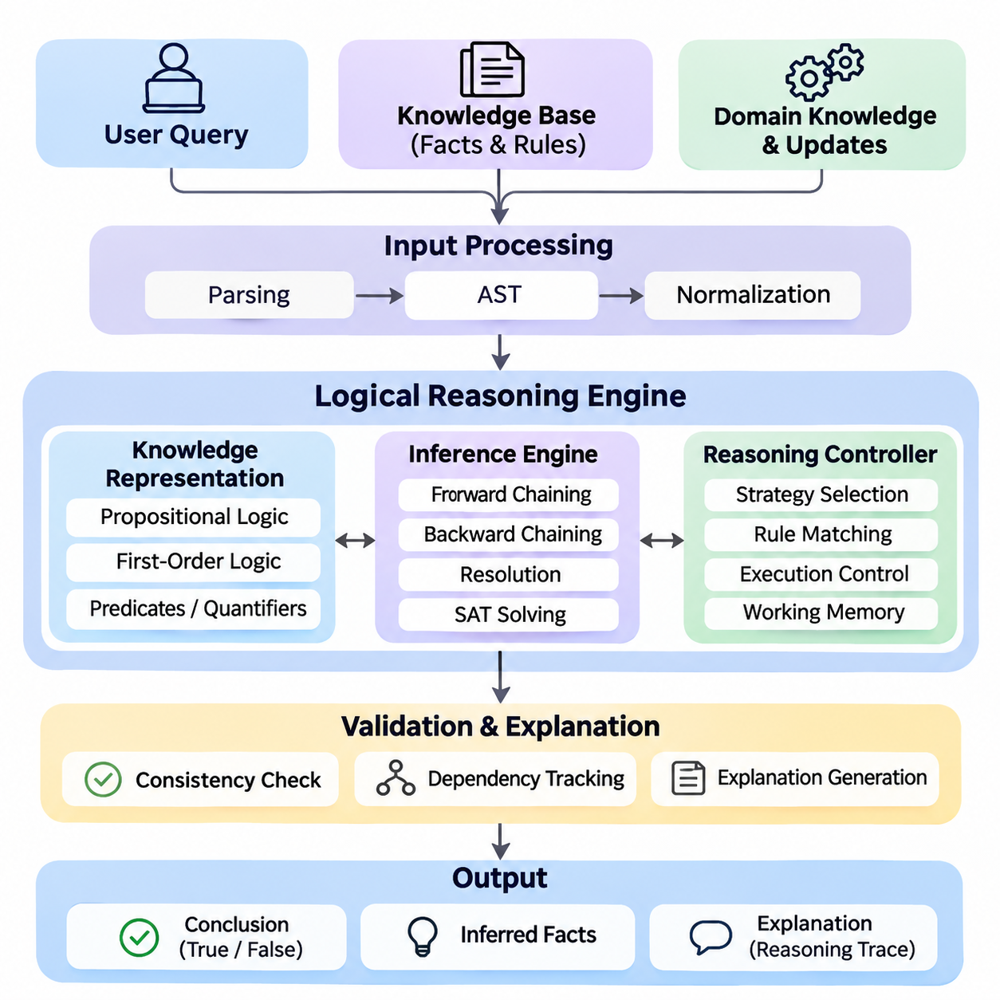
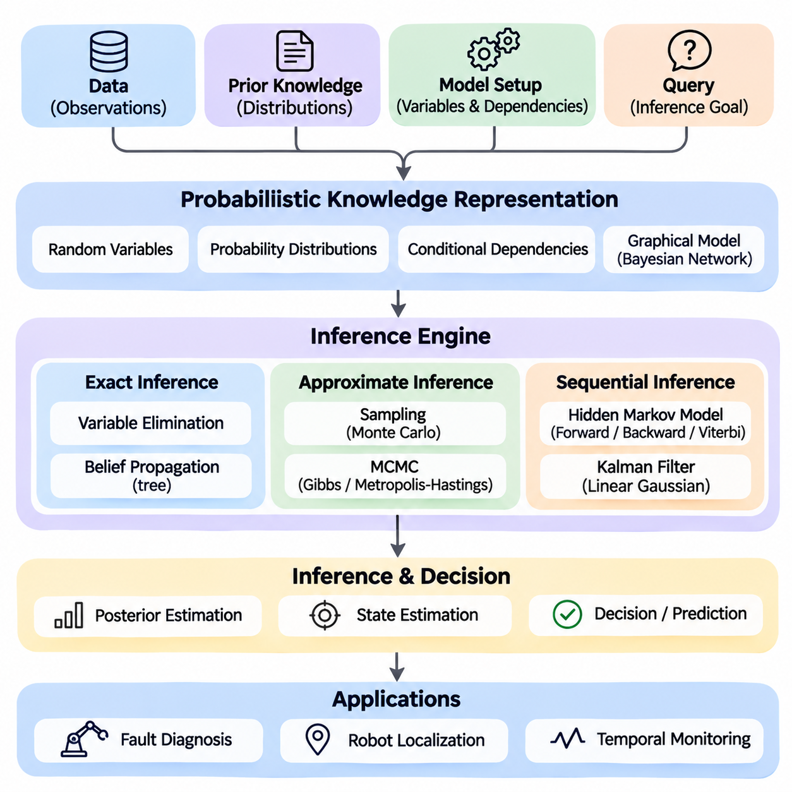
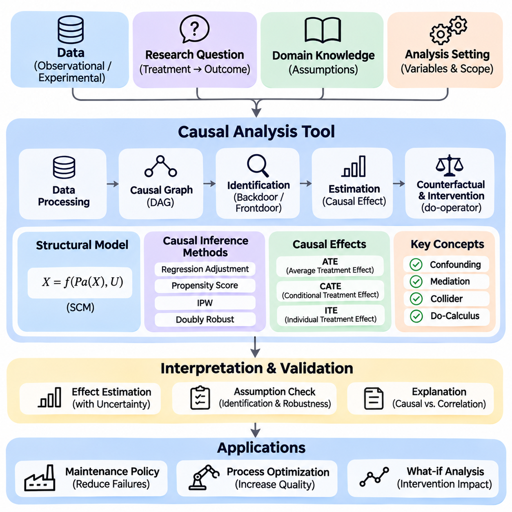
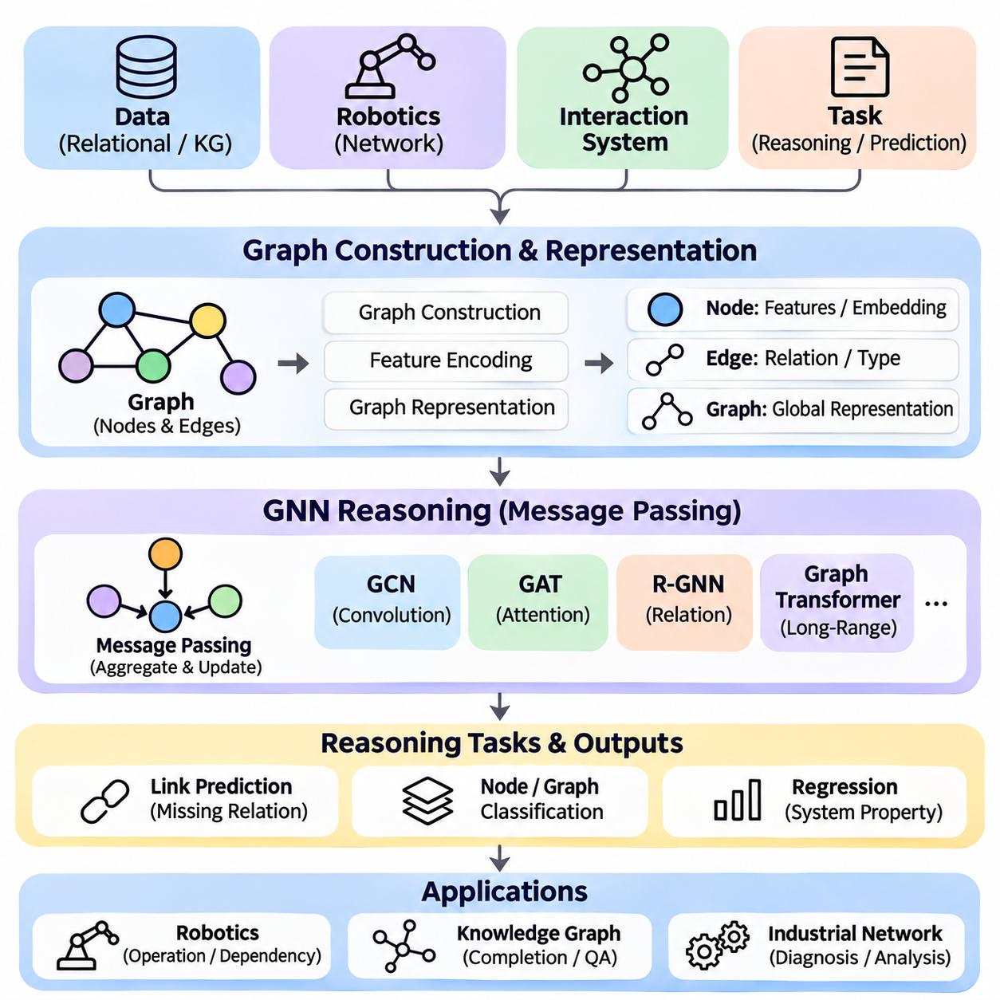
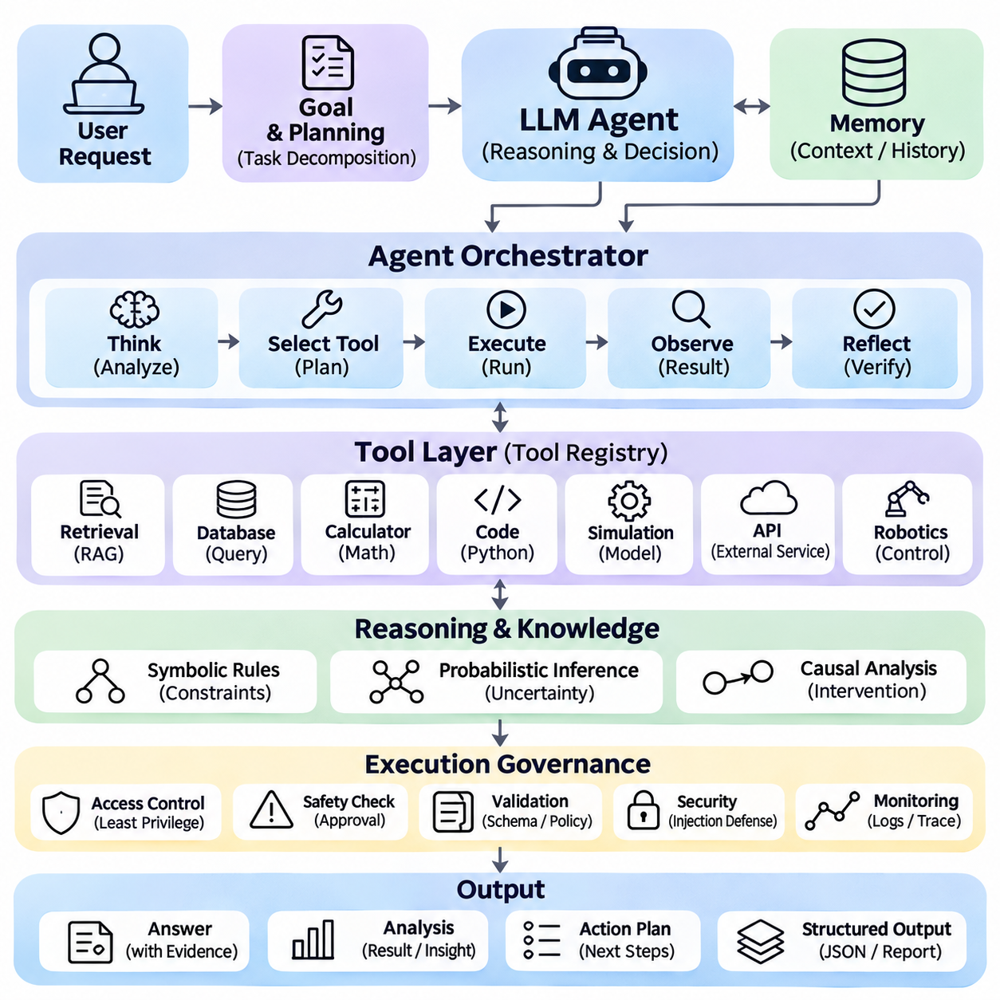
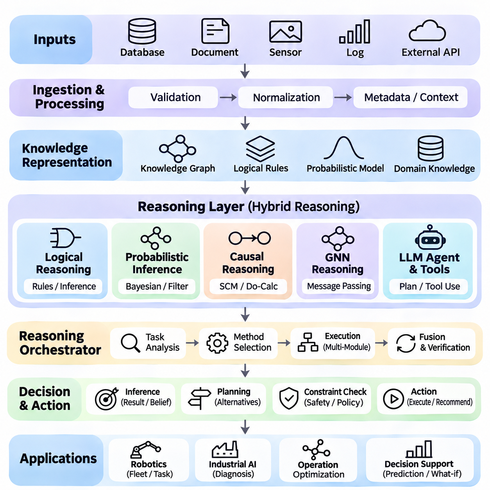

**Volume 03. Reasoning in AI**

# 06. Integrated Projects

## 06.01 Logical Reasoning Engine [w/Code]

{width="7.268055555555556in" height="7.268055555555556in"}

A Logical Reasoning Engine is an integrated artificial intelligence system that derives valid conclusions from explicitly represented knowledge, logical rules, and user queries. Unlike statistical prediction systems, its primary objective is to establish whether conclusions follow from defined premises. The project combines propositional logic, first-order logic, inference algorithms, and rule-based reasoning into a modular, explainable computational framework.

The central objective is to construct a reasoning engine capable of representing facts, evaluating logical expressions, applying inference rules, and answering structured questions. The system should distinguish established facts from inferred conclusions and unsupported statements. Its architecture must support knowledge acquisition, symbolic representation, inference execution, consistency checking, and explanation generation while maintaining predictable behavior.

Knowledge representation forms the foundation of the engine. Propositional logic represents statements as Boolean variables connected through conjunction, disjunction, negation, implication, and equivalence. First-order logic extends this representation through predicates, variables, constants, functions, and quantifiers. These mechanisms allow the engine to describe objects, properties, relationships, and general rules within a formally defined domain.

A practical implementation begins with a knowledge base containing facts and rules. Facts represent known conditions, while rules specify relationships that permit additional conclusions. For example, a robotic system may store that Robot_A is located in Zone_1 and that every robot operating in Zone_1 requires authorization. The reasoning engine can then infer the authorization requirement for Robot_A without explicitly storing that conclusion.

The input processing layer converts logical statements into internal representations suitable for computation. A parser identifies operators, predicates, arguments, variables, and quantifiers while validating grammatical structure. Abstract syntax trees provide hierarchical representations of expressions, allowing subsequent components to inspect and transform them. Normalization procedures prepare formulas for consistent interpretation and efficient inference.

Propositional reasoning provides an accessible starting point for implementation. Truth-table evaluation determines the truth value of compound expressions under specified assignments. Logical entailment testing establishes whether a conclusion follows from a knowledge base under every satisfying interpretation. Although truth tables are useful for small problems, their exponential growth motivates more efficient satisfiability algorithms for larger reasoning tasks.

A SAT solver determines whether a propositional formula admits at least one satisfying assignment. The engine can transform expressions into conjunctive normal form and apply algorithms such as Davis--Putnam--Logemann--Loveland or conflict-driven clause learning. Logical entailment can be tested by checking whether the knowledge base combined with the negation of a proposed conclusion is unsatisfiable.

First-order reasoning introduces variable binding and relational inference. Unification identifies substitutions that make compatible logical expressions identical, enabling general rules to operate on specific facts. Resolution applies logically valid transformations to clauses and can support proof by contradiction. A complete implementation must carefully handle substitutions, variable standardization, quantifier scope, and the limitations of automated theorem proving.

Rule-based reasoning provides another execution mechanism through forward chaining and backward chaining. Forward chaining begins with available facts and repeatedly applies applicable rules to derive additional knowledge. Backward chaining begins with a query and searches for premises that would establish its truth. These strategies support different computational requirements, including continuous knowledge updates and targeted question answering.

A hybrid inference controller can select reasoning strategies according to query characteristics and knowledge-base structure. Forward chaining is useful when many derived facts will be reused, while backward chaining reduces unnecessary computation for narrowly focused queries. Resolution and satisfiability checking provide complementary capabilities for general logical verification. Strategy selection must preserve the semantics and soundness guarantees of each supported reasoning method.

The inference engine should maintain a working memory containing established facts, intermediate conclusions, and active reasoning states. A rule-matching component identifies applicable implications, while an execution controller determines their processing order. Duplicate detection prevents repeated derivations, and dependency tracking records which premises support each conclusion. These mechanisms improve computational efficiency and enable transparent explanation generation.

Logical consistency is essential because contradictory knowledge can undermine classical reasoning. The engine should detect incompatible assertions, conflicting constraints, and unsatisfiable rule combinations. Consistency checking can employ SAT solving, theorem proving, or specialized integrity constraints. When contradictions are detected, the system should identify relevant premises and report the conflict rather than silently treating the knowledge base as reliable.

Not every practical domain follows monotonic reasoning, where previously established conclusions remain valid after additional knowledge is introduced. Non-monotonic reasoning allows conclusions to be reconsidered when new evidence appears. Default reasoning supports assumptions that normally hold, while defeasible reasoning permits exceptions to override general rules. These capabilities require explicit priority mechanisms and carefully defined inference semantics.

Temporal reasoning extends the engine to represent events, ordering, duration, and changing conditions. Logical rules can describe whether an action occurred before another event or whether a condition must remain true during an operation. Spatial reasoning represents relationships such as containment, adjacency, overlap, and relative position. Together, these extensions support intelligent systems operating within dynamic physical environments.

A useful engineering architecture separates the knowledge repository, parser, inference controller, reasoning algorithms, and query interface. Each component exposes clearly defined inputs and outputs, allowing independent testing and replacement. Python provides a practical implementation environment through classes representing terms, predicates, formulas, substitutions, and inference rules. Modular interfaces make the engine extensible without tightly coupling domain knowledge to algorithms.

The query interface accepts structured logical questions and returns conclusions with supporting evidence. Responses should distinguish proven statements, disproven statements, and conclusions that remain undetermined under the selected reasoning semantics. Importantly, failure to prove a statement does not necessarily establish its negation. The system must explicitly document whether it uses open-world assumptions, closed-world assumptions, or a combination of both.

Explainability is a major advantage of symbolic reasoning. Each inference step can be recorded as a proof trace identifying the applied rule, matched premises, substitutions, and resulting conclusion. These records can form a proof tree or dependency graph that users can inspect. Explanation generation should present the essential reasoning path while avoiding unnecessary intermediate operations that obscure the logical justification.

An industrial robotics application demonstrates the practical value of the engine. A mobile robot may receive facts describing its location, payload, operating mode, and environmental restrictions. Logical rules can determine whether a requested task satisfies operational constraints. If a robot carries hazardous material and a destination prohibits such cargo, the system can reject the mission and provide the specific rule responsible for that decision.

Integration with probabilistic and neural components can extend the system beyond purely symbolic inputs. Perception models may generate candidate observations, while probabilistic modules estimate their reliability. The logical engine evaluates verified or appropriately qualified symbolic assertions against operational rules. Such integration must preserve uncertainty information rather than automatically converting every uncertain prediction into an unquestioned fact.

Testing should cover parser correctness, logical equivalence, inference soundness, substitution accuracy, contradiction detection, and proof reproducibility. Unit tests can verify individual rules, while integration tests examine multi-step deductions across interconnected knowledge. Benchmark problems should include satisfiable and unsatisfiable formulas, recursive rules, contradictory assertions, and queries involving multiple variables.

Performance evaluation should measure inference latency, memory consumption, rule-matching efficiency, and scalability as knowledge-base size increases. Additional measurements can examine proof length, query throughput, and the computational impact of recursive reasoning. Different inference strategies should be compared under equivalent logical assumptions. Performance improvements must not compromise correctness or introduce unsupported conclusions.

The engine must also address practical limitations. General first-order logical entailment is undecidable, and unrestricted reasoning may fail to terminate. Recursive rules, large search spaces, and complex quantified expressions can impose substantial computational costs. Practical implementations therefore benefit from restricted logical fragments, indexing, caching, execution budgets, and controlled search strategies that balance expressiveness with predictable performance.

The completed project should provide a reusable reasoning service capable of knowledge management, formal inference, query answering, consistency analysis, and traceable explanation. Its modular design creates a foundation for subsequent probabilistic, causal, neural, and language-model reasoning projects. More importantly, it demonstrates how explicit logical structures can support verifiable decisions within larger intelligent systems.

## 06.02 Probabilistic Inference System [w/Code]

{width="7.268055555555556in" height="7.268055555555556in"}

A Probabilistic Inference System is an integrated artificial intelligence framework designed to reason under uncertainty by combining probability theory, graphical models, statistical estimation, and sequential inference. Unlike deterministic reasoning engines that derive conclusions from fixed logical premises, probabilistic systems represent uncertainty explicitly and update beliefs as evidence becomes available. This capability is essential for intelligent decision-making in dynamic environments.

The primary objective of this project is to construct a modular inference system capable of representing uncertain knowledge, estimating hidden states, integrating observations, and producing probability-based conclusions. The system combines Bayesian reasoning, exact inference, approximate inference, temporal models, and probabilistic robotics. Its architecture should support transparent probability calculations, reproducible experiments, and extensible interfaces for practical applications.

Bayesian probability provides the mathematical foundation for updating beliefs when new evidence is observed. Bayes\' theorem relates prior probability, likelihood, and posterior probability through a normalization factor. A prior represents existing knowledge about a hypothesis, while the likelihood describes how probable an observation is under that hypothesis. The posterior combines both sources to produce an updated belief consistent with the available evidence.

The system begins with a probabilistic knowledge representation layer that defines random variables, possible states, probability distributions, and conditional dependencies. Discrete variables may represent equipment conditions or environmental categories, while continuous variables describe quantities such as position, velocity, and temperature. Each variable must have a clearly specified domain and an associated probability model suitable for the intended inference method.

Bayesian networks provide a structured mechanism for representing dependencies among random variables. A Bayesian network consists of a directed acyclic graph whose nodes represent variables and whose edges encode conditional dependencies. Each node contains a conditional probability distribution determined by its parent variables. This representation enables a complex joint probability distribution to be factorized into smaller, computationally manageable components.

A practical implementation may construct a Bayesian network for equipment fault diagnosis. Variables can represent power availability, sensor health, communication status, and system failure. Conditional probability tables describe relationships between component conditions and observed symptoms. When abnormal sensor readings are detected, the inference engine updates the probabilities of potential failure causes and identifies hypotheses requiring further investigation.

Exact inference algorithms compute posterior probabilities without approximation, subject to numerical precision. Variable elimination performs inference by multiplying probability factors and summing out hidden variables that are not relevant to a query. The elimination order strongly influences computational complexity because intermediate factors may become large. Efficient implementations therefore require careful factor representation, variable ordering, and numerical normalization.

Belief propagation provides another inference mechanism through the exchange of messages between connected variables or factors. In tree-structured graphical models, sum-product message passing can calculate exact marginal probabilities. In graphs containing cycles, loopy belief propagation may provide approximate results, although convergence is not guaranteed. The inference system should distinguish exact computations from approximate message-passing procedures.

Approximate inference becomes necessary when exact probability calculations are computationally impractical. Sampling methods estimate probability distributions by generating representative samples from a target distribution. Monte Carlo techniques approximate expectations and posterior quantities using sample averages. Their accuracy depends on sampling quality, computational budget, and statistical properties such as variance and dependence between samples.

Markov Chain Monte Carlo methods generate samples through stochastic transitions designed to preserve a target probability distribution. Algorithms such as Gibbs sampling and Metropolis--Hastings can estimate complex posterior distributions without explicitly calculating every possible state combination. Practical implementations must consider initialization, burn-in, autocorrelation, convergence diagnostics, and effective sample size when interpreting results.

Sequential probabilistic inference addresses systems whose hidden states evolve over time. Hidden Markov Models represent temporal processes through hidden states, transition probabilities, and observation probabilities. The Markov assumption states that the next hidden state depends on the current state rather than the complete historical sequence. This structure enables efficient reasoning about sequences of uncertain observations.

The forward algorithm calculates the probability of observed sequences and filtered state distributions, while the backward algorithm incorporates evidence from later observations. Combining both procedures produces smoothed state estimates. The Viterbi algorithm identifies the most probable hidden-state sequence under the model. These algorithms support applications such as activity recognition, fault monitoring, and temporal behavior interpretation.

Kalman filtering provides a recursive estimation framework for linear dynamical systems with Gaussian process and measurement noise. Each iteration includes a prediction stage based on the system dynamics and an update stage incorporating new measurements. The resulting estimate combines prior state information with observation uncertainty. Covariance matrices quantify estimation uncertainty and determine how strongly measurements influence the updated state.

Extended Kalman Filters accommodate nonlinear systems by locally linearizing transition and observation functions through Jacobian matrices. Unscented Kalman Filters use deterministically selected sigma points to approximate the propagation of uncertainty through nonlinear transformations. Both methods extend recursive state estimation beyond strictly linear models, but their accuracy depends on modeling assumptions and the characteristics of the underlying nonlinear dynamics.

Particle filters represent posterior distributions through weighted samples rather than a single Gaussian approximation. Particles are propagated through a transition model, weighted according to observation likelihoods, and resampled when necessary. This approach can represent multimodal distributions and nonlinear state transitions. However, particle degeneracy, sample impoverishment, and computational complexity require careful management.

A probabilistic robotics application demonstrates the integration of state estimation and sensor fusion. An autonomous mobile robot may combine wheel odometry, inertial measurements, GNSS observations, and LiDAR-based localization estimates. Each sensor provides information with different noise characteristics and failure conditions. The inference system combines these observations to estimate robot position, orientation, and uncertainty while accounting for motion dynamics.

Sensor fusion requires explicit models of measurement uncertainty and dependencies between observations. Independent measurements can provide complementary information, but correlated errors may cause overconfidence if treated incorrectly. Timestamp alignment, coordinate transformations, covariance estimation, and outlier detection are therefore essential engineering requirements. The system should reject invalid measurements or reduce their influence when sensor reliability deteriorates.

Partially Observable Markov Decision Processes extend probabilistic inference into sequential decision-making. Because an agent cannot directly observe the complete environmental state, it maintains a belief distribution over possible states. Actions influence future states, while observations update the belief. A decision policy selects actions according to expected rewards, transition dynamics, observation models, and uncertainty about the current environment.

The software architecture should separate probabilistic model definitions, inference algorithms, observation processing, state estimation, and result visualization interfaces. Python implementations can use NumPy and SciPy for numerical operations, while specialized probabilistic programming libraries can support graphical models and sampling. Modular interfaces allow exact inference, Monte Carlo methods, and recursive filters to operate within a consistent experimental framework.

Numerical stability is critical because repeated multiplication of small probabilities can produce floating-point underflow. Log-probability representations, normalization procedures, and stable summation techniques help preserve computational reliability. Probability distributions must satisfy nonnegativity and normalization constraints. Invalid parameters, singular covariance matrices, and inconsistent observations should trigger explicit validation errors rather than silently producing unreliable estimates.

Evaluation should examine estimation accuracy, posterior calibration, computational latency, memory consumption, and robustness to noisy or missing observations. Synthetic datasets with known ground truth allow controlled verification of inference algorithms. Real-world datasets reveal model mismatch, sensor bias, and distribution changes. Comparisons between exact and approximate methods should consider both computational efficiency and the accuracy of estimated probability distributions.

The completed Probabilistic Inference System should provide a reusable foundation for uncertainty-aware reasoning across diagnostic systems, autonomous robotics, temporal analysis, and intelligent decision-making. Its integrated architecture demonstrates how Bayesian networks, sampling algorithms, hidden-state models, and recursive filters can operate together. By representing uncertainty explicitly, the system enables decisions that reflect both available evidence and the limitations of current knowledge.

## 06.03 Causal Analysis Tool [w/Code]

{width="7.268055555555556in" height="7.268055555555556in"}

A Causal Analysis Tool is an integrated artificial intelligence system designed to identify, represent, and evaluate cause-and-effect relationships within complex datasets. Unlike conventional statistical analysis, which primarily identifies associations between variables, causal analysis investigates how interventions may change outcomes. The system combines causal graphical models, structural equations, identification methods, counterfactual reasoning, and statistical estimation into a unified analytical framework.

The primary objective of this project is to construct a modular causal reasoning platform capable of representing causal assumptions, identifying causal effects, estimating intervention outcomes, and explaining analytical conclusions. The tool should support observational datasets, experimental evidence, and domain knowledge while distinguishing statistical correlation from causal influence. Its architecture must emphasize transparency, reproducibility, assumption validation, and reliable interpretation.

Causal analysis begins by defining a research question involving a treatment, intervention, exposure, or decision variable and an outcome of interest. For example, an industrial system may investigate whether increasing preventive maintenance frequency reduces equipment failures. The analysis must distinguish the effect of maintenance from other influences, including equipment age, operating conditions, production intensity, and environmental factors that may affect both maintenance decisions and failure rates.

A causal graphical model represents hypothesized relationships through a directed acyclic graph. Nodes correspond to variables, while directed edges represent assumed direct causal influences. These graphs provide a structured language for expressing domain knowledge and identifying potential confounding relationships. The graph should be interpreted as a model of causal assumptions rather than proof that the represented relationships are correct.

Structural Causal Models extend causal graphs by associating each endogenous variable with a structural equation describing how its value depends on parent variables and exogenous disturbances. These equations define mechanisms through which causes generate effects. By explicitly representing the data-generating process, structural models provide a foundation for observational reasoning, interventions, and counterfactual analysis within a consistent mathematical framework.

The software architecture should separate data ingestion, causal graph construction, identification, statistical estimation, counterfactual simulation, and result interpretation. A data processing layer validates variable types, missing values, measurement scales, and temporal consistency. A graph management component stores causal assumptions and supports structural modifications. An estimation layer executes statistical procedures selected according to the identified causal estimand and available data.

Correlation analysis provides an initial description of statistical relationships but cannot independently establish causality. Two variables may be correlated because one causes the other, because both share a common cause, or because of selection mechanisms. The tool should therefore distinguish descriptive associations from causal estimates. Users must specify assumptions that justify interpreting observed relationships as evidence about interventions.

Confounding occurs when a variable influences both the treatment and outcome, potentially creating misleading associations. The backdoor criterion provides graphical conditions for identifying adjustment sets that block noncausal paths between treatment and outcome. When a valid adjustment set exists and relevant assumptions hold, statistical adjustment can identify causal effects. The tool should distinguish confounders from mediators and colliders to avoid introducing additional bias.

The frontdoor criterion provides an alternative identification strategy when a suitable mediator is observed and specific graphical conditions are satisfied. It can sometimes identify causal effects despite unobserved confounding between treatment and outcome. However, frontdoor identification requires restrictive assumptions concerning causal pathways and confounding relationships. The system should verify the required graphical conditions before applying the corresponding estimation procedure.

Interventional reasoning examines how an outcome distribution changes when a treatment variable is externally assigned. Pearl\'s do-operator distinguishes interventions from ordinary conditioning by modifying the causal mechanism that determines the treatment. Do-calculus provides transformation rules for identifying intervention distributions from observational information when permitted by the causal graph. The tool should report whether an effect is identifiable before attempting numerical estimation.

Once identification is established, the estimation component can apply regression adjustment, propensity score methods, inverse probability weighting, or doubly robust estimators. These techniques require appropriate assumptions concerning confounding, positivity, consistency, and model specification. The system should select methods according to the causal structure and data characteristics rather than treating every statistical estimator as universally applicable.

Average Treatment Effects quantify the expected difference between outcomes under alternative treatment conditions across a target population. Conditional Average Treatment Effects describe how causal effects vary across subgroups or individual characteristics. Such estimates can support personalized decisions and operational optimization. The tool must clearly define the target population, treatment contrast, outcome measure, and assumptions underlying each reported estimate.

Counterfactual reasoning investigates hypothetical outcomes under alternative conditions for the same unit or event. A structural causal model can support counterfactual inference through abduction, action, and prediction. The system first infers information about unobserved disturbances, then modifies the relevant intervention, and finally predicts the hypothetical outcome. Counterfactual conclusions depend on the structural model and generally cannot be verified directly for individual cases.

Causal discovery algorithms attempt to infer aspects of causal structure from observed data. Constraint-based approaches use conditional independence tests to eliminate incompatible graph structures, while score-based approaches search for graphs that optimize statistical criteria. The PC algorithm provides a representative constraint-based method. Its conclusions depend on assumptions such as causal sufficiency, faithfulness, and the reliability of conditional independence tests.

A practical implementation can integrate causal discovery with expert-defined constraints. Domain knowledge may establish that certain variables precede others or that particular causal directions are physically impossible. These constraints reduce the search space and improve interpretability. Nevertheless, observational data often identify only an equivalence class of causal graphs, making it essential to preserve ambiguity rather than invent unsupported causal directions.

Temporal causal analysis addresses relationships in which causes and effects occur at different times. Industrial monitoring systems may examine how operating temperature, vibration, maintenance actions, and component degradation influence future failures. Time-indexed variables and lagged dependencies can represent these relationships. The analysis must consider feedback, time-varying confounding, and temporal ordering to avoid misleading causal interpretations.

Sensitivity analysis evaluates how conclusions change when modeling assumptions are modified. Unmeasured confounding, measurement error, selection bias, and model misspecification can substantially alter estimated causal effects. The tool should support alternative adjustment sets, model specifications, and plausible confounding scenarios. Robust conclusions should remain reasonably stable across defensible assumptions, while unstable findings require explicit qualification.

A causal analysis workflow should include diagnostic procedures that examine covariate balance, overlap between treatment groups, model fit, and estimation uncertainty. Confidence intervals and uncertainty estimates communicate the precision of causal effect estimates under the adopted assumptions. Statistical significance alone does not establish causal validity. Diagnostic reports should separate estimation quality from the credibility of causal identification assumptions.

Python provides a practical environment for implementing the system through numerical computing, statistical modeling, and causal inference libraries. NumPy, pandas, and SciPy support data processing and numerical calculations, while libraries such as DoWhy, EconML, and causal-learn provide specialized causal modeling capabilities. A modular implementation should isolate library-specific interfaces so that identification and estimation components can be tested independently.

An industrial robotics case study can investigate whether a modified navigation policy reduces emergency braking events. Observational logs may contain robot speed, obstacle density, route complexity, payload, and braking frequency. A causal graph identifies potential confounders influencing both policy selection and braking outcomes. After establishing an appropriate identification strategy, the system estimates the intervention effect while documenting remaining uncertainty.

Evaluation should combine synthetic experiments with known causal structures and real-world observational studies. Synthetic structural models allow comparison between estimated effects and known intervention effects. Real-world evaluations assess robustness, computational performance, and practical interpretability. Benchmarking should measure identification correctness, estimation bias, confidence interval coverage, sensitivity to confounding, and reproducibility across experimental configurations.

The completed Causal Analysis Tool should provide a reusable platform for causal graph management, intervention identification, treatment effect estimation, counterfactual simulation, and evidence-based decision support. Its modular architecture connects theoretical causal reasoning with practical engineering workflows. By explicitly separating assumptions, identification, estimation, and interpretation, the system enables more defensible conclusions about how actions influence outcomes in complex environments.

## 06.04 GNN Reasoning System [w/Code]

{width="7.268055555555556in" height="7.268055555555556in"}

A Graph Neural Network Reasoning System is an integrated artificial intelligence framework designed to learn relationships, propagate information, and perform structured reasoning over graph-based data. Unlike conventional neural networks that primarily process fixed-dimensional inputs, Graph Neural Networks operate on interconnected entities and their relationships. This capability enables reasoning across knowledge graphs, relational databases, physical systems, and complex interaction networks.

The primary objective of this project is to construct a modular reasoning system that combines graph representation learning, message passing, relational inference, and neural prediction. The system should transform structured graph information into meaningful node, edge, and graph-level representations. Its architecture must support graph construction, feature encoding, neural reasoning, training, evaluation, and interpretable inference within a reproducible computational workflow.

Graph representation provides the foundation of the system. A graph consists of nodes representing entities and edges representing relationships or interactions between those entities. Nodes may contain numerical attributes, categorical labels, or learned embeddings, while edges may include relation types, distances, directions, or interaction strengths. This flexible representation enables the system to model structured knowledge and physical relationships within a unified mathematical framework.

The graph construction layer converts raw datasets into graph structures suitable for neural computation. In a knowledge graph, entities become nodes and semantic relationships become typed edges. In robotics, nodes may represent robots, obstacles, locations, and tasks, while edges describe spatial proximity, connectivity, or operational dependencies. Graph construction must preserve meaningful relationships while avoiding unnecessary connections that increase computational complexity.

Feature encoding transforms node and edge attributes into numerical representations that neural networks can process. Continuous attributes may be normalized, categorical attributes embedded, and missing values handled through explicit strategies. Structural features such as node degree, positional encodings, or graph distances can provide additional context. The resulting feature vectors form the initial representations used by subsequent message-passing operations.

Message passing is the central computational mechanism of Graph Neural Networks. During each layer, nodes receive information from neighboring nodes through messages generated from their features and relationships. An aggregation function combines incoming messages, and an update function produces a new node representation. Repeating this process allows information to propagate across multiple graph connections and enables learning from increasingly broad relational neighborhoods.

Graph Convolutional Networks provide a practical starting point for implementing neighborhood-based representation learning. A graph convolution layer combines node features with information from adjacent nodes using normalized graph connectivity. Multiple layers allow nodes to incorporate information from progressively larger neighborhoods. However, excessive propagation can cause oversmoothing, where node representations become difficult to distinguish, making architectural depth an important design consideration.

Graph Attention Networks extend message passing by learning the relative importance of neighboring nodes. Attention coefficients determine how strongly each neighbor contributes to the updated representation. This mechanism can improve flexibility when relationships differ in relevance. Nevertheless, attention weights should not automatically be interpreted as complete causal explanations, because learned importance scores do not independently establish why a prediction is correct.

Relational Graph Neural Networks support graphs containing multiple edge types. A knowledge graph may include relationships such as located_in, connected_to, requires, and controls. Relation-specific transformations allow the model to process these interactions differently while sharing information across the graph. This capability is particularly useful for heterogeneous systems where entities and relationships have distinct semantic meanings.

A practical reasoning task involves predicting missing relationships between entities. Given a graph containing known facts, the system can estimate whether an unobserved edge should exist. Link prediction models learn compatibility between node representations and candidate relations. Such predictions can support knowledge graph completion, recommendation systems, and operational dependency discovery, although predicted relationships remain hypotheses until independently verified.

Multi-hop relational reasoning requires combining information across several connected entities. For example, a robot may depend on a controller that communicates through a network connected to a central server. The reasoning system can learn representations that reflect these indirect dependencies. Message-passing depth determines the nominal neighborhood accessible to each node, while graph topology and aggregation behavior influence how effectively distant information is preserved.

Graph-level reasoning aggregates information from multiple nodes into a representation of an entire graph or subgraph. Readout operations such as mean pooling, sum pooling, and attention-based pooling summarize learned node features. These representations support classification and regression tasks involving complete systems. Applications include equipment condition assessment, molecular property prediction, and analysis of operational network configurations.

The system can incorporate graph transformers to model interactions beyond immediate neighborhoods. Attention mechanisms operating over graph elements may capture long-range dependencies that conventional local message passing handles inefficiently. Structural encodings and sparse attention strategies help preserve graph information while controlling computational cost. The choice between message-passing networks and graph transformers depends on graph size, relational complexity, and available computing resources.

Neuro-symbolic integration can strengthen reasoning by combining learned graph representations with explicit logical constraints. Neural components estimate relationships or classify entities, while symbolic rules verify whether predicted conclusions satisfy domain requirements. For example, a learned model may propose a robot-task assignment, but a logical constraint can reject assignments violating payload or access restrictions. This separation improves operational reliability and traceability.

The training pipeline begins by defining a supervised or self-supervised learning objective. Node classification uses labeled entities, link prediction uses observed relationships and sampled negative examples, and graph classification uses graph-level targets. Loss functions measure disagreement between predictions and training targets. Optimization algorithms update model parameters through gradient-based learning while validation data guide architecture selection and hyperparameter tuning.

Data partitioning requires particular care because graph connections can introduce information leakage. Transductive learning permits access to the full graph structure while withholding selected labels, whereas inductive learning evaluates generalization to previously unseen nodes or graphs. Link prediction benchmarks must prevent target-edge information from leaking through features or graph construction. Appropriate splits should reflect the intended deployment environment.

A Python implementation can use PyTorch together with PyTorch Geometric or Deep Graph Library for graph processing and neural computation. Graph objects store node features, edge indices, relation attributes, and target labels. Modular model classes implement graph convolution, attention, relational message passing, and prediction heads. Configuration files define experimental settings, enabling controlled comparisons between alternative architectures.

Scalability becomes important when graphs contain millions of nodes or edges. Full-graph message passing can exceed available memory and introduce substantial computational overhead. Neighbor sampling, subgraph mini-batching, sparse matrix operations, and distributed graph processing provide practical optimization strategies. System performance depends on graph density, feature dimensionality, sampling configuration, and communication costs between computational devices.

Interpretability requires examining which graph structures and features influence model predictions. Explanation methods may identify influential nodes, edges, subgraphs, or feature dimensions. Counterfactual graph analysis can investigate how predictions change when selected relationships are modified. These explanations should be treated as model-behavior analyses rather than definitive evidence of real-world causality, particularly when graph construction contains uncertain relationships.

An industrial robotics case study can model a fleet of autonomous mobile robots operating within a shared facility. Nodes represent robots, charging stations, workstations, routes, and assigned tasks. Edges encode accessibility, communication links, task dependencies, and spatial relationships. A GNN can predict congestion risks, identify potentially conflicting assignments, or estimate operational bottlenecks from the evolving graph structure.

Evaluation should measure predictive accuracy, relational generalization, computational efficiency, and robustness to graph perturbations. Node classification can use accuracy and F1 score, while link prediction can use ranking metrics such as mean reciprocal rank and Hits\\@K. Graph classification may use accuracy or area under the receiver operating characteristic curve. Ablation studies should examine the contributions of node features, edge types, model depth, and aggregation mechanisms.

The completed GNN Reasoning System should provide a reusable foundation for structured neural inference across knowledge graphs, robotics, industrial networks, and intelligent decision-support applications. Its architecture integrates graph construction, representation learning, message passing, relational prediction, and explanation mechanisms. By combining neural learning with explicit relational structures, the system demonstrates how interconnected information can support scalable and context-aware reasoning.

## 06.05 LLM Agent with Tools [w/Code]

{width="7.268055555555556in" height="7.268055555555556in"}

An LLM Agent with Tools is an intelligent software system that combines the language understanding and reasoning capabilities of a Large Language Model with external tools, computational services, and structured information sources. Unlike a conventional chatbot that primarily generates text, a tool-enabled agent can retrieve evidence, execute calculations, interact with software, and perform controlled actions. This architecture transforms language generation into an iterative process of reasoning, execution, and verification.

The primary objective of this project is to develop a modular agent capable of interpreting user objectives, decomposing complex tasks, selecting appropriate tools, and integrating execution results into coherent responses. The system should support multi-step reasoning, dynamic tool invocation, contextual memory, and structured output generation. Its design must emphasize reliability, transparency, access control, and recoverable execution across heterogeneous computational environments.

The agent architecture consists of a language model, an orchestration controller, a tool registry, a context manager, and an execution environment. The language model interprets requests and proposes actions, while the controller determines whether those actions are permitted and executable. The tool registry describes available operations, and the execution environment performs validated calls. This separation prevents generated instructions from automatically becoming unrestricted system actions.

Tool definitions provide structured descriptions of external capabilities, including operation names, expected arguments, data types, and return formats. A calculator may accept mathematical expressions, while a database tool may require a query and connection identifier. Schema validation ensures that generated arguments satisfy interface requirements before execution. Clear descriptions improve tool selection and reduce errors caused by ambiguous operation names or incompatible parameters.

The agent operates through a repeated reasoning and action cycle. It interprets the current objective, determines whether additional information or computation is necessary, and selects an appropriate operation. After execution, the tool result becomes part of the available context for subsequent decisions. The cycle continues until the task is completed, a stopping condition is reached, or an unresolved dependency requires user clarification.

Planning enables the agent to transform broad objectives into manageable subtasks. A complex engineering request may require retrieving specifications, comparing alternatives, calculating resource requirements, and preparing a final recommendation. The planner must recognize dependencies between operations and determine which tasks can execute independently. Explicit execution limits prevent unnecessary tool calls, excessive computation, and unproductive reasoning loops.

Retrieval tools connect the agent to documents, databases, knowledge graphs, and indexed information repositories. Retrieval-Augmented Generation allows the model to incorporate relevant external evidence rather than relying exclusively on learned parameters. Retrieved passages should retain source identifiers and relevant metadata. The agent must distinguish retrieved facts from generated interpretations and avoid presenting unsupported conclusions as verified evidence.

Computational tools extend the agent beyond natural language reasoning by providing deterministic calculations and executable procedures. Python interpreters, mathematical solvers, and simulation environments can process numerical problems or evaluate engineering scenarios. The agent should validate inputs, inspect execution outputs, and handle exceptions explicitly. Computational results require appropriate interpretation because correct execution does not guarantee correct assumptions or meaningful conclusions.

Memory management maintains information necessary for coherent multi-step execution. Short-term memory stores the current objective, recent observations, intermediate results, and unresolved questions. Persistent memory may retain authorized preferences or reusable project knowledge across sessions. Memory retrieval should prioritize relevance, provenance, and freshness while avoiding unnecessary retention of sensitive information or unverified model-generated assumptions.

Structured reasoning can combine language-model planning with symbolic rules and probabilistic inference. A symbolic component may enforce operational constraints, while a probabilistic model estimates uncertainty in observations or predicted outcomes. The language model coordinates these components and explains their results. Such hybrid reasoning is particularly valuable when decisions require both flexible interpretation and mathematically explicit validation.

Tool selection can be formulated as a decision problem involving expected usefulness, execution cost, latency, and operational risk. The agent should prefer direct reasoning for simple requests and invoke tools when external evidence or computation materially improves the answer. Parallel execution may reduce latency when independent operations are available. However, operations with dependencies must preserve their required execution order.

Security boundaries are essential because tool-enabled agents can interact with external systems. Least-privilege access restricts each tool to necessary permissions, while authentication and authorization protect sensitive resources. Potentially destructive actions require explicit approval and additional validation. The agent must treat retrieved documents, tool responses, and external messages as untrusted content rather than instructions that can override system policies.

Prompt injection represents a significant threat when external content attempts to redirect agent behavior. Malicious text embedded in retrieved documents or web pages may request unauthorized tool execution or disclosure of protected information. Defensive mechanisms include instruction hierarchy enforcement, content isolation, permission checks, and constrained tool interfaces. Security validation must occur outside the language model whenever dependable enforcement is required.

Execution reliability depends on robust error handling and recovery procedures. Tool calls may fail because of network interruptions, unavailable services, invalid arguments, or resource limitations. The controller should classify failures and determine whether retrying, selecting an alternative tool, or requesting clarification is appropriate. Retry limits, timeouts, idempotency controls, and execution logs help prevent duplicated operations and uncontrolled resource consumption.

Observability enables developers to inspect how the agent reaches operational outcomes. Execution traces should record tool selections, validated arguments, response status, latency, and relevant intermediate results. Sensitive values must be protected through appropriate logging policies. Structured traces support debugging, performance optimization, and accountability without requiring unrestricted exposure of private model reasoning or confidential information.

A practical Python implementation can combine an LLM interface with a registry of callable functions and an asynchronous orchestration layer. Tool adapters normalize different service interfaces into consistent request and response structures. A task-state object maintains execution progress, while validators check generated arguments before dispatch. Modular components allow individual tools, planning strategies, and memory mechanisms to be tested independently.

An industrial robotics application can demonstrate the agent\'s capabilities through maintenance and fleet management. A user may ask why an autonomous mobile robot repeatedly fails to complete a delivery mission. The agent retrieves operational logs, checks diagnostic records, analyzes battery measurements, and compares navigation events. It then produces an evidence-based explanation while distinguishing confirmed faults from possible contributing factors.

Integration with physical systems requires additional safeguards because incorrect commands may produce real-world consequences. The language model should not directly control safety-critical actuators or bypass certified control logic. Instead, it may propose high-level tasks that are validated by deterministic controllers, safety monitors, and authorization mechanisms. Execution should remain subject to operational constraints, environmental conditions, and emergency-stop systems.

Multi-agent architectures extend the design by assigning specialized responsibilities to cooperating agents. One agent may retrieve information, another may perform numerical analysis, and a third may review evidence or prepare reports. A supervisory controller coordinates their outputs and resolves task dependencies. Although specialization can improve modularity, additional agents also introduce communication overhead, inconsistent assumptions, and coordination complexity.

Evaluation should measure task completion accuracy, tool selection correctness, argument validity, execution success, latency, and computational cost. Benchmark scenarios must include missing information, conflicting evidence, malformed tool outputs, and permission restrictions. End-to-end tests should verify that the agent reaches supported conclusions without unauthorized actions. Repeated trials reveal variability caused by probabilistic language generation and changing external environments.

The completed LLM Agent with Tools should provide a reusable architecture for combining natural language interaction, external computation, information retrieval, and controlled operational execution. Its modular design connects planning, tool invocation, memory, security, and verification within a unified workflow. By grounding decisions in validated tool results and enforcing execution boundaries, the system enables more capable, accountable, and reliable AI-assisted automation.

## 06.06 End to End Reasoning AI System [w/Code]

{width="7.268055555555556in" height="7.268055555555556in"}

An End-to-End Reasoning AI System is an integrated artificial intelligence architecture that combines logical reasoning, probabilistic inference, causal analysis, graph neural networks, and language-model agents into a unified decision-making framework. Rather than relying on a single reasoning technique, the system coordinates complementary methods to interpret evidence, evaluate uncertainty, identify causal relationships, and generate actionable conclusions across complex environments.

The primary objective of this project is to construct a modular reasoning platform capable of processing heterogeneous information, maintaining structured knowledge, selecting appropriate inference methods, and executing validated decisions. The architecture should connect symbolic reasoning, statistical estimation, neural representation learning, and external tools through standardized interfaces. Its design emphasizes reliability, explainability, scalability, and reproducible execution.

The system begins with a multimodal information ingestion layer that accepts structured databases, documents, sensor measurements, event logs, and external service responses. Each input undergoes validation, normalization, and metadata extraction before entering the reasoning pipeline. Timestamps, source identifiers, confidence estimates, and data quality indicators preserve the context required for reliable interpretation and subsequent inference.

A unified knowledge representation layer organizes incoming information into entities, attributes, relationships, logical rules, and probabilistic variables. Knowledge graphs provide relational structure, while symbolic constraints encode explicit operational requirements. Probabilistic distributions describe uncertainty associated with observations and hidden states. The representation must distinguish verified facts, inferred hypotheses, and assumptions introduced by analytical models.

Logical reasoning provides deterministic validation and rule-based inference. A logical engine evaluates propositions, applies inference rules, checks consistency, and determines whether candidate conclusions satisfy established constraints. Forward chaining derives consequences from available facts, while backward chaining investigates whether specific goals can be established. This component is particularly important for enforcing safety rules, operational policies, and authorization requirements.

Probabilistic inference handles uncertainty that cannot be resolved through deterministic rules alone. Bayesian networks represent conditional dependencies, while recursive filters estimate hidden states from noisy observations. Sampling algorithms approximate complex posterior distributions when exact inference becomes computationally expensive. The system should propagate uncertainty through intermediate calculations and avoid presenting uncertain predictions as established facts.

Causal reasoning extends the architecture from identifying relationships to evaluating the consequences of interventions. Structural causal models represent hypothesized mechanisms connecting variables, while graphical identification methods determine whether causal effects can be estimated from available evidence. Counterfactual analysis explores alternative outcomes under different actions. Causal conclusions must remain conditional on explicitly documented identification assumptions.

Graph Neural Networks provide learned representations of interconnected entities and their interactions. Message-passing operations aggregate information across neighboring nodes, enabling relational prediction and graph-level classification. In complex operational networks, graph learning can estimate hidden dependencies, detect anomalous relationships, and predict system conditions. Neural predictions should complement rather than automatically override explicit logical constraints.

Large Language Models provide a natural language interface and coordinate reasoning operations across specialized components. The language-model agent interprets user objectives, decomposes tasks, selects tools, and synthesizes results into understandable explanations. Its orchestration controller validates tool requests and enforces execution permissions. The model should not independently authorize high-impact actions or treat generated reasoning as verified evidence.

A central reasoning orchestrator manages the complete inference workflow. It identifies the task type, determines which reasoning modules are relevant, and schedules their execution according to dependencies. A diagnostic question may require probabilistic estimation followed by causal analysis, while a planning request may require graph prediction and logical constraint checking. Intermediate results are stored with provenance and uncertainty information.

Hybrid reasoning requires explicit mechanisms for combining outputs from different models. Logical rules may reject an unsafe recommendation even when a neural model assigns it a high probability. Probabilistic estimates may rank competing hypotheses, while causal analysis evaluates whether proposed interventions can produce desired outcomes. Conflicting conclusions should trigger additional verification rather than being silently merged into a single unsupported answer.

The system should maintain a shared state containing current observations, inferred beliefs, active goals, task history, and operational constraints. A context manager updates this state as new information arrives and preserves relevant dependencies between reasoning steps. Versioned knowledge records allow conclusions to be traced to the evidence available at the time of inference. Outdated or contradictory information should be flagged for review.

An end-to-end reasoning workflow begins when a user submits a question or an external event triggers analysis. The system identifies the objective, retrieves relevant evidence, and constructs a task-specific reasoning context. Specialized modules then evaluate logical conditions, estimate uncertain variables, analyze causal hypotheses, or predict relational patterns. The orchestrator combines validated results and prepares a response or proposed action.

Decision-making converts reasoning results into candidate actions evaluated against objectives and constraints. Each candidate may be assessed according to expected benefit, uncertainty, computational cost, and operational risk. Optimization or planning algorithms select feasible alternatives, while symbolic rules enforce mandatory restrictions. Actions affecting external systems require authorization and independent validation before execution.

A practical industrial robotics application can integrate these capabilities into autonomous mobile robot fleet management. Sensor data and operational logs describe robot positions, battery conditions, task assignments, and environmental obstacles. Probabilistic filters estimate uncertain robot states, while graph neural networks model fleet interactions. Logical rules enforce operational restrictions, and causal models investigate factors contributing to repeated mission failures.

For example, a robot may repeatedly stop near a congested workstation. The probabilistic module estimates localization confidence, while graph analysis identifies traffic dependencies between robots and shared routes. Causal analysis examines whether congestion, sensor degradation, or scheduling changes contribute to the stops. The language-model agent summarizes the evidence and proposes corrective actions, which remain subject to operational safety validation.

Software implementation should follow a modular service-oriented architecture. Python components can provide logical inference, probabilistic computation, causal estimation, graph learning, and language-model orchestration. Standardized data schemas and application programming interfaces allow independent development and testing. Message queues or event-driven interfaces can support asynchronous communication between modules without tightly coupling their internal implementations.

Reliability requires explicit handling of failures, uncertainty, and inconsistent evidence. Each module should report execution status, confidence information where meaningful, and diagnostic messages. Timeouts, retries, fallback procedures, and resource limits prevent individual failures from disrupting the entire system. Safety-critical decisions must use deterministic validation mechanisms that remain effective even when neural predictions or external services are unavailable.

Security and governance are essential because integrated reasoning systems may access sensitive information and influence physical operations. Authentication, authorization, audit logging, and least-privilege permissions protect external resources. Retrieved content must be treated as untrusted data to reduce prompt injection risks. Human approval should remain mandatory for consequential actions that exceed predefined autonomy boundaries.

Evaluation should examine individual reasoning modules and the complete integrated workflow. Logical inference is tested for correctness, probabilistic models for calibration, causal estimators for identification validity, and graph models for predictive generalization. Agent components are evaluated through tool-use accuracy and task completion. End-to-end benchmarks measure decision quality, latency, robustness, explainability, and reproducibility under realistic conditions.

The completed End-to-End Reasoning AI System should demonstrate how symbolic, probabilistic, causal, neural, and language-based reasoning can operate within a coherent architecture. Its reusable components support intelligent diagnostics, autonomous robotics, industrial decision support, and complex workflow automation. By preserving evidence provenance, uncertainty, operational constraints, and verification boundaries, the system enables more dependable and interpretable AI-driven decisions.
